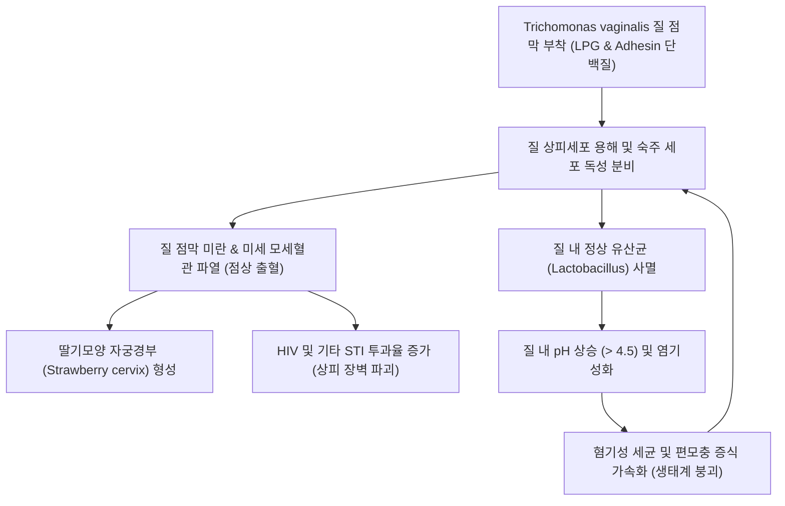
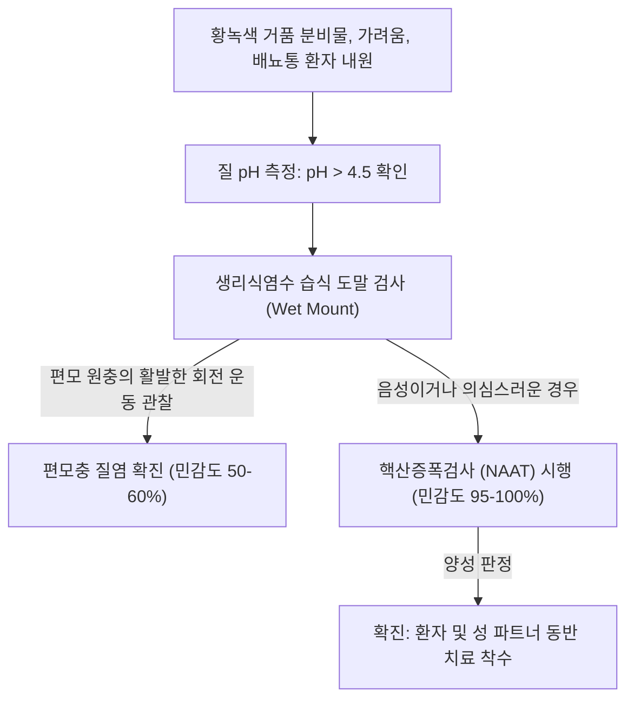

# 🩺 편모충 질염 (Trichomoniasis / 膣鞭毛蟲症)

> **핵심 3줄 요약 (Key Summary)**:
> - 📍 **병소 부위 & 해부·병태생리**: 혐기성 단세포 원충인 질편모충(*Trichomonas vaginalis*)에 의해 질 점막 편평상피 및 비뇨생식관 점막에 발생하는 성매개 감염증(STI).
> - 🚩 **전형적 임상 양상**: 거품이 이는 황녹색의 악취 나는 질 분비물, 심한 외음부 가려움증 및 작열감, 성교통, 배뇨통, 질경 소견상 점상 출혈을 보이는 **딸기모양 자궁경부(Strawberry cervix)**.
> - 🛠️ **핵심 검사 & 치료 전략**: 질 분비물 핵산증폭검사(NAAT) 또는 생리식염수 습식 도말(Wet mount)상 활발히 움직이는 편모충 확인, 질 pH > 4.5 측정; 1차 약제로 경구 **[[메트로니다졸]] (Metronidazole)** 투여 및 **성 파트너 동반 필수 치료**, 한의학적 청열이습·살충지양(용담사간탕 가감) 병용.
> - ⚠️ **응급 의뢰 레드플래그**: 임신 중 감염 시 조기양막파수, 조산, 저체중아 출산 위험 증가; HIV 동반 감염 위험 급증; 골반염(PID) 의심 증상(골반통, 발열, 경부거상통) 병발 시 정밀 검사 및 상급병원 의뢰.

---

## 📌 목차
1. [질환 개요 & 해부학적 병태생리](#1--질환-개요---해부학적-병태생리)
2. [병태생리 메커니즘 & 생체역학적 악순환 네트워크](#2--병태생리-메커니즘---생체역학적-악순환-네트워크)
3. [임상 증상 & 이학적 검사 알고리즘](#3--임상-증상---이학적-검사-알고리즘)
4. [감별 진단 매트릭스](#4--감별-진단-매트릭스)
5. [한의 통합 치료 프로토콜](#5--한의-통합-치료-프로토콜)
6. [양방 치료 & 병용·의뢰 기준](#6-양방-치료--병용의뢰-기준)
7. [재활 운동 & 생활습관 티칭 가이드](#7--재활-운동---생활습관-티칭-가이드)
8. [💡 사용자 진료실 핵심 필기 & 임상 노하우](#8--사용자-진료실-핵심-필기---임상-노하우)
9. [📚 출처 및 현대 학술 연구 요약 (References)](#9--출처-및-현대-학술-연구-요약-references)

---

## 1. 질환 개요 & 해부학적 병태생리

### 1) 질환 정의 및 역학
- **편모충 질염(Trichomoniasis, 트리코모나스증)**은 편모를 가진 기생 원충인 *Trichomonas vaginalis*에 의해 발생하는 비바이러스성 성매개 감염증(Sexually Transmitted Infection, STI)이다.
- 전 세계적으로 매년 수억 명의 신규 감염이 발생하는 가장 흔한 비바이러스성 성매개 질환이다.
- 남성의 경우 주로 요도나 전립선에 무증상 보균 상태로 기생하다가 성관계를 통해 여성에게 전파되며, 여성 환자의 약 50%에서도 무증상이거나 비전형적 증상을 나타내어 은밀한 지역사회 확산의 원인이 된다.

### 2) 병원체 생물학 및 해부학적 병소
- ***Trichomonas vaginalis***:
  - 4개의 전방 편모와 1개의 후방 파동막(Undulating membrane)을 가진 서양배 모양(10~20 μm)의 혐기성 단세포 원충이다.
  - 포낭(Cyst) 형태가 존재하지 않고 영양형(Trophozoite) 상태로만 존재하므로 체외 환경에서는 생존력이 약하며, 대부분 직접적인 성적 접촉에 의해 전파된다 (드물게 젖은 수건, 목욕탕 등을 통한 전파 가능성 제기).
- **주요 침범 부위**:
  - 여성: 질(Vagina), 외음부(Vulva), 자궁경관내막(Endocervix), 요도(Urethra), 스킨선(Skene's glands), 바르톨린선(Bartholin's glands).
  - 남성: 요도, 전립선, 부고환.

---

## 2. 병태생리 메커니즘 & 생체역학적 악순환 네트워크

### 1) 점막 부착 및 세포 용해 메커니즘
- 편모충은 표면의 리포포스포글리칸(LPG)과 4가지 주요 부착 단백질(AP65, AP51, AP33, AP23)을 통해 질 상피세포에 강력히 결합한다.
- 시스테인 단백분해효소(Cysteine proteinases)를 분비하여 상피세포, 적혈구, 세포외 기질을 분해하고 세포 독성을 유발한다.
- 모세혈관의 투과성 항진과 미세출혈이 유도되어 질벽과 자궁경부에 광범위한 점상 홍반을 형성한다.

### 2) 질 내 미생물총 붕괴(Dysbiosis)와 pH 상승
- 편모충은 글리코겐을 소비하고 과산화수소를 생성하는 정상 질 유산균([[Lactobacillus]])을 파괴한다.
- 이로 인해 정상 산성 환경(pH 3.8~4.2)이 깨지고 질 내 pH가 5.0~6.5 이상으로 상승한다.
- 알칼리화된 환경은 세균성 질염 원인균 및 편모충 자체의 증식을 더욱 촉진하는 악순환을 유발한다.

---

## 3. 임상 증상 & 이학적 검사 알고리즘

### 1) 주요 임상 양상
- **질 분비물 이상**:
  - 전형적으로 묽고 거품이 있는(Frothy) 황녹색 또는 회색의 화농성 분비물.
  - 강한 부패취 또는 생선 비린내 유사 악취 동반.
- **외음부 및 질 자극 증상**:
  - 외음부의 극심한 소양감(가려움), 작열감(화끈거림), 부종, 발적.
  - 성교통(Dyspareunia) 및 요도 자극에 의한 배뇨통(Dysuria).
- **질경 소견 (Physical Findings)**:
  - 질 점막의 광범위한 발적과 미란.
  - **딸기모양 자궁경부(Strawberry cervix / Colpitis macularis)**: 자궁경부에 다발성 점상 홍반 및 모세혈관 출혈이 관찰됨 (육안 관찰은 약 2~5%에서 보이나, 질확대경 검사 시 최대 45%에서 확인되는 특징적 병변).

### 2) 진단 알고리즘

---

## 4. 감별 진단 매트릭스

| 질환명 | 주 증상 및 분비물 양상 | 질 분비물 현미경 소견 | 질 pH | 아민 냄새 검사 (Whiff Test) | 1차 표준 치료 |
| :--- | :--- | :--- | :--- | :--- | :--- |
| **편모충 질염** | 황녹색, 거품성, 악취, 딸기모양 경부, 소양감 | 회전 운동하는 편모충, 다수의 백혈구 | > 4.5 (보통 5.0~6.5) | 양성 또는 음성 | 메트로니다졸 경구 (파트너 필수 치료) |
| **[[세균성 질염]]** | 얇은 회백색, 생선 비린내, 외음부 염증 경미 | 단서세포(Clue cells) > 20%, 백혈구 드묾 | > 4.5 (보통 4.7~5.5) | 강양성 (10% KOH 점적 시) | 메트로니다졸 경구/질겔 |
| **질 칸디다증** | 백색 치즈/비지 찌꺼기 양상, 극심한 가려움 | 가성균사(Pseudohyphae), 아포 | 정상 (≤ 4.5) | 음성 | 플루코나졸 경구 / 클로트리마졸 질정 |
| **위축성 질염** | 폐경 후 질 건조감, 성교통, 얇고 마른 분비물 | 파라바살 세포 증가, 백혈구 관찰 | > 5.0 | 음성 | 국소 에스트로겐 크림 |

---

## 5. 한의 통합 치료 프로토콜

### 1) 한의 변증 분류
- **간경습열형 (肝經濕熱型)**:
  - 주증: 황녹색의 거품성 대하, 심한 부패취, 외음부 소양 및 작열통, 구고(입안이 씀), 설홍태황니, 맥현삭.
  - 치법: 청간사화(淸肝瀉火), 청열이습(淸熱利濕), 살충지양(殺蟲止痒).
  - 처방: [[용담사간탕]](龍膽瀉肝湯) 가감 (용담초 8g, 황금 10g, 산치자 10g, 택사 10g, 차전자 10g, 목통 6g, 당귀 8g, 생지황 12g, 시호 6g, 고삼 15g, 백선피 10g).
- **비허습저형 (脾虛濕沮型)**:
  - 주증: 대하가 지속되며 백색 또는 연황색 분비물, 식욕 부진, 대변 당설, 사지 권태감, 설담태백니, 맥연약.
  - 치법: 건비익기(健脾益氣), 제습지대(除濕止帶).
  - 처방: [[완대탕]](完帶湯) 가감 (백출 20g, 산약 20g, 인삼 8g, 백작약 12g, 차전자 10g, 창출 10g, 감초 4g, 진피 6g, 형개수 4g, 시호 4g).
- **신허습열형 (腎虛濕熱型)**:
  - 주증: 만성 재발성 대하, 요슬산연(허리와 무릎 시림), 소변 빈삭 또는 작열통, 설홍태황, 맥세삭.
  - 치법: 보신청열(補腎淸熱), 분청화습(分淸化濕).
  - 처방: [[비해분청음]](萆薢分淸飲) 합 지백지황탕 가감.

### 2) 외용 한약 세정요법 (좌욕제)
- **사상자세제 (蛇床子洗劑)**:
  - 구성: [[사상자]](蛇床子) 20g, [[고삼]](苦參) 20g, 백선피 15g, 황백 15g, 명반 5g.
  - 용법: 전탕액을 미지근하게 식힌 후 1일 1~2회 외음부 세정 및 좌욕 시행.
  - 약리 기전: 고삼의 matrine, 사상자의 osthole 성분이 *T. vaginalis* 원충 세포막을 직접 파괴하여 살충 효과를 나타냄.

### 3) 침구 치료 프로토콜
- **주요 혈위**:
  - 국소: [[중극]](CV3), [[관원]](CV4), [[수도]](ST28) — 골반강 기혈 순환 촉진 및 습열 배출.
  - 원격: [[음릉천]](SP9), [[삼음교]](SP6), [[혈해]](SP10), [[태충]](LR3), [[여구]](LR5) — 간경 습열 사화, 지양(가려움 해소).
- **시술 기법**:
  - 급성 염증기에는 음릉천, 여구, 태충 혈에 사법을 적용하여 열독을 배출한다.

---

## 6. 양방 치료 & 병용·의뢰 기준

### 1) 미국 CDC 표준 약물 치료 지침
- **여성 편모충증 1차 권고 요법**:
  - **[[메트로니다졸]] (Metronidazole)** 500 mg 경구 1일 2회, **7일간 복용** (단회 2g 요법 대비 완치율이 유의하게 높음).
  - 대체의약품: [[티니다졸]] (Tinidazole) 2 g 경구 단회 요법.
- **남성 편모충증 1차 권고 요법**:
  - **메트로니다졸 (Metronidazole)** 2 g 경구 단회 복용.
- **성 파트너 필수 동반 치료 (Expedited Partner Therapy, EPT)**:
  - 환자의 성 파트너는 증상 유무와 무관하게 **반드시 동시에 동일 용량으로 치료**해야 한다.
  - 파트너 치료가 완료되고 모든 증상이 소실될 때까지(약물 복용 종료 후 최소 7일간) 성관계를 철저히 금지한다.
- **완치 판정 검사 (Test of Cure)**:
  - 모든 여성 환자는 재감염률이 매우 높으므로(약 17~20%), 치료 완료 3개월 후(또는 재방문 시) NAAT 검사를 통한 추적 검사가 권고된다.

### 2) 주의사항 및 의뢰 기준
- **금주 지도**:
  - 메트로니다졸 복용 중 및 복용 후 24시간(티니다졸은 72시간) 동안 음주 시 디설피람 유사 반응(Disulfiram-like reaction: 오심, 구토, 안면홍조, 두통, 빈맥)이 발생하므로 절대 금주한다.
- **임신 중 치료**:
  - 임신 전 분기에서 메트로니다졸 500 mg 1일 2회 7일 요법 사용 가능 (조산 및 저체중아 출산 예방).

---

## 7. 재활 운동 & 생활습관 티칭 가이드

### 1) 질 내 환경 및 위생 관리
- **질 세척(Douching) 금지**:
  - 질 내부를 비누나 세정제로 과도하게 씻어내면 정상 유산균이 파괴되어 편모충 및 혐기성 세균의 증식을 유발하므로 외음부만 흐르는 물로 세척한다.
- **통기성 유지**:
  - 면 소재 속옷을 착용하고, 꽉 끼는 바지나 레깅스 착용을 피하여 외음부 습도를 낮춘다.

### 2) 성생활 및 핑퐁 감염 예방
- 감염 사실을 성 파트너에게 솔직히 알리고 함께 병의원에 내원하여 약을 복용하도록 지도한다.
- 치료 기간이 끝난 후에도 콘돔을 지속적으로 사용하여 기타 STI 및 재감염을 예방한다.

---

## 8. 💡 사용자 진료실 핵심 필기 & 임상 노하우

### 1) 진료실 핵심 체크리스트
- "냉이 누렇고 거품이 나며 밑이 너무 가렵다"는 환자가 오면, 질경 진찰 시 자궁경부의 점상 출혈(딸기모양 경부) 유무를 면밀히 살핀다.
- 본인만 치료받고 남편이나 파트너가 치료를 받지 않으면 며칠 후 다시 재발하여 내원하는 대표적 '핑퐁 감염' 질환이다. 반드시 "동반 치료 없이는 완치가 불가능함"을 환자에게 강조해야 한다.

### 2) 한의 치료의 실질적 역할
- 메트로니다졸 복용 후 질염 원충은 박멸되었으나, 질 점막이 손상되어 지속적인 분비물과 가려움, 건조감을 호소하는 환자에게 [[용담사간탕]] 및 [[사상자]] 좌욕제를 병용하면 점막 상피의 재생과 정상 균총 회복을 극적으로 단축시킬 수 있다.

---

## 9. 📚 출처 및 현대 학술 연구 요약 (References)

- Workowski KA, et al. (2021). Diagnosis and Management of Trichomonas vaginalis: Summary of Evidence Reviewed for the 2021 Centers for Disease Control and Prevention Sexually Transmitted Infections Treatment Guidelines. *Clin Infect Dis*. PMID: 35416973.

- Van Der Pol B, et al. (2021). Performance of a Vaginal Panel Assay Compared With the Clinical Diagnosis of Vaginitis. *J Low Genit Tract Dis*. PMID: 34736269.

- Kissinger P, et al. (2022). Impact of an Interruptive Alert on the Number of Women Receiving CDC-Recommended Therapy for Trichomoniasis. *Sex Transm Dis*. PMID: 40936794.
