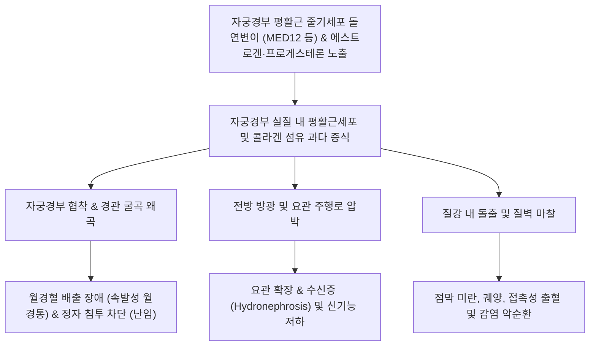
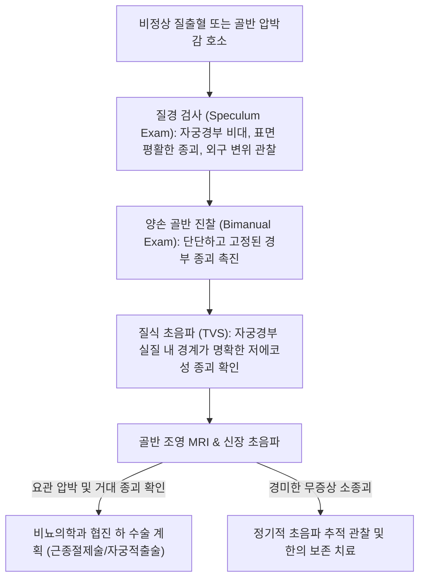

# 🩺 자궁경부 섬유종 (Cervical Leiomyoma / 子宮頸部 纖維腫)

> **핵심 3줄 요약 (Key Summary)**:
> - 📍 **병소 부위 & 해부·병태생리**: 전체 [[자궁근종]](Uterine leiomyoma)의 약 1~2% 미만에서 발생하는 질환으로, 자궁경부(Cervix)의 평활근 세포 및 결합조직에서 기원하는 양성 단일클론 종양 (FIGO Type 8 경부성 근종).
> - 🚩 **전형적 임상 양상**: 질경 시야에서 관찰되는 경부 돌출성 종괴, 성교 후 접촉성 출혈 및 대하 증가, 방광·요도 압박으로 인한 빈뇨·배뇨곤란 및 요관 폐색(수신증), 직장 압박감, 임신 시 난산 및 난임.
> - 🛠️ **핵심 검사 & 치료 전략**: 질경 및 양손 골반 진찰, 골반 초음파(TVS) 및 골반 MRI를 통한 요관 주행로 확인; 증상성 거대 근종 시 질식/복강경 근종절제술(Myomectomy) 또는 자궁적출술, 한의학적 파혈소징·활혈거어(계지복령환 가감) 병용.
> - ⚠️ **응급 의뢰 레드플래그**: 요관 압박에 의한 급성 신기능 저하 및 수신증(Hydronephrosis), 질식 분만로를 완전히 폐색하는 거대 종괴(제왕절개 필수 적응증), 출혈성 괴사 및 감염, 급격한 크기 증가를 보이는 평활근육종(Leiomyosarcoma) 의심 시 상급병원 긴급 전원.

---

## 📌 목차
1. [질환 개요 & 해부학적 병태생리](#1--질환-개요---해부학적-병태생리)
2. [병태생리 메커니즘 & 생체역학적 악순환 네트워크](#2--병태생리-메커니즘---생체역학적-악순환-네트워크)
3. [임상 증상 & 이학적 검사 알고리즘](#3--임상-증상---이학적-검사-알고리즘)
4. [감별 진단 매트릭스](#4--감별-진단-매트릭스)
5. [한의 통합 치료 프로토콜](#5--한의-통합-치료-프로토콜)
6. [양방 치료 & 병용·의뢰 기준](#6-양방-치료--병용의뢰-기준)
7. [재활 운동 & 생활습관 티칭 가이드](#7--재활-운동---생활습관-티칭-가이드)
8. [💡 사용자 진료실 핵심 필기 & 임상 노하우](#8--사용자-진료실-핵심-필기---임상-노하우)
9. [📚 출처 및 현대 학술 연구 요약 (References)](#9--출처-및-현대-학술-연구-요약-references)

---

## 1. 질환 개요 & 해부학적 병태생리

### 1) 질환 정의 및 해부학적 특수성
- **자궁경부 섬유종(자궁경부 평활근종, Cervical Leiomyoma)**은 자궁경부(Cervix uteri)의 평활근 섬유에서 발생하는 양성 평활근종이다.
- 전체 자궁근종의 1~2%를 차지할 정도로 드물지만, 해부학적으로 좁은 골반강 하부의 방광, 요도, 직장, 그리고 **요관(Ureter)** 및 자궁동맥(Uterine artery)에 인접해 있어 임상적 처치와 수술적 난이도가 극도로 높다.
- FIGO(국제산부인과연맹) 분류상 **Type 8(기타/자궁경부성)**에 해당한다.

### 2) 발생 양상 및 해부학적 분류
- **외인성/돌출형 (Extracervical/Exophytic)**:
  - 자궁경부 외측 또는 장막하로 돌출하여 광인대(Broad ligament) 사이로 자라거나(광인대내 근종 형태), 질강 내로 하강하여 돌출함.
- **내인성/간질성 (Intracervical/Interstitial)**:
  - 자궁경부 실질 벽 내에서 팽창성으로 증식하여 경관(Endocervical canal)을 심하게 왜곡시키고 방광 삼각부를 거상시킴.
- **유경성 점막하 근종 (Pedunculated Submucosal)**:
  - 자궁경관 내강 또는 외구(External os)를 통해 질 내로 탈출(탈출성 경부 근종, Myoma delivering).

---

## 2. 병태생리 메커니즘 & 생체역학적 악순환 네트워크

### 1) 분자생물학적 기전
- 체세포 유전자 변이(MED12, HMGA2)와 난소 스테로이드 호르몬([[에스트로겐]], [[프로게스테론]])의 자극에 반응하여 평활근세포가 클론성 증식을 일으킨다.
- TGF-β 경로 활성화로 인해 다량의 프로테오글리칸과 콜라겐 결합조직이 축적되며, 자궁체부 근종보다 섬유화(Fibrosis) 경향이 강해 매우 단단한 결절을 형성한다.

### 2) 골반 장기 압박과 생체역학적 왜곡
- 경부가 비대해지면서 해부학적으로 경부 외측을 통과하는 자궁동맥과 요관의 정상 해부학적 위치를 심하게 변위시킨다 (요관이 종양 외측 또는 상방으로 밀려남).
- 하부 비뇨기계를 압박하여 요정체, 빈뇨를 유발하고, 심할 경우 무증상 요관 폐색으로 인한 신위축증을 초래할 수 있다.

---

## 3. 임상 증상 & 이학적 검사 알고리즘

### 1) 주요 임상 양상
- **부정출혈 및 접촉성 출혈 (Abnormal Bleeding)**:
  - 성관계 후 출혈(Postcoital bleeding), 분비물 증가, 불규칙한 질출혈. (자궁체부 근종처럼 월경과다가 주 증상이 아닐 수 있음).
- **골반 압박 및 비뇨기 증상**:
  - 방광 압박에 의한 빈뇨, 절박뇨, 잔뇨감, 요폐.
  - 직장 압박에 의한 배변통, 이급후증(Tenesmus), 변비.
- **월경통 및 난임**:
  - 경관 폐색에 의한 월경혈 정체(자궁수혈증) 및 극심한 경련성 생리통.
  - 경관 점액 통과 장애로 인한 불임증.
- **분만 장애**:
  - 임신 중 산도를 차단하여 태위 이상(둔위, 횡위) 및 분만 정체 초래.

### 2) 이학적 검사 및 진단 알고리즘

---

## 4. 감별 진단 매트릭스

| 질환명 | 주 증상 및 호발 특징 | 질경 / 골반 진찰 소견 | 영상 소견 (초음파/MRI) | 1차 감별점 및 대책 |
| :--- | :--- | :--- | :--- | :--- |
| **자궁경부 섬유종** | 무통성 비대, 접촉성 출혈, 압박 증상 | 단단한 구형 종괴, 경부 전체를 팽창시킴 | 경계 명확한 저에코 결절, 변연부 혈류 | 조직 생검 또는 절제술로 확진 |
| **[[자궁경부암]]** | 악취 나는 혈성 분비물, 체중 감소 | 불규칙한 궤양, 외장성(외성) 취약한 출혈 종괴 | 침습성 침윤 소견, 림프절 비대 | 자궁경부 세포진 및 펀치 생검 필수 |
| **자궁경부 폴립** | 소량의 점상 출혈, 무증상 흔함 | 부드럽고 붉은 유경성 돌기, 1~2cm 미만 | 경관 내 단순 용종성 음영 | 외래 겸자 비틀림 절제술 |
| **자궁내막증/선근증** | 극심한 만성 골반통, 결절성 압통 | 후질원개 결절, 자궁 천골인대 압통 | 미만성 비대, 이종성 근층 음영 | 호르몬 요법, 소염진통요법 |
| **탈출성 점막하 근종** | 갑작스러운 출혈, 하복부 산통 | 자궁외구를 통해 질강으로 매달려 나온 종괴 | 줄기(Pedicle)가 자궁체부에서 시작됨 | 줄기 결찰 및 질식 절제술 |

---

## 5. 한의 통합 치료 프로토콜

### 1) 한의 변증 분류
- **어혈저체형 (瘀血阻滯型)**:
  - 주증: 하복부 및 골반강의 둔통, 월경혈 암홍색 및 혈괴, 접촉성 출혈, 설암, 어점, 맥현삽.
  - 치법: 활혈화어(活血化瘀), 연견소징(軟堅消癥).
  - 처방: [[계지복령환]](桂枝茯苓丸) 합 [[소퇴음]](消瘰丸) 가감 (계지 10g, 복령 15g, 목단피 10g, 도인 10g, 작약 15g, 현삼 15g, 모려 20g, 패모 10g, 삼릉 8g, 봉출 8g).
- **기체습열형 (氣滯濕熱型)**:
  - 주증: 대하 증가(황백색 탁한 대하), 배뇨 곤란, 골반 열감 및 팽만감, 설홍태황니, 맥활삭.
  - 치법: 소간이습(疏肝利濕), 화어통락(化瘀通絡).
  - 처방: [[대황자충환]](大黃䗪蟲丸) 가감 또는 용담사간탕 합 화어방.
- **기혈허약형 (氣血虛弱型)**:
  - 주증: 만성 출혈로 인한 어지러움, 피로, 면색 창백, 자궁경부 종괴 잔존, 설담태백, 맥세약.
  - 치법: 익기양혈(益氣養血), 활혈소징(活血消癥).
  - 처방: [[팔진탕]](八珍湯) 가 삼릉, 봉출, 익모초.

### 2) 침구 치료 프로토콜
- **주요 혈위**:
  - 하복부 및 골반: [[자궁]](EX-CA1), [[중극]](CV3), [[관원]](CV4), [[수도]](ST28) — 경부 국소 미세혈류 순환 촉진 및 울혈 해소.
  - 경락 원격: [[삼음교]](SP6), [[혈해]](SP10), [[태충]](LR3), [[차료]](BL32) — 활혈거어, 골반 신경총 안정화.
- **시술 기법**:
  - 차료 및 자궁혈에 전침(2/100 Hz 혼합파)을 적용하여 골반강 평활근 긴장 완화 및 통증 경감 유도.

---

## 6. 양방 치료 & 병용·의뢰 기준

### 1) 수술적 치료 (Surgical Management)
- 자궁경부 섬유종은 약물 치료(GnRH 작용제 등)로 일시적 크기 감소를 도모할 수 있으나, 약물 중단 시 재증식하므로 근본적인 증상 해결을 위해 수술적 절제가 표준이다.
- **질식 근종절제술 (Vaginal Myomectomy)**:
  - 질강 내로 돌출되었거나 외인성인 경우 질을 통해 근종 피막을 박리하고 핵출(Enucleation) 시행.
- **복강경 / 개복 수술 (Laparoscopic / Abdominal Approach)**:
  - 거대 간질성 근종 또는 광인대로 침습한 경우 시행.
  - **수술 중 주의사항**: 요관 손상 위험이 극도로 높으므로 수술 전 **요관 부목(Ureteral catheter/stent)** 거치가 권고되며, 내장골동맥(Internal iliac artery) 풍선 폐색술을 통해 대량 출혈을 예방하기도 함.

### 2) 응급 의뢰 레드플래그
- **요관 폐색 및 수신증**:
  - 정기 초음파 또는 CT상 신배 확장, 혈청 크레아티닌 상승 확인 시 즉시 비뇨의학과/부인과 협진 의뢰.
- **분만기 산도 폐색**:
  - 임신 3기 자궁경부 근종이 내자궁구를 가로막는 경우 질식 분만이 불가능하므로 예정 제왕절개술 계획.
- **육종(Sarcoma) 의심**:
  - 폐경 후 급격한 크기 증가, 중심부 괴사 소견 시 악성 감별을 위한 정밀 검사 의뢰.

---

## 7. 재활 운동 & 생활습관 티칭 가이드

### 1) 골반저 안정화 및 순환 개선
- **케겔 운동 및 골반저 이완**:
  - 골반저근의 과도한 긴장을 풀고 림프 순환을 돕기 위해 무리한 압박 운동을 피하고 부드러운 골반 가동성 스트레칭을 시행한다.
- **복압 상승 활동 제한**:
  - 만성 변비, 무거운 물건 들기 등 복압을 지속적으로 높이는 행위는 경부 종괴의 질강 탈출을 촉진하므로 배변 습관을 개선한다.

### 2) 정기 검진 교육
- 무증상 소종괴의 경우 6개월 간격으로 질식 초음파를 시행하여 크기 변화와 요관 압박 유무를 엄격히 추적 관찰한다.

---

## 8. 💡 사용자 진료실 핵심 필기 & 임상 노하우

### 1) 진료실 핵심 체크포인트
- 자궁경부 근종 환자는 질경을 삽입했을 때 자궁경부 외구가 한쪽으로 심하게 밀려나 있거나, 경부 입구를 막고 있는 거대한 평활한 종괴를 발견하게 된다.
- "성관계 후 피가 비친다"는 주소로 내원했을 때 단순 경부염이나 폴립으로 오인하기 쉬우나, 양손진찰 시 경부 실질 자체가 주먹만 하게 만져진다면 경부 근종을 강력히 의심해야 한다.

### 2) 수술 의뢰 시 환자 티칭
- 경부 근종은 일반 자궁체부 근종보다 수술 시 출혈량이 많고 요관 손상 위험이 높다는 점을 환자에게 충분히 설명하고, 부인과 종양 수술 경험이 풍부한 전문의에게 의뢰해야 한다.

---

## 9. 📚 출처 및 현대 학술 연구 요약 (References)

- Bagga R, et al. (2025). Vaginal Myomectomy for Large Intracervical Fibroids in Women Desirous of Preserving Their Uterus: A Case Series. *J Obstet Gynaecol India*. PMID: 40416286.

- Panda S, et al. (2024). Navigating Through Technical Difficulties in Operating Massive Cervical Fibroid- A Case Series. *J Clin Diagn Res*. PMID: 41613341.

- Kanao H, et al. (2011). Temporary endovascular balloon occlusion of the bilateral internal iliac arteries to control hemorrhage during laparoscopic-assisted vaginal hysterectomy for cervical myoma. *J Minim Invasive Gynecol*. PMID: 21658835.
