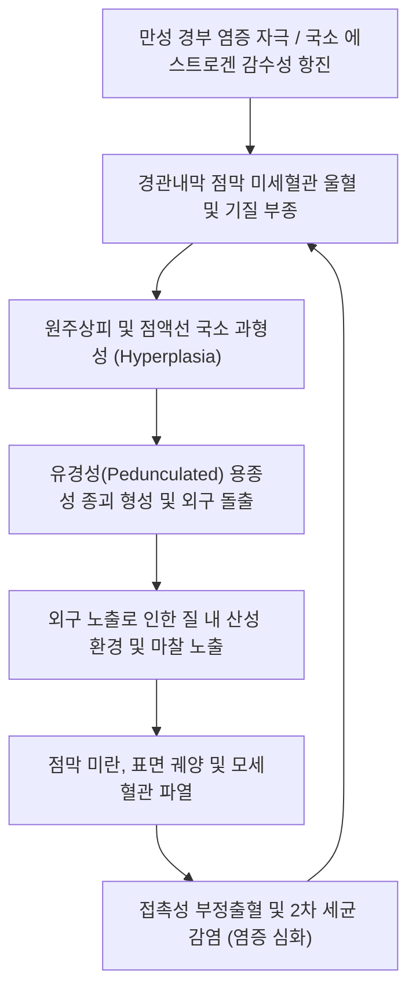
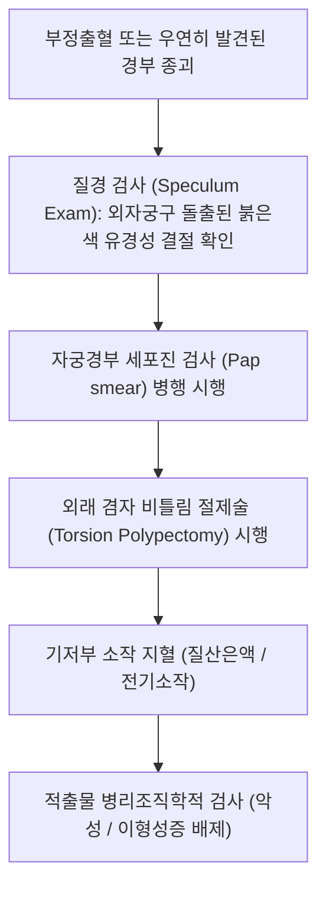

# 🩺 자궁경부 폴립 (Cervical Polyp / 子宮頸部 茸腫)

> **핵심 3줄 요약 (Key Summary)**:
> - 📍 **병소 부위 & 해부·병태생리**: 자궁경관 내막(Endocervix)의 점막 상피 및 결합조직 기질이 국소적으로 과다 증식하여 외경부로 돌출하는 흔한 양성 용종성 병변.
> - 🚩 **전형적 임상 양상**: 성교 후 점상 출혈(Postcoital bleeding), 배변 후 또는 격렬한 운동 후 갈색 분비물, 무증상 질경 검진 중 우연 발견, 질 분비물(백대하) 증가.
> - 🛠️ **핵심 검사 & 치료 전략**: 외래 질경 시야 하 겸자 비틀림 절제술(Torsion polypectomy) 및 기저부 지혈, **적출 조직의 병리조직학적 검사(악성 배제 필수)**, 한의학적 보비익기·섭혈(귀비탕/보중익기탕) 및 청열이습 병용.
> - ⚠️ **응급 의뢰 레드플래그**: 크기가 2cm 이상으로 거대하거나 표면이 불규칙하고 궤양·경결이 있는 경우, 폐경 후 발생한 지속성 부정출혈, 조직검사상 이형성증(CIN/AIS) 또는 침윤성 자궁경부암/자궁내막암 동반 소견 시 부인종양 전문의 즉각 의뢰.

---

## 📌 목차
1. [질환 개요 & 해부학적 병태생리](#1--질환-개요---해부학적-병태생리)
2. [병태생리 메커니즘 & 생체역학적 악순환 네트워크](#2--병태생리-메커니즘---생체역학적-악순환-네트워크)
3. [임상 증상 & 이학적 검사 알고리즘](#3--임상-증상---이학적-검사-알고리즘)
4. [감별 진단 매트릭스](#4--감별-진단-매트릭스)
5. [한의 통합 치료 프로토콜](#5--한의-통합-치료-프로토콜)
6. [양방 치료 & 병용·의뢰 기준](#6-양방-치료--병용의뢰-기준)
7. [재활 운동 & 생활습관 티칭 가이드](#7--재활-운동---생활습관-티칭-가이드)
8. [💡 사용자 진료실 핵심 필기 & 임상 노하우](#8--사용자-진료실-핵심-필기---임상-노하우)
9. [📚 출처 및 현대 학술 연구 요약 (References)](#9--출처-및-현대-학술-연구-요약-references)

---

## 1. 질환 개요 & 해부학적 병태생리

### 1) 질환 정의 및 역학
- **자궁경부 폴립(자궁경부 용종, Cervical Polyp)**은 자궁경관 내막(Endocervix) 또는 드물게 외경부(Ectocervix)의 점막 조직이 국소적으로 과형성되어 자궁경부 외구(External os) 밖으로 돌출되는 양성 종괴이다.
- 부인과 영역에서 가장 흔하게 관찰되는 자궁경부 양성 질환 중 하나로, 40~50대 경산부 여성에서 호발한다.
- 99% 이상이 양성이지만, 약 0.1~1.5% 미만에서 자궁경부 상피내암 또는 침윤성 암, 자궁내막암의 동반 가능성이 보고되므로 절제 후 조직학적 검사가 필수적이다.

### 2) 조직학적 분류 및 해부학적 병소
- **경관내막 폴립 (Endocervical Polyp)**:
  - 전체의 약 90% 이상을 차지.
  - 원주상피세포(Columnar epithelium)로 덮여 있으며, 내부에 혈관이 풍부한 결합조직 기질과 점액 분비선이 존재함.
  - 체리 레드(Cherry-red) 색조를 띠며, 촉감이 부드럽고 잘 부서지며 출혈하기 쉬움.
- **외경부 폴립 (Ectocervical Polyp)**:
  - 편평상피세포(Squamous epithelium)로 덮여 있음.
  - 연분홍색을 띠며, 조직이 비교적 단단하고 기저부가 넓은(Sessile) 형태가 많음.

---

## 2. 병태생리 메커니즘 & 생체역학적 악순환 네트워크

### 1) 병인 기전
- **만성 염증 반응**: 만성 자궁경부염, 질염 등의 지속적인 염증 자극으로 인한 상피세포의 반응성 증식.
- **호르몬 불균형**: 국소적인 [[에스트로겐]] 자극에 대한 경관내막 기질 세포의 과민 반응.
- **미세순환 장애**: 경관 점막 정맥총의 국소 폐색 및 울혈이 기질 부종과 용종 형성을 촉진함.

### 2) 기계적 마찰과 출혈
- 자궁경관 내강에 머물지 않고 외자궁구 밖으로 돌출되면서 질 점막 및 성교 시 물리적 접촉, 탐폰 삽입 등에 의해 표면 원주상피가 쉽게 박리된다.
- 풍부한 신생 모세혈관이 노출되어 경미한 자극에도 선홍색의 접촉성 출혈이 유발된다.

---

## 3. 임상 증상 & 이학적 검사 알고리즘

### 1) 주요 임상 양상
- **무증상 (Asymptomatic)**: 약 50%의 환자에서는 전혀 증상이 없으며, 정기 자궁경부암 검진이나 질경 검사 중 우연히 발견됨.
- **접촉성 질출혈 (Postcoital bleeding)**: 가장 흔한 유증상 소견으로, 성교 직후 소량의 선홍색 혈액이 비침.
- **불규칙한 부정출혈 (Intermenstrual bleeding)**: 월경과 월경 사이의 갈색 분비물, 배변 시 복압 상승 후 분비물.
- **질 분비물 증가 (Leukorrhea)**: 점액성 또는 농성 대하의 지속적 배출.

### 2) 이학적 검사 및 진단 단계

---

## 4. 감별 진단 매트릭스

| 질환명 | 주 증상 및 호발 양상 | 질경 소견 | 조직학적 소견 | 치료 전략 |
| :--- | :--- | :--- | :--- | :--- |
| **자궁경부 폴립** | 소량의 접촉성 출혈, 무증상 다수 | 외구로 돌출된 0.5~2cm 부드러운 적색 유경성 돌기 | 점액선 증식, 혈관성 기질 (양성) | 외래 단순 비틀림 절제술 |
| **자궁내막 폴립 (탈출형)** | 생리량 증가, 부정출혈 | 경관을 통해 하강한 종괴 (줄기가 자궁강 내 위치) | 자궁내막 선상피 증식 | 자궁경하 용종절제술 (Hysteroscopy) |
| **[[자궁경부암]] (외장형)** | 악취 나는 혈성 분비물, 체중 감소 | 불규칙한 표면, 단단하고 쉽게 부서지는 궤양성 출혈 종괴 | 악성 편평상피세포암 / 선암 | 광범위 자궁절제술 / 동시항암방사선치료 |
| **탈출성 점막하 근종** | 생리통 심함, 다량의 출혈 | 단단하고 표면이 매끄러운 3cm 이상의 결절 | 평활근 다발 및 섬유 결합조직 | 기저부 결찰 및 질식 절제술 |
| **탈락막 폴립 (Decidual polyp)** | 임신 중 소량 질출혈 | 임신 중 경관에서 관찰되는 부드러운 용종 | 탈락막화된 기질 세포 | 임신 중 무리한 절제 지양 (보존적 관찰) |

---

## 5. 한의 통합 치료 프로토콜

### 1) 한의 변증 분류
- **비허불섭혈형 (脾虛不攝血型)**:
  - 주증: 피로 시 출혈 증가, 소량의 담홍색 또는 갈색 분비물이 지속됨, 안면 창백, 식욕 부진, 연변, 설담태백, 맥세약.
  - 치법: 건비익기(健脾益氣), 통섭기혈(統攝氣血).
  - 처방: [[귀비탕]](歸脾湯) 또는 [[보중익기탕]](補中益氣湯) 가감 (황기 20g, 당귀 10g, 백출 12g, 인삼 8g, 감초 4g, 승마 4g, 시호 4g, 아교 8g, 형개초 6g).
- **간경습열형 (肝經濕熱型)**:
  - 주증: 황색 농성 대하, 성교통, 외음부 소양감, 접촉성 출혈, 구고인건, 설홍태황니, 맥현삭.
  - 치법: 청간이습(淸肝利濕), 양혈지혈(凉血止血).
  - 처방: [[용담사간탕]](龍膽瀉肝湯) 합 지유산 가감 (용담초 8g, 황금 10g, 지유 12g, 괴화 10g, 백선피 10g, 생지황 12g).
- **음허내열형 (陰虛內熱型)**:
  - 주증: 폐경 전후기 여성, 도한(식은땀), 오심번열, 소량의 선홍색 부정출혈, 설홍소태, 맥세삭.
  - 치법: 자음강화(滋陰降火), 양혈지혈(凉血止血).
  - 처방: [[지백지황탕]](知柏地黃湯) 가 아교, 백모근, 한련초.

### 2) 침구 치료 프로토콜
- **주요 혈위**:
  - 하복부 국소: [[관원]](CV4), [[기해]](CV6), [[중극]](CV3) — 골반 기혈 순환 안정 및 점막 재생 촉진.
  - 비·신경 경락: [[은백]](SP1), [[삼음교]](SP6), [[혈해]](SP10), [[태계]](KI3) — 비불섭혈 지혈(은백 구법), 익기양혈.
- **시술 기법**:
  - 만성적 점상 출혈에는 은백(SP1) 혈에 뜸 3~5장을 시술하여 건비통혈(健脾統血) 효과를 극대화한다.

---

## 6. 양방 치료 & 병용·의뢰 기준

### 1) 외래 수술적 치료 (Outpatient Polypectomy)
- **비틀림 절제술 (Twist-off / Torsion)**:
  - 유경성 폴립의 기저부를 무구 겸자(Ring forceps 또는 Polyp forceps)로 잡고 360도 회전시켜 비틀어 떼어냄.
  - 대부분 무마취로 통증 없이 수 초 내에 시행 가능.
- **지혈 처치**:
  - 절제 후 기저부 출혈 부위에 질산은(Silver nitrate, AgNO3) 면봉을 도포하거나 몬셀액(Monsel's solution)을 압박 도포하여 화학적 소작 지혈 시행.
- **자궁경하 절제술 (Hysteroscopic Polypectomy)**:
  - 용종의 기저부가 외경부가 아닌 자궁내막 강 깊숙이 위치하거나, 초음파상 자궁내막 비후가 동반된 경우 자궁경하 절제술 시행.

### 2) 조직검사 및 악성 배제 원칙
- **전수 병리검사 의뢰 (Rule of Pathology)**:
  - 아무리 전형적인 양성 소견이라도 **적출한 모든 폴립 조직은 100% 병리과에 의뢰**하여 조직검사를 받아야 한다.
- **위험 소견 및 상급병원 의뢰 기준**:
  - 병리 결과 이형성증(Atypia), 자궁경부 상피내암(CIN/AIS), 또는 선암(Adenocarcinoma) 발견 시.
  - 직경 2cm를 초과하는 거대 폴립으로 기저부가 광범위하여 외래 절제가 어렵거나 대량 출혈 위험이 있는 경우.

---

## 7. 재활 운동 & 생활습관 티칭 가이드

### 1) 절제 시술 후 주의사항
- **시술 후 출혈 관리**:
  - 절제 후 1~3일간 경미한 갈색 분비물이나 소량의 점상 출혈이 있을 수 있음을 사전 고지한다.
- **감염 예방**:
  - 시술 후 최소 1~2주간은 통목욕, 사우나, 수영장 이용 및 성관계를 금지한다.

### 2) 재발 예방 및 면역 관리
- 자궁경부 폴립은 만성 경부염이 지속될 경우 다른 부위에서 재발률이 약 6~12%에 달한다.
- 정기적인 자궁경부 세포진 검사(Pap smear)를 매년 시행받도록 티칭한다.

---

## 8. 💡 사용자 진료실 핵심 필기 & 임상 노하우

### 1) 진료실 핵심 체크리스트
- "부부관계 후 휴지에 피가 묻어나온다"는 40대 여성 환자가 내원했을 때, 질경을 벌리자마자 외자궁구에 앵두알처럼 매달려 있는 경관 폴립을 바로 확인할 수 있다.
- 겸자로 가볍게 비틀어 제거하면 출혈 원인이 즉시 해소되지만, 반드시 "뿌리가 자궁내막에서 시작된 내막 폴립은 아닌지" 초음파로 자궁내막 두께를 확인해야 한다.

### 2) 한의-양방 통합 치료의 시너지
- 단순 용종은 외래에서 비틀어 절제하는 것이 가장 깔끔하고 확실한 해결책이다.
- 그러나 반복적으로 폴립이 재발하거나 절제 후에도 만성적인 백대하와 접촉성 출혈이 지속되는 환자에게 [[귀비탕]]이나 [[용담사간탕]]을 투약하면 만성 경부염을 진화시키고 점막 상피의 면역력을 정상화하여 재발 고리를 완벽히 끊을 수 있다.

---

## 9. 📚 출처 및 현대 학술 연구 요약 (References)

- Stamatellos I, et al. (2016). Diagnostic Value of Visual Examination of Cervical Polypoid Lesions and Predictors of Misdiagnosis. *Anticancer Res*. PMID: 27529156.

- Nasiell J, et al. (2022). Relationship between unremoved cervical polyp in pregnancy and spontaneous preterm birth. *Acta Obstet Gynecol Scand*. PMID: 35841937.

- Rahimi S, et al. (2024). Prevalence, Clinical Features, and Management of Cervical Polyps: A One-Year Study at Rabia Balkhi Hospital in Afghanistan. *Int J Womens Health*. PMID: 39411598.
