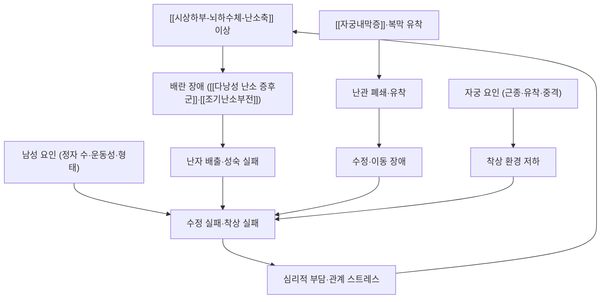

# 🩺 불임 (Infertility, 不姙)

> **핵심 3줄 요약 (Key Summary)**:
> - 📍 병소 부위 & 해부·병태생리: **1년간 정상적인 부부관계에도 임신이 되지 않는 상태**로, 단일 장기의 문제가 아니라 배란–난관–자궁·자궁내막–정자–착상의 **연속 경로 중 어느 단계가 막혔는지**의 문제다. 여성 요인(배란·난관·자궁·복막), 남성 요인, 원인 불명으로 나눈다.
> - 🚩 전형적 임상 양상: 배란 장애형은 월경 불순·무월경이, 난관·복막형은 골반통·[[자궁내막증]] 병력이, 남성 요인은 특이 증상 없이 정액검사에서 발견되는 경우가 흔하다.
> - 🛠️ 핵심 감별 & 한·양방 치료 전략: **정액검사 + 배란 확인 + 난관 개통성** 3축을 먼저 확보한다. 치료는 원인별로 배란유도([[클로미펜]]·[[레트로졸]])·인공수정·체외수정·수술로 나뉘고, 침·한약은 배란유도와 병행하는 동반 증상 축 또는 보조 요법으로 위치시킨다.
> - ⚠️ **응급 의뢰 레드플래그**: 임신 가능성 + 급성 하복부 통증·출혈은 자궁외임신이다. 배란유도 중 심한 복부 팽만·호흡곤란·핍뇨는 [[난소 과자극증후군]]으로 응급 평가가 필요하다.

---

## 📌 목차
1. [질환 개요 & 병태생리 (Disease Overview)](#1-질환-개요--병태생리-disease-overview)
2. [병태생리 메커니즘 & 대사·장기부전 악순환 네트워크](#2-병태생리-메커니즘--대사장기부전-악순환-네트워크)
3. [임상 증상 & 환자 소견 (Clinical Presentation)](#3-임상-증상--환자-소견-clinical-presentation)
4. [감별 진단 매트릭스 (Differential Diagnosis)](#4-감별-진단-매트릭스-differential-diagnosis)
5. [한의 통합 치료 프로토콜 (침·약침·한약)](#5-한의-통합-치료-프로토콜-침약침한약)
6. [양방 치료 & 병용·의뢰 기준 (Conventional Treatment & Referral)](#6-양방-치료--병용의뢰-기준-conventional-treatment--referral)
7. [식이·생활습관 & 자가관리 티칭 가이드](#7-식이생활습관--자가관리-티칭-가이드)
8. [💡 진료실 핵심 필기 & 임상 노하우](#8--진료실-핵심-필기--임상-노하우)
9. [출처 및 학술 참고 문헌 (References)](#9-출처-및-학술-참고-문헌-references)

---

## 1. 질환 개요 & 병태생리 (Disease Overview)

![[불임_01_병태_여성불임의원인_도해.jpg|460]]
> [그림 1: 여성 불임의 원인 분류 도해 — 난소 요인·자궁 요인·난관 요인·복막 요인을 중심으로 정리 — 질병관리청 국가건강정보포털 (공공저작물, 출처표시)]

* **질환 정의 및 분류**
  * 정의: **1년간(35세 이상은 6개월) 정상적인 부부관계에도 임신이 되지 않는 상태.** 정의상 '원인 질환'이 아니라 도달하지 못한 결과 상태이므로, 원인 규명이 진단의 본체다.
  * 분류: ① **여성 요인** — 배란 장애(무배란·희발배란), 난관 요인(폐쇄·유착), 자궁·자궁내막 요인(근종·유착·중격), 복막 요인([[자궁내막증]]) ② **남성 요인** — 정자 수·운동성·형태 이상, 정관 폐쇄, 배출 장애 ③ **혼합·원인 불명**.
  * 배란 장애의 가장 흔한 원인은 [[다낭성 난소 증후군]]이고, 난관·복막 요인의 주요 원인이 [[자궁내막증]]·골반 염증성 질환이다.
* **관련 장기 및 조직**
  * **주 이환 경로**: [[시상하부-뇌하수체-난소축]] → [[난소]](배란) → 난관(수정·이동) → 자궁내막(착상).
  * **연관 인자**: [[AMH]]·[[LH]]·[[FSH]]·[[에스트로겐]]·[[프로게스테론]] · [[SHBG]] · 갑상선·프로락틴
  * **연관 질환**: [[다낭성 난소 증후군]] · [[자궁내막증]] · [[자궁샘근종]] · 골반 염증성 질환.

---

## 2. 병태생리 메커니즘 & 대사·장기부전 악순환 네트워크

![[불임_02_생리_배란수정착상_도해.jpg|460]]
> [그림 2: 배란 → 수정 → 착상 과정 도해 — 난소에서 배출된 난자가 난관에서 수정되고 자궁내막에 착상하는 연속 경로 — 질병관리청 국가건강정보포털 (공공저작물, 출처표시)]

### 1) 분자·세포 수준 기전
* **배란 장애(원문 필기·타 질환 연계)**: [[다낭성 난소 증후군]]에서 [[인슐린 저항성]]에 따른 고인슐린혈증이 [[LH]] 맥동을 높이고 난포 성숙을 정지시킨다. [[자궁내막증]]에서는 **지속적 [[에스트로겐]] 노출로 배란 조건이 충족되지 않고 [[프로게스테론]] 단계로 넘어가지 못하는** 양상이 함께 관찰된다 → [[다낭성 난소 증후군]] · [[자궁내막증]]
* **난관 기능**: 난관은 단순 관이 아니라 섬모 운동·평활근 수축·난관액 분비로 수정과 이동을 수행한다. 유착·협착은 이 기능을 끊는다.
* **착상 기전**: [[자궁내막]] 수용성 창(window of implantation)과 배아 품질의 상호작용. 항에스트로겐 작용이 강한 배란유도제는 내막 성숙을 저해해 **배란율과 임신율의 간극**을 만들 수 있다 → [[클로미펜]]
* **남성 요인**: 정자 생성은 [[테스토스테론]]·[[FSH]] 조절을 받고, 열·산화 스트레스·정계정맥류가 품질을 떨어뜨린다.

### 2) 장기·계통 수준 결과
* 배란 실패 → 월경 불순·무월경 → [[프로게스테론]] 결핍 → 자궁내막 지속 증식.
* 유착 → 난관 폐쇄·난자 포획 장애 → [[자궁외임신]] 위험 증가.
* 반복 실패 → 심리적 부담·관계 스트레스 → [[코르티솔]] 상승·수면 붕괴 → 축 기능 추가 악화(악순환).

### 3) 위험인자와 진행 단계
* 위험인자: 여성 나이(가장 강력), [[다낭성 난소 증후군]]·[[자궁내막증]]·골반 염증성 질환 병력, 골반 수술력, 흡연·음주·비만·저체중, 직업적 열 노출.
* 단계: 배란 불안정 → 주기 이상 → 난관·착상 환경 문제 → 복합 요인.

---

## 3. 임상 증상 & 환자 소견 (Clinical Presentation)

![[불임_03_병태_자궁요인_도해.jpg|440]]
> [그림 3: 자궁 요인에 의한 불임 도해 — 자궁내 유착·근종·중격 등 착상 환경을 저해하는 구조적 원인 — 질병관리청 국가건강정보포털 (공공저작물, 출처표시)]

### 1) 주소증 및 핵심 증상
* **전형 증상**: ① 월경 주기 이상(희발월경·무월경 — 배란 장애 시사) ② 월경통·성교통·배변통([[자궁내막증]] 시사) ③ 과거 골반 감염·수술력 ④ 특이 증상 없이 검사에서 발견되는 경우.
* **비전형·경증 발현**: 규칙적 월경이어도 무배란일 수 있고, 정상 정액 수치여도 기능적 문제가 있을 수 있다.
* **악화 인자**: 나이, 흡연, 체중의 양 극단, 만성 스트레스·수면 부족.

### 2) 객관적 소견 (Signs & Labs)
* **신체 소견**: 골반 검진(자궁 위치·압통·결절), 체질량지수·갑상선 촉진, 유즙 분비 확인.
* **검사 수치(3축 평가)**
  * **배란 확인**: 월경 주기 기록, 배란예측검사·기초체온, 황체기 [[프로게스테론]].
  * **난관 개통성**: 자궁난관조영술(HSG)·초음파 자궁조영술; [[자궁내막증]] 의심 시 진단적 복강경.
  * **남성 요인**: 정액검사(2회 이상, 2~4주 간격) — 수·운동성·형태.
  * **보조 호르몬**: [[LH]]·[[FSH]]·[[AMH]]·[[에스트로겐]]·프로락틴·[[TSH]].
* **영상**: 경질초음파(난소·자궁), MRI(심부 병변). → [[자궁내막증]] · [[만성 골반통]]

### 3) 병기·중증도 판정
* 불임 자체에는 병기가 없다. **여성 나이 · 불임 기간 · 원인 축의 개수**로 치료 단계(배란유도 → 인공수정 → 체외수정)를 결정한다.

---

## 4. 감별 진단 매트릭스 (Differential Diagnosis)

| 감별 진단 | 특징적 양상 | 감별 포인트 (검사·수치) |
| :--- | :--- | :--- |
| **배란 장애** | 월경 불순·무월경 | 주기 기록, [[프로게스테론]], [[LH]]·[[FSH]]·[[AMH]] |
| [[다낭성 난소 증후군]] | 고안드로겐 + 다낭성 난소 | 로테르담 기준, [[테스토스테론]]·[[SHBG]] |
| [[자궁내막증]] | 월경통·골반통·성교통 | 임상 진단·초음파·MRI |
| 난관 폐쇄·유착 | 무증상~골반통 | 자궁난관조영술 |
| 자궁 요인 | 월경량 변화·유산력 | 초음파·자궁내시경 |
| **남성 요인** | 대개 무증상 | **정액검사** (필수) |
| 갑상선·고프로락틴 | 피로·유즙 분비 | [[TSH]]·프로락틴 |
| **자궁외임신** (레드플래그) | **임신 가능성 + 급성 통증** | β-hCG·초음파·즉시 응급 |

> 🚩 **레드플래그 감별**: 임신 가능성이 있는 급성 하복부 통증·출혈은 자궁외임신을 최우선으로 배제한다.

---

## 5. 한의 통합 치료 프로토콜 (침·약침·한약)

* **변증 분류(교과서 범위)**: 신허(腎虛 — 신음허·신양허) · 간울(肝鬱) · 담습(痰濕) · 혈어(血瘀) · 기혈양허(氣血兩虛). 배란 장애형은 신허·담습, 난관·복막형은 혈어, 심리 부담이 큰 경우는 간울 축을 본다.
* **침구 치료 (Acupuncture)**
  * 배혈 원칙: 하복부([[중극(CV3)]]·[[관원(CV4)]]·[[기해(CV6)]]·[[귀래(ST29)]]·[[천추(ST25)]]) + 원위혈([[삼음교(SP6)]]·[[족삼리(ST36)]]·[[태충(LR3)]]·[[음릉천(SP9)]]·[[혈해(SP10)]]). 혈위명은 볼트 표준에 따라 순수 텍스트로 표기한다.
  * **근거의 정직성(중요)**: 2026-10-11 리뷰 1번에서 [[다낭성 난소 증후군]] 무배란성 불임 환자 1,000명을 대상으로 한 침 치료는 **출산율을 높이지 못했다**(활성 침 21.8% vs 대조 침 22.4%). Cochrane 2025 업데이트도 같은 결론이었다(출산 RR 0.97, 0.76~1.23). 따라서 **"침으로 임신율을 높인다"고 환자에게 말하지 않는다** → [[전침]] · [[클로미펜]] · [[다낭성 난소 증후군]]
  * 위치 짓기: 침은 **월경 불순·골반통·불면·불안 등 동반 증상 관리와 치료 순응도 지지**에 배치한다.
* **약침 치료 (Pharmacopuncture)**: 하복부·요천추 압통점에 소량. **배란유도 주기·임신 중에는 시행하지 않는다** → [[약침]] · [[아시혈]]
* **한약 치료 (Herbal Medicine)**
  * 변증별로 보신조경(補腎調經)·소간이기(疏肝理氣)·조습화담(燥濕化痰)·활혈거어(活血祛瘀) 방향을 쓴다.
  * **임신 가능성이 있는 주기에는 활혈제·자궁 자극 처방을 쓰지 않는다** — 배란 후기부터는 임신 가능성을 전제로 처방 강도를 낮춘다.
  * 2026-10-11 시험은 개별화 한약을 금지한 고정 프로토콜이었다 — '한약이 배란유도를 대체한다'는 근거는 이 시험에서 나오지 않았다.
* **뜸·부항·기타**: 하복부 냉증·신양허 변증에서 온중 목적의 뜸. 골반저·복부 마사지는 순응도 보조. 혈위명은 순수 텍스트로 표기 → [[뜸]]

---

## 6. 양방 치료 & 병용·의뢰 기준 (Conventional Treatment & Referral)

* **약물 치료 (Medication)**
  * **배란유도**: 1차 [[레트로졸]](특히 [[다낭성 난소 증후군]]), 2차 [[클로미펜]]. 반응 없으면 곤도트로핀(주사) — [[난소 과자극증후군]] 위험이 커진다.
  * **배란유도 근거(2026-10-11 리뷰 1번)**: 클로미펜은 위약 대비 출산율을 유의하게 높였다(28.7% vs 15.4%, 차이 13.3%, 95% CI 8.0~18.5). 반면 무배란 실패율 23.4%·누적 출산율 19.1%·다태임신율 7.4%의 한계가 함께 보고됐다.
  * **대사 보조**: [[인슐린 저항성]] 동반 시 [[메트포르민]] 병용.
  * **주의**: 배란유도제는 같은 주기에 경구피임약·호르몬 요법과 병용하지 않는다(축 억제).
* **비약물 치료 (Procedures)**
  * **인공수정(IUI)**: 배란유도 + 정액 세척 후 자궁내 주입.
  * **체외수정(IVF/ICSI)**: 난관 폐쇄·중증 남성 요인·반복 실패. [[다낭성 난소 증후군]]처럼 과배란 합병증 위험이 큰 경우 미성숙 난자 체외성숙·동결보존법을 고려한다(국가건강정보포털).
* **수술·시술 적응증**: 난관 유착 박리·재개통, [[자궁내막증]] 병변 절제, 자궁근종·자궁내 유착 교정.
* **한의 병용 판단 (Combination Therapy)**
  * **병용 가능**: 배란유도 주기와 병행해 동반 증상(월경통·불면·불안·소화기 증상)을 관리하고 생활요법을 지지한다.
  * **주의**: 같은 주기 내 배란유도제와 호르몬제의 중복, 활혈 한약과 착상기 겹침을 피한다. 항응고·출혈 경향 환자는 자침 강도를 낮춘다.
  * **금기**: 임신 확인 후에는 배란유도제와 자궁 자극 처방·약침을 중단한다.
* **양방·전문과 의뢰 기준 (Referral Criteria)**
  * **즉시 응급**: 임신 가능성 + 급성 하복부 통증·출혈(자궁외임신), 배란유도 중 심한 팽만·호흡곤란·핍뇨([[난소 과자극증후군]]).
  * **전문과 의뢰**: 1년(35세 이상 6개월) 이상 임신이 없을 때, 3~6주기 배란유도 실패, 정액검사 이상 → 산부인과·생식내분비·난임 전문의.

---

## 7. 식이·생활습관 & 자가관리 티칭 가이드

* **식이 지도 (Diet)**
  * 균형 잡힌 식이·적정 체중 유지가 기본. 과도한 카페인·알코올·흡연은 줄인다.
  * 한의 변증별: 담습형에서는 정제 탄수화물·유제품·주류를 줄이고, 신허·기혈양허형에서는 규칙적이고 따뜻한 식사를 지도한다 → [[약식동원]]
* **생활습관 (Lifestyle)**
  * 성인 기준 **주 150분 중등도 유산소 + 주 2회 근력운동**. 과도한 고강도 운동은 오히려 배란을 억제할 수 있으므로 균형을 취한다 → [[유산소운동]] · [[저항운동]] · [[운동요법]]
  * 수면 규칙성·스트레스 관리, 직업적 열 노출 회피(남성).
* **자가관리 (Self-monitoring)**: 월경 시작일·주기 길이 기록, 배란 확인(배란예측검사·기초체온), 체중·수면 기록.
* **환자 교육 스크립트**
  * "임신이 안 되는 이유는 한 가지가 아니라 배란·난관·자궁·정자 중 어느 단계에서 막혔는지의 문제입니다. 그래서 남편 정액검사까지 포함해 세 가지를 먼저 확인합니다. 배란 문제라면 배란유도제가 중심 치료이고, 침이나 한약은 생리 불순·골반통·수면 같은 동반 증상을 관리하는 보조 치료입니다. 대규모 연구에서도 침이 출산율을 높이지는 못했습니다. 다만 체중과 생활요법은 어느 경우에도 도움이 됩니다."
* **정기 추적 항목**: 주기 기록, 배란 확인, 배란유도 반응(초음파), 필요 시 [[AMH]] 추적(난소 예비능).

---

## 8. 💡 진료실 핵심 필기 & 임상 노하우

* **실전 문진 체크리스트(레드플래그 먼저)**
  1. 임신 가능성과 급성 통증·출혈 여부 → 자궁외임신 배제.
  2. 나이와 시도 기간(1년 / 35세 이상 6개월) — 치료 단계 결정의 첫 변수.
  3. 월경 주기 기록, 월경통·성교통·배변통 유무.
  4. **배우자 정액검사 시행 여부** — 여성 요인만 파다가 시간을 잃는 경우가 많다.
  5. 과거 골반 감염·수술력, 현재 복용 약물, 흡연·음주·체중 변화.
* **치료 순서 및 노하우**
  * 진료실 순서: ① 레드플래그 배제 ② 3축 평가 확보(정액·배란·난관) ③ 생활요법 상담 ④ 변증 침·한약은 동반 증상 축으로 배치 ⑤ 6~8주 후 반응·주기 재평가 ⑥ 3~6주기 무반응 시 전문과 의뢰.
  * "배란유도 성공 = 임신"이 아니라는 점을 반드시 설명한다 — 자궁내막·난관·정자 요인이 남아 있을 수 있다.
  * 배란유도제 + 침 병행에서 **피하 멍(7.4% vs 1.8%)·설사(5.0% vs 1.6%)** 가 활성 침군에서 더 많았음을 기억하고, 항응고제 복용·출혈 경향 환자를 먼저 선별한다.
  * 임신이 확인되면 배란유도제·자궁 자극 처방·약침을 즉시 중단하고 산전 관리로 전환한다.
* **환자 티칭 스크립트(심리 지지)**
  * "임신 준비는 길어질 수 있습니다. 치료 단계를 미리 알려드리고, 한 단계에서 3~6주기 안에 반응이 없으면 다음 단계로 넘어가는 기준을 같이 정해 두겠습니다."
* **상부에 담지 못한 고유 필기**
  * 불임은 원인 질환이 아니라 **경로의 문제**라는 관점을 문진 순서에 그대로 반영한다(배란 → 난관 → 자궁 → 정자 순으로 확인). 이 순서가 진료실 시간을 가장 효율적으로 쓴다.

---

## 9. 출처 및 학술 참고 문헌 (References)

1. **질병관리청 국가건강정보포털** — 「불임증」(콘텐츠 ID 5429). [링크](https://health.kdca.go.kr)
   - [연구 요약] 한국어 환자용 설명(정의·원인·검사·치료)과 그림 1~3의 원본 — 미성숙 난자 체외수정·동결보존법 등 치료 옵션 기술을 확인한 1차 출처다. 공공저작물 출처표시·변경금지 조건으로 원본 그대로 인용했다.
2. **Legro RS 등 (2017)**. *Effect of Acupuncture and Clomiphene in Chinese Women With Polycystic Ovary Syndrome: A Randomized Clinical Trial*. **JAMA**, 317(24):2502-2514. [PMID 28655015](https://pubmed.ncbi.nlm.nih.gov/28655015/) · [DOI 10.1001/jama.2017.7217](https://doi.org/10.1001/jama.2017.7217)
   - [연구 요약] 무배란성 불임 1,000명 2×2 RCT — 클로미펜은 출산율을 유의하게 높였고(28.7% vs 15.4%), 침은 추가 이득을 주지 못했다. 본 노트 §6 배란유도 근거의 출처다.
3. **Zhang GS 등 (2025)**. *Acupuncture for polycystic ovary syndrome*. **Cochrane Database Syst Rev**, 10(10):CD007689. [PMID 41147529](https://pubmed.ncbi.nlm.nih.gov/41147529/)
   - [연구 요약] 침 vs 샴침에서 출산율 RR 0.97(0.76~1.23)로 차이가 없었다 — 배란유도는 약물 축이 담당한다는 위치를 재확인한다.
4. **Teede HJ 등 (2023)**. *International evidence-based guideline for the assessment and management of PCOS*. Melbourne: Monash University.
   - [연구 요약] 배란 장애 불임 치료에서 레트로졸·클로미펜·메트포르민의 위치와 생활요법 우선 원칙을 정리한 국제 근거중심 지침.

## 함께 보기
- [[다낭성 난소 증후군]] · [[자궁내막증]] · [[자궁샘근종]] · [[클로미펜]] · [[레트로졸]] · [[메트포르민]] · [[AMH]] · [[LH]] · [[FSH]] · [[에스트로겐]] · [[프로게스테론]] · [[시상하부-뇌하수체-난소축]] · [[GnRH]] · [[난소 과자극증후군]] · [[자궁외임신]] · [[만성 골반통]] · [[월경통]] · [[인슐린 저항성]] · [[전침]] · [[약침]] · [[뜸]] · [[삼음교(SP6)]] · [[중극(CV3)]] · [[관원(CV4)]] · [[기해(CV6)]] · [[귀래(ST29)]] · [[천추(ST25)]] · [[족삼리(ST36)]] · [[태충(LR3)]] · [[음릉천(SP9)]] · [[혈해(SP10)]]
- [[2026-10-11_부인과소아과_심층리뷰]] 1번 · [[2026-10-11_부인과소아과_개념학습]]
