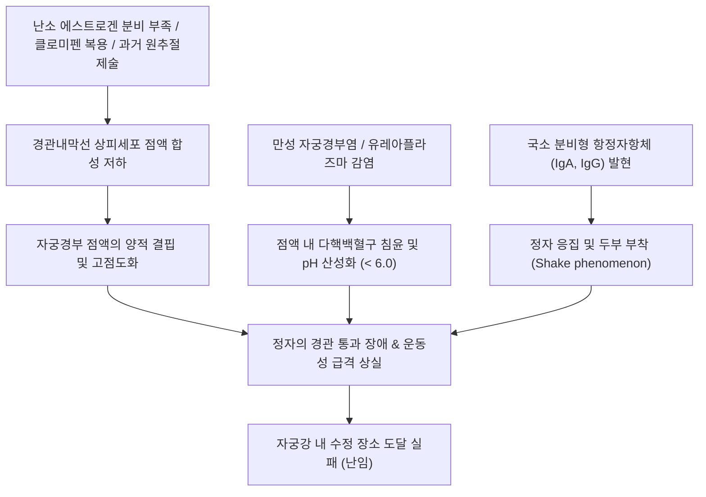

# 🩺 자궁경부 점액의 불임 문제 (Cervical Factor Infertility / 子宮頸部 粘液 不姙)

> **핵심 3줄 요약 (Key Summary)**:
> - 📍 **병소 부위 & 해부·병태생리**: 배란기 자궁경관 내막선(Endocervical glands)의 분비 이상 또는 만성 자궁경부염, 국소 항정자항체(ASA)로 인해 정자의 통과·생존을 저해하는 경부인자 불임(Cervical factor infertility).
> - 🚩 **전형적 임상 양상**: 배란기임에도 불구하고 자궁경부 점액의 양적 부족(건조감), 점도 과다(탁하고 끈적임), 신장도(Spinnbarkeit) 저하, 양치엽 형성(Ferning) 불량, 성교후 검사(Huhner test)상 운동성 정자 부재.
> - 🛠️ **핵심 검사 & 치료 전략**: 성교후 검사(PCT) 및 자궁경관 점액-정자 침투 검사; 현대 난임 의학의 표준 치료는 경부 점액 장벽을 완전히 우회하는 **[[자궁강내 인공수정]](IUI, Intrauterine Insemination)**, 한의학적 신음허·기혈허약 변증 하 조경종옥탕/육미지황탕 가감.
> - ⚠️ **응급 의뢰 레드플래그**: 심한 점액농성 분비물 및 경부 미란을 동반한 클라미디아/임균성 급성 자궁경부염(골반염 및 난관 유착 진행 위험), 과거 원추절제술 후 자궁경관 완전 유착·폐색(자궁수혈증 위험) 시 부인과 즉각 의뢰.

---

## 📌 목차
1. [질환 개요 & 해부학적 병태생리](#1--질환-개요---해부학적-병태생리)
2. [병태생리 메커니즘 & 생체역학적 악순환 네트워크](#2--병태생리-메커니즘---생체역학적-악순환-네트워크)
3. [임상 증상 & 이학적 검사 알고리즘](#3--임상-증상---이학적-검사-알고리즘)
4. [감별 진단 매트릭스](#4--감별-진단-매트릭스)
5. [한의 통합 치료 프로토콜](#5--한의-통합-치료-프로토콜)
6. [양방 치료 & 병용·의뢰 기준](#6-양방-치료--병용의뢰-기준)
7. [재활 운동 & 생활습관 티칭 가이드](#7--재활-운동---생활습관-티칭-가이드)
8. [💡 사용자 진료실 핵심 필기 & 임상 노하우](#8--사용자-진료실-핵심-필기---임상-노하우)
9. [📚 출처 및 현대 학술 연구 요약 (References)](#9--출처-및-현대-학술-연구-요약-references)

---

## 1. 질환 개요 & 해부학적 병태생리

### 1) 질환 정의 및 임상적 의의
- **자궁경부 점액의 불임 문제(경부인자 불임, Cervical Factor Infertility)**는 자궁경관 내막에서 분비되는 점액의 양적 결핍, 질적 이상(비정상적 점도 및 pH), 또는 면역학적 적대성(Cervical hostility)으로 인해 정자가 자궁강 내로 진입하지 못하여 초래되는 난임 상태이다.
- 전체 여성 난임 원인의 약 3~5%를 차지하며, 과거 배란 장애나 난관 요인에 비해 독립된 진단으로 다루어졌으나, 현대 생식의학에서는 [[자궁강내 인공수정]](IUI)을 통해 경관을 우회함으로써 비교적 높은 성공률로 극복되는 질환이다.

### 2) 정상 자궁경부 점액의 생리적 역할
- **배란기 E형 점액(Estrogenic mucus)**:
  - 배란 직전 혈중 [[에스트로겐]]의 급격한 상승에 반응하여 분비량이 1일 최대 600~700 mg까지 증가함.
  - 수분 함량이 95~98%에 달하며, 맑고 투명하고 묽으며 알칼리성(pH 7.0~8.5)을 띰.
  - 높은 신장도(Spinnbarkeit > 8~10 cm)와 건조 시 뚜렷한 양치엽 양상(Fern pattern)을 형성.
  - 질 내의 산성 환경(pH 4.0 전후)으로부터 정자를 보호하고, 병적 세균의 침입을 막으며, 운동성 정자가 상행할 수 있는 '미세 고속도로' 역할을 수행.
- **황체기 G형 점액(Gestagenic mucus)**:
  - 배란 후 [[프로게스테론]] 분비로 인해 점액이 탁하고 끈적거리며 점도가 높아져 정자 침투를 차단.

---

## 2. 병태생리 메커니즘 & 생체역학적 악순환 네트워크

### 1) 주요 병태 기전
- **의원성 요인 (Iatrogenic factor)**:
  - 배란유도제인 클로미펜([[클로미펜]], Clomiphene citrate)의 항에스트로겐 작용으로 인해 경관 점액이 심하게 건조해지고 끈적해지는 부작용.
  - 자궁경부 이형성증 치료를 위한 원추절제술(LEEP, Conization), 냉동치료, 레이저 소작술 후 점액 분비 선조직의 영구적 소실.
- **감염 및 염증성 요인**:
  - 만성 경부염, 클라미디아, 마이코플라즈마 감염으로 인해 점액 내 백혈구가 증가하고 효소 분비로 점액의 생화학적 구조가 파괴됨.
- **면역학적 적대성 (Immunological hostility)**:
  - 점액 내에 정자 표면 항원에 반응하는 항정자항체(Antisperm antibodies, ASA)가 존재하여 정자가 점액과 접촉하는 순간 제자리에서 진동(Shaking)만 하거나 사멸함.

---

## 3. 임상 증상 & 이학적 검사 알고리즘

### 1) 임상 증상
- 대다수 환자는 뚜렷한 전신 증상이 없으며, 1년 이상 피임 없이 정상적인 부부관계를 가졌음에도 임신이 되지 않는 불임증을 주소로 내원함.
- 배란기에도 질 분비물의 증가(물처럼 흐르는 맑은 대하)를 느끼지 못하고 외음부 건조감을 호소함.

### 2) 검사 및 진단 알고리즘
- **인슐러 점수화 체계 (Insler Score)**:
  - 배란 직전 점액의 양(0~3점), 신장도(0~3점), 양치엽 형성(0~3점), 자궁경관구 개방도(0~3점)를 종합하여 12점 만점으로 평가 (10점 이상이면 양호, 7점 미만이면 불량).
- **성교후 검사 (Postcoital Test, Huhner Test)**:
  - 배란 예정일 성관계 후 8~12시간 이내에 자궁경부 점액을 채취하여 고배율 현미경으로 관찰.
  - 고배율 시야(HPF)당 전진 운동성을 가진 정자가 5~10마리 이상 관찰되면 정상(양성).
  - 정자가 전혀 관찰되지 않거나 운동성이 없고 제자리에서 떨기만 하는 경우(Shaking phenomenon) 경부인자 불임 진단.

---

## 4. 감별 진단 매트릭스

| 질환명 | 주 원인 및 병태 | 점액 상태 및 검사 소견 | 나팔관 개통성 / 정액 검사 | 1차 해결책 |
| :--- | :--- | :--- | :--- | :--- |
| **자궁경부 점액 불임** | 에스트로겐 부족, 원추절제술 기왕력, 항정자항체 | 양 부족, 신장도 < 5cm, PCT상 운동 정자 부재 | 양측 나팔관 정상, 남편 정액 정상 | 자궁강내 인공수정 (IUI) |
| **남성 요인 불임** | 정자수 감소증, 무력정자증, 기형정자증 | 점액은 정상이나 정액 자체 이상 | 정액 검사상 정자수·운동성 저하 | 남성 치료, IUI 또는 시험관(ICSI) |
| **난관 요인 불임** | 난관 폐색, 골반 내 유착, 수난관증 | 경부 점액 정상 (Insler 양호) | 자궁난관조영술(HSG)상 폐쇄 소견 | 난관 복강경 성형술 또는 시험관(IVF) |
| **배란 요인 불임** | 다낭성난소증후군, 고프로락틴혈증 | 기초체온표상 무배란, LH/FSH 불균형 | 초음파상 다낭성 난소, 무배란 | 배란 유도 (레트로졸/클로미펜) |

---

## 5. 한의 통합 치료 프로토콜

### 1) 한의 변증 분류
- **신음허형 (腎陰虛型)**:
  - 주증: 배란기 대하 분비량이 극히 적고 건조함, 성교통, 오심번열, 허리와 무릎의 시림, 설홍소태, 맥세삭.
  - 치법: 자음보신(滋陰補腎), 윤조생진(潤燥生津).
  - 처방: [[육미지황탕]](六味地黃湯) 합 좌귀환 가감 (숙지황 20g, 산약 15g, 산수유 10g, 복령 10g, 구기자 12g, 귀판 15g, 맥문동 10g).
- **기혈양허형 (氣血兩虛型)**:
  - 주증: 안면 창백, 만성 피로, 월경량 감소, 배란기 점액의 탄력성 부족, 설담태백, 맥세약.
  - 치법: 보기양혈(益氣養血), 조경종옥(調經種玉).
  - 처방: [[조경종옥탕]](調經種玉湯) 가감 (숙지황 15g, 당귀 12g, 백작약 12g, 천궁 8g, 백출 10g, 복령 10g, 향부자 8g, 익모초 15g).
- **습열어저형 (濕熱瘀阻型)**:
  - 주증: 만성 경부염 병발, 점액이 혼탁하고 황색을 띰, 소변 단적, 설홍태황니, 맥활삭.
  - 치법: 청열이습(淸熱利濕), 활혈화어(活血化瘀).
  - 처방: [[비해분청음]](萆薢分淸飲) 가 연교, 황백, 단삼.

### 2) 침구 치료 프로토콜
- **주요 혈위**:
  - 하복부 국소: [[관원]](CV4), [[중극]](CV3), [[자궁]](EX-CA1) — 자궁경부 미세혈류 촉진 및 내막선 분비 기능 정상화.
  - 신경·비경 경락: [[삼음교]](SP6), [[태계]](KI3), [[신수]](BL23), [[혈해]](SP10) — 신음 보강, 호르몬 축 조절.
- **시술 기법**:
  - 난포기(배란 전)에 관원, 자궁, 삼음교 혈에 온침 또는 뜸 치료를 병행하여 골반강 혈류 순환을 촉진한다.

---

## 6. 양방 치료 & 병용·의뢰 기준

### 1) 자궁강내 인공수정 (IUI, Intrauterine Insemination) - 표준 치료
- 자궁경부 점액 문제를 해결하는 가장 확실하고 표준적인 치료법은 **[[자궁강내 인공수정]](IUI)**이다.
- 남성의 정액을 채취하여 세척 및 원심분리를 통해 양질의 운동성 정자만을 농축한 후, 부드러운 카테터를 이용하여 **자궁경부를 통과시켜 자궁강 내에 직접 주입**한다.
- 이를 통해 경관 점액의 양적 부족, 고점도, 면역학적 항정자항체 장벽을 100% 우회한다.

### 2) 보조적 약물 요법
- **배란 전 소량 에스트로겐 요법**:
  - 클로미펜 투여로 점액이 마른 경우 배란 전 에스트라디올 1~2 mg을 단기간 투여하여 점액 분비 유도.
- **구아페네신 (Guaifenesin)**:
  - 거담제 성분으로 점액의 점도를 낮추기 위해 경험적으로 사용되기도 함.

---

## 7. 재활 운동 & 생활습관 티칭 가이드

### 1) 수분 섭취 및 영양 관리
- **충분한 수분 공급**:
  - 자궁경부 점액의 95% 이상이 수분이므로 하루 1.5~2.0L 이상의 미온수를 꾸준히 섭취한다.
- **항산화 영양소**:
  - 비타민 C, 비타민 E, 코엔자임 Q10 섭취를 통해 자궁경관 상피의 산화적 스트레스를 줄인다.

### 2) 질 세척제 및 윤활제 주의
- 상용 질 세정제나 일반 성교 윤활제(KY 젤 등)는 정자의 운동성을 심각하게 저하시키므로 배란기에는 절대 사용하지 말고, 임신 전용 윤활제(Pre-Seed 등)를 사용한다.

---

## 8. 💡 사용자 진료실 핵심 필기 & 임상 노하우

### 1) 임상 상담 노하우
- 난임 환자가 "배란기인데도 분비물이 전혀 나오지 않고 뻑뻑하다"고 호소할 때, 과거 LEEP(원추절제술) 수술력이나 클로미펜 복용력을 반드시 확인해야 한다.
- 만약 원추절제술로 경관선이 영구 손상된 경우 자연 임신만을 고집하기보다, 한방 착상 보약으로 자궁내막 수용성을 높인 상태에서 **IUI(인공수정)를 조기에 병용**하도록 권유하는 것이 현명한 협진 전략이다.

---

## 9. 📚 출처 및 현대 학술 연구 요약 (References)

- Helmerhorst FM, et al. (2005). Intrauterine insemination versus timed intercourse for cervical hostility in subfertile couples. *Cochrane Database Syst Rev*. PMID: 16719942.

- Eggert-Kruse W, et al. (1995). In-vitro cervical mucus-sperm penetration tests and outcome of infertility treatments in couples with repeatedly negative post-coital tests. *Hum Reprod*. PMID: 7745077.

- Al-Sadi R, et al. (2025). Anti-Chlamydia trachomatis Host Defence Arsenal Within the Cervicovaginal Environment. *Pathogens*. PMID: 41596756.
