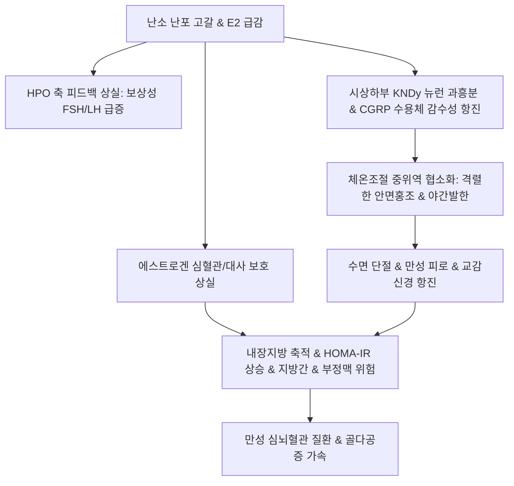

# 🩺 갱년기 (Climacteric / Menopausal Transition)

> **핵심 3줄 요약 (Key Summary)**:
> - 📍 **정의 & 병태생리**: 난소 기능 쇠퇴로 에스트로겐([[에스트로겐]]) 분비가 급감하고 뇌하수체의 보상성 [[FSH]]·[[LH]] 분비가 급증하는 폐경 전후 과도기(평균 45~55세). 에스트로겐 결핍은 시상하부 체온조절 중추 교란(CGRP 경로 과민화), 골소실, 심혈관 및 지질 대사 악화를 초래한다.
> - 🚩 **임상 양상**: 혈관운동증상(안면홍조, 야간발한), 수면장애, 감정 기복, 비뇨생식기 위축(GSM: 질건조감·성교통), [[지방간]] 및 [[당뇨병]]·[[부정맥]] 등 심혈관 질환 이환율 상승.
> - 🛠️ **치료 원칙**: ACOG/SIM 가이드라인 기반 중등도 이상 혈관운동증상에 호르몬대체요법(HRT) 또는 비호르몬 요법 적용, 한의학적 신음허(腎陰虛)·음허화왕(陰虛火旺) 변증에 따른 [[자음강화탕]], [[지백지황환]], CGRP 수용체 감수성을 조절하는 [[계지복령환]] 병용.
> - ⚠️ **응급 의뢰 레드플래그**: 폐경 후 질 출혈(Postmenopausal Bleeding, PMB)은 자궁내막암 배제를 위한 즉각적 자궁내막 조직검사 의뢰 대상이며, 급성 흉통·호흡곤란·심계항진 등 심혈관 사건 발생 시 응급 전원의뢰 필요.

---

## 📌 목차
1. [질환 개요 & 해부학적 병태생리](#1-질환-개요--해부학적-병태생리)
2. [병태생리 메커니즘 & 신경내분비·혈관 악순환 네트워크](#2-병태생리-메커니즘--신경내분비혈관-악순환-네트워크)
3. [임상 증상 & 진단 평가 알고리즘](#3-임상-증상--진단-평가-알고리즘)
4. [감별 진단 매트릭스 (Differential Diagnosis)](#4-감별-진단-매트릭스-differential-diagnosis)
5. [한의 통합 치료 프로토콜 (침·약침·한약)](#5-한의-통합-치료-프로토콜-침약침한약)
6. [양방 치료 & 병용·의뢰 기준 (Conventional Treatment & Referral)](#6-양방-치료--병용의뢰-기준-conventional-treatment--referral)
7. [생활습관 티칭 & 장기 만성질환 예방 가이드](#7-생활습관-티칭--장기-만성질환-예방-가이드)
8. [💡 사용자 진료실 핵심 필기 & 임상 노하우 (Melt-In 잔여 심화 집약)](#8-💡-사용자-진료실-핵심-필기--임상-노하우-melt-in-잔여-심화-집약)
9. [출처 및 학술 참고 문헌 (References)](#9-출처-및-학술-참고-문헌-references)

---

## 1. 질환 개요 & 해부학적 병태생리

### 1) 질환 정의 및 임상적 의의
- **갱년기(Climacteric)**: 가임기에서 생식능력이 소실되는 노년기로 이행하는 과도기로, 난소의 원시난포 고갈과 기능 저하가 주원인이다. 평균 만 50세 전후로 발생하며 통상 폐경 전 수년(폐경이행기, Perimenopause)부터 폐경 후 1년까지를 포괄한다.
- **폐경(Menopause)**: 난소 난포의 활성 상실로 인해 월경이 영구히 정지된 상태로, 12개월 연속 무월경이 확인될 때 후향적으로 진단된다.
- **임상적 중요성**: 단순한 생리 중단에 그치지 않고, 에스트로겐의 전신 보호 효과(혈관 내피 보호, 골밀도 유지, 인슐린 감수성 보존, 뇌 신경전달물질 안정)가 급격히 상실되면서 [[골다공증]], [[지방간]], [[당뇨병]], [[부정맥]], [[이상지질혈증]], 허혈성 심혈관질환 등 중대한 만성 대사 질환 이환율이 기하급수적으로 증가한다.

### 2) 난소 노화와 해부학적 조직 변화
- **원시난포 고갈**: 출생 시 약 100만 개, 사춘기 약 30~40만 개이던 난포 수가 1,000개 미만으로 감소하면서 난포 폐쇄(Atresia)가 가속화된다.
- **기질 섬유화**: 난소 기질(Stroma)의 혈관 위축과 섬유화가 진행되며, 과립막세포(Granulosa cell)의 [[인히빈 B]](Inhibin B) 및 [[안티뮐러관호르몬]](AMH) 생성이 고갈된다.
- **표적 조직 위축**: 에스트로겐 수용체(ER-alpha, ER-beta)가 풍부한 질 점막 표피 박리 및 글리코겐 감소, 요도 및 방광 삼각부 위축, 피부 교원섬유 감소, 유방 실질 위축 및 지방 치환이 동반된다.

---

## 2. 병태생리 메커니즘 & 신경내분비·혈관 악순환 네트워크

### 1) 시상하부-체온조절 중추 교란 및 혈관운동 증상
- **보상성 HPO 축 과흥분**: 난소의 [[에스트라디올]](E2) 및 인히빈 음성 피드백 상실 -> 시상하부 [[GnRH]] 분비 촉진 -> 뇌하수체 전엽에서 [[FSH]] 및 [[LH]]의 대량 박동성 방출(보상성 과다 분비).
- **KNDy 뉴런 탈억제**: 시상하부 궁상핵(Arcuate nucleus)의 Kisspeptin/Neurokinin B/Dynorphin (KNDy) 신경세포가 에스트로겐 결핍으로 탈억제되어 과활성화됨.
- **체온조절 중위역(Thermoneutral Zone) 축소**: KNDy 뉴런 흥분이 전시각영역(POA)의 체온조절 중추로 전달되어, 체온 중립 범위가 극도로 좁아진다. 사소한 체온 상승이나 스트레스에도 뇌는 체온이 위험 수준으로 상승했다고 착각하여 격렬한 체온 방출 반응(말초 혈관 확장, 발한)을 발동한다.
- **CGRP와 혈관 감수성 항진**: 혈중 E2 감소 시 칼시토닌 유전자 관련 펩타이드([[CGRP]]) 분비 조절이 교란되고 말초 CGRP 수용체 감수성이 보상적으로 급증한다. 이로 인해 미세한 교감신경 자극에도 안면부와 상흉부 세동맥이 급격히 확장되어 홍조(Hot Flush)가 촉발된다.

### 2) 신경내분비-대사 악순환 도식

### 3) 만성 대사 및 전신 질환 이환 메커니즘
- **지질 대사 교란**: 에스트로겐 결핍은 간의 LDL 수용체 활성을 떨어뜨려 LDL-C 및 중성지방(TG)을 상승시키고 HDL-C를 감소시킨다.
- **간세포 지방 축적**: 에스트로겐의 간 대사 조절 기능 약화로 유리지방산 유입이 증가하여 비알코올성 [[지방간]](NAFLD/MASLD)이 촉진된다.
- **부정맥 및 혈관 경직**: 혈관 내피세포의 eNOS 활성 저하로 산화질소(NO) 생성이 감소하고 동맥 경직도가 증가하며, 자율신경계 불균형으로 발작성 심계항진 및 [[부정맥]] 빈도가 급증한다.

---

## 3. 임상 증상 & 진단 평가 알고리즘

### 1) 주요 임상 양상
- **혈관운동성 증상(Vasomotor Symptoms, VMS)**: 돌발성 상체 열감, 안면 홍조, 발한, 이어지는 오한(환자의 75% 이상 경험).
- **폐경비뇨생식기증후군(Genitourinary Syndrome of Menopause, GSM)**: 질 건조감, 성교통, 질 분비물 감소, 빈뇨, 절박뇨, 재발성 요로감염.
- **신경정신 및 수면 증상**: 입면장애, 조기각성, 야간발한으로 인한 수면분절, 불안, 우울감, 인지기능 저하(Brain fog).
- **근골격계 증상**: 관절통, 근육통, 골밀도 감소로 인한 요배통.

### 2) 단계별 평가 및 진단 기준 (STRAW+10 기준)
- **폐경이행기 초기**: 월경주기 변동 폭이 연속 2회 이상 7일 이상 차이 발생.
- **폐경이행기 후기**: 60일 이상의 무월경 주기 발생(FSH가 가임기 고농도 수준인 25~40 IU/L 이상으로 상승).
- **진단 확인**: 45세 이상 여성에서 전형적인 혈관운동 증상과 함께 12개월 이상 무월경 시 추가 혈액검사 없이 임상적으로 폐경 진단 가능. 단, 40~45세는 조기폐경 감별을 위해 혈중 [[FSH]], [[에스트라디올]], TSH, 프로락틴 검사 시행.

---

## 4. 감별 진단 매트릭스 (Differential Diagnosis)

| 감별 질환 | 호발 연령 및 특이 징후 | 핵심 감별 검사 | 폐경기와의 감별 포인트 |
| :--- | :--- | :--- | :--- |
| **[[갑상선기능항진증]]** | 전 연령대, 체중감소, 안구돌출, 진전, 설사 | TSH 저하, Free T4 상승 | 무월경 동반 가능하나 열감 지속 및 갑상선 종대 확인 |
| **[[갈색세포종]]** | 30~50대, 발작성 두통, 발한, 고혈압 3대징후 | 24시간 소변 메타네프린/카테콜아민 | 돌발적 혈압 폭등 및 심한 두통 동반 |
| **[[쿠싱 증후군]]** | 중심성 비만, 문페이스, 자색선조, 고혈당 | 24시간 소변 자유 코르티솔, 야간 덱사메타손 억제검사 | 특징적 쿠싱양 외모 및 혈중 코르티솔 자율 분비 |
| **[[조기 난소 부전]](POI)** | 40세 이전 무월경, 불임, 고FSH혈증 | 혈중 FSH > 25~40 IU/L (1개월 간격 2회), 염색체 검사 | 만 40세 미만의 조기 발생 및 자가면역 질환 동반 여부 |
| **[[공황장애]]** | 급성 호흡곤란, 질식감, 죽을 것 같은 공포 | 정신건강의학과적 면담, 배제 진단 | 안면열감보다 급성 공황발작 및 심계항진이 주증상 |

---

## 5. 한의 통합 치료 프로토콜 (침·약침·한약)

### 1) 변증별 한약 처방 프로토콜
- **신음허(腎陰虛) / 음허화왕(陰虛火旺)**:
  - 주증: 조열도한(潮熱盜汗), 오심번열(五心煩熱), 구갈, 요슬산연, 설홍소태, 맥세삭.
  - 대표 처방: [[지백지황환]], [[자음강화탕]], [[육미지황탕]] 가감(지모, 황백, 맥문동).
- **간울화화(肝鬱化火) / 심신불교(心腎不交)**:
  - 주증: 정서 불안, 불면, 번조(煩躁), 가슴 두근거림, 두통.
  - 대표 처방: [[가미소요산]], [[귀비탕]], [[청심연자음]].
- **어혈조체(瘀血阻滯) / CGRP 과민 혈관운동장애**:
  - 주증: 하복부 압통, 피부 건조 및 조열, 입술 자암색, 혈중 CGRP 과민 반응.
  - 대표 처방: [[계지복령환]] (임상 근거: 난소 쇠퇴로 인한 E2 급감 시 혈중 CGRP 저하 및 말초 CGRP 수용체 감수성 항진을 억제하여 안면홍조를 안정화).

### 2) 침구 및 약침 치료
- **주요 혈위**: [[삼음교]](SP6), [[신수]](BL23), [[태계]](KI3), [[관원]](CV4), [[백회]](GV20), [[풍지]](GB20), [[내관]](PC6).
- **약침 시술**: 자하거(Hominis Placenta) 약침 0.5~1.0cc를 신수(BL23), 관원(CV4), 삼음교(SP6)에 주 2회 시술하여 내분비 보정 및 자율신경계 안정 촉진.

---

## 6. 양방 치료 & 병용·의뢰 기준 (Conventional Treatment & Referral)

### 1) 양방 표준 의학 치료
- **호르몬대체요법(HRT / MHT)**:
  - 자궁이 있는 여성: 에스트로겐 + 프로게스토겐 복합제(자궁내막 증식증 및 암 예방 필수).
  - 자궁절제술 기왕력 여성: 에스트로겐 단독 요법(ET).
  - 투여 시점(Window of Opportunity): 폐경 10년 이내, 60세 미만 환자에서 심혈관 및 골다공증 예방 이득이 위험을 상회.
- **비호르몬 치료제**:
  - Fezolinetant (NK3 수용체 길항제): KNDy 뉴런 차단으로 중등도~중증 혈관운동증상 신속 호전.
  - SSRI/SNRI (파록세틴, 벤라팍신), 가바펜틴: 수면장애 및 경도 혈관운동증상 완화.
  - 국소 에스트로겐 크림/질정: 폐경비뇨생식기증후군(GSM) 전용 요법.

### 2) 한양방 병용 시 주의사항 & 금기증
- **에스트로겐 활성화 한약 주의**: 유방암 병력, 활동성 혈전색전증, 미진단 질 출혈 환자에서 보정(補精) 계열 약물의 고용량 장기 투여 시 부인과 정기 검진 병행 필수.
- **협진 적응증**: 심한 수면장애 및 골소실 환자에서 HRT와 한의 침구/약침 병용 시 호르몬 감량 및 삶의 질 개선 극대화.

---

## 7. 생활습관 티칭 & 장기 만성질환 예방 가이드

### 1) 식단 및 영양 요법
- **식물성 에스트로겐 섭취**: 대두(콩류, 두부), 아마씨 등 이소플라본(Isoflavone) 함유 식품 섭취 권장.
- **심혈관 보호 식단**: 지중해식 식단(올리브유, 통곡물, 채소, 생선)으로 내장지방 축적 및 [[지방간]] 예방.
- **카페인·알코올·매운 음식 제한**: 혈관 확장 자극 인자를 차단하여 안면홍조 촉발 빈도 감소.

### 2) 운동 및 체온 관리
- **유산소 & 저항성 복합 운동**: 주 150분 이상의 중강도 유산소 운동(빠르게 걷기, 수영) 및 주 2~3회 근력 운동(골밀도 보존 및 근감소증 예방).
- **층별 의복 착용**: 얇은 옷을 겹쳐 입어 홍조 발생 시 즉시 탈의할 수 있는 환경 유지, 실내온도 18~20도 유지.

---

## 8. 💡 사용자 진료실 핵심 필기 & 임상 노하우 (Melt-In 잔여 심화 집약)

### 1) 폐경과 만성 대사 질환 이환의 상관관계
- 폐경은 단순한 생식 기능의 종료가 아니라 심혈관질환, [[지방간]], [[당뇨병]], [[부정맥]] 등 중풍 및 심혈관계 사건 발생 위험을 비가역적으로 폭증시키는 중대한 전신 대사 전환점이다. 난소 노화로 인한 에스트로겐의 급격한 결핍이 근본 원인이다.
- 따라서 단순 증상 완화에 그치지 않고, 만성 대사 질환 예방 차원에서 건강관리를 적극 시행하고 적절한 시기(Window of opportunity)에 여성호르몬 치료나 한의학적 보신음(補腎陰)·활혈화어(活血化瘀) 치료를 병행하는 것이 예후를 결정한다.

### 2) 시상하부-체온중추 오작동 기전
- 원시난자가 고갈되면 뇌는 난자의 노화에 보상하기 위해 시상하부의 [[GnRH]] 및 뇌하수체의 [[FSH]], [[LH]] 분비를 폭발적으로 증가시킨다.
- 이 과정에서 신경계에서 다량 분출되는 신경전달물질과 호르몬이 시상하부 체온조절 중추에 비정상적으로 작용하여, 정상 체온 상태임에도 뇌는 얼굴과 상체가 위험한 고열 상태라고 착각하게 된다. 그 결과 혈관을 급격히 확장시켜 얼굴이 벌개지는 잘못된 방어 반응(Hot Flush)을 일으킨다.
- 이 질환은 개인의 유전적 감수성, 정신건강 상태, 사회적 관계망의 안정도에 따라 중증도가 크게 좌우되는 다인성(Multifactorial) 질환이므로 전인적 접근이 필수적이다.
- 40세 이전 조기 폐경의 경우 난포 고갈 외에도 면역학적, 대사적, 스트레스성 요인이 복합 작용하므로 한의학적 복원 치료가 유효할 수 있다.

### 3) CGRP 기전과 계지복령환의 약리적 적용
- 난소 기능이 저하되어 에스트라디올(E2) 농도가 급감하면 혈중 [[CGRP]] 농도가 저하되고, 이에 대한 보상 반응으로 말초 혈관의 [[CGRP]] 수용체 수가 급격히 증가한다.
- CGRP 수용체 감수성 항진 상태에서는 사소한 신호나 자극에도 미세혈관이 폭발적으로 확장되어 격렬한 안면홍조가 발생한다.
- 이러한 환자군에 [[계지복령환]]을 투여하면 혈중 CGRP 농도 저하를 막고 말초 CGRP 감수성 항진을 유의하게 억제하여 혈관 반응성을 정상화시킨다.
- **임상 주의점**: 에스트로겐의 과다 활성화나 무분별한 보정제 과다 복용은 [[자궁내막증]]이나 암종, [[유방암]]의 발생 위험을 높일 수 있으므로 정기적인 유방 및 부인과 초음파 스크리닝을 반드시 병행해야 한다.

---

## 9. 출처 및 학술 참고 문헌 (References)

Murina. (2026). Recommendations for the Diagnosis and Treatment of Genitourinary Syndrome of Menopause from the Italian Society of Menopause (SIM) and Italian Society of Gynecology of the Third Age (SIGiTE). *Healthcare (Basel)*. PMID: 42881642.

Kim J. (2026). ACOG Clinical Practice Guideline: Management of Menopause-Related Vasomotor, Sleep, and Mood Symptoms. *Obstet Gynecol*. PMID: 42878500.

Aktoz. (2026). Menopause and lung health: a narrative review of physiological changes, disease risks and clinical management. *Climacteric*. PMID: 42852718.
