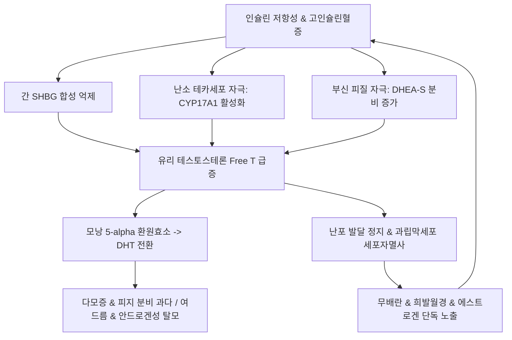

# 🩺 고안드로겐 혈증 (高雄激素血症, Hyperandrogenism)

> **핵심 3줄 요약 (Key Summary)**:
> - 📍 **정의 & 병태생리**: 여성 체내에서 테스토스테론([[테스토스테론]]), DHEA-S, 안드로스텐디온 등 안드로겐 농도가 비정상적으로 상승하거나 표적 조직의 감수성이 항진된 상태. 난소 내막세포([[테카세포]]) 과형성 또는 부신망상대 기능 항진, 인슐린 저항성([[인슐린 저항성]])에 따른 [[SHBG]] 감소가 핵심 기전이다.
> - 🚩 **임상 양상**: 다모증(Hirsutism, Ferriman-Gallwey score ≥ 8), 난치성 여드름, 안드로겐성 탈모, 희발월경 또는 무월경, 심한 경우 음핵 비대 및 저음화 등 남성화(Virilization) 동반.
> - 🛠️ **치료 원칙**: 경구피임제(COC), 항안드로겐제(스피로놀락톤, 시프로테론 아세테이트) 및 인슐린 감수성 개선제(메트포르민) 적용, 한의학적으로 간울화화(肝鬱化火)·습열하주(濕熱下注) 변증에 따른 [[용담사간탕]], [[창부도담탕]], [[가미소요산]] 투여.
> - ⚠️ **응급 의뢰 레드플래그**: 수주~수개월 내 급속히 진행하는 심한 남성화(음핵비대, 턱수염 급증, 목소리 저음화) 또는 총 테스토스테론 > 150~200 ng/dL, DHEA-S > 700~800 ug/dL는 안드로겐 분비 난소 종양(Sertoli-Leydig cell tumor) 또는 부신 피질암(Adrenocortical Carcinoma)을 시사하므로 즉각적인 상급병원 영상의뢰 필수.

---

## 📌 목차
1. [질환 개요 & 해부학적 병태생리](#1-질환-개요--해부학적-병태생리)
2. [병태생리 메커니즘 & 호르몬·대사 악순환 네트워크](#2-병태생리-메커니즘--호르몬대사-악순환-네트워크)
3. [임상 증상 & 이학적 평가 알고리즘](#3-임상-증상--이학적-평가-알고리즘)
4. [감별 진단 매트릭스 (Differential Diagnosis)](#4-감별-진단-매트릭스-differential-diagnosis)
5. [한의 통합 치료 프로토콜 (침·약침·한약)](#5-한의-통합-치료-프로토콜-침약침한약)
6. [양방 치료 & 병용·의뢰 기준 (Conventional Treatment & Referral)](#6-양방-치료--병용의뢰-기준-conventional-treatment--referral)
7. [영양 요법 & 생활습관 티칭 가이드](#7-영양-요법--생활습관-티칭-가이드)
8. [💡 사용자 진료실 핵심 필기 & 임상 노하우 (Melt-In 잔여 심화 집약)](#8-💡-사용자-진료실-핵심-필기--임상-노하우-melt-in-잔여-심화-집약)
9. [출처 및 학술 참고 문헌 (References)](#9-출처-및-학술-참고-문헌-references)

---

## 1. 질환 개요 & 해부학적 병태생리

### 1) 질환 정의 및 분류
- **고안드로겐 혈증(Hyperandrogenism)**: 여성 체내에서 남성 호르몬(Androgen)의 절대적인 분비량이 증가하거나 활성형 호르몬의 생체이용률이 증가하여 임상적 또는 생화학적 징후를 나타내는 병태.
- **임상적 고안드로겐증(Clinical Hyperandrogenism)**: 다모증, 여드름, 안드로겐성 탈모 등 모낭-피지선 단위(Pilosebaceous unit)의 과잉 반응.
- **생화학적 고안드로겐증(Biochemical Hyperandrogenism)**: 혈청 총 테스토스테론, 유리 테스토스테론(Free Testosterone), DHEA-S 또는 안드로스텐디온의 기준치 초과 상승.

### 2) 해부학적 기원 및 호르몬 생산 조직
- **난소(Ovary)**: LH 자극에 반응하여 [[테카세포]](Theca cell)에서 안드로스텐디온과 테스토스테론을 합성. 과립막세포(Granulosa cell)의 [[아로마타제]](Aromatase) 효소 활성이 불충분하면 난소 내 안드로겐 축적이 심화된다.
- **부신 피질(Adrenal Cortex)**: 망상대(Zona reticularis)에서 ACTH 조절을 받아 주로 [[DHEA]], DHEA-S, 안드로스텐디온을 분비.
- **말초 표적 조직(지방, 간, 모낭)**: 5알파-환원효소([[5-알파 환원효소]])에 의해 테스토스테론이 활성형인 디하이드로테스토스테론([[DHT]])으로 전환되어 모낭 안드로겐 수용체에 강력히 결합.

---

## 2. 병태생리 메커니즘 & 호르몬·대사 악순환 네트워크

### 1) 인슐린 저항성과 고인슐린혈증의 핵심 매개 작용
- **간의 SHBG 합성 억제**: 고인슐린혈증은 간세포의 성호르몬결합글로불린([[SHBG]]) 생성을 억제하여, 혈중 총 테스토스테론이 정상이라도 생물학적 활성을 띠는 '유리 테스토스테론' 분율을 극적으로 상승시킨다.
- **난소 테카세포 직접 자극**: 인슐린은 난소의 인슐린 수용체 및 IGF-1 수용체에 결합하여 LH와 상승작용을 일으키고, 테카세포의 CYP17A1(17알파-하이드록실라제) 활성을 증폭시켜 테스토스테론 합성을 폭발적으로 증가시킨다.
- **부신 민감도 항진**: 인슐린은 부신 피질의 ACTH 반응성을 강화하여 DHEA-S 생산을 촉진한다.

### 2) 내분비-대사 상호작용 도식

---

## 3. 임상 증상 & 이학적 평가 알고리즘

### 1) 주요 임상 증상
- **다모증(Hirsutism)**: 남성형 체모 분포(인중, 턱, 흉부, 백선부, 내퇴부, 등)에 굵고 짙은 종모(Terminal hair)가 발생하는 현상.
- **페리만-골웨이 점수(modified Ferriman-Gallwey, mFG score)**: 9개 신체 부위의 체모 밀도를 0~4점으로 평가하여 총점 8점 이상(한국인 등 동아시아인은 4~6점 이상) 시 임상적 다모증으로 진단.
- **피부과적 증상**: 성인기 지속성 낭포성 여드름, 두피 정수리 부위 모발 가늘어짐 및 남성형 탈모(Ludwig scale), 흑색가시세포증(Acanthosis nigricans, 인슐린 저항성 시사).
- **월경 이상**: 희발월경(주기 > 35일), 무월경(3~6개월 이상 월경 없음), 기능성 자궁출혈.

### 2) 생화학적 진단 프로토콜
- **1차 호르몬 검사**: 총 테스토스테론, 유리 테스토스테론, SHBG, DHEA-S (월경 주기 초기 아침 공복 측정).
- **선별 및 배제 검사**:
  - 17-OHP(17-하이드록시프로게스테론): 비전형 선천성 부신과형성증(NCAH) 배제.
  - 혈청 TSH, 프로락틴: 갑상선 질환 및 고프로락틴혈증 배제.
  - 24시간 소변 유리 코르티솔: 쿠싱증후군 감별.

---

## 4. 감별 진단 매트릭스 (Differential Diagnosis)

| 감별 질환 | 호발 연령 및 특이 소견 | 핵심 혈액학적 지표 | 치료 및 임상 대책 |
| :--- | :--- | :--- | :--- |
| **[[다낭성 난소 증후군]](PCOS)** | 가임기(10~30대), 비만, 초음파상 다낭성 난소 | LH/FSH 비율 상승, 경도~중등도 T 상승 | 체중 감량, 경구피임제, 메트포르민, 한약 |
| **[[비전형 선천성 부신과형성증]](NCAH)** | 10~20대, 이른 음모 발달, 가족력 | 17-OHP > 2 ng/mL (ACTH 자극 시 > 10) | 글루코코르티코이드(저용량 덱사메타손) 투여 |
| **난소 안드로겐 생성 종양** | 폐경 전후 또는 전 연령, 급속한 남성화 | 총 테스토스테론 > 150~200 ng/dL | 골반 MRI, 경질 초음파, 수술적 절제 |
| **부신 피질암(Adrenal Ca)** | 전 연령, 급속 악화, 복부 종괴 | DHEA-S > 700~800 ug/dL | 복부 CT/MRI, 부신 절제술 |
| **특발성 다모증** | 정상 월경 주기, 정상 호르몬 수치 | 테스토스테론 및 SHBG 정상 | 말초 5-알파 환원효소 과민 반응, 국소 제모 |

---

## 5. 한의 통합 치료 프로토콜 (침·약침·한약)

### 1) 변증별 한약 처방
- **간울화화(肝鬱化火) / 기체혈어(氣滯血瘀)**:
  - 주증: 정서적 스트레스 시 증상 악화, 여드름 염증 심화, 월경통, 설홍태황, 맥현삭.
  - 대표 처방: [[가미소요산]], [[단치소요산]], [[용담사간탕]].
- **담습조체(痰濕阻滯) / 비허습성(脾虛濕盛)**:
  - 주증: 과체중 또는 비만, 복부비만, 부종, 피지 분비 과다, 설담반 치흔, 맥활.
  - 대표 처방: [[창부도담탕]], [[이진탕]] 가감(창출, 반하, 향부자, 천궁).
- **신음허(腎陰虛) / 상열하한(上熱下寒)**:
  - 주증: 체모 과다, 구갈, 오심번열, 하복 냉감, 요슬산연.
  - 대표 처방: [[육미지황탕]], [[지백지황환]] 가감(지모, 황백, 단삼).

### 2) 침구 치료 및 혈위
- **주요 혈위**: [[삼음교]](SP6), [[중극]](CV3), [[관원]](CV4), [[족삼리]](ST36), [[혈해]](SP10), [[태충]](LR3), [[풍륭]](ST40).
- **침치료 기전**: 교감신경 긴장을 완화하고 난소 혈류를 개선하며, 인슐린 감수성을 향상시켜 혈중 안드로겐 저하를 유도.

---

## 6. 양방 치료 & 병용·의뢰 기준 (Conventional Treatment & Referral)

### 1) 약물 치료 프로토콜
- **복합 경구피임제(Combined Oral Contraceptives, COC)**:
  - 1차 선택제. 에스트로겐 성분이 간의 SHBG 합성을 증가시켜 유리 테스토스테론을 저하시키고, 프로게스틴 성분이 LH 분비를 억제하여 난소 안드로겐 생산 차단.
  - 드로스피레논(Drospirenone) 또는 시프로테론(Cyproterone acetate) 등 항안드로겐성 프로게스틴 선호.
- **항안드로겐제(Anti-androgens)**:
  - 스피로놀락톤([[스피로놀락톤]], Spironolactone): 안드로겐 수용체 경쟁적 차단 및 5알파-환원효소 억제 (남아 임신 시 태아 생식기 기형 위험으로 피임 필수).
  - 피나스테리드([[피나스테리드]]): 5알파-환원효소 억제제(탈모 치료 병용).
- **인슐린 감수성 개선제**:
  - 메트포르민([[메트포르민]]): 인슐린 저항성을 개선하여 테카세포 안드로겐 합성 억제.

### 2) 한양방 병용 시 주의점 및 의뢰 기준
- **병용 요법**: COC 복용 중 발생하는 체중 증가나 소화장애에 대해 한방 담습 변증 치료를 병용하여 부작용 경감 및 대사 지표 개선.
- **수술적 전원**: 영상의학적으로 부신 또는 난소에 2cm 이상의 종괴가 발견되거나 생화학적 수치가 극단적으로 높은 경우 즉각 전원의뢰.

---

## 7. 영양 요법 & 생활습관 티칭 가이드

### 1) 식단 관리 및 체중 조절
- **저탄수화물·케토제닉 식단**: 비만형 고안드로겐증 환자에서 탄수화물 제한 식이는 인슐린 분비를 급감시켜 유리 테스토스테론과 HOMA-IR을 유의하게 감소시킨다.
- **저혈당지수(Low-GI) 식단**: 인슐린 스파이크를 방지하여 난소 테카세포 자극 차단.
- **녹차 및 스피아민트차**: 항안드로겐 작용이 보고된 폴리페놀 함유 음료 음용 권장.

### 2) 마음챙김(Mindfulness) 및 운동
- **마인드풀니스 중재**: 심리적 스트레스와 코르티솔 분비를 경감시켜 부신성 안드로겐 과다 분비 악순환을 차단.
- **근력 & 유산소 운동**: 주 150분 이상의 유산소 운동과 주 2~3회 대근육 저항성 운동으로 말초 포도당 흡수를 촉진하고 인슐린 저항성 완화.

---

## 8. 💡 사용자 진료실 핵심 필기 & 임상 노하우 (Melt-In 잔여 심화 집약)

### 1) 진료실 감별의 최우선 순위: 급격한 남성화의 조기 포착
- 단순 다모증과 종양성 남성화(Virilization)의 구분은 환자의 생명을 가르는 결정적 포인트다.
- 수개월 내에 턱수염이 굵게 자라거나, 음핵이 비대해지고(Clitoromegaly), 목소리가 굵어지는 저음화가 동반된다면 이는 단순 PCOS가 아니라 난소의 Sertoli-Leydig 세포종이나 부신피질암의 강력한 징후이다.
- 이러한 환자는 한의 진료실에서 지체하지 않고 즉시 총 테스토스테론 및 DHEA-S 선별검사와 함께 복부 및 골반 영상의학 검사로 연계해야 한다.

### 2) SHBG의 임상적 통찰
- 혈중 총 테스토스테론 수치가 정상 범위 상한선에 걸쳐 있더라도 환자가 심한 다모증과 여드름을 호소하는 경우가 흔하다.
- 이는 간에서 생성되는 [[SHBG]]가 고인슐린혈증이나 비만으로 인해 억제되어 생체이용률이 높은 '유리 테스토스테론'이 조직을 지배하고 있기 때문이다.
- 따라서 치료의 핵심 타깃을 모낭에 두는 것이 아니라, 간과 췌장의 대사 환경 개선(인슐린 저항성 해소, 체중 감량, 담습 청열)에 두어야 근본적인 모발 및 피부 증상이 호전된다.

---

## 9. 출처 및 학술 참고 문헌 (References)

Li. (2026). Efficacy of mindfulness-based interventions on psychological distress, hyperandrogenism, and metabolic profile in women with polycystic ovary syndrome: A systematic review and meta-analysis of randomized controlled trials. *Appl Psychol Health Well Being*. PMID: 42538604.

Galas. (2026). Endogenous Hyperandrogenism in Women and Its Influence on Exercise Capacity and Athletic Performance: A Narrative Review. *Cureus*. PMID: 42438653.

Maseroli. (2026). Ketogenic diet as a therapeutic intervention for biochemical hyperandrogenism in PCOS women with obesity or overweight: a meta-analytic study. *J Endocrinol Invest*. PMID: 42287532.
