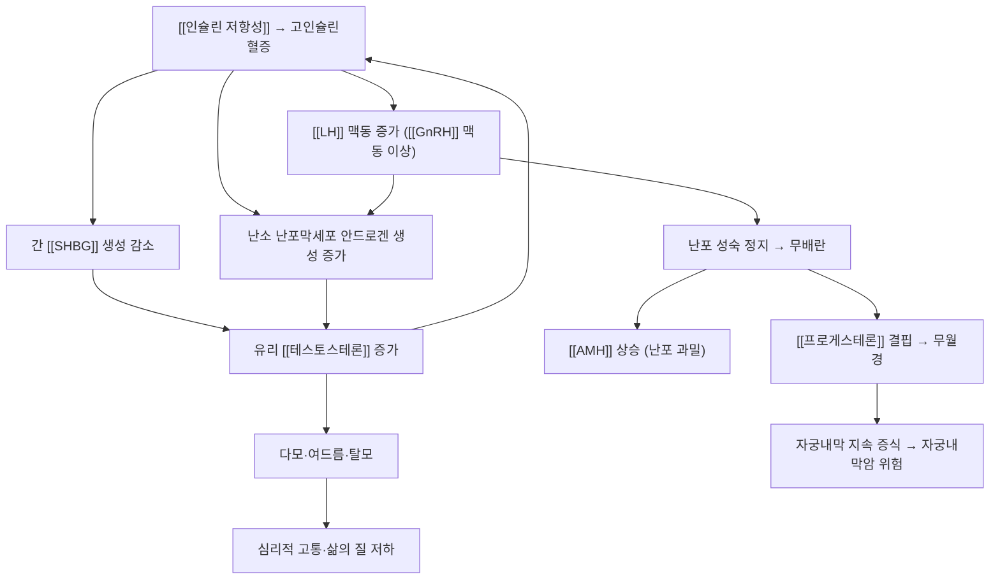

# 🩺 다낭성 난소 증후군 (Polycystic Ovary Syndrome, PCOS)

> **핵심 3줄 요약 (Key Summary)**:
> - 📍 병소 부위 & 해부·병태생리: 만성 무배란과 고안드로겐혈증을 특징으로 하는 [[시상하부-뇌하수체-난소축]]의 기능 이상이다. [[인슐린 저항성]]에 따른 고인슐린혈증이 난소 [[테스토스테론]] 생성을 늘리고 [[SHBG]]를 낮춰 유리 안드로겐을 증가시키는 것이 핵심 고리다.
> - 🚩 전형적 임상 양상 & 3대 징후: ① 희발월경·무월경 ② 다모·여드름 등 고안드로겐 징후 ③ 초음파상 다낭성 난소. 이 중 2개 이상이면 진단한다(수정 로테르담 기준). 무배란성 불임의 가장 흔한 원인이다.
> - 🛠️ 핵심 감별 & 한·양방 치료 전략: 갑상선 질환·고프로락틴혈증·선천성 부신증식증·안드로겐 생성 종양을 배제한다. 치료는 생활요법(체중 감량·운동)을 축으로 하고, 배란 목적에는 약물([[레트로졸]]·[[클로미펜]]·[[메트포르민]])이 중심이며 침·한약은 동반 증상 축으로 배치한다.
> - ⚠️ **응급 의뢰 레드플래그**: 급격한 남성화(음핵 비대·목소리 변화)나 단기간 악화는 안드로겐 생성 종양을 시사한다. 배란유도 중 심한 하복부 팽만·호흡곤란은 [[난소 과자극증후군]]이다.

---

## 📌 목차
1. [질환 개요 & 병태생리 (Disease Overview)](#1-질환-개요--병태생리-disease-overview)
2. [병태생리 메커니즘 & 대사·장기부전 악순환 네트워크](#2-병태생리-메커니즘--대사장기부전-악순환-네트워크)
3. [임상 증상 & 환자 소견 (Clinical Presentation)](#3-임상-증상--환자-소견-clinical-presentation)
4. [감별 진단 매트릭스 (Differential Diagnosis)](#4-감별-진단-매트릭스-differential-diagnosis)
5. [한의 통합 치료 프로토콜 (침·약침·한약)](#5-한의-통합-치료-프로토콜-침약침한약)
6. [양방 치료 & 병용·의뢰 기준 (Conventional Treatment & Referral)](#6-양방-치료--병용의뢰-기준-conventional-treatment--referral)
7. [식이·생활습관 & 자가관리 티칭 가이드](#7-식이생활습관--자가관리-티칭-가이드)
8. [💡 진료실 핵심 필기 & 임상 노하우](#8--진료실-핵심-필기--임상-노하우)
9. [출처 및 학술 참고 문헌 (References)](#9-출처-및-학술-참고-문헌-references)

---

## 1. 질환 개요 & 병태생리 (Disease Overview)

![[다낭성 난소 증후군_01_해부_정상난소와다낭성난소_도해.jpg|460]]
> [그림 1: 정상 난소와 다낭성 난소의 비교 도해 — 다낭성 난소에서는 미성숙 난포가 다수 배열한다 — 질병관리청 국가건강정보포털 (공공저작물, 출처표시)]

* **질환 정의 및 분류**:
  * 만성 무배란(희발배란) + 고안드로겐혈증 + 다낭성 난소 형태를 특징으로 하는 내분비·대사 질환.
  * **진단 기준(수정 로테르담 기준)** — 다음 3개 중 2개 이상, 다른 원인 배제
    * ① 희발배란 또는 무배란
    * ② 임상적(다모·여드름·탈모) 또는 생화학적 고안드로겐혈증
    * ③ 초음파상 다낭성 난소(한쪽 난소에 2~9 mm 난포 12개 이상, 또는 난소 용적 증가)
  * 표현형이 이질적이라 비만형·정상체중형, 고안드로겐 우세형·배란장애 우세형으로 나누어 접근한다.
* **역학**: 가임기 여성의 약 5~10%로 보고되며, 무배란성 불임의 가장 흔한 원인이다.
* **관련 장기 및 조직**:
  * **주 이환 장기**: [[난소]] — 난포 성숙 정지와 다수의 미성숙 난포.
  * **연관 대사·조절계**: [[시상하부-뇌하수체-난소축]] · [[인슐린 저항성]] · [[SHBG]] · [[AMH]] · [[LH]] · [[FSH]]
  * **합병증 표적 장기**: 자궁내막(무배란에 따른 [[자궁내막암]] 위험), 간(지방간), 혈관(대사증후군·[[제2형 당뇨병]])

---

## 2. 병태생리 메커니즘 & 대사·장기부전 악순환 네트워크

![[다낭성 난소 증후군_02_임상_주요증상_도해.jpg|460]]
> [그림 2: 다낭성 난소 증후군의 주요 증상 — 생리 불순·비만·다모·여드름·불임 등이 함께 나타난다 — 질병관리청 국가건강정보포털 (공공저작물, 출처표시)]

### 1) 분자·세포 수준 기전
* **난소 스테로이드 생성 이상**: [[LH]] 자극에 대한 난포막세포(theca cell)의 안드로겐 합성 반응이 과도하고, 과립세포의 [[아로마타제]] 활성이 상대적으로 부족해 안드로겐이 축적된다.
* **인슐린 공동작용**: 인슐린이 [[LH]] 수용체 신호를 증폭시켜 안드로겐 생성을 더 늘린다.
* **난포 발육 정지**: 난포가 우성 난포로 선택되지 못하고 2~9 mm 단계에서 정지하며 [[AMH]]가 높게 유지된다. AMH 상승은 다시 난포 모집을 억제하는 악순환을 만든다.
* [[SHBG]] 감소: 인슐린이 간의 SHBG 생성을 억제해 총 테스토스테론이 정상이어도 **유리 안드로겐이 증가**한다.

### 2) 장기·계통 수준 결과
* 무배란 → [[프로게스테론]] 결핍 → 무월경·희발월경 → 자궁내막 지속 증식(자궁내막 증식증·암 위험).
* 고인슐린혈증 → 중심성 비만·지질 이상·[[제2형 당뇨병]]·지방간, 장기적으로 심혈관 위험 증가.
* 고안드로겐 → 다모·여드름·탈모와 심리적 고통 → 삶의 질 저하 → 스트레스가 다시 축을 악화시킨다.

### 3) 위험인자와 진행 단계
* **위험인자**: 가족력, 비만(특히 중심성), 좌식 생활, 인슐린 저항성.
* **진행**: 사춘기 월경 불순 → 가임기 무배란성 불임·고안드로겐 → 중년 대사증후군·당뇨·자궁내막 병변.

---

## 3. 임상 증상 & 환자 소견 (Clinical Presentation)

![[다낭성 난소 증후군_03_진단_초음파_다낭성난소_영상.jpg|420]]
> [그림 3: 경질초음파상 다낭성 난소 — 난소 변연을 따라 다수의 작은 난포('난포')가 배열한다 — 질병관리청 국가건강정보포털 (공공저작물, 출처표시)]

![[다낭성 난소 증후군_06_진단_초음파_난소와자궁내막_영상.jpg|460]]
> [그림 4: 다낭성 난소(좌)와 무배란에 따른 두꺼운 자궁 내막(우, '자궁 내막' 표시) 초음파 소견 — 질병관리청 국가건강정보포털 (공공저작물, 출처표시)]

### 1) 주소증 및 핵심 증상
* **전형 증상**: ① 월경 주기 이상(희발월경·무월경) ② 다모(얼굴·가슴·복부 털), 여드름, 안드로겐성 탈모 ③ 임신이 되지 않음 ④ 체중 증가·체중 감량 저항.
* **비전형·경증 발현**: 월경 주기가 규칙적이어도 무배란일 수 있고, 정상 체중에서도 인슐린 저항성이 존재한다.
* **증상 악화 인자**: 체중 증가, 좌식 생활, 고당질 식이, 수면 부족.

### 2) 객관적 소견 (Signs & Labs)
* **신체 소견**: 체질량지수·허리둘레, 다모 정도(Ferriman-Gallwey 점수), 여드름·지루, 흑색가시세포증([[인슐린 저항성]] 피부 표지).
* **검사 수치(진단·추적 지표)**: [[LH]]/[[FSH]] 비, 총·유리 [[테스토스테론]], [[SHBG]], [[AMH]], DHEAS, [[TSH]]·프로락틴(감별), 공복혈당·[[HbA1c]]·[[HOMA-IR]]·지질, [[경구포도당부하검사]]
  > ⚠️ 진단 기준의 수치 컷오프는 검사실·가이드라인마다 달라 단일 값을 단정하지 않는다. 기관 기준을 확인해 적용한다.
* **영상**: 경질초음파(난포 수·난소 용적), 필요 시 자궁내막 두께 평가.

### 3) 병기·중증도 판정
* 단일 병기 체계가 없고, **대사 위험 + 생식 요구 + 고안드로겐 중증도**를 함께 평가해 치료 우선순위를 정한다. 임신을 원하는가 여부가 치료 분기의 핵심이다.

---

## 4. 감별 진단 매트릭스 (Differential Diagnosis)

| 감별 질환 | 특징적 양상 | 감별 포인트 (검사·수치) |
| :--- | :--- | :--- |
| [[다낭성 난소 증후군]] (본 질환) | 무배란 + 고안드로겐 + 다낭성 난소 | 로테르담 기준 2/3 충족 |
| [[갑상선기능저하증]] | 월경 불순, 피로, 체중 증가 | [[TSH]] 상승 |
| 고프로락틴혈증 | 무월경·유즙 분비 | 프로락틴 상승, 약물력 확인 |
| 선천성 부신증식증(비전형) | 어린 나이 발현, 남성화 | 17-하이드록시프로게스테론 |
| 쿠싱증후군 | 중심성 비만·자색선조·근력 저하 | [[코르티솔]] 검사 |
| **안드로겐 생성 종양** (레드플래그) | **급격한 남성화·단기 악화** | 테스토스테론·DHEAS 급상승, 영상 |
| [[조기난소부전]] | 무월경 + 안면홍조 | [[FSH]] 상승·[[에스트로겐]] 저하 |

> 🚩 **레드플래그 감별**: 급속 남성화, 골반 종괴 동반은 종양 감별이 최우선이다.

---

## 5. 한의 통합 치료 프로토콜 (침·약침·한약)

* **변증 분류(교과서 범위)**
  * **담습(痰濕)**: 비만·부종·대하·설태 후니 — 건비이수·화담.
  * **습열(濕熱)**: 여드름·피지 과다·구고·냄새 나는 대하 — 청열이습.
  * **기체혈어(氣滯血瘀)**: 월경 지연·골반통·혈괴 — 이기활혈.
  * **신허(腎虛)**: 요슬산연·월경량 소·오한 — 보신조경.
* **침구 치료 (Acupuncture)**
  * 배혈 원칙: 하복부 배혈([[중극(CV3)]]·[[기해(CV6)]]·[[귀래(ST29)]]·[[천추(ST25)]]) + 원위혈([[삼음교(SP6)]]·[[음릉천(SP9)]]·[[태충(LR3)]]·[[족삼리(ST36)]]). 혈위명은 볼트 표준에 따라 순수 텍스트로 표기한다.
  * 2026-10-11 시험(PCOSAct) 프로토콜: 회당 30분 유침, 주 2회, 최대 32회(4주기), 복부·하지에 저주파 전침(2 Hz, 0.3 ms) + 수부·두부 혈위 수기 자극. → [[전침]] · [[득기]] · [[침 자극 강도와 용량]]
  * **⚠️ 근거의 정직성**: 이 배혈 구성은 1,000명 RCT에서 출산율을 높이지 못했다(활성 침 21.8% vs 대조 침 22.4%). 배란·출산 목적의 침 치료 효능은 지지되지 않으며, 월경 불순·골반통·불면·불안 등 **동반 증상 관리** 축으로 위치시킨다 → [[침 자극 강도와 용량]]
* **약침 치료 (Pharmacopuncture)**
  * 하복부·요천추부 압통점에 소량 주입. 임신 계획 중에는 시행하지 않는다 → [[약침]] · [[아시혈]]
* **한약 치료 (Herbal Medicine)**
  * 변증별 처방을 쓴다. 담습·습열·기체혈어·신허에 따라 이수·청열·활혈·보신 처방을 나눈다 — 구체 방제는 변증 확정 후 결정한다.
  * 2026-10-11 시험은 **개별화 한약 처방을 금지**한 고정 프로토콜이었다. 한약이 배란유도를 대체한다는 근거는 이 시험에서 나오지 않았다.
* **뜸·부항**: 복부 냉증·담습 변증에서 온중 목적으로 보조한다 — 혈위명은 순수 텍스트로 표기 → [[뜸]] · [[부항]]

---

## 6. 양방 치료 & 병용·의뢰 기준 (Conventional Treatment & Referral)

* **약물 치료 (Medication)**
  * **배란유도(임신 목적)**: 1차 [[레트로졸]]([[아로마타제]] 억제), 2차 [[클로미펜]]. 반응 없으면 곤도트로핀·복강경 난소 천공술, 이후 보조생식술.
    * 2026-10-11 리뷰 1번: 클로미펜은 위약 대비 출산율을 유의하게 높였다(28.7% vs 15.4%, 차이 13.3%, 95% CI 8.0~18.5). 반면 무배란 실패율 23.4%·누적 출산율 19.1%·다태임신율 7.4%의 한계가 함께 보고됐다.
  * **인슐린 저항성 개선**: [[메트포르민]] 병용이 배란율·주기 회복에 도움을 줄 수 있다.
  * **주기 조절·고안드로겐(임신 비목적)**: 복합 경구피임약(연속 복용), 프로게스토젠(주기적 사용으로 자궁내막 보호), 항안드로겐(스피로놀락톤).
  * **주의**: 배란유도제 병용 시 [[난소 과자극증후군]] 위험이 커진다.
* **비약물 치료 (Procedures)**: 복강경 난소 천공술(배란유도 저항성), 자궁내막 보호 목적의 주기적 프로게스토젠.
* **수술·시술 적응증**: 배란유도 실패, 심한 고안드로겐, 자궁내막 증식증 동반 시.
* **한의 병용 판단 (Combination Therapy)**
  * **병용 가능**: 생활요법 + 침(동반 증상) + 변증 한약. 배란유도제와 시기만 겹치지 않게 조정한다.
  * **주의**: 같은 주기에 경구피임약과 배란유도제를 병용하면 배란유도 효과가 상쇄된다(축 억제).
  * **금기**: 임신 확인 후에는 배란유도제·대부분의 항안드로겐을 중단한다.
* **양방·전문과 의뢰 기준 (Referral Criteria)**
  * **즉시 의뢰**: 급속 남성화, 골반 종괴, 심한 [[난소 과자극증후군]] 증상(복부 팽만·호흡곤란·핍뇨).
  * **전문과 의뢰**: 6개월 이상 무월경, 3~6주기 배란유도 실패, 임신 계획 중 난임 1년 이상 → 산부인과·생식내분비.

---

## 7. 식이·생활습관 & 자가관리 티칭 가이드

![[다낭성 난소 증후군_04_생활_비만_생활습관개선_실사.jpg|420]]
> [그림 5: 비만 환자의 생활습관 개선(유산소 기구 운동) 실사 — 질병관리청 국가건강정보포털 (공공저작물, 출처표시)]

* **식이 지도 (Diet)**
  * 정제 탄수화물·당 음료를 줄이고 단백질·식이섬유·불포화지방 비중을 높인다. 총 열량의 급격한 제한보다 **지속 가능한 구조**가 우선이다.
  * 한의 변증 연결: 담습·습열 변증에서는 자극적·기름진 음식과 주류를 줄이고, 신허 변증에서는 규칙적 식사와 따뜻한 음식 위주로 지도한다 → [[약식동원]]
* **생활습관 (Lifestyle)**
  * **체중 5~10% 감량**만으로 배란 회복·주기 개선이 기대된다. 마른 체형에서도 중저강도 유산소 운동이 총·유리 테스토스테론과 [[HOMA-IR]]을 개선한다는 별도 메타분석 근거가 있다(2026-09-20 회차).
  * 성인 기준 **주 150분 중등도 유산소 또는 주 75분 고강도 + 주 2회 근력운동**을 기본 처방으로 제시한다 → [[유산소운동]] · [[저항운동]] · [[운동요법]]
  * 수면 규칙성·스트레스 관리([[코르티솔]])를 함께 다룬다 → [[코르티솔]]
* **자가관리 (Self-monitoring)**: 월경 시작일 기록(주기 길이), 체중·허리둘레 주 1회, 배란 확인(기초체온·배란예측검사), 필요 시 혈당 자가측정.
* **환자 교육 스크립트**
  * "이 질환은 난소 하나의 문제가 아니라 인슐린과 호르몬이 서로를 밀어 올리는 상태입니다. 그래서 체중을 5%만 줄여도 생리가 돌아오는 분이 많습니다. 임신이 목표이면 배란유도제가 중심이고, 침과 한약은 생리 불순·골반통·수면·불안 같은 동반 증상을 관리하는 보조 치료입니다. 생활요법은 어느 목표에서든 먼저 세웁니다."
* **정기 추적 항목**: 6~12개월마다 혈압·공복혈당·[[HbA1c]]·지질·체중. 무월경이 지속되면 자궁내막 두께 평가.

---

## 8. 💡 진료실 핵심 필기 & 임상 노하우

* **실전 문진 체크리스트(순서대로)**
  1. 임신 계획이 있는가? — 치료 분기를 결정하는 첫 질문.
  2. 월경 주기 기록: 최근 6개월 최장·최단 주기, 무월경 기간.
  3. 다모·여드름·탈모의 진행 속도 — **급속 진행이면 종양 감별 우선**.
  4. 체중 변화·좌식 시간·수면·식이 패턴.
  5. 복용 약물(경구피임약·배란유도제·[[메트포르민]])과 주기 내 시점.
* **치료 순서 및 노하우**
  * 생활요법 상담을 첫 방문에 반드시 넣고, 침·한약은 2차 축으로 배치한다 — 이 시험의 결론과 2026-09-20 운동 근거가 같은 방향이다.
  * 하복부 전침(2 Hz)을 장기 사용할 때는 활성 침군에서 피하 멍(7.4% vs 1.8%)·설사(5.0% vs 1.6%)가 더 많았음을 기억하고, 항응고제 복용·출혈 경향 환자는 자침 전 확인한다.
  * 배란유도제 복용 중 환자에게 침을 병행할 때는 "배란 판정은 초음파로 한다"는 원칙을 환자와 공유한다.
* **환자 티칭 스크립트(재발·합병증 예방)**
  * "생리가 3개월 이상 없으면 자궁내막이 계속 두꺼워질 수 있어 산부인과에서 내막 두께를 확인하셔야 합니다. 당뇨·지질 검사도 6~12개월마다 필요합니다."
* **상부에 담지 못한 고유 필기**
  * 2026-09-20 회차에서 정리한 'PCOS 중저강도 주 150분·마른 체형' 처방과 [[HOMA-IR]] 추적 세트를 이 노트의 §7에 통합했다.

---

## 9. 출처 및 학술 참고 문헌 (References)

1. **Legro RS 등 (2017)**. *Effect of Acupuncture and Clomiphene in Chinese Women With Polycystic Ovary Syndrome: A Randomized Clinical Trial*. **JAMA**, 317(24):2502-2514. [PMID 28655015](https://pubmed.ncbi.nlm.nih.gov/28655015/) · [DOI 10.1001/jama.2017.7217](https://doi.org/10.1001/jama.2017.7217)
   - [연구 요약] 중국 21개 기관·1,000명 2×2 요인설계 RCT. 출산율은 활성 침+클로미펜 29.4%, 대조 침+클로미펜 28.0%, 활성 침+위약 13.9%, 대조 침+위약 16.8% — 침의 추가 이득은 없었고 클로미펜은 유의한 이득을 보였다.
2. **Zhang GS 등 (2025)**. *Acupuncture for polycystic ovary syndrome*. **Cochrane Database Syst Rev**, 10(10):CD007689. [PMID 41147529](https://pubmed.ncbi.nlm.nih.gov/41147529/)
   - [연구 요약] RCT 9건·1,606명 — 침은 샴침 대비 출산율 RR 0.97(0.76~1.23)·배란 SMD 0.02(−0.15~0.19)로 차이가 없었고 이상반응은 침군에서 더 많았다(RR 1.16, 1.02~1.31, 중등도 확실성).
3. **질병관리청 국가건강정보포털** — 「다낭성 난소 증후군」(콘텐츠 ID 5971). [링크](https://health.kdca.go.kr)
   - [연구 요약] 한국어 환자용 설명(정의·원인·증상·진단·치료·생활요법)과 그림 1~5의 원본 — 공공저작물 출처표시·변경금지 조건으로 원본 그대로 인용했다.
4. **Teede HJ 등 (2023)**. *International evidence-based guideline for the assessment and management of PCOS*. Melbourne: Monash University.
   - [연구 요약] 진단 기준·대사 평가·생활요법 우선 원칙을 정리한 국제 근거중심 지침.
5. **ClinicalTrials.gov [NCT01573858](https://clinicaltrials.gov/study/NCT01573858)** (PCOSAct)
   - [연구 요약] 2세트 혈위 구성·2 Hz 전침 파라미터·주 2회 최대 32회 일정이 상세 기술된 공개 프로토콜.

## 함께 보기
- [[클로미펜]] · [[레트로졸]] · [[메트포르민]] · [[불임]] · [[자궁내막증]] · [[월경통]] · [[비만]] · [[제2형 당뇨병]] · [[인슐린 저항성]] · [[SHBG]] · [[테스토스테론]] · [[AMH]] · [[LH]] · [[FSH]] · [[시상하부-뇌하수체-난소축]] · [[GnRH]] · [[아로마타제]] · [[HOMA-IR]] · [[HbA1c]] · [[전침]] · [[약침]] · [[운동요법]] · [[유산소운동]] · [[저항운동]] · [[중극(CV3)]] · [[기해(CV6)]] · [[귀래(ST29)]] · [[천추(ST25)]] · [[삼음교(SP6)]] · [[음릉천(SP9)]] · [[태충(LR3)]] · [[족삼리(ST36)]]
- [[2026-10-11_부인과소아과_심층리뷰]] 1번 · [[2026-10-11_부인과소아과_개념학습]]
