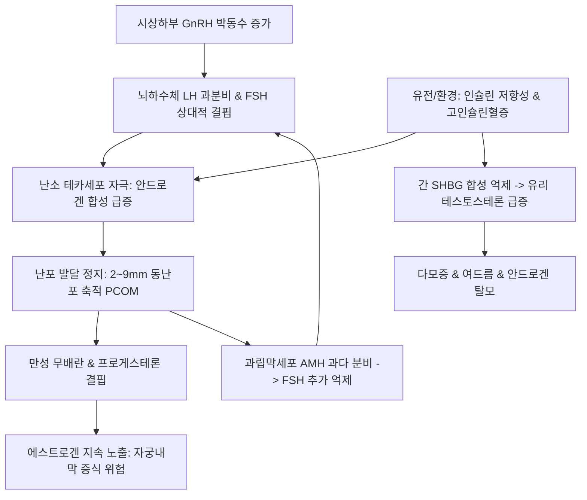

# 🩺 다낭성 난소 증후군 (Polycystic Ovary Syndrome, PCOS)

> **핵심 3줄 요약 (Key Summary)**:
> - 📍 **정의 & 병태생리**: 가임기 여성의 8~13%에 이환되는 가장 흔한 신경내분비-대사 복합 증후군. 시상하부-뇌하수체 GnRH/LH 박동성 분비 항진, 난소 [[테카세포]]의 과도한 안드로겐 생성, 인슐린 저항성([[인슐린 저항성]]) 및 고인슐린혈증으로 인한 [[SHBG]] 감소가 난포 성숙 장애와 만성 무배란을 유발한다.
> - 🚩 **임상 양상**: 희발월경 또는 무월경, 불임, 임상적/생화학적 고안드로겐증(다모증, 여드름, 탈모), 초음파상 염주알 모양의 다낭성 난소(PCOM: 2~9mm 동난포 ≥ 20개), 비만 및 흑색가시세포증.
> - 🛠️ **치료 원칙**: 1차 치료는 주 150분 이상의 중강도 유산소 운동 및 체중 감량(5~10% 감량 시 자연 배란 회복). 배란유도(레트로졸, 클로미펜), 인슐린 개선(메트포르민, GLP-1 RA), 한의학적으로 담습(痰濕)·간울(肝鬱)·신허(腎虛) 변증에 따른 [[창부도담탕]], [[조경종옥탕]], [[육미지황탕]] 투여.
> - ⚠️ **응급 의뢰 레드플래그**: 배란유도제 복용 중 급격한 복부 팽만·호흡곤란·감뇨증 발생 시 [[난소 과자극증후군]](OHSS) 응급 의뢰. 급격한 남성화 징후(음핵비대, 저음화)는 안드로겐 생성 종양 배제 필요. 장기 무배란에 따른 부정출혈은 [[자궁내막증식증]] 및 [[자궁내막암]] 스크리닝 대상.

---

## 📌 목차
1. [질환 개요 & 해부학적 병태생리](#1-질환-개요--해부학적-병태생리)
2. [병태생리 메커니즘 & 신경내분비·대사 악순환 네트워크](#2-병태생리-메커니즘--신경내분비대사-악순환-네트워크)
3. [임상 증상 & 로테르담 진단 평가 알고리즘](#3-임상-증상--로테르담-진단-평가-알고리즘)
4. [감별 진단 매트릭스 (Differential Diagnosis)](#4-감별-진단-매트릭스-differential-diagnosis)
5. [한의 통합 치료 프로토콜 (침·약침·한약)](#5-한의-통합-치료-프로토콜-침약침한약)
6. [양방 치료 & 배란유도·의뢰 기준 (Conventional Treatment & Referral)](#6-양방-치료--배란유도의뢰-기준-conventional-treatment--referral)
7. [생활습관 중재 & 장기 심혈관·대사 위험 관리](#7-생활습관-중재--장기-심혈관대사-위험-관리)
8. [💡 사용자 진료실 핵심 필기 & 임상 노하우 (Melt-In 잔여 심화 집약)](#8-💡-사용자-진료실-핵심-필기--임상-노하우-melt-in-잔여-심화-집약)
9. [출처 및 학술 참고 문헌 (References)](#9-출처-및-학술-참고-문헌-references)

---

## 1. 질환 개요 & 해부학적 병태생리

### 1) 질환 정의 및 임상적 중요성
- **다낭성 난소 증후군(PCOS)**: 시상하부-뇌하수체-난소 축의 기능적 교란과 대사 장애가 결합하여 만성 무배란, 고안드로겐혈증, 다낭성 난소 형태를 나타내는 이질적인 복합 내분비 질환이다.
- 가임기 여성 불임의 주된 원인(무배란성 불임의 약 70~80%)이며, 제2형 당뇨병, 대사증후군, 비알코올성 지방간, 자궁내막암의 평생 이환 위험을 유의하게 증가시킨다.

### 2) 해부학적 소견 및 난소 미세환경
- **난소 용적 증가**: 정상 난소 용적(약 6~8 mL)에 비해 10 mL 이상으로 비대해지며, 중앙 간질(Stroma)의 과도한 증식이 관찰된다.
- **난포 발달 정지(Follicular Arrest)**: 난포가 직경 2~9 mm 크기의 작은 동난포(Antral follicle) 단계에서 성장을 멈추고 우성 난포로 선택되지 못하며, 피질하 부위에 진주 목걸이 모양(String of pearls)으로 배열된다.
- **테카세포 과형성**: 난소 기질 및 난포막 세포(Theca interna)가 두터워지며, LH 수용체 과발현과 함께 안드로겐을 대량 생산한다.

---

## 2. 병태생리 메커니즘 & 신경내분비·대사 악순환 네트워크

### 1) 3대 병태생리 축의 상호작용
1. **신경내분비 교란 (GnRH/LH 항진)**: 시상하부 [[GnRH]] 분비 빈도가 가속화되어 뇌하수체에서 [[LH]] 분비가 우선적으로 촉진되고 [[FSH]] 분비는 상대적으로 억제된다(LH/FSH 비율 ≥ 2~3). 상대적 FSH 부족은 과립막세포의 난포 성숙과 아로마타제 활성을 차단한다.
2. **고안드로겐증 (Hyperandrogenism)**: 과도한 LH 자극과 인슐린 상승이 테카세포를 자극하여 [[테스토스테론]] 및 안드로스텐디온 생성을 폭증시킨다. 국소 안드로겐 과다는 난포 폐쇄를 가속한다.
3. **인슐린 저항성과 고인슐린혈증**: 수용체 후 인산화 결함으로 말초 조직 포도당 섭취가 저하되며, 보상성 고인슐린혈증이 간의 [[SHBG]] 합성을 억제하여 유리 테스토스테론을 급증시키고 난소 안드로겐 합성을 직접 촉진한다.

### 2) 신경내분비-대사 악순환 도식

---

## 3. 임상 증상 & 로테르담 진단 평가 알고리즘

### 1) 로테르담 진단 기준 (Rotterdam Criteria, 2003 / 2023 국제 가이드라인 갱신)
- 아래 3가지 기준 중 **2가지 이상**을 만족하고, 다른 원인 질환(CAH, 쿠싱증후군, 고프로락틴혈증, 갑상선질환)이 배제될 때 진단:
  1. **희발배란 또는 무배란 (Oligo- or Anovulation)**: 월경 주기 35일 초과 또는 연간 8회 미만의 월경, 혹은 3개월 이상의 무월경.
  2. **고안드로겐증 (Hyperandrogenism)**:
     - 임상적: 다모증(modified Ferriman-Gallwey score ≥ 4~8), 중증 여드름, 남성형 탈모.
     - 생화학적: 혈청 총/유리 테스토스테론, FAI(Free Androgen Index) 상승.
  3. **초음파상 다낭성 난소 (Polycystic Ovarian Morphology, PCOM)**:
     - 경질 초음파 기준 한쪽 난소에서 2~9 mm 난포 수가 **20개 이상**이거나 난소 용적 **10 mL 이상** (고해상도 초음파 권고).
- **AMH의 진단적 활용**: 초음파 검사가 불가능하거나 청소년기 환자에서 혈청 [[AMH]] 상승이 PCOM 대체 마커로 활용됨.

### 2) 4가지 임상 표현형(Phenotypes)
- **Type A (Full)**: 무배란 + 고안드로겐증 + PCOM (대사 위험 가장 높음)
- **Type B (Classic)**: 무배란 + 고안드로겐증 (초음파 정상)
- **Type C (Ovulatory)**: 고안드로겐증 + PCOM (규칙적 배란 유지)
- **Type D (Non-androgenic)**: 무배란 + PCOM (안드로겐 정상, 대사 위험 상대적 낮음)

---

## 4. 감별 진단 매트릭스 (Differential Diagnosis)

| 감별 질환 | 호발 연령 및 특이 소견 | 핵심 감별 검사 | PCOS와의 차이점 |
| :--- | :--- | :--- | :--- |
| **비전형 선천성 부신과형성증(NCAH)** | 10~20대, 심한 다모증, 저신장 | 17-OHP > 2 ng/mL (ACTH 자극 후 > 10) | 21-하이드록실라제 효소 유전자 결함 |
| **[[쿠싱 증후군]]** | 중심성 비만, 버팔로 험프, 자색선조 | 24시간 소변 유리 코르티솔 상승 | 고코르티솔혈증에 의한 전신 증상 동반 |
| **[[고프로락틴혈증]]** | 유즙 분비, 두통, 시야장애 | 혈청 Prolactin > 25 ng/mL | 뇌하수체 선종 또는 약물 유발성 |
| **[[갑상선기능저하증]]** | 피로, 부종, 체중증가, 한냉불내성 | TSH 상승, Free T4 저하 | 갑상선 호르몬 보충 시 월경 정상화 |
| **안드로겐 분비 종양** | 급격한 남성화, 음핵비대 | 총 테스토스테론 > 150~200 ng/dL | 단기간 급속 악화, 골반/부신 종괴 |

---

## 5. 한의 통합 치료 프로토콜 (침·약침·한약)

### 1) 변증별 한약 처방 프로토콜
- **담습조체(痰濕阻滯) / 비허습성(脾虛濕盛)**:
  - 주증: 비만, 희발월경, 백대하 과다, 신체 무거움, 설반태백니, 맥활.
  - 대표 처방: [[창부도담탕]], [[도담탕]] 가감(창출, 반하, 진피, 향부자, 사인, 복령).
  - 치법: 조습화담(燥濕化痰), 행기조경(行氣調經).
- **간울기체(肝鬱氣滯) / 기체혈어(氣滯血瘀)**:
  - 주증: 스트레스 후 무월경, 유방 창통, 감정 기복, 하복통, 맥현.
  - 대표 처방: [[조경종옥탕]], [[가미소요산]], [[개울이기탕]].
  - 치법: 소간해울(疏肝解鬱), 활혈조경(活血調經).
- **신허(腎虛) — 신음허 / 신양허**:
  - 주증: 체형 마름, 요슬산연, 어지럼증, 성욕 저하, 설홍소태 또는 담백태.
  - 대표 처방: [[육미지황탕]], [[귀신환]], [[우귀음]] 가감.
  - 치법: 보신익정(補腎益精), 자음양혈(滋陰養血).

### 2) 침구 치료 및 신경조절
- **주요 혈위**: [[중극]](CV3), [[관원]](CV4), [[기해]](CV6), [[삼음교]](SP6), [[혈해]](SP10), [[족삼리]](ST36), [[자궁]](EX-CA1), [[태충]](LR3).
- **전침 치료(Electroacupuncture)**: 중극-관원, 삼음교-자궁혈 저주파(2 Hz) 전침 자극은 난소 교감신경 긴장도를 낮추고 국소 혈류를 개선하며 인슐린 감수성을 향상시켜 배란율을 높임.

---

## 6. 양방 치료 & 배란유도·의뢰 기준 (Conventional Treatment & Referral)

### 1) 증상 및 임신 희망 여부별 치료
- **임신을 원하지 않는 경우**:
  - 복합 경구피임제(COC): 자궁내막 증식 예방, 안드로겐 저하, 월경 주기 규칙화.
  - 주기적 프로게스틴 투여(MPA, 미분화 프로게스테론): 자궁내막 보호 목적.
  - 인슐린 감수성 개선제: 메트포르민([[메트포르민]])은 체중 감량 및 인슐린 저항성 완화에 병용.
- **임신을 희망하는 경우 (배란유도)**:
  - 1차 배란유도제: 레트로졸([[레트로졸]], Letrozole, 아로마타제 억제제) — 클로미펜 대비 높은 배란율과 생아 출생률 입증.
  - 2차 치료: 클로미펜([[클로미펜]]) + 메트포르민 병용, 저용량 성선자극호르몬(Gonadotropin) 주사.
  - 수술적 치료: 복강경하 난소 천공술(Laparoscopic Ovarian Drilling, LOD).

### 2) 부작용 관리 & 응급 의뢰
- **[[난소 과자극증후군]](OHSS)**: 배란유도 중 난소의 급격한 비대, 복수, 흉수, 혈전색전증 발생 가능. 복통 및 호흡곤란 시 즉각 전원.
- **장기 무배란 합병증**: 6개월 이상 무월경 지속 시 초음파상 자궁내막 두께 측정 및 조직검사 의뢰.

---

## 7. 생활습관 중재 & 장기 심혈관·대사 위험 관리

### 1) 1차 핵심 치료: 생활습관 교정 (Lifestyle Modification)
- **체중 감량의 중요성**: 기존 체중의 **5~10% 감량**만으로도 유리 테스토스테론이 유의하게 감소하고, 환자의 50% 이상에서 자연 배란 및 규칙적 월경이 회복된다.
- **운동 요법**: 주 150분 이상의 중강도 유산소 운동(빠르게 걷기, 조깅, 수영)과 주 2회 이상의 근력 운동 권장. 2026년 메타분석에 따르면 운동 단독으로도 공복 인슐린, HOMA-IR, 총 테스토스테론 저하 및 HDL-C 상승 효과가 확립되어 있다.
- **식이 요법**: 정제 탄수화물과 당류를 제한하는 저탄수화물·저혈당지수(Low-GI) 식이, 지중해식 식단 권장.

### 2) 장기 만성질환 추적 스크리닝 세트
- 혈압, 허리둘레, 공복 혈당 및 경구 포도당부하검사(OGTT), 지질 패널(TG, HDL, LDL), 간기능 검사(ALT, AST, 지방간 유무)를 최소 1~2년 주기로 정기 추적.

---

## 8. 💡 사용자 진료실 핵심 필기 & 임상 노하우 (Melt-In 잔여 심화 집약)

### 1) 치료의 근본 철학: 단발성 유도가 아닌 장기적 대사 관리
- PCOS는 완치되는 단일 질환이 아니라, 유전적 소인과 환경적 대사 인자가 얽혀 있는 평생 관리(Management) 대상이다.
- 배란유도제나 피임약으로 유도한 월경은 일시적인 대증 치료에 불과하며, 약물을 중단하면 곧바로 무배란과 고안드로겐증으로 회복된다.
- 따라서 진료실에서는 환자에게 "생리를 나오게 하는 약"에만 의존하지 말고, 인슐린 저항성을 개선하는 주 150분 이상의 중저강도 운동과 식습관 교정이 치료의 본체임을 반드시 교육해야 한다.

### 2) 비만형 vs 비비만형(Lean) PCOS의 진료실 접근법
- **비만형 PCOS**: 인슐린 저항성과 복부비만, 습담(濕痰)이 지배적이다. [[창부도담탕]]이나 방풍통성산 가감방을 적용하여 적극적인 체중 감량과 대사 지표 개선을 목표로 삼는다.
- **마른 체형(Lean) PCOS**: 인슐린 저항성보다 시상하부성 스트레스, 부신성 안드로겐 분비, 신경내분비계 불균형(간울, 신허)이 주도한다. 무리한 다이어트는 오히려 HPO 축을 억제하므로, [[조경종옥탕]]이나 [[육미지황탕]] 계열로 간신(肝腎)을 보하고 기혈을 안정시키는 전략을 취한다.

### 3) 장기 합병증 추적의 중요성
- 무배란 상태가 장기화되면 황체형성이 되지 않아 프로게스테론의 길항 없이 에스트로겐에만 지속 노출된다.
- 이는 30~40대 젊은 여성에서도 [[자궁내막증식증]] 및 [[자궁내막암]]의 조기 발생을 초래하므로, 연 1회 이상의 부인과 초음파 자궁내막 두께 확인을 철저히 티칭해야 한다.

---

## 9. 출처 및 학술 참고 문헌 (References)

Kamiska. (2026). Changes in the diagnosis and management of polycystic ovary syndrome in adolescents based on recommendations of scientific societies over the last decade. *Pediatr Endocrinol Diabetes Metab*. PMID: 42902704.

Sahu. (2026). Polycystic ovary syndrome: An insight into pathophysiology, current management, and emerging therapeutic approaches. *Curr Opin Pharmacol*. PMID: 42880183.

Shetty. (2025). Role of Liraglutide in weight management and reproductive health in women with obesity and PCOS- A critical review of the evidence. *F1000Res*. PMID: 42723672.
