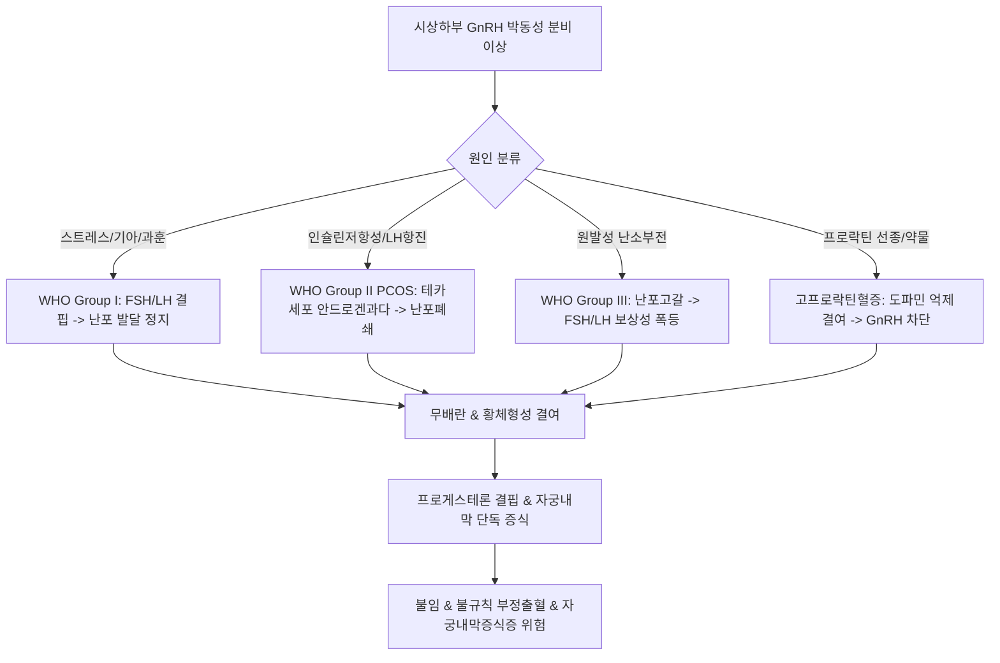

# 🩺 배란 장애 (排卵障碍, Ovulatory Dysfunction / Anovulation)

> **핵심 3줄 요약 (Key Summary)**:
> - 📍 **정의 & 병태생리**: 시상하부-뇌하수체-난소(HPO) 축의 기능적·기질적 결함으로 인해 성숙 난포의 발달, 파열 및 난자 배출이 정상적으로 일어나지 않는 병태. 여성 불임 원인의 약 25~40%를 차지하며, WHO 분류상 시상하부성 무배란(Group I), 정상성선자극성 무배란/PCOS(Group II), 고성선자극성 난소부전(Group III)으로 대별된다.
> - 🚩 **임상 양상**: 무월경(Amenorrhea), 희발월경(Oligomenorrhea), 불규칙한 기능성 자궁출혈, 기초체온 단상성(Monophasic) 변화, 불임.
> - 🛠️ **치료 원칙**: 기저 원인 교정(스트레스 완화, 적정 체중 회복), 레트로졸 또는 클로미펜을 통한 약물성 배란유도, 한의학적 보신조경(補腎調經)·활혈통경(活血通經) 원칙에 따른 [[조경종옥탕]], [[당귀작약산]], [[육미지황탕]] 투여.
> - ⚠️ **응급 의뢰 레드플래그**: 장기 무배란에 따른 무항체성 에스트로겐 지속 노출로 인한 대량 자궁 부정출혈은 심한 빈혈 및 쇼크를 유발할 수 있으며, 자궁내막 증식증 및 악성 종양 감별을 위한 즉각적 산부인과 조직검사 의뢰 필요.

---

## 📌 목차
1. [질환 개요 & 해부학적 병태생리](#1-질환-개요--해부학적-병태생리)
2. [병태생리 메커니즘 & WHO 3대 분류 네트워크](#2-병태생리-메커니즘--who-3대-분류-네트워크)
3. [임상 증상 & 배란 평가 진단 알고리즘](#3-임상-증상--배란-평가-진단-알고리즘)
4. [감별 진단 매트릭스 (Differential Diagnosis)](#4-감별-진단-매트릭스-differential-diagnosis)
5. [한의 통합 치료 프로토콜 (침·약침·한약)](#5-한의-통합-치료-프로토콜-침약침한약)
6. [양방 치료 & 배란유도·의뢰 기준 (Conventional Treatment & Referral)](#6-양방-치료--배란유도의뢰-기준-conventional-treatment--referral)
7. [생활습관 티칭 & 자가 배란 모니터링 가이드](#7-생활습관-티칭--자가-배란-모니터링-가이드)
8. [💡 사용자 진료실 핵심 필기 & 임상 노하우 (Melt-In 잔여 심화 집약)](#8-💡-사용자-진료실-핵심-필기--임상-노하우-melt-in-잔여-심화-집약)
9. [출처 및 학술 참고 문헌 (References)](#9-출처-및-학술-참고-문헌-references)

---

## 1. 질환 개요 & 해부학적 병태생리

### 1) 질환 정의 및 임상적 중요성
- **배란 장애(Ovulatory Dysfunction)**: 정상적인 생리 주기에서 주기적으로 난포가 성숙하여 난자를 방출하는 배란 과정이 불규칙하거나(희발배란) 완전히 결여된(무배란) 상태를 총칭한다.
- 여성 불임증 환자 4명 중 1명 이상에서 관찰되는 가장 흔한 원인 질환이며, 임신 문제 외에도 황체형성 부전에 따른 프로게스테론 결핍으로 비정상 자궁출혈과 자궁내막 질환을 야기한다.

### 2) 정상 배란과 난소 미세구조 해부학
- **우성 난포의 선택**: 주기 초 뇌하수체 [[FSH]] 자극에 의해 여러 동난포 중 난포액 내 에스트라디올([[에스트라디올]]) 농도가 가장 높고 FSH 수용체가 풍부한 단 하나의 난포가 우성 난포(Graafian follicle)로 선택된다.
- **LH 서지(LH Surge)**: 에스트라디올 농도가 임계치(200 pg/mL 이상 48시간 유지)에 도달하면 시상하부-뇌하수체 축의 양성 피드백이 발동하여 황체형성호르몬([[LH]])이 급격히 대량 방출된다.
- **배란 및 황체 형성**: LH 서지 34~36시간 후 단백분해효소(콜라게나아제) 활성화로 난포벽이 파열되어 난자가 복강으로 배출되고, 잔여 과립막세포와 테카세포가 황체화(Luteinization)되어 [[프로게스테론]]을 분비한다. 이 단계 중 어느 하나라도 손상되면 배란 장애가 발생한다.

---

## 2. 병태생리 메커니즘 & WHO 3대 분류 네트워크

### 1) 세계보건기구(WHO)의 배란 장애 3대 분류
- **WHO Group I (저성선자극호르몬성 저에스트로겐 무배란, 5~10%)**:
  - 원인: 시상하부 또는 뇌하수체 부전(체중 급감, 거식증, 과도한 운동, 심한 정신적 스트레스, 칼만 증후군).
  - 소견: [[FSH]], [[LH]] 모두 저하, [[에스트라디올]] 결핍, 프로게스틴 소퇴성 출혈 음성.
- **WHO Group II (정상성선자극호르몬성 정원에스트로겐 배란장애, 70~85%)**:
  - 원인: [[다낭성 난소 증후군]](PCOS), 인슐린 저항성, 비만.
  - 소견: FSH 정상 또는 경도 저하, LH 상승, 정상~상승된 에스트로겐, 프로게스틴 소퇴성 출혈 양성.
- **WHO Group III (고성선자극호르몬성 저에스트로겐 난소부전, 10~15%)**:
  - 원인: 조기 난소 부전([[조기 난소 부전]], POI), 난소 수술 또는 방사선 치료 후, 터너 증후군 등 유전적 이상.
  - 소견: 난소 난포 고갈로 인한 FSH/LH의 극단적 상승, 에스트라디올 결핍.
- **기타 분류 (고프로락틴혈증)**: 프로락틴 상승에 의한 GnRH 박동성 분비 억제.

### 2) 배란 장애의 신경내분비 병태생리 도식

---

## 3. 임상 증상 & 배란 평가 진단 알고리즘

### 1) 주요 임상 증상
- **월경 주기 이상**: 35일 이상의 희발월경, 3개월 이상의 무월경, 예측 불가능한 불규칙 출혈.
- **배란 관련 징후 결여**: 배란기 자궁경관점액의 양 및 신장성 증가(스핀바르카이트) 소실, 배란통 결여, 월경전 긴장증의 결여.
- **전신 증상**: 비만, 다모증, 여드름(PCOS형), 급격한 체중감소, 저체온, 서맥(시상하부성), 안면홍조, 야간발한(난소부전형).

### 2) 배란 유무 확인을 위한 검사 프로토콜
- **기초체온표(BBT)**: 프로게스테론의 체온상승 효과를 확인. 배란 후 고온기(0.3~0.5도 상승)가 11일 이상 지속되지 않고 단상성을 나타내면 무배란.
- **황체기 중기 혈청 프로게스테론**: 예상 월경 7일 전(28일 주기의 경우 21일째) 혈청 프로게스테론 측정. 3 ng/mL 미만은 무배란, 10 ng/mL 이상이면 적절한 배란 및 황체기능으로 판단.
- **연속 질식 초음파 난포 추적(Folliculometry)**: 우성 난포가 직경 18~24 mm까지 성장한 후 파열되어 크기가 급격히 줄어들고 더글라스와(Cul-de-sac)에 소량의 액체가 고이는 소견 확인.
- **소변 LH 검사키트**: 배란 전 LH 서지 검출.

---

## 4. 감별 진단 매트릭스 (Differential Diagnosis)

| 감별 질환 | 호발 원인 및 특이 소견 | 혈액학적 핵심 소견 | 감별 포인트 |
| :--- | :--- | :--- | :--- |
| **[[다낭성 난소 증후군]](PCOS)** | 가임기 여성, 비만, 다모증, PCOM | LH/FSH 비율 상승, AMH 상승, 안드로겐 상승 | WHO Group II의 대표 질환 |
| **기능성 시상하부성 무월경** | 극단적 체중감소, 섭식장애, 과훈 선수 | FSH, LH, E2 모두 저하 | WHO Group I, 체중 회복 시 가역적 |
| **[[조기 난소 부전]](POI)** | 40세 이전 발생, 안면홍조 등 갱년기 증상 | FSH > 25~40 IU/L, AMH 고갈 | WHO Group III, 비가역적 난포 소실 |
| **[[고프로락틴혈증]]** | 유즙누출증, 뇌하수체 미세선종, 약물복용 | 혈청 Prolactin > 25 ng/mL | 프로락틴 단독 상승, 뇌 MRI 검사 |
| **[[갑상선기능항진증]] / 저하증** | 체중변화, 피로, 맥박수 변화, 갑상선종대 | TSH, Free T4 이상 | 갑상선 자가항체 및 호르몬 교정 시 정상화 |

---

## 5. 한의 통합 치료 프로토콜 (침·약침·한약)

### 1) 변증별 한약 처방 프로토콜
- **신허형(腎虛型) — 신음허 / 신양허**:
  - 주증: 초경 지연, 월경주기 연장, 희발월경, 요슬산연, 어지럼증, 이명.
  - 대표 처방: [[육미지황탕]], [[귀신환]], [[좌귀음]], [[우귀음]].
  - 치법: 보신익정(補腎益精), 자음양혈(滋陰養血)하여 난포 성숙 유도.
- **기혈허약형(氣血虛弱型) / 시상하부성 기능 저하**:
  - 주증: 마른 체형, 극심한 다이어트 후 무경, 만성 피로, 안색 위황, 설담태백.
  - 대표 처방: [[팔진탕]], [[십전대보탕]], [[인삼양영탕]].
  - 치법: 보기양혈(補氣養血), 건비보신(健脾補腎).
- **간울기체형(肝鬱氣滯型) / 기체혈어**:
  - 주증: 심한 정서적 스트레스, 흉협창만, 유방 팽만감, 하복 창통.
  - 대표 처방: [[조경종옥탕]], [[가미소요산]], [[시호소간산]].
  - 치법: 소간해울(疏肝解鬱), 이기조경(理氣調經).
- **습담조체형(濕痰阻滯型) / 비만형 배란장애**:
  - 주증: 과체중, 백대하 과다, 두중감, 설태 백니, 맥활.
  - 대표 처방: [[창부도담탕]], [[도담탕]] 가감.
  - 치법: 조습화담(燥濕化痰), 활혈통락(活血通絡).

### 2) 침구 치료 프로토콜
- **주요 혈위**: [[관원]](CV4), [[중극]](CV3), [[기해]](CV6), [[삼음교]](SP6), [[혈해]](SP10), [[족삼리]](ST36), [[자궁]](EX-CA1), [[신수]](BL23).
- **시술 기전**: 주기별 침치료(난포기 보신양혈, 배란기 활혈통경, 황체기 온신조양)를 통해 자궁 및 난소 동맥 혈류 저항지수(RI)를 낮추고 자궁내막 수용성을 증진.

---

## 6. 양방 치료 & 배란유도·의뢰 기준 (Conventional Treatment & Referral)

### 1) 표준 배란유도 요법
- **레트로졸(Letrozole)**:
  - 기전: 가역적 아로마타제 억제제로 중추 에스트로겐 농도를 일시 저하시켜 내인성 FSH 분비를 촉진.
  - 용법: 월경 3~5일째부터 2.5~5.0 mg씩 5일간 경구 투여 (클로미펜 대비 자궁내막 위축 부작용이 적고 단일 난포 배란율 우수).
- **클로미펜(Clomiphene citrate)**:
  - 기전: 시상하부 에스트로겐 수용체 차단제로 음성 피드백을 차단하여 성선자극호르몬 분비 촉진.
  - 용법: 50~100 mg씩 5일간 투여 (단, 장기 사용 시 항에스트로겐 효과로 경관점액 저하 및 내막 얇아짐 유발).
- **성선자극호르몬 요법 (hMG, rFSH)**:
  - 경구 배란유도제에 저항성을 보이는 경우 투여. 엄격한 초음파 난포 모니터링 필수.
- **도파민 작용제 (카베골린, 브로모크립틴)**: 고프로락틴혈증성 배란장애의 1차 치료.

### 2) 병용 요법 및 전원 의뢰 기준
- **한양방 병용**: 양방 배란유도제 복용 시 자궁내막 두께 얇아짐 부작용에 대해 한방 활혈보혈(當歸, 丹參 등) 한약 병용 시 자궁내막 혈류 및 수용성 개선.
- **전원의뢰**: 배란유도 후 3~6주기 이상 임신 실패 시 체외수정(IVF) 등 보조생식술 의뢰.

---

## 7. 생활습관 티칭 & 자가 배란 모니터링 가이드

### 1) 영양 및 체중 관리
- **BMI 정상화**: 저체중(BMI < 18.5) 환자는 영양 섭취 증대 및 에너지 가용성 확보가 최우선이며, 비만(BMI > 25) 환자는 5~10% 체중 감량이 배란 회복의 선결 조건.
- **균형 잡힌 지방 섭취**: 불포화지방산(오메가-3) 섭취를 늘리고 트랜스지방 및 단순당 섭취 제한.

### 2) 스트레스 완화 및 생활 리듬
- **수면의 질 확보**: 멜라토닌 분비 정상화는 난포액 내 항산화 환경을 조성하므로 야간 7~8시간의 규칙적 수면 필수.
- **과도한 고강도 운동 제한**: 마라톤, 크로스핏 등 체지방 고갈을 유발하는 운동은 저성선성 배란장애를 악화시키므로 중등도 유산소 운동으로 전환.

---

## 8. 💡 사용자 진료실 핵심 필기 & 임상 노하우 (Melt-In 잔여 심화 집약)

### 1) 진료실에서 배란 장애를 진단하는 3단계 접근법
- 첫째, 월경 주기의 규칙성과 기초체온표(BBT)를 통해 무배란 여부를 먼저 확인한다.
- 둘째, 혈청 호르몬 검사([[FSH]], [[LH]], E2, Prolactin, TSH, AMH)를 통해 WHO Group I, II, III 중 어디에 속하는지 정확히 위치를 특정해야 한다.
- 셋째, 프로게스테론 소퇴성 출혈 검사(황체호르몬 투여 후 소퇴성 출혈 여부)를 통해 체내 에스트로겐 분비 능력이 보존되어 있는지 파악한다(출혈 시 Group II, 무출혈 시 Group I 또는 III).

### 2) 한의학적 주기 조절 요법(Cycle Therapy)의 묘미
- 배란 장애 환자에게 단일 처방을 한 달 내내 투여하기보다는 여성의 생리 주기에 맞춘 단계별 변증 치료가 훨씬 우수한 임상 성적을 낸다.
  - **난포기(월경 종료 후~배란 전)**: 난포의 성숙과 내막 증식을 위해 보신양혈(補腎養血, [[육미지황탕]], 사물탕 계열) 위주 처방.
  - **배란기(예상 배란일 전후 3~5일)**: 기혈 순환을 극대화하여 난포 파열을 유도하기 위해 활혈소간(活血疏肝, [[조경종옥탕]], [[단치소요산]] 가감) 처방.
  - **황체기(배란 후~월경 전)**: 황체 기능 유지와 착상을 위해 온신건비(溫腎健脾, [[당귀작약산]], 이천토영단 계열) 처방.

### 3) 만성 무배란과 자궁내막 보호의 필수성
- 무배란 상태가 지속되면 자궁내막이 프로게스테론의 반대 없이 에스트로겐의 지속적 자극을 받아 비정상적으로 증식하게 된다.
- 이는 불규칙한 파탄성 출혈(Breakthrough bleeding)뿐 아니라 젊은 여성에서도 [[자궁내막증식증]] 및 악성 종양의 위험을 비가역적으로 높인다.
- 따라서 임신을 원하지 않는 환자라 하더라도 최소 2~3개월에 1회는 소퇴성 출혈을 유도하여 자궁내막을 탈락시켜 주는 관리가 반드시 병행되어야 한다.

---

## 9. 출처 및 학술 참고 문헌 (References)

Violette. (2026). Understanding and Addressing Anovulatory Infertility. *Endocrinol Metab Clin North Am*. PMID: 42907060.

Tadesse. (2026). Clomiphene citrate in the management of anovulation: a review of mechanisms, outcomes, and clinical challenges. *Gynecol Endocrinol*. PMID: 41863134.

Chen. (2025). Causality and potential drug targets for hyperandrogenism and anovulation-related infertility: two-sample Mendelian randomization and colocalization analyses. *J Ovarian Res*. PMID: 41353542.
