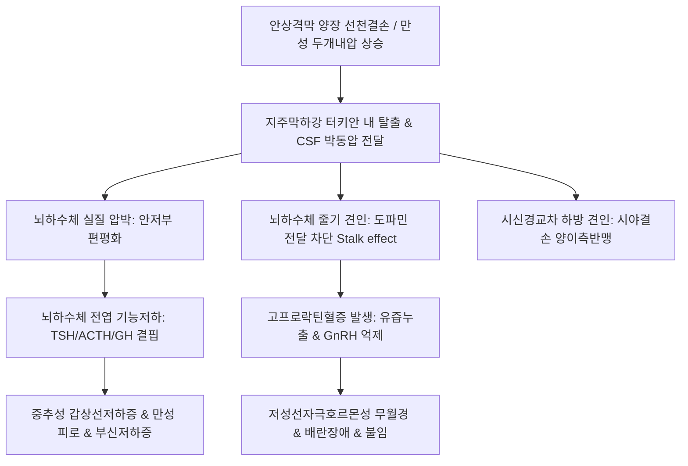

# 🩺 빈양장 증후군 (Empty Sella Syndrome / 腦下垂體鞍空虛症候群, ESS)

> **핵심 3줄 요약 (Key Summary)**:
> - 📍 **정의 & 병태생리**: 뇌하수체 상부를 덮는 안상격막(양장, Diaphragma sellae)의 선천적 결손이나 불완전성, 혹은 만성 두개내압 상승으로 지주막하강이 안와(Sella turcica, 터키안) 내부로 탈출하여 뇌척수액(CSF)이 차고 뇌하수체가 후하방으로 압박·위축되는 신경내분비 질환.
> - 🚩 **임상 양상**: 만성 두통, 시야 장애(시신경교차 압박), 고프로락틴혈증([[고프로락틴혈증]])에 의한 유즙누출증 및 무월경([[무월경]]), 뇌하수체 전엽 기능 저하증(2차성 성선기능저하증, 중추성 [[갑상선기능저하증]], 부신피질기능저하증), 불임.
> - 🛠️ **치료 원칙**: 무증상 일차성 ESS는 정기적 MRI 및 호르몬 추적 관찰, 결핍 호르몬(갑상선호르몬, 글루코코르티코이드, 에스트로겐/프로게스틴) 보충, 한의학적으로 보신익정(補腎益精)·승청강탁(升淸降濁)에 따른 [[보중익기탕]], [[육미지황탕]], [[귀비탕]] 투여.
> - ⚠️ **응급 의뢰 레드플래그**: 급격한 시력 저하 또는 양이측 반맹(Bitemporal hemianopsia), 지속적인 뇌척수액 비루(CSF rhinorrhea, 맑은 콧물 누출), 급성 부신 위기(Adrenal crisis: 저혈압 쇼크, 저나트륨혈증, 의식 저하) 발생 시 즉시 응급 신경외과·내분비내과 전원의뢰 필요.

---

## 📌 목차
1. [질환 개요 & 해부학적 병태생리](#1-질환-개요--해부학적-병태생리)
2. [병태생리 메커니즘 & 신경내분비 압박 네트워크](#2-병태생리-메커니즘--신경내분비-압박-네트워크)
3. [임상 증상 & 신경내분비 진단 알고리즘](#3-임상-증상--신경내분비-진단-알고리즘)
4. [감별 진단 매트릭스 (Differential Diagnosis)](#4-감별-진단-매트릭스-differential-diagnosis)
5. [한의 통합 치료 프로토콜 (침·약침·한약)](#5-한의-통합-치료-프로토콜-침약침한약)
6. [양방 치료 & 호르몬 대체·수술 의뢰 기준 (Conventional Treatment & Referral)](#6-양방-치료--호르몬-대체수술-의뢰-기준-conventional-treatment--referral)
7. [생활습관 티칭 & 두개내압 관리 가이드](#7-생활습관-티칭--두개내압-관리-가이드)
8. [💡 사용자 진료실 핵심 필기 & 임상 노하우 (Melt-In 잔여 심화 집약)](#8-💡-사용자-진료실-핵심-필기--임상-노하우-melt-in-잔여-심화-집약)
9. [출처 및 학술 참고 문헌 (References)](#9-출처-및-학술-참고-문헌-references)

---

## 1. 질환 개요 & 해부학적 병태생리

### 1) 질환 정의 및 분류
- **빈양장 증후군(Empty Sella Syndrome, ESS)**: 두개골 기저부 접형골에 위치한 터키안(Sella turcica) 내부가 뇌하수체 실질 대신 뇌척수액(CSF)으로 채워져, 영상의학적으로 안와 내부가 '비어 있는 것처럼' 관찰되는 병태이다.
- **일차성(Primary ESS)**: 터키안 상부를 덮는 경막 구조물인 **안상격막(양장, Diaphragma sellae)**의 선천적 결손이나 이완, 그리고 특발성 두개내압 상승(IIH)이 결합하여 발생하며, 중년 비만 여성 및 다산부에서 호발한다.
- **이차성(Secondary ESS)**: 뇌하수체 선종의 자발성 경색/출혈(뇌하수체 졸중), 수술적 절제, 방사선 치료, 또는 종양·혈종에 의해 뇌하수체가 압박·괴사된 후 안와가 위축되며 발생한다.

### 2) 터키안 부위의 해부학적 구조
- **터키안(Sella turcica)**: 뇌하수체가 안착하는 접형골의 안장 모양 오목한 골성 구조물.
- **안상격막(양장, Diaphragma sellae)**: 경막의 주름으로 뇌하수체 오목을 지주막하강과 분리하며, 중앙에 뇌하수체 줄기(Infundibulum)가 통과하는 작은 구멍이 있다. 이 격막이 결손되면 지주막과 맥락총 유래 뇌척수액이 터키안 내로 탈출(Herniation)한다.
- **시신경교차(Optic Chiasm)**: 터키안 상방 5~10 mm에 위치하여, 격막 결손이나 뇌하수체 탈출 시 견인되거나 압박받아 시야 결손을 초래한다.

---

## 2. 병태생리 메커니즘 & 신경내분비 압박 네트워크

### 1) 뇌척수액 박동성 압박과 호르몬 분비 교란
- **지주막하강 박동성 탈출**: 안상격막 결손 부위를 통해 지주막과 뇌척수액이 터키안 내부로 유입되어 지속적인 정수압(Hydrostatic pressure)과 박동압을 가한다.
- **뇌하수체 실질 압박**: 뇌하수체 전엽과 후엽이 안와의 저부 및 후벽으로 납작하게 압착(Pancaking)된다. 실질의 50% 이상이 압박되어도 상당수 환자는 기저 호르몬 분비를 유지하나, 미세혈류 장애 시 단계적 전엽 기능 저하가 유발된다.
- **뇌하수체 줄기(Pituitary stalk) 견인 및 압박**:
  - 도파민 차단 효과(Stalk effect): 시상하부에서 분비되는 도파민([[도파민]])의 하강 전달이 차단되어, 뇌하수체 유즙분비세포의 긴장성 억제가 풀리면서 경도~중등도의 **고프로락틴혈증([[고프로락틴혈증]])**이 발생한다.
  - 이로 인해 [[FSH]] 및 [[LH]] 분비가 억제되어 무월경, 희발월경, 무배란성 불임이 초래된다.

### 2) 병태생리 악순환 도식

---

## 3. 임상 증상 & 신경내분비 진단 알고리즘

### 1) 주요 임상 증상
- **신경학적 증상**: 만성 지속성 두통(환자의 60~80%), 현훈, 두중감.
- **내분비 및 부인과 증상**: 무월경([[무월경]]), 희발월경, 성욕 감퇴, 유즙 누출증(Galactorrhea), 불임증.
- **전신 대사 저하 증상**: 중추성 갑상선기능저하증([[갑상선기능저하증]])으로 인한 극심한 피로, 체중 증가, 한냉불내성, 부종, 심낭삼출(Pericardial effusion).
- **시각 증상**: 시야 흐림, 시력 감퇴, 양안 외측 시야 결손(Bitemporal hemianopsia).

### 2) 영상 및 호르몬 진단 프로토콜
- **뇌 자기공명영상(Sella MRI)**: 표준 확진 검사. 터키안 내 CSF 신호 강도 충만(T1 저신호, T2 고신호), 뇌하수체 높이 2 mm 미만으로 편평화, 터키안 골성 확장 확인. 부분 빈양장(Partial, 실질 > 50% 잔존) 대 완전 빈양장(Complete, CSF > 50%) 감별.
- **기저 호르몬 선별 패널**:
  - 혈청 프로락틴, [[FSH]], [[LH]], [[에스트라디올]], TSH, Free T4, 8시 아침 혈청 코르티솔, ACTH, IGF-1.
- **복합 뇌하수체 자극검사(Combined Pituitary Stimulation Test)**: 다발성 전엽 기능저하증 의심 시 시행.

---

## 4. 감별 진단 매트릭스 (Differential Diagnosis)

| 감별 질환 | 호발 기전 및 병력 | MRI 및 호르몬 소견 | 빈양장 증후군과의 차이점 |
| :--- | :--- | :--- | :--- |
| **[[시한 증후군]](Sheehan's)** | 분만 시 대량 출혈(PPH) 및 저혈압 쇼크 | 터키안 내 뇌하수체 허혈성 괴사, 전엽부전 | 명확한 분만 후 무유증·무월경 병력 |
| **뇌하수체 미세선종** | 프로락틴 선종 등 자율 분비 | 터키안 내 10mm 미만 결절성 조영증강 | 프로락틴 수치 현저히 고농도(> 100~200 ng/mL) |
| **라트케낭종(Rathke's cleft cyst)** | 라트케낭 잔유물 내 액체 축적 | 터키안 내 균일한 낭성 병변, 격막 정상 | 낭종 내용물 단백질 농도에 따라 다양한 T1 신호 |
| **두개인두종(Craniopharyngioma)** | 시상하부-터키안 상부 양성 종양 | 석회화 동반 혼합 낭포성 종괴 | 소아·청소년 호발, 상방 종괴 형성 |
| **특발성 두개내 고혈압(IIH)** | 가임기 비만 여성, 시신경유두부종 | 뇌실 정상, 정맥동 협착, 부분 ESS 동반 | 시신경유두부종 및 요추천자 뇌압 > 250 mmH2O |

---

## 5. 한의 통합 치료 프로토콜 (침·약침·한약)

### 1) 변증별 한약 처방 프로토콜
- **신양허(腎陽虛) / 명문화쇠(命門火衰)**:
  - 주증: 무월경, 극심한 추위 탐, 전신 무기력, 안색 창백, 요슬산랭, 설담태백, 맥침지미약.
  - 대표 처방: [[우귀음]], [[신기환]], [[온포음]] 가감(부자, 육계, 음양곽, 녹각교).
  - 치법: 온신장양(溫腎壯陽), 익정전수(益精塡髓).
- **비신양허(脾腎兩虛) / 기혈부족(氣血不足)**:
  - 주증: 만성 피로, 소화불량, 부종, 두통, 월경 결여, 설체반 치흔, 맥세완.
  - 대표 처방: [[보중익기탕]], [[팔진탕]], [[인삼양영탕]] 가감.
  - 치법: 보기건비(補氣健脾), 승청양혈(升淸養血).
- **간울신허(肝鬱腎虛) / 충임실조(衝任失調)**:
  - 주증: 고프로락틴혈증 동반, 유방 창통, 정서 억울, 불면, 현훈, 맥현세.
  - 대표 처방: [[가미소요산]], [[귀비탕]] 가감(맥아 초, 백작약, 시호, 산조인).

### 2) 침구 치료 및 신경안정 혈위
- **주요 혈위**: [[백회]](GV20), [[풍지]](GB20), [[태양]](EX-HN5), [[인당]](EX-HN3), [[관원]](CV4), [[삼음교]](SP6), [[태충]](LR3), [[신수]](BL23).
- **두개안면 혈류 개선 자침**: 풍지-백회 전침 자극으로 뇌저 혈류 순환을 촉진하고 경항부 근막 긴장을 이완하여 두통 경감.

---

## 6. 양방 치료 & 호르몬 대체·수술 의뢰 기준 (Conventional Treatment & Referral)

### 1) 양방 보존적 및 내분비 치료
- **무증상 환자**: 치료 불필요, 1~2년 간격의 추적 내분비 혈액검사 및 임상 증상 관찰.
- **호르몬 결핍 치료**:
  - 중추성 갑상선저하증: 레보티록신(Levothyroxine) 보충 (단, 부신피질부전 동반 시 하이드로코르티손을 먼저 투여해야 급성 부신 위기 예방 가능).
  - 2차성 성선기능저하증: 가임기 여성에서 에스트로겐/프로게스틴 순환 요법(HRT) 투여로 골다공증 및 심혈관 질환 예방.
  - 고프로락틴혈증: 도파민 작용제(카베골린, 브로모크립틴) 저용량 투여.
- **불임 치료**: 배란 장애 시 성선자극호르몬(GnRH 펌프 또는 고나도트로핀) 투여로 난포 발달 유도.

### 2) 수술적 치료 적응증 및 의뢰
- **적응증**: 지속적 뇌척수액 비루(CSF rhinorrhea: 수막염 위험), 시신경교차 압박에 의한 진행성 시야 결손, 중증 두개내압 상승.
- **수술 기법**: 경접형동 접근법(Transsphenoidal approach)을 통한 터키안 패킹(Chiasmopexy, 자가 지방/근막/연골 이식).

---

## 7. 생활습관 티칭 & 두개내압 관리 가이드

### 1) 두개내압 상승 방지 생활습관
- **복압 및 흉강내압 급상승 차단**: 만성 변비 치료, 무거운 물건 들기, 과도한 발살바(Valsalva) 동작 자제.
- **적정 체중 감량**: 특발성 두개내압 상승을 동반한 비만 환자에서 체중 5~10% 감량은 뇌척수액 압력을 감소시켜 두통 완화.

### 2) 저혈압 및 전해질 모니터링
- 부신피질호르몬 결핍 환자는 탈수 및 저나트륨혈증 위험이 높으므로 충분한 수분 및 적정 염분 섭취, 정기 전해질 검사 필수.

---

## 8. 💡 사용자 진료실 핵심 필기 & 임상 노하우 (Melt-In 잔여 심화 집약)

### 1) 뇌하수체 아래 지주막(양장) 결손의 병리적 통찰
- 빈양장 증후군은 뇌하수체 하부 및 상부를 지지하는 지주막인 '양장(Diaphragma sellae)'의 선천적 결손이나 불완전성에 기인한다.
- 뇌종양, 두개내 혈종, 만성 뇌압 상승이 동반되는 경우 뇌하수체가 아래로 강하게 밀리면서 양장을 파열시키거나 손상시킬 수 있다.
- 임상에서 원인 불명의 만성 두통과 함께 생리 불순(무월경, 희발월경)이 지속되는 중년 여성 환자를 접할 때, 뇌하수체 선종뿐만 아니라 빈양장 증후군을 반드시 감별 질환 목록에 올려야 한다.

### 2) 호르몬 보충 순서의 절대 원칙 (Adrenal First)
- 빈양장 증후군으로 인해 전엽 기능 부전이 다발성으로 발생한 경우, 갑상선 호르몬(신지로이드)을 부신피질 호르몬보다 먼저 투여하면 간의 코르티솔 대사가 급격히 촉진되어 치명적인 '급성 부신 위기(Adrenal Crisis)'가 발생할 수 있다.
- 따라서 반드시 혈청 코르티솔 및 ACTH 수치를 먼저 확인하고, 부신 결핍이 동반되어 있다면 글루코코르티코이드를 선행 투여한 후 갑상선 호르몬을 보충해야 한다.

---

## 9. 출처 및 학술 참고 문헌 (References)

Mandal. (2026). Refractory Pericardial Effusion Secondary to Central Hypothyroidism due to Empty Sella Syndrome: A Rare Case Report. *Clin Case Rep*. PMID: 42840647.

Houjjaj. (2026). Successful Pregnancy in a Woman With Primary Infertility Associated With Isolated Hypogonadotropic Hypogonadism and Partial Empty Sella Syndrome: A Case Report. *Cureus*. PMID: 42333326.

Bahati. (2026). Bilateral Blindness in a Patient With Vestibular Schwannoma and Empty Sella Syndrome: A Case Report. *Cureus*. PMID: 41694899.
