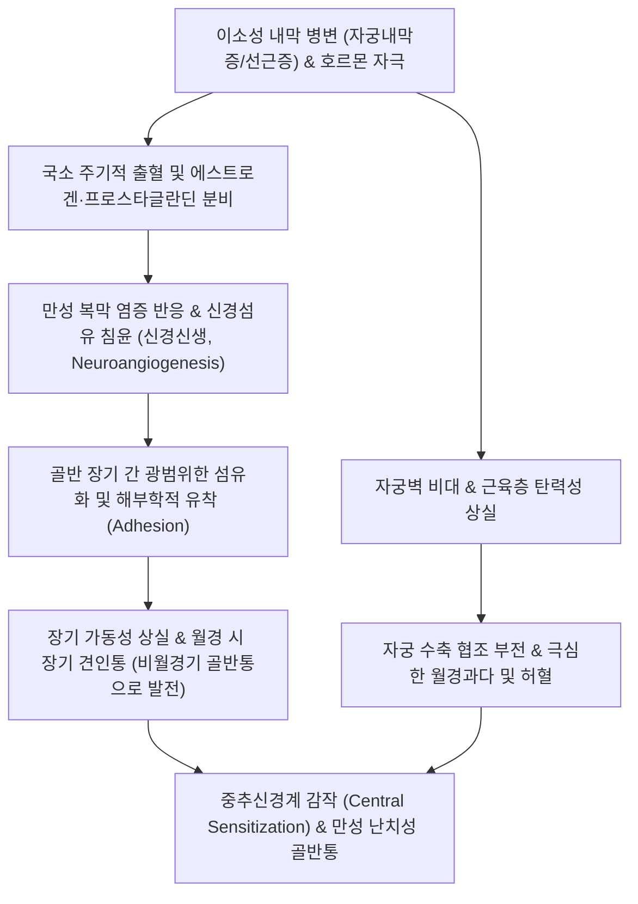
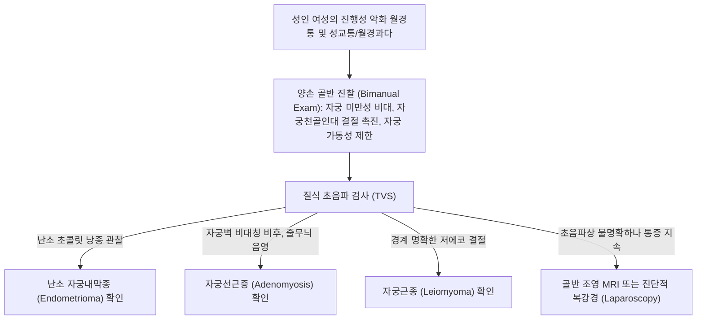

# 🩺 속발성 월경곤란증 (Secondary Dysmenorrhea / 續發性 月經困難症)

> **핵심 3줄 요약 (Key Summary)**:
> - 📍 **병소 부위 & 해부·병태생리**: 자궁 및 골반강 내 식별 가능한 기질적 병변([[자궁내막증]], [[자궁선근증]], [[자궁근종]], [[골반염]], 자궁경관 협착 등)에 의해 유발되는 이차적 골반 통증 증후군.
> - 🚩 **전형적 임상 양상**: 초경 수년 후(보통 25세 이후) 새롭게 시작되어 점진적으로 악화됨, 월경 시작 1~2주 전부터 통증 발생하여 월경 출혈 중 및 종료 후에도 지속, 성교통(Dyspareunia), 배변통(Dyschezia), 월경과다(Menorrhagia), 비월경기 만성 골반통 동반.
> - 🛠️ **핵심 검사 & 치료 전략**: 양손 골반 진찰(자궁 비대, 자궁천골인대 결절 압통), 질식 초음파(TVS) 및 골반 MRI, 확진 및 병기 결정을 위한 진단적 복강경(Laparoscopy); 원인 기질 질환의 수술적/약물적(호르몬 제제, 레보노르게스트렐 IUS) 제어, 한의학적 파혈소징·활혈거어(혈부축어탕/계지복령환) 병용.
> - ⚠️ **응급 의뢰 레드플래그**: 골반 난소 자궁내막종(초콜릿 낭종)의 파열로 인한 급성 복막염 징후, 다량의 월경과다로 인한 중증 빈혈(Hb < 7 g/dL) 및 혈역학적 불안정, 난소 낭종 염전(Torsion), 악성 종양 의심 시 산부인과 응급 의뢰.

---

## 📌 목차
1. [질환 개요 & 해부학적 병태생리](#1--질환-개요---해부학적-병태생리)
2. [병태생리 메커니즘 & 생체역학적 악순환 네트워크](#2--병태생리-메커니즘---생체역학적-악순환-네트워크)
3. [임상 증상 & 이학적 검사 알고리즘](#3--임상-증상---이학적-검사-알고리즘)
4. [감별 진단 매트릭스](#4--감별-진단-매트릭스)
5. [한의 통합 치료 프로토콜](#5--한의-통합-치료-프로토콜)
6. [양방 치료 & 병용·의뢰 기준](#6-양방-치료--병용의뢰-기준)
7. [재활 운동 & 생활습관 티칭 가이드](#7--재활-운동---생활습관-티칭-가이드)
8. [💡 사용자 진료실 핵심 필기 & 임상 노하우](#8--사용자-진료실-핵심-필기---임상-노하우)
9. [📚 출처 및 현대 학술 연구 요약 (References)](#9--출처-및-현대-학술-연구-요약-references)

---

## 1. 질환 개요 & 해부학적 병태생리

### 1) 질환 정의 및 임상적 특징
- **속발성 월경곤란증(Secondary Dysmenorrhea, 기질성 월경통)**은 골반 내의 명백한 해부학적·기질적 질환으로 인해 발생하는 월경통이다.
- 원발성 월경곤란증이 프로스타글란딘 과다에 의한 기능성 경련인 반면, 속발성은 기질적 조직 증식, 유착, 염증, 혈관 울혈 및 기계적 압박이 통증의 근본 원인이다.
- 전체 월경통 환자의 약 10~25%를 차지하며, 나이가 들수록(특히 30~40대 여성) 발생 빈도가 현저히 증가한다.

### 2) 주요 원인 질환 및 해부학적 병소
- **[[자궁내막증]] (Endometriosis)**:
  - 가장 흔한 원인 질환(속발성 월경통의 60~70% 이상).
  - 자궁내막 조직이 난소, 자궁천골인대, 더글라스와(Cul-de-sac), 복막, 장관 등에 이소성으로 착상하여 주기적 출혈, 섬유화 및 골반 장기 간 광범위한 유착을 유발.
- **[[자궁선근증]] (Adenomyosis)**:
  - 자궁내막 기질 및 선조직이 자궁 평활근층 내부로 침윤하여 자궁벽 전체가 미만성으로 비대해짐.
  - 심한 월경통과 함께 빈혈을 동반하는 월경과다 유발.
- **[[자궁근종]] (Uterine Leiomyoma)**:
  - 특히 점막하 근종(Submucosal) 또는 거대 근층내 근종.
  - 자궁 수축 장애, 울혈 및 월경혈 배출 장애 유발.
- **기타 원인**:
  - 만성 골반염(PID) 후유증에 의한 난관-난소 유착, 자궁경관 협착증(Cervical stenosis), 골반 정맥 울혈 증후군, 선천성 뮐러관 기형.

---

## 2. 병태생리 메커니즘 & 생체역학적 악순환 네트워크

### 1) 만성 염증과 신경 신생 (Neuroangiogenesis)
- 이소성 자궁내막 병변은 대식세포를 활성화하여 다량의 염증성 사이토카인([[IL-1]], [[IL-6]], [[TNF-alpha]], VEGF, NGF)을 방출한다.
- 신경성장인자(NGF)에 의해 병변 주위로 감각 신경 섬유(A-delta 및 C 섬유)가 신생 증식하여 통증 역치가 극단적으로 낮아진다.
- 지속적인 유해 자극은 척수 및 뇌의 **중추 감작(Central sensitization)**을 유발하여 비월경기에도 통증이 지속되는 만성 골반통 증후군으로 이행한다.

### 2) 섬유화 유착과 기계적 견인통
- 반복되는 출혈과 흡수 과정에서 섬유아세포가 증식하여 자궁, 난소, 직장, 방광이 하나의 덩어리로 엉겨 붙는 '동결 골반(Frozen pelvis)'이 형성된다.
- 월경 시 골반 울혈이 더해지면 유착 부위가 당겨지면서 극심한 견인통과 배변통, 심부 성교통이 발생한다.

---

## 3. 임상 증상 & 이학적 검사 알고리즘

### 1) 주요 임상 증상
- **통증 양상**:
  - 월경 시작 1~2주 전부터 하복부 및 골반 둔통이 시작되어 월경 기간 내내 지속되고, 월경 출혈이 끝난 후에도 며칠간 통증이 지속됨.
  - 시간이 지날수록 통증의 강도가 점진적으로 악화되는 진행성(Progressive) 경과.
- **3대 부인과적 동반 증상**:
  - **월경통 (Dysmenorrhea)**: 지속적이고 둔한 심부 골반통.
  - **성교통 (Dyspareunia)**: 특히 깊은 삽입 시 발생하는 심부 골반통 (자궁천골인대 및 더글라스와 병변 시 전형적).
  - **배변통 (Dyschezia)**: 배변 시 직장 및 골반 안쪽을 찌르는 듯한 통증.
- **월경 이상**: 월경과다, 부정출혈, 월경 주기 연장.
- **난임 (Infertility)**: 골반 유착 및 난소 기능 저하로 인한 불임증 동반.

### 2) 이학적 검사 및 진단 알고리즘

---

## 4. 감별 진단 매트릭스

| 질환명 | 호발 연령 | 통증 시작 시점 | 동반 주 증상 | 초음파 / MRI 영상 소견 | 1차 표준 치료 |
| :--- | :--- | :--- | :--- | :--- | :--- |
| **속발성 월경곤란증** | 25~45세 | 월경 1~2주 전 ~ 종료 후까지 | 진행성 통증, 성교통, 배변통, 월경과다 | 기질적 병변 (내막종, 선근증, 근종 등) | 원인 질환별 약물/수술 |
| **[[원발성 월경곤란증]]** | 10대~20대 초반 | 월경 직전/직후 ~ 48시간 내 | 쥐어짜는 산통, 오심/구토/설사 | 정상 (기질적 병변 없음) | NSAIDs, 경구피임약 |
| **만성 골반염 (PID)** | 성활발기 여성 | 비주기적 통증, 월경 시 악화 | 농성 대하, 자궁경부거상통, 발열 | 난관수종, 난관-난소 농양 | 광범위 복합 항생요법 |
| **골반 울혈 증후군** | 다산부, 30대 | 하루 일과 후, 오래 서 있을 때 | 만성 둔통, 외음부 정맥류 | 난소정맥 확장 및 역류 소견 | 난소정맥 색전술 |

---

## 5. 한의 통합 치료 프로토콜

### 1) 한의 변증 분류
- **어혈결체·징하형 (瘀血結滯·癥瘕型)** — 자궁내막증/선근증 다발:
  - 주증: 월경 전부터 아랫배가 찌르듯 쑤시고 아픔, 거안(拒按), 월경혈 암흑색 및 대형 혈괴, 심한 성교통, 골반 내 단단한 결절, 설암자, 어반, 맥침삽.
  - 치법: 활혈화어(活血化瘀), 파징소적(破癥消積), 온경지통(溫經止痛).
  - 처방: [[혈부축어탕]](血府逐瘀湯) 합 [[계지복령환]](桂枝茯苓丸) 가감 (당귀 12g, 생지황 12g, 도인 10g, 홍화 8g, 지각 8g, 적작약 10g, 시호 6g, 천궁 8g, 우슬 10g, 삼릉 8g, 봉출 8g).
- **기체혈어형 (氣滯血瘀型)**:
  - 주증: 월경 전 하복부 팽만통 심함, 유방 창통, 정서적 억울 시 통증 악화, 설자태백, 맥현.
  - 치법: 소간이기(疏肝理氣), 활혈통경(活血通經).
  - 처방: [[시호소간산]](柴胡疏肝散) 합 실소산 가감 (시호 8g, 백작약 15g, 지각 8g, 향부자 10g, 오령지 10g, 포황 10g, 연호색 12g).
- **한응어체형 (寒凝瘀滯型)**:
  - 주증: 아랫배가 차고 쑤시며 따뜻하게 하면 통증 완화, 월경혈 암색 및 혈괴, 사지냉, 설담암, 맥침긴.
  - 치법: 온경산한(溫經散寒), 활혈화어(活血化瘀).
  - 처방: [[소복축어탕]](少腹逐瘀湯) 가 육계, 오수유, 부자.

### 2) 침구 치료 프로토콜
- **주요 혈위**:
  - 하복부 국소: [[자궁]](EX-CA1), [[중극]](CV3), [[관원]](CV4), [[수도]](ST28) — 골반 장기 유착 부위 미세혈류 순환 촉진 및 울혈 해소.
  - 배요부: [[차료]](BL32), [[신수]](BL23), [[대장수]](BL25) — 천골 신경총 조절, 하복부 연관통 완화.
  - 하지 경락: [[삼음교]](SP6), [[혈해]](SP10), [[지기]](SP8), [[태충]](LR3) — 활혈거어, 전신 통증 억제계 활성화.
- **시술 기법**:
  - 차료(BL32) 및 자궁(EX-CA1) 혈에 심자 후 전침(2/100 Hz 혼합파)을 20분간 적용하여 골반강 평활근 경련과 신경성 통증을 억제한다.

---

## 6. 양방 치료 & 병용·의뢰 기준

### 1) 약물 요법
- **호르몬 요법 (Hormonal Therapy)**:
  - **레보노르게스트렐 방출 자궁내장치 (LNG-IUS, 미레나)**: 자궁선근증 및 자궁내막증성 통증의 1차 치료제로 탁월함 (자궁내막 위축 및 월경량 급감).
  - **경구 프로게스틴**: 디에노게스트(Dienogest 2 mg 일일 1회) — 자궁내막증 병변 위축 및 배란 억제.
  - **GnRH 작용제 / 길항제**: 중증 자궁내막증 시 가성 폐경 유도.
- **진통 소염제**:
  - NSAIDs를 병용하나, 기질적 병변으로 인해 원발성에 비해 단독 진통 효과는 제한적임.

### 2) 수술적 치료 및 응급 의뢰
- **복강경 수술 (Laparoscopic Surgery)**:
  - 약물 치료 불응성 자궁내막증, 난소 자궁내막종(> 4cm), 골반 유착 박리술.
- **자궁적출술 (Hysterectomy)**:
  - 출산 계획을 마친 중증 자궁선근증 및 거대 자궁근종 환자에서 근본적 해결책.
- **응급 의뢰 레드플래그**:
  - 난소 낭종 파열에 따른 급성 복부 산통 및 반발통(혈복강 위험), 월경과다로 인한 심한 어지러움 및 빈혈 시 즉각 상급병원 산부인과 의뢰.

---

## 7. 재활 운동 & 생활습관 티칭 가이드

### 1) 골반강 혈류 순환 및 온열 관리
- **좌훈 및 반신욕**:
  - 38~40℃의 온수로 1일 15~20분간 좌욕 또는 반신욕을 시행하여 골반저근의 만성 긴장을 완화하고 정맥 울혈을 개선한다.
- **골반 스트레칭**:
  - 나비 자세(Baddha Konasana), 고양이 자세 등 골반저를 이완시키는 스트레칭을 매일 아침저녁으로 시행한다.

### 2) 환경호르몬 및 식단 조절
- 내분비 교란 물질(비스페놀 A, 프탈레이트 등 일회용기 플라스틱) 노출을 철저히 차단한다.
- 붉은 육류와 동물성 포화지방 섭취를 줄이고, 십자화과 채소(브로콜리, 양배추 등 에스트로겐 대사 촉진)와 오메가-3 섭취를 늘린다.

---

## 8. 💡 사용자 진료실 핵심 필기 & 임상 노하우

### 1) 진료실 핵심 감별 포인트
- 30대 여성이 "몇 년 전부터 생리통이 점점 더 심해지고, 생리 시작 일주일 전부터 아프며, 부부관계 할 때도 밑이 빠질 것처럼 아프다"고 호소하면 십중팔구 자궁내막증이나 자궁선근증이 원인인 속발성 월경통이다.
- 이 환자들에게 단순 진통제만 처방해서는 통증이 제어되지 않으므로, 초음파로 자궁벽 두께와 난소 혹 유무를 먼저 확인해야 한다.

### 2) 한의-양방 통합 치료의 임상적 강점
- 미레나(LNG-IUS)를 삽입하거나 디에노게스트를 복용 중인 환자 중 부정출혈, 하복부 팽만감, 골반 둔통 부작용을 겪는 경우가 매우 흔하다.
- 이때 양방 호르몬 치료를 중단시키지 않고 [[혈부축어탕]]이나 [[계지복령환]]을 병용 투여하면 호르몬제의 부작용을 완화하면서 골반 내 염증과 미세순환을 개선하여 삶의 질을 획기적으로 끌어올릴 수 있다.

---

## 9. 📚 출처 및 현대 학술 연구 요약 (References)

- Kably-Ambe A, et al. (2024). Multimodality imaging findings in secondary dysmenorrhea. *Radiographics*. PMID: 40347829.

- Vercellini P, et al. (2025). Medical Treatment for Endometriosis: One Size Does Not Fit All. *J Clin Med*. PMID: 41899332.

- Bofill Rodriguez M, et al. (2020). Levonorgestrel-releasing intrauterine system vs. systemic medication or blank controls for the treatment of dysmenorrhea. *Cochrane Database Syst Rev*. PMID: 36405811.
