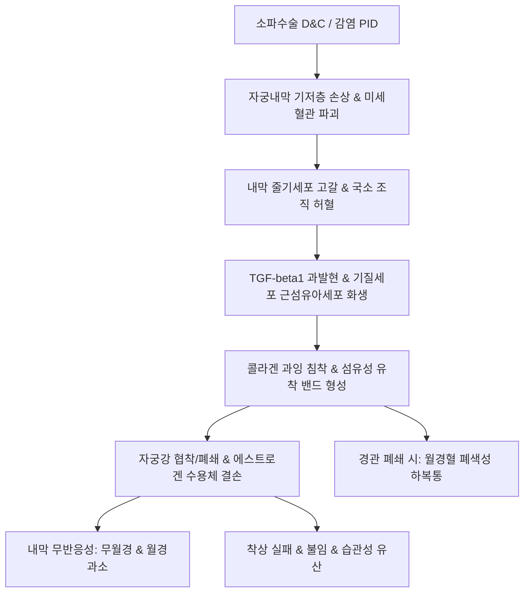

# 🩺 아셔만 증후군 (Asherman's Syndrome / 子宮腔癒着症, IUA)

> **핵심 3줄 요약 (Key Summary)**:
> - 📍 **정의 & 병태생리**: 소파수술(D&C), 계류유산 처치, 제왕절개 또는 자궁내막염 등으로 인해 자궁내막 기저층(Stratum basalis)이 손상되어 자궁내벽 전벽과 후벽 사이에 섬유성 흉터 밴드 및 유착이 형성되어 자궁강이 협소화되거나 폐쇄되는 후천성 질환.
> - 🚩 **임상 양상**: 소파술 후 발생하는 무월경([[무월경]]) 또는 현저한 월경 과소([[월경 과소]]), 월경기 주기적 하복부 산통(폐쇄성 유착으로 인한 혈포궁 경련), 불임 및 반복 유산, 비정상 태반 착상(태반 유착증).
> - 🛠️ **치료 원칙**: 자궁경하 유착박리술(Hysteroscopic adhesiolysis)이 표준 외과적 치료이며, 술 후 유착 재발 방지를 위한 자궁강 내 풍선 카테터/히알루론산 겔 삽입 및 고용량 에스트로겐-프로게스틴 요법, 한의학적으로 활혈화어(活血化瘀)·생기통경(生肌通經)에 따른 [[소복축어탕]], [[당귀작약산]], [[육미지황탕]] 병용.
> - ⚠️ **응급 의뢰 레드플래그**: 임신 중 태반 유착(Placenta accreta spectrum, PAS)으로 인한 분만 시 조절되지 않는 대량 출혈 쇼크 위험, 자궁경 수술 중 자궁천공(Uterine perforation) 의심 시 즉각적 응급 개복/복강경 탐색술 필요.

---

## 📌 목차
1. [질환 개요 & 해부학적 병태생리](#1-질환-개요--해부학적-병태생리)
2. [병태생리 메커니즘 & 섬유화 악순환 네트워크](#2-병태생리-메커니즘--섬유화-악순환-네트워크)
3. [임상 증상 & 자궁강 평가 알고리즘](#3-임상-증상--자궁강-평가-알고리즘)
4. [감별 진단 매트릭스 (Differential Diagnosis)](#4-감별-진단-매트릭스-differential-diagnosis)
5. [한의 통합 치료 프로토콜 (침·약침·한약)](#5-한의-통합-치료-프로토콜-침약침한약)
6. [양방 치료 & 자궁경 수술·재발방지 기준 (Conventional Treatment & Referral)](#6-양방-치료--자궁경-수술재발방지-기준-conventional-treatment--referral)
7. [술 후 관리 & 임신 준비 가이드](#7-술-후-관리--임신-준비-가이드)
8. [💡 사용자 진료실 핵심 필기 & 임상 노하우 (Melt-In 잔여 심화 집약)](#8-💡-사용자-진료실-핵심-필기--임상-노하우-melt-in-잔여-심화-집약)
9. [출처 및 학술 참고 문헌 (References)](#9-출처-및-학술-참고-문헌-references)

---

## 1. 질환 개요 & 해부학적 병태생리

### 1) 질환 정의 및 임상적 중요성
- **아셔만 증후군(Asherman's Syndrome)**: 외상 또는 심한 감염으로 자궁내막 기저층이 박리·손상되어 섬유성 유착(Intrauterine Adhesions, IUA)이 형성되고, 이로 인해 월경 장애(무월경/과소월경), 불임, 반복 임신 손실을 나타내는 임상 증후군이다.
- 자궁인자 불임(Uterine factor infertility)의 대표적 원인이며, 가임기 여성의 소파술 기왕력자 중 15~20%에서 다양한 등급의 유착이 유발된다.

### 2) 자궁내막의 해부학적 구조와 기저층 손상
- **기능층(Stratum functionalis)**: 매 월경 주기마다 에스트로겐과 프로게스테론에 반응하여 증식·분비되고 탈락하는 표층.
- **기저층(Stratum basalis)**: 월경 탈락 후 내막을 재생시키는 줄기세포(Endometrial stem/progenitor cells)와 관상선 기저부가 존재하는 층.
- **병소 해부학**: 분만 후 또는 계류유산 소파술(D&C) 시 저하된 내막 저항성 상태에서 과도한 소파 조작이 가해지면 기저층이 파괴되고 근층(Myometrium)이 노출된다. 이때 섬유아세포(Fibroblast)가 증식하고 콜라겐 섬유 밴드가 형성되어 대향하는 자궁벽끼리 융합된다.

---

## 2. 병태생리 메커니즘 & 섬유화 악순환 네트워크

### 1) 자궁내막 재생 정지와 만성 섬유화 기전
- **줄기세포 고갈 및 미세혈관 소실**: 기저층 손상으로 내막 상피세포 줄기세포가 고갈되고 나선동맥(Spiral artery) 미세혈관망이 파괴되어 국소 조직 허혈(Ischemia)이 유발된다.
- **TGF-beta/Smad 신호전달계 과활성화**: 허혈 및 염증 반응은 강력한 섬유화 촉진 인자인 TGF-beta1 분비를 촉진하며, 내막 기질세포가 근섬유아세포(Myofibroblast)로 화생(EndoMT)하여 세포외기질(ECM)과 콜라겐 Type I/III를 과도하게 침착시킨다.
- **에스트로겐 수용체(ER) 발현 감소**: 섬유화된 흉터 조직은 에스트로겐 수용체(ER-alpha) 발현이 결손되어, 체내 에스트로겐 농도가 정상이어도 내막 증식이 전혀 일어나지 않는 호르몬 불응성 상태로 전락한다.

### 2) 섬유화 악순환 도식

---

## 3. 임상 증상 & 자궁강 평가 알고리즘

### 1) 주요 임상 양상
- **월경 양상 이상**: 선행 소파수술 후 정상 생리가 회복되지 않는 무월경(약 40~50%) 또는 생리대가 젖지 않을 정도의 현저한 월경 과소(약 30%).
- **주기적 하복통(Cryptomenorrhea)**: 자궁경관 내구 부위가 유착으로 폐쇄된 경우, 내막 일부에서 출혈된 혈액이 배출되지 못하고 자궁강 내에 저류(Hematometra)되어 월경 예정일마다 심한 산통 유발.
- **생식 기능 장애**: 착상 부전으로 인한 원발성/속발성 불임, 1분기 계류유산 반복.

### 2) 진단적 검사 프로토콜
- **자궁경 검사(Hysteroscopy)**: 표준 확진 검사(Gold standard). 유착의 위치, 범위, 두께(점막성, 섬유성, 근육성), 자궁관 개구부(Tubal ostia) 개통 여부를 직접 시각화.
- **자궁난관조영술(HSG)**: 자궁강 내 다발성 충만 결손(Filling defect) 확인.
- **식염수 주입 자궁초음파(SIS / 3D 초음파)**: 비침습적으로 자궁내막 연속성 단절 및 유착 밴드 확인.
- **프로게스테론/에스트로겐 소퇴성 출혈 검사**: 호르몬 투여 후에도 출혈이 없으면 자궁내막 기저층 손상(자궁인자) 확진.

---

## 4. 감별 진단 매트릭스 (Differential Diagnosis)

| 감별 질환 | 호발 원인 및 병력 | 핵심 감별 검사 | 아셔만 증후군과의 차이점 |
| :--- | :--- | :--- | :--- |
| **[[시한 증후군]]** | 분만 시 대량 출혈 후 뇌하수체 괴사 | 혈청 FSH/LH/TSH 저하 | 자궁경 정상, 전신 뇌하수체 호르몬 결핍 |
| **[[자궁경관 협착증]](Cervical stenosis)** | 원추절제술, LEEP 시술 기왕력 | 자궁경 통과 불가, 초음파상 자궁강 정상 | 유착이 자궁경부에 국한, 기저층 보존 |
| **[[다낭성 난소 증후군]](PCOS)** | 비만, 다모증, 만성 무배란 | 초음파상 PCOM, 프로게스틴 소퇴출혈 양성 | 호르몬 투여 시 소퇴성 출혈 발생 |
| **조기 난소 부전([[조기 난소 부전]])** | 40세 이전 무월경, 안면홍조 | FSH > 25~40 IU/L, AMH 고갈 | 난소 난포 소실, 자궁강 자체는 유착 없음 |
| **선천성 자궁 기형(중격자궁 등)** | 외상 병력 없음, 원발성 불임 | 3D 초음파, 골반 MRI | 섬유성 유착 밴드가 아닌 선천성 근육/섬유 중격 |

---

## 5. 한의 통합 치료 프로토콜 (침·약침·한약)

### 1) 변증별 한약 처방 프로토콜
- **어혈조체(瘀血阻滯) / 충임어조(衝任瘀阻)**:
  - 주증: 소파술 후 무월경 또는 흑자색 미량 출혈, 혈괴 동반, 하복부 거안(拒按) 압통, 설자암 어점, 맥침삽.
  - 대표 처방: [[소복축어탕]], [[실소산]], [[계지복령환]] 가감(단삼, 오령지, 포황, 몰약, 삼릉, 아출).
  - 치법: 활혈화어(活血化瘀), 파징통경(破癥通經).
- **기혈양허(氣血兩虛) / 자궁허손(子宮虛損)**:
  - 주증: 수술 후 월경량 극소, 안색 위황, 만성 피로, 두훈, 심계, 설담소태, 맥세약.
  - 대표 처방: [[당귀작약산]], [[팔진탕]], [[인삼양영탕]] 가감(황기, 당귀, 백작약, 아교).
  - 치법: 익기양혈(益氣養血), 생기지내(生肌至內).
- **신허혈어(腎虛血瘀) / 자궁냉통(子宮冷痛)**:
  - 주증: 하복부 냉감, 요슬산연, 기초체온 저하, 설담태백, 맥침세.
  - 대표 처방: [[육미지황탕]], [[온경탕]] 가감(녹각상, 두충, 당귀, 천궁, 오수유).
  - 치법: 온신보신(溫腎補腎), 활혈온포(活血溫胞).

### 2) 침구 치료 프로토콜
- **주요 혈위**: [[관원]](CV4), [[중극]](CV3), [[기해]](CV6), [[자궁]](EX-CA1), [[삼음교]](SP6), [[혈해]](SP10), [[지기]](SP8), [[태충]](LR3).
- **시술 기전**: 하복부 온침 및 전침(2 Hz) 치료로 자궁동맥 저항지수를 낮추어 내막 기저층의 신생혈관 형성을 촉진하고 내막 두께 회복 지원.

---

## 6. 양방 치료 & 자궁경 수술·재발방지 기준 (Conventional Treatment & Referral)

### 1) 표준 수술적 치료 (Hysteroscopic Adhesiolysis)
- **미세가위/바늘 전극 박리**: 자궁경 유도 하에 정상 자궁강 형태가 복원될 때까지 섬유성 유착 밴드를 조심스럽게 절제 (에너지 소작 기구는 정상 내막 추가 열손상 위험으로 지양).
- **수술 중 모니터링**: 복강경 병용 또는 초음파 가이드 하에 시행하여 자궁천공 위험 최소화.

### 2) 수술 후 재유착 방지 프로토콜
- **물리적 장벽 설치**: 자궁강 내 소아용 폴리 카테터(Foley balloon, 3~5cc 식염수 주입)를 5~7일간 유치하거나, 자궁강 전용 가교 히알루론산(HA) 겔 주입.
- **고용량 호르몬 치료**: 수술 직후부터 에스트라디올 발레레이트(E2V 4~6 mg/일)를 21~28일간 투여하여 잔존 내막 세포 증식을 유도한 후, 마지막 10일간 프로게스틴을 병용하여 탈락 유도 (1~3주기 시행).
- **최신 재생 의학 요법**: 자가 다혈소판 혈장([[PRP]], Platelet-Rich Plasma) 내막하 주입 및 골수 유래 줄기세포(BMSC) 치료 연구 활발.

---

## 7. 술 후 관리 & 임신 준비 가이드

### 1) 자궁내막 두께 모니터링 및 2차 자궁경
- 수술 후 2~3개월 시점에 2차 외래 자궁경(Second-look hysteroscopy)을 시행하여 미세 잔여 유착 여부 확인 및 제거.
- 착상기 자궁내막 두께가 최소 7~8 mm 이상, 3층상(Trilaminar pattern)이 관찰될 때 임신 시도 권장.

### 2) 산과적 위험 관리
- 아셔만 증후군 치료 후 임신 성공 시 태반 유착(Placenta accreta spectrum), 전치태반, 태아 성장지연, 조산 위험이 높으므로 3차 상급병원 산과 등록 및 분만 계획 필수.

---

## 8. 💡 사용자 진료실 핵심 필기 & 임상 노하우 (Melt-In 잔여 심화 집약)

### 1) 소파수술, IVD, 골반염과 자궁내막 섬유화
- 아셔만 증후군은 분만 후 또는 유산 후 잔류 태반 제거를 위한 소파술(D&C), 자궁 내 장치(IVD/IUD) 삽입 후 감염, 만성 골반염증성 질환(PID)에 의해 자궁내막 기저층에 비가역적인 섬유성 변화가 발생하여 유착을 형성함으로써 발생한다.
- 임상에서 "소파술 후 3~6개월이 지나도록 생리가 없거나, 생리 양이 휴지 한 장 묻을 정도로 급감했다"고 호소하는 환자는 단순 기혈허약으로 치부해서는 안 되며, 자궁강 유착증을 1순위로 의심해야 한다.

### 2) 한의 치료의 골든타임과 협진 원칙
- 섬유화된 두터운 유착 밴드는 한약만으로 물리적 박리가 불가능하므로, 중등도 이상의 유착은 즉시 산부인과 자궁경하 유착박리술로 연계해야 한다.
- 한의 치료의 진정한 진가는 **수술 직후 내막 재생기**에 발휘된다. 수술 후 양방의 에스트로겐 요법과 병행하여 어혈을 제거하고 미세혈류를 개선하는 [[소복축어탕]]이나 [[당귀작약산]]을 집중 투여할 때, 자궁내막 두께의 신속한 회복과 유착 재발 방지율이 극대화된다.

---

## 9. 출처 및 학술 참고 문헌 (References)

Zhu. (2026). ATI-2341 TFA promotes acquisition of epithelial-like immunophenotype in bone marrow mesenchymal stem cells and alleviates intrauterine adhesion in a rat model. *Pak J Pharm Sci*. PMID: 42770639.

Johnson. (2026). Managing uterine evacuation in a patient with Asherman syndrome who failed procedural and medication abortions: a case report. *Case Rep Womens Health*. PMID: 42761855.

Xiong. (2026). Platelet-rich plasma as an adjuvant therapy for intrauterine adhesions: a narrative review of mechanisms, clinical efficacy and combination strategies. *Ann Med*. PMID: 42751776.
