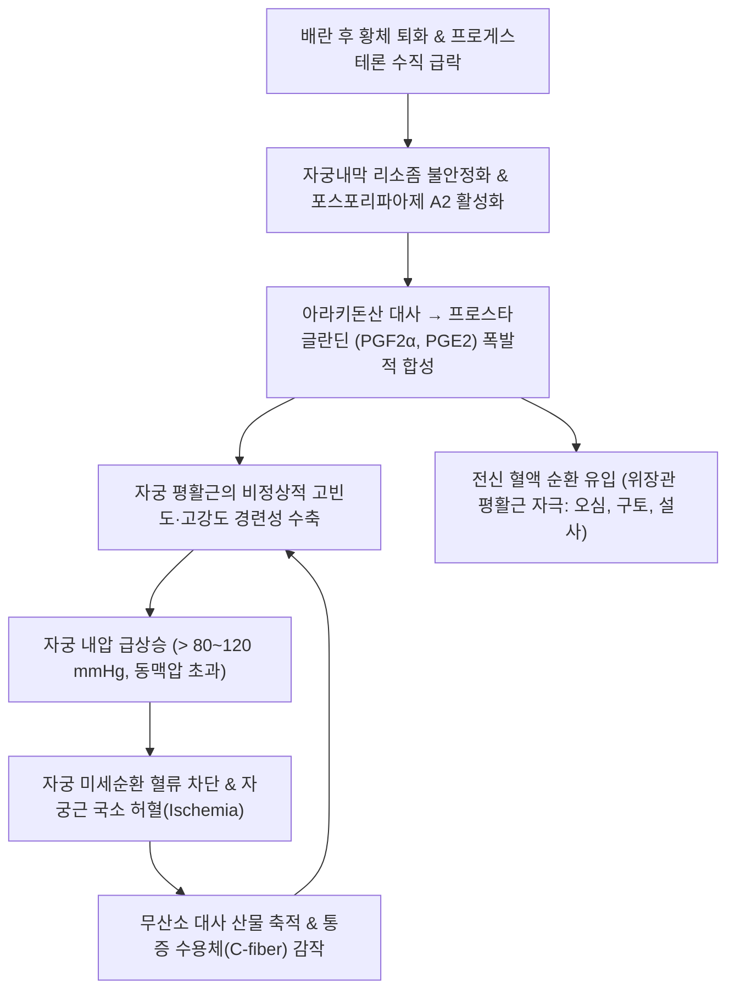
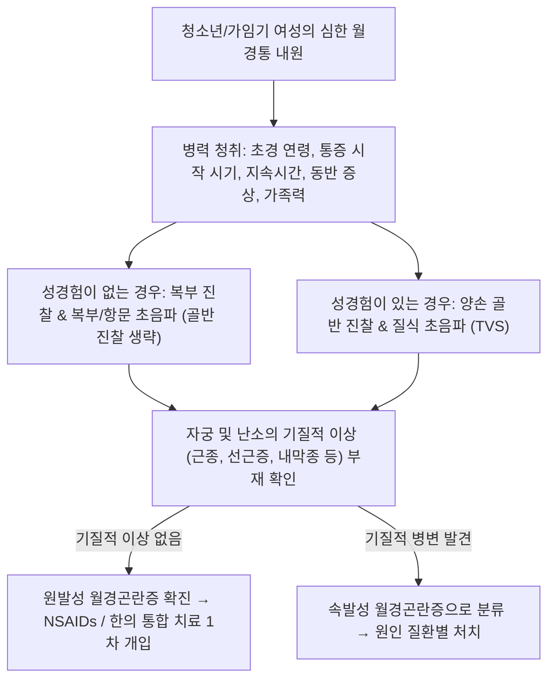

# 🩺 원발성 월경곤란증 (Primary Dysmenorrhea / 原發性 月經困難症)

> **핵심 3줄 요약 (Key Summary)**:
> - 📍 **병소 부위 & 해부·병태생리**: 골반 내 기질적 병변(기형, 종양, 내막증 등) 없이 황체 퇴화 시 자궁내막에서 [[프로스타글란딘]]($PGF_{2\alpha}$, $PGE_2$)의 과다 합성에 의해 유발되는 자궁근층(Myometrium) 경련성 과수축 및 허혈성 통증.
> - 🚩 **전형적 임상 양상**: 초경 후 1~2년 이내(배란성 주기 확립 후) 시작, 월경 시작 수 시간 전~직후 발생하는 하복부 및 치골상부 쥐어짜는 듯한 산통(Colicky pain), 대퇴부 방산통, 오심·구토·설사·두통 동반, 통증 지속시간 48~72시간 이내.
> - 🛠️ **핵심 검사 & 치료 전략**: 골반 진찰 및 초음파상 정상 소견 확인을 통한 기질적 병변 배제; 1차 약제로 NSAIDs(사이클로옥시게나제 억제제) 및 복합 경구피임약(COC), 한의학적 기체혈어·한응혈어 변증 하 현부리경탕/소복축어탕/작약감초탕 및 침구·온침 치료.
> - ⚠️ **응급 의뢰 레드플래그**: NSAIDs 및 경구피임약 표준 치료 3~6개월 후에도 반응하지 않는 불응성 통증(자궁내막증 잠재 가능성 70% 이상), 25세 이후 새롭게 발생한 악화성 생리통(속발성 원인), 비월경기 만성 골반통 또는 심한 성교통 병발 시 복강경 정밀 검사 의뢰.

---

## 📌 목차
1. [질환 개요 & 해부학적 병태생리](#1--질환-개요---해부학적-병태생리)
2. [병태생리 메커니즘 & 생체역학적 악순환 네트워크](#2--병태생리-메커니즘---생체역학적-악순환-네트워크)
3. [임상 증상 & 이학적 검사 알고리즘](#3--임상-증상---이학적-검사-알고리즘)
4. [감별 진단 매트릭스](#4--감별-진단-매트릭스)
5. [한의 통합 치료 프로토콜](#5--한의-통합-치료-프로토콜)
6. [양방 치료 & 병용·의뢰 기준](#6-양방-치료--병용의뢰-기준)
7. [재활 운동 & 생활습관 티칭 가이드](#7--재활-운동---생활습관-티칭-가이드)
8. [💡 사용자 진료실 핵심 필기 & 임상 노하우](#8--사용자-진료실-핵심-필기---임상-노하우)
9. [📚 출처 및 현대 학술 연구 요약 (References)](#9--출처-및-현대-학술-연구-요약-references)

---

## 1. 질환 개요 & 해부학적 병태생리

### 1) 질환 정의 및 역학
- **원발성 월경곤란증(Primary Dysmenorrhea, 기능성 월경통)**은 골반 내 명백한 기질적 병인(자궁내막증, 자궁선근증, 근종, 골반염 등)이 동반되지 않으면서 월경과 함께 주기적으로 발생하는 하복부 경련성 통증이다.
- 가임기 여성의 50~90%가 경험하는 가장 흔한 부인과 증상이며, 10~15%는 일상생활과 학업, 직장 생활에 심각한 장애를 겪는다.
- 배란성 월경 주기(Ovulatory cycle)가 확립되는 초경 후 6~24개월 이내에 주로 시작되며, 20대 중반 이후 또는 첫 분만 후 자연적으로 완화되는 경향이 있다.

### 2) 해부학적 구조 및 통증 전달 경로
- **자궁 평활근 (Myometrium)**: 자궁 수축 시 자궁 내압이 상승하여 혈류를 차단함.
- **신경 경로**:
  - 자궁 체부의 통증 감각 신경 섬유는 자궁신경총(Uterovaginal plexus) → 하복신경총(Inferior hypogastric plexus) → 하복신경(Hypogastric nerve) → 요수 교감신경절(T10~L1)을 통해 척수 후각으로 전달된다.
  - 이로 인해 하복부뿐만 아니라 요천추부 및 대퇴부 내측으로 연관통(Referred pain)이 방산된다.

---

## 2. 병태생리 메커니즘 & 생체역학적 악순환 네트워크

### 1) 프로스타글란딘 과다 생성 가설 (Gold Standard Pathophysiology)
- 배란이 일어난 황체기 말기, [[프로게스테론]] 수치가 급격히 하락하면 자궁내막 세포 내의 리소좀 막이 분해된다.
- 세포막 인지질에서 아라키돈산(Arachidonic acid)이 유리되고, COX(사이클로옥시게나제) 경로를 통해 **$PGF_{2\alpha}$**와 **$PGE_2$**가 다량 합성된다.
- $PGF_{2\alpha}$는 강력한 자궁 평활근 수축 물질이자 혈관 수축 물질로 작용한다.

### 2) 자궁 허혈과 허혈성 통증의 악순환
- 정상 자궁 수축압(50 mmHg 미만)과 달리, 월경통 환자에서는 자궁 내 기본 긴장도가 증가하고 수축압이 80~120 mmHg 이상(심할 경우 200 mmHg)으로 치솟는다.
- 자궁 내압이 자궁 동맥압을 초과하면서 나선동맥이 압박되고 자궁근 혈류가 차단되어 **심근경색과 유사한 자궁근 허혈(Ischemia)**과 저산소증이 발생한다.
- 허혈 부위에 젖산, 브라디키닌 등 통증 유발 대사산물이 저류되어 C-신경섬유를 직접 자극함으로써 맹렬한 쥐어짜는 통증이 완성된다.

---

## 3. 임상 증상 & 이학적 검사 알고리즘

### 1) 주요 임상 양상
- **통증의 개시 및 지속**:
  - 월경 출혈 시작 수 시간 전 또는 직후에 시작되어, 출혈 첫날(12~24시간) 가장 극심하며 대개 48~72시간 이내에 소실됨.
- **통증 양상**:
  - 치골 상부의 간헐적이고 쥐어짜는 듯한 경련성 산통(Cramping pain).
  - 요천추부 및 대퇴부 안쪽으로 방산.
- **동반 전신 증상**:
  - 혈중으로 유입된 프로스타글란딘에 의해 위장관 운동 항진: 오심, 구토, 식욕부진, 설사(약 50%).
  - 혈관 수축 및 자율신경계 반응: 두통, 어지러움, 피로, 실신, 안면 창백.

### 2) 이학적 검사 및 감별 단계

---

## 4. 감별 진단 매트릭스

| 질환명 | 호발 연령 | 통증 시작 및 지속 기간 | 골반 진찰 / 초음파 소견 | 진통제(NSAIDs) 반응 |
| :--- | :--- | :--- | :--- | :--- |
| **원발성 월경곤란증** | 10대 후반~20대 초반 (초경 1~2년 후) | 월경 시작 직전/직후 시작, 48~72시간 내 소실 | 정상 (자궁 크기 정상, 골반 압통 없음) | 반응 매우 양호 (70~80% 호전) |
| **[[속발성 월경곤란증]]** | 20대 후반~40대 (초경 수년 후) | 월경 시작 1~2주 전부터 시작, 월경 종료 후에도 지속 | 자궁 비대, 자궁천골인대 결절, 난소 낭종 | 불완전하거나 반응 불량 |
| **자궁내막증** | 20~30대 가임기 여성 | 점진적 악화, 배변통, 심한 성교통 동반 | 후원개 결절 압통, 난소 자궁내막종(초음파) | NSAIDs에 불응성인 경우 흔함 |
| **자궁선근증** | 30~40대 경산부 | 극심한 통증과 함께 심한 월경과다(빈혈) | 미만성으로 비대된 구형 자궁, 심한 자궁 압통 | 일시적 호전 후 지속 악화 |

---

## 5. 한의 통합 치료 프로토콜

### 1) 한의 변증 분류
- **기체혈어형 (氣滯血瘀型)** — 임상 다발:
  - 주증: 월경 전 또는 월경 첫날 하복부 창통(불통즉통 不通則痛), 거안(拒按), 월경혈 암홍색 및 다량의 혈괴 배출 후 통증 경감, 유방 팽만통, 설암, 어반, 맥현.
  - 치법: 행기활혈(行氣活血), 거어지통(祛瘀止痛).
  - 처방: [[현부리경탕]](玄附理經湯) 또는 [[소복축어탕]](少腹逐瘀湯) 가감 (오약 10g, 향부자 12g, 당귀 12g, 천궁 8g, 도인 10g, 홍화 6g, 연호색 12g, 몰약 6g).
- **한응혈어형 (寒凝血瘀型)**:
  - 주증: 아랫배가 얼음장처럼 차고 쑤시듯 아픔, 온열 찜질 시 통증 완화, 사지궐냉, 면색 창백, 설담암태백, 맥침지.
  - 치법: 온경산한(溫經散寒), 화어지통(化瘀止痛).
  - 처방: [[온경탕]](溫經湯) 또는 소복축어탕 가 육계, 오수유, 건강.
- **기혈허약형 (氣血虛弱型)**:
  - 주증: 월경 중 또는 월경 후 하복부 은은한 통증(불영즉통 不榮則痛), 희안(喜按), 피로감, 면색 창백, 설담태백, 맥세약.
  - 치법: 익기양혈(益氣養血), 조경지통(調經止痛).
  - 처방: [[팔진탕]](八珍湯) 합 당귀작약산 가 연호색, 목향.
- **근긴장·급박통형**:
  - 주증: 복직근이 판자처럼 굳어 있으며 발작적인 쥐어짜는 통증.
  - 처방: [[작약감초탕]](芍藥甘草湯) (백작약 20g, 감초 10g) — 평활근 경련 급속 진통.

### 2) 침구 치료 프로토콜
- **주요 혈위**:
  - 하복부: [[중극]](CV3), [[관원]](CV4), [[기해]](CV6) — 자궁 평활근 이완 및 골반 순환 개선.
  - 경락 원격: [[삼음교]](SP6) — 비·간·신 삼음경 교차혈로 월경통의 특효혈; [[지기]](SP8) — 비경의 극혈(郄穴)로 급성 산통 지통; [[태충]](LR3), [[합곡]](LI4) — 사관혈(행기지통).
- **시술 기법**:
  - 급성 통증기: 지기, 삼음교 혈에 강자극 사법 및 전침(2 Hz 저주파 자극) 시술.
  - 온침 및 뜸: 한응형 환자에게 중극, 관원 혈 온침 및 간접구(왕뜸) 적용 시 자궁근 허혈을 급속히 개선.

---

## 6. 양방 치료 & 병용·의뢰 기준

### 1) 1차 약물 치료
- **NSAIDs (비스테로이드성 소염진통제)** — 1차 선택제:
  - 작용 기전: 사이클로옥시게나제(COX)를 억제하여 프로스타글란딘 합성 자체를 차단.
  - 용법 원칙: 통증이 본격화되기 전, **월경 시작 직전 또는 첫 증상 발현 시점에 선제적 복용** 시작, 6~8시간 간격으로 2~3일간 규칙적 투여.
  - 약제: 이부프로펜([[이부프로펜]], 400~800 mg tid), 나프록센([[나프록센]], 500 mg 초기 투여 후 250 mg q6-8h), 덱시부프로펜.
- **복합 경구피임약 (Combined Oral Contraceptives, COC)**:
  - 피임을 원하거나 NSAIDs에 반응이 불충분한 경우 병용 또는 대체.
  - 배란을 억제하여 황체기 프로게스테론 급락 및 자궁내막 두께를 감소시켜 프로스타글란딘 생성을 근본적으로 억제.

### 2) 병용·의뢰 기준
- 표준 약물 치료(NSAIDs + COC) 3~6개월 시행 후에도 통증 조절에 실패하는 경우:
  - 잠재적 자궁내막증(Endometriosis) 또는 자궁선근증 가능성이 70% 이상이므로 복강경 검사 또는 정밀 골반 MRI 의뢰.

---

## 7. 재활 운동 & 생활습관 티칭 가이드

### 1) 온열 요법 (Heat Therapy)
- 하복부에 40~42℃ 수준의 온열 패드를 부착하는 것은 경구 이부프로펜 복용과 대등한 수준의 평활근 이완 및 혈류 개선 효과를 제공한다.

### 2) 생활습관 및 운동
- **규칙적인 유산소 운동**:
  - 엔도르핀 분비를 촉진하고 골반강 울혈을 개선하여 월경통 빈도와 강도를 줄임.
- **식이 조절**:
  - 오메가-3 지방산(생선유) 섭취 증가(항염증성 $PGE_3$ 유도), 카페인 및 고염식 제한.

---

## 8. 💡 사용자 진료실 핵심 필기 & 임상 노하우

### 1) 임상 진료 팁: '불통즉통'과 '불영즉통'의 분별
- 진료실에서 진찰할 때 산모나 환자가 배를 눌렀을 때 "손도 못 대게 아파하는 경우(거안 拒按)"는 100% 어혈성 기체(실증)로 [[현부리경탕]]이나 [[소복축어탕]]을 쓰고,
- "손으로 지그시 눌러주거나 따뜻하게 문질러주면 살 것 같다고 하는 경우(희안 喜按)"는 기혈허약(허증)으로 [[팔진탕]]이나 [[당귀작약산]]에 온경약을 가미해야 실패하지 않는다.

### 2) 급성 발작 시 신속 진통 프로토콜
- 진료실에 얼굴이 하얗게 질려서 허리를 굽힌 채 들어오는 급성 월경통 환자에게는 양측 [[지기]](SP8)와 [[삼음교]](SP6)에 강자극 직자침을 놓고, [[작약감초탕]] 과립제를 따뜻한 물에 진하게 타서 복용시키면 15~20분 내로 경련이 드라마틱하게 진정된다.

---

## 9. 📚 출처 및 현대 학술 연구 요약 (References)

- Barcikowska Z, et al. (2026). Stopping Dysmenorrhea: A Systematic Review of Drugs Inhibiting Uterine Contraction. *J Clin Med*. PMID: 42746335.

- Zhang X, et al. (2024). The clinical value of acupuncture combined with Wenjing decoction in treating primary dysmenorrhea: A systematic review and meta-analysis. *Medicine (Baltimore)*. PMID: 40988743.

- Lin L, et al. (2025). Transcutaneous electrical nerve stimulation for treatment of primary dysmenorrhea: A systematic review and meta-analysis of randomized controlled trials. *Heliyon*. PMID: 41790650.

---
## 📎 개념 학습 보충 (2026-10-25 논문 연계)

**연계 논문**: Cai J, Liu M, Jing Y, et al. Aerobic exercise to alleviate primary dysmenorrhea in adolescents and young women: a systematic review and meta-analysis of RCTs. *Acta Obstet Gynecol Scand*. 2025;104(5):815-828. [PMID 39887989](https://pubmed.ncbi.nlm.nih.gov/39887989/)

- 이 메타분석은 RCT 16편·918명을 묶어 [[유산소운동]]의 효과를 **용량 단위**로 쪼갠 첫 시도다. 통증강도 SMD −1.728(95% CI −2.26~−1.31), 통증지속시간 12.53시간 감소였고 GRADE는 각각 중등도·낮음이었다.
- 처방으로 옮기면 **필라테스 또는 저강도 유산소 30~45분, 주 2회, 총 2개월경주기(약 8주)** 다. 강도는 [[Borg CR10]] 11~13("가볍다~약간 힘들다"), 대화가 가능한 수준으로 지도한다.
- 반드시 알아둘 모순: 본문 Figure 8은 1회 31~45분군이 최대 효과(SMD −3.05)라 했으나 초록 결론은 46~60분을 더 효율적이라 적었다. 한 논문 안에서 결론이 엇갈리므로 **30~45분을 기본, 체력이 낮은 환자는 20~30분부터** 시작하는 보수적 해석이 안전하다.
- 고빈도가 불리했다는 점도 임상적으로 중요하다. 주 3회·3회 초과보다 **주 2회 이하**가 큰 효과(SMD −2.24)를 보였다 — 기존의 "많이 할수록 좋다"는 통념을 뒤집는 결과다.
- 월경 중 중단 규칙: 통증 NRS ≤4면 유지, 5~6이면 20분으로 단축, ≥7이면 그 주기는 쉬고 월경 종료 후 재개한다.
- 배제가 먼저다. 30세 이후 새로 시작, 성교통 동반, 월경량 급증, 진통제 반응 소실, 초음파상 [[자궁선근증]]·[[자궁내막증]] 소견이 있으면 이 프로토콜은 보조요법일 뿐이며 [[속발성 월경곤란증]] 영역이다.
- 한의 결합 순서(본 논문이 검증한 설계가 아닌 변증 논리에 따른 확장): 월경 전 5~7일에 침·뜸·온열로 자궁 과수축을 먼저 낮추고, 월경기에는 운동 강도를 최소화하며, 월경 종료 후 배란기까지를 운동 처방의 본 구간으로 삼는다.
- 함께 보기: [[프로스타글란딘]] · [[PGF2a]] · [[유산소운동]] · [[Borg CR10]] · [[SMD(표준화 평균차)]] · [[속발성 월경곤란증]] · [[자궁내막증]]
