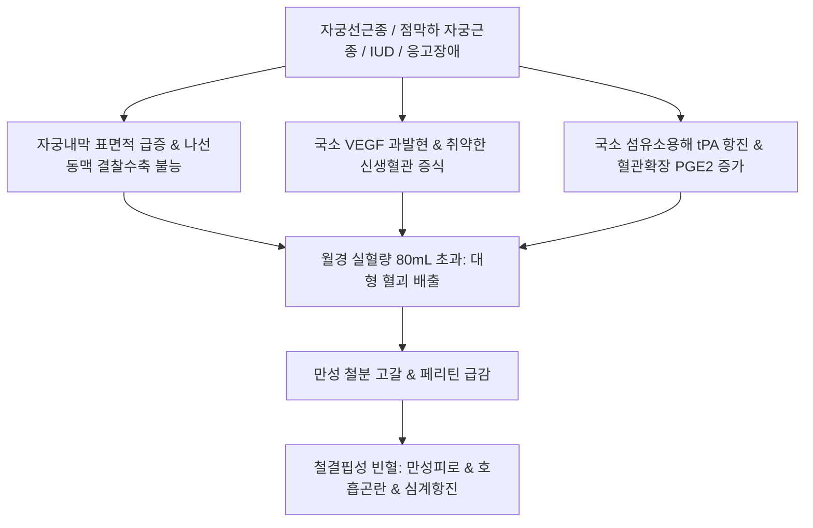

# 🩺 월경 과다 (Heavy Menstrual Bleeding / 月經過多, Menorrhagia)

> **핵심 3줄 요약 (Key Summary)**:
> - 📍 **정의 & 병태생리**: 월경 주기는 21~35일로 규칙적이나, 주기당 실혈량이 80 mL 이상이거나 출혈 기간이 7일 이상 지속되어 신체적·정신적·사회적 삶의 질을 현저히 저해하는 병태. FIGO PALM-COEIN 분류상 자궁선근종([[자궁선근종]]), 점막하 자궁근종([[자궁근종]]), 자궁내막용종, 응고장애 등이 주원인이다.
> - 🚩 **임상 양상**: 대형 생리대/탐폰이 1~2시간마다 완전히 젖음, 야간 패드 교체 필요, 직경 2.5 cm 이상의 대형 혈괴 배출, 만성 철결핍성 빈혈([[철결핍]])로 인한 피로·호흡곤란·두훈.
> - 🛠️ **치료 원칙**: 양방 레보노르게스트렐 방출 자궁내장치(LNG-IUS, 미레나), 트라넥삼산(TXA), 경구 프로게스틴 투여, 한의학적으로 기허(氣虛)·실열(實熱)·허열(虛熱)·혈어(血瘀) 변증에 따른 [[보음전]], [[귀비탕]], [[실소산]], [[단삼택연음]], [[소복축어탕]] 처방.
> - ⚠️ **응급 의뢰 레드플래그**: 활력징후 불안정(혈압 저하, 기립성 빈맥), 혈색소(Hb) < 7~8 g/dL의 중증 급성 출혈, 어지럼증 및 실신 동반 시 즉각적인 응급실 수혈 및 지혈 처치(자궁강 탐폰 압박, 자궁동맥색전술, 응급 소파술) 의뢰.

---

## 📌 목차
1. [질환 개요 & 해부학적 병태생리](#1-질환-개요--해부학적-병태생리)
2. [병태생리 메커니즘 & FIGO 원인 분류 네트워크](#2-병태생리-메커니즘--figo-원인-분류-네트워크)
3. [임상 증상 & 실혈량 평가 알고리즘](#3-임상-증상--실혈량-평가-알고리즘)
4. [감별 진단 매트릭스 (Differential Diagnosis)](#4-감별-진단-매트릭스-differential-diagnosis)
5. [한의 통합 치료 프로토콜 (침·약침·한약)](#5-한의-통합-치료-프로토콜-침약침한약)
6. [양방 치료 & 약물·수술적 지혈 기준 (Conventional Treatment & Referral)](#6-양방-치료--약물수술적-지혈-기준-conventional-treatment--referral)
7. [빈혈 관리 & 일상생활 티칭 가이드](#7-빈혈-관리--일상생활-티칭-가이드)
8. [💡 사용자 진료실 핵심 필기 & 임상 노하우 (Melt-In 잔여 심화 집약)](#8-💡-사용자-진료실-핵심-필기--임상-노하우-melt-in-잔여-심화-집약)
9. [출처 및 학술 참고 문헌 (References)](#9-출처-및-학술-참고-문헌-references)

---

## 1. 질환 개요 & 해부학적 병태생리

### 1) 질환 정의 및 임상적 기준
- **월경 과다(Heavy Menstrual Bleeding, HMB / Menorrhagia)**: 규칙적인 월경 주기(24~38일)를 유지하면서 월경 기간 중 총 실혈량이 **80 mL 이상**이거나, 출혈 기간이 **8일 이상** 지속되는 상태이다.
- 가임기 여성의 약 20~30%가 경험하며, 만성적인 실혈로 인해 심각한 [[철결핍]]성 빈혈과 만성 피로, 일상생활의 기능적 저하를 초래한다.
- **부정자궁출혈과의 감별**: 부정출혈(Metrorrhagia / AUB)은 주기성을 완전히 벗어난 불규칙한 비정상 출혈인 반면, 월경 과다는 정상적인 생리 주기의 틀 안에서 출혈량 자체가 과다한 상태를 뜻한다.

### 2) 자궁 국소 지혈 해부학 및 파탄 기전
- **자궁근층 수축과 나선동맥 압박**: 정상 월경 시 자궁근층(Myometrium)의 강력한 결찰성 수축이 내막 나선동맥(Spiral arteriole)을 조여 물리적 지혈(Living ligature)을 완성한다.
- **국소 응고 및 섬유소 용해계 균형**: 자궁내막 내 혈소판 마개 형성과 섬유소 침착, 그리고 플라스미노겐 활성제(tPA)의 균형에 의해 출혈량이 조절된다.
- **병변 조직의 지혈 실패**: [[자궁선근종]]이나 점막하 [[자궁근종]]이 존재하는 경우, 내막 표면적이 비정상적으로 넓어지고 근층의 정상적인 결찰 수축이 물리적으로 방해받으며, VEGF 과발현에 의한 미세혈관 증식과 국소 프로스타글란딘(PGE2/PGI2) 과다로 혈관이 확장되어 폭발적인 출혈이 일어난다.

---

## 2. 병태생리 메커니즘 & FIGO 원인 분류 네트워크

### 1) FIGO PALM-COEIN 체계에 따른 병인
- **기질적 원인 (PALM - 구조적 이상)**:
  - **P (Polyp)**: 자궁내막용종의 미세혈관 파탄.
  - **A (Adenomyosis)**: [[자궁선근종]] — 가장 흔한 원인 중 하나로, 접합부 근층 파괴 및 수축 부전.
  - **L (Leiomyoma)**: [[자궁근종]] — 특히 자궁강으로 돌출된 점막하 근종(Submucosal type 0, 1, 2).
  - **M (Malignancy & Hyperplasia)**: [[자궁내막증식증]] 및 [[자궁내막암]].
- **비구조적 원인 (COEIN - 기능적/전신 이상)**:
  - **C (Coagulopathy)**: 폰빌레브란트병(vWD), 혈소판 감소증, 백혈병.
  - **O (Ovulatory dysfunction)**: 황체기 결함 또는 불완전 배란.
  - **E (Endometrial)**: 자궁내막 국소 혈관수축물질(Endothelin-1, PGF2-alpha) 결핍 및 tPA 과다.
  - **I (Iatrogenic)**: 항응고제 복용, 구리 자궁내장치(Copper-IUD) 삽입.
  - **N (Not otherwise classified)**: 동정맥 기형(AVM), 자궁 혈관종.

### 2) 월경 과다의 병태생리 도식

---

## 3. 임상 증상 & 실혈량 평가 알고리즘

### 1) 주요 임상 양상
- **과다 실혈 징후**: 대형 생리대나 탐폰을 1~2시간 연속으로 적셔 교체해야 함, 수면 중 침구 오염(야간 패드 관통), 500원 동전 크기(직경 2.5 cm 이상)의 대형 핏덩어리(혈괴) 배출.
- **월경 기간 연장**: 생리가 7일 이상 끝나지 않고 지속됨.
- **빈혈 동반 증상**: 어지럼증, 계단 보행 시 숨참, 안면 창백, 피로, 기립성 어지럼증, 이명.

### 2) 객관적 평가 도구
- **PBAC 점수(Pictorial Blood Loss Assessment Chart)**: 패드/탐폰의 오염 정도와 혈괴 크기를 점수화하여 **100점 이상**인 경우 실혈량 80 mL 이상(HMB)으로 판정.
- **혈액학적 평가**: CBC, 페리틴(Ferritin: 저장철 확인), 철/TIBC, 응고 프로파일(PT/aPTT).
- **골반 초음파(TVS)**: 자궁내막 두께 측정, 근종의 위치(FIGO 분류), 선근종의 미만성 비대 감별.

---

## 4. 감별 진단 매트릭스 (Differential Diagnosis)

| 감별 질환 | 호발 연령 및 특이 소견 | 핵심 영상/검사 소견 | 월경 과다와의 감별점 |
| :--- | :--- | :--- | :--- |
| **[[자궁선근종]]** | 35~50대 경산부, 극심한 속발성 월경통 | 초음파상 비대칭성 후벽 비대, 접합부 비후 | 월경과다와 함께 중증 월경통 동반 빈도 최다 |
| **점막하 [[자궁근종]]** | 30~40대, 복부 종괴, 빈뇨 | TVS/SIS상 자궁강 내 돌출된 저에코 종괴 | 해부학적 종괴 직접 확인, 수술적 절제 고려 |
| **[[자궁내막증식증]] / 암** | 폐경주변기(45세 이상), 비만, 당뇨 | 내막 두께 > 12~15 mm, 불규칙 음영 | 자궁내막 조직생검 필수, 비정상 증식 확인 |
| **혈액 응고 장애(vWD 등)** | 청소년기 초경부터 지속된 월경과다 | vWF 항원/활성 저하, aPTT 연장 | 멍이 잘 듦, 잦은 코피 등 전신 출혈 경향 |
| **부정자궁출혈(AUB-O)** | 무배란성, 주기 불규칙, 예측 불가 | 호르몬 불균형, 무배란 확인 | 주기가 불규칙하고 파탄성 출혈 양상 |

---

## 5. 한의 통합 치료 프로토콜 (침·약침·한약)

### 1) 변증별 한약 처방 프로토콜
- **기허형(氣虛型) / 비불통혈(脾不統血)**:
  - 주증: 월경량 과다, 색담홍, 질희박, 피로 무력, 면색위황, 심계, 설담태백, 맥세약.
  - 대표 처방: [[귀비탕]], [[보중익기탕]], 거원전(擧元煎) 가감(황기, 당귀, 백출, 복신, 인삼, 오미자).
  - 치법: 보기건비(補氣健脾), 섭혈지혈(攝血止血).
- **실열형(實熱型) / 혈열망행(血熱妄行)**:
  - 주증: 월경량 폭발적 과다, 색심홍 또는 농홍, 끈적임, 구갈, 번조, 변비, 설홍태황, 맥활삭.
  - 대표 처방: [[청경산]], 청열고경탕, 금련사물탕 가감(황금, 황련, 황백, 치자, 지황).
  - 치법: 청열양혈(淸熱涼血), 고충지혈(固衝止血).
- **허열형(虛熱型) / 음허화왕(陰虛火旺)**:
  - 주증: 월경량 다, 색홍, 조열도한, 오심번열, 구건인조, 설홍소태, 맥세삭.
  - 대표 처방: 열증이 강한 경우 [[보음전]], 음허가 강한 경우 가감일물전(加減一物煎) 가감(지모, 황백, 생지황, 백작약, 맥문동).
  - 치법: 자음강화(滋陰降火), 양혈지혈(涼血止血).
- **혈어형(血瘀型) / 어혈조체(瘀血阻滯)**:
  - 주증: 월경량 다, 자암색 대형 혈괴 다량 배출, 혈괴 배출 시 통증 완화, 하복부 거안 압통, 설자암, 맥삽.
  - 대표 처방: [[실소산]], [[단삼택연음]], [[소복축어탕]] 가감(오령지, 포황, 단삼, 당귀, 천궁, 익모초).
  - 치법: 활혈화어(活血化瘀), 거어지혈(祛瘀止血).

### 2) 침구 치료 프로토콜
- **주요 혈위**: [[은백]](SP1), [[대돈]](LR1), [[관원]](CV4), [[삼음교]](SP6), [[혈해]](SP10), [[족삼리]](ST36), [[백회]](GV20).
- **지혈 특효 뜸치료**: 비통혈(脾統血) 강화를 위해 은백(SP1)·대돈(LR1) 혈에 직접구 3~5장 시술로 급성 출혈 억제.

---

## 6. 양방 치료 & 약물·수술적 지혈 기준 (Conventional Treatment & Referral)

### 1) 약물 치료 프로토콜
- **레보노르게스트렐 방출 자궁내장치(LNG-IUS, 미레나)**: 1차 선택 치료. 국소 프로게스틴 방출로 자궁내막 위축을 유도하여 실혈량을 70~90% 감소시킴.
- **트라넥삼산(Tranexamic acid, TXA)**: 항섬유소용해제로 월경기 복용 시 실혈량 40~50% 감소 (비호르몬 제제).
- **NSAIDs (메페남산, 이부프로펜)**: 자궁내막 혈관확장 프로스타글란딘 합성을 억제하여 출혈량 20~30% 감소 및 통증 조절.
- **경구 복합 피임제(COC) 및 프로게스틴 요법**: 주기 조절 및 내막 증식 억제.

### 2) 수술적 치료 적응증 및 전원
- **수술 적응증**: 약물 치료 저항성 빈혈, 점막하 근종(TCR 근종절제술), 자궁내막 악성 의심.
- **수술 방법**: 자궁내막소작술(Endometrial ablation), 자궁동맥색전술(UAE), 자궁절제술(Hysterectomy).

---

## 7. 빈혈 관리 & 일상생활 티칭 가이드

### 1) 철분제 복용 요법
- 혈청 페리틴 < 30 ng/mL 환자는 원소철 기준 일일 100~200 mg 경구 철분제 복용, 비타민 C 병용으로 흡수율 증대. 경구 불내성 또는 중증 빈혈(Hb < 8 g/dL) 시 고용량 정맥 철분 주사(페린젝트 등) 의뢰.

### 2) 일상생활 주의사항
- 월경기 격렬한 운동 및 사우나 자제, 충분한 수분 섭취로 순환 혈장량 유지.

---

## 8. 💡 사용자 진료실 핵심 필기 & 임상 노하우 (Melt-In 잔여 심화 집약)

### 1) 병리적 정의와 다발 원인의 임상적 통찰
- 월경 과다는 월경 주기는 규칙적이지만 월경량이 80 mL 이상으로 병적으로 많은 상태를 의미한다.
- 임상에서 가장 흔한 기질적 원인은 **[[자궁선근종]]**이며, 그 외 만성 난관염, 자궁내막염, 자궁내 피임장치(Copper-IUD)에 의해서도 빈발한다.
- 자궁근종의 경우 일반적으로 월경 지연이나 무월경을 동반하는 경우가 많으나, 점막하 근종의 형태를 띨 때는 극심한 월경 과다의 주범이 된다.
- 부정자궁출혈은 정상 생리 주기를 벗어난 비정상 출혈을 뜻하며, 월경 과다는 생리적인 출혈 기간 동안 출혈량 자체가 과다한 것이므로 임상 문진에서 주기의 규칙성을 반드시 선별해야 한다.

### 2) 변증별 처방 운용의 정밀 원칙
- **실열(實熱)**: 출혈이 폭발적이고 혈색이 심홍색인 실열증에는 청열고경탕이나 청경산을 쓴다.
- **허열(虛熱)**: 음허화왕으로 인한 허열 상태에서는 열증이 주도적인 경우 [[보음전]]을 사용하고, 음허 증상이 더 두드러진 경우에는 [[가감일물전]](加減一物煎)을 적용하여 자음강화한다.
- **혈어(血瘀)**: 자암색 덩어리 피가 쏟아지는 어혈성 월경 과다에는 지혈에만 급급하지 말고 거어지혈(祛瘀止血) 원칙에 따라 [[실소산]], [[단삼택연음]], [[소복축어탕]]을 투여해야 어혈이 제거되면서 혈관 결찰이 비로소 완성된다.

---

## 9. 출처 및 학술 참고 문헌 (References)

Abdi. (2026). Uterine angiomatosis as an unexpected cause of refractory pelvic pain and heavy menstrual bleeding: a case report and literature review. *Case Rep Womens Health*. PMID: 42827688.

Drejza. (2026). The Impact of Heavy Menstrual Bleeding on Quality of Life: A Mixed-Methods Survey Study. *BJOG*. PMID: 42324234.

Huang. (2026). Comparative Efficacy of Medical Therapies for Heavy Menstrual Bleeding in Adolescents and Young Adults With Bleeding Disorders. *J Adolesc Health*. PMID: 42911153.
