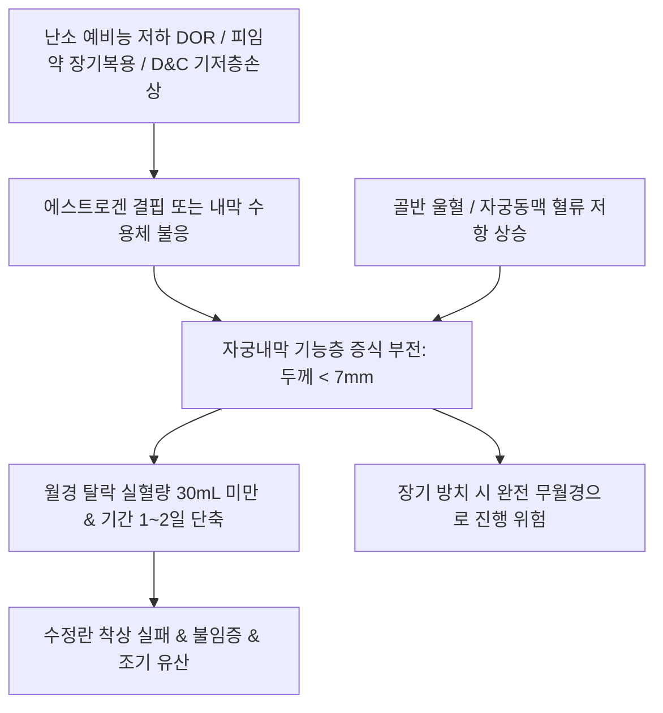

# 🩺 월경 과소 (Hypomenorrhea / 月經過少, Light Menstrual Bleeding)

> **핵심 3줄 요약 (Key Summary)**:
> - 📍 **정의 & 병태생리**: 월경 주기는 21~35일로 규칙적이나, 주기당 총 실혈량이 30 mL 미만으로 극히 적거나 출혈 지속 기간이 2일 이하로 단축된 병태. 자궁내막 기저층 손상([[아셔만 증후군]]), 경구피임제 장기 복용에 따른 내막 위축, 난소 예비능 저하([[조기 난소 부전]]), 갑상선 기능 이상이 핵심 기전이다.
> - 🚩 **임상 양상**: 소형 생리대나 팬티라이너로만 충분한 극소량 출혈(휴지에 묻어나는 수준), 월경 기간 1~2일 내 종료, 착상기 자궁내막 두께 저하(< 7~8 mm)로 인한 불임 및 반복 착상 실패.
> - 🛠️ **치료 원칙**: 기저 원인 질환 교정(피임약 중단, 호르몬 조절, 자궁경하 유착박리술), 에스트로겐 프라이밍을 통한 자궁내막 증식 유도, 한의학적으로 신허(腎虛)·혈허(血虛)·혈한(血寒)·어혈(瘀血) 변증에 따른 [[육미지황탕]], [[당귀작약산]], [[귀비탕]], [[온경탕]] 투여.
> - ⚠️ **응급 의뢰 레드플래그**: 임신 가능 연령 여성에서 갑작스러운 월경 과소는 정상 생리가 아닌 자궁외 임신(Ectopic pregnancy) 또는 절박유산의 파탄성 출혈일 가능성이 있으므로 즉각적인 소변 hCG 검사 및 질식 초음파 감별 필수.

---

## 📌 목차
1. [질환 개요 & 해부학적 병태생리](#1-질환-개요--해부학적-병태생리)
2. [병태생리 메커니즘 & 자궁내막 위축 네트워크](#2-병태생리-메커니즘--자궁내막-위축-네트워크)
3. [임상 증상 & 내막 두께 평가 알고리즘](#3-임상-증상--내막-두께-평가-알고리즘)
4. [감별 진단 매트릭스 (Differential Diagnosis)](#4-감별-진단-매트릭스-differential-diagnosis)
5. [한의 통합 치료 프로토콜 (침·약침·한약)](#5-한의-통합-치료-프로토콜-침약침한약)
6. [양방 치료 & 내막 재생·의뢰 기준 (Conventional Treatment & Referral)](#6-양방-치료--내막-재생의뢰-기준-conventional-treatment--referral)
7. [영양 요법 & 자궁 혈류 개선 가이드](#7-영양-요법--자궁-혈류-개선-가이드)
8. [💡 사용자 진료실 핵심 필기 & 임상 노하우 (Melt-In 잔여 심화 집약)](#8-💡-사용자-진료실-핵심-필기--임상-노하우-melt-in-잔여-심화-집약)
9. [출처 및 학술 참고 문헌 (References)](#9-출처-및-학술-참고-문헌-references)

---

## 1. 질환 개요 & 해부학적 병태생리

### 1) 질환 정의 및 임상적 의의
- **월경 과소(Hypomenorrhea / Light Menstrual Bleeding)**: 정상적인 월경 주기를 유지하면서 월경량이 **30 mL 미만**으로 비정상적으로 적거나, 월경 지속 기간이 **2일 미만**으로 끝나는 상태를 말한다.
- 임상에서 환자는 대개 출혈량이 늘어나는 월경 과다([[월경 과다]])에 비해 위기감을 적게 느끼고 방치하기 쉬우나, **가임기 여성에서 자궁내막 두께 저하 및 불임의 조기 경고 징후**로 작용한다.

### 2) 자궁내막 해부학적 미세구조와 반응성 저하
- **증식기 내막 성장 부전**: 정상적인 배란 주기에서 난포 분비 에스트로겐 자극을 받아 자궁내막 기능층이 8~12 mm 두께로 비후되어야 한다.
- **수용체 반응 결손 및 기저층 위축**:
  - 장기적인 복합 피임제 복용 또는 황체호르몬 단독 제제 투여 시 자궁내막 선조직(Glandular epithelium)이 위축되고 기질 섬유화가 발생한다.
  - 소파수술 후 기저층 손상으로 줄기세포와 나선동맥이 고갈되면 에스트로겐 자극에도 내막이 증식하지 못한다.
  - 내막 두께가 배란기/착상기에 **7 mm 미만**(특히 6 mm 이하)인 경우 착상 성공률이 급격히 저하되어 불임으로 직결된다.

---

## 2. 병태생리 메커니즘 & 자궁내막 위축 네트워크

### 1) 3대 주요 병태생리 경로
1. **의원성 및 외상성 경로**: 소파수술 후 자궁내막 기저층 손상([[아셔만 증후군]]), 경구피임제 장기 복용, 자궁내 피임장치(LNG-IUS)로 인한 내막 위축.
2. **난소 내분비 경로**: 난소 예비능 저하(DOR), 시상하부-뇌하수체 기능 저하로 인한 [[에스트라디올]] 생성 부족 -> 내막 자극 부전.
3. **자궁 국소 혈류 장애 경로**: 자궁동맥 저항지수(RI) 상승, 골반강 미세순환 부전으로 인한 내막 허혈 및 위축.

### 2) 병태생리 악순환 도식

---

## 3. 임상 증상 & 내막 두께 평가 알고리즘

### 1) 주요 임상 양상
- **극소량 출혈**: 하루에 팬티라이너 1~2장으로 충분하거나, 소변 후 휴지에 핑크색 또는 갈색으로 살짝 묻어나는 수준.
- **기간 단축**: 출혈이 반나절에서 1~2일 만에 완전히 멈춤.
- **동반 증상**: 난소 기능 저하 동반 시 안면홍조, 질 건조감, 성교통, 피로감, 두통.

### 2) 진단적 평가 프로토콜
- **배란기 경질 초음파(TVS)**: 배란 직전(주기 12~14일) 자궁내막 두께(Endometrial thickness) 및 3층상(Trilaminar pattern) 확인. 내막 두께 < 7 mm 시 'Thin endometrium' 진단.
- **호르몬 패널**: 월경 2~3일째 혈청 [[FSH]], [[LH]], [[에스트라디올]], [[AMH]], TSH, 프로락틴 측정.
- **자궁경(Hysteroscopy)**: 소파술 병력이 있는 경우 자궁강 유착증([[아셔만 증후군]]) 유무 시각적 확인.

---

## 4. 감별 진단 매트릭스 (Differential Diagnosis)

| 감별 질환 | 호발 기전 및 병력 | 핵심 감별 검사 | 월경 과소와의 감별점 |
| :--- | :--- | :--- | :--- |
| **[[자궁외 임신]](Ectopic pregnancy)** | 마지막 월경 후 불규칙 미량 출혈, 하복통 | 소변/혈청 beta-hCG 양성, 초음파 자궁강 외 임신낭 | 생리가 아닌 절박/파열 출혈, 응급 질환 |
| **착상혈(Implantation bleeding)** | 배란 6~12일 후(예정일 수일 전) 발생 | 1~2일간 갈색 미량 출혈 후 소실, hCG 양성 | 임신에 의한 생리적 현상 |
| **[[아셔만 증후군]]** | 소파술 후 발생, 심한 유착 | 자궁경 검사상 섬유성 유착 밴드 확인 | 기저층 파괴에 의한 기질적 협착 |
| **[[조기 난소 부전]](POI)** | 40세 이전 발생, 갱년기 증상 동반 | FSH > 25~40 IU/L, AMH 고갈 | 난포 고갈로 인한 호르몬 결핍성 과소/무월경 |
| **경구피임제 복용 유발성** | 피임약 복용 중 정상적인 소퇴성 출혈 감소 | 투약력 확인, 약물 중단 시 회복 | 인위적 호르몬 억제에 의한 양성 위축 |

---

## 5. 한의 통합 치료 프로토콜 (침·약침·한약)

### 1) 변증별 한약 처방 프로토콜
- **신허형(腎虛型) / 천계쇠소(天癸衰少)**:
  - 주증: 월경량 극소, 색담홍 또는 암홍, 질희박, 요슬산연, 두훈이명, 성욕 저하, 설담소태, 맥침세.
  - 대표 처방: [[육미지황탕]], [[귀신환]], [[우귀음]] 가감(산수유, 숙지황, 토사자, 음양곽).
  - 치법: 보신익정(補腎益精), 양혈조경(養血調經).
- **혈허형(血虛型) / 영혈부족(營血不足)**:
  - 주증: 월경량 소, 색담, 안색 위황, 피부 건조, 심계정충, 불면, 설담태백, 맥세.
  - 대표 처방: [[당귀작약산]], [[사물탕]], [[귀비탕]] 가감(당귀, 숙지황, 백작약, 아교).
  - 치법: 보기양혈(補氣養血), 충영포궁(充盈胞宮).
- **혈한형(血寒型) / 한응포궁(寒凝胞宮)**:
  - 주증: 월경량 극소, 색암자, 소량 혈괴, 하복부 냉통, 온열 시 완화, 수족냉증, 설담태백, 맥침지.
  - 대표 처방: [[온경탕]], [[당귀사역탕]] 가감(오수유, 육계, 애엽, 생강).
  - 치법: 온경산한(溫經散寒), 활혈통경(活血通經).
- **담습형(痰濕型) / 포궁습담(胞宮濕痰)**:
  - 주증: 비만 체형, 월경량 감소, 백대하 과다, 신체 무거움, 설반태백니, 맥활.
  - 대표 처방: [[창부도담탕]], [[이진탕]] 가감(창출, 반하, 향부자, 천궁).
  - 치법: 조습화담(燥濕化痰), 활혈조경(活血調經).

### 2) 침구 치료 프로토콜
- **주요 혈위**: [[관원]](CV4), [[기해]](CV6), [[중극]](CV3), [[삼음교]](SP6), [[혈해]](SP10), [[족삼리]](ST36), [[자궁]](EX-CA1), [[신수]](BL23).
- **골반강 혈류 순환 촉진 침치료**: 삼음교-자궁혈 저주파 전침 및 관원혈 뜸치료를 병행하여 난소 및 자궁동맥 저항을 감소시키고 내막 증식 유도.

---

## 6. 양방 치료 & 내막 재생·의뢰 기준 (Conventional Treatment & Referral)

### 1) 약물 및 호르몬 치료
- **에스트로겐 프라이밍(Estrogen priming)**: 박형 자궁내막(Thin endometrium) 환자에게 난포기 고용량 에스트라디올(경구 또는 경피 패치)을 투여하여 내막 비후 유도.
- **혈류 개선제**: 저용량 아스피린(Baby aspirin, 100 mg), 비타민 E, L-아르기닌(L-arginine), 실데나필(Sildenafil 질정) 병용.
- **자가 농축 혈소판 혈장([[PRP]]) 자궁강 주입**: 난치성 얇은 자궁내막 환자에서 내막 재생 및 혈류 개선 목적으로 시술.

### 2) 산부인과 전원 의뢰 기준
- 가임기 여성에서 불임 또는 반복 착상 실패(RIF)를 겪으며 초음파상 자궁내막 두께가 지속적으로 7 mm 미만인 경우 생식의학센터 의뢰.

---

## 7. 영양 요법 & 자궁 혈류 개선 가이드

### 1) 혈관 내피 보호 및 조혈 영양소
- 비타민 E, 오메가-3 지방산, 아르기닌이 풍부한 견과류와 생선 섭취로 골반강 미세순환 활성화.
- 철분, 엽산, 비타민 B12 섭취로 조혈 기능 보강.

### 2) 온열 요법 및 생활 습관
- 하복부 찜질 및 족욕을 통해 골반 혈류 순환 촉진, 꽉 끼는 하의 착용 피하기.

---

## 8. 💡 사용자 진료실 핵심 필기 & 임상 노하우 (Melt-In 잔여 심화 집약)

### 1) 월경 과소의 임상적 본질과 치료 적응증
- 월경 과다는 출혈량이 늘어 빈혈과 쇼크를 유발하므로 즉각적인 치료 대상이 되지만, 월경 과소는 사실상 단순히 피를 더 많이 흘리게 하는 치료를 목적으로 하지는 않는다.
- 진료실에서 월경 과소를 적극적으로 치료해야 하는 핵심 적응증은 바로 **'불임(Infertility)'과 연관될 때**이다.
- 특히 배란기 및 착상기에 자궁내막 두께가 1 cm 이하이거나, 월경 출혈량이 30 mL 미만으로 극도로 줄어든 경우는 자궁내막의 수용성 결손과 착상 실패를 의미하므로, 이 경우에 한하여 내막 증식과 혈류 개선을 목표로 집중적인 보혈보신(補血補腎) 치료를 시행해야 한다.

### 2) 피임약 중단 후 월경 과소의 대처법
- 경구피임제를 수년간 장기 복용한 후 약을 끊었음에도 생리 양이 회복되지 않는 환자가 많다.
- 이는 외인성 호르몬에 의해 내막 기저층이 장기간 억제되어 자율적 증식 능력이 동면 상태에 빠진 것이다.
- 이때 인위적인 호르몬 투여를 반복하기보다는 [[당귀작약산]]이나 [[조경종옥탕]]에 녹각교, 자하거 등을 가미하여 자궁 국소 미세혈관 신생과 내막 줄기세포 활성화를 3~6개월간 꾸준히 유도하는 것이 효과적이다.

---

## 9. 출처 및 학술 참고 문헌 (References)

Niu. (2026). Identification of Symptom Clusters and Core Symptoms of Menstrual Distress in Reproductive-Age Women: A Network Analysis. *Int J Womens Health*. PMID: 42928763.

Sakib. (2026). Diagnostic Discordance in Recurrent Pregnancy Loss: Hysteroscopy Resolves Ultrasound-MRI Disagreement in Septate Uterus, but Concurrent Ovulation Induction Precludes Causal Attribution of the Reproductive Outcome. *Clin Case Rep*. PMID: 42787328.

Borrelli. (2026). A Step-By-Step Description of the Hysteroscopic Injection of Platelet-Rich Plasma (PRP) Into the Endo-Myometrial Junction For Patients With Asherman's Syndrome. *J Minim Invasive Gynecol*. PMID: 41662906.
