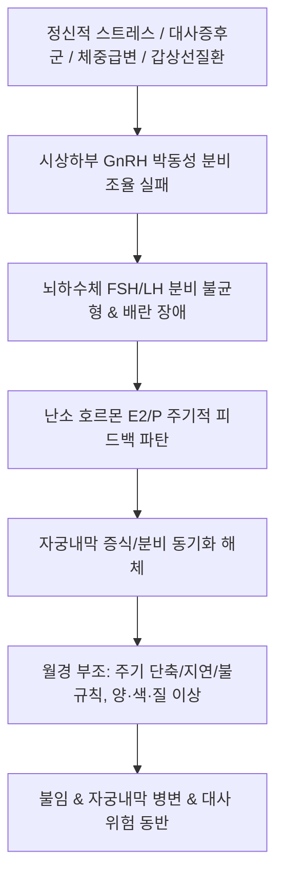

# 🩺 월경 부조 (Irregular Menstruation / 月經不調, Menstrual Irregularity)

> **핵심 3줄 요약 (Key Summary)**:
> - 📍 **정의 & 병태생리**: 월경의 주기(앞당겨짐 또는 늦어짐), 출혈 기간, 출혈량(과다 또는 과소), 혈색, 혈질이 정상 범위를 벗어나 불규칙하게 교란된 병태의 총칭. 시상하부-뇌하수체-난소(HPO) 축의 기능 조절 실패, [[다낭성 난소 증후군]](PCOS), 갑상선 질환, 스트레스 및 체중 급변이 주원인이다.
> - 🚩 **임상 양상**: 주기의 예측 불가능성(21일 미만 혹은 35일 이상 진폭), 생리량의 불규칙한 변동, 부정출혈, 한의 변증에 따른 특징적 월경색(심홍·암홍·담홍·자홍) 및 질 농도(혈괴·희박·점조) 변화.
> - 🛠️ **치료 원칙**: 기저 내분비 원인 감별 및 호르몬 조절, 한의학에서 월경 속도·양·색·질의 4대 지표 분석을 통한 변증 시치([[소요산]], [[조경종옥탕]], [[귀비탕]], [[온경탕]], [[보음전]]).
> - ⚠️ **응급 의뢰 레드플래그**: 장기간의 불규칙 출혈 후 발생하는 대량 파탄성 출혈 쇼크, 폐경 주변기 환자에서 호르몬 불응성 출혈 지속 시 [[자궁내막증식증]] 및 [[자궁내막암]] 배제를 위한 즉각적 자궁내막 조직생검 의뢰.

---

## 📌 목차
1. [질환 개요 & 해부학적 병태생리](#1-질환-개요--해부학적-병태생리)
2. [병태생리 메커니즘 & HPO 축 조절 부전 네트워크](#2-병태생리-메커니즘--hpo-축-조절-부전-네트워크)
3. [임상 증상 & 월경 양상 4대 평가 매트릭스](#3-임상-증상--월경-양상-4대-평가-매트릭스)
4. [감별 진단 매트릭스 (Differential Diagnosis)](#4-감별-진단-매트릭스-differential-diagnosis)
5. [한의 통합 치료 프로토콜 (침·약침·한약)](#5-한의-통합-치료-프로토콜-침약침한약)
6. [양방 치료 & 주기 조절·의뢰 기준 (Conventional Treatment & Referral)](#6-양방-치료--주기-조절의뢰-기준-conventional-treatment--referral)
7. [생활습관 티칭 & 생체 리듬 회복 가이드](#7-생활습관-티칭--생체-리듬-회복-가이드)
8. [💡 사용자 진료실 핵심 필기 & 임상 노하우 (Melt-In 잔여 심화 집약)](#8-💡-사용자-진료실-핵심-필기--임상-노하우-melt-in-잔여-심화-집약)
9. [출처 및 학술 참고 문헌 (References)](#9-출처-및-학술-참고-문헌-references)

---

## 1. 질환 개요 & 해부학적 병태생리

### 1) 질환 정의 및 임상적 포괄성
- **월경 부조(Irregular Menstruation / 月經不調)**: 월경의 4대 기본 요소인 **주기(Cycle), 기간(Duration), 양(Volume), 성상(Character - 색·질)** 중 하나 이상이 정상 생리 범위를 벗어난 제반 월경 이상 상태를 아우르는 한의학적·임상적 상위 개념이다.
- 세부 질환으로 [[월경 선기]](주기 단축), [[월경 후기]](주기 연장), [[월경선후무정기]](주기 불규칙), [[월경 과다]](양 과다), [[월경 과소]](양 과소)를 포괄한다.

### 2) HPO 축과 자궁내막의 생리적 동기화
- 정상 월경은 시상하부 [[GnRH]]의 정밀한 90~120분 주기 박동성 분비 -> 뇌하수체 [[FSH]]/[[LH]] 조절 -> 난소 난포 성숙 및 [[에스트라디올]]/[[프로게스테론]] 분비 -> 자궁내막 증식기·분비기·탈락기의 유기적 피드백에 의해 유지된다.
- 이 축의 어느 한 지점이라도 스트레스(코르티솔 상승), 대사 이상(고인슐린혈증), 체중 급변으로 교란되면 배란 동기화가 깨지며 월경 부조가 발생한다.

---

## 2. 병태생리 메커니즘 & HPO 축 조절 부전 네트워크

### 1) 주요 내분비 교란 기전
- **만성 무배란성 에스트로겐 단독 노출**: [[다낭성 난소 증후군]](PCOS)이나 비만 환자에서 프로게스테론 길항 없이 에스트로겐만 지속 분비되어 내막이 과다 비후되다가 무작위로 파탄 출혈(Breakthrough bleeding)을 일으킴.
- **스트레스성 시상하부 기능 부전**: 심한 정신적 스트레스나 과훈 시 코르티코트로핀 분비 호르몬(CRH) 및 베타-엔돌핀이 GnRH 박동성 분비를 억제하여 주기 지연 및 무배란 초래.
- **갑상선-난소 상호작용**: [[갑상선기능저하증]] 시 TRH 상승이 프로락틴 분비를 자극하여 성선자극호르몬을 억제하고 월경 불순을 유발.

### 2) 월경 부조 병태생리 도식

---

## 3. 임상 증상 & 월경 양상 4대 평가 매트릭스

### 1) 진료실 핵심 월경 양상 4대 평가 매트릭스 (변증 진단 SOP)
한의 진료실에서 월경 부조 환자를 평가할 때 아래 4가지 지표를 분석하여 체질과 병인을 즉각 도출한다:

| 평가 지표 | 열증 (熱證) | 한증 (寒證) | 허증 (虛證) | 기체 (氣滯) | 혈어 (血瘀) |
| :--- | :--- | :--- | :--- | :--- | :--- |
| **1) 월경 속도 (주기)** | 빨라짐 ([[월경 선기]]) | 느려짐 ([[월경 후기]]) | 늘어지거나 지연 | 선후부종 ([[월경선후무정기]]) | 지연 또는 부정기 |
| **2) 월경량** | 많음 ([[월경 과다]]) | 적음 ([[월경 과소]]) | 많거나 멎지 않음 | 많기도 하고 적기도 함 | 정상 또는 적어짐 |
| **3) 월경색** | 심홍색 (深紅, 짙은 붉은색) | 암홍색 (暗紅, 어두운 색) | 담홍색 (淡紅, 묽고 옅은색) | 자홍색 (紫紅, 자줏빛) | 암자색 (暗紫, 검붉은색) |
| **4) 질 농도 (성상)** | 끈끈함 (稠粘, 점조) | 혈괴 동반 (血塊) | 희박함 (稀薄, 묽음) | 맑고 끈적임 교대 | 덩어리 피 (血塊 다수) |

---

## 4. 감별 진단 매트릭스 (Differential Diagnosis)

| 감별 질환 | 호발 연령 및 특이 소견 | 핵심 감별 검사 | 감별 포인트 |
| :--- | :--- | :--- | :--- |
| **[[다낭성 난소 증후군]](PCOS)** | 10~30대, 비만, 다모증, 여드름 | LH/FSH 비율 > 2, 초음파상 PCOM, AMH 상승 | 고안드로겐혈증 및 다낭성 난소 확인 |
| **폐경이행기(Perimenopause)** | 40대 중후반, 안면홍조, 불면 | 혈청 FSH 상승, E2 변동 | 연령대 및 혈관운동 증상 동반 |
| **[[갑상선기능항진증]] / 저하증** | 체중변화, 피로, 맥박수 이상 | TSH, Free T4 이상 | 갑상선 기능 교정 시 생리 정상화 |
| **[[고프로락틴혈증]]** | 유즙 분비, 두통, 시야 장애 | 혈청 Prolactin > 25 ng/mL, 뇌 MRI | 프로락틴 단독 상승, 유즙분비 |
| **자궁내막 병변(폴립, 근종, 증식증)** | 출혈량 과다, 골반통, 빈혈 | 골반 초음파, 자궁경, 조직검사 | 기질적 병변 초음파 확인 |

---

## 5. 한의 통합 치료 프로토콜 (침·약침·한약)

### 1) 변증별 한약 처방 프로토콜
- **간울기체(肝鬱氣滯) / 기체혈어(氣滯血瘀)**:
  - 주증: 스트레스 후 월경선후무정, 생리량 다소불정, 유방창통, 소복창통, 설자태박, 맥현.
  - 대표 처방: [[가미소요산]], [[소간해울탕]], [[조경종옥탕]] 가감(시호, 백작약, 당귀, 향부자, 울금).
  - 치법: 소간해울(疏肝解鬱), 이기조경(理氣調經).
- **비신양허(脾腎兩虛) / 충임불고(衝任不固)**:
  - 주증: 생리 주기 연장 또는 부정출혈, 월경색 담홍, 만성 피로, 소화불량, 요슬산연, 설담치흔, 맥세약.
  - 대표 처방: [[귀비탕]], [[보중익기탕]], [[우귀음]] 가감.
  - 치법: 건비온신(健脾溫腎), 조충익혈(調衝益血).
- **혈열망행(血熱妄行) / 음허혈열(陰虛血熱)**:
  - 주증: 생리 주기 단축, 생리량 과다, 심홍색 점조혈, 구갈, 오심번열, 설홍태황, 맥삭.
  - 대표 처방: [[청경산]], [[보음전]], [[지백지황환]] 가감.
  - 치법: 청열양혈(淸熱涼血), 자음조경(滋陰調經).
- **한응혈어(寒凝血瘀) / 포궁허한(胞宮虛寒)**:
  - 주증: 생리 지연, 암자색 혈괴, 하복냉통, 수족냉, 온열 시 완화, 설담태백, 맥침지.
  - 대표 처방: [[온경탕]], [[소복축어탕]] 가감.
  - 치법: 온경산한(溫經散寒), 활혈화어(活血化瘀).

### 2) 침구 치료 프로토콜
- **주요 혈위**: [[관원]](CV4), [[기해]](CV6), [[중극]](CV3), [[삼음교]](SP6), [[혈해]](SP10), [[태충]](LR3), [[족삼리]](ST36).
- **시술 기전**: 간경(LR)·비경(SP)·신경(KI)의 교회혈인 삼음교와 임맥(CV) 혈위를 자극하여 충임맥 기혈을 조화시키고 자율신경계 긴장 완화.

---

## 6. 양방 치료 & 주기 조절·의뢰 기준 (Conventional Treatment & Referral)

### 1) 표준 호르몬 주기 치료
- **복합 경구피임제(COC)**: 피임 희망 여성에서 인위적 에스트로겐-프로게스틴 공급으로 자궁내막을 안정화시키고 규칙적 소퇴성 출혈 유도.
- **주기적 프로게스틴 요법(Dydrogesterone, 미분화 프로게스테론)**: 매 주기 황체기(14~25일째)에 10~12일간 투여하여 무배란성 자궁내막 증식증 예방 및 소퇴성 출혈 유도.
- **기저 원인 치료**: 갑상선약, 메트포르민, 도파민 작용제 투여.

### 2) 상급병원 전원의뢰 기준
- 3개월 이상 치료에도 지속되는 불규칙 출혈, 40세 이상 여성에서 내막 두께 비후 시 자궁내막 조직생검 의뢰.

---

## 7. 생활습관 티칭 & 생체 리듬 회복 가이드

### 1) 수면 및 서카디언 리듬 동기화
- 규칙적인 수면-각성 주기(야간 7~8시간 수면)는 멜라토닌 분비와 HPO 축의 박동성 리듬을 정상화하는 핵심 요소.

### 2) 체중 관리 및 영양 균형
- BMI 정상 범위(18.5~23) 유지, 극단적인 저탄수화물 다이어트나 폭식 지양.

---

## 8. 💡 사용자 진료실 핵심 필기 & 임상 노하우 (Melt-In 잔여 심화 집약)

### 1) 월경 부조의 정의와 변증 진단의 핵심 가치
- 월경 부조는 월경 날짜가 앞당겨지거나 늦어지는 것, 그리고 월경량이 불규칙한 상태를 총칭한다.
- 임상에서 월경 부조는 단순한 병명이 아니라 환자의 전신 한열허실(寒熱虛實)과 오장육부의 병적 편차를 파악하는 가장 중요한 한의학적 변증 지표이다.

### 2) 진료실 월경 양상 변증 공식 (실전 진단 비결)
환자의 문진표에서 월경 양상을 볼 때 아래 공식을 즉각 적용한다:
- **월경 속도 (주기)**:
  - 열증(熱證)은 빨라진다 ([[월경 선기]]).
  - 한증(寒證)은 느려진다 ([[월경 후기]]).
  - 허증(虛證)은 월경이 늘어지거나 길어진다.
  - 기체(氣滯)는 앞당겨졌다 늦어졌다 하는 선후부종([[월경선후무정기]])을 보인다.
- **월경량**:
  - 열증은 많다.
  - 한증은 적다.
  - 허증은 많거나 그치지 않는다.
  - 기체는 많기도 하고 적기도 하여 일정치 않다.
  - 혈어에서는 정상적이거나 적어지며, 음허(陰虛)에서는 진액 고갈로 당연히 적어진다.
- **월경색**:
  - 열증은 심홍색(深紅), 한증은 암홍색(暗紅), 허증은 담홍색(淡紅), 기체는 자홍색(紫紅), 혈어는 암자색(暗紫).
- **질 농도**:
  - 열증은 끈끈하고(稠粘), 한증은 혈괴(血塊)가 나오며, 허증은 묽고 희박(稀薄)하며, 혈어는 뚜렷한 혈괴(血塊)가 다발한다.
- 이 매트릭스를 기반으로 하여 환자의 주소증이 [[월경선후무정기]], [[월경 선기]], [[월경 후기]] 중 어디에 속하는지 정밀 감별하여 처방을 확정한다.

---

## 9. 출처 및 학술 참고 문헌 (References)

Aalpona. (2026). Comparison of Clinical, Metabolic, and Hormonal Profiles in Obese Versus Lean Women With Polycystic Ovary Syndrome: A Systematic Review and Meta-Analysis. *Endocrinol Diabetes Metab*. PMID: 42850789.

Ramey. (2026). When a Psychiatric Diagnosis Is Actually Perimenopause. *Am J Nurs*. PMID: 42814536.

Haerudin. (2026). Adolescent dysmenorrhea revealing Herlyn-Werner-Wunderlich syndrome with endometriosis: A radiologic case report. *Radiol Case Rep*. PMID: 42633389.
