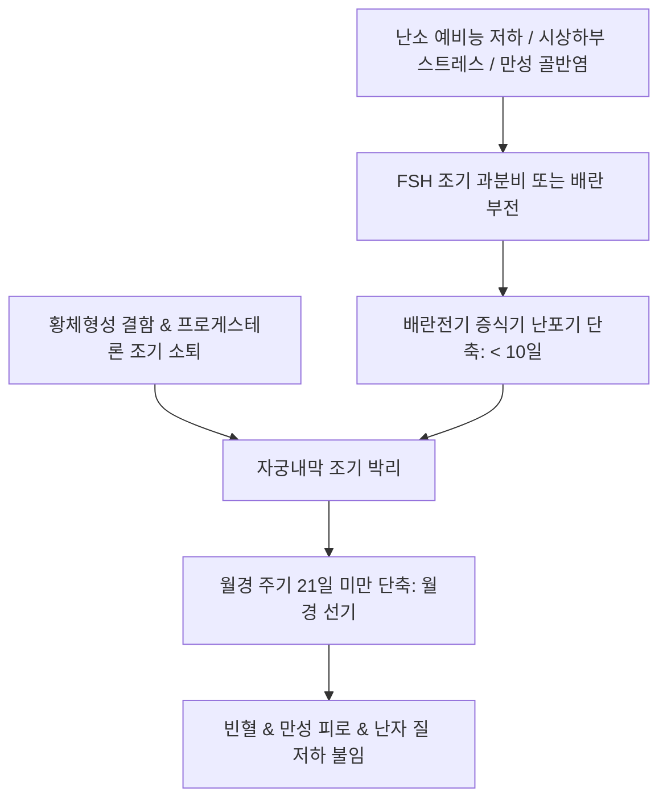

# 🩺 월경 선기 (Polymenorrhea / 月經先期, Frequent Menstruation)

> **핵심 3줄 요약 (Key Summary)**:
> - 📍 **정의 & 병태생리**: 월경 주기가 연속 2주기 이상 21일 미만으로 단축되는 병태. 대개 시상하부-뇌하수체-난소 축의 조절 부전으로 난포기(배란 전 증식기)가 비정상적으로 짧아지거나 황체기 결함, 혹은 만성 무배란성 파탄 출혈로 인해 발생한다.
> - 🚩 **임상 양상**: 빈번한 생리(한 달에 2회 이상), 잦은 출혈로 인한 피로와 빈혈, 기저 질환에 따른 동반 증상(갑상선 기능 이상, 만성 골반염, 자궁내막증).
> - 🛠️ **치료 원칙**: 양방 배란 유도 및 황체호르몬 주기 치료, 한의학적으로 기허(氣虛)·혈열(血熱)·음허(陰虛)·혈어(血瘀) 변증에 따른 [[보중익기탕]], [[청경산]], [[귀비탕]], [[단치소요산]], [[선기탕]] 투여.
> - ⚠️ **응급 의뢰 레드플래그**: 잦은 출혈과 함께 급성 골반통, 악취 나는 화농성 대하, 발열 동반 시 급성 난관염/골반염(PID) 의뢰 필요. 40세 이상에서 불규칙 빈발 출혈 지속 시 [[자궁내막암]] 스크리닝 필수.

---

## 📌 목차
1. [질환 개요 & 해부학적 병태생리](#1-질환-개요--해부학적-병태생리)
2. [병태생리 메커니즘 & 난포기 단축 네트워크](#2-병태생리-메커니즘--난포기-단축-네트워크)
3. [임상 증상 & 주기 단축 평가 알고리즘](#3-임상-증상--주기-단축-평가-알고리즘)
4. [감별 진단 매트릭스 (Differential Diagnosis)](#4-감별-진단-매트릭스-differential-diagnosis)
5. [한의 통합 치료 프로토콜 (침·약침·한약)](#5-한의-통합-치료-프로토콜-침약침한약)
6. [양방 치료 & 주기 연장·의뢰 기준 (Conventional Treatment & Referral)](#6-양방-치료--주기-연장의뢰-기준-conventional-treatment--referral)
7. [생활습관 티칭 & 난소 휴식 가이드](#7-생활습관-티칭--난소-휴식-가이드)
8. [💡 사용자 진료실 핵심 필기 & 임상 노하우 (Melt-In 잔여 심화 집약)](#8-💡-사용자-진료실-핵심-필기--임상-노하우-melt-in-잔여-심화-집약)
9. [출처 및 학술 참고 문헌 (References)](#9-출처-및-학술-참고-문헌-references)

---

## 1. 질환 개요 & 해부학적 병태생리

### 1) 질환 정의 및 임상적 중요성
- **월경 선기(Polymenorrhea / 月經先期)**: 정상적인 월경 주기(24~38일)에 비해 월경 간격이 연속 2주기 이상 **21일 미만**으로 앞당겨져 나타나는 병태를 말한다.
- 잦은 생리로 인해 환자는 한 달에 두 번씩 생리를 경험하게 되며, 만성 실혈로 인한 빈혈과 함께 난포 성숙 부족에 따른 불임을 초래한다.

### 2) 난소 주기 해부학과 주기 단축 기전
- **배란전기(증식기/난포기) 단축**: 대부분의 월경 선기는 난포기(Follicular phase)가 정상 14일에서 7~10일로 조기 종료되며 발생한다. 난포가 충분히 성숙하지 못한 채 조기 배란되거나(난소 예비능 저하 시 FSH 조기 상승), 난포 폐쇄로 이어져 파탄 출혈을 일으킨다.
- **황체기(Luteal phase) 단축**: 황체기능부전(LPD)으로 황체 수명이 10일 미만으로 짧아져 프로게스테론이 조기 급락하며 생리가 앞당겨진다.

---

## 2. 병태생리 메커니즘 & 난포기 단축 네트워크

### 1) 주요 병태생리 경로
1. **난소 노화 및 예비능 저하**: 폐경 주변기 여성에서 인히빈 B 저하 -> 기저 [[FSH]] 조기 급상승 -> 난포 조기 동원 및 급속 성장 -> 난포기 극단적 단축.
2. **시상하부-뇌하수체 조절 부전**: 스트레스, 체중 변화로 인한 무배란성 난포 출혈.
3. **만성 염증 및 내막 울혈**: 만성 골반염(PID) 또는 [[자궁내막증]]으로 인한 국소 프로스타글란딘 상승 및 혈관 확장.
4. **갑상선 기능 이상**: [[갑상선기능항진증]] 또는 저하증에 의한 성호르몬 대사율 변화.

### 2) 월경 선기 병태생리 도식

---

## 3. 임상 증상 & 주기 단축 평가 알고리즘

### 1) 주요 임상 양상
- **주기 단축**: 18~20일마다 반복되는 월경.
- **출혈 양상**: 기허형은 색담홍·질희박, 혈열형은 색심홍·점조혈, 혈어형은 자암색 혈괴 배출.
- **기초체온표(BBT)**: 저온기(난포기)가 비정상적으로 짧거나, 고온기(황체기)가 10일 미만으로 유지되는 양상 확인.

### 2) 진단적 검사 프로토콜
- **기저 호르몬 검사**: 생리 2~3일째 [[FSH]], [[LH]], [[에스트라디올]], [[AMH]], TSH, Free T4, 프로락틴.
- **배란 확인 검사**: 황체기 중기 혈청 프로게스테론 및 연속 초음파 난포 추적.
- **골반 초음파**: 만성 골반염, 난소 낭종, 자궁내막 병변 유무 확인.

---

## 4. 감별 진단 매트릭스 (Differential Diagnosis)

| 감별 질환 | 호발 기전 및 병력 | 핵심 검사 소견 | 감별 포인트 |
| :--- | :--- | :--- | :--- |
| **배란기 출혈(Ovulatory bleeding)** | 주기 12~16일경 1~3일간 소량 출혈 | 배란 초음파 일치, LH 서지 일치 | 생리가 아닌 배란 시 에스트로겐 일시 강하 출혈 |
| **[[다낭성 난소 증후군]](PCOS)** | 희발월경이 주이나 불규칙 빈발 출혈 가능 | 초음파상 PCOM, 안드로겐 상승 | 무배란성 파탄 출혈 |
| **만성 골반염증성 질환(PID)** | 골반통, 질 분비물, 성교통 | 골반 내진 압통, 자궁부속기 비후 | 염증 자체가 자궁내막 출혈 촉발 |
| **[[갑상선기능항진증]]** | 체중감소, 발한, 심계항진 | TSH 저하, Free T4 상승 | 갑상선 기능 교정 시 주기 정상화 |
| **자궁경부 용종/이형성증** | 성교 후 출혈, 접촉성 출혈 | 질경 검사, 자궁경부세포진(Pap) | 자궁경부 병소 직접 관찰 |

---

## 5. 한의 통합 치료 프로토콜 (침·약침·한약)

### 1) 변증별 한약 처방 프로토콜
- **비기허약(脾氣虛弱) / 비불통혈(脾不統血)**:
  - 주증: 생리 선기, 월경량 과다, 색담홍, 질희박, 피로 무력, 면색위황, 식욕 부진, 설담태백, 맥완약.
  - 대표 처방: [[보중익기탕]], [[귀비탕]], 거원전(擧元煎), 익위승양탕, 수비전(壽脾煎) 가감.
  - 치법: 보기건비(補氣健脾), 섭혈조경(攝血調經).
- **신기불고(腎氣不固) / 충임불섭(衝任不攝)**:
  - 주증: 생리 선기, 월경량 소, 색담암, 질희박, 요슬산연, 하지 무력, 야간뇨, 설담태백, 맥침세약.
  - 대표 처방: [[귀신환]], 온충탕(溫衝湯) 가감(숙지황, 산약, 토사자, 두충, 파극천).
  - 치법: 보신고충(補腎固衝), 익기조경(益氣調經).
- **양성혈열(陽盛血熱) / 실열망행(實熱妄行)**:
  - 주증: 생리 선기, 월경량 과다, 색심홍, 끈적임, 구갈, 번열, 변비, 설홍태황, 맥활삭.
  - 대표 처방: [[청경산]], 금련사물탕, 선기탕(先期湯) 가감(황금, 황련, 황백, 지황, 단삼).
  - 치법: 청열양혈(淸熱涼血), 조경지혈(調經止血).
- **간울혈열(肝鬱血熱) / 기체화화(氣滯化火)**:
  - 주증: 생리 선기, 월경량이 일정치 않고 색자홍, 유방 창통, 흉협고만, 정서 불안, 맥현삭.
  - 대표 처방: [[단치소요산]], 청경사물탕 가감(시호, 목단피, 치자, 백작약).
  - 치법: 소간청열(疏肝淸熱), 양혈조경(涼血調經).
- **음허혈열(陰虛血熱) / 허화내치(虛火內熾)**:
  - 주증: 생리 선기, 월경량 소, 색홍 무혈괴, 조열도한, 관홍, 인건, 설홍소태, 맥세삭.
  - 대표 처방: 지골피탕(地骨皮湯), [[양음청폐탕]] 가감(지골피, 맥문동, 지모, 백미).
  - 치법: 자음청열(滋陰淸熱), 양혈조경(涼血調經).
- **혈어형(血瘀型) / 어혈조체(瘀血阻滯)**:
  - 주증: 생리 선기, 색자암, 혈괴 동반, 하복통 거안, 설자암 어점, 맥삽.
  - 대표 처방: [[도홍사물탕]], 통어전(通瘀煎) 가감.
  - 치법: 활혈거어(活血祛瘀), 이기조경(理氣調經).

### 2) 침구 치료 프로토콜
- **주요 혈위**: [[관원]](CV4), [[삼음교]](SP6), [[혈해]](SP10), [[족삼리]](ST36), [[태충]](LR3), [[은백]](SP1), [[신수]](BL23).
- **기혈 조절 자침**: 혈열 시 혈해·행간 사법(瀉法), 기허 시 관원·족삼리 보법(補法) 및 뜸 치료.

---

## 6. 양방 치료 & 주기 연장·의뢰 기준 (Conventional Treatment & Referral)

### 1) 약물 요법
- **복합 경구피임제(COC)**: 21일 복용 후 7일 휴약 주기로 정상 28일 주기 확립.
- **황체호르몬 보충 요법**: 주기 14~25일째 경구 프로게스틴(디드로게스테론, 미분화 프로게스테론) 투여로 황체기 보강 및 조기 탈락 방지.
- **배란유도**: 임신 희망 여성에서 레트로졸 또는 클로미펜 투여로 우성 난포의 완전한 성숙 유도.

### 2) 상급병원 전원의뢰 기준
- 40세 이상 여성에서 내막 비후 동반 빈발 출혈 시 조직검사 의뢰.

---

## 7. 생활습관 티칭 & 난소 휴식 가이드

### 1) 과로 및 만성 피로 관리
- 비기허(脾氣虛) 예방을 위해 규칙적인 식사와 충분한 수면 확보, 격렬한 다이어트 금지.

### 2) 심리적 안정
- 간울화화(肝鬱化火)를 막기 위해 스트레스 이완 요법(명상, 심호흡) 생활화.

---

## 8. 💡 사용자 진료실 핵심 필기 & 임상 노하우 (Melt-In 잔여 심화 집약)

### 1) 병리적 본질과 원인의 임상적 고찰
- 월경 선기는 월경 간격이 연속 2주기 이상 21일 미만인 경우로 정의한다.
- 주요 원인으로는 내분비 조절 부전, 시상하부 조절 문제, 갑상샘 기능 이상, 만성 골반염증성 질환(염증 자체가 내막 울혈과 출혈을 촉발)이 있다.
- 대부분 난포 발달 부전으로 배란전기(증식기)가 비정상적으로 짧아지는 것이 핵심 기전이며, 음허혈열(陰虛血熱) 변증 환자는 난포 예비능 부족으로 인한 경우가 다수이다.

### 2) 처방 감별의 묘미: 선기탕 대 청경사물탕
- **청경사물탕 vs 선기탕**: 두 처방은 유사한 청열양혈 구성을 띠지만, 청경사물탕은 지황(地黃)을 군약으로 삼아 자음양혈을 위주로 하고, 선기탕(先期湯)은 당귀(當歸)를 주약으로 삼아 보혈조경을 위주로 한다.
- **과기음 vs 선기탕**: 과기음은 어혈(瘀血) 정체에 쓰고 선기탕은 열증(熱證)에 사용하는데, 두 처방이 단순히 반대로 대응하는 것이 아니라 환자의 허실 병태에 따라 섬세하게 적응증을 달리한다.
- **자석영(紫石英)**: 부소로 구성되어 난경온심(暖經溫心) 작용이 있어, 충임맥이 허한하면서 혈열이 섞인 복합 변증에 중요한 역할을 한다.
- **강황과 울금**: 파기거어(破氣祛瘀)시키는 풍습비통(오십견 등)에 주로 쓰이는 약재이나, 부인과 월경병에서 기체어혈을 풀 때 정밀하게 선별 활용된다.

---

## 9. 출처 및 학술 참고 문헌 (References)

Urazbayeva. (2026). Epidemiology, Risk Factors, Diagnosis, and Comorbidities of Endometriosis: An Umbrella Review. *J Clin Med*. PMID: 42355752.

Dueck. (2026). The overlooked connection: Managing menstrual irregularities in chronic conditions - A scoping review. *Womens Health (Lond)*. PMID: 42809887.

Kim. (2025). Prevalence and Risk Factors of Menstrual Disorders in Korean Women. *Healthcare (Basel)*. PMID: 40150456.
