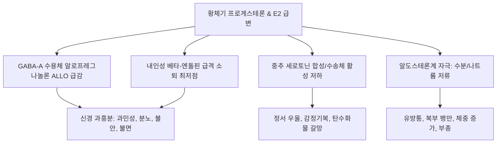

# 🩺 월경 전 증후군 (Premenstrual Syndrome, PMS / PMDD)

> **핵심 3줄 요약 (Key Summary)**:
> - 📍 **정의 & 병태생리**: 월경 전 황체기(배란 후 4~10일 전)에 주기적이고 지속적으로 발생하는 신체적·정신적·행동적 복합 증상군으로, 월경 시작 직후 신속히 소실되는 질환. 황체기 프로게스테론/알로프레그나놀론 급변에 대한 뇌 세로토닌([[세로토닌]]) 및 GABA 수용체 과민 반응, 내인성 오피오이드 저하가 주원인이다.
> - 🚩 **임상 양상**: 정서 증상(흥분, 과민, 분노, 불안, 우울, 충동성), 신체 증상(유방 압통, 체중 증가, 수분 저류성 부종, 두통, 피로, 단 음식 갈망), 중증 시 월경전불쾌장애(PMDD).
> - 🛠️ **치료 원칙**: 양방 선택적 세로토닌 재흡수 억제제(SSRI), 배란 억제 경구피임제(드로스피레논 함유 COC), 인지행동치료(CBT), 한의학적으로 간울기체(肝鬱氣滯)·심비양허(心脾兩虛) 변증에 따른 [[단치소요산]], [[감맥대조탕]], [[가미귀비탕]], [[온담탕]] 처방.
> - ⚠️ **응급 의뢰 레드플래그**: 심각한 충동 조절 장애, 자살 충동 또는 자해 행동, 타인에 대한 폭력 성향 발현 시 중증 월경전불쾌장애(PMDD) 또는 주요우울장애 악화로 판단하여 즉각적인 정신건강의학과 응급 협진 의뢰.

---

## 📌 목차
1. [질환 개요 & 해부학적 병태생리](#1-질환-개요--해부학적-병태생리)
2. [병태생리 메커니즘 & 8대 원인 가설 네트워크](#2-병태생리-메커니즘--8대-원인-가설-네트워크)
3. [임상 증상 & PAF/ACOG 진단 평가 알고리즘](#3-임상-증상--pafacog-진단-평가-알고리즘)
4. [감별 진단 매트릭스 (Differential Diagnosis)](#4-감별-진단-매트릭스-differential-diagnosis)
5. [한의 통합 치료 프로토콜 (침·약침·한약)](#5-한의-통합-치료-프로토콜-침약침한약)
6. [양방 치료 & 약물·정신요법 기준 (Conventional Treatment & Referral)](#6-양방-치료--약물정신요법-기준-conventional-treatment--referral)
7. [영양 요법 & 라이프스타일 티칭 가이드](#7-영양-요법--라이프스타일-티칭-가이드)
8. [💡 사용자 진료실 핵심 필기 & 임상 노하우 (Melt-In 잔여 심화 집약)](#8-💡-사용자-진료실-핵심-필기--임상-노하우-melt-in-잔여-심화-집약)
9. [출처 및 학술 참고 문헌 (References)](#9-출처-및-학술-참고-문헌-references)

---

## 1. 질환 개요 & 해부학적 병태생리

### 1) 질환 정의 및 임상적 분류
- **월경 전 증후군(Premenstrual Syndrome, PMS)**: 가임기 여성에서 월경 시작 전 반복적으로 나타나는 정서적, 행동적, 신체적 증상들의 복합체로, 일상생활이나 대인관계에 지장을 초래하며 월경 개시와 함께 수일 내에 호전되는 특징을 가진다.
- **월경전불쾌장애(Premenstrual Dysphoric Disorder, PMDD)**: PMS의 중증 형태로, 심한 우울, 분노, 절망감, 불안 등 정서 증상이 두드러져 DSM-5 진단 기준을 충족하는 정신신경내분비 질환이다(가임기 여성의 3~8%).

### 2) 신경생화학 및 표적 장기
- **중추신경계 감수성**: 난소 스테로이드 호르몬 농도 자체는 정상인 경우가 많으나, 중추신경계의 변연계(Limbic system) 및 시상하부 세포가 호르몬 변동에 비정상적으로 과민하게 반응한다.
- **GABA-A 수용체 알로스테릭 조절**: 프로게스테론 대사산물인 알로프레그나놀론(Allopregnanolone, ALLO)이 GABA 수용체 활성을 조절하는데, 황체기 말기 급격한 ALLO 강하가 불안과 공격성을 유발한다.

---

## 2. 병태생리 메커니즘 & 8대 원인 가설 네트워크

### 1) 의학 연구 기반 8대 원인 가설 (사용자 필기 집약)
1. **프로게스테론 원인설**: 황체기 [[프로게스테론]](P)의 급격한 변동 혹은 에스트로겐/프로게스테론 역전 현상(E > P)에 의한 신경 전달 교란.
2. **노르에피네프린·[[도파민]]설**: 카테콜아민 대사 교란(감소 시 우울, 증가 시 흥분·불안).
3. **비타민 B6([[비타민 B6]]) 결핍설**: 도파민 및 [[세로토닌]] 합성에 필수적인 조효소인 피리독살 인산 부족으로 인한 신경전달물질 고갈.
4. **저혈당설**: 황체기 인슐린 감수성 변화에 따른 반응성 저혈당(두통, 피로, 심계항진, 음식 갈망 유발).
5. **수분 저류설**: 레닌-안지오텐신-알도스테론 축(RAAS) 자극으로 인한 나트륨 및 체액 저류, 부종, 체중 증가.
6. **체내 호르몬 알레르기설**: 황체기 프로게스테론 및 프로락틴 급증에 대한 면역학적 과민 반응.
7. **내인성 [[오피오이드]] 결핍설**: 황체기 최고조에 달했던 베타-[[엔돌핀]] 및 [[엔케팔린]] 농도가 월경기 직전 급격히 바닥을 치며(최저점) 금단 증상과 유사한 정서 불안 촉발.
8. **잠재적 정신과적 문제의 표출**: 잠재된 기분 장애가 호르몬 변화를 방아쇠로 현성화.

### 2) 신경내분비 악순환 도식

---

## 3. 임상 증상 & PAF/ACOG 진단 평가 알고리즘

### 1) 주요 임상 증상
- **정서/행동 증상**: 과민성, 분노 폭발, 불안, 우울, 정서적 불안정, 사회적 위축, 집중력 저하, 피로, 단 음식(초콜릿 등) 폭식 갈망.
- **신체 증상**: 유방 압통 및 종창, 복부 팽만감, 수분 저류성 부종, 두통, 관절통/근육통.

### 2) PAF 분류 및 ACOG 진단 기준
- **PAF (Premenstrual Assessment Form)**: 후향적 평가 도구로 주요우울, 수분저류, 불쾌감, 충동, 사회기능 장애 5대 하위 척도로 환자 표현형을 분류.
- **진단 기준 (최소 2주기 연속 전향적 일지 작성)**:
  - 월경 시작 전 5일 이내에 정서적/신체적 증상이 최소 1개 이상 나타남.
  - 월경 시작 후 4일 이내에 증상이 완전히 소실되며, 최소 주기 13일경까지는 무증상 상태 유지.
  - 사회적, 직업적 기능 장애를 초래하며 다른 정신과 질환의 단순 악화가 아님.

---

## 4. 감별 진단 매트릭스 (Differential Diagnosis)

| 감별 질환 | 호발 특징 및 증상 양상 | 감별 핵심 검사 | PMS/PMDD와의 차이점 |
| :--- | :--- | :--- | :--- |
| **주요 우울 장애(MDD)** | 월경 주기와 무관하게 한 달 내내 지속 | 정신과 임상 면담, PHQ-9 | 월경 후에도 증상 호전기(무증상기)가 없음 |
| **[[갑상선기능저하증]]** | 만성 피로, 체중 증가, 추위 불내성 | TSH 상승, Free T4 저하 | 주기성이 없으며 갑상선 호르몬 이상 확인 |
| **폐경이행기 증후군** | 40대 중후반, 안면홍조, 생리주기 불규칙 | 혈청 FSH 상승, 주기 변동 | 혈관운동 증상 동반 및 무월경 주기 동반 |
| **특발성 부종** | 하루 중 체중 변동 심함, 기립 시 악화 | 전해질, 알부민, 신기능 검사 | 월경 주기와 무관하게 지속적인 체액 저류 |

---

## 5. 한의 통합 치료 프로토콜 (침·약침·한약)

### 1) 증상별 한약 처방 프로토콜 (사용자 필기 집약)
- **정지이상(情志異常) — 과민, 불안, 분노, 우울**:
  - 대표 처방: [[단치소요산]], [[감맥대조탕]], [[가미귀비탕]], [[온담탕]] 가감.
  - 치법: 소간해울(疏肝解鬱), 안신영심(安神寧心).
- **월경 전 두통(頭痛)**:
  - 대표 처방: [[가감기국지황탕]], [[영각구등탕]], [[통규활혈탕]], [[반하백출천마탕]] 가감.
  - 치법: 평간식풍(平肝熄風), 활혈통락(活血通絡).
- **월경 전 현훈(眩暈)**:
  - 대표 처방: [[귀비탕]], [[천마구등음]], [[반하백출천마탕]] 가감.
  - 치법: 건비양혈(健脾養血), 화담식풍(化痰熄風).
- **월경 전 부종(浮腫)**:
  - 대표 처방: [[영계출감탕]], [[진무탕]], 분심기음(分心氣飮) 가감.
  - 치법: 온양건비(溫陽健脾), 이수소종(利水消腫).
- **대상성 월경(代償性月經, 역경 — 코피, 토혈 등)**:
  - 대표 처방: [[청간인경탕]], [[삼황사물탕]], [[서각지황탕]], 순경탕(順經湯) 가감.
  - 치법: 청열양혈(淸熱涼血), 인혈하기도(引血下行).

### 2) 침구 치료 프로토콜
- **주요 혈위**: [[태충]](LR3), [[합곡]](LI4, 사관혈), [[내관]](PC6), [[삼음교]](SP6), [[신문]](HT7), [[백회]](GV20), [[풍지]](GB20).
- **신경안정 자침**: 사관혈 및 내관·신문혈 자침으로 자율신경계 과흥분을 진정시키고 중추 세로토닌 활성을 촉진.

---

## 6. 양방 치료 & 약물·정신요법 기준 (Conventional Treatment & Referral)

### 1) 약물 요법
- **1차 선택제 (SSRI)**: 세르트랄린, 플루옥세틴, 에스시탈로프람. 황체기 간헐 투여(주기 14일~월경 시작) 또는 지속 투여.
- **배란 억제 경구피임제**: 드로스피레논(Drospirenone) 함유 복합 피임제(야즈 등) — 항미네랄로코르티코이드 작용으로 부종 완화.
- **이뇨제 (스피로놀락톤)**: 황체기 수분 저류 및 유방통 완화.

### 2) 인지행동치료(CBT)
- 인지 재구조화, 이완 훈련, 스트레스 대처 기술 훈련 병용 시 약물 감량 및 장기 완화율 증대.

---

## 7. 영양 요법 & 라이프스타일 티칭 가이드

### 1) 비타민 및 미네랄 보충
- **비타민 B6**: 일일 50~100 mg 섭취로 도파민/세로토닌 합성 촉진 (말초신경병증 예방 위해 100mg 초과 금지).
- **칼슘 & 마그네슘**: 칼슘 1,000~1,200 mg/일, 마그네슘 200~400 mg/일 섭취 시 신경 안정 및 수분 저류 완화.

### 2) 식이 관리
- 정제 탄수화물, 카페인, 알코올, 짠 음식 섭취 제한으로 혈당 스파이크와 체액 저류 억제.

---

## 8. 💡 사용자 진료실 핵심 필기 & 임상 노하우 (Melt-In 잔여 심화 집약)

### 1) 임상적 정의와 PAF 평가의 가치
- 월경 전 증후군은 월경 전 발생하는 월경통 이외의 주기적이고 지속적인 신체·정신적 문제들의 총칭이다.
- 증상은 대개 월경 시작 4~10일 전 황체기에 발현되어 월경 개시와 함께 극적으로 사라진다.
- 임상에서는 PAF(Premenstrual Assessment Form)를 통해 주요우울, 수분저류, 불쾌감, 충동성, 사회기능 장애 유형을 분류하여 치료 우선순위를 정해야 한다.

### 2) 8대 가설의 임상적 실천
- 프로게스테론 역전 현상, 도파민 결핍, 비타민 B6 부족, 저혈당, 알도스테론 수분 저류, 호르몬 알레르기, 내인성 오피오이드 급락(엔돌핀 최저점 금단 현상), 잠재 정신과적 문제 등 8대 가설을 환자의 주소증에 1:1로 매칭하여 처방을 도출한다.
- 체중 증가와 부종에는 이뇨 작용의 [[영계출감탕]]이나 [[진무탕]]을, 과민과 흥분에는 [[온담탕]]과 [[단치소요산]]을, 두통에는 [[영각구등탕]]이나 [[반하백출천마탕]]을 선별 투여하여 대증과 근치를 겸한다.

---

## 9. 출처 및 학술 참고 문헌 (References)

Karakaya. (2026). Investigating the association between climate change anxiety and premenstrual syndrome severity among young women: a cross-sectional study. *J Psychosom Obstet Gynaecol*. PMID: 42584885.

Howard. (2026). Diagnosis and Management of Premenstrual Dysphoric Disorder, Premenstrual Syndrome, and Premenstrual Exacerbation. *Endocrinol Metab Clin North Am*. PMID: 42907055.

Liu. (2026). Efficacy of psychological interventions for premenstrual syndrome: A systematic review and meta-analysis of randomized controlled trials. *J Affect Disord*. PMID: 42448050.
