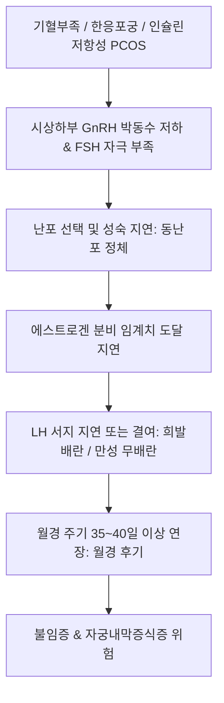

# 🩺 월경 후기 (Oligomenorrhea / 月經後期, Infrequent Menstruation)

> **핵심 3줄 요약 (Key Summary)**:
> - 📍 **정의 & 병태생리**: 정상적인 월경 주기에 비해 월경 간격이 연속 2주기 이상 35~40일 이상으로 지연되거나 연간 월경 횟수가 8회 이하로 감소한 병태. 시상하부-뇌하수체-난소(HPO) 축의 기능 부전, [[다낭성 난소 증후군]](PCOS), 고프로락틴혈증([[고프로락틴혈증]]), 한응포궁(寒凝胞宮) 및 기혈부족이 핵심 기전이다.
> - 🚩 **임상 양상**: 생리가 40일~수개월에 한 번씩 늦어짐, 무배란성 또는 희발배란성 주기, 변증에 따른 하복부 냉통(혈한), 전신 쇠약 및 안색 위황(기혈허약), 비만과 다모증 동반.
> - 🛠️ **치료 원칙**: 기저 내분비 장애 교정(배란 회복, 체중 조절, 메트포르민/GLP-1 RA), 한의학적으로 혈한(血寒)·기혈허약(氣血虛弱)·기체혈어(氣滯血瘀)·담습 변증에 따른 [[온경탕]], [[당귀사역탕]], [[인삼양영탕]], [[소영전]], [[우귀음]] 처방.
> - ⚠️ **응급 의뢰 레드플래그**: 장기간의 희발월경(무배란 상태) 지속으로 인한 에스트로겐 단독 노출은 [[자궁내막증식증]] 및 [[자궁내막암]]의 강력한 위험 인자이므로 6개월 이상 지연 시 부인과 초음파 및 자궁내막 조직생검 의뢰 필수.

---

## 📌 목차
1. [질환 개요 & 해부학적 병태생리](#1-질환-개요--해부학적-병태생리)
2. [병태생리 메커니즘 & 난포 발달 지연 네트워크](#2-병태생리-메커니즘--난포-발달-지연-네트워크)
3. [임상 증상 & 주기 지연 평가 알고리즘](#3-임상-증상--주기-지연-평가-알고리즘)
4. [감별 진단 매트릭스 (Differential Diagnosis)](#4-감별-진단-매트릭스-differential-diagnosis)
5. [한의 통합 치료 프로토콜 (침·약침·한약)](#5-한의-통합-치료-프로토콜-침약침한약)
6. [양방 치료 & 배란 유도·의뢰 기준 (Conventional Treatment & Referral)](#6-양방-치료--배란-유도의뢰-기준-conventional-treatment--referral)
7. [생활습관 티칭 & 대사 개선 가이드](#7-생활습관-티칭--대사-개선-가이드)
8. [💡 사용자 진료실 핵심 필기 & 임상 노하우 (Melt-In 잔여 심화 집약)](#8-💡-사용자-진료실-핵심-필기--임상-노하우-melt-in-잔여-심화-집약)
9. [출처 및 학술 참고 문헌 (References)](#9-출처-및-학술-참고-문헌-references)

---

## 1. 질환 개요 & 해부학적 병태생리

### 1) 질환 정의 및 임상적 중요성
- **월경 후기(Oligomenorrhea / 月經後期)**: 월경 주기가 **35일~40일 이상**으로 연장되어 지연되는 상태를 말하며, 심한 경우 2~3개월에 한 번씩 월경을 치른다.
- 단순한 주기 지연에 그치지 않고 배란 부전, 불임, 그리고 장기적인 에스트로겐 지속 자극에 의한 자궁내막 질환의 전조 증상으로 기능한다.

### 2) 난포 발달 지연과 내막 증식 해부학
- **난포 발달 정지(Follicular arrest)**: 정상적인 14일간의 난포 성장기가 30~50일 이상으로 지연되거나 작은 동난포 단계에서 정체됨.
- **불규칙한 내막 증식**: 프로게스테론의 주기적 분비 없이 에스트로겐의 지속적 자극만 받아 내막 혈관이 불안정하게 증식하다가 파탄 출혈을 유발.

---

## 2. 병태생리 메커니즘 & 난포 발달 지연 네트워크

### 1) 주요 병태생리 경로
1. **신경내분비 기능 저하**: 시상하부-뇌하수체 HPO 축 억제로 인한 [[GnRH]] 분비 빈도 감소 -> [[FSH]] 분비 부족 -> 난포 선택 및 성숙 지연.
2. **대사성 고인슐린혈증 및 PCOS**: 인슐린 저항성이 난소 테카세포 안드로겐 합성을 자극하여 난포 폐쇄 유발.
3. **한응혈체(寒凝血滯) 및 골반 혈류 저하**: 국소 골반강 혈류 장애와 한사(寒邪) 침습으로 난소 미세순환 부전.

### 2) 월경 후기 병태생리 도식

---

## 3. 임상 증상 & 주기 지연 평가 알고리즘

### 1) 주요 임상 증상
- **주기 연장**: 40~60일, 길게는 90일 주기로 생리 지연.
- **변증별 임상 특징**:
  - 혈한(血寒): 생리색 암자, 소량 혈괴, 하복부 냉통(온열 시 호전), 수족냉증.
  - 기혈허약(氣血虛弱): 생리색 담홍, 질희박, 피로, 어지럼증, 안색 위황.
  - 기체혈어(氣滯血瘀): 생리혈 암자색, 덩어리 피, 소복 창통, 유방 창통.
  - 담습(痰濕): 비만 체형, 신중(身重) 무기력, 백대하 과다.

### 2) 진단 평가 프로토콜
- **기저 호르몬 패널**: [[FSH]], [[LH]], [[에스트라디올]], [[AMH]], TSH, Free T4, 프로락틴, 총 테스토스테론.
- **프로게스틴 소퇴성 출혈 검사(Progestin challenge test)**: 경구 프로게스틴 투여 후 7일 이내 출혈 여부 확인(내인성 에스트로겐 존재 및 배란 장애 감별).
- **골반 초음파**: 다낭성 난소 형태(PCOM) 및 자궁내막 두께 측정.

---

## 4. 감별 진단 매트릭스 (Differential Diagnosis)

| 감별 질환 | 호발 기전 및 병력 | 핵심 검사 소견 | 월경 후기와의 차이점 |
| :--- | :--- | :--- | :--- |
| **임신(Pregnancy)** | 가임기 여성의 갑작스러운 생리 지연 | 소변/혈청 beta-hCG 양성 | 질환이 아닌 임신 확인 최우선 |
| **[[다낭성 난소 증후군]](PCOS)** | 비만, 다모증, 여드름, 만성 희발월경 | LH/FSH 비율 상승, PCOM 초음파 | 대사성 증후군을 동반한 대표적 원인 |
| **기능성 시상하부성 무월경** | 극단적 체중감소, 섭식장애, 운동선수 | FSH, LH, E2 모두 저하 | 에너지 가용성 부족에 의한 억제 |
| **[[조기 난소 부전]](POI)** | 40세 이전 발생, 안면홍조 | FSH > 25~40 IU/L, AMH 고갈 | 난포 고갈로 인한 비가역적 지연 |
| **[[갑상선기능저하증]]** | 부종, 체중증가, 피로 | TSH 상승, Free T4 저하 | 갑상선 기능 교정 시 회복 |

---

## 5. 한의 통합 치료 프로토콜 (침·약침·한약)

### 1) 변증별 한약 처방 프로토콜
- **혈한형(血寒型) — 실한 / 허한**:
  - 주증: 월경 연장 40일 이상, 색암자, 소량 혈괴, 하복부 냉통(따뜻하게 하면 완화), 수족냉, 설담태백, 맥침지.
  - 대표 처방: [[온경탕]], [[당귀사역탕]], [[우귀음]] 가감.
  - 치법: 온경산한(溫經散寒), 활혈조경(活血調經).
- **기혈허약형(氣血虛弱型)**:
  - 주증: 월경 지연, 색담홍, 질희박, 피로 무력, 면색위황, 두훈, 심계, 설담소태, 맥세약.
  - 대표 처방: [[소영전]], [[인삼양영탕]], [[팔진탕]] 가감.
  - 치법: 보기양혈(補氣養血), 조충조경(調衝調經).
- **기체혈어형(氣滯血瘀型)**:
  - 주증: 월경 지연, 생리혈 어두운 자색, 소량 혈괴, 하복부 창통, 유방 창통, 맥현.
  - 대표 처방: [[과기음]](琥珀散), [[소간해울탕]], [[조경종옥탕]] 가감.
  - 치법: 소간해울(疏肝解鬱), 활혈화어(活血化瘀).
- **담습조체형(痰濕阻滯型)**:
  - 주증: 체형 비만, 신체 무거움(身重), 두중, 백대하 과다, 설반치흔태백니, 맥활.
  - 대표 처방: [[창부도담탕]], [[도담탕]] 가감.
  - 치법: 조습화담(燥濕化痰), 활혈조경(活血調經).

### 2) 침구 치료 프로토콜
- **주요 혈위**: [[관원]](CV4), [[기해]](CV6), [[삼음교]](SP6), [[신수]](BL23), [[명문]](GV4), [[족삼리]](ST36), [[자궁]](EX-CA1).
- **온법(溫法) 뜸 치료**: 하복부 관원·신수혈 온침 및 간접구 시술로 골반강 냉기를 몰아내고 혈액 순환 촉진.

---

## 6. 양방 치료 & 배란 유도·의뢰 기준 (Conventional Treatment & Referral)

### 1) 표준 치료
- **주기적 프로게스틴 유도**: 2~3개월마다 미분화 프로게스테론을 10~14일간 투여하여 규칙적 소퇴성 출혈을 일으키고 자궁내막 증식 차단.
- **배란유도**: 임신 희망 시 레트로졸 또는 클로미펜 투여.
- **인슐린 감수성 개선제**: 비만형 PCOS 환자에게 메트포르민 또는 GLP-1 RA(세마글루타이드) 투여로 인슐린 저항성 완화 및 자연 배란 유도.

### 2) 상급병원 전원의뢰 기준
- 6개월 이상 무월경으로 진행하거나 내막 두께가 12 mm 이상 비후된 경우.

---

## 7. 생활습관 티칭 & 대사 개선 가이드

### 1) 체온 유지 및 보온 관리
- 하복부 및 하지 보온 철저, 찬 음식 및 빙과류 섭취 자제.

### 2) 운동 및 식습관
- 비만 환자는 주 150분 이상의 유산소 운동 및 저탄수화물 식이로 체중 5~10% 감량 유도.

---

## 8. 💡 사용자 진료실 핵심 필기 & 임상 노하우 (Melt-In 잔여 심화 집약)

### 1) 온경탕의 방제학적 변천과 임상 활용
- 금궤요략(金匱要略) 원방의 온경탕은 오수유(吳茱萸)를 군약으로 삼아 온경산한(溫經散寒)을 극대화한 처방이다.
- 반면 방약합편(方藥合編)의 온경탕은 맥문동(麥門冬)을 군약으로 삼았는데, 이는 오수유의 극심한 쓴맛을 배제하고 혈한(血寒)과 함께 음허(陰虛)가 동반된 환자에게 자음조경(滋陰調經)을 겸하기 위한 절묘한 방제학적 발전이다.

### 2) 당귀사역탕의 궐한(厥寒)과 소음병 궐냉(厥冷)의 정밀 감별
- **당귀사역탕(當歸四逆湯)**: 궐음병(厥陰病) 궐한에 쓰는 처방이다. 기저에 혈허(血虛)가 있는 상태에서 외한(外寒)이 침입한 표한(表寒) 위주이므로, 수족냉증에서 환자 본인이 차가움을 먼저 호소한다.
- **소음병 궐냉(厥冷)**: 양기내허(陽氣內虛)하고 허한(虛寒)하여 속에서부터 냉기가 발생하는 리한(裏寒)이므로, 타인이 만졌을 때 차가움을 먼저 느끼는 경우가 많다.

### 3) 기허(氣虛)와 담습(痰濕)의 감별
- 기허와 담습은 둘 다 기운이 없고 힘을 못 쓰는 두훈(頭暈)을 보이지만, 담습 환자는 몸이 천근만근 무거운 '신중(身重)' 증상이 뚜렷하므로 체중과 설태(백니태)를 보고 감별하여 [[창부도담탕]]을 적용한다.

---

## 9. 출처 및 학술 참고 문헌 (References)

Ding. (2025). Is integrative therapy of traditional Chinese medicine and progesterone capsule more effective than monotherapies in oligomenorrhea and hypomenorrhea? Evidence based on a multi-center randomized controlled trial and metabolomic profile. *J Transl Int Med*. PMID: 40861072.

Lo. (2023). Cardiovascular disease risk in women with hyperandrogenism, oligomenorrhea/menstrual irregularity or polycystic ovaries (components of polycystic ovary syndrome): a systematic review and meta-analysis. *Eur Heart J Open*. PMID: 37404840.

Carmina. (2026). Evidence That Semaglutide Represents an Important Tool for Treatment of Irregular Menses and Chronic Anovulation in Women with Polyendocrine Metabolic Ovarian Syndrome. *J Clin Med*. PMID: 42452625.
