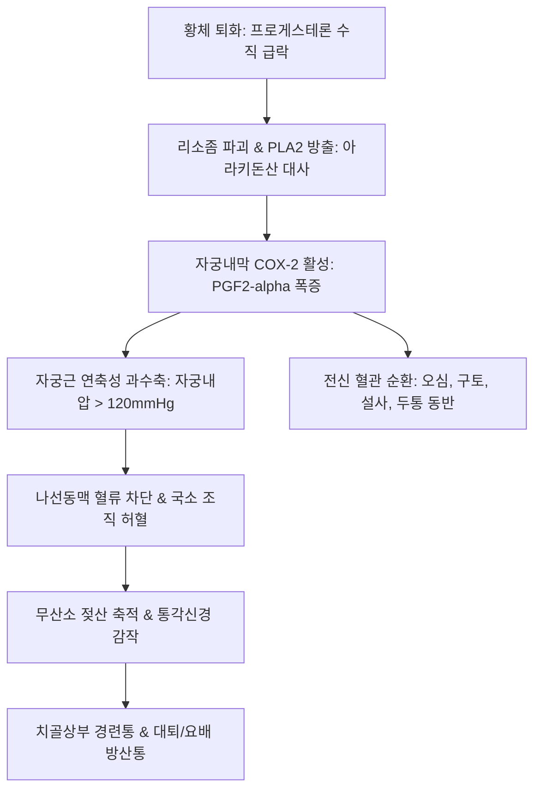

# 🩺 월경곤란증 (Dysmenorrhea / 月經困難症, Menstrual Pain)

> **핵심 3줄 요약 (Key Summary)**:
> - 📍 **정의 & 병태생리**: 월경 기간을 전후하여 발생하는 치골 상부 및 하복부의 경련성 동통과 동반 증상(요통, 오심, 두통, 설사)을 포괄하는 질환. 원발성은 황체기 말 프로게스테론 급락에 따른 자궁내막 프로스타글란딘([[프로스타글란딘]], PGF2-alpha) 과다 분비로 인한 자궁근 과수축 및 허혈이 원인이며, 속발성은 [[자궁내막증]], [[자궁선근종]], 골반염 등 기질적 병변이 원인이다.
> - 🚩 **임상 양상**: 월경 직전 또는 직후 시작되는 치골상부 산통(대퇴부 및 요배부 방산), 오심/구토, 피로, 설사. 속발성은 무배란 주기에도 발생하며 72시간 이상 지속되는 경향.
> - 🛠️ **치료 원칙**: NSAIDs, 경구피임제(COC), LNG-IUS(미레나), 한의학적으로 불통즉통(不通則痛)·불영즉통(不榮則痛) 변증에 따른 침구 치료(삼음교, 지기, 관원) 및 [[현부이경탕]], [[소복축어탕]], [[온경탕]], [[계지복령환]] 투여.
> - ⚠️ **응급 의뢰 레드플래그**: 진통제 불응성의 급격한 편측 골반통 악화, 복막자극 징후 동반 시 난소 낭종 염전/파열 또는 자궁외 임신 감별을 위한 즉각적 산부인과 응급 전원의뢰 필요.

---

## 📌 목차
1. [질환 개요 & 해부학적 병태생리](#1-질환-개요--해부학적-병태생리)
2. [병태생리 메커니즘 & 프로스타글란딘·근허혈 악순환 네트워크](#2-병태생리-메커니즘--프로스타글란딘근허혈-악순환-네트워크)
3. [임상 증상 & 원발성 대 속발성 감별 알고리즘](#3-임상-증상--원발성-대-속발성-감별-알고리즘)
4. [감별 진단 매트릭스 (Differential Diagnosis)](#4-감별-진단-매트릭스-differential-diagnosis)
5. [한의 통합 치료 프로토콜 (침·약침·추나·한약)](#5-한의-통합-치료-프로토콜-침약침추나한약)
6. [양방 치료 & 약물·수술적 병용 기준 (Conventional Treatment & Referral)](#6-양방-치료--약물수술적-병용-기준-conventional-treatment--referral)
7. [온열 요법 & 일상생활 관리 가이드](#7-온열-요법--일상생활-관리-가이드)
8. [💡 사용자 진료실 핵심 필기 & 임상 노하우 (Melt-In 잔여 심화 집약)](#8-💡-사용자-진료실-핵심-필기--임상-노하우-melt-in-잔여-심화-집약)
9. [출처 및 학술 참고 문헌 (References)](#9-출처-및-학술-참고-문헌-references)

---

## 1. 질환 개요 & 해부학적 병태생리

### 1) 질환 정의 및 임상적 포괄성
- **월경곤란증(Dysmenorrhea / 月經困難症)**: 월경통([[월경통]])을 중심으로 요통, 대퇴부 방산통, 오심, 구토, 설사, 두통 등 월경 관련 신체적 부수 증상들을 총칭하는 광범위한 임상 개념이다.
- 가임기 여성의 약 50% 이상에서 발현되며, 10~15%는 일상생활과 학업·직장 생활에 심각한 지장을 겪는다.

### 2) 자궁근층 수축과 신경 분포 해부학
- **자궁근층(Myometrium)**: 나선동맥을 둘러싼 평활근 섬유망으로 구성되며, 수축 시 자궁내압이 120 mmHg(때로는 > 200 mmHg)까지 상승하여 동맥혈류를 완전히 차단한다.
- **골반 통각 신경 경로**: 자궁 체부의 통각은 교감신경 섬유를 따라 하하복신경총(Inferior hypogastric plexus) 및 요수신경(T10~L1)으로 전달되고, 경부 및 하부는 천골신경(S2~S4) 및 음부신경([[음부신경]])을 경유한다.

---

## 2. 병태생리 메커니즘 & 프로스타글란딘·근허혈 악순환 네트워크

### 1) 원발성 월경곤란증의 생화학적 기전
- **프로게스테론 급락**: 황체 퇴화 시 프로게스테론 수치가 수직 강하함에 따라 세포막 리소좀(Lysosome)이 파괴되어 포스포리파아제 A2(PLA2)가 방출된다.
- **PGF2-alpha 과다 생성**: 아라키돈산 대사를 통해 COX-2 효소가 활성화되어 강력한 혈관 및 자궁근 수축 물질인 PGF2-alpha와 PGE2가 과다 합성된다.
- **자궁근 연축성 수축 및 무산소 허혈**: 자궁내압이 기저 혈압을 초과하여 조직 허혈(Ischemia)과 무산소 대사산물(젖산 등)이 축적되고, C-신경섬유를 자극하여 극심한 경련성 산통을 촉발한다.

### 2) 병태생리 악순환 도식

---

## 3. 임상 증상 & 원발성 대 속발성 감별 알고리즘

### 1) 주요 임상 양상
- **원발성(Primary)**: 초경 후 1~2년 이내(배란 주기 확립 후) 시작, 출혈 시작 수시간 전~직후 통증 발생, 48~72시간 내 소실, 경련성 산통, 전신 증상(오심, 설사, 피로) 빈발.
- **속발성(Secondary)**: 초경 수년 후 20~30대에 시작, 월경 시작 1~2주 전부터 통증 발생하여 월경 종료 후에도 수일간 지속, 성교통, 배변통, 월경 과다([[월경 과다]]) 동반.

### 2) 진단적 평가 프로토콜
- **골반 초음파(TVS)**: 자궁선근종, 자궁내막종, 자궁근종 감별.
- **골반 진찰**: 자궁천골인대 결절성 비후, 자궁 가동성 제한 확인.

---

## 4. 감별 진단 매트릭스 (Differential Diagnosis)

| 감별 질환 | 호발 연령 및 특이 소견 | 핵심 영상/검사 소견 | 월경곤란증과의 감별점 |
| :--- | :--- | :--- | :--- |
| **[[자궁내막증]]** | 20~40대, 만성 골반통, 심한 성교통, 불임 | 골반 MRI, 복강경하 내막병변 확인 | 월경 외 골반통 지속, 배변통 동반 |
| **[[자궁선근종]]** | 35세 이상 경산부, 중증 월경과다 동반 | 초음파상 자궁 미만성 비대, 접합부 비후 | 자궁 비대 및 월경 과다 동반 빈도 최다 |
| **점막하 [[자궁근종]]** | 30~40대, 월경과다, 하복부 압박감 | 초음파/자궁경 충만 결손 종괴 | 기질적 종괴 확인, 경관 통과 시 산통 |
| **만성 골반염(PID)** | 골반 장기 압통, 화농성 대하, 발열 | 질 도말 검사, 혈액 염증수치 상승 | 감염성 질환, 항생제 치료 필요 |
| **자궁경관 협착증** | 원추절제술 기왕력, 무월경/월경과소 | 자궁경 통과 장애, 혈포궁(Hematometra) | 수술 기왕력 및 물리적 폐쇄 확인 |

---

## 5. 한의 통합 치료 프로토콜 (침·약침·추나·한약)

### 1) 변증별 한약 처방 프로토콜
- **기체혈어(氣滯血瘀) / 불통즉통(不通則痛)**:
  - 주증: 월경 전 또는 월경기 소복 창통, 거안(拒按), 월경혈 암자색 혈괴, 혈괴 배출 후 통증 경감, 설자암, 맥현삽.
  - 대표 처방: [[현부이경탕]], [[소복축어탕]], [[격하축어탕]] 가감(향부자, 현호색, 당귀, 천궁, 오령지).
  - 치법: 행기활혈(行氣活血), 거어지통(祛瘀止痛).
- **한응혈체(寒凝血滯) / 포궁냉통(胞宮冷痛)**:
  - 주증: 월경 중 소복 냉통, 온열 시 완화, 오한 수족냉, 생리혈 흑자색, 설담태백, 맥침지.
  - 대표 처방: [[온경탕]], [[소복축어탕]] 가감(오수유, 육계, 건강, 소회향, 당귀).
  - 치법: 온경산한(溫經散寒), 활혈통경(活血通經).
- **기혈허약(氣血虛弱) / 불영즉통(不榮則痛)**:
  - 주증: 월경 중 또는 월경 후 은은한 소복통, 희안(喜按), 안색 위황, 피로 무력, 생리량 소 색담, 맥세약.
  - 대표 처방: [[성유탕]], [[팔진탕]], [[당귀작약산]] 가감(당귀, 황기, 인삼, 백작약).
  - 치법: 보기양혈(補氣養血), 화영지통(和營止痛).
- **간신휴손(肝腎虧損)**:
  - 주증: 월경 후 은은한 하복통 및 요슬산연, 두훈이명, 조열, 설홍소태, 맥침세.
  - 대표 처방: [[조간탕]], [[육미지황탕]] 가감.
  - 치법: 보익간신(補益肝腎), 양혈지통(養血止痛).

### 2) 침구 및 추나 치료
- **주요 혈위**: [[삼음교]](SP6), [[지기]](SP8, 극혈), [[중극]](CV3), [[관원]](CV4), [[차료]](BL32), [[혈해]](SP10), [[태충]](LR3).
- **급성기 극혈 자침**: 지기(SP8) 자침 시 자궁 평활근 연축을 신속히 완화하여 급성 복통 완화.
- **골반 추나 요법**: 천장관절(SI joint) 및 골반 경사 변위를 교정하여 하복신경총 압박 완화.

---

## 6. 양방 치료 & 약물·수술적 병용 기준 (Conventional Treatment & Referral)

### 1) 표준 약물 요법
- **NSAIDs (1차 치료)**: 이부프로펜, 나프록센, 메페남산. 월경 시작 1~2일 전 또는 통증 시작 즉시 투여하여 COX 효소를 선제 차단.
- **복합 경구피임제(COC)**: 배란 억제 및 자궁내막 위축 유도로 프로스타글란딘 합성 억제.
- **LNG-IUS (미레나)**: 자궁선근종 및 내막증 관련 속발성 월경통에 탁월한 통증 완화.

### 2) 수술적 치료 적응증
- 난치성 속발성 월경통 환자에서 복강경하 자궁내막증 병변 절제술 또는 천골전신경절제술(Presacral neurectomy).

---

## 7. 온열 요법 & 일상생활 관리 가이드

### 1) 온열 요법
- 하복부 핫팩 적용 시 국소 혈류가 증가하고 자궁근 긴장도가 감소하여 NSAIDs 단독 투여와 유사한 통증 완화 효과 확인.

### 2) 분만 후 증상 개선 기전 티칭
- 임신 및 질식 분만 후 경관 확장 및 자궁 수축력 감소, 자궁신경 종말 손상으로 증상이 자연 완화될 수 있음을 환자에게 설명하여 불안 완화.

---

## 8. 💡 사용자 진료실 핵심 필기 & 임상 노하우 (Melt-In 잔여 심화 집약)

### 1) 월경곤란증의 본질과 두 가지 한의학적 기전
- 월경곤란증은 단순한 월경통보다 포괄적인 개념으로, 하복부와 치골상부의 동통을 중심으로 요통, 오심, 구토 등 월경 관련 부수 증상들의 총칭이다.
- 한의학적 양대 병리는 **불통즉통(不通則痛 - 실증, 어혈/기체/한응)**과 **불영즉통(不榮則痛 - 허증, 기혈부족/간신허)**이며, 두 병리는 만성화되면서 상호 전화한다. 임상에서는 기혈 순환 장애에 의한 불통즉통이 훨씬 다발한다.

### 2) 프로스타글란딘과 프로게스테론 수직낙하의 병리
- 배란 후 황체기 말 프로게스테론이 수직 낙하하는 시기에 [[프로스타글란딘]](PGF2-alpha)이 폭발적으로 분비된다.
- 이 물질은 자궁근을 과도하게 수축시켜 내압을 높이고 국소 허혈을 유발하며, 말초 신경 역치를 낮추어 통증을 증폭시킨다.
- 프로스타글란딘 수치가 정상인 경우에도 자궁근의 감수성이 항진되어 있으면 극심한 통증이 발생할 수 있다.

### 3) 임신·분만 후 통증 개선 기전
- 출산 후 생리통이 사라지거나 호전되는 경우가 많은데, 이는 분만 과정에서 [[음부신경]]의 부분적 파괴, 자궁 평활근 수축력 감소, 자궁경부 외구의 영구적 확장으로 월경혈 배출 저항이 감소하기 때문이다.

### 4) 속발성 월경통의 3대 감별 포인트
- 1) 무배란성 월경 주기임에도 불구하고 통증이 지속된다.
- 2) 통증이 72시간을 초과하여 생리 후에도 지속된다.
- 3) 월경 과다, 성교통, 부정출혈 등 원인 질환([[자궁선근종]], [[자궁내막증]])의 증상이 동반된다. 이 경우 단순 대증 처방을 지양하고 기질적 질환에 맞춘 거어파징(祛瘀破癥) 치료를 병행해야 한다.

---

## 9. 출처 및 학술 참고 문헌 (References)

Tu. (2026). Prediction models for endometriosis-associated ovarian malignancy: A systematic review and meta-analysis. *Eur J Obstet Gynecol Reprod Biol X*. PMID: 42835309.

Kahl. (2026). Stopping Dysmenorrhea: A Systematic Review of Drugs Inhibiting Uterine Contractions. *J Endometr Uterine Disord*. PMID: 42746335.

Kurbaniyazova. (2026). Systematic review of the literature: estimation of the most common gynecological disorders and associated factors among Kazakhstani adolescents. *Future Sci OA*. PMID: 41388843.
