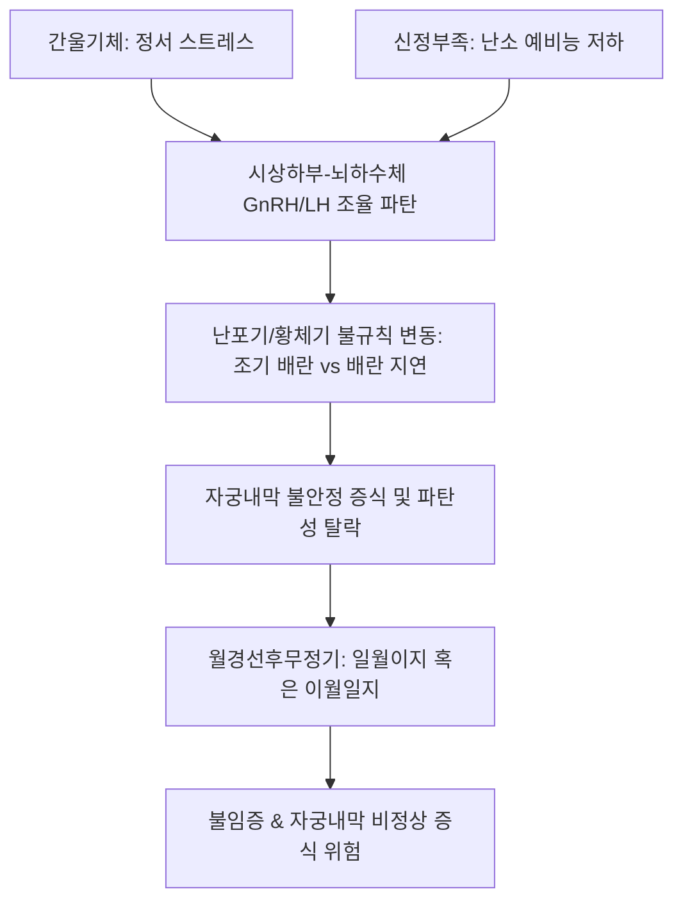

# 🩺 월경선후무정기 (Metrorrhagia / 月經先後無定期, Irregular Intermenstrual Cycles)

> **핵심 3줄 요약 (Key Summary)**:
> - 📍 **정의 & 병태생리**: 월경 주기가 앞당겨지거나(일월이지, 한 달에 2회) 늦어지는(이월일지, 두 달에 1회) 현상이 불규칙하게 교대로 반복되는 병태. 시상하부-뇌하수체-난소(HPO) 축의 동기화 실패, 난포 발달의 불규칙성, 간울(肝鬱)로 인한 기체 및 신허(腎虛)로 인한 충임맥 불고가 주원인이다.
> - 🚩 **임상 양상**: 다음 생리일을 전혀 예측할 수 없는 불규칙한 주기, 출혈량의 다소불정, 요슬산연 및 하지 무력(신허), 유방 창통 및 흉협고만(간울).
> - 🛠️ **치료 원칙**: 양방 프로게스틴 순환 요법 및 자궁내막 보호, 한의학적으로 간신동치(肝腎同治) 및 조경(調經) 원칙에 따른 [[정경탕]], [[가미소요산]], [[보음전]], [[귀신환]], [[일관전]] 처방.
> - ⚠️ **응급 의뢰 레드플래그**: 40세 이상 폐경이행기 여성에서 불규칙한 주기와 함께 장기간의 무통성 출혈 지속 시 [[자궁내막증식증]] 및 [[자궁내막암]] 감별을 위한 즉각적 자궁내막 조직생검 의뢰.

---

## 📌 목차
1. [질환 개요 & 해부학적 병태생리](#1-질환-개요--해부학적-병태생리)
2. [병태생리 메커니즘 & 간신실조 악순환 네트워크](#2-병태생리-메커니즘--간신실조-악순환-네트워크)
3. [임상 증상 & 주기 변동 평가 알고리즘](#3-임상-증상--주기-변동-평가-알고리즘)
4. [감별 진단 매트릭스 (Differential Diagnosis)](#4-감별-진단-매트릭스-differential-diagnosis)
5. [한의 통합 치료 프로토콜 (침·약침·한약)](#5-한의-통합-치료-프로토콜-침약침한약)
6. [양방 치료 & 주기 동기화·의뢰 기준 (Conventional Treatment & Referral)](#6-양방-치료--주기-동기화의뢰-기준-conventional-treatment--referral)
7. [생활습관 티칭 & 자율신경 안정 가이드](#7-생활습관-티칭--자율신경-안정-가이드)
8. [💡 사용자 진료실 핵심 필기 & 임상 노하우 (Melt-In 잔여 심화 집약)](#8-💡-사용자-진료실-핵심-필기--임상-노하우-melt-in-잔여-심화-집약)
9. [출처 및 학술 참고 문헌 (References)](#9-출처-및-학술-참고-문헌-references)

---

## 1. 질환 개요 & 해부학적 병태생리

### 1) 질환 정의 및 임상적 특징
- **월경선후무정기(月經先後無定期)**: 월경 주기가 앞당겨지는 것([[월경 선기]])과 늦어지는 것([[월경 후기]])이 규칙성 없이 번갈아 나타나, 한 달에 두 번 하기도 하고(일월이지, 一月二至) 두 달에 한 번 하기도 하는(이월일지, 二月一至) 상태를 뜻한다.
- 단순히 주기가 긴 희발월경이나 짧은 빈발월경과 달리, **주기 변동 폭이 7일 이상 불규칙**하게 요동치며 배란 장애와 자궁내막 파탄 출혈을 수반한다.

### 2) HPO 축 피드백 조율 실패와 해부학적 변화
- 정상적인 월경 조절은 난소의 [[에스트라디올]] 농도에 따라 시상하부 [[GnRH]] 분비가 정밀하게 조율되어야 하나, 간울(스트레스성 교감신경 항진)이나 신허(난소 예비능 저하)로 인해 양성/음성 피드백이 무작위로 교란된다.
- 이로 인해 우성 난포의 선택과 배란 시점이 매 주기마다 제각각으로 변화하며, 황체 형성 역시 불완전해진다.

---

## 2. 병태생리 메커니즘 & 간신실조 악순환 네트워크

### 1) 주요 병태생리 경로
1. **간기울결(肝氣鬱結) 경로**: 정서적 억울이나 만성 스트레스 -> 간기(肝氣) 울결 및 뇌-장-난소 축 교란 -> GnRH 박동성 분비 무질서화 -> 주기 불규칙.
2. **신정부족(腎精不足) 경로**: 난소 기능 쇠퇴, 과로, 다산으로 인한 신음(腎陰)·신양(腎陽) 부족 -> 난포 발달의 완급 부조화 -> 충임맥(衝任脈) 실조.
3. **비허습담(脾虛濕痰) 경로**: 소화 흡수 장애 및 대사 저하로 인한 불규칙 배란.

### 2) 병태생리 도식

---

## 3. 임상 증상 & 주기 변동 평가 알고리즘

### 1) 주요 임상 증상
- **주기의 무작위성**: 18일 만에 하다가 다음 주기는 45일 만에 하는 등 예측 불가.
- **출혈량 변동**: 생리량이 많았다가 적었다가 일정치 않음(다소불정).
- **변증별 동반 증상**:
  - 간울형: 흉협창만, 유방 팽만감, 한숨, 정서 기복, 맥현.
  - 신허형: 월경량 감소, 요슬산연, 하지 무력, 어지럼증, 이명, 맥침세.

### 2) 진단 평가 프로토콜
- **배란 유무 모니터링**: 기초체온표(BBT) 및 혈청 프로게스테론 검사.
- **호르몬 검사**: 생리 2~3일째 [[FSH]], [[LH]], [[에스트라디올]], [[AMH]], TSH, 프로락틴.
- **골반 초음파**: 자궁내막 두께 측정 및 난소 낭종, 다낭성 난소(PCOM) 확인.

---

## 4. 감별 진단 매트릭스 (Differential Diagnosis)

| 감별 질환 | 호발 연령 및 특이 소견 | 핵심 감별 검사 | 월경선후무정기와의 감별점 |
| :--- | :--- | :--- | :--- |
| **[[다낭성 난소 증후군]](PCOS)** | 10~30대 가임기, 비만, 다모증, 여드름 | LH/FSH 비율 > 2, 초음파 PCOM | 고안드로겐혈증 및 희발월경 위주 |
| **폐경이행기(Perimenopause)** | 40대 중후반, 안면홍조, 발한 | 혈청 FSH > 25 IU/L, AMH 급감 | 갱년기 혈관운동 증상 동반 |
| **[[자궁내막증식증]]** | 고령 가임기, 무통성 불규칙 출혈 | 자궁초음파상 내막 비후, 조직생검 | 기질적 자궁내막 비후 확인 필수 |
| **[[갑상선기능저하증]] / 항진증** | 피로, 체중 변화, 심계항진 | TSH, Free T4 이상 | 내분비 대사 질환 선별 |
| **자궁내막 용종(Polyp)** | 부정출혈, 성교 후 출혈 | 식염수주입초음파(SIS), 자궁경 | 국소 점막 돌출 병소 확인 |

---

## 5. 한의 통합 치료 프로토콜 (침·약침·한약)

### 1) 변증별 한약 처방 프로토콜
- **신허형(腎虛型) / 충임실조(衝任失調)**:
  - 주증: 월경선후무정, 월경량 적음, 색담암, 질희박, 요슬산연, 하지 무력, 어지럼증, 설담소태, 맥침세.
  - 대표 처방: [[정경탕]](定經湯), [[보음전]], 보음익신탕, [[귀신환]] 가감.
  - 방제 핵심: 정경탕은 토사자(菟絲子)를 군약으로 하여 신정(腎精)을 크게 보하고 백작약, 당귀, 숙지황, 형개수 등을 배합하여 간신을 동시에 조율함.
  - 치법: 보기보신(補氣補腎), 양혈조경(養血調經).
- **간울형(肝鬱型) / 간기불서(肝氣不舒)**:
  - 주증: 월경선후무정, 생리량 다소불정, 색자홍, 혈괴 동반, 흉협고만, 소복창통, 유방창통, 설태박백, 맥현.
  - 대표 처방: [[가미소요산]], [[일관전]], [[시호억간탕]], [[조경종옥탕]] 가감.
  - 치법: 소간해울(疏肝解鬱), 양혈조경(養血調經).
- **비허간울(脾虛肝鬱) / 심신불교(心腎不交)**:
  - 주증: 피로, 소화불량, 정서 불안, 불면, 생리 불규칙.
  - 대표 처방: [[귀비탕]] 합 [[소요산]] 가감.
  - 치법: 건비소간(健脾疏肝), 양심안신(養心安神).

### 2) 침구 치료 프로토콜
- **주요 혈위**: [[삼음교]](SP6), [[태충]](LR3), [[관원]](CV4), [[기해]](CV6), [[신수]](BL23), [[간수]](BL18), [[족삼리]](ST36).
- **시술 기전**: 간수-신수 배수혈 및 삼음교-태충 자침으로 간신의 기능을 평형화하고 충임맥 조절.

---

## 6. 양방 치료 & 주기 동기화·의뢰 기준 (Conventional Treatment & Referral)

### 1) 호르몬 치료 프로토콜
- **복합 경구피임제(COC)**: 인위적인 호르몬 주기를 부여하여 불규칙한 출혈을 즉각 잡고 내막을 안정화.
- **디드로게스테론(Dydrogesterone) 또는 미분화 프로게스테론**: 매월 주기 14~25일째 10~14일간 투여하여 규칙적 소퇴성 출혈 유도 및 자궁내막 보호.
- **LNG-IUS (미레나)**: 장기적인 자궁내막 보호 및 출혈 조절.

### 2) 상급병원 전원의뢰 기준
- 40세 이상 고령 환자에서 불규칙 출혈이 3개월 이상 지속되거나 초음파상 내막 두께가 불균일하게 두꺼워진 경우 즉시 자궁내막 조직생검 의뢰.

---

## 7. 생활습관 티칭 & 자율신경 안정 가이드

### 1) 스트레스 완화 및 심신 이완
- 간기울결을 해소하기 위해 주 3~4회 중등도 유산소 운동(산책, 요가)과 충분한 휴식 권장.

### 2) 규칙적인 생활 리듬 확립
- 일정한 수면 시간과 식사 시간을 유지하여 중추 생체시계와 HPO 축의 동기화 유도.

---

## 8. 💡 사용자 진료실 핵심 필기 & 임상 노하우 (Melt-In 잔여 심화 집약)

### 1) 병리적 정의와 고령 환자 감별의 중요성
- 월경선후무정기는 월경 주기가 앞당겨지는 일월이지(一月二至)와 늦어지는 이월일지(二月一至)가 불규칙하게 반복되는 상태를 뜻한다.
- 임상에서 40세 이상의 고령 가임기 여성이 월경선후무정기를 호소할 때는 단순 생리불순으로 간과해서는 안 되며, **[[자궁내막증식증]] 및 악성 종양과의 감별**을 최우선으로 고려해야 한다.

### 2) 변증별 대표 처방과 정경탕의 묘미
- **신허(腎虛)**: 월경량이 적고 하지 무력과 요슬산연이 동반되는 신허형에는 [[보음전]], 보음익신탕, [[귀신환]]을 적용한다.
- **간울(肝鬱)**: 흉협고만, 소복창통, 유방통이 두드러지는 간울형에는 [[소요산]], [[일관전]], [[시호억간탕]]을 사용한다.
- **정경탕(定經湯)**: 토사자(菟絲子)를 군약으로 삼는 대표적 명방으로, 신음(腎陰)과 신양(腎陽)을 동시에 보하면서 간기(肝氣)를 소통시켜 무질서한 월경 주기를 가장 안정적으로 동기화하는 비방이다.

---

## 9. 출처 및 학술 참고 문헌 (References)

Wei. (2026). Dydrogesterone versus levonorgestrel-releasing intrauterine system for abnormal uterine bleeding: a propensity score-matched analysis of long-term efficacy and recurrence. *Gynecol Endocrinol*. PMID: 41527377.

Sarvesh. (2026). Role of Uterine Artery Doppler Indices in Predicting Endometrial Pathology in Perimenopausal and Postmenopausal Women Presenting with Abnormal Uterine Bleeding. *Ann Afr Med*. PMID: 42904348.

Palo. (2026). Clinicopathological Profile of Disordered Proliferative Endometrium in Anovulatory Abnormal Uterine Bleeding and Determinants of Response to Levonorgestrel-Releasing Intrauterine System Therapy. *Horm Metab Res*. PMID: 42849454.
