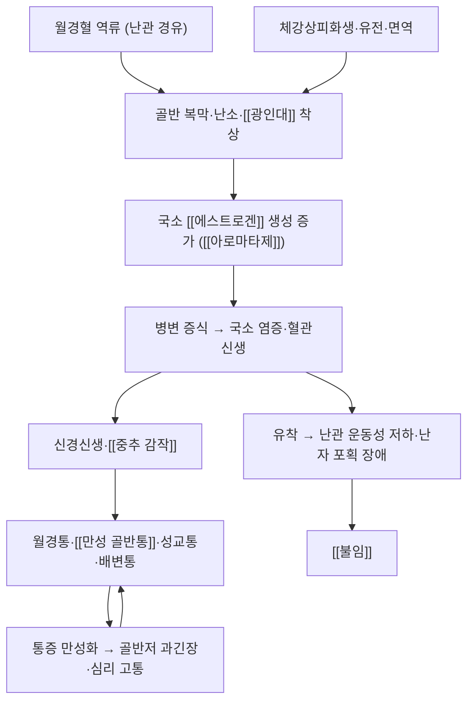

# 🩺 자궁내막증 (Endometriosis, 子宮內膜症)

> **핵심 3줄 요약 (Key Summary)**:
> - 📍 병소 부위 & 해부·병태생리: 자궁내막과 유사한 조직(샘·기질)이 **자궁강 밖**에서 착상·증식하는 만성 염증성·[[에스트로겐]] 의존성 질환이다. 난소·[[광인대]]·자궁천골인대·골반 복막을 침범하며 국소 염증·혈관신생·신경신생을 동반한다.
> - 🚩 전형적 임상 양상: 월경통·[[만성 골반통]]·성교통·배변통·난임. 30대 전후 가임기 여성에서 흔하고 가족력의 영향이 크다.
> - 🛠️ 핵심 감별 & 한·양방 치료 전략: ESHRE 2022는 **증상 기반 임상 진단**을 확대했고, 치료는 ① 약물(복합 경구피임약 연속·프로게스토젠·GnRH agonist + add-back) ② 수술(보존적 병변 절제) ③ **물리·도수치료 병행**([[HVLA]]·복부 가동술·[[광인대]] 가동술) ④ 심리·운동의 다중모달로 구성한다.
> - ⚠️ **응급 의뢰 레드플래그**: 급성 악화되는 골반통 + 발열은 자궁내막종 파열·감염·골반농양을, 갑작스러운 어지럼·실신은 난소 자궁내막종 출혈을 시사한다. 새로 발생한 심한 배변통·혈변은 심부 침윤 장 병변 감별이 필요하다.

---

## 📌 목차
1. [질환 개요 & 병태생리 (Disease Overview)](#1-질환-개요--병태생리-disease-overview)
2. [병태생리 메커니즘 & 대사·장기부전 악순환 네트워크](#2-병태생리-메커니즘--대사장기부전-악순환-네트워크)
3. [임상 증상 & 환자 소견 (Clinical Presentation)](#3-임상-증상--환자-소견-clinical-presentation)
4. [감별 진단 매트릭스 (Differential Diagnosis)](#4-감별-진단-매트릭스-differential-diagnosis)
5. [한의 통합 치료 프로토콜 (침·약침·한약)](#5-한의-통합-치료-프로토콜-침약침한약)
6. [양방 치료 & 병용·의뢰 기준 (Conventional Treatment & Referral)](#6-양방-치료--병용의뢰-기준-conventional-treatment--referral)
7. [식이·생활습관 & 자가관리 티칭 가이드](#7-식이생활습관--자가관리-티칭-가이드)
8. [💡 진료실 핵심 필기 & 임상 노하우](#8--진료실-핵심-필기--임상-노하우)
9. [출처 및 학술 참고 문헌 (References)](#9-출처-및-학술-참고-문헌-references)

---

## 1. 질환 개요 & 병태생리 (Disease Overview)

![[자궁내막증_01_해부_여성생식기구조_도해.jpg|460]]
> [그림 1: 여성 생식기의 구조 도해(자궁·난관·난소·질) — 자궁내막증 병변이 착상하는 해부학적 무대 — 질병관리청 국가건강정보포털 (공공저작물, 출처표시)]

* **질환 정의 및 분류**
  * 정의(원문 필기 보존): **자궁내막 조직이 위치를 옮긴 것으로, 자궁내막의 분비샘과 조직이 비정상적으로 증식한 것.**
  * 발생 연령(원문 필기 보존): **30대 이상, 35세 이하에서 주로 발생하며 가족력을 많이 탄다.**
  * 분류: ① 복막형 ② **난소형(자궁내막종, 초콜릿 낭종)** ③ **심부 침윤형(DIE)** — 직장·질·방광·[[광인대]]를 침범. 병기로는 수술 소견 기반 rASRM 병기와 #ENZIAN 분류를 쓴다.
* **원인(원문 필기 보존 + 교과서 범위)**
  * 월경혈의 역류(Sampson), 체강상피화생설, 유전적 요인, 면역학적 요인, [[다낭성 난소 증후군]], 비만.
* **증상(원문 필기 보존)**
  * 임신율 저하, 난소 및 자궁부속기 침범, 난관운동성 저하, 난자포획 장애, **월경통 및 [[만성 골반통]], 성교통, 골반외 부위의 자궁내막증**.
* **진단(원문 필기 보존)**
  * 초음파, 복강경, [[CA125]]로 진단.
* **역학**: 가임기 여성에서 흔한 만성 염증성 질환으로, 골반통·난임의 주요 원인이다. 폐경 후에는 소멸·자연 관해되는 것으로 알려져 있으나, 폐경 후 호르몬 치료를 한 경우 2~5%에서 발견된다는 보고가 있다(국가건강정보포털).

---

## 2. 병태생리 메커니즘 & 대사·장기부전 악순환 네트워크

![[자궁내막증_02_병태_월경혈역류_발생기전_도해.jpg|440]]
> [그림 2: 월경혈의 역류에 의한 자궁내막증 발생 기전 도해 — 자궁내막 조직이 난관을 통해 골반강으로 이동하는 경로 — 질병관리청 국가건강정보포털 (공공저작물, 출처표시)]

### 1) 분자·세포 수준 기전
* **에스트로겐 의존성(원문 필기 보존 응용)**: 병변은 자체 [[아로마타제]]와 스테로이드 생성 효소를 발현해 국소적으로 [[에스트로겐]]을 만들고, 이것이 다시 병변을 키운다. 원문 필기의 **"E2의 농도가 배란의 조건을 충족하지 못해 배란이 잘 나타나지 않고, 지속적인 E2에 의해 자궁내막이 증식됨([[프로게스테론]]이 억제해야 하는데 단계로 넘어가지 않음)"** 이 이 축을 정확히 지적한다.
* **국소 염증**: 대식세포·[[IL-1β]]·[[TNF-a]]·[[MCP-1]]을 비롯한 염증 매개체가 복강 내에 증가해 통증과 유착을 촉진한다.
* **면역 이상(원문 필기 보존)**: 자궁내막이 난관을 통해 난소로 들어갔을 때 이를 대식세포가 분해·재흡수해야 하는데 **이것이 잘 안 되는 경우가 병태의 핵심**이라는 원장 필기를 유지한다.
* **신경신생(neuroangiogenesis)**: 병변으로 신경섬유가 자라 들어가 통증이 강화되고, 반복 자극이 [[중추 감작]]·[[내장 과민성]]을 만든다.

### 2) 장기·계통 수준 결과
* 난소 자궁내막종 → 난소 실질 파괴·난소 예비능 저하 → [[불임]].
* 유착 → 난관 운동성·난자 포획 장애, 골반 장기 위치 변화.
* 만성 통증 → 골반저 과긴장·성교통·배변통·수면장애·불안·우울의 악순환.

### 3) 위험인자와 진행 단계
* 위험인자: 가족력, 이른 초경·긴 월경 기간·월경혈 역류를 늘리는 조건(난관 폐쇄 등), 저체중·정상체중, 좌식 생활.
* 단계: 무증상 착상 → 국소 병변·경증 통증 → 유착·심부 침윤 → 난임·만성 통증.

> 📌 **원문 필기: 자궁내막증과 신경 절제술**
> [[수족한출증]]은 미주신경 절제술로 치료한다. [[자궁내막증]]은 자궁내막이 경부 방향이 아닌 난관이나 다른 부위로 이동하는 질환으로, 자궁내막이 난관을 통해 난소에 들어갔을 때 이를 대식세포나 마크로파지가 분해하고 재흡수해줘야 하는데, 이것이 잘 안 되는 경우에 협착되고 이물질이 쌓여 질한(癥瘕)으로 이어질 수 있다(극심한 [[월경통]], 난임, 성교통).

> 📌 **원문 필기: 자궁내막증과 [[자궁샘근종]] 감별**
> 통증 강도는 자궁내막증이 더 심하고 기간도 길며, 월경할 때 심해진다. 치료를 진행해 증상이 완화되어도 조직적으로 병리 상태가 유지될 수도 있다. 기질적 병변이 있는 환자를 치료하는데 있어서 여러 증상이 완화되고 치료되어도 자궁벽의 두꺼움이 변화하지 않을 수 있다.

---

## 3. 임상 증상 & 환자 소견 (Clinical Presentation)

![[자궁내막증_04_임상_증상체크리스트_표.jpg|440]]
> [그림 3: 자궁내막증의 증상 체크리스트 — 배 아픔·생리통·성교통·배변통·만성 골반통·피로·불임 등 — 질병관리청 국가건강정보포털 (공공저작물, 출처표시)]

![[자궁내막증_05_진단_복강경소견_실사.jpg|480]]
> [그림 4: 자궁내막증의 복강경 소견 — 상단은 병변 발생 과정 도해, 하단은 실제 복강경 사진으로 화살표가 병변을 가리킨다 — 질병관리청 국가건강정보포털 (공공저작물, 출처표시)]

### 1) 주소증 및 핵심 증상
* **전형 증상**: ① 월경통(월경 시작 전부터 시작, 월경 기간 내내 지속) ② [[만성 골반통]] ③ 심부 성교통 ④ 월경 중 배변통·직장 압박감 ⑤ [[불임]] ⑥ 만성 피로.
* **비전형·경증 발현**: 무증상 우연 발견, 경미한 월경통만 있는 경우.
* **증상 악화·완화 인자**: 월경 직전·중에 악화, 폐경 후 자연 호전, 폐경 후 호르몬 치료 시 재발.

### 2) 객관적 소견 (Signs & Labs)
* **신체 소견**: 골반 검진에서 자궁천골인대 결절·압통, 자궁 후방 고정, 천골와 압통.
* **검사 수치**: [[CA125]]는 상승할 수 있으나 **선별검사로 쓰지 않는다**(증상 기반 임상 진단 원칙). 복강경 + 조직검사가 확진 방법이지만 진단 목적 복강경을 모든 환자에게 먼저 시행하지는 않는다.
* **영상**: 경질초음파·경직장초음파(난소 자궁내막종·심부 병변), MRI(심부 침윤 평가). → [[만성 골반통]] §3

### 3) 병기·중증도 판정
* rASRM 병기(Ⅰ~Ⅳ)는 **수술 소견**에 기반하며, 병기와 통증·불임의 정도가 일치하지 않는다. 진료실에서는 병기보다 **통증·삶의 질·임신 요구**를 기준으로 치료 강도를 정한다.

---

## 4. 감별 진단 매트릭스 (Differential Diagnosis)

| 감별 질환 | 특징적 양상 | 감별 포인트 (검사·수치) |
| :--- | :--- | :--- |
| [[자궁내막증]] (본 질환) | 월경통+골반통+성교통+불임 | 임상 진단(ESHRE 2022), 초음파·MRI, [[CA125]] 보조 |
| [[자궁샘근종]] | 월경 과다·생리통, 자궁 비대 | 초음파상 자궁벽 비후·낭성 변화 (원문 필기: 통증 강도는 자궁내막증이 더 심하고 기간도 길다) |
| 원발성 월경통 | 초경 직후부터, 배란 주기와 일치 | 골반 검진 정상, [[프로스타글란딘]] 조절로 반응 |
| [[만성 골반통]] | 6개월 이상, 원인 다양 | 원인 감별이 진단 자체 — 감염·근골격·내장 축 배제 |
| 골반 염증성 질환 | 발열·대하·압통 | 염증 수치, 병원체 검사 |
| **자궁내막종 파열·난소 염전** (레드플래그) | **급성 심한 골반통·실신·복막 자극** | 즉시 응급실·영상 |

> 🚩 **레드플래그 감별**: 급성 골반통+발열(농양), 실신+복통(자궁내막종 출혈), 심한 배변통+혈변(심부 장 침윤)을 최상단에 둔다.

---

## 5. 한의 통합 치료 프로토콜 (침·약침·한약)

* **변증 분류(교과서 범위)**: 기체혈어(氣滯血瘀) · 한응혈어(寒凝血瘀) · 습열어결(濕熱瘀結) · 기허혈어(氣虛血瘀) · 신허어조(腎虛瘀阻). 월경 주기(월경 전·중·후)에 따라 치법을 바꾼다.
* **침구 치료 (Acupuncture)**
  * 배혈 원칙: 하복부([[중극(CV3)]]·[[관원(CV4)]]·[[기해(CV6)]]·[[귀래(ST29)]]) + 요천추(신수·차료 계열) + 원위혈([[삼음교(SP6)]]·[[태충(LR3)]]·[[혈해(SP10)]]·[[족삼리(ST36)]]). 혈위명은 볼트 표준에 따라 순수 텍스트로 표기한다.
  * 월경 주기 맞춤: 월경 전 3~5일부터 시작해 월경 중·후까지 조정. 온경산한 목적으로 뜸·온침을 병용한다.
  * **근거 수준**: 자궁내막증 통증에서 침의 근거는 이질적이고 고품질 대규모 시험이 부족하다 — '통증 감소에 도움이 될 수 있다' 수준으로 설명하고, 약물·수술을 대체한다고 말하지 않는다.
* **약침 치료 (Pharmacopuncture)**: 하복부·요천추 압통점, 자궁천골인대 주변 압통점에 소량. **임신 계획 중·임신 중에는 시행하지 않는다** → [[약침]] · [[아시혈]]
* **한약 치료 (Herbal Medicine)**: 기체혈어·한응혈어에는 이기활혈·온경산한, 습열어결에는 청열이습활혈 방향. 월경 과다 동반 시 활혈제 강도에 주의하고 출혈량을 추적한다.
* **도수·물리 치료 병행(2026-10-11 근거)**
  * 8주간 15일 1회·회당 30분(총 4회) 도수 프로토콜이 통증과 신체적 삶의 질을 개선하고 6개월까지 유지됐다. 구성은 C0-C1-C2·T12-L1·[[천장관절]] [[HVLA]] + 복부 가동술·[[광인대]] 가동술·골반격막 이완(각 5분) 등 8단계다. **저강도 버전(복부 가동·광인대 가동·골반격막 이완 중심)** 으로 시작하는 설계도 근거 범위 안에 있다 → [[도수치료]] · [[HVLA]] · [[근막이완술]] · [[근에너지기법]]
  * 복부·골반 기법은 중극(CV3)·관원(CV4)·기해(CV6)·귀래(ST29)·삼음교(SP6)·태충(LR3) 부위와 개념적으로 겹치므로, **도수 이완 뒤에 온침·약침을 얹는 순서**가 환자 체감을 높이기 쉽다.
  * 골반저 근긴장이 뚜렷하면 과긴장성 골반저 이완 접근을 우선한다 → [[골반저근]] · [[골반저근훈련]]
* **뜸·부항·기타**: 하복부 냉증·한응혈어에 온중 목적으로 뜸, 배수혈 부항. 혈위명은 순수 텍스트로 표기 → [[뜸]] · [[부항]]

---

## 6. 양방 치료 & 병용·의뢰 기준 (Conventional Treatment & Referral)

* **약물 치료 (Medication)** — 국내 처방 관행 기준 계열 정리
  * **복합 경구피임약(연속 복용)**: 1차 통증 조절. 월경을 건너뛰어 병변 자극을 줄인다.
  * **프로게스토젠(디에노게스트 등)·LNG 자궁내장치**: 통증 조절과 출혈 감소.
  * [[GnRH]] agonist/antagonist: 병변 억제 목적. 연속 투여로 생식호르몬을 억제하며, **add-back 요법(저용량 호르몬 추가)** 으로 폐경 유사 증상·골소실을 완화한다 — 원문 필기의 "[[GnRH agonist]]는 [[GnRH]]를 연속 분비하게 하여 생식호르몬 분비를 감소시키며, [[자궁내막증]] 수술 후 월경을 중지시킬 때, [[에스트로겐]] 의존성 질환에 활용한다"를 유지한다 → [[GnRH]] · [[에스트로겐]]
  * **진통**: [[NSAIDs]] (통증 조절 보조), 신경병증성 성분이 있으면 [[아미트립틸린]]·[[둘록세틴]]·[[프레가발린]] 계열 검토.
  * **⚠️ 중요 답변(환자 질문 대응)**: 자궁내막증 약물치료(호르몬제)로 인해 **난소기능 저하나 난임이 유발되지는 않는다**. 오히려 약물치료를 하지 않으면 재발·진행 위험이 높다 — 임신을 원하는 환자에게 이 점을 정확히 설명한다.
* **비약물·수술 치료 (Procedures / Surgical Indication)**
  * 복강경 보존적 병변 절제·유착 박리 — 통증과 임신율에 도움. 심부 침윤(DIE)은 다학제 접근이 필요하다.
  * 자궁내막종은 크기·증상에 따라 배액·낭종 절제를 고려하며, **난소 예비능 보존**을 위해 반복 수술은 최소화한다.
* **한의 병용 판단 (Combination Therapy)**
  * **병용 가능**: 호르몬 치료·수술과 병행해 통증·수면·불안·골반저 긴장을 관리한다. 도수치료는 "약물·수술의 대체"가 아니라 **병행 부가요법**으로 위치시킨다.
  * **주의**: 호르몬 치료 중에는 간 대사 경로를 공유할 수 있는 한약·건강기능식품을 순차적으로 도입하고 간수치를 확인한다. 활혈제와 월경 과다가 겹치면 출혈량을 추적한다.
  * **금기**: 임신이 확인되면 GnRH agonist·항안드로겐 등은 중단한다.
* **양방·전문과 의뢰 기준 (Referral Criteria)**
  * **즉시 의뢰(응급)**: 급성 악화 골반통 + 발열(농양·감염), 실신·어지럼(자궁내막종 출혈), 급성 복막 자극(파열 의심).
  * **전문과 의뢰**: [[불임]] 동반 1년 이상, 약물 반응 없는 중증 통증, 심부 침윤 의심(배변통·혈변·배뇨 증상), 난소 종괴 급성장 → 산부인과(필요 시 자궁내막증 전문센터).
  * **반드시 산부인과 주치의와 치료 계획을 공유**하고, 호르몬 치료·수술 적응 여부를 도수치료로 대체하지 않는다.

---

## 7. 식이·생활습관 & 자가관리 티칭 가이드

* **식이 지도 (Diet)**
  * 항염 지향 식이(채소·불포화지방·식이섬유), 트랜스지방·과도한 알코올·카페인 감소. 체중이 과다하면 감량이 통증·염증에 도움이 된다.
  * 한의 변증별: 한응혈어에서는 찬 음식·생식을 줄이고 따뜻한 조리식을 권한다.
* **생활습관 (Lifestyle)**
  * 규칙적 유산소 운동·골반저 이완 호흡·스트레스 관리. 통증 악화기에는 저강도로 조정한다.
  * 만성 통증의 심리사회적 축(운동공포·통증 파국화·자기효능감)을 함께 다룬다 → [[운동공포]] · [[통증 파국화]] · [[자기효능감]] · [[통증신경과학 교육]]
* **자가관리 (Self-monitoring)**
  * 월경 일지 + 통증 점수(NRS/VAS) + 진통제 사용 일수 기록. 통증일지로 치료 반응을 판정한다 → [[시각아날로그척도(VAS)]] · [[NPRS]]
* **환자 교육 스크립트**
  * "이 질환은 자궁내막 조직이 자궁 밖에 붙어 염증과 통증을 만드는 병입니다. 통증이 심하고 배뇨·배변까지 아프면 초음파·MRI로 심한 침윤 여부를 확인해야 합니다. 약물·수술이 중심 치료이고, 여기에 도수치료를 더하면 통증과 움직임이 좋아진다는 근거가 있습니다. 다만 우울감이나 불안까지 해결되지는 않으니 필요하면 그 축은 따로 치료해야 합니다."
* **정기 추적 항목**: 통증·삶의 질(EHP-30·[[SF-36]]), 요추 가동성(수정 Schober), 임신 계획 여부, 간수치(호르몬·한약 병용 시).

---

## 8. 💡 진료실 핵심 필기 & 임상 노하우

* **실전 문진 체크리스트(레드플래그 먼저)**
  1. 발열·급성 악화·복막 자극 징후 → 응급 배제.
  2. 통증 양상: 월경과의 관계, 성교통·배변통 유무, 통증 일수/월.
  3. 임신 계획 여부와 기간, [[CA125]]·초음파·수술 이력.
  4. 현재 호르몬 치료 종류(add-back 여부)·복용 기간, 부작용(열감·골소실·기분 변화).
  5. 배변·배뇨 증상(심부 침윤 선별), 수면·기분.
* **치료 순서 및 노하우**
  * 진료실 순서: ① 레드플래그 배제 ② 통증일지 확보 ③ 산부인과 치료 계획 공유 ④ 도수 이완(복부·광인대·골반격막) → 온침/약침 ⑤ 능동부하·호흡으로 고정 ⑥ 4주·6개월 추적.
  * 추적은 통증([[시각아날로그척도(VAS)]])·요추 가동성(수정 Schober)·신체적 삶의 질([[SF-36]])로 잡는다. **우울·불안이 주 호소이면 도수치료로 해결하려 하지 말고 심리·약물 축으로 의뢰**한다.
  * 안전 설계: 골반·요추 [[HVLA]]는 급성 염증기, 임신, 출혈 경향·항응고제 복용, 골반 악성 종괴, 최근 복부·골반 수술 직후에는 시행하지 않는다. 복부 가동술은 식후 2시간 이내·방광이 찬 상태를 피하고, 통증이 NRS 5/10을 넘거나 어지럼·오심이 나오면 중단한다 → [[HVLA]] · [[근막이완술]]
  * 원문 필기 유지: **증상이 완화돼도 조직학적 병리가 그대로일 수 있고, 자궁벽 두께가 변하지 않을 수 있다** — 환자에게 "치료했다"는 표현을 '증상 조절됨'으로 바꿔 설명한다.
* **환자 티칭 스크립트(재발·수술 상담)**
  * "폐경이 되면 대부분 좋아지지만, 폐경 후 호르몬 치료를 하면 드물게 다시 발견될 수 있어 황체호르몬이 포함된 치료를 선택합니다."
* **상부에 담지 못한 고유 필기**
  * 자궁내막증과 [[자궁샘근종]]의 감별 포인트(통증 강도·기간·월경 연관성)와, **기질적 병변 환자에서 증상이 좋아져도 자궁벽 두께가 변하지 않을 수 있다**는 관찰을 유지한다.

---

## 9. 출처 및 학술 참고 문헌 (References)

1. **Cordeiro M 등 (2023)**. *Effectiveness of a Manual Therapy Protocol in Women with Pelvic Pain Due to Endometriosis: A Randomized Clinical Trial*. **J Clin Med**, 12(9):3310. [PMID 37176750](https://pubmed.ncbi.nlm.nih.gov/37176750/) · [DOI 10.3390/jcm12093310](https://doi.org/10.3390/jcm12093310)
   - [연구 요약] 스페인 단일기관 RCT(41명, 도수 21 vs 위약 20). 8주간 15일 1회·회당 30분 — 통증 강도가 중재 직후·1개월·6개월 모두 유의하게 감소(d=1.00·0.89·2.28)했고, 위약군 대비 중재 직후(p=.03)와 6개월(p<.001)에서 우수했다. 요추 가동성·신체적 삶의 질도 개선됐으나 우울·불안·사회적 지지는 변화가 없었다.
2. **ESHRE Endometriosis Guideline 2022** — Becker CM 등, *ESHRE guideline: endometriosis*, Hum Reprod Open 2022;2022(2):hoac009. [링크](https://www.eshre.eu/Guidelines-and-Legal/Guidelines/Endometriosis-Guideline)
   - [연구 요약] 진단(증상 기반 임상 진단 확대)·통증 치료·불임·청소년·폐경기 관리 109개 권고를 담은 국제 표준 진료지침.
3. **질병관리청 국가건강정보포털** — 「자궁내막증」(콘텐츠 ID 6283). [링크](https://health.kdca.go.kr)
   - [연구 요약] 한국어 환자용 설명과 그림 1~4의 원본 — 폐경 후 재발(호르몬 치료 시 2~5%), 호르몬제가 난임을 유발하지 않는다는 답변 문구를 확인한 1차 출처다. 공공저작물 출처표시·변경금지 조건으로 원본 그대로 인용했다.
4. **Hwang H 등 (2018)**. *Clinical evaluation and management of endometriosis: guideline for Korean patients*. **Obstet Gynecol Sci**, 61(5):553-564.
   - [연구 요약] 한국 환자 대상 자궁내막증 진단·치료 지침 — 국내 처방 관행을 반영한 계열 정리의 근거다.
5. **Legro RS 등 (2017)**. *Effect of Acupuncture and Clomiphene in Chinese Women With Polycystic Ovary Syndrome: A Randomized Clinical Trial*. **JAMA**, 317(24):2502-2514. [PMID 28655015](https://pubmed.ncbi.nlm.nih.gov/28655015/)
   - [연구 요약] 자궁내막증이 아닌 [[다낭성 난소 증후군]] 시험이지만, 복부·골반 배혈 구성과 전침 파라미터의 비교 근거로 함께 본다(교차 참조).

## 함께 보기
- [[만성 골반통]] · [[불임]] · [[다낭성 난소 증후군]] · [[자궁샘근종]] · [[광인대]] · [[천장관절]] · [[골반저근]] · [[골반저근훈련]] · [[GnRH]] · [[GnRH agonist]] · [[에스트로겐]] · [[프로게스테론]] · [[아로마타제]] · [[CA125]] · [[월경통]] · [[NSAIDs]] · [[HVLA]] · [[도수치료]] · [[근막이완술]] · [[근에너지기법]] · [[추나]] · [[약침]] · [[전침]] · [[뜸]] · [[아시혈]] · [[중극(CV3)]] · [[관원(CV4)]] · [[기해(CV6)]] · [[귀래(ST29)]] · [[삼음교(SP6)]] · [[태충(LR3)]] · [[혈해(SP10)]] · [[족삼리(ST36)]] · [[중추 감작]] · [[내장 과민성]] · [[운동공포]] · [[통증 파국화]] · [[자기효능감]] · [[SF-36]] · [[시각아날로그척도(VAS)]]
- [[2026-10-11_부인과소아과_심층리뷰]] 2번 · [[2026-10-11_부인과소아과_개념학습]]
