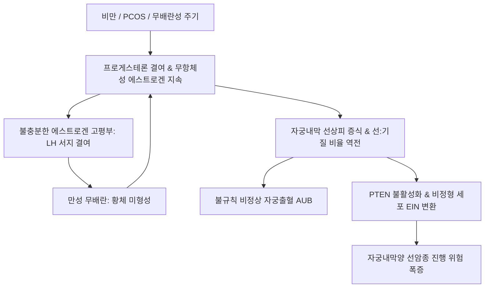

# 🩺 자궁내막증식증 (Endometrial Hyperplasia / 子宮內膜增殖症)

> **핵심 3줄 요약 (Key Summary)**:
> - 📍 **정의 & 병태생리**: 프로게스테론([[프로게스테론]])의 대항 없는 지속적인 에스트로겐([[에스트로겐]]) 자극으로 인해 자궁내막 샘(Gland)과 기질의 비율이 증가하여 샘 조직이 비정상적으로 과다 증식하는 전암성 병변. 비만, [[다낭성 난소 증후군]](PCOS), 무배란성 주기, 폐경이행기가 주원인이다.
> - 🚩 **임상 양상**: 불규칙한 비정상 자궁출혈(AUB), 월경 과다([[월경 과다]]), 폐경 후 질 출혈, 골반 초음파상 자궁내막의 비정상적 비후(가임기 > 14~15 mm, 폐경 후 > 4~5 mm).
> - 🛠️ **치료 원칙**: WHO 분류에 따라 비정형 없는 증식증은 고용량 프로게스틴(LNG-IUS 미레나 또는 경구 프로게스틴), 비정형 증식증(Atypical hyperplasia / EIN)은 자궁절제술이 원칙이나 가임력 보존 희망 시 메트포르민 병용 고용량 프로게스틴 및 엄격한 3개월 주기 조직검사, 한의학적으로 파어소장(破瘀消癥)·청열화담(淸熱化痰) 변증 시치.
> - ⚠️ **응급 의뢰 레드플래그**: 비정형 자궁내막증식증(EIN) 진단 시 최종 자궁적출 표본에서 약 30~40%의 동시성 자궁내막암(Coexistent endometrial cancer)이 발견되므로 즉각적인 부인종양 전문의 수술적 의뢰 필수.

---

## 📌 목차
1. [질환 개요 & 해부학적 병태생리](#1-질환-개요--해부학적-병태생리)
2. [병태생리 메커니즘 & 무항체 에스트로겐 발암 네트워크](#2-병태생리-메커니즘--무항체-에스트로겐-발암-네트워크)
3. [임상 증상 & WHO/EIN 분류 진단 알고리즘](#3-임상-증상--whoein-분류-진단-알고리즘)
4. [감별 진단 매트릭스 (Differential Diagnosis)](#4-감별-진단-매트릭스-differential-diagnosis)
5. [한의 통합 치료 프로토콜 (침·약침·한약)](#5-한의-통합-치료-프로토콜-침약침한약)
6. [양방 치료 & 호르몬·자궁보존 치료 기준 (Conventional Treatment & Referral)](#6-양방-치료--호르몬자궁보존-치료-기준-conventional-treatment--referral)
7. [체중 감량 & 대사증후군 관리 가이드](#7-체중-감량--대사증후군-관리-가이드)
8. [💡 사용자 진료실 핵심 필기 & 임상 노하우 (Melt-In 잔여 심화 집약)](#8-💡-사용자-진료실-핵심-필기--임상-노하우-melt-in-잔여-심화-집약)
9. [출처 및 학술 참고 문헌 (References)](#9-출처-및-학술-참고-문헌-references)

---

## 1. 질환 개요 & 해부학적 병태생리

### 1) 질환 정의 및 임상적 분류
- **자궁내막증식증(Endometrial Hyperplasia)**: 자궁내막의 선(샘, Gland) 구조가 기질(Stroma)에 비해 비정상적으로 증식하여 선 대 기질 비율이 1:1 이상으로 역전되는 질환이다.
- **2014 WHO 분류 체계**:
  1. **비정형 세포가 없는 자궁내막증식증 (Hyperplasia without atypia)**: 악성 진행 위험 1~3% 미만.
  2. **비정형 자궁내막증식증 / 자궁내막상피내종양 (Atypical hyperplasia / EIN)**: 악성 진행 위험 30~40% 이상인 명백한 전암병변.

### 2) 자궁내막 해부학과 무항체 에스트로겐 자극
- **선상피세포의 과형성**: 정상 분비기에는 프로게스테론이 에스트로겐 수용체를 하향 조절하고 세포자멸사(Apoptosis)를 유도하나, 프로게스테론 결핍 시 선상피세포가 통제 없이 증식한다.
- **PTEN 종양억제유전자 결실**: 지속적인 유사분열 자극으로 PTEN 유전자 불활성화, PI3K/Akt 신호 경로 과활성화가 일어나며 비정형 세포로 악성화된다.

---

## 2. 병태생리 메커니즘 & 무항체 에스트로겐 발암 네트워크

### 1) 에스트로겐 지속 노출과 LH 서지 부전의 악순환
- **무배란성 에스트로겐 지속**: 비만(말초 지방조직의 안드로겐 -> 에스트론 전환), [[다낭성 난소 증후군]](PCOS), 무배란 주기로 인해 에스트로겐이 지속 분비된다.
- **LH 서지(LH surge) 결여**: 에스트로겐이 계속 나오지만 양성 피드백을 유도할 만큼 충분히 높게 솟구치지 못하여 LH 서지가 일어나지 않고, 배란이 일어나지 않아 황체 형성과 프로게스테론 분비가 완전 차단된다.
- **증식기 무한 연장 및 파탄 출혈**: 자궁내막은 증식기 상태가 수개월간 지속되다가 구조적 지지 한계를 넘어 불규칙하게 탈락하며 장기적인 출혈을 초래한다.

### 2) 병태생리 악순환 도식

---

## 3. 임상 증상 & WHO/EIN 분류 진단 알고리즘

### 1) 주요 임상 양상
- **비정상 자궁출혈(AUB)**: 불규칙한 주기, 출혈 기간 연장(8일 이상), 월경 과다.
- **폐경 후 출혈(Postmenopausal bleeding, PMB)**: 폐경 후 질 출혈 환자의 10~15%에서 발견.
- **초음파상 내막 비후**: 경질 초음파에서 불균일하고 두터운 에코 음영 관찰.

### 2) 표준 진단 검사 SOP
- **자궁내막 조직생검(Endometrial Biopsy)**: 피펠(Pipelle) 흡인생검 또는 자궁경하 표적생검(Hysteroscopy guided biopsy)으로 병리학적 비정형성 여부 확진.
- **분자 생체지표**: MMR 단백질 결손(MSI), PTEN 돌연변이 확인.

---

## 4. 감별 진단 매트릭스 (Differential Diagnosis)

| 감별 질환 | 호발 연령 및 특이 소견 | 핵심 조직학적/영상 소견 | 감별 포인트 |
| :--- | :--- | :--- | :--- |
| **[[자궁내막암]](Endometrial Ca)** | 50~60대 폐경 후 여성, 비만 | 선구조 파괴, 기질 침윤(Myometrial invasion) | 근층 침윤 여부 확인 필수 |
| **자궁내막 용종(Polyp)** | 전 연령대, 국소 병변 | 섬유혈관 중심축을 가진 국소 점막 돌출 | 미만성 비후가 아닌 국소성 병소 |
| **점막하 [[자궁근종]]** | 30~40대, 심한 생리통 동반 | 평활근 세포 증식으로 둘러싸인 저에코 종괴 | 근육층 유래 양성 종양 |
| **무배란성 기능성 자궁출혈** | 사춘기 또는 폐경이행기 | 내막 조직학적 이상 없음(정상 증식기) | 선상피 과형성 부재 |

---

## 5. 한의 통합 치료 프로토콜 (침·약침·한약)

### 1) 변증별 한약 처방 프로토콜
- **비허습담(脾虛濕痰) / 담습어조(痰濕瘀阻)**:
  - 주증: 비만 환자, 불규칙 질출혈, 대하 백탁 과다, 신체 무거움, 설반태백니, 맥활.
  - 대표 처방: [[창부도담탕]], [[도담탕]] 가감(창출, 반하, 진피, 향부자, 복령, 삼릉, 아출).
  - 치법: 건비조습(健脾燥濕), 활혈소징(活血消癥).
- **어혈조체(瘀血阻滯) / 충임어열(衝任瘀熱)**:
  - 주증: 출혈량 다, 암자색 혈괴 배출, 하복부 거안 압통, 설자암 어반, 맥삽.
  - 대표 처방: [[계지복령환]], [[대황자충환]], [[실소산]] 가감(도인, 목단피, 작약, 복령, 삼칠).
  - 치법: 활혈거어(活血祛瘀), 파징지혈(破癥止血).
- **간울화화(肝鬱化火) / 혈열망행(血熱妄行)**:
  - 주증: 스트레스 시 출혈 악화, 생리혈 심홍 점조, 번조, 유방창통, 설홍태황, 맥현삭.
  - 대표 처방: [[단치소요산]], [[청경산]], 청열고경탕 가감.
  - 치법: 소간청열(疏肝淸熱), 양혈지혈(涼血止血).
- **신음부족(腎陰不足) / 허화내치(虛火內熾)**:
  - 주증: 희발월경 후 지속 출혈, 요슬산연, 조열도한, 설홍소태, 맥세삭.
  - 대표 처방: [[보음전]], [[지백지황환]], [[육미지황탕]] 가감.
  - 치법: 자음강화(滋陰降火), 고충조경(固衝調經).

### 2) 침구 치료 프로토콜
- **주요 혈위**: [[관원]](CV4), [[중극]](CV3), [[삼음교]](SP6), [[혈해]](SP10), [[풍륭]](ST40), [[태충]](LR3), [[자궁]](EX-CA1).
- **시술 기전**: 담습과 어혈을 제거하고 골반강 미세순환을 개선하여 내막의 병리적 과형성 억제.

---

## 6. 양방 치료 & 호르몬·자궁보존 치료 기준 (Conventional Treatment & Referral)

### 1) 비정형 없는 증식증 치료
- **레보노르게스트렐 방출 자궁내장치(LNG-IUS, 미레나)**: 1차 권고 치료. 자궁 국소 고농도 프로게스틴 방출로 90% 이상에서 완전 관해 유도.
- **경구 프로게스틴**: 메드록시프로게스테론 아세테이트(MPA 10~20 mg/일) 또는 메게스트롤 아세테이트(160 mg/일) 3~6개월 투여.
- **경구피임제(Yaz 등)**: 가임기 여성에서 규칙적 소퇴성 출혈 유도 및 주기 회복.

### 2) 비정형 자궁내막증식증(EIN) 치료
- **표준 치료**: 전자궁절제술 및 양측 난관절제술.
- **가임력 보존 희망 환자**: 미레나 삽입 + 경구 메트포르민([[메트포르민]]) 병용 요법 (인슐린 저항성 완화 및 AMPK 활성화를 통해 내막 증식 억제). 반드시 3개월 간격으로 자궁내막 조직생검 추적 필수.

---

## 7. 체중 감량 & 대사증후군 관리 가이드

### 1) 인슐린 감수성 개선
- 비만 환자에서 체중 7~10% 감량 시 말초 아로마타제 활성이 급감하여 체내 에스트로겐 수치가 정상화됨.
- 저탄수화물 지중해식 식단 권장.

---

## 8. 💡 사용자 진료실 핵심 필기 & 임상 노하우 (Melt-In 잔여 심화 집약)

### 1) 자궁내막 유착 및 암 진행의 경고
- 자궁내막 증식이 방치되어 만성화되면 자궁내막이 국소적으로 괴사 및 유착되는 상태까지 이어질 수 있으며, 이는 가임력을 영구적으로 파괴하고 [[자궁내막암]]으로 직결될 수 있다.
- 임상에서 "생리 주기가 두세 달씩 건너뛰다가 한번 시작하면 멈추지 않고 2~3주간 쏟아진다"고 호소하는 비만 여성은 100% 자궁내막증식증 의심 하에 접근해야 한다.

### 2) 에스트로겐 지속 노출과 LH surge 부전의 본질
- 원인은 프로게스테론에 의해 억제되지 않는 에스트로겐의 지속적인 자궁내막 증식이다.
- 에스트로겐이 계속 나오지만 충분한 임계치에 도달하지 못하여 정상적인 LH 서지(LH surge)가 발동하지 않고, 이로 인해 증식기가 무한정 지속된다.
- 따라서 치료의 본질은 무조건적인 지혈이 아니라, 주기적인 프로게스테론 자극을 부여하거나 자발적인 정상 배란을 유도하여 에스트로겐-프로게스테론의 정상 순환 주기를 되찾아주는 관리(Management)에 있다.

---

## 9. 출처 및 학술 참고 문헌 (References)

Yordanov. (2026). Metformin as an Adjunct to Fertility-Sparing Treatment in Atypical Endometrial Hyperplasia and Early-Stage Endometrioid Endometrial Cancer: Narrative Review. *Cancers (Basel)*. PMID: 42882834.

Li. (2026). Sentinel Lymph Node Assessment in Endometrial Intraepithelial Neoplasia/Atypical Endometrial Hyperplasia: An Updated Systematic Review and Meta-Analysis. *Diagnostics (Basel)*. PMID: 42882269.

Alatawi. (2026). Fertility-Sparing Treatment of Endometrial Cancer and Atypical Endometrial Hyperplasia by Molecular Classification: A Systematic Review and Meta-Analysis Accounting for Outcome-Assessment Timing and Follow-Up Duration. *Cancers (Basel)*. PMID: 42794938.
