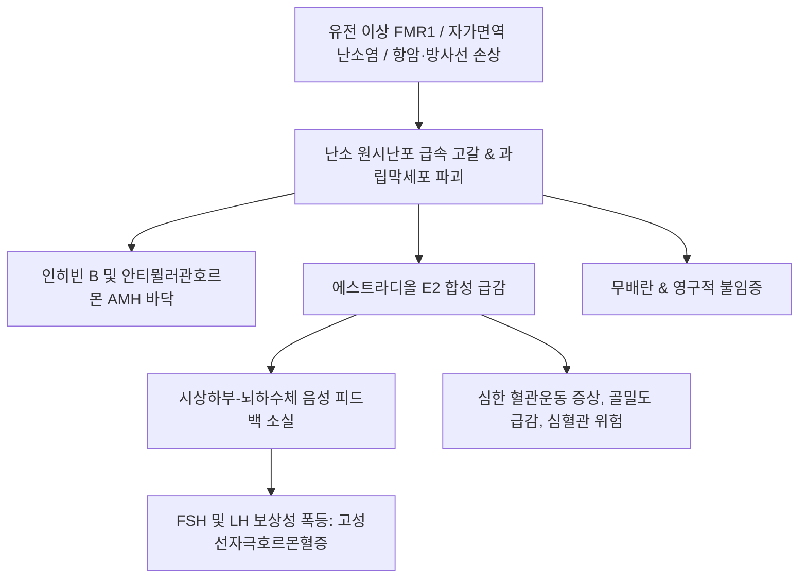

# 🩺 조기 폐경 (Premature Ovarian Insufficiency, POI / 早期閉經)

> **핵심 3줄 요약 (Key Summary)**:
> - 📍 **정의 & 병태생리**: 만 40세 이전에 난소의 난포 고갈 또는 심각한 기능 장애로 인해 난소 기능이 영구적 또는 간헐적으로 정지되는 병태. 염색체 이상(터너 증후군, FMR1 전돌연변이), 자가면역 질환(아디슨병, 하시모토), 의원성 손상(항암 화학요법, 골반 방사선, 난소 수술)이 주원인이다.
> - 🚩 **임상 양상**: 4개월 이상의 무월경([[무월경]]), 최소 4주 간격으로 측정한 혈청 [[FSH]] > 25~40 IU/L (2회 확인), 혈청 [[에스트라디올]] 결핍, 극심한 혈관운동 증상(안면홍조, 야간발한), 비뇨생식기 위축(질건조, 성교통), 불임.
> - 🛠️ **치료 원칙**: 골다공증 및 조기 심혈관 질환 예방을 위해 자연 폐경 연령(만 50~51세)까지 필수적인 호르몬대체요법(HRT) 투여, 한의학적으로 신정고갈(腎精枯竭)·천계조쇠(天癸早衰) 변증에 따른 [[육미지황탕]], [[좌귀환]], [[귀신환]], [[온포음]] 투여 및 배란 회복 유도.
> - ⚠️ **응급 의뢰 레드플래그**: 자가면역 다선성 증후군(APS) 동반 환자에서 발생하는 급성 부신 위기(쇼크, 저나트륨혈증, 저혈당), 극심한 조기 골소실로 인한 척추 압박골절 위험 시 즉각적 내분비내과 정밀검사 의뢰.

---

## 📌 목차
1. [질환 개요 & 해부학적 병태생리](#1-질환-개요--해부학적-병태생리)
2. [병태생리 메커니즘 & 난포 고갈 네트워크](#2-병태생리-메커니즘--난포-고갈-네트워크)
3. [임상 증상 & ESHRE 진단 가이드라인 알고리즘](#3-임상-증상--eshre-진단-가이드라인-알고리즘)
4. [감별 진단 매트릭스 (Differential Diagnosis)](#4-감별-진단-매트릭스-differential-diagnosis)
5. [한의 통합 치료 프로토콜 (침·약침·한약)](#5-한의-통합-치료-프로토콜-침약침한약)
6. [양방 치료 & 장기 호르몬대체요법(HRT) 기준 (Conventional Treatment & Referral)](#6-양방-치료--장기-호르몬대체요법hrt-기준-conventional-treatment--referral)
7. [골밀도 보존 & 심혈관 보호 가이드](#7-골밀도-보존--심혈관-보호-가이드)
8. [💡 사용자 진료실 핵심 필기 & 임상 노하우 (Melt-In 잔여 심화 집약)](#8-💡-사용자-진료실-핵심-필기--임상-노하우-melt-in-잔여-심화-집약)
9. [출처 및 학술 참고 문헌 (References)](#9-출처-및-학술-참고-문헌-references)

---

## 1. 질환 개요 & 해부학적 병태생리

### 1) 질환 정의 및 임상적 개념
- **조기 난소 부전(Premature Ovarian Insufficiency, POI)**: 과거 '조기 폐경(Premature Menopause)'으로 불렸으나, 환자의 약 5~10%에서 자발적인 난소 기능 일시 회복 및 자연 임신이 관찰되므로 현재는 가역적 가능성을 열어둔 '조기 난소 부전' 용어가 표준이다.
- 만 40세 미만 여성의 약 1%에서 발생하며, 30세 미만에서는 0.1%의 유병률을 보인다.

### 2) 난소 원시난포의 해부학적 고갈과 기능 상실
- **원시난포 풀(Pool)의 급속 소실**: 출생 시 부여받은 원시난포가 가속화된 세포자멸사(Apoptosis)로 인해 조기 소실됨.
- **난포 자극 불응성**: 난포가 난소 기질 내에 일부 잔존하더라도 FSH 수용체 유전자 결함이나 자가항체(Anti-ovarian antibody)의 과립막세포 공격으로 인해 고농도의 FSH 자극에도 난포 성숙이 일어나지 않음.

---

## 2. 병태생리 메커니즘 & 난포 고갈 네트워크

### 1) 4대 병인론적 경로
1. **유전학적 이상 (20~25%)**: 터너 증후군(45,X 또는 모자이크), 취약 X 증후군 FMR1 유전자 전돌연변이(Premutation, CGG 반복 55~200회).
2. **자가면역성 난소염 (5~10%)**: 부신 21-하이드록실라제 항체 양성(아디슨병 동반), 갑상선 과산화효소 항체(하시모토 갑상선염), 1형 당뇨병.
3. **의원성 및 환경 독소**: 골반 방사선 치료, 알킬화제 항암 화학요법, 광범위 양측 난소 낭종 절제술, 흡연.
4. **특발성 (Idiopathic, 60% 이상)**: 명확한 원인을 찾을 수 없는 분자 유전학적 난포 폐쇄.

### 2) 병태생리 악순환 도식

---

## 3. 임상 증상 & ESHRE 진단 가이드라인 알고리즘

### 1) 주요 임상 양상
- **월경 주기 이상**: 희발월경을 거쳐 4개월 이상 지속되는 무월경.
- **에스트로겐 결핍 증상**: 안면 홍조, 야간 발한, 수면 분절, 감정 기복, 질 건조감, 성교통, 반복성 방광염.
- **장기 합병증**: 조기 골감소증/[[골다공증]], 관상동맥 질환 위험 증가, 인지기능 저하.

### 2) ESHRE 확진 진단 기준
- 1) **만 40세 미만**의 연령.
- 2) **4개월 이상의 무월경** 또는 희발월경.
- 3) 최소 4주 이상의 간격을 두고 측정한 혈청 **[[FSH]] > 25 IU/L (연속 2회)**.
- 4) 부가 검사: 혈청 [[AMH]] < 0.1~0.5 ng/mL, 핵형 분석(Karyotype), FMR1 유전자 검사, 항부신 항체 선별.

---

## 4. 감별 진단 매트릭스 (Differential Diagnosis)

| 감별 질환 | 호발 기전 및 병력 | 호르몬 및 초음파 소견 | 조기 폐경과의 차이점 |
| :--- | :--- | :--- | :--- |
| **기능성 시상하부성 무월경** | 극단적 체중감소, 스트레스, 과훈 | FSH, LH, E2 모두 저하(저성선성) | FSH가 낮거나 정상, 가역적 회복 가능 |
| **[[다낭성 난소 증후군]](PCOS)** | 비만, 다모증, 만성 무배란 | FSH 정상, LH 상승, AMH 고농도 | 난포가 고갈된 것이 아니라 동난포 과다 축적 |
| **[[고프로락틴혈증]]** | 유즙 분비, 두통 | Prolactin > 25 ng/mL, 뇌 MRI 선종 | 프로락틴 단독 상승, 도파민 작용제 반응 |
| **[[아셔만 증후군]]** | 소파수술 후 무월경 | FSH 정상, 자궁경하 섬유성 유착 확인 | 난소 기능은 정상이며 자궁강 유착이 원인 |

---

## 5. 한의 통합 치료 프로토콜 (침·약침·한약)

### 1) 변증별 한약 처방 프로토콜
- **신음부족(腎陰不足) / 천계조쇠(天癸早衰)**:
  - 주증: 40세 이전 무월경, 조열도한, 오심번열, 질건조감, 요슬산연, 두훈이명, 설홍소태, 맥세삭.
  - 대표 처방: [[좌귀환]], [[육미지황탕]], [[지백지황환]] 가감(숙지황, 산수유, 구기자, 귀판, 지모, 황백).
  - 치법: 자음보신(滋陰補腎), 익정전수(益精塡髓).
- **신양허(腎陽虛) / 명문화쇠(命門火衰)**:
  - 주증: 무월경, 심한 추위 탐, 안색 창백, 성욕 감퇴, 하복 냉감, 요통, 설담태백, 맥침지미약.
  - 대표 처방: [[우귀음]], [[온포음]], [[신기환]] 가감(녹각교, 부자, 육계, 토사자, 두충).
  - 치법: 온신장양(溫腎壯陽), 보익충임(補益衝任).
- **기혈양허(氣血兩虛) / 충임허손(衝任虛損)**:
  - 주증: 피로 무력, 면색위황, 심계, 불면, 식욕 부진, 설담소태, 맥세약.
  - 대표 처방: [[인삼양영탕]], [[귀신환]], [[팔진탕]] 가감.
  - 치법: 보기양혈(補氣養血), 조양간신(調養肝腎).

### 2) 침구 치료 프로토콜
- **주요 혈위**: [[관원]](CV4), [[신수]](BL23), [[차료]](BL32), [[삼음교]](SP6), [[태계]](KI3), [[혈해]](SP10), [[자궁]](EX-CA1).
- **시술 기전**: 천골부 차료 및 하복부 관원혈 전침 치료를 통해 골반 자율신경계를 활성화하고 난소 잔여 난포 미세혈류 순환 촉진.

---

## 6. 양방 치료 & 장기 호르몬대체요법(HRT) 기준 (Conventional Treatment & Referral)

### 1) 표준 호르몬 대체 요법 (HRT)
- **투여 원칙**: 일반 폐경 여성과 달리, POI 환자는 **최소 평균 자연 폐경 연령(만 50~51세)까지** 반드시 생리적 용량의 호르몬을 보충해야 한다.
- **약제 구성**:
  - 에스트로겐: 경피 패치 또는 젤(17-beta estradiol 100 ug/일) 권장 (간 대사 회피로 혈전증 위험 최소화).
  - 프로게스토겐: 자궁이 있는 여성은 자궁내막 보호를 위해 미분화 프로게스테론(200 mg/일 12~14일간 주기적 투여).

### 2) 생식의학적 대책
- 자연 임신 확률은 5~10% 수준이므로 가임력 회복을 위해서는 공여 난자 체외수정(Egg donation IVF)을 조기에 상담 연계.

---

## 7. 골밀도 보존 & 심혈관 보호 가이드

### 1) 골밀도 관리
- 기저 골밀도(DEXA) 측정 후 1~2년 간격 추적. 비타민 D 1,000~2,000 IU/일, 칼슘 1,000~1,200 mg/일 섭취 및 체중 부하 근력 운동 필수.

### 2) 심혈관 위험 모니터링
- 에스트로겐 조기 결핍으로 혈관 탄성이 저하되므로 혈압, 지질 패널(LDL-C), 공복 혈당을 매년 정기 추적.

---

## 8. 💡 사용자 진료실 핵심 필기 & 임상 노하우 (Melt-In 잔여 심화 집약)

### 1) 조기 폐경과 일반 폐경의 임상적 차이점
- 40세 이전 조기 폐경은 단순한 난소 노화가 아니라 유전적 결함, 자가면역 질환, 대사적 손상, 극심한 스트레스가 복합 작용하여 발생하는 다인성 병태이다.
- 일반 폐경 여성은 HRT 투여 기간을 최소화하는 경향이 있으나, 조기 폐경 환자는 만 50세까지 심혈관 및 뼈를 보호하기 위해 생리적 수준의 호르몬 치료가 필수적임을 환자에게 명확히 교육해야 한다.

### 2) 한의학적 가역성 도전
- 조기 폐경 환자 중 일부는 난소 기질에 미성숙 난포가 휴면 상태로 잔존해 있다.
- 보신익정(補腎益精)하는 [[좌귀환]]이나 [[온포음]]에 자하거, 음양곽, 토사자 등을 고용량 배합하여 난소 혈류를 집중 개선하면 뇌하수체 피드백이 재가동되며 기적적으로 자발적 배란과 월경이 회복되는 임상례가 존재하므로, 조기에 포기하지 않고 6개월 이상의 집중 한의 치료를 시도해 볼 가치가 있다.

---

## 9. 출처 및 학술 참고 문헌 (References)

Pan. (2026). Role of NAT10-mediated RNA acetylation in premature ovarian insufficiency: a mechanistic review. *Gynecol Endocrinol*. PMID: 41508867.

Fukutomi. (2026). Chromosomal and genetic causes of primary ovarian insufficiency in the Utah population. *J Endocr Soc*. PMID: 42891080.

Roman. (2026). Young bodies, aging ovaries: A systematic review and meta-synthesis of women's perspectives on spontaneous premature ovarian insufficiency. *Int J Gynaecol Obstet*. PMID: 42281460.
