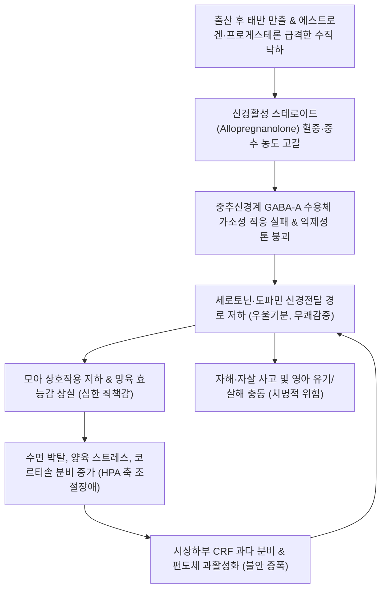

# 🩺 분만 후 우울증 (Postpartum Depression / 産後 憂鬱症)

> **핵심 3줄 요약 (Key Summary)**:
> - 📍 **병소 부위 & 해부·병태생리**: 분만 직후 난소 스테로이드([[에스트로겐]], [[프로게스테론]])의 급격한 수직 낙하 및 신경활성 스테로이드(Allopregnanolone) 결핍, 시상하부-뇌하수체-부신(HPA) 축 기능장애, [[GABA]] 수용체 가소성 실패로 인해 발생하는 주산기 주요 우울장애.
> - 🚩 **전형적 임상 양상**: 분만 후 2~6주 사이에 시작되는 지속적인 우울기분, 무쾌감증(Anhedonia), 극심한 피로 및 수면장애(영아 수면과 무관), 죄책감, 신생아 양육에 대한 과도한 불안 및 애착 형성 장애, 자해/영아해 유발 위험 사고.
> - 🛠️ **핵심 검사 & 치료 전략**: 에든버러 산후우울척도(EPDS) 선별 검사(≥ 10~13점 양성), 갑상선기능검사(산후 갑상선염 배제); 경증/중등도 시 인지행동치료(CBT), 중등도/중증 시 SSRI(설트랄린 1차) 또는 GABA-A 양성 알로스테릭 조절제(주라놀론, 브렉사놀론), 한의학적 간기울결·심비양허 변증(소요산/귀비탕/감맥대조탕) 병용.
> - <font color="#fa7e7e">⚠️ **응급 의뢰 레드플래그**: 영아를 해치려는 충동이나 망상(영아 살해 위험), 환청/환시, 지남력 상실을 동반한 **산후 정신병(Postpartum psychosis)** 징후, 명백한 자살 사고 및 계획 확인 시 정신건강의학과 폐쇄병동 즉각 응급 입원 의뢰.</font>

---

## 📌 목차
1. [질환 개요 & 해부학적 병태생리](#1--질환-개요---해부학적-병태생리)
2. [병태생리 메커니즘 & 생체역학적 악순환 네트워크](#2--병태생리-메커니즘---생체역학적-악순환-네트워크)
3. [임상 증상 & 이학적 검사 알고리즘](#3--임상-증상---이학적-검사-알고리즘)
4. [감별 진단 매트릭스](#4--감별-진단-매트릭스)
5. [한의 통합 치료 프로토콜](#5--한의-통합-치료-프로토콜)
6. [양방 치료 & 병용·의뢰 기준](#6-양방-치료--병용의뢰-기준)
7. [재활 운동 & 생활습관 티칭 가이드](#7--재활-운동---생활습관-티칭-가이드)
8. [💡 사용자 진료실 핵심 필기 & 임상 노하우](#8--사용자-진료실-핵심-필기---임상-노하우)
9. [📚 출처 및 현대 학술 연구 요약 (References)](#9--출처-및-현대-학술-연구-요약-references)

---

## 1. 질환 개요 & 해부학적 병태생리

### 1) 질환 정의 및 역학
- **분만 후 우울증(산후 우울증, Postpartum Depression, PPD)**은 출산 후 12개월(임상적으로는 주로 산후 4~6주 이내) 이내에 발병하는 주요 우울장애(Major Depressive Disorder with Peripartum Onset)이다.
- 산모의 약 10~15%에서 발생하는 흔한 질환으로, 분만 직후 일시적으로 나타나는 '산후 우울감(Postpartum blues, 베이비 블루스, 50~80% 발생)'과는 명확히 구분되는 심각한 정신의학적 상태이다.
- 방치할 경우 모아 애착 장애, 영아의 인지·정서 발달 지연, 모체의 만성 우울증으로 이어지며, 심각할 경우 산후 자살 및 영아 살해의 치명적 결과를 낳을 수 있다.

### 2) 신경생물학적 및 내분비적 배경
- **중추 신경망 및 호르몬 표적**:
  - 변연계(Limbic system), 전두엽 피질, 편도체(Amygdala)의 기능적 연결성 이상.
  - 임신 중 최고조에 달했던 에스트로겐, 프로게스테론이 태반 만출 후 48~72시간 내에 임신 전 기저치 이하로 급격히 추락하면서 중추신경계의 세로토닌([[세로토닌]]) 및 도파민 수용체 감수성을 교란한다.

---

## 2. 병태생리 메커니즘 & 생체역학적 악순환 네트워크



### 1) 신경활성 스테로이드(NAS) 가설
- 프로게스테론의 주요 대사산물인 **알로프레그나놀론(Allopregnanolone)**은 뇌내 $GABA_A$ 수용체의 강력한 양성 알로스테릭 조절제로, 불안을 완화하고 기분을 안정시키는 천연 진정 물질이다.
- 출산 후 알로프레그나놀론 농도가 급감할 때, 산모의 뇌가 $GABA_A$ 수용체의 소단위체 구성을 신속하게 재조정(Homeostatic plasticity)하지 못하면 과도한 불안과 우울 상태로 빠져들게 된다.

### 2) HPA 축 및 면역 염증성 불균형
- 임신 말기 둔마되었던 시상하부-뇌하수체-부신([[HPA]]) 축이 출산 후 급격히 재활성화되는 과정에서 조절 장애가 초래된다.
- 만성적인 수면 박탈과 스트레스가 인터루킨-6([[IL-6]]), [[TNF-alpha]] 등 전염증성 사이토카인을 상승시켜 신경염증 반응을 유발한다.

---

## 3. 임상 증상 & 이학적 검사 알고리즘

### 1) 주요 임상 증상
- **정서 증상**: 매일 지속되는 깊은 슬픔, 공허감, 절망감, 통제할 수 없는 울음, 즐거움의 상실(Anhedonia).
- **양육 관련 증상**: 아기에게 애착이 가지 않음, "내가 나쁜 엄마인 것 같다"는 극심한 자책감, 아기를 떨어뜨리거나 다치게 할 것 같은 침습적 불안 사고.
- **신체 증상**: 아기가 잘 때도 전혀 잠들지 못하는 심각한 불면증(Early/Middle/Late insomnia), 식욕 감퇴 또는 폭식, 극도의 무기력감, 원인 모를 신체 통증.
- **인지 증상**: 집중력 저하, 기억력 감퇴, 우유부단함, 자해 또는 자살에 대한 반복적 생각.

### 2) 선별 및 평가 알고리즘
```mermaid
flowchart TD
    P1["산후 2~12주 산모 정기 추적 관찰 내원"] --> P2["에든버러 산후우울척도 (EPDS, Edinburgh Postnatal Depression Scale) 설문"]
    P2 -->|EPDS < 9점| P3["정상 범위: 지지적 상담 및 정기 모니터링"]
    P2 -->|EPDS 10~12점| P4["경증 우울 또는 산후 블루스 지속 의심: 2주 후 재평가 & 심리상담"]
    P2 -->|EPDS ≥ 13점 또는 10번 문항(자해 생각) 양성| P5["산후 우울증 강력 의심: 정신건강의학과 심층 면담"]
    P5 --> P6["갑상선기능검사 (TSH, Free T4) 시행: 산후 갑상선염 배제"]
    P6 --> P7["치료 계획 수립: SSRI / 주라놀론 / 한의 심신 통합 치료"]
```

---

## 4. 감별 진단 매트릭스

| 질환명 | 발병 시기 | 주요 증상 및 특징 | 경과 및 예후 | 치료 전략 |
| :--- | :--- | :--- | :--- | :--- |
| **분만 후 우울증 (PPD)** | 산후 2주~수개월 (피크 4~6주) | 지속적 우울, 무쾌감증, 불면, 양육 죄책감, 자살 사고 | 수개월~수년 지속 가능, 치료 필수 | 약물치료(SSRI, 주라놀론), 인지치료, 한약 |
| **산후 우울감 (Postpartum Blues)** | 산후 2~3일째 발병 | 기분 가변성, 눈물 흘림, 경미한 불안, 피로 | **산후 10~14일 이내 자연 소실** | 안심 및 정서적 지지, 휴식 (약물 불필요) |
| **산후 정신병 (Postpartum Psychosis)** | 산후 2~3일~2주 이내 | 망상(아기가 악마라는 등), 환청, 극심한 초조, 혼돈 | **산과·정신과 초응급**, 영아 살해 위험 | 즉각 폐쇄병동 입원, 항정신병약, ECT |
| **산후 갑상선염** | 산후 1~6개월 | 갑상선 기능 항진(불안, 심계) 후 저하(피로, 우울) | 자가면역성 경과, TSH 이상 | 갑상선 기능 추적 및 레보티록신 투여 |

---

## 5. 한의 통합 치료 프로토콜

### 1) 한의 변증 분류
- **간기울결형 (肝氣鬱結型)**:
  - 주증: 정서 억울, 한숨을 자주 쉼, 흉협고만(가슴과 옆구리가 답답함), 감정 기복이 심하고 쉽게 화를 냄, 유방 팽만통, 설담태박백, 맥현.
  - 치법: 소간해울(疏肝解鬱), 이기지통(理氣止痛).
  - 처방: [[소요산]](逍遙散) 또는 시호소간산 가감 (시호 8g, 당귀 10g, 백작약 12g, 백출 10g, 복령 10g, 박하 4g, 향부자 10g, 울금 8g).
- **심비양허형 (心脾兩虛型)** — 임상 다발:
  - 주증: 출산 시 실혈 및 산후 피로로 인한 불면, 건망, 가슴 두근거림(심계), 식욕 부진, 면색 창백, 지속적 우울감, 설담태백, 맥세약.
  - 치법: 보익심비(補益心脾), 양심안신(養心安神).
  - 처방: [[귀비탕]](歸脾湯) 가감 (당귀 12g, 용안육 12g, 산조인(초) 15g, 원지 8g, 백출 10g, 복신 12g, 황기 15g, 인삼 8g, 목향 4g).
- **장조증 / 음허화왕형 (臟躁證 / 陰虛火旺型)**:
  - 주증: 슬픈 일이 없는데도 통곡하고 감정을 주체하지 못함, 불안 초조, 도한, 수족심열, 설홍소태, 맥세삭.
  - 치법: 양심안신(養心安神), 화중완급(和中緩急).
  - 처방: [[감맥대조탕]](甘麥大棗湯) 합 백합지황탕 (소맥 30g, 감초 10g, 대추 10매, 백합 15g, 생지황 15g).

### 2) 침구 치료 프로토콜
- **주요 혈위**:
  - 두면부 신경안정: [[백회]](GV20), [[신정]](GV24), [[인당]](EX-HN3) — 뇌신경 흥분 가라앉힘, 멜라토닌 분비 촉진.
  - 심·심포경 경락: [[내관]](PC6), [[신문]](HT7) — 안신녕심(불안 및 심계 완화).
  - 간·비경 경락: [[태충]](LR3), [[삼음교]](SP6), [[족삼리]](ST36) — 소간해울, 기혈 보강.
- **시술 기법**:
  - 백회와 인당, 신문, 내관 혈에 부드러운 평보평사법을 적용하고, 이압요법(귀의 신문, 피질하 혈에 이침 부착)을 병행하여 자율신경계 균형을 유도한다.

---

## 6. 양방 치료 & 병용·의뢰 기준

### 1) 약물 치료 (Pharmacotherapy)
- **SSRI (선택적 세로토닌 재흡수 억제제)** — 1차 유지 약제:
  - **[[설트랄린]] (Sertraline)**: 모유 이행률이 가장 낮아(수유기 안전성 최고 등급) 수유 산모의 1차 선택제 (초기 25~50 mg에서 시작하여 100~150 mg으로 증량).
  - 대체의약품: 에스시탈로프람(Escitalopram), 파록세틴(수유 시 비교적 안전).
- **GABA-A 수용체 양성 알로스테릭 조절제 (신약)**:
  - **주라놀론 (Zuranolone, Zurzuvae)**: 2023년 FDA 최초 승인된 경구용 산후 우울증 전용 치료제. 50 mg 1일 1회 저녁 식사와 함께 **14일간 단기 복용**. 투약 수일 내 신속한 증상 호전 유도.
  - **브렉사놀론 (Brexanolone, Zulresso)**: 60시간 지속 정맥 주사제 (과도한 진정 및 의식 상실 위험으로 입원 하 투여).

### 2) 비약물 정신치료 및 응급 입원 기준
- **대인관계치료 (IPT) 및 인지행동치료 (CBT)**: 경증 및 중등도 산후 우울증의 1차 표준 치료.
- **응급 의뢰 레드플래그**:
  - 환자가 자살 의도를 구체적으로 진술하거나 자해 시도를 한 경우.
  - 아기에게 해를 끼치려는 충동을 제어하지 못하거나 망상적 사고(산후 정신병)가 동반된 경우 즉시 119 또는 정신건강의학과 폐쇄병동 응급 입원 조치.

---

## 7. 재활 운동 & 생활습관 티칭 가이드

### 1) 수면 분담 및 수면 위생
- **연속 수면 4시간 확보**:
  - 수면 결핍은 PPD 악화의 최대 위험 요인이므로, 야간 수유는 배우자나 가족이 분담하여 산모가 최소 4시간 이상의 중단 없는 연속 수면을 취하도록 가용 자원을 총동원한다.

### 2) 햇빛 노출 및 가벼운 산책
- 오전 10~11시경 20~30분간 유모차를 밀며 가볍게 산책하고 자연 햇빛을 쬐어 뇌내 세로토닌 합성 및 야간 멜라토닌 분비를 촉진한다.

---

## 8. 💡 사용자 진료실 핵심 필기 & 임상 노하우

### 1) 진료실 면담 핵심 포인트
- 산모에게 "우울하세요?"라고 직접 묻기보다는 "요즘 아기가 잘 때 잠이 잘 오시나요?", "가끔 이유 없이 눈물이 나거나 아기를 보는 게 버겁게 느껴지시나요?"라고 부드럽게 유도해야 방어 기제를 풀고 속마음을 털어놓는다.
- "엄마가 약해서 그런 것이 아니라, 출산 후 호르몬이 급격히 떨어져서 뇌 신경계가 일시적으로 지친 뇌 질환"임을 설명하여 죄책감을 덜어주는 것이 치료의 절반이다.

### 2) 한의-양방 협진의 시너지
- 양방 SSRI 복용을 수유 문제로 주저하거나 복용 중 소화불량, 어지러움, 멍함 부작용을 호소하는 산모에게 [[귀비탕]]이나 [[감맥대조탕]]을 투여하면 수유를 안전하게 유지하면서도 불안과 가슴 두근거림, 불면을 매우 부드럽고 신속하게 안정시킬 수 있다.

---

## 9. 📚 출처 및 현대 학술 연구 요약 (References)

- Deligiannidis KM, et al. (2019). Pharmacotherapy of Postpartum Depression: Current Approaches and Novel Drug Development. *Trends Pharmacol Sci*. PMID: 30790145.

- Park J, et al. (2026). What Every NICU Nurse Should Know About Perinatal Mood and Anxiety Disorders. *Neonatal Netw*. PMID: 42791022.

- Melamed O, et al. (2026). Wearable sensors offer opportunities for phenotyping perinatal mood disorders: a narrative review. *Arch Womens Ment Health*. PMID: 42704686.
