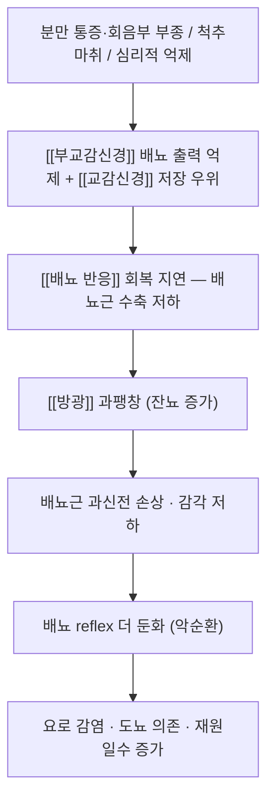

# 🩺 산후 요폐 (Postpartum Urinary Retention, ICD-10 R33 · 산후 합병증 코드 병기)

> **핵심 3줄 요약 (Key Summary)**:
> - 📍 병소 부위 & 병태생리: [[방광]] 배뇨근의 수축 회복 지연과 과팽창 — 분만 후 [[배뇨 반응]]의 부교감 출력이 일시에 억제되고, 통증·회음부 부종·심리적 억제가 이를 겹쳐 악화시킨다.
> - 🚩 전형적 임상 양상: 분만 후 6시간 전후로 자발 배뇨가 없거나 소량씩 자주 보면서 잔뇨가 많은 상태. 무증상 잔뇨(잠복성)와 도뇨가 필요한 명시적 요폐를 구분한다.
> - 🛠️ 핵심 감별 & 치료 전략: 요로 감염·신경인성 방광·약물성 요폐를 감별하고, 일차는 배뇨 유도·온열·도뇨이며 경혈 온찜질은 저위험 부가요법이다. 한방은 기허·기체혈어 변증으로 접근한다.
> - ⚠️ 응급 의뢰 레드플래그: 800 mL 이상 과팽창이 반복되거나 발열·옆구리 통증(요로 감염·신우신염), 하지 위약·회음부 감각 저하·대소변 실금(마미증후군)이 동반되면 즉시 의뢰한다.

---

## 📌 목차
1. [질환 개요 & 병태생리](#1-질환-개요--병태생리-disease-overview)
2. [병태생리 메커니즘 & 악순환 네트워크](#2-병태생리-메커니즘--악순환-네트워크)
3. [임상 증상 & 환자 소견](#3-임상-증상--환자-소견-clinical-presentation)
4. [감별 진단 매트릭스](#4-감별-진단-매트릭스-differential-diagnosis)
5. [한의 통합 치료 프로토콜](#5-한의-통합-치료-프로토콜-침약침한약)
6. [양방 치료 & 병용·의뢰 기준](#6-양방-치료--병용의뢰-기준-conventional-treatment--referral)
7. [식이·생활습관 & 자가관리 티칭](#7-식이생활습관--자가관리-티칭-가이드)
8. [💡 진료실 핵심 필기 & 임상 노하우](#8--진료실-핵심-필기--임상-노하우)
9. [출처 및 학술 참고 문헌](#9-출처-및-학술-참고-문헌-references)

---

## 1. 질환 개요 & 병태생리 (Disease Overview)

![[산후요폐_01_해부_방광요도_번호도해.jpg|450]]
> [그림 1: 방광·요관·요도·전립선·정낭을 번호로 표시한 골반 해부 도해 — 배뇨 통로의 폐쇄·저항 지점을 확인하는 기본 도판(남성 골반 단면 포함 판본) — Wikimedia Commons File:Illu bladder numbered.jpg, CC BY-SA 3.0]

* **질환 정의 및 분류**:
  * 산후 요폐는 분만 후 자발 배뇨가 정상적으로 회복되지 않는 상태다. 임상에서는 두 층으로 나눈다 — ① 명시적(overt) 요폐: 일정 시간(대개 분만 후 6시간 전후) 내 자발 배뇨가 없어 도뇨가 필요한 상태 ② 잠복성(covert) 요폐: 배뇨는 있으나 초음파 잔뇨량이 증가한 상태(연구마다 150 mL 전후를 기준으로 삼는다).
  * 역학: 무작위 대조시험의 통상관리군에서 명시적 요폐가 7.7%였고, 척추마취(무통분만) 하위군에서는 8.5%였다. 문헌 보고는 기준 정의에 따라 크게 흔들리므로 “6시간·잔뇨량”이라는 두 축을 명시해 읽어야 한다.
  * 호발군: 초산, 분만 시간 장기화, 척추마취·경막외 진통, 겸자·흡입 분만, 회음부 열상·봉합, 과거 산후 요폐 병력.
* **관련 장기 및 조직**:
  * 주 이환 장기: [[방광]] — 배뇨근 과팽창과 수축력 저하.
  * 연관 조절계: [[교감신경]](T10–L2, 저장 반사)과 [[부교감신경]](S2–S4, 배출 반사), 회음부 체성신경(외요도괄약근 보호 반사).
  * 합병증 표적: 요로 감염, 유치도뇨 관련 요로감염, 재원일수 증가, 장기 배뇨 기능장애.

---

## 2. 병태생리 메커니즘 & 악순환 네트워크

### 1) 분자·세포 수준 기전
* 과팽창은 배뇨근 평활근의 길이-장력 관계를 손상시키고, 지속되면 콜린성·푸린성 신경전달 효율과 미토콘드리아 대사가 함께 떨어진다. 감각 신경(Aδ·C섬유)의 역치 상승은 “방광이 찼다”는 인지 자체를 흐려 잠복성 요폐를 만든다.
* 척추마취는 천골 부교감 신경근을 일시 차단해 배출 반사 진입을 막는다. 마취 회복 후에도 과팽창이 남아 있으면 회복이 지연된다.

### 2) 장기·계통 수준 결과
* 저장(교감)과 배출(부교감)의 스위치가 저장 쪽으로 고정되면 잔뇨가 늘고, 잔뇨는 세균 증식과 배뇨근 과신전을 동시에 진행시킨다. 임상적으로는 “소변을 못 본다”와 “조금씩 자주 본다(잔뇨 많음)” 두 얼굴로 나타난다.

### 3) 위험인자와 진행 단계
* 위험인자 → 첫 배뇨 지연(6시간) → 잔뇨 증가 → 도뇨 필요 → 반복 도뇨·요로감염 → 지속성 요폐(수일~수주).

---

## 3. 임상 증상 & 환자 소견 (Clinical Presentation)

> 🖼️ 이미지 미확보 — 환자 임상 사진(복부 팽만·치골상부 타진)과 초음파 잔뇨 영상은 이번 회차에 확보하지 못했다. 다음 회차에 Open-i(초음파 소견) 조달을 재시도한다.

### 1) 주소증 및 핵심 증상
* 전형: 분만 후 6시간이 지나도 소변을 보지 못함, 치골상부 팽만감·통증, 소량씩 자주 보는 빈뇨, 잔뇨감.
* 비전형: 전혀 불편을 호소하지 않는데 잔뇨만 많은 잠복성 요폐 — 산후 첫날 복부 촉진·타진을 routine으로 해야 잡힌다.
* 악화 인자: 척추마취 잔효, 회음부 통증으로 인한 배뇨 회피, 와상 안정, 낯선 화장실 환경·타인 시선.

### 2) 객관적 소견 (Signs & Labs)
* 치골 상부 타진 탁음, 복부 촉진 팽만. 초음파 방광 스캔으로 잔뇨량 측정(비침습, 도뇨 전 선호).
* 요로 감염 감별: 발열·빈뇨·요절박·탁뇨가 있으면 요검사·요배양.

### 3) 병기·중증도 판정
* 경증: 자발 배뇨 가능 + 잔뇨 경도 → 배뇨 유도·온열·자세 교육.
* 중등도: 자발 배뇨 없음, 잔뇨 증가 → 일회성 도뇨 또는 유치도뇨 + 재평가.
* 중증: 반복 과팽창·감각 저하·지속성 요폐 → 비뇨의학과 평가(요역동학 검사).

---

## 4. 감별 진단 매트릭스 (Differential Diagnosis)

| 감별 질환 | 특징적 양상 | 감별 포인트 (검사·수치) |
| :--- | :--- | :--- |
| [[산후 요폐]] (본 질환) | 분만 후 첫 배뇨 지연, 잔뇨 증가 | 분만 후 경과시간 + 방광 스캔 잔뇨량 |
| 요로 감염 | 발열·요절박·탁뇨·치골상부 통증 | 요검사(백혈구·아질산염)·요배양 |
| [[신경성 방광]] | 배뇨·배변 동시 장애, 감각 저하 | 신경학적 검진, 잔뇨, 필요 시 요역동학 |
| 마미증후군 | 안장감각 저하·하지 위약·대소변 실금 | 즉시 응급 — MRI 의뢰 |
| 약물성 요폐 | 항콜린제·오피오이드·마취 잔효 | 복용·투여 시점 문진 |

> 🚩 레드플래그 감별: 마미증후군과 산후 자궁내막염·요로 패혈증은 응급이다. 발열 + 옆구리 통증 + 오한이면 온열요법보다 감염 평가가 먼저다.

---

## 5. 한의 통합 치료 프로토콜 (침·약침·한약)

* **변증 분류**:
  * 기허(氣虛): 소변이 시원하게 나오지 않고 잔뇨감, 피로·자한 → 보기 승양.
  * 기체혈어(氣滯血瘀): 하복부 창만·자궁수축통, 오로 정체 → 행기 활혈.
  * 습열하주(濕熱下注): 배뇨 시 작열감·탁뇨 → 청열 이습(감염 감별 선행).
  * 신양허(腎陽虛): 소변 무력, 요부 냉감, 다뇨·잔뇨 → 온신 조기.
* **침구 치료 (Acupuncture)**:
  * 기본 배혈: 중극(CV3)·관원(CV4)·기해(CV6)·삼음교(SP6)·방광수(BL28). 배출 반사 유도에는 중극·삼음교를 중심으로, 잔뇨·감각 둔화에는 방광수·차료(BL32)를 더한다.
  * 자극: 하복부 혈위는 얕게(방광 팽만 시 과심자 금지), 20~30분 유침, 주 3회를 1~2주. 전침은 저주파 2 Hz를 복부·하지에 적용한 보고가 있으나 산후 요폐 자체의 대규모 근거는 아직 없다.
  * 산후 요폐에 침을 단독으로 쓰는 근거는 약하다 — 배뇨 유도·도뇨 판단을 대체하지 않는다.
* **약침 치료 (Pharmacopuncture)**:
  * 팽만된 방광 상부 직접 자침은 금기. 차료·중료 축과 하지 혈위(삼음교)에 소량(0.1~0.2 mL/점) 적용하는 보수적 접근만 한다.
* **한약 치료 (Herbal Medicine)**:
  * 기허: [[보중익기탕]] 계열, 신양허: [[팔미지황환]] 계열, 기체혈어: [[소요산]]·[[계지복령환]] 계열로 변증 가미. 산후 요폐 자체를 1차 종점으로 한 무작위 시험은 확인되지 않아, 근거 수준은 전문가 의견·전통 사용에 해당한다.
* **뜸·부항·기타**:
  * [[뜸]]·온구로 신궐(CV8)·관원(CV4) 온중, 그리고 [[경혈 온찜질]]을 배뇨 유도 루틴에 결합한다. 산후 출혈 과다·발열 시 온열 중재는 보류한다.

---

## 6. 양방 치료 & 병용·의뢰 기준 (Conventional Treatment & Referral)

![[산후요폐_02_시술_유치도뇨_실사.jpg|420]]
> [그림 2: 유치도뇨관이 삽입·고정된 실제 모습 — 산후 요폐에서 도뇨 적응과 환자 교육(고정·요주머니 위치)에 쓰는 실사 — Wikimedia Commons File:Urinary catheter 2020.jpg, CC0]

* **약물 치료 (Medication)**:
  * 산후 요폐에 직접 승인된 약물은 없다. 배뇨근 수축력 회복을 노린 베타네콜·콜린성 제제는 근거가 일관되지 않아 routine 사용하지 않는다. 통증 조절(아세트아미노펜·NSAIDs)로 배뇨 회피 요인을 줄이는 것이 실질적이다.
  * 감염이 확인되면 항생제(요배양 감수성 기준).
* **비약물 치료 (Procedures)**:
  * 1차: 조기 보행, 화장실에서의 자세·프라이버시 확보, 물소리·회음부 온열, 충분한 수분.
  * 도뇨: 일회성 도뇨(intermittent) 우선, 반복 필요 시 유치도뇨. 과팽창이 심하면 감압 후 배뇨 훈련.
  * 배뇨 훈련(bladder training)과 잔뇨 추적(방광 스캔)을 함께 간다.
* **수술·시술 적응증 (Surgical Indication)**:
  * 지속성 요폐·배뇨근 무수축이 확인되면 비뇨의학과에서 요역동학 검사 후 자가 도뇨 교육, 드물게 신경조절술.
* **한의 병용 판단 (Combination Therapy)**:
  * 병용 가능: 경혈 온찜질·침·뜸은 도뇨와 병행 가능(도뇨를 대체하지 않는다).
  * 주의: 방광 과팽창 상태에서 하복부 심자·전침 고강도 자극. 감염 의심 시 온열 중재 보류.
* **양방·전문과 의뢰 기준 (Referral Criteria)**:
  * 즉시: 발열·옆구리 통증·패혈증 소견, 안장감각 저하·하지 위약, 800 mL 이상 과팽창 반복.
  * 24~48시간 내: 도뇨 후에도 자발 배뇨 회복 없음, 잔뇨 지속.

---

## 7. 식이·생활습관 & 자가관리 티칭 가이드

* **식이 지도 (Diet)**:
  * 수분은 제한하지 말고 하루 1.5~2 L를 나누어 마시게 한다(과팽창 시 일시적 조절은 의뢰 판단).
  * 카페인·탄산·과도한 염분은 방광 자극·부종을 늘릴 수 있어 산후 첫 2주는 줄인다. 한의 변증상 습열형은 자극적·기름진 음식, 신양허형은 찬 음료를 제한한다.
* **생활습관 (Lifestyle)**:
  * 분만 후 6시간 안에 첫 배뇨 시도를 목표로 하되, 통증 때문에 참지 않도록 진통 조절을 먼저 한다.
  * 배뇨 시 상체를 약간 앞으로 숙이고 발판을 사용해 골반저 긴장을 푼다.
* **자가관리 (Self-monitoring)**:
  * 배뇨 일기(시각·량·잔뇨감), 도뇨를 했다면 배출량 기록. 3일 단위로 추세를 본다.
* **환자 교육 스크립트**:
  * “출산 직후에는 방광이 힘을 잃어 소변이 안 나오는 일이 흔합니다. 6시간 안에 소변을 못 보거나, 봐도 개운하지 않으면 숨기지 말고 말씀해 주세요. 방광이 너무 불어나면 회복이 더뎌지기 때문에 일찍 도와드리는 편이 낫습니다.”
* **정기 추적 항목**:
  * 배뇨 일기 + 잔뇨량(방광 스캔) 2~3일, 요검사(발열 시), 2주 후 배뇨 패턴 재확인.

---

## 8. 💡 진료실 핵심 필기 & 임상 노하우

* **실전 문진 체크리스트**:
  * ① 분만 시각과 마지막 배뇨 시각 ② 무통분만(척추마취) 여부와 회복 시점 ③ 회음부 통증·봉합 상태 ④ 소량씩 자주 보는지(잠복성 의심) ⑤ 발열·옆구리 통증 ⑥ 하지 저림·안장 감각.
* **치료 순서 및 노하우**:
  * 도뇨 필요 여부를 먼저 판단하고, 그 위에 온열·침을 얹는다. 순서를 바꾸면 과팽창을 놓친다.
  * 경혈 온찜질은 온도보다 “점검 주기”가 안전을 좌우한다 — 병동 프로토콜(45°C·4시간)은 2시간마다 피부 확인이 전제다. 외래·가정은 40~42°C·30~40분으로 낮춘다.
  * 자궁수축통·초기 수유량 저하가 동반되면 같은 온열 세션으로 세 가지를 함께 겨냥한다(신궐·팔료·용천).
* **환자 티칭 스크립트**:
  * “따뜻한 찜질은 방광과 자궁 주변 혈류를 도와 배뇨와 자궁 수축통에 도움이 될 수 있습니다. 다만 45도 이상을 오래 대면 화상이 생기니, 집에서는 40도 정도로 30~40분씩 하고 피부를 자주 확인하세요.”
* **상부에 담지 못한 고유 필기**:
  * 산후 3일 입원 프로토콜을 외래로 옮길 때는 “4시간 연속”을 그대로 쓰지 않는다. 시간을 나누고 총 열량(온도×시간)을 낮추는 것이 핵심이다.

---

## 9. 출처 및 학술 참고 문헌 (References)

1. **Zhu Y, et al. (2022)**. *Effect of Acupoint Hot Compress on Postpartum Urinary Retention After Vaginal Delivery: A Randomized Clinical Trial*. **JAMA Network Open**, 5(5), e2213261. [PMID 35604687](https://pubmed.ncbi.nlm.nih.gov/35604687/) · [DOI](https://doi.org/10.1001/jamanetworkopen.2022.13261)
   - [연구 요약] 질식분만 산모 1,085명 분석에서 경혈 온찜질군의 산후 요폐가 4.5% vs 7.7%(RR 0.58, 95% CI 0.35–0.98)로 낮았고, 자궁수축통 VAS·EPDS·수유량도 개선됐다. 이상반응은 0건이었다.
2. **Kim et al. (2026)**. *Postpartum urinary retention after vaginal birth: incidence and associated risk factors among nulliparous women*. **Sexual & Reproductive Healthcare**, 50, 101288. [PMID 42887151](https://pubmed.ncbi.nlm.nih.gov/42887151/)
   - [연구 요약] 초산부에서 산후 요폐 발생률과 위험인자(분만 시간·진통 방법·회음부 손상)를 보고한 최근 코호트로, 위험군 선별의 근거가 된다.
3. **Clinical Significance of Bladder Sensory Loss and Bladder Overdistension in Persistent Postpartum Urinary Retention (2026)**. **Urologia Internationalis**, 1–[online]. [PMID 42640869](https://pubmed.ncbi.nlm.nih.gov/42640869/)
   - [연구 요약] 지속성 산후 요폐에서 방광 감각 저하와 과팽창이 임상 경과를 가른다는 관찰 — “조기 감압”의 근거.
4. **Postpartum Urinary Retention in Vaginal Delivery Women Under Epidural Analgesia: Risk Factors and Nursing Strategies (2026)**. **Biological Research for Nursing**, 28(4), 549–559. [PMID 42136222](https://pubmed.ncbi.nlm.nih.gov/42136222/)
   - [연구 요약] 경막외 진통 산모의 요폐 위험요인과 간호 중재(조기 배뇨 유도·잔뇨 측정)를 정리했다.
5. **질병관리청 국가건강정보포털** — 배뇨관련 이상 증상 [링크](https://health.kdca.go.kr)
   - [연구 요약] 배뇨장애의 환자용 정의·원인·자가관리 항목을 한국어로 제공해 상담 자료로 쓴다.
