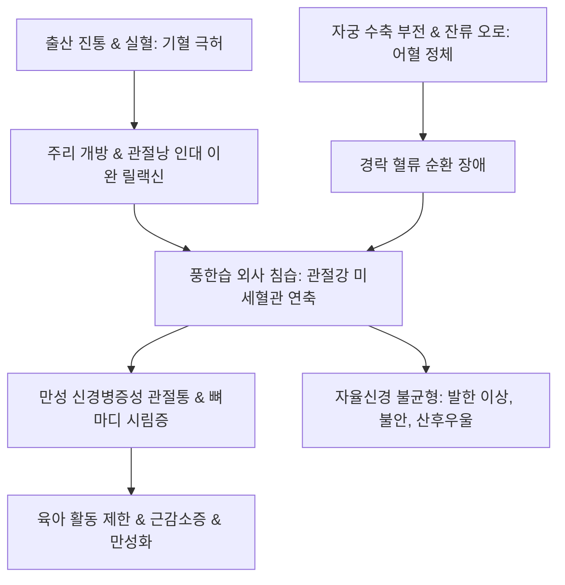

# 🩺 산후풍 (Postpartum Wind Syndrome / 産後風, Sanhupung)

> **핵심 3줄 요약 (Key Summary)**:
> - 📍 **정의 & 병태생리**: 분만 후 산욕기에 산모의 기혈이 극도로 소모되고 릴랙신(Relaxin) 호르몬에 의해 관절과 인대가 이완된 상태에서, 풍한습(風寒濕) 외사가 허약해진 경락과 관절강으로 침범하여 발생하는 전신 통증 및 자율신경 실조 증후군.
> - 🚩 **임상 양상**: 전신 관절통(손목, 무릎, 발목, 요배부), 시림증(뼈마디가 시리고 찬 바람이 들어오는 느낌), 전신 오한 및 발한 이상, 극심한 만성 피로, 산후 우울감.
> - 🛠️ **치료 원칙**: 생화탕을 통한 선어혈(先瘀血) 배출, 기혈 쌍보 및 거풍산한(祛風散寒)에 따른 [[보허탕]], [[팔진탕]], [[독활기생탕]], [[당귀작약산]], 약침 요법 및 관절 역학 재활.
> - ⚠️ **응급 의뢰 레드플래그**: 분만 후 고열(> 38℃), 오로 악취, 하복부 격통 동반 시 산욕기 패혈증(Puerperal sepsis) 또는 골반혈전정맥염 의심으로 즉시 상급병원 응급 전원의뢰 필요.

---

## 📌 목차
1. [질환 개요 & 해부학적 병태생리](#1-질환-개요--해부학적-병태생리)
2. [병태생리 메커니즘 & 생체역학·신경면역 악순환 네트워크](#2-병태생리-메커니즘--생체역학신경면역-악순환-네트워크)
3. [임상 증상 & 산후 관절 평가 알고리즘](#3-임상-증상--산후-관절-평가-알고리즘)
4. [감별 진단 매트릭스 (Differential Diagnosis)](#4-감별-진단-매트릭스-differential-diagnosis)
5. [한의 통합 치료 프로토콜 (침·약침·추나·한약)](#5-한의-통합-치료-프로토콜-침약침추나한약)
6. [양방 치료 & 통증 관리·류마티스 감별 기준 (Conventional Treatment & Referral)](#6-양방-치료--통증-관리류마티스-감별-기준-conventional-treatment--referral)
7. [산후 조리 & 관절 보호 티칭 가이드](#7-산후-조리--관절-보호-티칭-가이드)
8. [💡 사용자 진료실 핵심 필기 & 임상 노하우 (Melt-In 잔여 심화 집약)](#8-💡-사용자-진료실-핵심-필기--임상-노하우-melt-in-잔여-심화-집약)
9. [출처 및 학술 참고 문헌 (References)](#9-출처-및-학술-참고-문헌-references)

---

## 1. 질환 개요 & 해부학적 병태생리

### 1) 질환 정의 및 임상적 중요성
- **산후풍(産後風, Sanhupung)**: 출산 후 산모가 적절한 산후 조리를 하지 못하거나 찬 기운에 노출되어 관절통, 시림, 감각 이상, 피로, 자율신경 실조 등을 겪는 한국 전통의학 및 현대 통합의학적 산후 질환군이다.
- 산욕기(출산 후 6~8주) 동안 임신 전 상태로의 신체적 회복이 지연되며 만성 난치성 통증 및 섬유근통양 증후군으로 이행할 수 있다.

### 2) 분만 전후 해부학적 및 내분비 변화
- **릴랙신(Relaxin) 호르몬 효과**: 임신 중 분비된 릴랙신과 프로게스테론은 치골결합, 천장관절 및 전신 관절 인대를 극도로 이완시켜 출산을 가능하게 하나, 분만 후 3~5개월까지 인대 불안정성이 지속된다.
- **보행 및 골격 생체역학 변화**: 임신 중 복부 팽만과 골반 전방경사, 분만 후 수유 및 아기 안기로 인한 흉추 후만과 경항부·손목 관절 과부하가 결합한다.

---

## 2. 병태생리 메커니즘 & 생체역학·신경면역 악순환 네트워크

### 1) 산후 다허다어(多虛多瘀)의 병리
- **망혈상진(亡血傷津)**: 출산 시의 대량 실혈과 출산 진통으로 기혈과 진액이 극도로 고갈되어 주리(腠理, 땀구멍과 피부 장벽)가 열리고 체온조절 중추가 취약해짐.
- **어혈정체(瘀血停滯)**: 잔류 오로와 자궁 수축 부전으로 형성된 어혈이 경락을 막아 기혈 순환을 방해함.
- **풍한습사(風寒濕邪) 침범**: 허약해진 관절낭과 근막 틈새로 찬 기운과 습기가 침습하여 미세혈관을 수축시키고 한냉 과민증(Cold hypersensitivity)을 촉발함.

### 2) 산후풍 악순환 도식

---

## 3. 임상 증상 & 산후 관절 평가 알고리즘

### 1) 주요 임상 양상
- **관절 및 근골격 증상**: 드퀘르벵 건초염([[드퀘르벵 건초염]]), 손목·손가락 마디 통증, 무릎 통증, 요통, 골반통.
- **감각 및 자율신경 증상**: "에어컨이나 찬바람을 쐬면 뼈마디가 시리다", 두피나 허리가 차갑고 시림, 식은땀 후 오한, 전신 쇠약.
- **정신신경 증상**: 불면, 가슴 두근거림, 불안, 산후 우울.

### 2) 진단 평가 프로토콜
- **적외선 체열진단(DITI)**: 양측 관절 및 사지의 비정상적 저체온 음영(Cold pattern) 확인.
- **배제 혈액검사**: 류마티스 인자(RF), 항CCP 항체, ANA, ESR, CRP, 갑상선 기능(산후 갑상선염 배제).

---

## 4. 감별 진단 매트릭스 (Differential Diagnosis)

| 감별 질환 | 호발 기전 및 병력 | 핵심 검사 소견 | 산후풍과의 감별점 |
| :--- | :--- | :--- | :--- |
| **산후 류마티스 관절염** | 분만 후 면역 반동으로 자가면역 촉발 | RF/anti-CCP 양성, 관절 종창, 조조강직 > 1시간 | 활막염 및 골 미란 진행, 면역억제제 필요 |
| **산후 갑상선염** | 분만 후 1년 이내, 피로, 관절통 | TSH 변동, TPO 항체 양성 | 일시적 갑상선 중독증 후 저하증 경과 |
| **섬유근통(Fibromyalgia)** | 전신 만성 광범위 통증, 수면장애 | 압통점 양성, 염증수치 정상 | 찬바람에 대한 특이적 시림증보다 압통 주도 |
| **손목 건초염(드퀘르벵)** | 수유 및 아기 안기로 인한 무지 과사용 | 핑겔스타인 검사(Finkelstein) 양성 | 손목 국소 건초염으로 국한 |

---

## 5. 한의 통합 치료 프로토콜 (침·약침·추나·한약)

### 1) 단계별 한약 처방 프로토콜
- **1단계: 산후 1~2주 (생화탕기 — 활혈축어)**
  - 목표: 자궁 수축 촉진 및 잔류 오로 배출.
  - 대표 처방: [[생화탕]] 가감(당귀, 천궁, 도인, 포강, 자감초).
- **2단계: 산후 3~6주 이후 (보허기 — 기혈쌍보 & 거풍산한)**
  - 기혈허약형(氣血虛弱型): [[보허탕]], [[팔진탕]], [[십전대보탕]] 가감(인삼, 황기, 당귀, 백출).
  - 풍한습비형(風寒濕痺型 — 시림통 주도): [[독활기생탕]], [[오적산]], [[대방풍탕]] 가감(독활, 방풍, 계지, 진교, 세신).
  - 혈어신통형(血瘀身痛型): [[당귀작약산]], [[궁귀조혈음]] 가감.

### 2) 침구·약침 및 추나 치료
- **주요 혈위**: [[족삼리]](ST36), [[삼음교]](SP6), [[양릉천]](GB34), [[합곡]](LI4), [[태충]](LR3), [[관원]](CV4), [[신수]](BL23).
- **약침 치료**: 신수, 관원 및 관절 압통점에 자하거(胎盤) 약침 또는 녹용 약침 시술로 기혈 보충 및 관절 인대 재생.
- **산후 골반 추나**: 분만으로 변위된 골반대(치골결합, 천장관절)를 부드럽게 정렬하는 신연 교정.

---

## 6. 양방 치료 & 통증 관리·류마티스 감별 기준 (Conventional Treatment & Referral)

### 1) 보존적 통증 치료
- **아세트아미노펜 / NSAIDs (이부프로펜)**: 수유 안전성을 고려하여 단기간 간헐적 투여.
- **물리치료**: 파라핀욕, 온열 치료, 경피 신경 전기자극(TENS).

### 2) 전원 의뢰 기준
- 대칭성 관절 종창이 6주 이상 지속되거나 자가항체 양성 시 류마티스내과 협진.

---

## 7. 산후 조리 & 관절 보호 티칭 가이드

### 1) 체온 관리 및 환경 조성
- 실내 온도 22~24℃, 습도 50~60% 유지, 땀을 흠뻑 내는 무리한 과열 찜질 지양(탈수 및 기력 소모 방지), 얇은 긴소매 옷과 면양말 착용.

### 2) 관절 보호 인체공학
- 수유 쿠션을 활용하여 아기 무게를 지지하고 손목 꺾임 방지, 손목 보호대 착용.

---

## 8. 💡 사용자 진료실 핵심 필기 & 임상 노하우 (Melt-In 잔여 심화 집약)

### 1) 산후풍의 본질과 선어혈 후보허 원칙
- 산후풍은 단순한 근골격계 통증이 아니라, 분만으로 인한 기혈 대허(大虛)와 자궁 어혈(瘀血)이 기저에 깔려 있는 상태에서 풍한습 외사가 결합된 복합 질환이다.
- 따라서 출산 직후 무조건 보약([[보허탕]] 등)을 먼저 쓰면 잔류 오로가 체내에 정체되어 어혈성 산후풍을 악화시킬 수 있다.
- 반드시 첫 1~2주는 [[생화탕]]으로 오로를 완전히 배출시킨 후, 기혈을 쌍보하고 풍한을 몰아내는 보허 치료로 전환해야 부작용 없이 완치에 도달한다.

### 2) 시림증의 진료실 티칭 팁
- 산모가 호소하는 "뼈마디가 시리고 찬바람이 스며든다"는 증상은 신경병증성 냉각 과민 반응이다.
- 이때 환자가 뜨거운 방에서 땀을 억지로 빼면 기혈이 더욱 소진되어 시림증이 더 깊어지므로, 은은한 보온과 자하거 약침, 그리고 [[독활기생탕]] 계열의 한약으로 속을 데워주는 온중(溫中) 치료가 핵심이다.

---

## 9. 출처 및 학술 참고 문헌 (References)

Meyers. (2026). Gait biomechanics change during pregnancy and postpartum measured using markerless motion capture. *J Biomech*. PMID: 42860103.

Meyers. (2026). Foot Shape Changes During Pregnancy and Postpartum Are Associated With Patient Pain and Function. PMID: 42439597.

Kobayashi. (2026). Planned pregnancy after remission of anti-melanoma differentiation-associated gene 5 antibody-positive dermatomyositis-associated interstitial lung disease: More than 4 years of postpartum follow-up. *Mod Rheumatol Case Rep*. PMID: 42664192.
