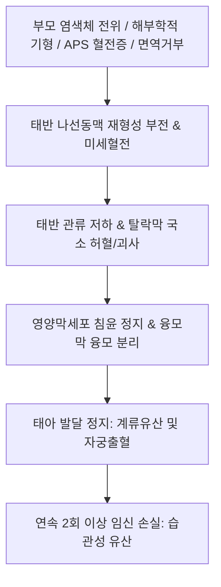

# 🩺 습관성 유산 (Recurrent Pregnancy Loss, RPL / 習慣性流産)

> **핵심 3줄 요약 (Key Summary)**:
> - 📍 **정의 & 병태생리**: 임신 20주 이전에 2회 또는 3회 이상 연속으로 자연 유산이 반복되는 병태. 부모 염색체 이상(상호 전위), 항인지질항체증후군(APS) 등 혈전성향증, 자궁 해부학적 기형(중격자궁, 아셔만), 내분비 질환(PCOS, 황체기 결함, 갑상선 자가면역), 면역학적 거부 반응이 주요 병인이다.
> - 🚩 **임상 양상**: 임신 확인 후 6~10주경 반복적인 태아 심박동 소실(계류유산), 질 출혈 및 하복통(절박유산), 반복 임신 실패로 인한 심리적 트라우마.
> - 🛠️ **치료 원칙**: 원인별 맞춤 치료(APS 환자에서 저용량 아스피린 + 저분자 헤파린 LMWH, 프로게스테론 보충, 중격 절제술), 한의학적으로 보신안태(補腎安胎)·건비고충(健脾固衝)에 따른 [[태산반석산]], [[수태환]], [[안태음]], [[당귀산]] 투여.
> - ⚠️ **응급 의뢰 레드플래그**: 임신 중 대량 질 출혈 및 쇼크, 패혈성 유산(Septic abortion: 고열, 오한, 화농성 질 분비물, 복막자극 징후) 발생 시 즉시 응급 산부인과 소파술 및 광범위 항생제 투여 의뢰.

---

## 📌 목차
1. [질환 개요 & 해부학적 병태생리](#1-질환-개요--해부학적-병태생리)
2. [병태생리 메커니즘 & 다요인 유산 네트워크](#2-병태생리-메커니즘--다요인-유산-네트워크)
3. [임상 증상 & 원인 규명 정밀 진단 알고리즘](#3-임상-증상--원인-규명-정밀-진단-알고리즘)
4. [감별 진단 매트릭스 (Differential Diagnosis)](#4-감별-진단-매트릭스-differential-diagnosis)
5. [한의 통합 치료 프로토콜 (침·약침·한약)](#5-한의-통합-치료-프로토콜-침약침한약)
6. [양방 치료 & 항응고·면역 치료 기준 (Conventional Treatment & Referral)](#6-양방-치료--항응고면역-치료-기준-conventional-treatment--referral)
7. [착상 후 생활 관리 & 심리적 지지 가이드](#7-착상-후-생활-관리--심리적-지지-가이드)
8. [💡 사용자 진료실 핵심 필기 & 임상 노하우 (Melt-In 잔여 심화 집약)](#8-💡-사용자-진료실-핵심-필기--임상-노하우-melt-in-잔여-심화-집약)
9. [출처 및 학술 참고 문헌 (References)](#9-출처-및-학술-참고-문헌-references)

---

## 1. 질환 개요 & 해부학적 병태생리

### 1) 질환 정의 및 진단 기준 변화
- **습관성 유산(Recurrent Pregnancy Loss, RPL)**: 과거에는 연속 3회 이상의 자연 유산으로 정의했으나, 최근 미국생식의학회(ASRM) 및 유럽생식의학회(ESHRE) 가이드라인은 **초음파상 확인된 임신 손실이 2회 이상 발생한 경우**부터 정밀 평가와 치료 개입을 권고한다.
- 가임기 여성의 약 1~2%에서 발생하며, 유산 횟수가 누적될수록 다음 임신의 유산율이 기하급수적으로 증가한다(2회 유산 후 약 25~30%, 3회 후 약 40~50%).

### 2) 착상 및 모체-태아 계면 해부학
- **영양막세포(Trophoblast) 침윤**: 배반포 영양막세포가 자궁내막 탈락막(Decidua)으로 침투하여 나선동맥을 재형성(Remodeling)해야 한다.
- **면역학적 관용(Immune tolerance)**: 부계 항원을 절반 지닌 태아(동종이식편)를 모체 면역계가 공격하지 않도록 조절 T세포(Treg)와 자궁 자연살해세포(uNK cell)의 관용 상태가 확립되어야 한다.

---

## 2. 병태생리 메커니즘 & 다요인 유산 네트워크

### 1) 5대 주요 병인론적 경로
1. **유전학적 요인 (3~5%)**: 부모의 염색체 상호 전위(Reciprocal translocation) 또는 로버트슨 전위 -> 감수분열 시 불균형 배아 형성.
2. **해부학적 요인 (10~15%)**: 선천성 중격자궁(Septate uterus), 자궁내막 유착증([[아셔만 증후군]]), 점막하 자궁근종([[자궁근종]]).
3. **면역 및 혈전 요인 (20%)**: 항인지질항체증후군(APS — 루푸스 항응고인자, 항카디오리핀 항체, 항베타2-GPI 항체)에 의한 태반 나선동맥 미세혈전증 및 경색.
4. **내분비 대사 요인 (15%)**: 황체기 결함, 조절되지 않는 당뇨병, 갑상선 자가면역(TPO 항체 양성), [[다낭성 난소 증후군]](PCOS).
5. **원인 불명 (Unexplained, 50% 이상)**: 모체-태아 면역 관용 파탄 및 배아 염색체 무작위 수적 이상(Aneuploidy).

### 2) 습관성 유산 병태생리 도식

---

## 3. 임상 증상 & 원인 규명 정밀 진단 알고리즘

### 1) 주요 임상 양상
- 임신 6~8주경 태아 심박동 미확인 또는 확인 후 정지.
- 무증상 계류유산(초음파로 우연히 발견)이 최다이며, 일부에서 암갈색 출혈 또는 복통 동반.

### 2) 1차 및 2차 정밀 검사 패널
- **부모 염색체 검사**: 부부 말초혈액 염색체 핵형 분석(Karyotyping).
- **자궁 해부학적 평가**: 3D 골반 초음파, 식염수주입자궁초음파(SIS), 자궁경 검사.
- **항인지질항체 패널 (12주 간격 2회 양성 확인)**: Lupus anticoagulant, Anticardiolipin IgG/IgM, Anti-beta2-glycoprotein I IgG/IgM.
- **내분비 검사**: TSH, Free T4, TPO 항체, HbA1c, 프로락틴, 황체기 프로게스테론.

---

## 4. 감별 진단 매트릭스 (Differential Diagnosis)

| 감별 질환 | 호발 특징 및 검사 소견 | 치료 대책 |
| :--- | :--- | :--- |
| **항인지질항체증후군(APS)** | 자가항체 12주 간격 2회 양성 | 저용량 아스피린 + LMWH 저분자 헤파린 병용 |
| **선천성 중격자궁(Septate)** | 자궁강 중앙 섬유성 중격 확인 | 자궁경하 중격 절제술(Hysteroscopic metroplasty) |
| **부모 염색체 균형 전위** | 부부 염색체 핵형 분석상 이상 | 착상 전 유전 검사(PGT-SR) 연계 시험관아기 |
| **갑상선 기능 이상/자가면역** | TSH 상승 또는 TPO 항체 양성 | 레보티록신(씬지로이드) 보충 치료 |
| **원인 불명성(Unexplained)** | 모든 표준 검사상 정상 소견 | 지지적 상담(TLC) 및 한의 보신안태 한약 투여 |

---

## 5. 한의 통합 치료 프로토콜 (침·약침·한약)

### 1) 단계별 한약 처방 프로토콜
- **임신 전 준비기 (착상 환경 개선 — 3개월 전)**:
  - 신허형(腎虛型): [[수태환]], [[육미지황탕]], [[귀신환]] 가감(토사자, 상기생, 속단, 아교).
  - 기혈허약형(氣血虛弱型): [[태산반석산]], [[팔진탕]] 가감.
  - 혈어형(血瘀型): [[당귀작약산]], [[도홍사물탕]] 가감.
- **임신 확인 후 안태기 (임신 4주~12주 — 안태지혈)**:
  - 대표 처방: [[태산반석산]](泰山磐石散), [[안태음]](安胎飮), [[당귀산]](當歸散) 가감.
  - 방제 핵심: 백출, 황금(황금은 청열안태, 백출은 건비안태), 두충, 속단, 상기생으로 자궁 수축을 억제하고 충임맥을 튼튼히 고정.

### 2) 침구 치료 프로토콜
- **주요 혈위**: [[족삼리]](ST36), [[백회]](GV20), [[내관]](PC6), [[신수]](BL23), [[태계]](KI3).
- **주의사항**: 임신 중 자궁 수축을 촉발할 수 있는 금침혈([[합곡]], [[삼음교]], [[견정]], [[곤륜]])은 엄격히 배제.

---

## 6. 양방 치료 & 항응고·면역 치료 기준 (Conventional Treatment & Referral)

### 1) 표준 약물 요법
- **APS 환자**: 임신 시도기부터 저용량 아스피린(100 mg/일) 복용 + 임신 확인 즉시 저분자 헤파린(Enoxaparin 40 mg 피하주사 일일 1회) 병용 투여.
- **황체기 결함 환자**: 질식 미분화 프로게스테론(Utrogestan 질정 400 mg/일) 임신 10~12주까지 투여.

### 2) 수술적 치료
- 자궁경하 중격 절제술로 자궁강 용적 복원.

---

## 7. 착상 후 생활 관리 & 심리적 지지 가이드

### 1) 지지적 치료(Tender Loving Care, TLC)
- 원인 불명 습관성 유산 환자에서 의료진의 잦은 초음파 확인과 따뜻한 심리적 지지만으로도 다음 임신 성공률이 70~80%에 도달함이 입증됨.

### 2) 생활 제한 지양
- 과도한 절대 안정보체(Bed rest)는 오히려 하지 정맥혈전증 위험을 높이므로 일상적인 가벼운 산책 권장.

---

## 8. 💡 사용자 진료실 핵심 필기 & 임상 노하우 (Melt-In 잔여 심화 집약)

### 1) 습관성 유산의 병리적 본질: 태원불고(胎元不固)
- 한의학에서 습관성 유산은 활태(滑胎)라 부르며, 신기(腎氣)가 허하여 태아를 붙잡아 매는 힘이 약해지고(충임불고), 비기(脾氣)가 허하여 기혈을 올려 보내지 못해 발생한다.
- 따라서 임신이 확인된 후 치료를 시작하면 늦으며, 반드시 임신 전 최소 2~3개월간 부부가 함께 신정을 보하고 자궁내막 미세순환을 개선하는 사전 조리가 치료 성패를 가른다.

### 2) 태산반석산과 황금·백출의 안태 묘미
- 장개빈의 명방인 [[태산반석산]]은 팔진탕의 기혈쌍보 구조에 황금, 속단, 사인을 배합한 처방이다.
- 주단계의 "황금과 백출은 안태의 성약(黃芩白朮 安胎之聖藥)"이라는 말처럼, 백출은 비위를 튼튼히 하여 태반에 영양을 공급하고 황금은 임신 중 발생하는 태열(胎熱)과 국소 염증을 가라앉혀 자궁 수축을 방지하는 탁월한 약리 기전을 발휘한다.

---

## 9. 출처 및 학술 참고 문헌 (References)

Zhe. (2026). Performance of large language models combined with clinical decision support for recurrent pregnancy loss management. *Gynecol Obstet Invest*. PMID: 42905619.

Cavalcante. (2026). Clinical management of recurrent pregnancy loss: a critical assessment of international guidelines. *Eur J Obstet Gynecol Reprod Biol*. PMID: 42893678.

Behrendt-Møller. (2026). Certainty of Evidence and Strength of Recommendations for Immunotherapy in the 2025 American Society for Reproductive Immunology Guideline on Recurrent Pregnancy Loss. *Am J Reprod Immunol*. PMID: 42934092.
