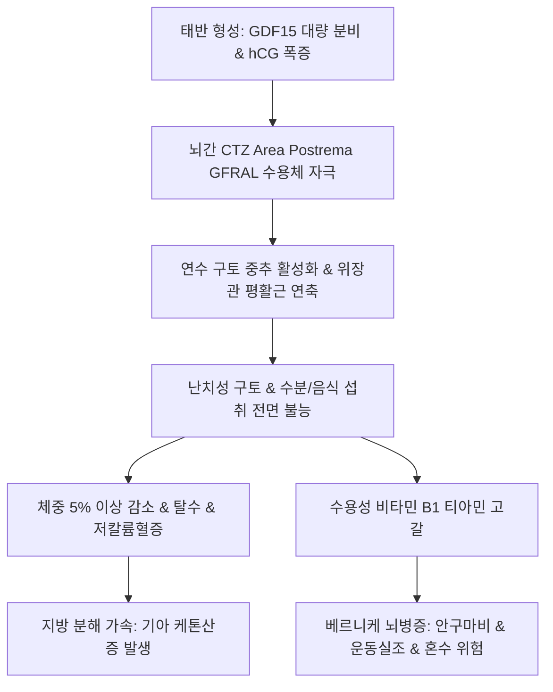

# 🩺 임신 오조 (Hyperemesis Gravidarum, HG / 姙娠惡阻)

> **핵심 3줄 요약 (Key Summary)**:
> - 📍 **정의 & 병태생리**: 임신 초기(대개 4~9주 시작) 발생하는 단순 입덧(Nausea and Vomiting of Pregnancy, NVP)의 극단적 형태로, 지속적이고 심한 구토로 인해 임신 전 체중의 5% 이상 감소, 탈수, 케톤뇨, 전해질 불균형을 초래하는 중증 산과 질환. 태반 호르몬(hCG, 에스트로겐) 급증과 태반 발현 식욕억제인자 GDF15 감수성이 핵심 인자이다.
> - 🚩 **임상 양상**: 음식물 및 물조차 삼키지 못하는 난치성 구토, 구갈, 현훈, 기립성 저혈압, 피부 긴장도 저하, 케톤 구취, 전신 쇠약.
> - 🛠️ **치료 원칙**: 정맥 수액 요법(탈수 교정) 및 **베르니케 뇌병증 예방을 위한 비타민 B1(티아민) 선행 투여**, 항구토제(독실라민-피리독신, 온단세트론), 한의학적으로 비위허약(脾胃虛弱)·위기상역(胃氣上逆) 변증에 따른 [[보생탕]], [[이진탕]], [[소반하가복령탕]], [[반하후박탕]] 처방 및 내관(PC6) 자침/지압.
> - ⚠️ **응급 의뢰 레드플래그**: 심한 구토 후 의식 혼미, 안구진탕(Nystagmus), 보행 실조(Ataxia) 동반 시 비타민 B1 고갈로 인한 급성 베르니케 뇌병증(Wernicke's encephalopathy) 의심으로 즉시 응급실 이송 및 고용량 티아민 정맥투여 필수.

---

## 📌 목차
1. [질환 개요 & 해부학적 병태생리](#1-질환-개요--해부학적-병태생리)
2. [병태생리 메커니즘 & GDF15·화학수용체 악순환 네트워크](#2-병태생리-메커니즘--gdf15화학수용체-악순환-네트워크)
3. [임상 증상 & PUQE 점수 평가 알고리즘](#3-임상-증상--puqe-점수-평가-알고리즘)
4. [감별 진단 매트릭스 (Differential Diagnosis)](#4-감별-진단-매트릭스-differential-diagnosis)
5. [한의 통합 치료 프로토콜 (침·약침·한약)](#5-한의-통합-치료-프로토콜-침약침한약)
6. [양방 치료 & 수액·비타민 보충·입원 기준 (Conventional Treatment & Referral)](#6-양방-치료--수액비타민-보충입원-기준-conventional-treatment--referral)
7. [식이 섭취 & 구토 유발 차단 가이드](#7-식이-섭취--구토-유발-차단-가이드)
8. [💡 사용자 진료실 핵심 필기 & 임상 노하우 (Melt-In 잔여 심화 집약)](#8-💡-사용자-진료실-핵심-필기--임상-노하우-melt-in-잔여-심화-집약)
9. [출처 및 학술 참고 문헌 (References)](#9-출처-및-학술-참고-문헌-references)

---

## 1. 질환 개요 & 해부학적 병태생리

### 1) 질환 정의 및 중증도
- **임신 오조(Hyperemesis Gravidarum, HG)**: 임산부의 70~80%가 겪는 일반적 입덧과 달리, 전체 임신의 약 0.3~2%에서 발생하는 중증 영양·대사 부전 질환이다.
- 단순 구역질을 넘어 지속적인 구토로 수분 및 음식 섭취가 전면 차단되어 산모의 체중 감소, 전해질 이상(저칼륨혈증, 저나트륨혈증), 대사성 알칼리증 또는 기아 케톤산증을 초래한다.

### 2) 화학수용체 유발대와 위장관 해부학
- **구토 중추(Area Postrema)**: 연수 제4뇌실 바닥에 위치하며 뇌혈관장벽(BBB)이 결손되어 혈액 내 순환 물질을 직접 감지하는 화학수용체 유발대(CTZ)가 존재한다.
- **위전도(Electrogastrography) 이상**: 임신 호르몬에 의해 위 평활근 운동성이 저하되고 위 부정맥(Gastric dysrhythmia: 빈위증 또는 서위증)이 촉발된다.

---

## 2. 병태생리 메커니즘 & GDF15·화학수용체 악순환 네트워크

### 1) 최신 신경내분비 병인 기전
- **GDF15 (Growth Differentiation Factor 15)**: 태반의 영양막세포에서 대량 합성되어 모체 혈액으로 분비되는 사이토카인으로, 뇌간의 GFRAL 수용체에 결합하여 강력한 오심, 구토, 섭식 억제를 유발한다. 임신 전 GDF15 농도가 낮았던 여성이 임신 중 태반 유래 고농도 GDF15에 노출될 때 중증 HG가 발생한다.
- **hCG 및 에스트로겐의 시너지**: hCG 농도가 정점에 달하는 임신 8~11주에 오조 증상이 가장 극심하며, 다태 임신이나 포상기태에서 빈발한다.
- **티아민(비타민 B1) 고갈 위험**: 기아 상태에서 포도당 수액만 투여하면 체내 잔존 티아민이 탄수화물 대사에 전량 소모되어 뇌간 및 유두체 손상(베르니케 뇌병증)이 촉발된다.

### 2) 임신 오조 병태생리 도식

---

## 3. 임상 증상 & PUQE 점수 평가 알고리즘

### 1) 주요 임상 양상
- 하루 종일 지속되는 심한 구역질 및 일 5~10회 이상의 담즙성/위액성 구토.
- 음식 냄새, 치약 냄새, 특정 향에 대한 극단적인 후각 과민.
- 구강 점막 건조, 안구 함몰, 기립성 빈맥 및 혈압 강하.

### 2) PUQE 점수 (Pregnancy-Unique Quantification of Emesis)
- 지난 24시간 동안의 ① 구역 지속 시간, ② 구토 횟수, ③ 헛구역질 횟수를 1~5점으로 평가 (총점 3~15점):
  - 경도: 3~6점 / 중등도: 7~12점 / **중증: 13~15점 (HG 의심 및 입원 고려)**.
- 혈액/소변 검사: 소변 케톤체(Ketone ≥ 2+), 전해질, BUN/Cr, 간기능(AST/ALT 경도 상승 가능).

---

## 4. 감별 진단 매트릭스 (Differential Diagnosis)

| 감별 질환 | 호발 특징 및 증상 양상 | 감별 핵심 검사 | 임신 오조와의 차이점 |
| :--- | :--- | :--- | :--- |
| **단순 입덧 (NVP)** | 임신 6~12주, 간헐적 구역질 | 체중 감소 < 5%, 소변 케톤 음성 | 탈수나 전해질 이상 없음 |
| **포상기태 (Molar pregnancy)** | 임신 주수 대비 자궁 과다 비대 | 초음파 눈보라(Snowstorm) 상, hCG > 10만 | 비정상 태반 증식 질환 |
| **급성 충수염 / 담낭염** | 국소 하복통/우상복통, 발열 | 백혈구 증가증, 복부 초음파 | 심한 국소 복통 및 압통 동반 |
| **위장관 감염증 (장염)** | 설사, 발열, 오한 동반 | 대변 배양, 급성 발병 후 단기간 경과 | 설사가 동반되며 임신과 무관 |
| **갑상선기능항진증(Grave's)** | 갑상선종대, 안구돌출, 심계항진 | TSH 저하, Free T4 상승, TSHR 항체 | 자가면역 갑상선 질환 |

---

## 5. 한의 통합 치료 프로토콜 (침·약침·한약)

### 1) 변증별 한약 처방 프로토콜
- **비위허약(脾胃虛弱) / 위허불화(胃虛不和)**:
  - 주증: 음식 섭취 시 즉시 구토, 구토물 맑고 묽음, 안색 창백, 극심한 무기력, 설담태백, 맥완약.
  - 대표 처방: [[보생탕]](保生湯), [[소반하가복령탕]], 육군자탕 가감(백출, 인삼, 복령, 진피, 반하, 생강).
  - 치법: 건비온위(健脾溫胃), 강역지구(降逆止嘔).
- **간위불화(肝胃不和) / 간열범위(肝熱犯胃)**:
  - 주증: 냄새만 맡아도 헛구역질, 쓴 물(담즙) 구토, 구갈, 가슴 답답함, 트림, 설홍태황, 맥현삭.
  - 대표 처방: [[이진탕]] 합 좌금환(左金丸), [[반하후박탕]] 가감(반하, 황련, 오수유, 죽여, 생강).
  - 치법: 청간화위(淸肝和胃), 강역지구(降逆止嘔).
- **담습조체(痰濕阻滯)**:
  - 주증: 구토물 끈적한 가래, 어지럼증, 가슴 창만, 설태 백니, 맥활.
  - 대표 처방: [[이진탕]], [[소반하탕]] 가감.
  - 치법: 조습화담(燥濕化痰), 화위화중(和胃和中).

### 2) 침구 치료 및 지압 요법 (세계적 근거 확립)
- **주요 혈위**: [[내관]](PC6), [[족삼리]](ST36), [[중완]](CV12), [[공손]](SP4).
- **내관혈(PC6) 지압 및 자침**: 손목 주름 상방 2촌 장장근건과 노쪽손목굽힘근건 사이의 내관혈 자침은 CTZ 구토 반사를 강력히 억제함이 다수의 무작위대조시험(RCT)으로 입증됨.

---

## 6. 양방 치료 & 수액·비타민 보충·입원 기준 (Conventional Treatment & Referral)

### 1) 응급 정맥 수액 프로토콜
- **티아민 선행 투여 필수**: **포도당 함유 수액 투여 전, 반드시 비타민 B1(Thiamine 100 mg 정맥 또는 근육주사)**을 투여하여 베르니케 뇌병증 예방.
- **수액 요법**: 0.9% 생리식염수 또는 하트만액을 투여하여 탈수와 전해질(K+, Na+) 보충.

### 2) 단계별 항구토 약물 요법
- **1차 약제**: 피리독신(비타민 B6, 10~25 mg) + 독실라민(Doxylamine 10~12.5 mg) 복합제 (디클렉틴 등).
- **2차 약제**: 메토클로프라미드(Reglan), 프로메타진.
- **3차 약제 (난치성)**: 온단세트론(Ondansetron, 5-HT3 수용체 길항제).

---

## 7. 식이 섭취 & 구토 유발 차단 가이드

### 1) 소량 빈식 및 건식 식이
- 아침 기상 직후 마른 크래커, 토스트 등을 소량 섭취하여 공복감 해소.
- 음식과 수분 섭취를 분리(식사 중 국물 섭취 지양, 식간 30분에 미지근한 물 한 모금씩 섭취).

### 2) 생강(Ginger) 요법
- 하루 1g 미만의 생강차 또는 생강 캔디 섭취로 위장 운동성 정상화.

---

## 8. 💡 사용자 진료실 핵심 필기 & 임상 노하우 (Melt-In 잔여 심화 집약)

### 1) 입덧과 임신 오조의 임상적 분기점
- 입덧은 임신 초기의 생리적 적응 과정이나, 체중이 5% 이상 줄어들고 소변 검사상 케톤이 검출되면 이는 단순 입덧이 아니라 산모와 태아를 위협하는 응급 질환인 임신 오조이다.
- 환자가 물조차 넘기지 못할 때는 한약 탕약을 무리하게 복용시키려 하지 말고, 우선 산부인과에 의뢰하여 정맥 수액과 티아민 주사로 탈수를 교정해야 한다.

### 2) 내관혈(PC6)과 이침의 즉각적 위력
- 구토로 약을 삼키지 못하는 산모에게 침치료는 가장 훌륭한 비약물 요법이다.
- 양측 내관(PC6)혈 자침과 함께 귀의 위(Stomach), 분문(Cardia), 신문(Shenmen)점에 피내침(이침)을 유치하고 지압을 티칭하면 구토 횟수와 오심 강도가 신속히 반감된다.
- 증상이 완화되어 음수(飮水)가 가능해지는 시점에 [[보생탕]]이나 [[이진탕]]에 생강즙을 타서 한 숟가락씩 천천히 복용시키면 비위가 안정화된다.

---

## 9. 출처 및 학술 참고 문헌 (References)

Mills. (2026). Experiences of psychological burden and care in women with hyperemesis gravidarum and nausea and vomiting in pregnancy: a mixed-methods systematic review. *Midwifery*. PMID: 42660075.

Wang. (2026). Acupuncture combined with auriculotherapy as adjunctive therapy for hyperemesis gravidarum: A randomized controlled trial evaluating hospital stay, relapse rate, and quality of life. *Complement Ther Med*. PMID: 42887805.

Coffey. (2026). Hyperemesis gravidarum and oral health: A scoping review. *Int J Gynaecol Obstet*. PMID: 41918341.
