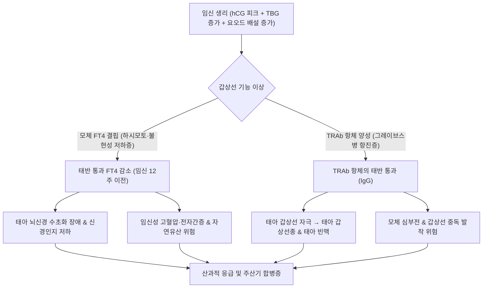

# 🩺 임신 중 갑상선 질환 (Thyroid Disorders in Pregnancy)

> **핵심 3줄 요약 (Key Summary)**:
> - 📍 병소 부위 & 해부·병태생리: 임신 중 에스트로겐 상승에 따른 갑상선글로불린(TBG) 증가, 인간융모막성선자극호르몬(hCG)의 TSH 수용체 교차 자극 및 태반을 통한 요오드 배설 증가로 모체 갑상선 호르몬 요구량이 30~50% 증가함. 임신 초기(임신 12~14주 이전) 태아는 자체 갑상선이 기능하지 않아 전적으로 모체의 유리 T4(FT4)에 뇌신경계 발달을 의존함.
> - 🚩 전형적 임상 양상: 저하증(극심한 피로, 체중 과다 증가, 한사 불내성, 부종, 인지기능 저하), 항진증(빈맥, 심계항진, 열감, 체중 감소 또는 증가 미달, 진전, 임신오조 악화).
> - 🛠️ 핵심 검사 & 치료 전략: 임신 분기별 특이 TSH 및 FT4 참고치 적용, 항TPO 항체, TRAb 측정. 저하증 시 레보티록신(LT4) 즉각 증량 투여, 항진증(그레이브스병) 시 임신 제1삼분기 PTU, 제2삼분기 이후 MMI로의 전환.
> - ⚠️ 응급 의뢰 레드플래그: 갑상선 중독 발작(Thyroid Storm: 고열, 중증 빈맥, 부정맥, 섬망), 임신 초기 중증 현성 저하증 방치(태아 신경인지 발달 지체, 조산, 유산, 사산 위험), 태아 갑상선종 및 울혈성 심부전 징후.

---

## 📌 목차
1. [질환 개요 & 해부학적 병태생리](#1-질환-개요--해부학적-병태생리)
2. [병태생리 메커니즘 & 생체역학적 악순환 네트워크](#2-병태생리-메커니즘--생체역학적-악순환-네트워크)
3. [임상 증상 & 이학적 검사(Physical Exam) 알고리즘](#3-임상-증상--이학적-검사physical-exam-알고리즘)
4. [감별 진단 매트릭스 (Differential Diagnosis)](#4-감별-진단-매트릭스-differential-diagnosis)
5. [한의 통합 치료 프로토콜 (침·약침·추나·한약)](#5-한의-통합-치료-프로토콜-침약침추나한약)
6. [양방 치료 & 병용·의뢰 기준 (Conventional Treatment & Referral)](#6-양방-치료--병용의뢰-기준-conventional-treatment--referral)
7. [재활 운동 & 생활습관 티칭 가이드](#7-재활-운동--생활습관-티칭-가이드)
8. [💡 사용자 진료실 핵심 필기 & 임상 노하우 (Melt-In 잔여 심화 집약)](#8--사용자-진료실-핵심-필기--임상-노하우--melt-in-잔여-심화-집약)
9. [출처 및 학술 참고 문헌 (References)](#9-출처-및-학술-참고-문헌-references)

---

## 1. 질환 개요 & 해부학적 병태생리

![[임신중갑상선질환_01_갑상선조직.png|450]]
> [그림 1: 정상 갑상선 조직(H&E) — 콜로이드가 가득 찬 여포(follicle)가 원형으로 배열된 모습. 임신 중에는 hCG가 TSH 수용체를 자극해 생리적으로 TSH가 낮아지므로, 임신 초기 갑상선 기능 평가는 임신 특이 참고치로 해석해야 한다 — 출처: Wikimedia Commons — File:Histology of Thyroid gland.jpg (CC BY-SA 4.0)]

임신 중 갑상선 질환은 임신으로 인한 독특한 내분비·면역학적 변화 속에서 모체와 태아 모두에게 지대한 영향을 미치는 질환군이다. 임신 중 모체의 갑상선 호르몬 이상은 자연유산, 전자간증(임신중독증), 조산, 태반 조기 박리, 저체중아 출산 및 태아의 비가역적인 중추신경계 발달 장애(지능 저하)를 초래할 수 있다.

### 임신 생리와 갑상선 기능의 3대 변화
1. **혈청 TBG(Thyroxine-Binding Globulin)의 급증**:
   - 태반에서 분비되는 고농도 에스트로겐의 자극으로 간에서의 TBG 합성이 증가하고 청소율이 감소하여 혈중 TBG가 2~3배 상승함.
   - 이에 따라 총 T4(TT4) 및 총 T3(TT3)는 비임신 시보다 1.5배가량 증가하므로, 반드시 **유리 T4(Free T4)**와 분기별 TSH로 평가해야 함.
2. **hCG(인간융모막성선자극호르몬)의 갑상선 자극 작용**:
   - hCG 분자의 $\alpha$-아단위는 TSH와 동일하며, $\beta$-아단위도 상동성을 가짐.
   - 임신 8~11주경 hCG가 정점에 달할 때 TSH 수용체를 교차 자극하여 일시적인 FT4 상승과 TSH 억제가 관찰됨(임신성 일과성 갑상선중독증).
3. **태아-태반 단위의 호르몬 교환 및 요오드 대사**:
   - 신혈류량 및 사구체여과율(GFR) 증가로 신장을 통한 요오드 배설이 증가하고, 태반을 통해 요오드와 호르몬이 태아로 이행되므로 일일 요오드 권장량이 $250\mu\text{g}$으로 증가함.
   - **태아 갑상선 형성**: 태아는 임신 10~12주경부터 요오드를 농축하고 18~20주경에야 자체 갑상선 호르몬을 충분히 분비하므로, **임신 제1삼분기의 태아 뇌 발달은 100% 모체의 FT4 공급에 의존**함.

---

## 2. 병태생리 메커니즘 & 생체역학적 악순환 네트워크

### 1) 갑상선기능저하증 (Hypothyroidism) 병태생리
- **원인**: [[하시모토 갑상선염]](자가면역성, 항TPO 항체 양성)이 가장 흔하며, 요오드 결핍 또는 갑상선 절제술 후 발생.
- **모체 및 태아에 미치는 악영향**:
  - 모체의 FT4 부족 $\rightarrow$ 태아 뇌세포의 증식, 뉴런 이동, 수초화(Myelination) 장애 $\rightarrow$ 출생 후 영구적 신경인지 결손 및 낮은 IQ.
  - 모체 혈관 저항 증가 및 이완기 고혈압 $\rightarrow$ 임신성 고혈압 및 [[전자간증]] 발생률 3배 증가.
  - 태반 허혈 및 박리, 주산기 사망률 증가.

### 2) 갑상선기능항진증 (Hyperthyroidism) 병태생리
- **원인**: [[그레이브스병]](Graves' disease, 자가면역성 TRAb 항체 매개)과 임신성 일과성 갑상선독증(Gestational transient thyrotoxicosis, GTT: hCG 매개).
- **합병증 네트워크**:
  - 모체: 울혈성 심부전, 부정맥, 갑상선 중독 발작(Thyroid storm).
  - 태아: 모체의 자극성 TRAb(TSH receptor antibody)가 태반을 통과(IgG 형태)하여 태아 갑상선을 자극 $\rightarrow$ 태아 갑상선종(Goiter), 태아 빈맥($>160\text{ bpm}$), 자궁 내 성장 지연(IUGR), 조산.

---

## 3. 임상 증상 & 이학적 검사(Physical Exam) 알고리즘

![[임신중갑상선질환_02_선천성갑상선기능저하.png|450]]
> [그림 2: 선천성 갑상선기능저하증 영아 실사 — 얼굴이 넓고 부어 있으며 혀가 커 보이고 콧대가 낮은 전형적 소견. 임신 중 모체 갑상선호르몬 부족이 태아 신경 발달에 영향을 줄 수 있음을 보여주는 대표 사진이다 — 출처: Wikimedia Commons — File:CDpic1.png (CC BY 2.5)]

![[임신중갑상선질환_03_점액수종얼굴.png|450]]
> [그림 3: 점액수종(myxedema) 얼굴 실사 — 눈꺼풀과 볼이 부어 있고 표정이 둔해진 무표정한 얼굴, 피부가 건조하고 거칠어진 모습. 갑상선기능저하증의 전형적 안면 소견이다 — 출처: Wikimedia Commons — File:Myxedema face.png (CC BY 2.5)]

### 1) 주요 임상 증상
- **임신 중 갑상선기능저하증**:
  - 정상 임신 증상(피로, 변비, 체중 증가)과 겹쳐 간과되기 쉬움.
  - 뚜렷한 무기력, 심한 한사 불내성(추위 탐), 부종, 서맥, 피부 건조, 탈모, 근육경련.
- **임신 중 갑상선기능항진증**:
  - 안정 시 지속되는 빈맥($>100\text{ bpm}$), 손 떨림(Tremor), 열감, 다한증, 식욕 증가에도 체중 감소 또는 정체, 잦은 배변, 수면장애.
  - 안구 돌출증, 전경부 미만성 갑상선종(Goiter) 및 혈류 잡음(Bruit).

### 2) 진단 검사 및 알고리즘 (ATA 2026 가이드라인)
1. **혈청 TSH 및 Free T4 (분기별 임신 특이 기준치 적용)**:
   - 각 기관별 기준치가 없을 경우 일반적 가이드라인:
     - 제1삼분기 (1~12주): TSH $0.1\sim 2.5\text{ mIU/L}$ (또는 $4.0\text{ mIU/L}$).
     - 제2삼분기 (13~27주): TSH $0.2\sim 3.0\text{ mIU/L}$.
     - 제3삼분기 (28~40주): TSH $0.3\sim 3.5\text{ mIU/L}$.
2. **갑상선 자가항체 검사**:
   - **항TPO 항체 (Anti-TPO Ab)**: 하시모토병 확인. 양성인 경우 불현성 저하증(TSH $2.5\sim 4.0\text{ mIU/L}$)에서도 유산 방지를 위해 적극적 치료 권고.
   - **TSH 수용체 항체 (TRAb / TBII)**: 그레이브스병 감별 및 태아 갑상선독증 예측(임신 24~28주 추적).
3. **방사선 검사 금기**:
   - 임신 중 **방사성 요오드 섭취율(RAIU) 및 갑상선 스캔은 태아 갑상선 파괴 위험으로 절대 금기**. 초음파 검사로 형태학적 평가 대체.

---

## 4. 감별 진단 매트릭스 (Differential Diagnosis)

| 감별 질환 | 호발 시기 및 병인 | TSH / FT4 검사 소견 | TRAb / 항TPO 항체 | 감별 핵심 포인트 |
| :--- | :--- | :--- | :--- | :--- |
| **임신 중 [[그레이브스병]]** | 임신 전부터 또는 임신 초기, 자가면역 | TSH 현저히 억제, FT4 현저히 상승 | **TRAb 양성 (95% 이상)** | 안병증, 미만성 갑상선종 잡음, 항갑상선제(PTU/MMI) 투여 필요 |
| **임신성 일과성 갑상선독증 (GTT)** | 임신 8~12주 (hCG 피크 시기) | TSH 억제, FT4 경도~중등도 상승 | **TRAb 음성** | 심한 임신오조(Hyperemesis) 동반, 임신 14~18주경 저절로 정상화 (치료 불필요) |
| **임신 중 [[하시모토 갑상선염]]** | 전 임신 기간, 자가면역성 파괴 | TSH 상승, FT4 저하 또는 정상 | **항TPO 항체 양성** | 태아 신경 발달 보호 위해 즉각적인 레보티록신 투여 |
| **산후 갑상선염 (Postpartum Thyroiditis)** | 분만 후 1~6개월 이내 면역 반동 | 파괴성 중독기(1~2개월) $\rightarrow$ 저하증(2~6개월) $\rightarrow$ 회복 | 항TPO 항체 양성 (80%) | 분만 후 일시적 경과, TRAb 음성, 방사성 요오드 스캔(수유 중단 후) 감별 |
| **정상 임신의 생리적 변화** | 임신 전 기간 | TSH 정상 범위, FT4 정상 (TBG 상승) | 자가항체 음성 | 주관적 피로 외 객관적 검사상 정상 |

---

## 5. 한의 통합 치료 프로토콜 (침·약침·추나·한약)

> ⚠️ **임산부 대상 안전 수칙 및 한계 설정**:
> 임신 중 갑상선 호르몬 수치 불균형은 태아 뇌 발달과 유산에 직결되므로, **호르몬 대체요법(레보티록신) 및 항갑상선제 복용을 절대 임의 중단시켜서는 안 되며 내분비내과·산부인과와의 긴밀한 공조 하에 진행**한다.
> 한의 치료는 **임신 중 모체의 자율신경계 안정, 입덧(임신오조) 경감, 부종 및 소화불량 완화, 안태(安胎) 보조 요법**을 중심으로 안전하게 시행한다.

### 1) 침구 치료 프로토콜
- **안태(安胎) 및 자율신경 조절**:
  - [[내관]](PC6), [[공손]](SP4): 심포경·비경의 기혈을 조절하여 임신오조, 심계항진, 구역감 진정.
  - [[족삼리]](ST36), [[백회]](GV20): 기운을 북돋우고(보기) 무기력증과 피로 개선.
  - [[신수]](BL23), [[태계]](KI3): 선천 신정(腎精)을 보하고 태원(胎元)을 공고히 함.
- ⛔ **임산부 금침혈 (금기)**:
  - 자궁 수축을 유발하는 [[합곡]](LI4), [[삼음교]](SP6), [[견정]](GB21), [[지음]](BL67), 하복부 혈위([[관원]], [[기해]])는 **자침 엄격 금지**.

### 2) 약침 치료 (안전성 중심)
- 임신 중 약침은 원칙적으로 보수적으로 접근하며, 전신 순환 개선 목적으로 [[신수]](BL23) 또는 흉추 배수혈에 저용량 태반(자하거) 약침(0.2~0.3cc)을 조심스럽게 활용하여 모체 기혈 보강.

### 3) 한약 처방 (임신 중 안전한 안태 한약)
- **비신양허(脾腎陽虛)형 갑상선기능저하증 (부종, 피로, 소화불량, 냉증)**:
  - **수태환(壽胎丸)** 합 **보중익기탕(補中益氣湯) 가감**:
  - 신기를 보하고 태아를 안정시키며 비위 기운을 진작함.
  - 처방 구성: [[토사자]], [[상기생]], [[속단]], [[아교]], [[황기]], [[백출]], [[당귀]], [[진피]], [[감초]].
- **간울화화(肝鬱化火) 및 음허화왕(陰虛火旺)형 경도 갑상선항진증 (심계, 불안, 번열)**:
  - **가미소요산(加味逍遙散)** 또는 **안태음(安胎飮) 가감**:
  - 간열을 내리고 기를 소통시키며 혈맥을 안정시킴.
  - 처방 구성: [[백작약]], [[당귀]], [[백출]], [[복령]], [[시호]], [[목단피]], [[치자]], [[황금]], [[백출]]. (황금과 백출은 대표적인 한방 안태지제安胎之劑).

---

## 6. 양방 치료 & 병용·의뢰 기준 (Conventional Treatment & Referral)

![[임신중갑상선질환_04_갑상선호르몬제.png|450]]
> [그림 4: 갑상선호르몬 제제 실사 — 왼쪽이 T3(리오티로닌, Cynomel 0.025 mg), 오른쪽이 T4(레보티록신) 정제. 임신 중 갑상선기능저하증 치료는 T4(레보티록신) 단독 요법이 원칙이며 용량은 임신 중 20~30% 정도 증량이 필요할 수 있다 — 출처: Wikimedia Commons — File:Thyroid hormone pills - left T3 - right T4.jpg (CC0)]

### 1) 갑상선기능저하증 약물 치료 (ATA 2026 Guidelines)
- **레보티록신 (Levothyroxine, LT4, 씬지로이드 / 씬지록신)**:
  - **목표 TSH**: 임신 제1삼분기 $<2.5\text{ mIU/L}$, 제2·3삼분기 $<3.0\text{ mIU/L}$.
  - 기존 복용자: 임신 확인 즉시 주당 복용량을 20~30% 증량 (주 2회 하루 2알 복용 또는 매일 증량).
  - 신규 진단자: 전신 저하증 시 체중당 $1.6\sim 2.0\mu\text{g/kg/day}$ 투여.
  - 철분제 및 칼슘제와의 상호작용: 임산부 철분제는 LT4 흡수를 방해하므로 **최소 4시간 이상 간격을 두고 복용**.

### 2) 갑상선기능항진증 약물 치료 (그레이브스병)
- **항갑상선제 선택 (최기형성 vs 간독성 균형)**:
  - **임신 제1삼분기 (임신 12주까지)**: **프로필티오우라실 (PTU)** 우선 사용 (메티마졸의 선천성 기형(Aplasia cutis, 후비공 폐쇄) 위험 회피).
  - **임신 제2삼분기 이후 (16주 이후)**: **메티마졸 (MMI)**로 교체 고려 (PTU의 치명적 산모 전격성 간부전 부작용 회피).
  - 치료 목표: 태아 갑상선기능저하증을 유발하지 않도록 **모체 FT4를 정상 상한치 또는 경도 상승 수준**으로 유지하는 최소 유효 용량 투여.

### 3) 양방·전문과 응급 의뢰 기준 (Referral Criteria)
- 🚨 **즉각적인 내분비내과 및 고위험 산모 센터 전원**:
  - 산모가 심한 고열, 섬망, 심방세동, 구토를 동반한 **갑상선 중독 발작(Thyroid storm)** 의심 시.
  - 임신 초기 TSH $> 10\text{ mIU/L}$의 중증 현성 저하증이 발견된 경우.
  - TRAb 항체 역가가 기준치의 3배 이상으로 높아 태아 갑상선종, 태아 빈맥, 태아 수종이 의심될 때.

---

## 7. 재활 운동 & 생활습관 티칭 가이드

### 1) 임산부 요오드 영양 관리
- **WHO / ATA 권장 섭취량**: 임신 및 수유기 여성은 **하루 $250\mu\text{g}$의 요오드 섭취 권장**.
- **과다 섭취 주의**: 한국 임산부의 경우 미역국을 하루 수차례 과도하게 섭취하여 일일 수천 $\mu\text{g}$의 요오드에 노출되는 경우가 흔함. 과도한 요오드는 볼프-차이코프 효과(Wolff-Chaikoff effect)로 태아 갑상선 기능 저하 및 갑상선종을 유발할 수 있으므로, 적정량 섭취 지도.

### 2) 생활 및 심신 안정
- 가벼운 산책과 임산부 요가를 통한 자율신경 안정 및 스트레스 완화.
- 철분제, 칼슘제, 비타민제와 갑상선 호르몬제의 복용 시간표를 철저히 분리하여 티칭.

---

## 8. 💡 사용자 진료실 핵심 필기 & 임상 노하우 (Melt-In 잔여 심화 집약)

### 1) "임신 준비 중인데 씬지로이드를 먹어도 되나요?"에 대한 확답
- 진료실에서 가장 흔한 임산부의 불안은 "갑상선약(씬지로이드)이 태아에게 기형을 유발하지 않을까?"이다.
- 이에 대해 한의사는 명확하고 단호하게 안심시켜야 한다:
  - **"씬지로이드는 인공 화학 독약이 아니라, 엄마 몸에서 만들어져 아기 뇌로 가야 할 바로 그 호르몬을 채워주는 필수 영양소와 같습니다."**
  - 약을 중단하는 것이야말로 아기의 뇌 발달에 치명적인 손상을 입히는 위험천만한 행동임을 명백히 티칭해야 한다.

### 2) 출산 후 '산후풍'으로 오인되는 산후 갑상선염
- 출산 후 3~6개월경 산모가 극심한 관절통, 오한, 탈모, 우울감, 부종을 호소하며 한의원에 내원할 때 단순 '산후풍'이나 '산후우울증'으로만 넘겨짚어서는 안 된다.
- 산후 갑상선염(Postpartum Thyroiditis)의 저하증기일 가능성이 매우 높으므로 반드시 TSH와 FT4 혈액 검사를 의뢰해야 한다.

---

## 9. 출처 및 학술 참고 문헌 (References)

1. Thyroid Disorders during Pregnancy and Puerperal Periods: A Narrative Review. (2026). *Z Geburtshilfe Neonatol*, 230(5):. PMID: 42785367.

2. Navigating the RCOG 2025 and ATA 2026 guideline updates on the management of thyroid disorders during pregnancy. (2026). *Case Rep Womens Health*, 47:e00751. PMID: 42698877.

3. American Thyroid Association 2026 Guidelines for Thyroid Disease in Preconception, Pregnancy, and Postpartum. (2026). *Thyroid*, 36(5):. PMID: 42219800.

---

## 관련 노트

- [[하시모토 갑상선염]]
- [[그레이브스병]]
- [[전자간증]]
- [[내관]]
- [[공손]]
- [[족삼리]]
- [[백회]]
- [[신수]]
- [[태계]]
- [[황기]]
- [[백출]]
- [[당귀]]
- [[진피]]
- [[감초]]
- [[토사자]]
- [[상기생]]
- [[속단]]
- [[아교]]
- [[백작약]]
- [[시호]]
- [[복령]]
- [[황금]]
- [[치자]]
- [[수태환]]
- [[보중익기탕]]
- [[가미소요산]]
- [[안태음]]
