# 🩺 임신 중 고혈압 (Hypertensive Disorders of Pregnancy, HDP)

> **핵심 3줄 요약 (Key Summary)**:
> - 📍 병소 부위 & 해부·병태생리: 자궁 나선동맥(Spiral arteries)의 불완전한 영양막세포 리모델링으로 인한 태반 허혈, 항혈관형성 인자(sFlt-1) 과잉 분비 및 전신 모체 혈관내피세포 기능 부전(Endothelial dysfunction), 다발성 장기 관류 저하.
> - 🚩 전형적 임상 양상: 4대 아형(만성 고혈압, 임신성 고혈압, 전자간증-자간증, 만성 고혈압에 병합된 전자간증). 수축기혈압 $\ge 140\text{ mmHg}$ 또는 이완기혈압 $\ge 90\text{ mmHg}$, 단백뇨, 심한 두통, 시야 장애, 심와부 통증, 급격한 부종.
> - 🛠️ 핵심 검사 & 치료 전략: 혈압 재측정(최소 4시간 간격), 소변 단백/크레아티닌 비율(UPCR), 혈소판 수, AST/ALT, 크레아티닌, 태아 도플러 초음파. 혈압 조절제(라베탈롤, 니페디핀, 메틸도파) 및 자간증 예방을 위한 황산마그네슘($\text{MgSO}_4$). 근본 치료는 적절한 시기의 분만(Delivery).
> - ⚠️ 응급 의뢰 레드플래그: 중증 전자간증 기준(혈압 $\ge 160/110\text{ mmHg}$, 심한 불응성 두통, 시야 흐림/암점, 상복부/우상복부 통증, 폐부종), HELLP 증후군(용혈, 간효소 상승, 혈소판 감소 $<100,000/\mu\text{L}$), 자간증(전신 강직-간대 발작), 태반 조기 박리.

---

## 📌 목차
1. [질환 개요 & 해부학적 병태생리](#1-질환-개요--해부학적-병태생리)
2. [병태생리 메커니즘 & 생체역학적 악순환 네트워크](#2-병태생리-메커니즘--생체역학적-악순환-네트워크)
3. [임상 증상 & 이학적 검사(Physical Exam) 알고리즘](#3-임상-증상--이학적-검사physical-exam-알고리즘)
4. [감별 진단 매트릭스 (Differential Diagnosis)](#4-감별-진단-매트릭스-differential-diagnosis)
5. [한의 통합 치료 프로토콜 (침·약침·추나·한약)](#5-한의-통합-치료-프로토콜-침약침추나한약)
6. [양방 치료 & 병용·의뢰 기준 (Conventional Treatment & Referral)](#6-양방-치료--병용의뢰-기준-conventional-treatment--referral)
7. [재활 운동 & 생활습관 티칭 가이드](#7-재활-운동--생활습관-티칭-가이드)
8. [💡 사용자 진료실 핵심 필기 & 임상 노하우 (Melt-In 잔여 심화 집약)](#8--사용자-진료실-핵심-필기--임상-노하우--melt-in-잔여-심화-집약)
9. [출처 및 학술 참고 문헌 (References)](#9-출처-및-학술-참고-문헌-references)

---

## 1. 질환 개요 & 해부학적 병태생리

임신 중 고혈압(Hypertensive Disorders of Pregnancy, HDP)은 전 세계 모성 및 주산기 사망과 유병률의 주요 원인 중 하나로, 전체 임신의 약 5~10%에서 발생한다. 단순한 혈압 상승을 넘어 모체의 뇌, 간, 신장, 심혈관계 및 태반-태아 단위 전체를 침범하는 다발성 전신 혈관 장애이다.

### 임신성 고혈압 질환군의 4대 임상 분류 (ACOG 기준)
1. **만성 고혈압 (Chronic Hypertension)**:
   - 임신 전부터 고혈압이 있었거나, **임신 20주 이전**에 발견된 수축기 $\ge 140\text{ mmHg}$ 또는 이완기 $\ge 90\text{ mmHg}$의 고혈압. 분만 후 12주 이상 지속됨.
2. **임신성 고혈압 (Gestational Hypertension)**:
   - **임신 20주 이후**에 처음 발생한 고혈압으로, 단백뇨나 기타 전자간증의 중증 장기 손상 소견이 없음. 분만 후 12주 이내 정상화됨.
3. **[[전자간증]] 및 자간증 (Preeclampsia & Eclampsia)**:
   - 임신 20주 이후 고혈압과 함께 **단백뇨($\ge 300\text{ mg/day}$ 또는 UPCR $\ge 0.3$)**가 동반되거나, 단백뇨가 없더라도 혈소판 감소증, 신기능 저하, 간기능 이상, 폐부종, 뇌신경 증상(두통, 시야 장애) 중 하나 이상이 동반된 상태.
   - **자간증(Eclampsia)**: 전자간증 환자에서 다른 신경과적 원인 없이 전신 강직-간대 발작(Seizure) 또는 혼수가 발생한 초응급 상태.
4. **만성 고혈압에 병합된 전자간증 (Chronic Hypertension with Superimposed Preeclampsia)**:
   - 기존 만성 고혈압 산모에서 임신 20주 이후 갑작스러운 단백뇨 발생, 혈압의 급격한 악화, 또는 혈소판 감소·간수치 상승 등 장기 기능 부전이 겹치는 경우.

---

## 2. 병태생리 메커니즘 & 생체역학적 악순환 네트워크

### 1) 2단계 병태생리 모델 (Two-Stage Model)
1. **제1단계: 태반 형성 이상 (Placental Malperfusion)**
   - 정상 임신에서는 태아 혈관영양막세포(Cytotrophoblast)가 모체 자궁 탈락막 및 근층의 **나선동맥(Spiral artery)** 내막으로 침투하여, 굵고 저항이 낮은 고유량 혈관으로 재형성(Remodeling)함.
   - 전자간증에서는 영양막세포 침투가 불완전하여 나선동맥이 좁고 꼬인 고저항 혈관으로 남아 지속적인 **태반 허혈 및 저산소증(Hypoxia)**을 유발함.
2. **제2단계: 모체 전신 혈관내피세포 기능 부전 (Maternal Endothelial Dysfunction)**
   - 허혈된 태반에서 항혈관형성 인자인 **sFlt-1 (soluble fms-like tyrosine kinase-1)** 및 soluble Endoglin(sEng)이 혈중으로 대량 방출됨.
   - sFlt-1은 모체 혈관내피세포의 생존과 항상성에 필수적인 VEGF(혈관내피성장인자) 및 PlGF(태반성장인자)를 포획·중화함.
   - 결과적으로 전신 모체 혈관내피세포가 파괴되어 산화질소(NO) 및 프로스타사이클린 분비 감소, 엔도텔린-1 증가 $\rightarrow$ 전신 혈관 수축, 모세혈관 누출(혈관 투과성 증가 $\rightarrow$ 부종, 단백뇨), 미세혈전 형성.

```mermaid
flowchart TD
    A["자궁 나선동맥 리모델링 부전"] --> B["태반 허혈 & 산화 스트레스"]
    B --> C["항혈관형성 인자 (sFlt-1, sEng) 대량 분비"]
    
    C --> D["모체 전신 순환: VEGF / PlGF 차단"]
    D --> E["전신 모체 혈관내피세포 기능 부전 (Endothelial Injury)"]
    
    E --> F["전신 혈관 연축 → 중증 고혈압"]
    E --> G["신장 사구체 모세혈관 내피증 → 단백뇨 & 신부전"]
    E --> H["혈소판 활성화 및 소비 → 혈소판 감소증 & HELLP"]
    E --> I["뇌 모세혈관 투과성 증가 & 혈관성 뇌부종 → 두통, 시야장애, 자간 발작"]
    
    F & G & H & I --> J["모체-태아 생명 위협 (응급 분만 적응증)"]
```

---

## 3. 임상 증상 & 이학적 검사(Physical Exam) 알고리즘

### 1) 주요 임상 증상
- **초기 무증상**: 정기 산전 진찰 중 우연히 발견되는 혈압 상승.
- **중증 징후 (Imminent Preeclampsia Symptoms)**:
  - **신경학적 증상**: 통상적인 진통제에 반응하지 않는 심한 욱신거리는 전두부/후두부 두통, 눈앞이 번쩍임(Scotoma), 시야 흐림, 복시.
  - **상복부 증상**: 심와부(명치) 또는 우상복부의 쥐어짜는 듯한 통증(글리슨막 신장에 의한 간 허혈/출혈 징후), 오심, 구토.
  - **호흡기계 증상**: 흉부 압박감, 호흡곤란, 앙와위 호흡 불능(폐부종 징후).
  - **급격한 체중 증가**: 일주일에 $2\text{ kg}$ 이상의 급격한 체중 증가 및 안면, 손가락 부종.

### 2) 이학적 검사 및 진단 검사 알고리즘
1. **혈압 측정 표준화**:
   - 환자를 10분간 안정시킨 후 좌위에서 적절한 크기의 커프로 측정. 최소 4시간 간격으로 2회 이상 $\ge 140/90\text{ mmHg}$ 확인.
   - 단, $\ge 160/110\text{ mmHg}$인 경우 뇌출혈 예방을 위해 수 분 간격으로 재확인 후 즉시 응급 처치.
2. **혈액 및 소변 검사 (전자간증 패널)**:
   - **단백뇨**: 소변 단백/크레아티닌 비율(UPCR) $\ge 0.3\text{ mg/mg}$ 또는 24시간 요단백 $\ge 300\text{ mg}$.
   - **CBC**: 혈소판 수 ($< 100,000/\mu\text{L}$ 여부), 혈색소/헤마토크릿(혈장 유출로 인한 농축).
   - **간기능**: AST, ALT 정상 상한치의 2배 이상 상승, LDH 상승, 총 빌리루빈 상승.
   - **신장기능**: 혈청 크레아티닌 $> 1.1\text{ mg/dL}$ 또는 기저치의 2배 증가.
3. **태아 평가**:
   - 비수축검사(NST), 양수지수(AFI), 제대동맥 도플러 초음파(태반 저항 증가 및 이완기 혈류 역류 관찰).

---

## 4. 감별 진단 매트릭스 (Differential Diagnosis)

| 감별 질환 | 발병 시기 | 단백뇨 유무 | 간수치 / 혈소판 이상 | 감별 핵심 포인트 |
| :--- | :--- | :--- | :--- | :--- |
| **임신성 고혈압** | 임신 20주 이후 | **없음** | 정상 | 일과성 혈압 상승, 장기 손상 없음, 분만 후 정상화 |
| **[[전자간증]]** | 임신 20주 이후 | **있음 (또는 장기 손상)** | 동반 가능 (혈소판 감소 등) | 혈압 $\ge 140/90$ + 단백뇨 또는 두통/간기능 이상 |
| **HELLP 증후군** | 임신 27~37주경 호발 | 흔히 동반됨 | **용혈(LDH$\uparrow$), AST/ALT$\uparrow$, 혈소판$<10$만** | 미세혈관병성 용혈성 빈혈, 상복부 격통, 초응급 질환 |
| **만성 고혈압** | 임신 20주 이전 | 대개 없음 (신질환 시 제외) | 정상 | 임신 전부터 존재, 분만 후에도 지속 |
| **임신 급성 지방간 (AFLP)** | 임신 제3삼분기 후반 | 가변적 | 간효소 상승, **심한 저혈당, 응고장애(DIC)** | 고혈압보다 심한 황달, 저혈당, 뇌증이 주 증상 |

---

## 5. 한의 통합 치료 프로토콜 (침·약침·추나·한약)

> ⚠️ **임산부 고혈압 안전 관리의 절대 원칙**:
> 임신 중 고혈압은 모체 뇌출혈, 태반 조기 박리, 자간 발작, 태아 사망을 유발할 수 있는 고위험 산과 합병증이다. **중등도 이상의 고혈압($\ge 140/90\text{ mmHg}$) 및 전자간증 의심 산모에 대한 단독 한의 치료는 절대 금기**이며, 반드시 산부인과 주치의와의 협진 및 혈압 약물 복용 하에서만 **스트레스 완화, 경미한 부종 조절, 자율신경 안정 목적의 보조 요법**으로 극히 제한적으로 적용한다.

### 1) 침구 치료 프로토콜
- **자율신경계 안정 및 청열평간(淸熱平肝)**:
  - [[태충]](LR3): 간양상항(肝陽上亢)을 평정하고 두통, 어지럼증 완화 (임산부의 경우 강자극을 피하고 극천자).
  - [[내관]](PC6): 흉민, 심계, 오심 진정, 자율신경 균형 조절.
  - [[백회]](GV20), [[풍지]](GB20): 두경부 혈관 경직 완화 및 혈압 안정 (부드러운 지압 및 천자).
  - [[족삼리]](ST36): 보기건비, 수습 대사 원활화.
- ⛔ **임산부 절대 금침혈 준수**:
  - [[합곡]](LI4), [[삼음교]](SP6), [[견정]](GB21), [[지음]](BL67), 하복부 혈위는 자궁 수축 및 조산 위험으로 **절대 침을 놓지 않는다**.

### 2) 한약 처방 (임신 중 변증별 보조 처방)
- **간양상항(肝陽上亢)형 (임신 후기 두통, 어지럼증, 안면 홍조, 신경과민)**:
  - **천마구등음(天麻鉤藤飮) 가감**:
  - 간양을 가라앉히고 혈압을 안정시킴.
  - 구성: [[천마]], [[구등]], [[석결명]], [[산치자]], [[황금]], [[우슬]](초우슬로 저용량 사용 또는 제외), [[두충]], [[상기생]], [[야교등]], [[복신]].
- **기체습저·비허수종(氣滯濕沮·脾虛水腫)형 (임신 후기 사지 부종, 소변 불리, 흉민)**:
  - **백출산(白朮散, 전씨백출산)** 또는 **안태음(安胎飮) 가미방**:
  - 비기를 건전하게 하여 부종을 내리고 태아를 보호함.
  - 구성: [[백출]], [[복령]], [[진피]], [[생강]], [[대추]], [[당귀]], [[백작약]], [[상기생]], [[소엽]].

---

## 6. 양방 치료 & 병용·의뢰 기준 (Conventional Treatment & Referral)

### 1) 강압 약물 치료 (Antihypertensive Agents)
- **치료 목표**: 산모의 뇌혈관 질환(뇌출혈) 및 심혈관 손상을 예방하면서도, 태반 관류압을 유지하기 위해 혈압을 **수축기 130~140 mmHg, 이완기 80~90 mmHg** 수준으로 조절 (급격한 강압으로 인한 태아 곤란증 방지).
- **1차 선택 경구 강압제**:
  - **라베탈롤 (Labetalol)**: 알파/베타 차단제. 안전성과 효과가 가장 입증됨.
  - **니페디핀 서방정 (Nifedipine ER)**: 지속성 칼슘 통로 차단제(CCB).
  - **메틸도파 (Methyldopa)**: 중추성 알파-2 효능제 (장기 안전성 확립, 진정 부작용).
- ⛔ **임신 중 절대 금기 약물**:
  - **[[ACEI]](ACE 억제제)** 및 **[[ARB]](안지오텐신 수용체 차단제)**: 태아 신장 무형성증, 신부전, 양수과소증, 두개골 형성 부전, 자궁 내 사망을 유발하므로 **절대 금기**.
  - 이뇨제(Thiazide, Furosemide): 모체 혈장량을 감소시켜 태반 혈류를 악화시키므로 폐부종을 제외하고는 원칙적 금기.

### 2) 응급 강압 및 경련 예방 요법
- **중증 고혈압($\ge 160/110\text{ mmHg}$) 응급 처치**:
  - Labetalol 정주 또는 Hydralazine 정주, Nifedipine 캡슐 투여.
- **황산마그네슘 ($\text{MgSO}_4$, Magnesium Sulfate)**:
  - 중증 전자간증 및 자간증 환자에서 **경련(발작) 예방 및 치료의 골드 스탠다드**.
  - 로딩 도즈 4~6g IV 후 1~2g/hr 유지 (슬개건 반사, 호흡수, 소변 배출량 엄격 감시).

### 3) 고위험군 아스피린 예방 요법
- 전자간증 고위험 산모(과거 전자간증력, 다태임신, 만성 고혈압, 당뇨병, 자가면역질환):
  - **임신 12~16주부터 매일 저용량 아스피린 (100~150mg) 복용** (태반 혈류 개선 및 전자간증 발생률 50% 이상 감소).

### 4) 절대적 응급 분만 적응증 (Delivery Timing)
- 전자간증의 유일한 완치법은 **태반과 태아의 분만**이다:
  - 37주 이상: 진단 즉시 분만 고려.
  - 34주 이전이라도 산모의 생명이 위협받는 경우(불응성 중증 고혈압, 자간 발작, 폐부종, 파종성 혈관내 응고 DIC, 태반 조기 박리, 태아 가사)에는 주수에 관계없이 즉각 분만 진행.

---

## 7. 재활 운동 & 생활습관 티칭 가이드

### 1) 가정 혈압 측정 및 조기 경보
- **규칙적 자가 혈압 측정**: 아침·저녁 2회 측정하여 수첩에 기록.
- **체위 지도**: 안정 시 **좌측와위(Left lateral position)** 권장 (하대정맥 압박을 완화하여 심박출량과 자궁-태반 혈류량 극대화).
- **염분 섭취**: 일반 고혈압과 달리 임신성 고혈압 환자에게 **극단적인 저염식은 혈장량을 과도하게 감소시킬 수 있으므로 권장하지 않으며**, 정상 수준의 균형 잡힌 식단 지도.

### 2) 응급 징후 자가 체크 교육
- 산모에게 "심한 두통, 눈앞에 불꽃이 튀거나 흐려짐, 명치 통증"이 발생하면 진통제를 먹고 기다리지 말고 그 즉시 산부인과 응급실로 가도록 반복 교육.

---

## 8. 💡 사용자 진료실 핵심 필기 & 임상 노하우 (Melt-In 잔여 심화 집약)

### 1) "임신 후기 붓는 것은 다 자연스러운 것 아닌가요?"에 대한 경각심
- 많은 산모들이 다리가 붓는 것을 단순한 임신 후기 부종으로 방치하다가 전자간증을 놓친다.
- 생리적 부종은 주로 오후에 종아리와 발목에 국한되고 휴식 후 호전된다.
- 그러나 **아침에 일어났을 때 반지가 전혀 들어가지 않을 정도로 손가락이 퉁퉁 붓거나, 얼굴과 눈꺼풀이 부어오르는 부종(Facial & Hand edema)**은 모세혈관 누출의 명백한 신호이므로 즉시 혈압 측정과 단백뇨 검사를 받도록 해야 한다.

### 2) 명치 통증(우상복부 통증)을 소화불량으로 오진하지 말 것
- 임신 30주 전후 산모가 "명치 끝이 쥐어짜듯 아프고 체한 것 같다"고 한의원에 내원했을 때, 임신 중 식적(食積)으로 오인하여 소화제를 처방하는 것은 극도로 위험하다.
- 이는 간 피막(Glisson's capsule) 아래 출혈이나 간 효소 급상승을 시사하는 **중증 전자간증 또는 HELLP 증후군의 전조 증상**일 수 있으므로 즉시 혈압을 재고 응급 전원해야 한다.

---

## 9. 출처 및 학술 참고 문헌 (References)

1. Hypertensive Disorders in Pregnancy: A Comparative Analysis of Clinical Guidelines Across Six High-Income Countries. (2026). *Birth*, 53(5):. PMID: 42702894.

2. Home Versus Clinic Blood Pressure Monitoring in Women with Hypertensive Disorders of Pregnancy: A Systematic Review and Meta-Analysis. (2026). *J Clin Med*, 15(16):. PMID: 42652599.

3. Lactation as a targeted intervention for hypertensive disorders in pregnancy: understanding the cardioprotective relationship. (2026). *Expert Rev Cardiovasc Ther*, 24(10):. PMID: 42743915.

---

## 관련 노트

- [[전자간증]]
- [[태충]]
- [[내관]]
- [[백회]]
- [[풍지]]
- [[족삼리]]
- [[천마]]
- [[구등]]
- [[석결명]]
- [[산치자]]
- [[황금]]
- [[두충]]
- [[상기생]]
- [[백출]]
- [[복령]]
- [[진피]]
- [[당귀]]
- [[백작약]]
- [[천마구등음]]
- [[안태음]]
- [[ACEI]]
- [[ARB]]
