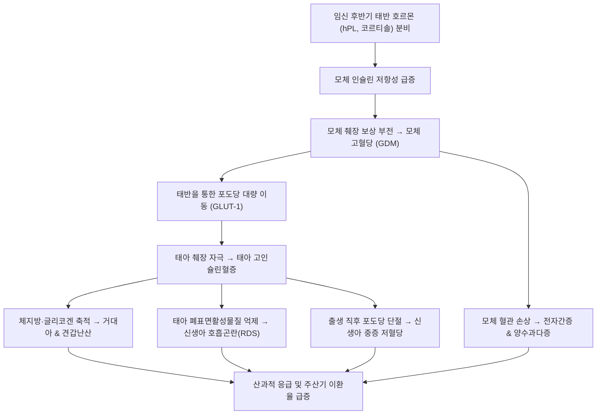

# 🩺 임신 중 당뇨병 (Diabetes Mellitus in Pregnancy)

> **핵심 3줄 요약 (Key Summary)**:
> - 📍 병소 부위 & 해부·병태생리: 태반 호르몬(인간태반락토겐 hPL, 코르티솔, 프로게스테론, 태반 인슐린분해효소)에 의한 생리적 인슐린 저항성 급증을 모체 췌장 $\beta$-세포의 대상성 인슐린 분비 증가가 따라가지 못해 고혈당 유발. 모체 고혈당의 태반 통과 $\rightarrow$ 태아 고인슐린혈증 $\rightarrow$ 거대아(Macrosomia) 및 장기 비대.
> - 🚩 전형적 임상 양상: 대개 무증상으로 산전 선별검사에서 발견. 양수과다증, 태아 과성장(자궁저고 증가), 피로, 갈증, 빈뇨, 반복적인 칸디다 질염.
> - 🛠️ 핵심 검사 & 치료 전략: 임신 24~28주 50g 경구 당부하 선별검사(GCT) 및 100g 3시간 확진 검사(또는 IADPSG 75g 원스텝 검사). 1차 치료는 철저한 의학영양요법(MNT) 및 운동, 목표 혈당(공복 $<95\text{ mg/dL}$, 식후 1시간 $<140$, 2시간 $<120$) 미달 시 인슐린 요법 즉시 개시.
> - ⚠️ 응급 의뢰 레드플래그: 당뇨병성 케톤산증(DKA: 산모와 태아 사망률 급증, 정상 혈당 DKA 주의), 태아 절박 가사(Fetal distress), 심한 양수과다증에 의한 조기 양막 파수, 분만 중 견갑난산(Shoulder dystocia) 위험, 출생 직후 신생아 중증 저혈당 및 호흡곤란증후군(RDS).

---

## 📌 목차
1. [질환 개요 & 해부학적 병태생리](#1-질환-개요--해부학적-병태생리)
2. [병태생리 메커니즘 & 생체역학적 악순환 네트워크](#2-병태생리-메커니즘--생체역학적-악순환-네트워크)
3. [임상 증상 & 이학적 검사(Physical Exam) 알고리즘](#3-임상-증상--이학적-검사physical-exam-알고리즘)
4. [감별 진단 매트릭스 (Differential Diagnosis)](#4-감별-진단-매트릭스-differential-diagnosis)
5. [한의 통합 치료 프로토콜 (침·약침·추나·한약)](#5-한의-통합-치료-프로토콜-침약침추나한약)
6. [양방 치료 & 병용·의뢰 기준 (Conventional Treatment & Referral)](#6-양방-치료--병용의뢰-기준-conventional-treatment--referral)
7. [재활 운동 & 생활습관 티칭 가이드](#7-재활-운동--생활습관-티칭-가이드)
8. [💡 사용자 진료실 핵심 필기 & 임상 노하우 (Melt-In 잔여 심화 집약)](#8--사용자-진료실-핵심-필기--임상-노하우--melt-in-잔여-심화-집약)
9. [출처 및 학술 참고 문헌 (References)](#9-출처-및-학술-참고-문헌-references)

---

## 1. 질환 개요 & 해부학적 병태생리

임신 중 당뇨병은 크게 **임신 전 당뇨병(Pregestational Diabetes: 당뇨병 환자가 임신한 경우)**과 **임신성 당뇨병(Gestational Diabetes Mellitus, GDM: 임신 중 처음 발견되거나 진단된 당대사 장애)**으로 분류된다. 임신성 당뇨병은 전체 임신의 약 6~10%에서 발생하며, 고령 임신과 비만 산모의 증가로 유병률이 급격히 증가하고 있다.

### 해부·생리학적 태반-태아 단위의 당대사 변화
1. **임신 제2·3삼분기의 인슐린 저항성 생리**:
   - 태반이 성장함에 따라 분비되는 **인간태반락토겐(hPL, human Placental Lactogen)**, 프로게스테론, 코르티솔, 태반 성장호르몬, TNF-$\alpha$ 등 항인슐린 호르몬이 모체의 인슐린 감수성을 50~70% 떨어뜨림.
   - 이는 모체의 포도당 소모를 억제하여 태아에게 우선적으로 포도당을 공급하기 위한 진화적 기전이나, 모체 췌장의 인슐린 분비 대상 능력이 부족한 경우 고혈당으로 이어짐.
2. **페데르센 가설(Pedersen Hypothesis)과 태아 과성장**:
   - 포도당은 촉진확산(Facilitated diffusion, GLUT1)을 통해 태반을 자유롭게 통과하지만, 모체의 인슐린은 태반을 통과하지 못함.
   - 모체의 고혈당 $\rightarrow$ 태아 순환 내 고혈당 유발 $\rightarrow$ 임신 10~12주부터 형성된 태아 췌장 $\beta$-세포 자극 $\rightarrow$ **태아 고인슐린혈증(Fetal Hyperinsulinemia)** 유도.
   - 인슐린은 강력한 동화(Anabolic) 및 성장인자로 작용하여 체지방 축적, 근육 증식, 장기 비대(간비대, 심근비대)를 유도하여 **거대아(Macrosomia, 출생체중 $\ge 4.0\text{ kg}$)**를 형성함.

---

## 2. 병태생리 메커니즘 & 생체역학적 악순환 네트워크

![[임신중당뇨병_01_인슐린포도당대사.png|450]]
> [그림 1: 인슐린과 포도당 대사 도해 — 인슐린이 수용체에 결합하면 GLUT4 운반체가 세포막으로 이동해 포도당이 세포 안으로 들어가고, 남은 포도당은 글리코겐·피루브산·지방산으로 저장·전환된다. 임신 중에는 태반 호르몬이 이 인슐린 작용을 방해해 인슐린 저항성이 커진다 — 출처: Wikimedia Commons — File:Insulin glucose metabolism.jpg (CC BY-SA 3.0)]

### 1) 모체 및 태아의 병태생리학적 연쇄 손상
- **모체 합병증**:
  - 혈관내피 손상으로 인한 [[전자간증]] 발생 위험 3~4배 증가.
  - 양수과다증(Hydramnios: 태아 고혈당에 의한 삼투성 이뇨 $\rightarrow$ 조기 양막 파수 및 조산 위험).
  - 거대아 출산에 따른 제왕절개율 증가, 산도 열상, 산후 출혈.
  - 장기적으로 출산 후 5~10년 이내 제2형 [[당뇨병]] 발병률 50% 육박.
- **태아 및 신생아 합병증**:
  - **견갑난산 (Shoulder Dystocia)**: 머리는 통과했으나 과도하게 발달한 어깨가 치골결합에 걸려 상완신경총 마비(Erb palsy) 또는 쇄골 골절 초래.
  - **신생아 저혈당증 (Neonatal Hypoglycemia)**: 출생 직후 탯줄 결찰로 모체의 고농도 포도당 공급은 차단되나, 태아 자체의 고인슐린 분비는 지속되어 급격한 저혈당($<40\text{ mg/dL}$) 및 경련 발생.
  - **신생아 호흡곤란증후군 (RDS)**: 고농도 인슐린이 제2형 폐포세포의 폐표면활성물질(Surfactant) 합성을 억제하여 폐 미성숙 초래.
  - 신생아 적혈구과다증, 고빌리루빈혈증, 저칼슘혈증.

---

## 3. 임상 증상 & 이학적 검사(Physical Exam) 알고리즘

![[임신중당뇨병_02_자가혈당측정기구.png|450]]
> [그림 2: 자가혈당측정 도구 실사 — 혈당측정기, 시험지 통, 채혈침(란셋), 기록수첩이 한데 놓여 있다. 임신성 당뇨에서는 공복과 식후 1~2시간 혈당을 이 기구로 매일 기록한다 — 출처: Wikimedia Commons — File:Gestational diabetes kit.jpg (CC BY 2.0)]

### 1) 주요 임상 증상
- 대부분 자각 증상이 없어 정기 선별검사로 진단됨.
- 다음(Polydipsia), 다뇨(Polyuria), 피로감, 잦은 질 칸디다증(Candida vaginitis), 체중의 비정상적 과다 증가.
- 자궁저고(Fundal height)가 해당 임신 주수보다 3cm 이상 크게 측정되는 경우(거대아 및 양수과다증 의심).

### 2) 선별 및 확진 검사 알고리즘 (ADA 2026 Standards of Care)
1. **임신 초기 첫 방문 (임신 전 미진단 당뇨병 선별)**:
   - 고위험군(비만, 과거 당뇨병력, 직계 가족력): 공복 혈당($\ge 126\text{ mg/dL}$) 또는 당화혈색소 HbA1c($\ge 6.5\%$) 검사로 현성 당뇨병 배제.
2. **임신 24~28주 통상 선별 검사 (2-Step Approach, 국내 다빈도)**:
   - **1단계 (선별)**: 식사 여부와 무관하게 50g 경구 포도당 투여 1시간 후 혈당 측정 $\rightarrow$ **$\ge 140\text{ mg/dL}$ (고위험군 $\ge 130$)** 시 양성.
   - **2단계 (확진, 100g OGTT)**: 최소 8시간 공복 후 100g 포도당 복용, 4개 기준치 중 **2개 이상 만족 시 확진 (Carpenter-Coustan 기준)**:
     - 공복: $\ge 95\text{ mg/dL}$
     - 1시간: $\ge 180\text{ mg/dL}$
     - 2시간: $\ge 155\text{ mg/dL}$
     - 3시간: $\ge 140\text{ mg/dL}$
3. **1-Step Approach (IADPSG / ADA 권고)**:
   - 공복 75g OGTT 시행, 공복 $\ge 92$, 1시간 $\ge 180$, 2시간 $\ge 153\text{ mg/dL}$ 중 **1개 이상 만족 시 진단**.

---

## 4. 감별 진단 매트릭스 (Differential Diagnosis)

| 감별 질환 | 발병 시기 | 진단 기준 및 특징 | 태아 기형 위험도 | 치료 원칙 및 감별점 |
| :--- | :--- | :--- | :--- | :--- |
| **임신성 당뇨병 (GDM)** | 임신 24~28주경 (중·후기) | 50g/100g 또는 75g OGTT 기준 충족 | **일반 임신과 유사** (장기 형성기 이후 발생) | 식단·운동 1차, 인슐린 투여, 분만 후 호전 |
| **임신 전 제2형 [[당뇨병]]** | 임신 전 또는 임신 초기(20주 전) | 공복 $\ge 126\text{ mg/dL}$, HbA1c $\ge 6.5\%$ | **현저히 높음 (심장, 신경관 결손)** | 임신 초기 장기 형성기 고혈당 노출, 엄격한 인슐린 |
| **임신 전 제1형 당뇨병** | 청소년기 진단 기왕력 | 췌장 자가항체 양성, 절대적 인슐린 결핍 | **현저히 높음, DKA 취약** | 다회 인슐린 주사(MDI) 또는 인슐린 펌프 필수 |
| **임신 중 신성 당뇨 (Renal Glycosuria)** | 임신 전 기간 | 소변 당 양성이지만 **혈당은 완벽히 정상** | 없음 | 신장 사구체 여과율 증가로 인한 단순 재흡수 역치 저하 |

---

## 5. 한의 통합 치료 프로토콜 (침·약침·추나·한약)

> ⚠️ **임산부 고혈당 안전 관리의 절대 원칙**:
> 임신성 당뇨병의 모체 고혈당은 태아 거대아, 난산, 주산기 가사를 직접적으로 초래한다. **자가 혈당 측정을 생략한 채 한방 치료에만 의존하는 것은 절대 금기**이다.
> 한의 치료는 **자가 혈당 모니터링 및 철저한 의학영양요법(MNT)을 확립한 상태에서, 인슐린 저항성 완화, 췌장 기능 보조, 임신 중 소화기 대사 촉진 및 과도한 체중 증가 억제를 돕는 보조 요법**으로 안전하게 적용한다.

### 1) 침구 치료 프로토콜
- **당대사 촉진 및 비위 기능 정상화**:
  - [[족삼리]](ST36), [[비수]](BL20), [[위수]](BL21): 비위(脾胃)의 운화 기능을 촉진하여 포도당 흡수 및 대사 정상화.
  - [[내관]](PC6), [[공손]](SP4): 소화기 긴장 완화, 입덧 후 폭식 경향 억제.
  - [[태충]](LR3): 간기울결(肝氣鬱結) 해소 및 인슐린 저항성 완화 (극천자).
  - [[폐수]](BL13), [[신수]](BL23): 상소(上消)·하소(下消) 증상 완화.
- ⛔ **임산부 금침혈 절대 준수**:
  - [[합곡]](LI4), [[삼음교]](SP6), [[견정]](GB21), [[지음]](BL67), 하복부 혈위는 조산 및 자궁 수축 위험으로 **절대 자침하지 않는다**.

### 2) 한약 처방 (임신 중 안전한 대사 조절 한약)
- **비허습성(脾虛濕盛) 및 위열(胃熱)형 (과도한 식욕, 갈증, 급격한 체중 증가)**:
  - **백호가인삼탕(白虎加人蔘湯)** 가감 또는 **옥천산(玉泉散)** 가미방:
  - 위장 내 조열(燥熱)을 꺼주어 번갈과 이상 식욕을 진정시키고 진액을 보충함.
  - 구성: [[석고]], [[지모]], [[인삼]](또는 당삼), [[감초]], [[멥쌀]], [[갈근]], [[맥문동]], [[천화분]].
- **비신양허(脾腎兩虛)형 (피로, 소화불량, 부종, 공복 혈당 상승 경향)**:
  - **보중익기탕(補中益氣湯)** 합 **생맥산(生脈散) 가감**:
  - 췌장 $\beta$-세포의 피로를 덜고 기력을 보강하여 인슐린 분비 대상 기능을 도움.
  - 구성: [[황기]], [[백출]], [[진피]], [[당귀]], [[인삼]], [[맥문동]], [[오미자]], [[복령]], [[산약]].

---

## 6. 양방 치료 & 병용·의뢰 기준 (Conventional Treatment & Referral)

![[임신중당뇨병_03_치료알고리즘.png|450]]
> [그림 3: 임신성 당뇨 관리 알고리즘(영문) — 모든 임신부 선별검사 후 식이요법(MNT)과 운동으로 시작하고, 2주 후 식후 2시간 혈당이 120 mg/dL 미만이면 유지, 120 이상이면 메트포르민 또는 인슐린을 시작하며 이후 3일 또는 1~2주마다 혈당을 확인해 용량을 조정하는 흐름이다 — 출처: Wikimedia Commons — File:"medical management of GDM".png (GDM Guideline Manual, Health MCHFW) (CC BY-SA 4.0)]

### 1) 혈당 조절 목표치 (ADA 2026 Standards of Care)
모든 임신 중 당뇨병 산모는 1일 4회 이상(기상 직후 공복, 매 끼니 후 1시간 또는 2시간) 자가 혈당을 측정해야 함:
- **공복 혈당 (Fasting)**: $< 95\text{ mg/dL}$
- **식후 1시간 혈당 (1-hr Postprandial)**: $< 140\text{ mg/dL}$
- **식후 2시간 혈당 (2-hr Postprandial)**: $< 120\text{ mg/dL}$
- **당화혈색소 (HbA1c)**: 저혈당 위험이 없는 한 $< 6.0\%$ 유지.

### 2) 단계별 약물 치료 (Medical Therapy)
1. **1차 비약물 치료 (MNT & 운동)**:
   - 진단 후 1~2주간 영양 상담을 통한 식단 조절 및 식후 산책.
2. **인슐린 치료 (Insulin Therapy, 1차 약제 Gold Standard)**:
   - 식단 조절에도 목표 혈당에 도달하지 못할 때 지체 없이 개시.
   - 인슐린은 태반을 통과하지 않으므로 태아에게 가장 안전함.
   - 기저 인슐린(NPH, Detemir, Glargine) + 초속효성 식전 인슐린(Lispro, Aspart) 복합 요법.
3. **경구 혈당강하제에 대한 최신 권고 (ADA / ACOG)**:
   - 메트포르민(Metformin)과 글리부라이드(Glyburide)는 태반을 통과하므로 미국 가이드라인에서는 **1차 치료제로 권고하지 않음** (인슐린 거부 또는 순응도 불량 등 제한적 상황에서만 고려).

### 3) 양방·전문과 응급 의뢰 기준 (Referral Criteria)
- 🚨 **당뇨병성 케톤산증 (DKA) 의심**:
  - 산모가 심한 구토, 탈수, 복통, 호흡곤란(쿠스마울 호흡), 아세톤 냄새 호소 시 (임신 중에는 혈당이 $200\text{ mg/dL}$ 이하인 **정상혈당 DKA**도 빈발하므로 즉시 소변/혈중 케톤 검사 및 응급실 이송).
- 🚨 초음파상 태아 복위(AC) 급증 및 추정 체중이 90백분위수를 초과하는 거대아 징후.
- 🚨 양수과다증(AFI $> 24\text{ cm}$) 동반으로 인한 조기 진통 징후.

---

## 7. 재활 운동 & 생활습관 티칭 가이드

### 1) 의학영양요법 (MNT) 핵심 원칙
- **탄수화물 스마트 조절**:
  - 탄수화물을 무조건 끊는 것은 위험하며(케톤혈증 발생 $\rightarrow$ 태아 뇌 발달 장애), 양질의 복합 탄수화물(현미, 귀리, 통곡물, 채소)로 일일 칼로리의 35~45%를 섭취.
  - 단순당(설탕, 과일주스, 액상과당, 빵, 떡, 면) 완전 차단.
- **분할 식사 (3회 식사 + 2~3회 간식)**:
  - 혈당 스파이크를 막기 위해 끼니당 식사량을 줄이고, 취침 전 가벼운 복합 탄수화물/단백질 간식(삶은 달걀, 견과류)을 섭취하여 야간 저혈당 및 아침 반동성 고혈당(소모기/새벽 현상) 방지.

### 2) 안전한 임산부 운동
- 식후 혈당이 가장 치솟는 **식사 직후 30분 시점에 15~30분간 가벼운 평지 걷기**.
- 골반과 하체 대근육을 활용하여 인슐린 없이도 근육의 GLUT4를 활성화시켜 포도당을 소모하도록 유도.

---

## 8. 💡 사용자 진료실 핵심 필기 & 임상 노하우 (Melt-In 잔여 심화 집약)

### 1) "출산하고 나면 무조건 완치되나요?"에 대한 팩트 티칭
- 아기를 낳고 태반이 만출되면 태반 호르몬이 사라지므로 임신성 당뇨 환자의 혈당은 며칠 내로 정상으로 돌아온다.
- 그러나 환자에게 **"임신성 당뇨는 평생의 당뇨병 체질을 임신이라는 스트레스 테스트를 통해 미리 확인한 것"**임을 명확히 각인시켜야 한다.
- 임신성 당뇨를 겪은 산모의 50% 이상이 10년 이내에 제2형 당뇨병으로 진행하므로, **출산 후 4~12주에 반드시 75g OGTT 추적 검사**를 받고, 이후 매년 정기 혈당 검사를 받아야 함을 강조해야 한다.

### 2) "아기가 크면 좋은 것 아닌가요?"라는 오해의 교정
- "우량아를 낳아야 튼튼하다"는 옛 어르신들의 말은 당뇨 산모에게 치명적인 독이다.
- 당뇨로 인한 거대아는 뼈와 골격이 튼튼한 것이 아니라, 고인슐린으로 인해 **어깨와 체지방, 심장 근육만 비정상적으로 비대해진 상태**이다.
- 분만 시 어깨가 걸리는 견갑난산으로 아기의 팔 신경이 영구 마비되거나 쇄골이 부러질 수 있음을 경고하여, 식단 관리에 대한 동기부여를 강하게 심어주어야 한다.

---

## 9. 출처 및 학술 참고 문헌 (References)

1. 15. Management of Diabetes in Pregnancy: Standards of Care in Diabetes-2026. (2026). *Diabetes Care*, 49(Suppl 1):S282-S298. PMID: 41358885.

2. Late Onset Gestational Diabetes Mellitus: Clinical Implications of Delayed Diagnosis and a Pragmatic Approach to Screening: A Narrative Review. (2026). *Curr Diabetes Rev*, 22(8):. PMID: 42712092.

3. Comparison of three gestational weight gain guidelines for adverse pregnancy outcomes in Chinese women with gestational diabetes: A cohort study. (2026). *BMC Pregnancy Childbirth*, 26(1):153. PMID: 42806617.

---

## 관련 노트

- [[당뇨병]]
- [[전자간증]]
- [[족삼리]]
- [[비수]]
- [[위수]]
- [[내관]]
- [[공손]]
- [[태충]]
- [[폐수]]
- [[신수]]
- [[석고]]
- [[지모]]
- [[인삼]]
- [[감초]]
- [[갈근]]
- [[맥문동]]
- [[천화분]]
- [[황기]]
- [[백출]]
- [[진피]]
- [[당귀]]
- [[오미자]]
- [[복령]]
- [[산약]]
- [[백호가인삼탕]]
- [[보중익기탕]]
- [[생맥산]]
