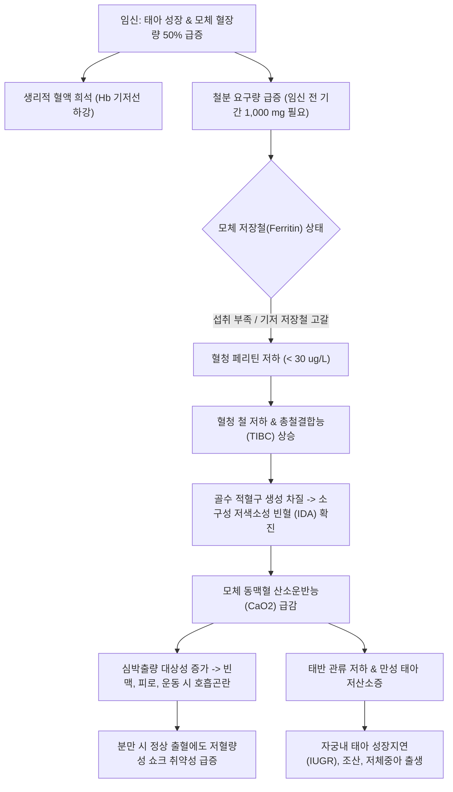
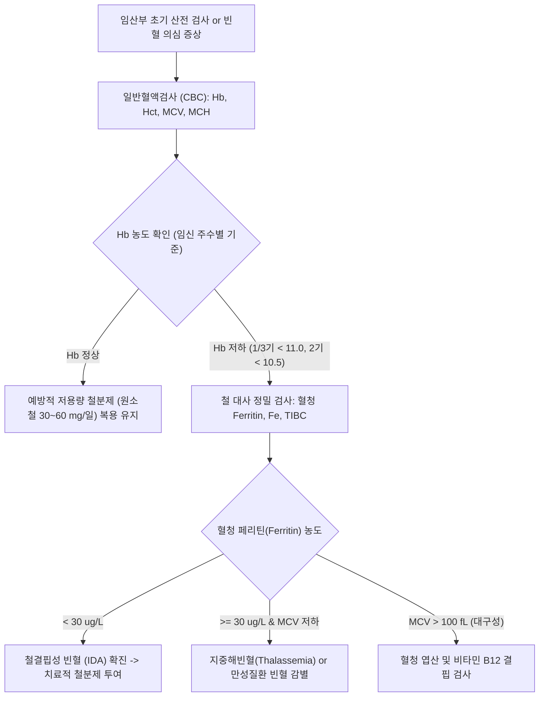

# 🩺 임신 중 빈혈 (Anemia in Pregnancy)

> **핵심 3줄 요약 (Key Summary)**:
> - 📍 병소 부위 & 해부·병태생리: 임신 중 혈장량 급증(40~50%)에 따른 생리적 희석성 빈혈을 기반으로, 태아·태반 성장 및 모체 적혈구량 증가에 필요한 철분 요구량 급증(총 약 1,000 mg)으로 발생하는 영양 결핍성 빈혈([[철결핍성 빈혈]] IDA 75~95%, 엽산 결핍성 거대적혈모구빈혈).
> - 🚩 전형적 임상 양상: WHO 기준 헤모글로빈(Hb) 1·3삼분기 $< 11.0 \text{ g/dL}$, 2삼분기 $< 10.5 \text{ g/dL}$; 피로, 어지럼증, 창백, 운동성 호흡곤란, 심계항진, 이식증(Pica, 얼음 갈망증 Pagophagia).
> - 🛠️ 핵심 검사 & 치료 전략: 일반혈액검사(CBC), 혈청 페리틴(Ferritin $< 30 \mu g/L$ 확진), 트랜스페린 포화도; 1차 경구 원소철 30~60 mg(예방) 또는 100~200 mg(치료); 중증, 위장장애 불내성, 임신 말기 급속 교정 필요 시 정맥 철분제(수크로스철, 페릭 카르복시말토스 FCM); 비타민 C 병용.
> - ⚠️ 응급 의뢰 레드플래그: Hb < 7.0 g/dL의 중증 빈혈, 안정 시 호흡곤란, 흉통, 실신, 태아 심음 이상(태아 곤란증) -> 심부전 및 태아 저산소증 위험으로 즉각 상급병원 의뢰 및 수혈/정맥철 준비.

---

## 📌 목차
1. [질환 개요 & 해부학적 병태생리](#1-질환-개요--해부학적-병태생리)
2. [병태생리 메커니즘 & 생체역학적 악순환 네트워크](#2-병태생리-메커니즘--생체역학적-악순환-네트워크)
3. [임상 증상 & 이학적 검사(Physical Exam) 알고리즘](#3-임상-증상--이학적-검사physical-exam-알고리즘)
4. [감별 진단 매트릭스 (Differential Diagnosis)](#4-감별-진단-매트릭스-differential-diagnosis)
5. [한의 통합 치료 프로토콜 (침·약침·추나·한약)](#5-한의-통합-치료-프로토콜--침-약침-추나-한약-)
6. [양방 치료 & 병용·의뢰 기준 (Conventional Treatment & Referral)](#6-양방-치료--병용의뢰-기준-conventional-treatment--referral)
7. [재활 운동 & 생활습관 티칭 가이드](#7-재활-운동--생활습관-티칭-가이드)
8. [💡 사용자 진료실 핵심 필기 & 임상 노하우 (Melt-In 잔여 심화 집약)](#8--사용자-진료실-핵심-필기--임상-노하우--melt-in-잔여-심화-집약-)
9. [출처 및 학술 참고 문헌 (References)](#9-출처-및-학술-참고-문헌--references)

---

## 1. 질환 개요 & 해부학적 병태생리

* **정의**: 임신 중 빈혈(Anemia in Pregnancy)은 임신 기간 중 순환하는 적혈구량 또는 헤모글로빈(Hemoglobin, Hb) 농도가 산소 운반 요구량을 충족하지 못할 정도로 저하된 상태를 말한다.
* **진단 기준 (WHO 및 CDC/ACOG)**:
  * **임신 제1삼분기 (1~12주)**: $\text{Hb} < 11.0 \text{ g/dL}$ (헤마토크릿 Hct $< 33\%$)
  * **임신 제2삼분기 (13~28주)**: $\text{Hb} < 10.5 \text{ g/dL}$ (헤마토크릿 Hct $< 32\%$)
  * **임신 제3삼분기 (29주~분만)**: $\text{Hb} < 11.0 \text{ g/dL}$ (헤마토크릿 Hct $< 33\%$)
  * **산욕기 (Postpartum)**: $\text{Hb} < 10.0 \text{ g/dL}$
* **생리적 변화와 철분 대사**:
  * **생리적 혈액 희석(Hydremia of Pregnancy)**: 임신 중 혈장량(Plasma volume)은 약 45~50% 급증하는 반면, 적혈구 용적은 약 20~30% 증가에 그쳐 생리적 혈액 희석이 발생한다.
  * **임신 중 철분 요구량**: 임신 전 기간 동안 모체 적혈구 증대(450 mg), 태아 및 태반 발달(350 mg), 분만 시 출혈 대비(200 mg)를 포함하여 **총 약 1,000 mg의 철분이 추가로 필요**하다.
* **원인별 분류**:
  * **[[철결핍성 빈혈]](Iron Deficiency Anemia, IDA)**: 임신 중 빈혈의 75~95%를 차지하는 압도적 원인.
  * **엽산 결핍성 빈혈(Folate deficiency)**: 다태 임신이나 영양 결핍에서 발생하는 거대적혈모구빈혈.
  * 기타: 혈색소병증(지중해빈혈 Thalassemia), 만성 질환 빈혈, 급성 출혈, 골수 질환.

---

## 2. 병태생리 메커니즘 & 생체역학적 악순환 네트워크

---

## 3. 임상 증상 & 이학적 검사(Physical Exam) 알고리즘

### 1) 주요 임상 증상
* **전신 대사 및 뇌기능 증상**:
  * 진행성 피로감(Fatigue), 쇠약감, 무기력, 집중력 저하.
  * 두통, 어지럼증, 실신감(Presyncope), 기립성 불내성.
* **심폐 증상**:
  * 안정 시 또는 가벼운 보행 시의 운동성 호흡곤란, 심계항진, 빈맥.
* **외모 및 특이 이학적 징후**:
  * 안검 결막(Conjunctiva), 손바닥 손금선, 입술, 손톱의 창백(Pallor).
  * 설염(Glossitis, 혀의 유두 위축), 구각구순염(Angular cheilitis).
  * 숟가락형 손톱(스푼형 조갑, Koilonychia).
  * **이식증(Pica)**: 영양가 없는 물질을 강박적으로 먹는 증상, 특히 얼음을 지속적으로 씹어 먹는 빙식증(Pagophagia)이나 흙/쌀을 씹는 현상.

### 2) 검사 및 진단 알고리즘

---

## 4. 감별 진단 매트릭스 (Differential Diagnosis)

| 감별 질환 | MCV (평균적혈구용적) | 혈청 페리틴(Ferritin) | 혈청 철(Fe) / TIBC | 말초혈액도말 소견 | 치료 접근 |
| :--- | :--- | :--- | :--- | :--- | :--- |
| **철결핍성 빈혈 (IDA)** | **저하 (< 80 fL, 소구성)** | **현저히 저하 (< 30 $\mu g/L$)** | Fe $\downarrow$, TIBC $\uparrow$ | 소구성 저색소성, 중심 담염 확대 | 경구 또는 정맥 철분 보충 |
| **생리적 임신성 혈액희석** | **정상 (80~100 fL)** | **정상 ($\ge 30 \mu g/L$)** | 정상 | 정상 적혈구 형태 | 예방적 용량 철분제 유지 |
| **엽산 결핍 빈혈** | **상승 (> 100 fL, 대구성)** | 정상 | 정상 | 거대적혈구, 다엽성 호중구 | 엽산 1~5 mg/일 보충 |
| **지중해빈혈 경증 (Minor)** | **현저한 저하 (< 75 fL)** | **정상 또는 상승** | Fe 정상, TIBC 정상 | 표적세포(Target cells) 다수 | 철분 투여 금기, 유전 상담 |
| **만성 질환성 빈혈 (ACD)** | 정상 또는 경미 저하 | **상승 (염증성 페리틴↑)** | Fe $\downarrow$, TIBC $\downarrow$ | 정구성 또는 경미 소구성 | 기저 감염/자가면역 치료 |

---

## 5. 한의 통합 치료 프로토콜 (침·약침·추나·한약)

> 💡 **한의학적 접근의 핵심**: 임신 중 빈혈은 한의학에서 **임신혈허(妊娠血虛)** 또는 **임신위황(妊娠萎黃)**의 범주에 속한다. 서양의학적 철분 보충을 기본 골격으로 하되, 철분제의 주된 복약 중단 원인인 **오심, 구토, 소화장애, 변비 등의 위장관 부작용을 완화**하고 비위의 운화(運化) 기능을 도와 조혈(造血) 효율을 극대화하는 보완 치료가 매우 효과적이다.

### 1) 변증 분류
* **비위허약·기혈양허(脾胃虛弱·氣血兩虛)**: 안색위황, 피로 무력, 식욕부진, 소화불량, 어지럼증, 심계, 설담태백, 맥세약.
* **간신음허(肝腎陰虛)**: 요슬산연, 두훈안화, 모발 건조, 구갈, 수족심열, 설홍소태, 맥세삭.
* **비허습체(脾虛濕滯, 철분제 부작용 동반)**: 철분제 복용 후 심한 복부 팽만감, 구역감, 변비, 흑색변 불쾌감, 맥유완.

### 2) 침구 치료 (임신 안전 혈위 엄격 준수)
* **주요 혈위**:
  * 비위 기운 보강 & 소화 흡수 촉진: [[족삼리]](ST36), [[비수]](BL20), [[위수]](BL21), [[태백]](SP3).
  * 양혈 익기 및 심계 안정: [[내관]](PC6), [[심수]](BL15), [[백회]](GV20).
* **임신 금기 혈위 절대 배제**: 합곡, 삼음교, 곤륜, 지음 및 하복부 직자 절대 금기.
* **자침 기법**: 유침 15분, 부드러운 보법 자침으로 입덧과 철분제 소화불량 완화.

### 3) 한약 처방 (임신 안태 및 보혈 방제)
* **당귀보혈탕(當歸補血湯) 합 사군자탕(四君子湯) 가감**:
  * 비위의 기운을 돋워 혈액 생성을 돕는 대표적 임신 안전 보혈 처방. (황기 20~30g, 당귀 6g, 인삼/당삼 8g, 백출 8g, 복령 8g, 감초 4g).
* **태산반석산(泰山磐石散) 가감**:
  * 기혈이 모두 허약하여 태아가 불안하고 산모가 빈혈성 쇠약을 겪을 때 기혈을 쌍보하고 안태함. (인삼, 황기, 당귀, 백작약, 숙지황, 백출, 사인, 황금).
* **사물탕(四物湯) 가감**: 간혈을 자양하고 혈허성 어지럼증 개선.

---

## 6. 양방 치료 & 병용·의뢰 기준 (Conventional Treatment & Referral)

* **약물 치료 (Medication)**:
  * **예방 요법 (모든 임산부)**:
    * 임신 12~16주부터 분만 후 수유기까지 **원소철 30~60 mg/day + 엽산 400 $\mu g/day$** 기본 복용.
  * **1차 경구 치료 요법 (확진된 IDA)**:
    * **원소철(Elemental iron) 100~200 mg/day** 경구 투여 (황산제일철 Ferrous sulfate, 푸마르산제일철, 글루콘산제일철).
    * *복용 팁*: 공복(식전 1시간 또는 취침 전)에 비타민 C(오렌지 주스)와 함께 복용 시 흡수율 2~3배 증가. 차(탄닌), 커피, 우유(칼슘), 제산제는 철분 흡수를 방해하므로 2시간 이상 간격 유지.
    * *격일 투여법 (Alternate-day dosing)*: 고용량 매일 복용 시 헵시딘(Hepcidin) 수치가 급상승하여 다음날 철분 흡수를 차단하므로, 격일로 100~200mg을 복용하는 방식이 위장장애는 절반으로 줄이고 흡수율은 유사하게 유지됨.
  * **2차 정맥 철분 주사 요법 (Intravenous Iron)**:
    * **적응증**: 심한 경구 철분제 불내성(조절되지 않는 오심/변비), 염증성 장질환 등 흡수 장애, 임신 3삼분기에 진단되어 분만 전 급속 교정이 필요한 경우, $\text{Hb} < 8.0\text{ g/dL}$의 중증 빈혈.
    * 제제: **페릭 카르복시말토스 (Ferric carboxymaltose, 페린젝트)** 500~1,000 mg 단회 정맥 점적 투여 (임신 2~3삼분기 안전성 우수), 수크로스철(Iron sucrose).
  * **수혈(Transfusion, 농축적혈구 PRBC)**:
    * $\text{Hb} < 7.0 \text{ g/dL}$이면서 혈역학적 불안정성, 활동성 질출혈, 분만 직전 급성 빈혈 시 고려.
* **양방·전문과 의뢰 기준 (Referral Criteria)**:
  * 경구 철분제 복용 3~4주 후에도 헤모글로빈이 $1.0 \text{ g/dL}$ 이상 상승하지 않는 경우 (불응성 빈혈, 정맥철제 전환 필요).
  * **즉각 의뢰 (Red Flag)**:
    * $\text{Hb} < 7.0 \text{ g/dL}$.
    * 안정 시 호흡곤란, 흉통, 실신, 부종 급악화.
    * 태동 감소, 태아 성장지연 의심 소견.

---

## 7. 재활 운동 & 생활습관 티칭 가이드

* **식이 요법 및 철분 흡수 촉진법**:
  * 헴철(Heme iron, 흡수율 20~30%): 붉은 살코기, 쇠고기, 닭고기, 생선.
  * 비헴철(Non-heme iron, 흡수율 2~5%): 시금치, 콩류, 계란 노른자, 견과류 (반드시 비타민 C 풍부한 과일/채소와 함께 섭취).
* **철분제 변비 관리**:
  * 철분 복용 중 흔히 발생하는 변비 완화를 위해 수분 섭취(하루 2L 이상)와 식이섬유(자두 주스 Prune juice, 차전자피) 적극 권장.
* **가벼운 유산소 걷기**:
  * 무리한 고강도 운동은 태반 산소 공급을 저해하므로 피하고, 혈액 순환을 돕는 평지 걷기(하루 20~30분) 위주 시행.

---

## 8. 💡 사용자 진료실 핵심 필기 & 임상 노하우 (Melt-In 잔여 심화 집약)

* **철분제 변비와 입덧으로 고통받는 산모를 위한 '격일 복용'과 '한약 배합' 티칭**:
  * 산모가 "철분약만 먹으면 속이 뒤집히고 변비가 너무 심해서 못 먹겠다"고 호소할 때, 약을 끊으라고 하지 말고 **격일 복용(이틀에 한 번 복용)**으로 변경하도록 지도하라. 최신 혈액학 연구에 따르면 격일 복용이 헵시딘 간섭을 줄여 흡수율은 유지하면서 위장 부작용을 극적으로 줄여준다.
  * 여기에 당귀보혈탕이나 사군자탕 계열의 부드러운 한약을 병용하면 위장 점막을 보호하여 철분제 순응도를 90% 이상으로 끌어올릴 수 있다.
* **지중해빈혈(Thalassemia trait)의 함정 경계**:
  * 동남아 국적 산모나 가족력이 있는 산모 중 MCV가 70 이하로 몹시 낮은데도 혈청 페리틴은 정상 이상인 경우가 있다. 이 산모에게 무작정 철분제를 고용량으로 투여하면 철분 과부하(Iron overload) 독성을 초래할 수 있으므로, 반드시 혈청 페리틴 수치를 먼저 확인하고 이상 시 전기영동 검사를 의뢰해야 한다.

---

## 9. 출처 및 학술 참고 문헌 (References)

* Abouelnaga O, et al. (2026 Dec). Expert consensus on the screening, diagnosis, and management of perinatal iron deficiency anemia in Egypt. *J Matern Fetal Neonatal Med*, 39(1):2345678. PMID: 42476909.

* Sharma S, et al. (2026 Dec). Response of reticulocyte and red blood cell indices to single-dose intravenous iron in pregnant women with moderate iron deficiency anemia: secondary analysis of the RAPIDIRON trial. *J Matern Fetal Neonatal Med*, 39(1):2341234. PMID: 42045095.

* Domellöf M, et al. (2026 Nov 1). Iron deficiency during pregnancy and lactation. *Curr Opin Clin Nutr Metab Care*, 29(6):412-419. PMID: 42681977.

---

## 관련 노트

- [[_의학/03_이론/질환/부인과/임신·출산/임신 중 요로 감염|임신 중 요로 감염]]
- [[철결핍성 빈혈]]
- [[임신]]
- [[저혈압]]
- [[기립성 저혈압]]
- [[생맥산]]
- [[신부전]]

