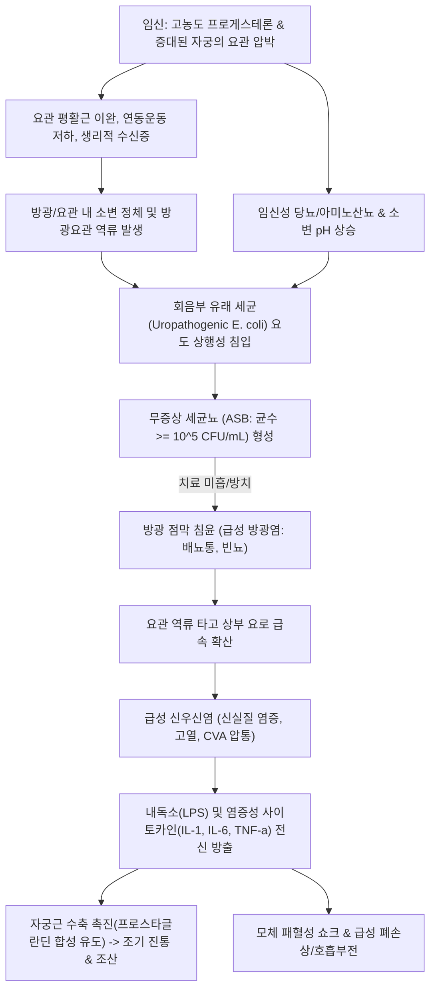
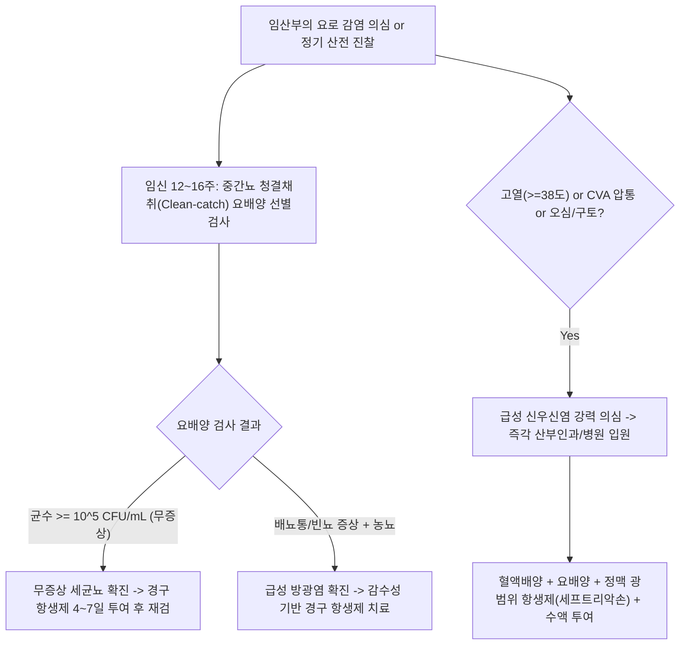

# 🩺 임신 중 요로 감염 (Urinary Tract Infections in Pregnancy)

> **핵심 3줄 요약 (Key Summary)**:
> - 📍 병소 부위 & 해부·병태생리: 임신 중 프로게스테론에 의한 요관 평활근 이완, 수신증(Hydronephrosis), 증대된 자궁의 기계적 요관 압박으로 인한 소변 정체 및 당뇨/아미노산뇨 환경에서 대장균([[E. coli]]) 등이 상행성 감염 유발.
> - 🚩 전형적 임상 양상: 무증상 세균뇨(ASB, 2~10%), 급성 방광염(배뇨통, 빈뇨, 절박뇨, 치골상부 통증), 급성 [[신우신염]](발열 38℃ 이상, 오한, 늑골척추각 압통 CVA tenderness, 오심/구토).
> - 🛠️ 핵심 검사 & 치료 전략: 임신 초기(12~16주) 정기 요배양 선별검사 필수($\ge 10^5 \text{ CFU/mL}$ 시 ASB도 즉각 치료); 임신 안전성 확인된 항생제(세팔로스포린계 세팔렉신, 포스포마이신, 아목시실린-클라불라네이트); 신우신염 시 즉각 입원 정맥 항생제 투여.
> - ⚠️ 응급 의뢰 레드플래그: 고열, 패혈증 징후(빈맥, 저혈압), 조기 자궁 수축, 조기 양막 파수(PROM) 동반 -> 패혈성 쇼크 및 조산 위험으로 즉각 산부인과 응급 입원.

---

## 📌 목차
1. [질환 개요 & 해부학적 병태생리](#1-질환-개요--해부학적-병태생리)
2. [병태생리 메커니즘 & 생체역학적 악순환 네트워크](#2-병태생리-메커니즘--생체역학적-악순환-네트워크)
3. [임상 증상 & 이학적 검사(Physical Exam) 알고리즘](#3-임상-증상--이학적-검사physical-exam-알고리즘)
4. [감별 진단 매트릭스 (Differential Diagnosis)](#4-감별-진단-매트릭스-differential-diagnosis)
5. [한의 통합 치료 프로토콜 (침·약침·추나·한약)](#5-한의-통합-치료-프로토콜-침약침추나한약)
6. [양방 치료 & 병용·의뢰 기준 (Conventional Treatment & Referral)](#6-양방-치료--병용의뢰-기준-conventional-treatment--referral)
7. [재활 운동 & 생활습관 티칭 가이드](#7-재활-운동--생활습관-티칭-가이드)
8. [💡 사용자 진료실 핵심 필기 & 임상 노하우 (Melt-In 잔여 심화 집약)](#8--사용자-진료실-핵심-필기--임상-노하우-melt-in-잔여-심화-집약)
9. [출처 및 학술 참고 문헌 (References)](#9-출처-및-학술-참고-문헌--references)

---

## 1. 질환 개요 & 해부학적 병태생리

* **정의**: 임신 중 요로 감염(Urinary Tract Infection in Pregnancy, UTI)은 임신 여성의 요도, 방광, 요관, 신우 및 신실질에 발생하는 세균성 감염증을 총칭한다. 임상적 양상에 따라 **무증상 세균뇨(Asymptomatic Bacteriuria, ASB)**, **급성 방광염(Acute Cystitis)**, **급성 신우신염(Acute Pyelonephritis)**의 3단계 스펙트럼으로 나뉜다.
* **해부생리학적 취약성 요인**:
  * **호르몬 요인**: 태반에서 분비되는 고농도 프로게스테론이 요관 및 방광 평활근을 이완시켜 요관 연동운동(Peristalsis)을 저하시키고 요관 내경을 확장(생리적 수신증, 주로 우측 요관 호발)시킨다.
  * **기계적 압박**: 임신 중기 이후 우측으로 편위(Dextrorotation)되며 증대된 자궁이 골반연(Pelvic brim)에서 요관을 직접 압박하여 방광요관 역류(Vesicoureteral reflux) 및 요 정체를 유발한다.
  * **소변 화학적 조성 변화**: 사구체여과율(GFR) 증가와 세뇨관 재흡수 한계 초과로 인해 소변 내 포도당, 아미노산, 호르몬 농도가 상승하고 소변 pH가 알칼리화되어 세균 증식의 최적 배양 환경을 제공한다.
* **역학 및 위험성**:
  * 임산부의 약 2~10%에서 무증상 세균뇨가 발견되며, 비임신 상태와 달리 임신 중 무증상 세균뇨를 방치할 경우 **20~40%에서 급성 신우신염으로 급격히 진행**한다.
  * 신우신염은 모체 패혈증, 급성 호흡곤란 증후군(ARDS), 조기 진통(Preterm labor), 조산, 저체중출생아를 유발하는 주된 산과적 위험 요인이다.

---

## 2. 병태생리 메커니즘 & 생체역학적 악순환 네트워크

* **원인 병원균 분포**:
  * 대장균(Escherichia coli)이 70~80%로 가장 흔하다.
  * 기타: 폐렴간균(Klebsiella pneumoniae), 프로테우스(Proteus mirabilis), B군 연쇄상구균(Group B Streptococcus, GBS - 신생아 패혈증 예방 관점 중요), 부생성 포도구균(Staphylococcus saprophyticus).

---

## 3. 임상 증상 & 이학적 검사(Physical Exam) 알고리즘

### 1) 주요 임상 증상
* **무증상 세균뇨 (ASB)**: 배뇨 관련 자각 증상이 전혀 없음에도 요배양 검사상 의미 있는 세균뇨($\ge 10^5 \text{ CFU/mL}$) 확인.
* **급성 방광염 (Acute Cystitis)**:
  * 배뇨통(Dysuria), 요절박(Urgency), 빈뇨(Frequency, 야간뇨 악화).
  * 치골상부(하복부) 둔통 및 불쾌감, 육안적 혈뇨(Hematuria), 혼탁뇨.
  * *발열, 오한, 전신 쇠약감은 동반되지 않음.*
* **급성 신우신염 (Acute Pyelonephritis)**:
  * 38℃ 이상의 갑작스러운 고열, 오한, 흠뻑 젖는 발한.
  * 일측성 또는 양측성 늑골척추각(Costovertebral angle, CVA) 압통 및 요통.
  * 오심, 구토, 식욕부진, 전신 근육통, 두통.

### 2) 이학적 검사 및 진단 알고리즘

---

## 4. 감별 진단 매트릭스 (Differential Diagnosis)

| 질환 | 체온 / 전신 증상 | 요 검사 소견 | CVA 압통 | 자궁 수축 유무 | 감별 포인트 |
| :--- | :--- | :--- | :--- | :--- | :--- |
| **임신 중 급성 방광염** | 정상 / 전신 증상 없음 | 농뇨, 세균뇨, 배뇨통 | **음성 (None)** | 음성 | 발열 없이 하부 요로 증상에 국한 |
| **임신 중 급성 신우신염** | **38℃ 이상 고열, 오한** | 농뇨, 백혈구 원주체, 세균뇨 | **양성 (CVA 압통 뚜렷)** | 조기 수축 가능 | 상부 요로 감염, 즉각 입원 적응증 |
| **생리적 임신 빈뇨** | 정상 | 완전 정상 (WBC < 5) | 음성 | 음성 | 자궁 압박에 의한 정상 생리, 배뇨통 없음 |
| **임신성 요로결석 (신산통)** | 정상 또는 미열 | **현미경적/육안적 혈뇨** | 심한 산통성 측복통 | 동반 가능 | 급작스러운 쥐어짜는 옆구리 통증, 방사통 |
| **급성 충수염 (임신 중)** | 미열~중등도 발열 | 대개 정상 (인접 시 미세 농뇨) | 음성 (우상복부 압통) | 가능 | 충수가 임신 자궁에 밀려 우상복부로 이동 |
| **조기 진통 (Preterm labor)** | 정상 | 다양함 (UTI가 유발 요인 가능) | 음성 | **규칙적 자궁 수축** | 자궁 경부 개대 및 소실 진행 여부 확인 |

---

## 5. 한의 통합 치료 프로토콜 (침·약침·추나·한약)

> ⚠️ **절대 주의 (임산부 안전 수칙)**: 임신 중 요로 감염은 조산과 패혈증 위험이 높으므로, **양방 항생제 치료를 절대 지연시켜서는 안 된다.** 급성 신우신염은 즉각 상급병원 입원 의뢰 대상이다. 한의 치료는 임신 중 방광염의 보조 요법 및 항생제 치료 후 재발 방지, 방광 점막 안정화 목적으로 **임신 금기 약물/혈위를 엄격히 배제**하여 적용한다.

### 1) 임신 중 금기 사항
* **금기 혈위 (자궁 수축 유발 위험)**: [[합곡]](LI4), [[삼음교]](SP6), [[지음]](BL67), [[곤륜]](BL60), 하복부 혈위 깊은 자침 금기.
* **금기 한약재**: 우슬, 대황, 도인, 홍화, 파두, 삼릉, 봉출 등 공하·파혈약 전면 배제.

### 2) 변증 분류
* **방광습열(膀胱濕熱)**: 배뇨통, 요적단소(소변이 붉고 찔끔거림), 하복부 팽만통, 구갈, 설홍태황니, 맥활삭.
* **비신양허·임신요삽(脾腎兩虛·妊娠尿澁)**: 임신 후 만성 피로, 요슬산연, 소변 빈삭하나 통증은 경미함, 면색창백, 설담태백, 맥활완.

### 3) 침구 치료 (임신 안전 혈위 중심)
* **주요 혈위**:
  * 습열 청열 & 비위 기운 보강: [[족삼리]](ST36), [[음릉천]](SP9), [[곡지]](LI11).
  * 방광 기화 촉진: [[신수]](BL23) 가벼운 사자(斜刺), [[방광수]](BL28) 얕은 자침, [[내관]](PC6) 오심 완화.
* **자침 기법**: 유침 15분, 부드러운 평보평사, 복부 직자 절대 금기.

### 4) 한약 처방 (임신 안전 안태·청열 방제)
* **팔정산(八正散) 임신 가감**:
  * 급성 방광염 증상 완화. 자궁을 자극하는 대황을 빼고 활석, 차전자, 구맥, 편축, 목통, 황백을 감량 배합하여 단기 투여.
* **안태음(安胎飮) 합 저령탕(猪苓湯) 가감**:
  * 임신부의 기혈을 안정시키고 소변 출납을 이롭게 함. (백출, 당귀, 작약, 숙지황, 진피, 저령, 복령, 택사, 활석, 아교).
* **차전자·포공영 달인 물**: 임신 중 안전한 청열이뇨 약재로 가벼운 방광염 증상 시 음용.

---

## 6. 양방 치료 & 병용·의뢰 기준 (Conventional Treatment & Referral)

* **약물 치료 (Medication)**:
  * **무증상 세균뇨(ASB) 및 급성 방광염 (경구 4~7일)**:
    * **1차 권고 약제**:
      * **세팔렉신(Cephalexin)** 500mg q6~8h (가장 널리 쓰이며 임신 전 기간 안전).
      * **포스포마이신(Fosfomycin trometamol)** 3g 단회 복용 (복약 순응도 우수, 교차내성 적음).
      * **아목시실린-클라불라네이트(Augmentin)** 500/125mg bid 또는 625mg tid.
    * **주의/제한 약제**:
      * 니트로푸란토인(Nitrofurantoin): 임신 1삼분기(기관형성기) 및 임신 36주 이후(신생아 용혈성 빈혈 위험, G6PD 결핍 관련) 사용 제한.
      * TMP-SMX(바이트림): 임신 1삼분기(엽산 대사 억제, 신경관 결손) 및 말기(핵황달 Kernicterus 위험) 금기.
    * **임신 중 절대 금기 항생제**:
      * **플루오로퀴놀론계(Ciprofloxacin, Levofloxacin)**: 태아 연골 및 골격 발달 독성.
      * **테트라사이클린계(Doxycycline)**: 태아 치아 착색 및 골 성장 억제.
      * **아미노글리코사이드계(Gentamicin)**: 태아 제8뇌신경 이독성 및 신독성.
  * **급성 신우신염 (입원 정맥 항생제 요법)**:
    * 3세대 세팔로스포린 정맥 투여: **세프트리악손(Ceftriaxone 1~2g IV q24h)** 또는 세포탁심.
    * 해열 후 48시간 이상 경과 및 임상 호전 시 경구 항생제로 전환하여 총 10~14일 치료 완료.
* **양방·전문과 의뢰 기준 (Referral Criteria)**:
  * 임신 중 배뇨통, 농뇨 환자는 즉각 산부인과에 의뢰하여 공식 요배양 검사 및 태아 안녕 평가(NST, 초음파) 시행.
  * **응급 입원 의뢰 (Red Flag)**:
    * 체온 $\ge 38.0^\circ\text{C}$, 오한, CVA 압통 동반 (급성 신우신염).
    * 규칙적 자궁 수축, 질 출혈, 양수 누출(PROM) 징후.
    * 혈압 저하, 빈맥, 호흡수 증가 등 패혈증(Sepsis) 의심 징후.

---

## 7. 재활 운동 & 생활습관 티칭 가이드

* **수분 섭취 및 배뇨 습관 교정**:
  * 하루 2~2.5L 이상의 충분한 수분 섭취로 소변 흐름을 유지하여 세균의 요로계 정착 차단.
  * 소변을 참지 말고 2~3시간마다 규칙적으로 방광을 완전히 비우도록 지도.
* **회음부 위생 및 성교 관리**:
  * 배변 후 앞에서 뒤로 닦는(Front-to-back) 위생 수칙 준수.
  * 성교 전후 배뇨 및 생식기 청결 유지.
* **크랜베리 제품 활용**:
  * 크랜베리의 프로안토시아니딘(Proanthocyanidin) 성분은 대장균의 방광 점막 P-fimbriae 부착을 억제하여 재발 방지에 안전한 보조 수단으로 활용 가능.

---

## 8. 💡 사용자 진료실 핵심 필기 & 임상 노하우 (Melt-In 잔여 심화 집약)

* **"배가 뭉치고 허리가 아파요"로 내원하는 임산부의 숨은 신우신염 감별**:
  * 임신 2~3삼분기 산모가 단순 요통이나 가진통으로 오인하여 한의원에 내원할 때가 있다.
  * 반드시 등을 두드려보는 **늑골척추각 타진 검사(CVA percussion)**를 루틴으로 시행해야 한다. 산모가 깜짝 놀라며 펄쩍 뛸 정도의 일측성 타진통이 있다면 이는 근육통이나 가진통이 아니라 **급성 신우신염**이다. 침 치료를 즉시 중단하고 당일 산부인과 응급실로 의뢰해야 산모와 태아를 살릴 수 있다.
* **무증상 세균뇨를 가볍게 여기는 산모 티칭 노하우**:
  * 산전 검사에서 세균이 나왔다고 산부인과에서 항생제를 처방받았는데, "아무 증상도 없는데 아기한테 해로울까 봐 안 먹었어요"라고 말하는 산모가 매우 많다.
  * 이때 한의사는 "임신 중에는 콩팥으로 가는 길이 늘어나 있어서 세균이 순식간에 콩팥으로 타고 올라가 조산을 유발할 수 있다. 세팔렉신 같은 1차 항생제는 수십 년간 전 세계에서 태아 안전성이 입증되었으므로 정해진 날짜 동안 끝까지 복용해야 한다"고 명확히 지도해 주어야 한다.

---

## 9. 출처 및 학술 참고 문헌 (References)

* Patel S, et al. (2026 Oct 4). Managing urinary tract infections in pregnancy: teratogenic risks, molecular mechanisms, and antibiotic safety. *Expert Opin Drug Metab Toxicol*, 22(10):811-824. PMID: 42808229.

* St John AR, et al. (2026 Nov). Patterns of Antibiotic Utilization and Bacterial Susceptibility of Prenatal Urinary Tract Infections. *J Womens Health (Larchmt)*, 35(11):1421-1430. PMID: 42374771.

* Expert Panel on Urologic Imaging, et al. (2026 Aug). ACR Appropriateness Criteria® Recurrent Lower Urinary Tract Infections in Females: Update 2026. *J Am Coll Radiol*, 23(8S):S190-S202. PMID: 41973892.

---

## 관련 노트

- [[_의학/03_이론/질환/부인과/임신·출산/임신 중 빈혈|임신 중 빈혈]]
- [[신우신염]]
- [[방광염]]
- [[E. coli]]
- [[임신]]
