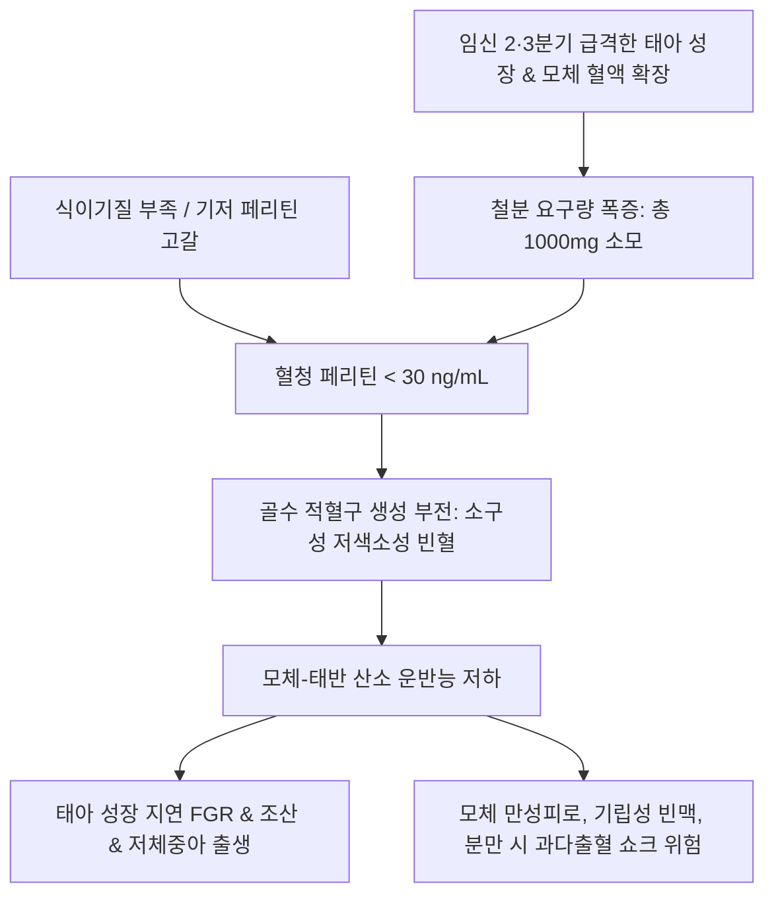

# 🩺 임신성 빈혈 (Anemia in Pregnancy / 姙娠貧血, Gestational Anemia)

> **핵심 3줄 요약 (Key Summary)**:
> - 📍 **정의 & 병태생리**: 임신 중 혈장량의 비례적 과다 증가(40~50%)에 따른 생리적 혈액희석 상태를 넘어, 적혈구 용적 및 혈색소 생성이 모체와 태아의 철분 요구량을 충족하지 못해 발생하는 병태. WHO 기준 헤모글로빈(Hb)이 임신 1·3분기 11.0 g/dL 미만, 2분기 10.5 g/dL 미만인 경우로 정의되며 철결핍성 빈혈([[철결핍]])이 90% 이상을 차지한다.
> - 🚩 **임상 양상**: 만성 피로, 현훈, 기립성 어지럼증, 안색 창백, 운동 시 호흡곤란, 심계항진, 스푼형 손톱(Koilonychia), 이식증(Pica: 얼음, 흙 섭취).
> - 🛠️ **치료 원칙**: 경구 원소철(100~200 mg/일) 보충 또는 2·3분기 불내성 시 정맥 철분제(IV Iron, 페린젝트 등) 투여, 엽산 병용, 한의학적으로 비위허약(脾胃虛弱)·기혈양허(氣血兩虛) 변증에 따른 [[당귀작약산]], [[팔진탕]], [[인삼양영탕]], [[보중익기탕]] 처방.
> - ⚠️ **응급 의뢰 레드플래그**: 분만 전 중증 빈혈(Hb < 7~8 g/dL)은 분만 시 정상적인 산과적 출혈에도 즉각적인 저혈량성 쇼크 및 심부전을 유발하므로 신속한 정맥 철분 주사 또는 농축적혈구(pRBC) 수혈 의뢰.

---

## 📌 목차
1. [질환 개요 & 해부학적 병태생리](#1-질환-개요--해부학적-병태생리)
2. [병태생리 메커니즘 & 철대사·혈액희석 네트워크](#2-병태생리-메커니즘--철대사혈액희석-네트워크)
3. [임상 증상 & 혈청 페리틴 진단 알고리즘](#3-임상-증상--혈청-페리틴-진단-알고리즘)
4. [감별 진단 매트릭스 (Differential Diagnosis)](#4-감별-진단-매트릭스-differential-diagnosis)
5. [한의 통합 치료 프로토콜 (침·약침·한약)](#5-한의-통합-치료-프로토콜-침약침한약)
6. [양방 치료 & 경구/정맥 철분 요법 기준 (Conventional Treatment & Referral)](#6-양방-치료--경구정맥-철분-요법-기준-conventional-treatment--referral)
7. [식이 요법 & 철분 흡수 최적화 가이드](#7-식이-요법--철분-흡수-최적화-가이드)
8. [💡 사용자 진료실 핵심 필기 & 임상 노하우 (Melt-In 잔여 심화 집약)](#8-💡-사용자-진료실-핵심-필기--임상-노하우-melt-in-잔여-심화-집약)
9. [출처 및 학술 참고 문헌 (References)](#9-출처-및-학술-참고-문헌-references)

---

## 1. 질환 개요 & 해부학적 병태생리

### 1) 질환 정의 및 임상적 진단 기준
- **임신성 빈혈(Anemia in Pregnancy)**: 임신 기간 중 순환 적혈구량의 절대적 부족 또는 기능 저하로 인해 모체 조직과 태반으로의 산소 공급이 저하된 상태.
- **WHO 및 미국산부인과학회(ACOG) 진단 기준**:
  - 임신 1분기(1~12주): **Hb < 11.0 g/dL** (Hct < 33%)
  - 임신 2분기(13~28주): **Hb < 10.5 g/dL** (Hct < 32%)
  - 임신 3분기(29주~분만): **Hb < 11.0 g/dL** (Hct < 33%)
  - 산후: **Hb < 10.0 g/dL**

### 2) 모체 혈액량 증가와 생리적 희석 해부학
- **혈장량과 적혈구 용적의 불균형**: 모체 혈장량은 임신 중 태반 순환과 분만 시 실혈에 대비하여 정상 대비 40~50%(약 1,200~1,500 mL) 증가하나, 적혈구 용적(Red cell mass)은 에리스로포이에틴(EPO) 자극에도 불구하고 20~30%(약 300~450 mL) 증가에 그친다.
- **생리적 빈혈(Physiologic anemia)**: 이 혈액량 증가율의 차이로 인해 혈액 점도가 낮아져 미세순환 저항이 감소하고 태반 관류가 촉진되는 생리적 적응 현상이 나타나나, 기저 저장철이 부족한 경우 병리적 빈혈로 직결된다.

---

## 2. 병태생리 메커니즘 & 철대사·혈액희석 네트워크

### 1) 임신 중 철분 요구량과 헵시딘의 역할
- **임신 전 과정의 철분 소모량**: 총 약 1,000 mg의 원소철이 요구된다(태아 및 태반 발달 300~350 mg, 모체 적혈구 증대 500 mg, 분만 실혈 250 mg).
- **헵시딘(Hepcidin) 억제**: 정상 임신에서는 장관 철 흡수를 극대화하기 위해 간에서 분비되는 철 흡수 억제 호르몬인 헵시딘이 2·3분기에 생리적으로 억제된다. 그러나 염증성 질환이나 비만이 동반되면 헵시딘이 상승하여 철 흡수가 차단된다.
- **태아로의 우선 수송**: 태반은 능동 수송 기전을 통해 모체 헤모글로빈 수치와 무관하게 철분을 태아로 우선 이동시키므로, 산모의 저장철이 먼저 바닥나며 빈혈이 심화된다.

### 2) 임신성 빈혈 병태생리 도식

---

## 3. 임상 증상 & 혈청 페리틴 진단 알고리즘

### 1) 주요 임상 양상
- **전신 증상**: 만성적인 전신 쇠약감, 무기력, 집중력 저하, 두통, 현훈.
- **심폐 증상**: 가벼운 보행 시에도 숨참(노력성 호흡곤란), 심계항진, 기립성 어지럼증.
- **외관적 징후**: 결막 창백, 안색 위황, 설염, 구각염, 취약한 모발 및 손톱.

### 2) 혈액학적 진단 프로토콜
- **CBC**: Hb, Hct, MCV(< 80 fL 시 소구성), MCH(< 27 pg 시 저색소성).
- **혈청 페리틴(Serum Ferritin)**: 철결핍 선별의 Gold Standard. **< 30 ng/mL** 시 명백한 저장철 고갈(임신 중에는 < 15~30 ng/mL 기준).
- **혈청 철 / TIBC / 트랜스페린 포화도**: 트랜스페린 포화도(Transferrin saturation) < 16~20% 시 기능성 철결핍 확진.

---

## 4. 감별 진단 매트릭스 (Differential Diagnosis)

| 감별 질환 | 호발 특징 및 검사 소견 | 감별 포인트 |
| :--- | :--- | :--- |
| **철결핍성 빈혈 (IDA)** | 소구성 저색소성, 페리틴 < 30 ng/mL, TIBC 상승 | 임신성 빈혈의 90% 이상 |
| **엽산 결핍성 거대적아구성 빈혈** | 대구성(MCV > 100 fL), 다분엽 호중구 | 엽산 보충으로 교정 |
| **지중해빈혈(Thalassemia trait)** | 소구성이 극심하나(MCV < 70) 페리틴 정상 | 헤모글로빈 전기영동 확인, 철분 과잉 주의 |
| **만성질환에 의한 빈혈 (ACD)** | 정구성 정색소성, 페리틴 정상~상승, 헵시딘 상승 | 만성 염증/감염 질환 동반 |

---

## 5. 한의 통합 치료 프로토콜 (침·약침·한약)

### 1) 변증별 한약 처방 프로토콜
- **비위허약(脾胃虛弱) / 생혈부족(生血不足)**:
  - 주증: 안색 위황, 피로 무력, 식욕 부진, 소화불량, 변비 또는 설사, 설담태백, 맥세약.
  - 대표 처방: [[보중익기탕]], [[육군자탕]], [[향사육군자탕]] 가감(백출, 황기, 당귀, 사인).
  - 치법: 건비익기(健脾益氣), 화위생혈(和胃生血).
- **기혈양허(氣血兩虛) / 영혈손상(營血損傷)**:
  - 주증: 심한 어지럼증, 심계항진, 숨참, 불면, 피부 건조, 설담소태, 맥세.
  - 대표 처방: [[당귀작약산]], [[팔진탕]], [[인삼양영탕]] 가감(당귀, 숙지황, 백작약, 아교).
  - 치법: 보기양혈(補氣養血), 충영포궁(充盈胞宮).
- **간신부족(肝腎不足) / 정혈휴손(精血虧損)**:
  - 주증: 요슬산연, 하지 무력, 이명, 태아 성장 지연, 설담암, 맥침세.
  - 대표 처방: [[귀신환]], [[육미지황탕]] 가감.
  - 치법: 보익간신(補益肝腎), 익정양혈(益精養血).

### 2) 침구 치료 프로토콜
- **주요 혈위**: [[족삼리]](ST36), [[삼음교]](SP6), [[비수]](BL20), [[심수]](BL15), [[관원]](CV4), [[내관]](PC6).
- **시술 기전**: 족삼리-비수 자침으로 장관 미세혈류를 개선하여 비위의 조혈 기능 및 철분 흡수 촉진.

---

## 6. 양방 치료 & 경구/정맥 철분 요법 기준 (Conventional Treatment & Referral)

### 1) 경구 철분 요법
- **1차 요법**: 원소철(Elemental iron) 60~100 mg 매일 또는 격일 복용 (격일 복용 시 헵시딘 상승을 피해 흡수율 증가 및 위장장애 경감).
- 부작용: 오심, 변비, 속쓰림, 흑색변.

### 2) 정맥 철분 요법(IV Iron) 적응증
- **적응증**:
  - 임신 2·3분기에 중등도~중증 빈혈(Hb < 10.0 g/dL, 페리틴 < 30 ng/mL)이면서 경구 철분제에 위장장애로 불응하는 경우.
  - 분만 예정일이 6주 이내로 임박하여 신속한 조혈이 요구되는 경우.
- **약제**: 수크로오스 철(Venoferrum) 또는 카르복시말토오스 철(Ferinject). 1~2회 투여로 1~2주 내 Hb 급상승.

---

## 7. 식이 요법 & 철분 흡수 최적화 가이드

### 1) 헴철(Heme iron) 섭취
- 붉은 살코기, 생선 등 흡수율이 높은(15~35%) 헴철 위주 식단 구성.

### 2) 흡수 촉진 및 저해 인자
- **촉진**: 비타민 C(오렌지 주스, 피망 등)와 함께 섭취.
- **저해**: 식사 전후 2시간 동안 커피, 홍차, 녹차(탄닌 성분), 우유 및 칼슘제(철분 흡수 경쟁 차단) 섭취 금지.

---

## 8. 💡 사용자 진료실 핵심 필기 & 임상 노하우 (Melt-In 잔여 심화 집약)

### 1) 생리적 혈액희석과 병리적 빈혈의 감별
- 임산부의 혈색소 저하는 혈장량이 적혈구보다 훨씬 많이 늘어나는 생리적 희석 현상이 기본 배경이다.
- 따라서 단순히 Hb 수치 하나만 보지 말고, 반드시 혈청 페리틴(Ferritin)을 세트로 측정하여 30 ng/mL 미만의 실질적 저장철 결핍이 존재하는지 확인해야 한다.

### 2) 철분제 위장장애 극복을 위한 한방 병용
- 임산부들이 철분제 복용을 중단하는 가장 흔한 이유는 오심, 구토, 변비 등 소화기 부작용이다.
- 이때 철분제를 억지로 밀어붙이지 말고, 비위를 보호하고 기혈을 보하는 [[보중익기탕]]이나 [[당귀작약산]]을 병용하거나 격일 복용법을 티칭하면 위장장애 없이 체내 헤모글로빈을 안전하게 목표치까지 끌어올릴 수 있다.

---

## 9. 출처 및 학술 참고 문헌 (References)

Rui. (2026). Application of Shengxuening tablets for the prevention of anemia in pregnancy: stratified efficacy analysis based on serum ferritin levels and thalassemia subgroups. *J Matern Fetal Neonatal Med*. PMID: 41672571.

Sales. (2026). Intravenous vs Oral Iron for Treating Iron Deficiency Anemia in Pregnancy: A Systematic Review and Meta-Analysis. *JAMA Netw Open*. PMID: 42776532.

Lett. (2026). Iron Deficiency and Iron Deficiency Anemia in Pregnancy: A Narrative Review for Canadian Obstetrical Practice. *J Obstet Gynaecol Can*. PMID: 42025958.
