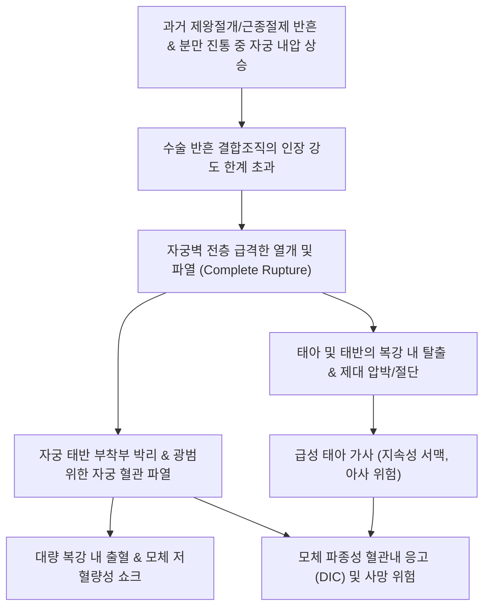
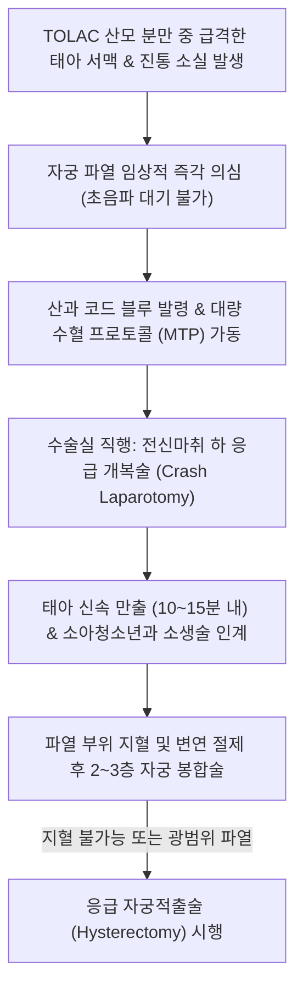

# 🩺 자궁 파열 (Uterine Rupture / 子宮破裂)

> **핵심 3줄 요약 (Key Summary)**:
> - 📍 **병소 부위 & 해부·병태생리**: 임신 후기 또는 분만 진통 중 자궁벽 평활근 전층(Myometrium)이 복막까지 완전히 파열되어 자궁강과 복강이 개통되는 **치명적인 산과적 초응급(Obstetric catastrophe)**; 과거 제왕절개 또는 자궁근종절제술의 반흔 부위 파열이 최다 원인.
> - 🚩 **전형적 임상 양상**: 분만 진통 중 갑작스러운 **태아 심음의 급격한 이상(지속성 심한 서맥, Bradycardia)**, 찢어지는 듯한 돌발성 복통, 기존 자궁 수축의 급격한 소실, 태아 선진부의 골반강 상방 후퇴, 질출혈, 모체 저혈압 및 저혈량성 쇼크.
> - 🛠️ **핵심 검사 & 치료 전략**: 연속적 태아 심박동 모니터링 및 모체 활력징후 감시를 통한 임상적 즉각 진단; 지체 없는 **응급 개복술(Crash Laparotomy) 및 신속한 제왕절개 분만(10~15분 이내)**, 대량 수혈 프로토콜 가동, 파열 부위 일차 봉합술(Uterine repair) 또는 자궁적출술(Hysterectomy), 산후 회복기 한의학적 보기생혈·활혈거어 병용.
> - ⚠️ **응급 의뢰 레드플래그**: 태아 심음 급감과 함께 진통이 갑자기 멈추고 산모가 찢어지는 복통 및 쇼크 상태에 빠지는 즉시 1분 1초를 다투는 초응급 상황이므로 상급병원 수술실 직행 및 신생아 집중치료팀 소환 필수.

---

## 📌 목차
1. [질환 개요 & 해부학적 병태생리](#1--질환-개요---해부학적-병태생리)
2. [병태생리 메커니즘 & 생체역학적 악순환 네트워크](#2--병태생리-메커니즘---생체역학적-악순환-네트워크)
3. [임상 증상 & 이학적 검사 알고리즘](#3--임상-증상---이학적-검사-알고리즘)
4. [감별 진단 매트릭스](#4--감별-진단-매트릭스)
5. [한의 통합 치료 프로토콜](#5--한의-통합-치료-프로토콜)
6. [양방 치료 & 병용·의뢰 기준](#6-양방-치료--병용의뢰-기준)
7. [재활 운동 & 생활습관 티칭 가이드](#7--재활-운동---생활습관-티칭-가이드)
8. [💡 사용자 진료실 핵심 필기 & 임상 노하우](#8--사용자-진료실-핵심-필기---임상-노하우)
9. [📚 출처 및 현대 학술 연구 요약 (References)](#9--출처-및-현대-학술-연구-요약-references)

---

## 1. 질환 개요 & 해부학적 병태생리

### 1) 질환 정의 및 분류
- **자궁 파열(Uterine Rupture)**은 임신 또는 분만 중 자궁벽의 완전 파열(Complete rupture)로 인해 자궁근층, 장막(Serosa), 양막이 모두 찢어져 태아와 태반이 복강 내로 탈출할 수 있는 상태를 의미한다.
- **불완전 파열 (자궁 열개, Uterine Dehiscence)**: 복막 장막층은 유지된 채 내측 근육층 반흔만 벌어진 상태로, 혈역학적으로 안정적이며 태아 곤란증이 없는 경우가 많음.
- **완전 파열 (Complete Rupture)**: 전층이 파열되어 대량 혈복강(Hemoperitoneum), 태아 가사 및 모체 쇼크를 유발하는 산과적 재앙.

### 2) 위험 인자 및 해부학적 병소
- **과거 자궁 수술 반흔 (가장 중요한 위험 인자, 90% 이상)**:
  - 과거 제왕절개술: 횡절개 반흔(TOLAC 시 파열 위험 0.5~0.9%), 고전적 종절개 반흔(Classical vertical incision, 파열 위험 4~9%로 TOLAC 절대 금기).
  - 복강경 또는 개복 [[자궁근종]] 절제술(Myomectomy, 특히 자궁내막강 침범 봉합 기왕력), [[자궁선근증]] 병변 절제술.
- **비반흔성 자궁 파열 (드묾, 1/10,000 이하)**:
  - [[옥시토신]](Oxytocin) 또는 [[프로스타글란딘]] 제제의 과도한 유도 분만 투여, 다산부의 급산, 아두골반불균형(CPD), 둔위 외회전술(ECV) 실패, 심한 복부 외상.

---

## 2. 병태생리 메커니즘 & 생체역학적 악순환 네트워크

### 1) 혈역학적 파탄과 산소 공급 차단
- 자궁 파열 순간 자궁동맥의 주요 분지가 단열되어 분당 수백 mL의 혈액이 복강 내로 유출되어 [[저혈압]]과 [[빈맥]]이 유발된다.
- 태반 관류압이 즉각 0으로 떨어지며, [[태반 조기 박리]]가 병발하고 태아에게 가던 모든 가스 교환이 일시에 중단된다.
- 10~15분 이내에 태아를 만출하지 못할 경우 중증 저산소성 허혈성 뇌병증(HIE) 또는 태아 사망이 불가피하다.
- 모체 순환 혈액량 급감으로 [[저혈량성 쇼크]]와 급성 대사성 산증이 초래된다.

---

## 3. 임상 증상 & 이학적 검사 알고리즘

### 1) 주요 임상 양상
- **태아 심음 이상 (가장 일관되고 흔한 최초 징후, 70~80%)**:
  - 정상 박동을 보이던 태아 모니터링상 갑작스러운 지연성 감속(Prolonged deceleration) 또는 지속성 중증 서맥(< 90회/분).
- **진통의 갑작스러운 변화**:
  - 규칙적으로 강하게 오던 자궁 수축이 파열과 동시에 자궁 내압이 해제되면서 완전히 멈춤.
- **모체 통증 및 신체 징후**:
  - 진통과는 다른 차원의 찢어지는 듯한(Sharp, tearing) 극심한 돌발성 하복통.
  - 내진 시 질강 깊숙이 진입해 있던 태아의 머리가 골반 밖으로 쑥 올라가 만져지지 않음(Loss of station).
  - 질출혈(미미할 수 있음 — 출혈의 대부분이 복강 내로 고이기 때문).
  - 모체 빈맥, 식은땀, 혈압 저하, 의식 저하.

### 2) 응급 진단 및 대처 알고리즘

---

## 4. 감별 진단 매트릭스

| 질환명 | 주 증상 및 특징 | 자궁 수축 양상 | 출혈 위치 및 양상 | 태아 심음 |
| :--- | :--- | :--- | :--- | :--- |
| **자궁 파열** | 찢어지는 돌발 복통, 선진부 후퇴, 쇼크 | 수축이 갑자기 멈춤 (내압 소실) | 대량 복강 내 출혈 (질출혈은 소량일 수 있음) | 급격하고 지속적인 심한 서맥 |
| **태반 조기 박리** | 판자처럼 딱딱한 자궁, 지속성 암적색 출혈 | 자궁의 지속적 과긴장(Tetanic contraction) | 질출혈 동반 또는 은폐형 출혈 | 만기 감속, 태아 곤란증 |
| **전치 태반** | 통증이 전혀 없는 선홍색 질출혈 | 정상 자궁 수축 | 외인성 선홍색 대량 질출혈 | 초기에는 태아 심음 정상 유지 |
| **양수 색전증** | 분만 직후 급성 호흡곤란, 청색증, 심정지 | 무관 | 파종성 혈관내 응고(DIC)로 인한 전신 출혈 | 급성 태아 사망 |

---

## 5. 한의 통합 치료 프로토콜

> ⚠️ **주의**: 자궁 파열의 급성기는 100% 산과적 초응급 수술 적응증이며, 한의 치료는 응급 수술 성공 후 **산후 회복기(산욕기)**의 기혈 보강, 어혈 배출, 복강 내 유착 방지에 적용한다.

### 1) 한의 변증 분류 (수술 후 회복기)
- **산후 실혈상진·기혈양허형 (氣血兩虛型)**:
  - 주증: 대량 출혈 후 극심한 피로, 빈혈, 어지러움, 자한, 면색 창백, 설담무태, 맥미세삭.
  - 치법: 대보원기(大補元氣), 익기생혈(益氣生血).
  - 처방: [[당귀보혈탕]](當歸補血湯) 합 [[십전대보탕]](十全大補湯) 가감 (황기 30g, 당귀 15g, 인삼 10g, 백출 10g, 복령 10g, 숙지황 15g, 백작약 12g, 천궁 8g, 아교 8g).
- **산후 어혈어저형 (瘀血瘀阻型)**:
  - 주증: 복강 내 잔류 혈종, 수술 부위 국소 둔통, 오로 부전, 설자, 맥삽.
  - 치법: 활혈거어(活血祛瘀), 온경지통(溫經止痛).
  - 처방: [[생화탕]](生化湯) 가감 (당귀 15g, 천궁 10g, 도인 8g, 익모초 15g, 포황 10g).

### 2) 침구 치료
- **주요 혈위**: [[족삼리]](ST36), [[삼음교]](SP6), [[기해]](CV6), [[백회]](GV20).
- **기법**: 부드러운 보법 자침 및 간접구를 통해 조혈 기능을 돕고 골반강 혈류 순환을 회복시킨다.

---

## 6. 양방 치료 & 병용·의뢰 기준

### 1) 응급 수술 및 소생술 (Surgical Management)
- **응급 개복술 (Crash Laparotomy)**:
  - 진단 즉시 10~15분 이내에 복강을 열고 태아를 만출하여 뇌 손상을 최소화함.
- **수술적 지혈 옵션**:
  - **자궁 보존적 봉합술 (Primary Repair)**: 파열 부위 변연이 비교적 깨끗하고 자궁 혈관 손상이 제어 가능한 가임력 보존 희망 산모에서 시행 (흡수성 봉사로 2~3층 봉합).
  - **응급 자궁적출술 (Emergency Peripartum Hysterectomy)**: 파열 부위가 자궁경부나 질 원개, 광인대로 심하게 연장되었거나 지혈되지 않는 파종성 혈관내 응고(DIC) 동반 시 산모의 생명을 구하기 위해 즉시 자궁적출술 시행.
- **대량 수혈 (Massive Transfusion Protocol)**:
  - 농축적혈구, 신선동결혈장, 혈소판을 1:1:1 비율로 신속히 투여하여 응고장애 교정.
- **약물 보조 요법**:
  - 수술 후 감염 예방을 위해 광범위 항생제인 [[세파졸린]] 또는 3세대 세파계 항생제를 투여하고, 자궁 수축 유지를 위해 [[옥시토신]]을 점적한다.

### 2) 향후 임신 관리 지침
- 자궁 파열 기왕력이 있는 산모는 **차기 임신 시 진통 시작 전(임신 36~37주경) 반드시 예정 [[제왕절개술]]**을 시행해야 하며, 절대 자연 진통을 시도해서는 안 된다.
- 과거 [[난임]] 치료를 받았거나 [[자궁외 임신]] 등의 합병증 여부를 주의 깊게 평가한다.

---

## 7. 재활 운동 & 생활습관 티칭 가이드

### 1) 수술 후 회복 및 복대 착용
- 복벽 및 자궁 반흔의 안정을 위해 수술 후 초기에는 복대를 적절히 착용하고 복압을 급격히 높이는 기침, 무거운 물건 들기를 철저히 피한다.
- 산후 [[자궁퇴축]] 상태와 비정상 오로 분비를 매일 관찰한다.

### 2) 피임 교육
- 자궁 봉합술을 받은 산모는 자궁벽 반흔 조직의 완전한 치유와 재파열 방지를 위해 최소 18~24개월간 철저한 [[피임]]을 실천해야 한다.

---

## 8. 💡 사용자 진료실 핵심 필기 & 임상 노하우

### 1) 임상적 경각심
- VBAC(TOLAC, 제왕절개 후 자연분만)을 시도하는 산모를 모니터링할 때 "갑자기 태아 심박동이 곤두박질치고 산모가 진통이 멈췄다면서 찢어지는 배 통증을 호소한다"면 1초도 망설이지 말고 자궁 파열을 선언하고 수술실로 달려야 한다.
- 질출혈이 소량이라고 해서 안심해서는 안 된다. 피는 전부 복강 안으로 쏟아져 들어가고 있기 때문이다.

---

## 9. 📚 출처 및 현대 학술 연구 요약 (References)

- Chau A, et al. (2026). Recognition of intrapartum uterine rupture, anesthetic management, and maternal-fetal outcomes. *Curr Opin Anaesthesiol*. PMID: 42052858.

- Manyeh AK, et al. (2026). Rising global incidence of peripartum hysterectomy, how to address this challenge: a systematic review and meta-analysis. *EClinicalMedicine*. PMID: 42314489.

- Deprest J, et al. (2026). Maternal outcomes following prenatal spina bifida repair: A systematic review and meta-analysis. *Prenat Diagn*. PMID: 42597070.
