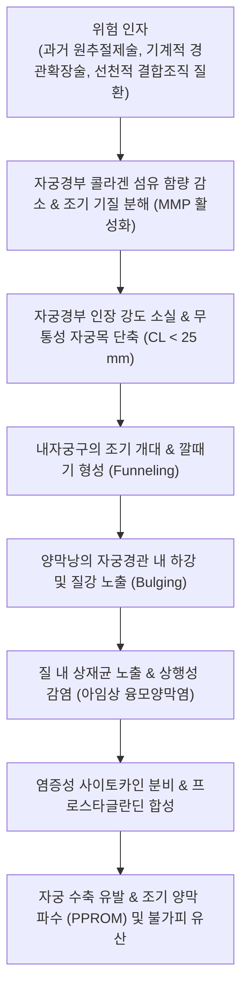

# 🩺 자궁경부 부전 (Cervical Insufficiency / 子宮頸部 不全)

> **핵심 3줄 요약 (Key Summary)**:
> - 📍 **병소 부위 & 해부·병태생리**: 임신 중반기(임신 16~24주)에 뚜렷한 자궁 수축이나 진통 없이 자궁경부(Cervix) 섬유성 결합조직의 구조적 결함으로 인해 자궁경관이 조기에 무통성으로 개대 및 소실(Effacement)되는 질환.
> - 🚩 **전형적 임상 양상**: 무통성(또는 경미한 골반 압박감) 자궁경관 개대, 질 분비물(점액성, 혈성 이슬)의 갑작스러운 증가, 조기 양막 팽출(Bulging membrane) 및 양막 파수, 임신 중반기 습관성 유산 또는 극조산(Extreme preterm birth).
> - 🛠️ **핵심 검사 & 치료 전략**: 질식 초음파를 통한 자궁경부 길이(CL < 25 mm) 및 깔때기 형성(Funneling) 측정; 1차 치료로 **자궁경부 원주봉합술(Cervical Cerclage, 맥도날드/시로드카 술기)** 및 질 프로게스테론 투여, 한의학적 보신안태·익기승제(태산반석산/보중익기탕) 병용.
> - ⚠️ **응급 의뢰 레드플래그**: 임신 24주 이전 양막이 질강 내로 완전히 탈출한 응급 상황(진행된 융모양막염 배제 후 응급 구제 봉합술 필요), 활성 융모양막염 징후(모체 발열, 악취 질분비물, 자궁 압통), 활성 자궁 수축 동반 시 상급병원 고위험산모집중치료실 즉각 전원.

---

## 📌 목차
1. [질환 개요 & 해부학적 병태생리](#1--질환-개요---해부학적-병태생리)
2. [병태생리 메커니즘 & 생체역학적 악순환 네트워크](#2--병태생리-메커니즘---생체역학적-악순환-네트워크)
3. [임상 증상 & 이학적 검사 알고리즘](#3--임상-증상---이학적-검사-알고리즘)
4. [감별 진단 매트릭스](#4--감별-진단-매트릭스)
5. [한의 통합 치료 프로토콜](#5--한의-통합-치료-프로토콜)
6. [양방 치료 & 병용·의뢰 기준](#6-양방-치료--병용의뢰-기준)
7. [재활 운동 & 생활습관 티칭 가이드](#7--재활-운동---생활습관-티칭-가이드)
8. [💡 사용자 진료실 핵심 필기 & 임상 노하우](#8--사용자-진료실-핵심-필기---임상-노하우)
9. [📚 출처 및 현대 학술 연구 요약 (References)](#9--출처-및-현대-학술-연구-요약-references)

---

## 1. 질환 개요 & 해부학적 병태생리

### 1) 질환 정의 및 임상적 중요성
- **자궁경부 부전(자궁경부 무력증, Cervical Insufficiency)**은 임신 중반기(주로 임신 16~24주)에 임상적인 진통이나 자궁 수축 없이 자궁목이 스스로 부드러워지고 열려 태아와 양막을 지탱하지 못하는 상태이다.
- 전체 임신의 약 0.5~1%에서 발생하지만, 임신 16~24주 사이에 일어나는 임신 중반기 유산 및 조산의 약 15~20%를 차지하는 주요 원인이다.
- 과거 임신 중반기 무통성 유산의 기왕력이 있는 산모는 다음 임신 시 재발률이 30%를 상회한다.

### 2) 자궁경부의 결합조직 해부학
- 자궁체부가 대부분 평활근으로 이루어진 것과 달리, 정상 자궁경부는 약 85~90%의 **세포외 기질(콜라겐 I형, III형 결합조직)**과 10~15%의 평활근으로 구성된다.
- 정상 임신에서는 치밀한 콜라겐 교차결합(Cross-linking)이 유지되어 팽창하는 자궁 내 압력을 견고하게 막아주는 기계적 괄약근 역할을 수행한다.
- 자궁경부 부전에서는 선천적 또는 후천적 원인([[자궁경부 폴립]] 또는 [[자궁경부암]] 선별을 위한 원추절제술, [[자궁근종]] 수술 기왕력)으로 콜라겐 섬유의 비율이 감소하고, 기질단백분해효소(MMP)에 의해 조기에 기질이 분해되면서 경부 인장 강도(Tensile strength)가 붕괴된다.
- 임신 중 [[에스트로겐]]과 [[프로게스테론]]의 결합조직 리모델링 조절 이상이 동반된다.

---

## 2. 병태생리 메커니즘 & 생체역학적 악순환 네트워크

### 1) 구조적 파탄과 무통성 개대
- 자궁경관 내자궁구(Internal os)가 중력과 양수 압력을 이기지 못하고 V자 또는 U자 모양으로 벌어지는 **깔때기 형성(Funneling)**이 시작된다.
- 산모는 진통을 전혀 느끼지 못하지만 경관 길이는 빠르게 짧아져 결국 외자궁구까지 열린다.
- 이 과정에서 [[질출혈]]이나 [[골반대 통증]]과 유사한 하복부 둔통이 동반될 수 있다.

### 2) 상행 감염과 조산의 연결 고리
- 양막이 질 내로 노출되면 정상 질 미생물총에 노출되어 무균 상태여야 할 양막과 탈락막에 염증(Chorioamnionitis)이 발생한다.
- 이 염증 반응이 2차적으로 [[프로스타글란딘]]과 [[옥시토신]] 수용체를 자극하여 자궁 수축을 촉발함으로써 임신이 종결되는 악순환을 밟는다.

---

## 3. 임상 증상 & 이학적 검사 알고리즘

### 1) 주요 임상 양상
- **무증상 (Asymptomatic)**: 통증이나 배뭉침이 전혀 없어 정기 초음파 검진에서 우연히 발견되는 경우가 흔함.
- **경미한 자각 증상**:
  - 질 내 이물감 또는 "밑이 빠질 것 같은" 골반 하수감/압박감.
  - 질 분비물의 갑작스러운 변화: 맑은 물 같은 점액성 분비물 또는 갈색/선홍색 이슬(Show).
  - 경미한 생리통 유사 하복부 불쾌감.

### 2) 초음파 검사 및 평가 지표 (TVS)
- **질식 초음파 (Transvaginal Ultrasound, TVS)**:
  - 방광을 비운 상태에서 측정하는 표준 검사법.
  - **자궁경부 길이(Cervical Length, CL) < 25 mm** (임신 16~24주 기준)인 경우 고위험군으로 진단.
  - 경부 깔때기 형성(Funneling, T-Y-V-U 진행 단계).
  - 경부 자궁저부 압박 검사(Fundal pressure test): 자궁저부를 손으로 누를 때 경관이 동적으로 벌어지는 현상 관찰.

---

## 4. 감별 진단 매트릭스

| 질환명 | 주 증상 및 통증 유무 | 자궁경부 변화 | 자궁 수축 유무 | 1차 표준 치료 |
| :--- | :--- | :--- | :--- | :--- |
| **자궁경부 부전** | **진통 없음(무통성)**, 질 분비물 증가, 조기 양막 팽출 | 경관 조기 단축(< 25mm), U자형 깔때기 형성 | **자궁 수축 없음** | 자궁경부 원주봉합술(Cerclage) |
| **조기 진통 (Preterm Labor)** | 규칙적인 하복부 진통(20분에 4회 이상), 생리통 유사 | 수축에 동반되어 경관 개대 및 소실 진행 | **규칙적 자궁 수축 존재** | 자궁수축억제제(Tocolytics), 스테로이드 |
| **태반 조기 박리** | 심한 복통, 판자형 자궁 과긴장, 질출혈 | 경부 개대와 무관 | 자궁 지속적 과긴장 | 응급 제왕절개 분만 |
| **전치 태반** | 무통성 선홍색 대량 질출혈 | 내자궁구를 태반이 덮고 있음 | 수축 없음 | 절대 침상안정, 질경/내진 절대 금기 |

---

## 5. 한의 통합 치료 프로토콜

### 1) 한의 변증 분류
- **신허태원불고형 (腎虛胎元不固型)**:
  - 주증: 과거 임신 중반기 습관성 유산 병력, 요슬산연(허리와 무릎 시림), 태동불안, 소변 빈삭, 설담태백, 맥침세척약.
  - 치법: 보신안태(補腎安胎), 고충지혈(固衝止血).
  - 처방: [[수태환]](壽胎丸) 또는 [[태산반석산]](泰山磐石散) 가감 (토사자 15g, 상기생 15g, 속단 12g, 아교 10g, 황기 15g, 인삼 8g, 백출 10g, 당귀 8g, 백작약 10g).
- **비허기함형 (脾虛氣陷型)**:
  - 주증: 밑이 빠질 것 같은 하수감(중기하함), 만성 피로, 식욕 부진, 대변 연변, 안면 창백, 설담태백, 맥연무력.
  - 치법: 건비익기(健脾益氣), 승양거함(升陽擧陷).
  - 처방: [[보중익기탕]](補中益氣湯) 가 두충, 속단, 백출 (황기 20g, 인삼 8g, 백출 12g, 당귀 8g, 진피 6g, 승마 4g, 시호 4g, 감초 4g).

### 2) 침구 치료 프로토콜
- **주요 혈위**:
  - [[백회]](GV20) — 승양거함(처진 장기와 기운을 끌어올림).
  - [[족삼리]](ST36), [[삼음교]](SP6), [[신수]](BL23) — 비신 기혈 보강.
- **금기 혈위 (절대 금기)**:
  - 임신 중 [[합곡]](LI4), [[삼음교]](SP6) 강자극, [[지음]](BL67), [[견정]](GB21)은 자궁 수축을 유발할 수 있으므로 강자극을 철저히 배제하고 부드러운 보법만 적용한다.

---

## 6. 양방 치료 & 병용·의뢰 기준

### 1) 자궁경부 원주봉합술 (Cervical Cerclage)
- **적응증별 분류**:
  - **기왕력 기반 봉합술 (History-indicated)**: 과거 1회 이상의 임신 중반기 무통성 조산 병력이 있는 산모에게 임신 12~14주경 예방적 시행.
  - **초음파 기반 봉합술 (Ultrasound-indicated)**: 조산 기왕력이 있는 산모가 추적 초음파상 임신 24주 이전 경부 길이 < 25 mm로 단축된 경우 시행.
  - **신체검진 기반/응급 구제 봉합술 (Physical exam-indicated/Rescue)**: 자궁경부가 이미 1~4cm 개대되고 양막이 관찰되는 경우 융모양막염 배제 후 긴급 시행.
- **대표 술기**:
  - **맥도날드 술기 (McDonald technique)**: 질식 접근으로 외자궁구 상부 경관을 원형으로 쌈지봉합(Purse-string suture)하는 가장 보편적 술식.
  - **시로드카 술기 (Shirodkar technique)**: 방광과 직장 점막을 박리하여 내자궁구에 더 가깝게 높은 위치에서 결찰.
  - 결찰사 제거: 통상 임신 36~37주경 외래에서 실을 제거하여 자연 진통을 유도.

### 2) 질식 프로게스테론 요법 (Vaginal Progesterone)
- 단태아이면서 조산 기왕력이 없으나 임신 24주 이전 경부 길이가 25 mm 이하로 단축된 경우 매일 취침 전 질식 미분화 프로게스테론 200 mg을 임신 36주까지 투여하여 조산 위험을 약 30~40% 감소시킴.

---

## 7. 재활 운동 & 생활습관 티칭 가이드

### 1) 침상 안정 및 활동 제한
- **트렌델렌버그 체위 (Trendelenburg position)**:
  - 봉합술 전후 또는 양막 팽출 시 골반을 높여 양수 압력이 경부에 직접 가해지는 것을 줄인다.
- **복압 상승 활동 금지**:
  - 무거운 물건 들기, 장시간 서 있기, 계단 오르기, 배변 시 과도하게 힘주기를 피한다.

### 2) 성생활 금지
- 임신 중반기 자궁경부 단축이 확인되거나 봉합술을 시행한 산모는 감염 및 물리적 자극 예방을 위해 출산 시까지 성관계를 엄격히 금한다.

---

## 8. 💡 사용자 진료실 핵심 필기 & 임상 노하우

### 1) 진료실 핵심 감별 포인트
- 임신 18~20주경 산모가 "배는 전혀 안 아픈데 맑은 냉이 왈칵 쏟아지고 밑이 묵직하게 빠지는 느낌이 든다"고 내원하면 한약 안태약만 처방해 보내서는 절대 안 된다.
- 이것은 자궁경관이 열려 양막이 질 속으로 빠져나오고 있는 절체절명의 신호이므로, 즉시 산부인과에 연락하여 질식 초음파로 경부 길이를 측정하고 필요 시 당일 응급 맥도날드 수술을 받도록 해야 산모와 태아를 살릴 수 있다.

---

## 9. 📚 출처 및 현대 학술 연구 요약 (References)

- Hezelgrave NL, et al. (2026). The Case for History-Indicated Cerclage: A Patient-Centered Approach to Preventing Preterm Birth. *Am J Obstet Gynecol*. PMID: 42359895.

- Roman A, et al. (2026). Ultrasound-indicated cerclage as a critical decision window in cervical insufficiency: a clinical review. *Am J Obstet Gynecol MFM*. PMID: 42688633.

- Alfirevic Z, et al. (2025). Guidelines on cerclage placement: a comparative systematic review. *Am J Obstet Gynecol*. PMID: 40541862.
