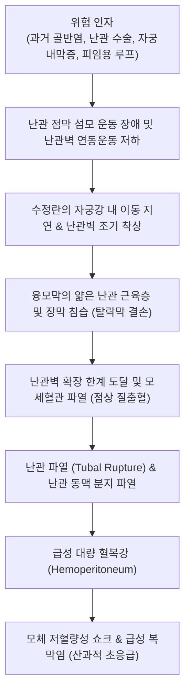

# 🩺 자궁외 임신 (Ectopic Pregnancy / 子宮外 姙娠)

> **핵심 3줄 요약 (Key Summary)**:
> - 📍 **병소 부위 & 해부·병태생리**: 수정란이 정상적인 자궁내막 강(Endometrial cavity) 이외의 부위, 특히 **난관 팽대부(Ampulla of fallopian tube, 95% 이상)**, 난관 협부, 난소, 복강, 자궁경부, 제왕절개 반흔 등에 비정상적으로 착상하여 발생하는 산과적 급성 질환.
> - 🚩 **전형적 임상 양상**: 임신 초기(임신 6~8주경) 무월경 후 발생하는 **일측성 하복부 산통**, 점상 질출혈(Spotting), 복막 자극 징후, 파열 시 대량 혈복강으로 인한 급성 쇼크(어지러움, 견갑통, 실신).
> - 🛠️ **핵심 검사 & 치료 전략**: 혈청 정량 $\beta$-hCG 측정 및 질식 초음파(TVS)를 통한 자궁강 내 태낭 부재 및 부속기 종괴 확인(판별 역치 $\beta$-hCG 1,500~2,000 mIU/mL); 조기 발견 시 **[[메토트렉세이트]](MTX) 전신 근육주사 요법**, 파열/혈역학적 불안정 시 **응급 복강경하 난관절제술(Salpingectomy)**, 수술 후 한의학적 활혈거어·익기양혈(궁외임신방) 병용.
> - <font color="#fa7e7e">⚠️ **응급 의뢰 레드플래그**: 난관 파열로 인한 대량 내출혈 징후(갑작스러운 복부 팽만, 복벽 강직 및 반발통, 혈압 저하, 빈맥, 횡격막 자극에 의한 어깨 통증 Kehr's sign) 확인 시 즉각 119 및 산부인과 응급 수술실 이송.</font>

---

## 📌 목차
1. [질환 개요 & 해부학적 병태생리](#1--질환-개요---해부학적-병태생리)
2. [병태생리 메커니즘 & 생체역학적 악순환 네트워크](#2--병태생리-메커니즘---생체역학적-악순환-네트워크)
3. [임상 증상 & 이학적 검사 알고리즘](#3--임상-증상---이학적-검사-알고리즘)
4. [감별 진단 매트릭스](#4--감별-진단-매트릭스)
5. [한의 통합 치료 프로토콜](#5--한의-통합-치료-프로토콜)
6. [양방 치료 & 병용·의뢰 기준](#6-양방-치료--병용의뢰-기준)
7. [재활 운동 & 생활습관 티칭 가이드](#7--재활-운동---생활습관-티칭-가이드)
8. [💡 사용자 진료실 핵심 필기 & 임상 노하우](#8--사용자-진료실-핵심-필기---임상-노하우)
9. [📚 출처 및 현대 학술 연구 요약 (References)](#9--출처-및-현대-학술-연구-요약-references)

---

## 1. 질환 개요 & 해부학적 병태생리

### 1) 질환 정의 및 발생 빈도
- **자궁외 임신(이소성 임신, Ectopic Pregnancy)**은 수정란이 정상적인 자궁체부 내막 이외의 장소에 착상한 임신을 총칭한다.
- 전체 임신의 약 1~2%에서 발생하지만, 임신 제1삼분기(초기 3개월) 모성 사망의 가장 흔한 원인 질환이다.
- 최근 보조생식술(시험관 아기 시술, IVF)의 증가, [[골반염]](PID) 및 클라미디아 감염 증가, 과거 골반 수술 기왕력 등으로 인해 발생 빈도가 꾸준히 유지되고 있다.
- 환자에게 [[난임]] 및 향후 생식력 저하를 초래할 수 있는 중요한 부인과 질환이다.

### 2) 해부학적 착상 부위 분류
- **난관 임신 (Tubal Pregnancy, 약 95~97%)**:
  - **팽대부 (Ampulla)**: 약 70%로 가장 흔함 (난관 내경이 넓어 파열이 비교적 늦은 8~12주경 발생).
  - **협부 (Isthmus)**: 약 12% (내경이 좁아 6~8주경 조기 파열 다발).
  - **채부 (Fimbria)**: 약 11% (복강 내로 난관 유산 다발).
  - **간질부 / 간질부위 (Interstitial / Cornual)**: 약 2~3% (자궁근층과 연결된 부위로 혈관이 매우 풍부하여 임신 12~16주경 지연 파열 시 치명적 대량 출혈 유발).
- **비난관성 이소성 임신 (Non-tubal, 약 3~5%)**:
  - 난소 임신(Ovarian, 3%), 복강 임신(Abdominal, 1%), [[자궁경부염|자궁경부 임신]](Cervical, < 1%), [[제왕절개술|제왕절개]] 반흔 임신(Cesarean scar pregnancy, CSP).

---

## 2. 병태생리 메커니즘 & 생체역학적 악순환 네트워크



### 1) 난관 수송 기능 저하
- 클라미디아나 임균에 의한 골반염은 난관 점막 섬모를 파괴하고 관강 내 섬유성 유착을 유발한다.
- 수정란이 배아 발달 과정을 거치며 커지는 동안 자궁강으로 내려가지 못하고 난관 점막에 안착하여 착상하게 된다.
- [[자궁내막증]] 또는 골반 수술 후 유착도 난관의 물리적 폐쇄와 연동 운동 장애를 유발한다.

### 2) 탈락막 결손과 조기 파열
- 자궁내막과 달리 난관벽에는 태반의 침습을 방어하는 두터운 탈락막(Decidua) 방어벽이 없다.
- 영양막 세포(Trophoblast)가 얇은 난관 평활근층을 직접 침식하고 혈관벽을 뚫고 들어가 결국 팽창을 견디지 못하고 난관벽이 파열된다.
- 파열 시 [[출산 시 과다 자궁 출혈|대량 복강내 출혈]]과 혈종 형성이 뒤따른다.

---

## 3. 임상 증상 & 이학적 검사 알고리즘

### 1) 고전적 3대 임상 양상
- **무월경 (Amenorrhea)**: 대개 생리 예정일보다 1~2주 이상 지연된 병력 (임신 6~8주).
- **골반 및 하복부 통증**:
  - 파열 전: 일측성 하복부의 둔통 또는 산통.
  - 파열 후: 칼로 찌르는 듯한 극심한 돌발성 복통, 전복부로 확산되는 복막자극통.
- **비정상 질출혈 (Abnormal Bleeding)**:
  - 흑갈색의 소량 점상 출혈이 간헐적으로 지속됨 (자궁내막 탈락막의 불완전 탈락에 기인).
- **파열 및 복강 내 출혈 징후**:
  - **커 증후(Kehr's sign)**: 복강 내 혈액이 횡격막 신경(C3~C5)을 자극하여 발생하는 편측 어깨 끝 통증.
  - 현기증, 식은땀, 실신(Syncope), 빈맥, 저혈압.

### 2) 진단 알고리즘
```mermaid
flowchart TD
    D1["가임기 여성의 무월경 + 일측성 복통 + 질출혈 내원"] --> D2["혈청 정량 β-hCG 측정 및 질식 초음파 (TVS)"]
    D2 -->|β-hCG ≥ 1,500~2,000 mIU/mL| D3["판별 역치 (Discriminatory Zone) 도달"]
    D3 -->|자궁강 내 태낭(GS) 없음 + 부속기 종괴 관찰| D4["자궁외 임신 확진"]
    D2 -->|β-hCG < 1,500 mIU/mL & 초음파상 불명확| D5["위치불명 임신 (PUL): 48시간 후 β-hCG 추적 검사"]
    D5 -->|48시간 후 증가율 < 35% 또는 정체/감소| D6["비정상 임신 판정 → 자궁외 임신 준하여 처치"]
```

---

## 4. 감별 진단 매트릭스

| 질환명 | $\beta$-hCG 양상 | 초음파 소견 | 통증 양상 | 1차 조치 |
| :--- | :--- | :--- | :--- | :--- |
| **자궁외 임신** | 48시간 증가율 < 50% (비정상 상승), 1500 이상 시에도 GS 없음 | 자궁강 내 태낭 결여, 부속기 복합 에코성 종괴, 더글라스와 유체 저류 | 일측성 산통, 파열 시 극심한 복통 및 쇼크 | MTX 약물 요법 / 복강경 수술 |
| **[[자연 유산|절박 유산]]** | 정상 증가 또는 경미한 저하 | 자궁강 내 태낭 관찰됨, 태아 심박동 확인 가능 | 경미한 하복부 생리통 유사 통증 | 침상 안정, 프로게스테론 보충 |
| **난소 낭종 염전 / 파열** | 음성 (비임신) | 비대된 난소 낭종, 도플러상 난소 혈류 소실 | 돌발적인 극심한 편측 산통, 구토 | 응급 복강경하 난소 낭종 절제술 |
| **급성 충수돌기염** | 음성 (비임신) | 충수돌기 직경 > 6mm, 압박 불가 | 심와부 통증 후 우하복부(McBurney) 국소화 | 충수절제술 |

---

## 5. 한의 통합 치료 프로토콜

> ⚠️ **주의**: 자궁외 임신 파열 및 혈역학적 불안정 환자는 100% 산부인과 응급 수술 적응증이다. 한의 치료는 혈역학적으로 완전히 안정되고 $\beta$-hCG가 낮아 MTX 보존 요법을 시행 중인 경우, 또는 **수술 후 잔류 어혈 배출 및 난관 개통성 회복, 차기 임신 준비기**에 적용한다.

### 1) 한의 변증 분류
- **어혈결체·태어부정형 (瘀血結滯·胎瘀不正型)** — 수술 후 회복기:
  - 주증: 수술 후 하복부 둔통, 오로 부전, 잔류 혈종, 설암자, 어반, 맥침삽.
  - 치법: 활혈거어(活血祛瘀), 소징지통(消癥止痛).
  - 처방: [[궁외임신방]](宮外孕方) 또는 [[소복축어탕]](少腹逐瘀湯) 가감 (적작약 15g, 단삼 15g, 도인 10g, 삼릉 8g, 봉출 8g, 유향 6g, 몰약 6g, 익모초 20g, 연호색 10g).
- **기혈양허형 (氣血兩虛型)**:
  - 주증: 실혈 후 어지러움, 피로, 면색 창백, 자한, 설담태백, 맥세약.
  - 치법: 보기양혈(益氣養血), 조경통락(調經通絡).
  - 처방: [[팔진탕]](八珍湯) 가 황기, 단삼, 향부자.

### 2) 침구 치료
- **주요 혈위**: [[삼음교]](SP6), [[혈해]](SP10), [[관원]](CV4), [[기해]](CV6), [[태충]](LR3), [[중극]](CV3), [[족삼리]](ST36).
- **효능**: 골반강 내 미세혈류 촉진, 잔류 혈종 흡수 및 골반 유착 예방.

---

## 6. 양방 치료 & 병용·의뢰 기준

### 1) 내과적 약물 요법 (Methotrexate, MTX)
- **적응증 (엄격한 기준 충족 필수)**:
  - 혈역학적으로 안정적(정상 혈압, 맥박).
  - 파열의 증거가 없고 심한 복통이 없음.
  - 혈청 $\beta$-hCG < 5,000 mIU/mL.
  - 초음파상 자궁외 종괴 직경 < 3.5~4.0 cm, 태아 심박동(FHB) 없음.
  - 환자의 추적 검사 순응도가 확실함.
- **프로토콜**:
  - 단일 용량 요법(Single-dose): 체표면적당 **MTX 50 mg/$m^2$ 근육주사(IM)**.
  - Day 4와 Day 7에 $\beta$-hCG 측정: Day 4 대비 Day 7 감소율이 15% 이상이면 매주 추적 검사(음성화될 때까지); 15% 미만 감소 시 MTX 2차 투여 또는 수술 고려.

### 2) 수술적 치료 (Surgical Management)
- **복강경 수술 (Laparoscopy)** — 표준 수술법:
  - **난관절제술 (Salpingectomy)**: 파열되었거나, 난관 손상이 심하거나, 가족 계획을 마친 경우, 반대측 난관이 정상인 경우 1차 선택.
  - **난관절개술 (Salpingostomy)**: 반대측 난관이 폐색/결손되어 가임력 보존이 절실한 경우 난관 벽을 절개하여 임신 산물만 제거하고 봉합 (수술 후 잔류 영양막 증식 위험 있어 $\beta$-hCG 추적 필수).
  - 과다 출혈 시 [[수혈]] 및 [[저혈량성 쇼크]] 치료 병행.

---

## 7. 재활 운동 & 생활습관 티칭 가이드

### 1) MTX 투여 중 주의사항
- **엽산 섭취 절대 금지**: 엽산(Folic acid)은 MTX의 길항제이므로 비타민제나 엽산 보충제 복용을 즉시 중단한다.
- **파열 유발 활동 제한**: 가스 생성 음식 제한, 성관계 금지, 격렬한 운동 및 복부 압박 금지 (난관 파열 방지).

### 2) 차기 임신 관리
- 자궁외 임신 기왕력 환자는 다음 임신 시 재발률이 약 10~15%에 달하므로, 다음 임신 시 생리가 지연되는 즉시 산부인과에 내원하여 조기 초음파로 정상 착상 여부를 확인해야 한다.

---

## 8. 💡 사용자 진료실 핵심 필기 & 임상 노하우

### 1) 진료실 핵심 체크포인트
- 가임기 여성이 "생리가 조금 늦어졌는데 갈색 피가 찔끔거리고 오른쪽 아랫배가 콕콕 쑤셔요"라고 내원하면 무조건 **소변 임신반응검사(hCG)**부터 확인해야 한다.
- 환자가 "피임약을 먹고 있어서 임신일 리가 없다"고 하더라도 절대 방심하지 말고 검사해야 하며, 양성이 나오면 즉시 초음파가 가능한 산부인과로 직행시켜야 난관 파열로 인한 생명의 위협을 막을 수 있다.

---

## 9. 📚 출처 및 현대 학술 연구 요약 (References)

- Turok DK, et al. (2026). Diagnostic Terminology and Clinical Practice in Interstitial Ectopic Pregnancy: A Consensus Statement. *Obstet Gynecol*. PMID: 42859738.

- Chen X, et al. (2026). Letrozole in ectopic pregnancy: exploring a promising frontier in non-surgical treatment. *Reprod Biol Endocrinol*. PMID: 42663163.

- Mol F, et al. (2026). Comparative efficacy of tube-sparing interventions for tubal ectopic pregnancy: a systematic review and network meta-analysis. *Hum Reprod Update*. PMID: 42468117.
