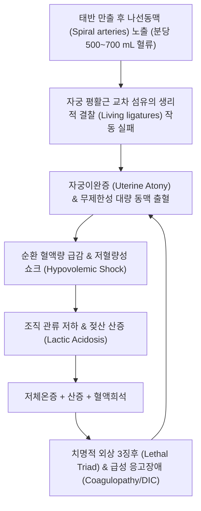
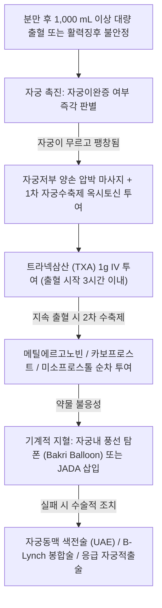

# 🩺 출산 시 과다 자궁 출혈 (Postpartum Hemorrhage / 産後 出血)

> **핵심 3줄 요약 (Key Summary)**:
> - 📍 **병소 부위 & 해부·병태생리**: 분만 후 24시간 이내에 발생하는 **1,000 mL 이상의 누적 실혈량** 또는 분만 후 저혈량증(Hypovolemia)의 징후 및 증상을 동반한 출혈; **4T 기전**(자궁이완증 Tone, 잔류태반 Tissue, 산도열상 Trauma, 혈액응고장애 Thrombin) 중 **자궁무력증(Uterine atony, 70~80%)**이 최다 원인.
> - 🚩 **전형적 임상 양상**: 태반 만출 후 질강을 통한 멈추지 않는 대량 출혈, 촉진 시 자궁이 부드럽고 무르게 팽창되어 만져짐(Atonic boggy uterus), 빈맥(> 110회/분), 저혈압(수축기압 < 90 mmHg), 식은땀, 안면 창백, 의식 저하.
> - 🛠️ **핵심 검사 & 치료 전략**: 자궁저부 양손 도수 압박 및 마사지, 1차 자궁수축제(**[[옥시토신]]**, 메틸에르고노빈, 카보프로스트, 미소프로스톨), 항섬유소용해제(**[[트라넥삼산]]**, TXA), 자궁내 풍선 카테터(Bakri) 또는 음압 흡인 장치(JADA), 불응 시 자궁동맥 색전술(UAE) 또는 B-Lynch 봉합술/자궁적출술; 회복기 한의학적 대보원기·익기지혈(독삼탕/생화탕) 병용.
> - ⚠️ **응급 의뢰 레드플래그**: 지속적이고 통제되지 않는 대량 출혈, 활력징후 붕괴(Shock Index = HR/SBP ≥ 1.0), 파종성 혈관내 응고(DIC) 소견 시 1분 1초를 다투는 생명 위협 상황이므로 산과 대량 수혈 프로토콜(MTP) 즉각 가동 및 상급 수술실 긴급 처치.

---

## 📌 목차
1. [질환 개요 & 해부학적 병태생리](#1--질환-개요---해부학적-병태생리)
2. [병태생리 메커니즘 & 생체역학적 악순환 네트워크](#2--병태생리-메커니즘---생체역학적-악순환-네트워크)
3. [임상 증상 & 이학적 검사 알고리즘](#3--임상-증상---이학적-검사-알고리즘)
4. [감별 진단 매트릭스](#4--감별-진단-매트릭스)
5. [한의 통합 치료 프로토콜](#5--한의-통합-치료-프로토콜)
6. [양방 치료 & 병용·의뢰 기준](#6-양방-치료--병용의뢰-기준)
7. [재활 운동 & 생활습관 티칭 가이드](#7--재활-운동---생활습관-티칭-가이드)
8. [💡 사용자 진료실 핵심 필기 & 임상 노하우](#8--사용자-진료실-핵심-필기---임상-노하우)
9. [📚 출처 및 현대 학술 연구 요약 (References)](#9--출처-및-현대-학술-연구-요약-references)

---

## 1. 질환 개요 & 해부학적 병태생리

### 1) 질환 정의 (ACOG 및 재정의 기준)
- **산후 출혈(Postpartum Hemorrhage, PPH)**은 전통적으로 질식 분만 후 500 mL 이상, 제왕절개 후 1,000 mL 이상의 출혈로 정의되었으나, 최근 **ACOG(미국산부인과학회) 재정의에 따라 "분만 방식에 관계없이 24시간 이내의 누적 실혈량 1,000 mL 이상, 또는 실혈량과 무관하게 저혈량증 징후를 동반한 출혈"**로 통일되었다.
- 전 세계적으로 모성 사망 원인 1위(약 27%)를 차지하는 가장 위중한 산과적 응급 질환이다.

### 2) 4T 병태생리학적 분류
- **Tone (자궁 무력증/자궁이완증, 70~80%)**: 태반 만출 후 자궁 평활근이 적절히 수축하지 못하여 혈관을 조이지 못함.
- **Tissue (태반 조직 잔류, 10%)**: 태반 조각, 부태반, 탈락막의 잔류(RPOC) 또는 유착태반(Placenta accreta spectrum).
- **Trauma (산도 열상 및 혈종, 10~15%)**: 자궁경부 열상, 질벽 파열, 회음부 열상, 자궁 파열.
- **Thrombin (응고장애, 1%)**: 혈소판감소증, 혈우병, 양수색전증 또는 대량 출혈 후 초래된 DIC.

---

## 2. 병태생리 메커니즘 & 생체역학적 악순환 네트워크

### 1) '생체 결찰사(Living Ligatures)' 기전
- 임신 말기 자궁태반 혈류량은 분당 500~800 mL(심박출량의 10~15%)에 달한다.
- 태반이 떨어져 나가면 자궁 평활근의 격자형(Figure-of-eight) 근육 다발이 강력하게 수축하여 혈관을 물리적으로 비틀어 짜매는 '생체 결찰사' 역할을 해야 한다.
- 다태임신, 거대아, 양수과다증(자궁 과다팽창), 장시간 진통, 융모양막염 등으로 근육 피로가 발생하면 이 기전이 마비된다.

### 2) 치명적 3징후(Lethal Triad)와 DIC 악순환
- 대량 출혈이 지속되면 수액 소생술로 인한 희석, 저체온증, 조직 저산소증에 의한 대사성 산증이 결합하여 응고 인자 활성이 붕괴된다.
- 이로 인해 전신 모세혈관에서 피가 멎지 않는 파종성 혈관내 응고(DIC)가 발생하여 환자가 급속도로 사망에 이르게 된다.

---

## 3. 임상 증상 & 이학적 검사 알고리즘

### 1) 주요 임상 증상
- **외인성 대량 질출혈**: 패드가 수 분 만에 흠뻑 젖고 혈괴(Clot)가 쏟아져 나옴.
- **자궁 촉진 소견**: 하복부 자궁저부가 배꼽 위까지 올라와 있고 단단하지 않으며 스펀지처럼 물렁물렁하게 만져짐.
- **쇼크 지수 (Shock Index, SI)**:
  - $\text{SI} = \frac{\text{심박수(HR)}}{\text{수축기혈압(SBP)}}$
  - 정상 < 0.7~0.9. **SI ≥ 1.0**이면 잠재적 대량 출혈 및 중증 쇼크를 의미하며, 적극적인 수혈 준비 신호.

### 2) 응급 진단 및 지혈 알고리즘

---

## 4. 감별 진단 매트릭스 (4T Differential)

| 원인 범주 (4T) | 주 원인 질환 | 자궁 촉진 소견 | 특징적 소견 | 1차 처치 |
| :--- | :--- | :--- | :--- | :--- |
| **Tone (70%)** | 자궁이완증 (Uterine atony) | 매우 부드럽고 팽창됨 (Boggy) | 대량의 혈괴, 마사지 시 일시적 수축 | 자궁 마사지 + 옥시토신 + TXA |
| **Tissue (10%)** | 태반 잔류(RPOC), 유착태반 | 수축은 비교적 양호하나 출혈 지속 | 만출된 태반 결손 확인, 초음파상 음영 | 도수 태반 제거술 / 흡입 소파술 |
| **Trauma (15%)** | 질/경부 열상, [[자궁 파열]] | **자궁이 돌처럼 단단하게 수축되어 있음** | 자궁 수축 양호함에도 선홍색 피가 뿜어져 나옴 | 질경 시야 하 열상 봉합술 |
| **Thrombin (1%)** | 소모성 응고장애, [[혈소판]] 감소증 | 초기 수축 양호하나 점차 이완 | 혈액이 굳지 않고 물처럼 흐름, 천자 부위 삼출 | FFP, 혈소판, 동결침전제재 수혈 |

---

## 5. 한의 통합 치료 프로토콜

> ⚠️ **주의**: 산후 대량 출혈 급성기는 1분 1초를 다투는 생명 위협 상태로 양방 응급 지혈 처치가 절대적이다. 한의 치료는 급성 출혈이 잡힌 직후 **출혈 쇼크 후 회복기(기혈 고갈, 극심한 빈혈, 자궁 퇴축부전)**에 조혈 및 기혈 회복을 위해 투여한다.

### 1) 한의 변증 분류 (회복기)
- **기허불섭혈·망양형 (氣虛不攝血·亡陽型)**:
  - 주증: 대량 출혈 후 사지궐냉, 식은땀, 안면 창백, 호흡 미약, 실신, 설담무태, 맥미세욕절.
  - 치법: 대보원기(大補元氣), 익기이고탈(益氣以固脫).
  - 처방: [[독삼탕]](獨參湯) (인삼 30~50g) 급투, 또는 [[삼부탕]](參附湯) (인삼 20g, 부자 10g).
- **기혈양허·어혈잔류형 (氣血兩虛·瘀血殘留型)**:
  - 주증: 출혈 제어 후 지속되는 미열, [[자궁퇴축]] 부전, 림프 순환 저하, 어지러움, 설담암, 맥세약.
  - 치법: 보기생혈(補氣生血), 활혈화어(活血化瘀).
  - 처방: [[생화탕]](生化湯) 합 [[당귀보혈탕]](當歸補血湯) 가감 (황기 30g, 당귀 15g, 천궁 10g, 도인 8g, 익모초 20g, 포황 10g).

### 2) 침구 치료
- **주요 혈위**: [[백회]](GV20), [[기해]](CV6), [[관원]](CV4), [[족삼리]](ST36), [[은백]](SP1), [[삼음교]](SP6), [[혈해]](SP10).
- **효능**: 온양익기(溫陽益氣), 뜸 치료를 병행하여 비기(脾氣)의 혈액 통섭 기능을 재건한다.

---

## 6. 양방 치료 & 병용·의뢰 기준

### 1) 1차 약물 치료
- **자궁수축제 (Uterotonics)**:
  - **[[옥시토신]] (Oxytocin)**: 1차 선택제, 10~40 IU를 생리식염수 1L에 혼합하여 정맥 점적 투여 (절대 IV 볼루스 직접 투여 금지: 급성 저혈압 유발).
  - **[[트라넥삼산]] (Tranexamic Acid, TXA)**: 출혈 확인 3시간 이내에 1 g IV 투여 (출혈로 인한 모성 사망률 30% 감소 입증, WOMAN 트라이얼).
  - **메틸에르고노빈 (Methergine)**: 0.2 mg IM ([[고혈압]] 환자 금기).
  - **카보프로스트 (Hemabate, PGF2α 유도체)**: 0.25 mg IM ([[천식]] 환자 금기).
  - **미소프로스톨 (Misoprostol)**: 800~1,000 mcg 직장/설하 투여.

### 2) 기계적 및 수술적 중재술
- **자궁강내 탐폰 장치**:
  - **바크리 풍선 카테터 (Bakri Balloon)**: 자궁강 내에 삽입하여 생리식염수 300~500 mL를 주입해 내벽을 압박 지혈.
  - **JADA 시스템**: 질 내 음압 흡인 장치로 자궁을 수축시켜 신속 지혈.
- **수술 및 중재 영상의학**:
  - **자궁동맥 색전술 (UAE)**: 혈역학적으로 안정적인 상태에서 형광 투시하 혈관 색전.
  - **B-Lynch 봉합술**: 개복 하에 자궁을 멜빵 형태로 묶어 압박.
  - **응급 [[자궁적출술]]**: 모든 보존적 치료 실패 시 최종 생명 보존 수술.
  - [[저혈량성 쇼크]] 상태 교정을 위한 대량 [[수혈]] 병행.

---

## 7. 재활 운동 & 생활습관 티칭 가이드

### 1) 철분제 복용 및 조혈 영양
- 대량 실혈 후 체내 철분 저장량이 완전히 고갈되므로, 정맥 철분 주사제 투여 및 최소 3~6개월간 고용량 경구 철분제 복용을 지속한다.

### 2) 자궁 수축 촉진
- 모유 수유를 조기에 지속하여 내인성 옥시토신 분비를 유도하고 자궁의 완전한 퇴축을 돕는다.

---

## 8. 💡 사용자 진료실 핵심 필기 & 임상 노하우

### 1) 산후 출혈의 골든타임
- 출산 후 출혈은 "조금 더 지켜보자"는 태도가 사망을 부른다. 15분 만에 1L가 쏟아져 나올 수 있기 때문이다.
- 배를 만졌을 때 자궁이 야구공처럼 단단하게 잡히지 않고 물렁물렁하다면 수액 라인을 즉시 2개 잡고 옥시토신을 걸며 마사지를 시작해야 한다.
- 피가 멎지 않고 3시간이 경과하면 TXA의 효과도 급감하므로 조기 개입이 생명을 살리는 유일한 길이다.

---

## 9. 📚 출처 및 현대 학술 연구 요약 (References)

- Shields LE, et al. (2025). ACOG Clinical Practice Update: Use of Nonsurgical Hemorrhage-Control Devices for Postpartum Hemorrhage. *Obstet Gynecol*. PMID: 40743526.

- Wang L, et al. (2025). Efficacy and Safety of Early Administration of IV Tranexamic Acid in Postpartum Hemorrhage: A Systematic Review. *Eur J Obstet Gynecol*. PMID: 42411392.

- American College of Obstetricians and Gynecologists. (2006). ACOG Practice Bulletin: Clinical Management Guidelines for Obstetrician-Gynecologists Number 76: Postpartum Hemorrhage. *Obstet Gynecol*. PMID: 17012482.
