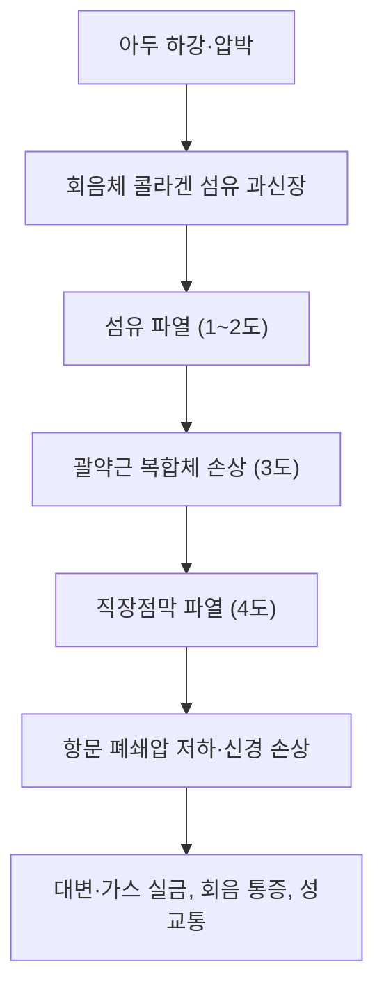

# 🩺 회음열상 (Perineal Laceration / Obstetric Anal Sphincter Injury, ICD-10 O70)

> 🖼️ 이미지: 2도 열상 삽화 1장(공유 저작물) 수록. 해부 구조는 [[회음부]] 노트 도해 참조.

> **핵심 3줄 요약 (Key Summary)**:
> - 📍 **병소 부위 & 병태생리**: 질구 후방 [[회음부]] 연조직과 회음체, 심하면 [[항문외괄약근]]·직장점막까지 분만 중 기계적 신장으로 파열된다.
> - 🚩 **전형적 임상 양상**: 분만 직후 회음부 통증·출혈·봉합 필요. 3·4도(산과 항문괄약근 손상, OASIS)는 대변 실금·가스 조절 실패로 이어진다.
> - 🛠️ **핵심 감별 & 치료 전략**: 열상 정도에 따른 단계별 봉합, 산후 골반저 재활, 산전 [[회음부 마사지]]로 위험 감소.
> - ⚠️ **응급 의뢰 레드플래그**: 4도 열상, 봉합 후 대변 실금 지속, 창상 감염·괴사, 대량 출혈은 즉시 산과·대장항문과 의뢰.

---

## 📌 목차
1. [질환 개요 & 병태생리](#1-질환-개요--병태생리)
2. [병태생리 메커니즘](#2-병태생리-메커니즘)
3. [임상 증상 & 소견](#3-임상-증상--소견)
4. [감별 진단 매트릭스](#4-감별-진단-매트릭스)
5. [한의 통합 치료 프로토콜](#5-한의-통합-치료-프로토콜)
6. [양방 치료 & 병용·의뢰 기준](#6-양방-치료--병용의뢰-기준)
7. [식이·생활습관 & 자가관리](#7-식이생활습관--자가관리)
8. [💡 진료실 핵심 필기](#8--진료실-핵심-필기)
9. [출처 및 학술 참고 문헌](#9-출처-및-학술-참고-문헌)

---

## 1. 질환 개요 & 병태생리

![[회음열상_01_열상_삽화.jpg|320]]
> [그림 1: 2도 회음열상 삽화 — 음순을 좌우로 벌린 상태에서 항문괄약근을 침범하지 않은 회음체 파열이 삼각형 창상으로 보이며, 파열은 통상 질구 후방 6시 방향에서 후방으로 진행한다 — 출처: Barton Cooke Hirst, *A Text-book of Obstetrics* (1898), Public Domain]

* **정의 및 분류 (RCOG 기준)**:
  * **1도** — 질 점막·회음부 피부만 손상, 봉합이 필요 없거나 최소.
  * **2도** — 회음체 근육까지 손상. 항문괄약근은 보존. 산과 열상의 대부분.
  * **3도 (OASIS)** — [[항문외괄약근]] 손상. 3a는 외괄약근 50% 미만, 3b는 50% 이상, 3c는 내괄약근까지.
  * **4도** — 항문점막까지 손상.
* **역학**: 질식분만의 상당수에서 회음부 외상이 발생하며, 3·4도 열상은 초산부·견갑난산·기구분만·4 kg 이상 태아·지속 후방후두위에서 빈도가 높다.
* **관련 구조**: [[회음부]] · 회음체 · [[골반저근]] · [[음부신경]](통증·감각) · [[항문외괄약근]](실금 결정 인자).

---

## 2. 병태생리 메커니즘

### 1) 조직 수준 기전
* 회음체는 콜라겐과 엘라스틴이 교차하는 건판이다. 분만 시 신장률이 조직 한계를 넘으면 섬유가 미세파열되고, 파열선이 후방으로 이어지면 괄약근까지 도달한다.
### 2) 기능 수준 결과
* 외괄약근은 수의적 폐쇄, 내괄약근은 정지 긴장을 담당한다. 내괄약근 손상(3c·4도)에서 실금이 더 완고하게 남는다. 손상 후 [[음부신경]] 가지의 견인 손상이 겹치면 폐쇄압 회복이 지연된다.
### 3) 위험인자와 예방 지점
* 초산, 고령 산모, 태아체중 증가, 기구분만, 분만 2기 지연, 정중 회음절개. 반대로 산전 [[회음부 마사지]]와 무절개(hands-on) 관리, 필요 시 정중측방 [[회음절개술]]이 예방 축이다.

---

## 3. 임상 증상 & 소견

### 1) 주소증
* 분만 직후 회음부 작열·압통, 앉을 때 통증, 봉합 부위 당김, 배뇨 시 통증.
* 3·4도에서는 가스 조절 실패, 설사 시 실금, 항문 긴장 저하.
### 2) 객관적 소견
* 시진으로 열상 범위·깊이 확인, 직장 수지검사로 괄약근 긴장과 점막 손상 확인.
* 산후 6~12주 평가에서 항문압측정·항문초음파로 괄약근 결손을 확인할 수 있다.
### 3) 중증도 판정
* 1~2도는 국소 봉합과 통증 관리, 3·4도는 수술실 봉합과 산후 추적이 원칙이다.

---

## 4. 감별 진단 매트릭스

| 감별 질환 | 특징적 양상 | 감별 포인트 |
| :--- | :--- | :--- |
| [[회음열상]] | 분만 직후 발생, 열상선 명확 | 시진·직장 수지검사 |
| [[회음절개술]] 창상 | 외과적 절개선, 적응증 있음 | 절개 방향·시점 문진 |
| 회음부 혈종 | 급격한 팽윤·심한 통증·빈맥 | 부풀어 오른 종괴, 혈색소 저하 |
| 창상 감염 | 발열·악취 분비물·발적 | 배양, 발열 시 응급 |
| 음부신경통 | 좌위 악화, 감각 이상 | 신경 주행 압통 |

> 🚩 **레드플래그**: 대변 실금 동반 4도 열상, 혈종으로 인한 실신성 통증, 발열과 괴사성 변화는 즉시 의뢰.

---

## 5. 한의 통합 치료 프로토콜

* **변증**: 산후 기혈허손(氣血虛損), 어혈정체(瘀血停滯), 습열하주(濕熱下注)로 나누어 접근한다.
* **침구**: 산후 회음 통증에 천추 하부 배수혈·차료(BL32)·중료(BL33), 원위로 삼음교(SP6)·태충(LR3). 회음부 직접 자침은 창상 치유 전 시행하지 않는다. [[전침]]은 저빈도로 국소 순환 유도 목적에 한정한다.
* **약침·외치**: 봉합 부위 주변 최소 자극, 어혈 변증에는 소염·활혈 계열 약침을 창상에서 떨어진 경혈에 적용한다.
* **한약**: 산후 어혈·허손 변증에 따라 보익·활혈 처방을 선택하고, 수유 중에는 유즙 이행이 적은 본초 위주로 구성한다.
* **뜸·부항**: 창상 부위 직접 시술 금지. 천추부 간접 온열은 창상 치유 후 시행한다.

---

## 6. 양방 치료 & 병용·의뢰 기준

* **봉합**: 1~2도는 국소 마취 후 봉합, 3도는 외괄약근 단단문 봉합(3b 이상), 4도는 점막-내괄약근-외괄약근 순서로 층별 봉합. 술 후 예방적 항생제와 완하제를 병용한다.
* **약물**: 아세트아미노펜·NSAIDs로 통증 조절, 변비 예방을 위해 부피형 완하제를 쓴다.
* **비약물**: 산후 골반저 운동([[골반저근]] 훈련), [[바이오피드백]], 필요 시 생체되먹임 기반 항문 재교육.
* **한·양방 병용**: 봉합 직후 2주는 감염 감시를 우선하고, 창상 안정 후 침·한약을 병행한다.
* **의뢰 기준**: 3·4도 열상, 지속 실금, 재발성 열상 병력은 산과·대장항문과 협진.

---

## 7. 식이·생활습관 & 자가관리

* **배변 관리**: 수분 1.5~2 L, 식이섬유 충분히, 좌변기에서 오래 앉지 않기. 변비는 봉합 파열의 주요 위험이다.
* **좌위·압박**: 도넛 방석보다 측위·골반 후방 지지가 낫다. 자전거·승마는 창상 안정 후 재개.
* **산후 운동**: 통증이 사라진 뒤 골반저 수축-이완 훈련 주 5일, 하루 2~3세트부터.
* **환자 교육 스크립트**: "산후 2주는 상처가 붙는 시기라 변비를 피하는 게 가장 중요합니다. 통증이 줄면 골반저 근육을 조였다 푸는 연습을 시작하시고, 대변이 새거나 가스 조절이 안 되면 바로 산부인과에 말씀하셔야 합니다."

---

## 8. 💡 진료실 핵심 필기

* 산후 초진에서 "몇 도 열상이었나"를 모르는 환자가 많다. 대신 "바늘로 꿰맸는지, 수술실에서 했는지, 대변이 새는 느낌이 있었는지"를 물으면 중증도를 가늠할 수 있다.
* 회음 통증이 6주 넘게 지속되면 근막성·신경성 감별로 넘어간다. 창상은 다 나았다는데 통증이 남으면 [[음부신경]] 포착과 [[골반저근]] 발통점을 본다.
* 재발 방지 상담은 다음 임신 전에 한다. 초산에서 3·4도였던 산모는 다음 분만 계획을 산과와 상의하도록 연결하는 것이 한의원의 역할이다.

---

## 9. 출처 및 학술 참고 문헌

1. **Royal College of Obstetricians and Gynaecologists (2015)**. *The Management of Third- and Fourth-Degree Perineal Tears* (Green-top Guideline No. 29). [RCOG](https://www.rcog.org.uk/guidance/browse-all-guidance/green-top-guidelines/third-and-fourth-degree-perineal-tears-green-top-guideline-no-29/)
   * [연구 요약] 3·4도 열상의 분류(OASIS)·봉합 술기·산후 추적 체계를 정리한 표준 지침.
2. **Abedzadeh-Kalahroudi M, et al. (2020)**. Antenatal perineal massage benefits in reducing perineal trauma and postpartum morbidities: a systematic review and meta-analysis of randomized controlled trials. *Int Urogynecol J*, 31(9), 1735-1745. [PMID 32399905](https://pubmed.ncbi.nlm.nih.gov/32399905/)
   * [연구 요약] 산전 회음부 마사지가 회음절개(RR 0.79)와 회음 열상(RR 0.79)을 줄였고 3·4도 열상 위험도 낮췄다.
3. **Beckmann MM, Stock OM (2013)**. Antenatal perineal massage for reducing perineal trauma. *Cochrane Database Syst Rev*, (4), CD005123. [PMID 23633325](https://pubmed.ncbi.nlm.nih.gov/23633325/)
   * [연구 요약] 4개 시험 2,497명 분석에서 봉합이 필요한 손상 RR 0.91(NNTB 15), 회음절개 RR 0.84(NNTB 21), 초산부에서 효과가 뚜렷했다.
