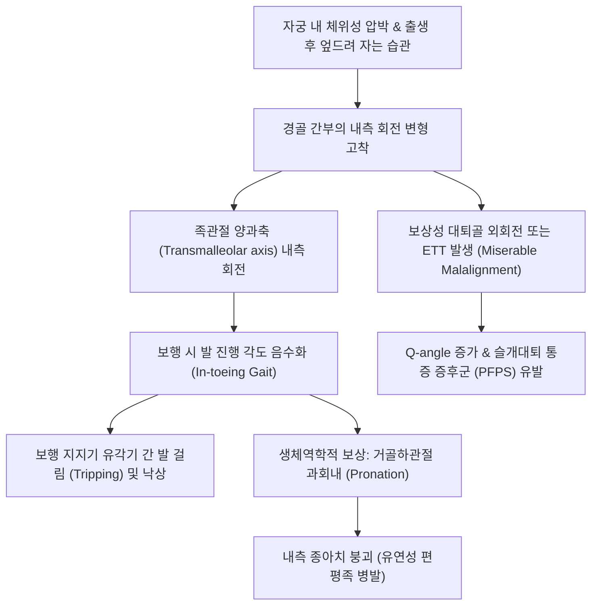

# 🩺 [[경골 염전]] (Tibial Torsion / 脛骨捻轉, Q68.8 / M21.8)

> **핵심 3줄 요약 (Key Summary)**:
> - 📍 병소 부위 & 해부·병태생리: 정강이뼈([[경골]])의 종축(장축)을 중심으로 한 회전성 비틀림 변형으로, 근위부 대퇴-경골 관절면 축과 원위부 족관절 양과축([[Transmalleolar Axis]]) 사이의 비틀림 각도 편위에 의해 발생한다. 내측 경골 염전(Internal Tibial Torsion, ITT)은 자궁 내 태아의 굴곡-내회전 자세로 인한 생리적 상태로 신생아~영유아기 [[안짱걸음]](In-toeing gait)의 최빈 원인이며, 외측 경골 염전(External Tibial Torsion, ETT)은 성장기 과도한 보상성 회전으로 인해 발생하여 [[팔자걸음]](Out-toeing), [[슬개대퇴 통증 증후군]](PFPS), 성인기 [[퇴행성 슬관절염]] 위험을 증가시킨다.
> - 🚩 전형적 임상 양상 & 3대 징후: 보행 시 발끝이 안쪽 또는 바깥쪽을 심하게 향함, 슬개골([[슬개골]])은 정면을 주시하고 있으나 발의 장축만 회전되어 있는 '슬개골-족부 회전 해리', 보행 중 자신의 발에 걸려 넘어지는 잦은 낙상(Frequent tripping). 복와위에서 무릎을 90도 굴곡시켜 측정한 허벅지-발 각도([[Thigh-Foot Angle]], TFA)가 음수(ITT) 또는 과도한 양수(ETT)로 편위된다.
> - 🛠️ 핵심 감별 검사 & 한·양방 다각적 치료 전략: 복와위 Thigh-Foot Angle(TFA) 측정, 양과축 각도(TMAA) 평가, [[발 진행 각도]](Foot Progression Angle, FPA) 분석. 만 3~4세까지 90% 이상 자연 교정(Spontaneous derotation)되므로 안심과 추적 관찰이 기본 원칙이며, 과거 사용되던 데니스 브라운 바(Denis Browne bar)나 보조기 신발의 무효성을 교육한다. 만 8세 이상에서 TFA -15도 이하의 심각한 기능 장애 시 원위 경비골 회전절골술을 고려한다. 한의학에서는 비신양허(脾腎兩虛), 근맥실양(筋脈失養)으로 변증하여 소아 추나 하지 안교법(하퇴 근막 이완 및 회전 유도 기법), [[보중익기탕]], [[육미지황탕]], [[독활기생탕]], [[신수]], [[족삼리]], [[양릉천]], [[태충]] 등의 혈위를 자극한다.
> - <font color="#fa7e7e">⚠️ 응급 의뢰 레드플래그 & 악화 요인: 편측성의 비대칭적 염전, 진행성 파행 및 국소 통증, 하지 부동(Leg Length Discrepancy), 병적인 골 기형 의심 소견([[블라운트병]], [[구루병]], 골이형성증) 또는 중추신경계 이상(심부건반사 항진, 바빈스키 징후, 발목 간대성 경련 등 [[뇌성마비]] 의심 증상) 관찰 시 소아정형외과 및 소아신경과 정밀 의뢰.</font>

---

## 📌 목차
1. [질환 개요 & 해부학적 병태생리](#1-질환-개요--해부학적-병태생리)
2. [병태생리 메커니즘 & 생체역학적 악순환 네트워크](#2-병태생리-메커니즘--생체역학적-악순환-네트워크)
3. [임상 증상 & 이학적 검사(Physical Exam) 알고리즘](#3-임상-증상--이학적-검사physical-exam-알고리즘)
4. [감별 진단 매트릭스 (Differential Diagnosis)](#4-감별-진단-매트릭스-differential-diagnosis)
5. [한의 통합 치료 프로토콜 (침·약침·추나·한약)](#5-한의-통합-치료-프로토콜-침약침추나한약)
6. [양방 치료 & 병용·의뢰 기준 (Conventional Treatment & Referral)](#6-양방-치료--병용의뢰-기준-conventional-treatment--referral)
7. [재활 운동 & 생활습관 티칭 가이드](#7-재활-운동--생활습관-티칭-가이드)
8. [💡 사용자 진료실 핵심 필기 & 임상 노하우 (Melt-In 잔여 심화 집약)](#8--사용자-진료실-핵심-필기--임상-노하우-melt-in-잔여-심화-집약)
9. [출처 및 학술 참고 문헌 (References)](#9-출처-및-학술-참고-문헌-references)

---

## 1. 질환 개요 & 해부학적 병태생리

### 1) 질환의 정의 및 발생학적 배경
[[경골 염전]](Tibial Torsion)이란 정강이뼈([[경골]], Tibia)의 해부학적 장축을 중심으로 근위부 관절면(대퇴골 과부와 접하는 경골 고원, Tibial plateau)과 원위부 관절면(거골과 접하는 원위 경골 천장 및 양과 축, Transmalleolar axis) 사이에 발생하는 회전성 정렬 이상(Rotational malalignment)을 의미한다.

인간의 태아 발생 과정에서 하지는 재태 7주경 전방으로 회전하면서 내전 및 굴곡 자세를 취하게 된다. 자궁 내의 좁은 공간(Intrauterine packing)에서 태아는 엉덩관절과 무릎관절을 굴곡시킨 채 하퇴부를 내회전시키고 발을 안쪽으로 감싸는 자세로 위치한다. 이로 인해 모든 신생아는 출생 시 평균 -15° ~ -5° 수준의 생리적 내측 경골 염전(Internal Tibial Torsion, ITT)을 지닌 채 태어난다.

출생 후 신생아가 직립하고 체중 부하(Weight-bearing)를 시작하면서, 골단판(Physis)에 가해지는 기계적 비틀림 스트레스와 [[Wolff의 법칙]](Wolff's Law)에 의한 지속적 골 개조(Bone remodeling)가 일어난다. 정상적인 발달 과정에서 경골은 연간 약 1.5° ~ 2°씩 외측으로 회전(External derotation)하여 다음과 같은 정상 경골 비틀림 각도의 변화를 보인다:
* **신생아 및 1세 미만**: -5° ~ +5° (내회전 경향 우세)
* **만 1~2세 (보행 개시 직후)**: 0° ~ +10°
* **만 3~4세**: +10° ~ +15° (안정적인 외염전 획득)
* **학령기 및 성인**: +15° ~ +20° (평균 +15° 수준의 외측 경골 염전이 성인의 해부학적 정상 정렬임)

### 2) 분류 (Classification)
1. **내측 경골 염전 (Internal Tibial Torsion, ITT)**:
   * 경골이 장축을 기준으로 내측으로 과도하게 회전되어 원위 경골 과간축이 내측을 향하는 상태.
   * 유아기(만 1~3세) [[안짱걸음]](In-toeing gait)의 가장 흔한 원인이다.
   * 대부분 양측성이며, 좌측이 자궁 내 좌두위(LOA) 위치로 인해 우측보다 심한 경향이 있다.
2. **외측 경골 염전 (External Tibial Torsion, ETT)**:
   * 경골이 장축을 기준으로 외측으로 과도하게 회전된 상태(성인 기준 +25°~+30° 이상).
   * 소아 후기, 청소년기 및 성인기 [[팔자걸음]](Out-toeing gait)을 유발한다.
   * 심한 [[대퇴 염전]](과도한 대퇴 전경)에 대한 보상 작용으로 2차 발생하거나, 신경근육성 불균형, 특발성 과도 성장으로 인해 나타난다.

### 3) 관련 해부학적 구조물
* **골격 및 관절 복합체**:
  * [[경골]](Tibia): 체중의 85~90%를 지지하는 주기둥 뼈로, 비틀림 변형의 주체.
  * [[비골]](Fibula): 외측 지지 및 외과의 지렛대 역할을 수행하며, 경골의 비틀림에 동반 변형됨.
  * [[근위 경비관절]](Superior tibiofibular joint) 및 [[원위 경비인대결합]](Tibiofibular syndesmosis): 경골과 비골 사이의 회전 결합을 매개.
  * [[거퇴관절]](Talocrural joint): 거골 활차(Trochlea of talus)가 경골 내과와 비골 외과 사이의 장부관절(Mortise)에 수용되므로, 경골의 회전이 발의 진행 방향을 직접 결정함.
  * [[슬개대퇴 관절]](Patellofemoral joint): 원위 경골 회전 시 Q-각(Q-angle)의 변화를 초래하여 슬개골 추적(Patellar tracking)에 직접적 영향을 미침.
* **근육 및 근막계**:
  * 내회전 토크 작용 근육군: [[전경골근]](Tibialis anterior), [[후경골근]](Tibialis posterior), [[반건양근]](Semitendinosus), [[반막양근]](Semimembranosus), [[박근]](Gracilis), [[슬와근]](Popliteus).
  * 외회전 토크 작용 근육군: [[장비골근]](Peroneus longus), [[단비골근]](Peroneus brevis), [[대퇴이두근]](Biceps femoris), 하퇴삼두근 외측두([[비복근]], Gastrocnemius lateral head).
* **신경 및 혈관**:
  * [[좌골신경]](Sciatic nerve)의 분지인 [[경골신경]](Tibial nerve) 및 [[총비골신경]](Common peroneal nerve).
  * 총비골신경이 비골두 경부를 감아돌아 [[심비골신경]](Deep peroneal nerve)과 [[천비골신경]](Superficial peroneal nerve)으로 분지하므로, 수술적 절골술이나 과도한 교정 시 비골신경 마비 위험이 존재함.
  * 전경골동맥(Anterior tibial artery) 및 후경골동맥(Posterior tibial artery).

---

## 2. 병태생리 메커니즘 & 생체역학적 악순환 네트워크

### 1) 회전 변형의 발생 기전
내측 경골 염전의 원발성 원인은 자궁 내 압박과 기계적 자세 유지다. 양수 과소증, 거대아, 쌍태아 임신 등의 환경에서 태아 하퇴부에 가해지는 내회전성 압박 토크가 영구적인 골단판 모델링으로 고착된다.

출생 후 지속적인 악화 인자로는 다음과 같은 습관이 관여한다:
1. **엎드려 자는 수면 자세(Prone sleeping)**: 영유아가 엎드려 잘 때 무릎을 굴곡시키고 발끝을 안쪽으로 모으는 자세를 취하면, 체중이 종골과 족관절 외측에 실리면서 경골에 내회전 비틀림 모멘트를 지속적으로 가하게 된다.
2. **무릎 꿇고 앉는 정좌 자세**: 발등을 바닥에 대고 엉덩이로 뒤꿈치를 누르며 발이 안쪽으로 회전된 상태로 장시간 앉는 습관.
3. **근막 및 건의 비대칭 구축**: 출생 후 전경골근과 후경골근의 과긴장 및 하퇴 내측 근막 지대의 단축이 동반되어 경골의 정상적인 외측 회전 리모델링 과정을 방해한다.

```
[ 자궁 내 압박 / 엎드려 자는 자세 / 정좌 습관 ]
                   │
                   ▼
       [ 경골 장축의 내회전력 고착 ]
                   │
         ┌─────────┴─────────┐
         ▼                   ▼
[ 근위 경골 고원 정렬 ]  [ 원위 양과축 내측 편위 ]
 (슬개골은 전방 주시)     (족관절 장부관절 내회전)
         │                   │
         └─────────┬─────────┘
                   ▼
       [ 발끝 내측 편위 (안짱걸음) ]
                   │
         ┌─────────┴─────────┐
         ▼                   ▼
 [ 지지기 족부 과회내 ]  [ 무릎 안쪽 비틀림 토크 ]
  (보상성 평발화)         (슬개골 외측 아탈구 경향)
         │                   │
         └─────────┬─────────┘
                   ▼
     [ 잦은 보행 중 걸림 & 낙상 ]
     [ 장기적 슬관절 / 족관절 마모 ]
```



### 2) 생체역학적 연쇄 반응 (Kinetic Chain)과 Miserable Malalignment
경골 염전은 단일 분절의 문제로 끝나지 않고 하지 전체의 운동사슬(Kinetic Chain)에 심각한 역학적 보상 반응을 촉발한다:

1. **족부의 2차적 보상 (Subtalar Pronation)**:
   * 경골이 안쪽으로 비틀려 있으면 유각기(Swing phase)에서 반대측 다리에 발이 걸리기 쉽다. 신체는 발끝을 진행 방향과 평행하게 맞추기 위해 보행 시 [[거골하관절]](Subtalar joint)을 과도하게 외번·외전시키는 과회내(Overpronation)를 유발한다.
   * 이로 인해 족저근막과 [[용수철인대]](Spring ligament)에 과도한 신장 스트레스가 가해지며 2차적인 [[편평족]](Pes planus, 평발)과 족저근막염이 호발한다.
2. **비참한 정렬 불량 증후군 (Miserable Malalignment Syndrome)**:
   * 근위부의 과도한 [[대퇴 전경]](Femoral anteversion)과 원위부의 보상성 외측 경골 염전(External tibial torsion)이 결합된 형태.
   * 대퇴골은 안쪽으로 돌고(Squinting patella, 슬개골 내측 응시), 경골은 바깥쪽으로 돌아 발은 바깥을 향하게 된다.
   * 이로 인해 슬개골에 작용하는 외측 외력 벡터인 **Q-각(Q-angle)**이 극단적으로 증가하여 슬개골이 활차구(Trochlear groove) 외측으로 밀려나는 아탈구력(Lateral subluxation force)을 받는다.
   * 청소년기 및 20대 여성에서 심한 무릎 전방 통증([[슬개대퇴 통증 증후군]], PFPS)과 슬개골 연골연화증(Chondromalacia patellae)의 주요 원인이 된다.

---

## 3. 임상 증상 & 이학적 검사(Physical Exam) 알고리즘

### 1) 임상 증상 및 주소증
* **안짱걸음 (In-toeing gait)**: 내측 경골 염전의 주 증상으로, 환아의 보호자가 "아이가 걸을 때 발끝이 안쪽으로 모여요", "신발 안쪽 앞코가 닳아요"라며 내원함.
* **잦은 넘어짐 (Tripping & Falling)**: 보행 시 스윙하는 발의 엄지발가락 쪽이 지지하는 발의 뒤꿈치나 종아리에 걸려 자주 넘어짐. 특히 달릴 때 더욱 두드러짐.
* **비대칭적 마모 및 굳은살**: 신발 밑창의 외측 후방 및 내측 전방 부위의 비정상적 편마모.
* **운동 후 피로감**: 정강이 앞쪽 및 무릎 내측의 묵직한 통증과 근육 피로 호소 (학령기 아동).
* **외측 경골 염전 시**: 발끝이 바깥을 향하는 [[팔자걸음]](Out-toeing), 보행 추진력 약화, 달리기 속도 저하, 슬개골 주변의 전방 무릎 통증.

### 2) 스타헬리 회전 프로파일 (Staheli's Rotational Profile)
소아 하지 회전 변형을 평가하기 위한 표준화된 신체 검진 체계로, 반드시 체계적인 단계로 시행되어야 한다.

```
[ 소아 하지 회전 변형 진찰 흐름도 ]
                  │
                  ▼
   1단계: 동적 보행 평가
   - 발 진행 각도 (Foot Progression Angle, FPA) 측정
   - 슬개골의 진행 방향 관찰 (정면 주시 vs 내측 주시)
                  │
                  ▼
   2단계: 슬개골 축과 발 축 대조
   - 슬개골 정면 주시 + 발 내측 편위 ──> [ 경골 염전 의심 ]
   - 슬개골 내측 주시 (Kissing patella) ─> [ 대퇴 염전 의심 ]
                  │
                  ▼
   3단계: 복와위 (Prone Position) 고관절 회전각 측정
   - 고관절 내회전 / 외회전 각도 평가 (대퇴 염전 배제)
                  │
                  ▼
   4단계: 복와위 슬관절 90도 굴곡
   - 허벅지-발 각도 (Thigh-Foot Angle, TFA) 측정 (경골 염전 확진)
   - 양과축 각도 (Transmalleolar Axis Angle, TMAA) 측정
                  │
                  ▼
   5단계: 족부 기형 평가
   - 발바닥 외측연 직선성 평가 (중족골 내전 감별)
```

#### ① 발 진행 각도 (Foot Progression Angle, FPA)
* **측정법**: 아이가 직선을 따라 걸어갈 때 진행 방향의 축과 발의 종축(뒤꿈치 중앙에서 둘째 발가락을 잇는 선)이 이루는 각도.
* **판독**:
  * 정상: +5° ~ +10° (약간의 외측 편위)
  * 경도 내회전(Mild In-toeing): -5° ~ -10°
  * 중등도 내회전(Moderate In-toeing): -10° ~ -15°
  * 중증 내회전(Severe In-toeing): -15° 초과

#### ② 허벅지-발 각도 (Thigh-Foot Angle, TFA) — ★ 경골 염전의 진단적 골드 스탠다드
* **측정법**: 환아를 진찰대 위에 엎드리게(Prone position) 한 뒤, 무릎을 90° 굴곡시키고 발목을 중립위(90° 배측굴곡)로 유지한다. 위에서 내려다보면서 대퇴부 장축(허벅지 중심선)과 발바닥 종축(종골 중앙에서 제2중족골간을 지나는 선)이 이루는 각도를 각도기(Goniometer)로 측정한다.
* **임상적 의미**: 대퇴골과 골반의 영향을 완전히 배제하고 오직 **경골의 순수한 회전 상태**만을 독립적으로 평가하는 검사법이다.
* **판독 기준**:
  * 정상 성인 및 4세 이상 소아: **+10° ~ +15° (외회전)** (정상 범위: 0° ~ +30°)
  * 신생아 정상: -5° ~ 0°
  * 내측 경골 염전(ITT): **음수 각도 (TFA < 0°)**. (-10° ~ -30°의 내회전 소견)
  * 외측 경골 염전(ETT): **과도한 양수 각도 (TFA > +25° ~ +30°)**.

#### ③ 양과축 각도 (Transmalleolar Axis Angle, TMAA)
* **측정법**: 복와위 무릎 90도 굴곡 상태에서 대퇴골 과부의 관절면 수직축과 내과(Medial malleolus) 및 외과(Lateral malleolus)의 중심점을 연결하는 축 사이의 각도.
* **판독**: 통상 TFA보다 약 5도 정도 더 큰 외회전 값을 나타내며, 족부의 변형(평발이나 중족골 내전)이 심해 TFA 측정이 왜곡될 때 순수 골성 염전을 정확히 반영함.

#### ④ 슬개골 주시 방향과 족부 축의 해리 (Patellar-Foot Dissociation)
* 환아가 서 있거나 걸을 때 **슬개골이 정확히 정면을 향하고 있음에도 발끝이 안쪽을 향한다면 병소는 100% 무릎 아래인 경골(경골 염전) 또는 족부**에 있다.
* 만약 슬개골 자체가 안쪽을 향하고 있다면 병소는 무릎 위인 대퇴골([[대퇴 염전]])에 있다.

---

## 4. 감별 진단 매트릭스 (Differential Diagnosis)

소아 안짱걸음(In-toeing)은 발생 위치에 따라 크게 **족부(Foot) - 하퇴(Tibia) - 대퇴/고관절(Femur/Hip)**의 3단계로 감별된다.

| 감별 질환 | 호발 연령 | 병변 부위 | 슬개골 주시 방향 | 결정적 이학적 검사 소견 | 자연 경과 및 예후 |
| :--- | :--- | :--- | :--- | :--- | :--- |
| **[[경골 염전]] (ITT)** (본 질환) | 1~3세 (걸음마기) | 하퇴부 ([[경골]]) | **정면 주시** | **TFA 음수 (< 0°)**, 고관절 회전 정상, 발바닥 외측연 직선 | 만 3~4세까지 90% 이상 자연 교정 |
| **[[대퇴 염전]]** (과도한 전경) | 3~8세 (유치원기) | 대퇴부 ([[대퇴골]]) | **내측 주시** (Kissing patella) | **고관절 내회전 > 70°~80°**, 외회전 < 20°, 크레이그 검사 양성, TFA는 정상 | 만 8~10세까지 점진적 리모델링 호전 |
| **[[중족골 내전]]** (Metatarsus adductus) | 0~1세 (영아기) | 족부 전족부 | **정면 주시** | 발바닥 외측연 C자형 굴곡, 제5중족골 기저부 돌출, 힐-바이섹터 라인 이상, TFA 정상 | 유연성에 따라 생후 6~12개월 내 대부분 자연 회복 |
| **[[발달성 고관절 이형성증]]** (DDH) | 영아기~보행기 | 고관절 비구/대퇴두 | 비대칭적 | Ortolani/Barlow 검사 양성, 대퇴 피부주름 비대칭, Galeazzi 검사 단축, 파행 | 방치 시 영구적 관절 탈구 및 파행 (조기 수술 필수) |
| **[[블라운트병]]** (Blount disease) | 2~4세 (유아형), 청소년형 | 근위 경골 내측 골단판 | 내측/전방 | 진행성 O다리([[내반슬]]), 경골 근위부 내측 부리모양 뼈 돌출, 방사선상 랭켄스킬드(Langenskiöld) 병기 | 자연 교정 불가, 진행성 골 변형 (교정 절골술 필수) |
| **[[뇌성마비]]** (경직형 양마비) | 전 연령 | 중추신경계 상위운동신경원 | 내측/불규칙 | 첨족(Equinus) 보행, 가위보행(Scissor gait), DTR 항진, 발목 간대(Clonus) 양성 | 신경근육계 재활, 보톡스 및 건 신장술 필요 |

---

## 5. 한의 통합 치료 프로토콜 (침·약침·추나·한약)

### 1) 한의학적 병인병기 및 변증 논치
한의학에서 소아 하지의 회전 기형과 보행 이상은 『동의보감(東醫寶鑑)』 소아문(小兒門)의 **오지(五遲, 행지 行遲)** 및 **하지무력(下肢無力)**, **각기(脚氣)**, **근위(筋痿)**의 범주에 속한다.

* **비신양허(脾腎兩虛)**: 선천적으로 신기(腎氣)가 부족하여 골수(骨髓)를 충실히 채우지 못하고(腎主骨), 후천적으로 비위(脾胃)가 허약하여 사지 기육(肌肉)에 영양을 공급하지 못하여(脾主四肢) 뼈의 정상적 성형과 건인대 발달이 지연되는 병기.
* **간신부족(肝腎不足)·근골실양(筋骨失養)**: 간은 근을 주관하고(肝主筋) 신은 골을 주관하므로, 간신이 허약하면 근맥이 이완되거나 불균형하게 연축되어 뼈를 바른 위치로 잡아당기지 못함.
* **기혈어체(氣血瘀滯)·경락울체(經絡鬱滯)**: 자궁 내 압박이나 불량한 자세로 인해 하퇴부 경락(족태음비경, 족궐음간경, 족양명위경, 족소양담경)의 기혈 순환이 저체되어 근막이 굳어지고 회전 변형이 고착화됨.

### 2) 소아 추나 치료 (Chuna Manipulation) & 하지 안교법(按矯法)
소아의 뼈는 골화가 완전히 끝나지 않고 유연성이 풍부하므로, 강한 교정력(HVLA)을 절대 사용하지 않으며, 부드러운 근막 이완과 관절 가동술(Mobilization) 중심의 안교법을 시행한다.

```
[ 소아 하지 안교 추나 시술 단계 ]
1단계: 하퇴 내측·후방 근막 이완 (수기 유선법)
   - 전경골근, 후경골근, 가자미근 내측 섬유의 긴장 완화
2단계: 족관절 견인-외회전 가동술 (Distraction-External Rotation)
   - 종골과 거골의 외번 가동 및 경골 장축 외회전 유도
3단계: 슬관절 굴곡위 경골 탈염전 신장 (Derotation Stretching)
   - 복와위 90도 굴곡 상태에서 하퇴를 외측으로 완만히 지지
```

* **하퇴 근막 유선법(揉捏法)**:
  * 술자는 환아를 편안히 눕히고 엄지와 식지 복면을 이용하여 하퇴 내측의 전경골근, 후경골근 및 비복근 내측두를 따라 부드럽게 쓰다듬고 굴리며 근막 유착을 푼다 (1회 3~5분).
* **경골 탈염전 수기 가동술**:
  * 환아를 복와위로 눕히고 슬관절을 90도 굴곡시킨다.
  * 술자의 한 손은 환아의 대퇴골 원위부 과부를 단단히 고정하여 대퇴의 회전을 차단한다.
  * 다른 한 손으로 환아의 종골과 족관절을 감싸 쥐고, 생리적 저항 장벽(Pathological barrier)에 도달할 때까지 족관절과 경골 원위부를 외측(외회전 방향)으로 부드럽게 유도한다.
  * 저항 지점에서 강한 힘을 가하지 않고 5~10초간 부드럽게 유지(Sustained stretch)하며 호흡에 맞추어 5~10회 반복한다.
* **골반 및 요천추 균형 추나**:
  * 골반 변위나 천골 경사가 동반된 경우, 앙와위에서 양측 고관절 굴곡-외전 스트레칭과 이상근, 장요근의 이완을 병행하여 하지 전체의 회전 사슬을 정돈한다.

### 3) 침구 치료 (Acupuncture)
소아는 자침에 대한 공포가 크므로, 굵은 침의 유침(留針)을 지양하고 **0.16mm × 15mm 내외의 극세침을 사용한 무통 속자속발(速刺速拔, 쾌자법)** 또는 **레이저 침**, **소아 피내침(스티커 침)**을 적용한다.

* **선혈 원칙**:
  * **근위 취혈**: 하퇴부 외측 회전근을 자극하고 내측 연축을 완화하기 위해 경골 외측 및 족관절 주변 경혈 선택.
    * [[양릉천]](GB34): 근회(筋會)로서 하지의 모든 근육과 근막 긴장을 조절. 비골두 하단에서 심비골신경과 장/단비골근을 촉진.
    * [[족삼리]](ST36): 족양명위경의 합혈로서 사지 기육을 영양하고 전경골근의 기능적 밸런스를 잡음.
    * [[현종]](GB39, 절골): 수회(髓會)로서 골조직 발육과 하지 외측 지지력을 강화.
    * [[삼음교]](SP6): 족삼음경의 교회혈로 하퇴 내측 근막의 만성 구축을 해소.
    * [[태충]](LR3): 족궐음간경의 원혈로서 평간식풍, 근맥 이완.
    * [[곤륜]](BL60) & [[신수]](BL23): 선천 신기를 보하고 외측 족관절 지지력을 향상.
* **자침 기법**:
  * 영유아(1~3세): 스티커형 피내침(0.2mm 마이크로니들)을 양릉천, 족삼리, 현종에 부착하고 1~2일간 유지하도록 지도.
  * 학령기 아동: 통증이 거의 없는 무통 자침기로 1~2mm 천자 후 즉시 발침(자극 시간 수초).

### 4) 한약 치료 (Herbal Medicine)
골 성형과 근육 발달을 촉진하고 체질적 불균형을 개선하기 위해 성장 단계별 맞춤 처방을 투여한다.

* **비신양허형 (골 성장 지연 및 전신 무력형)**:
  * 처방: **[[보중익기탕]](補中益氣湯)** 합 **[[육미지황탕]](六味地黃湯)** 가미.
  * 구성 약물: [[황기]](6g), [[백출]](4g), [[당귀]](4g), [[숙지황]](6g), [[산약]](4g), [[산수유]](4g), [[오가피]](4g), [[두충]](4g), [[우슬]](3g).
  * 약리 기전: 황기 다당체와 당귀 추출물이 조혈 및 성장호르몬 축을 자극하고, 오가피·두충·우슬의 페놀 화합물과 이리도이드 성분이 조골세포(Osteoblast) 증식 및 골밀도 형성을 유도하며 관절 인대를 강화함.
* **근골실양·풍한습체형 (하퇴 냉감 및 보행 피로형)**:
  * 처방: **[[독활기생탕]](獨活寄生湯)** 가감.
  * 구성 약물: [[독활]](4g), [[상기생]](4g), [[두충]](4g), [[우슬]](3g), [[진범]](3g), [[백작약]](4g), [[천궁]](3g), [[감초]](2g).
  * 약리 기전: 활혈거풍(活血祛風)하고 간신을 보하여 하퇴부 연부조직의 미세혈류 순환을 촉진하고 근육 피로를 빠르게 회복시킴.

---

## 6. 양방 치료 & 병용·의뢰 기준 (Conventional Treatment & Referral)

### 1) 보존적 치료의 허와 실 (근거 중심 정형외과적 관점)
과거 수십 년간 내측 경골 염전 치료를 위해 다양한 기계적 교정 장구들이 사용되었다:
* **데니스 브라운 바 (Denis Browne Bar)**: 양 발을 신발에 고정하고 금속 막대로 외회전 각도를 유지시키는 장치.
* **필로 슬래브 (Fillauer Bar)**, 회전 토션 케이블, 특수 교정화(Reverse-last shoes).

> ⚠️ **현대 소아정형외과의 확립된 결론**:
> 대규모 전향적 코호트 연구들과 미국정형외과학회(AAOS) 가이드라인에 따르면, **보조기나 특수 신발을 착용한 군과 아무런 치료를 하지 않고 관찰한 군 사이에서 만 4~5세 시점의 경골 회전 각도(TFA) 호전 속도 및 최종 결과에 유의미한 통계적 차이가 없음**이 명백히 입증되었다.
> 오히려 야간 보조기 착용은 유아의 정상적 수면 주기를 방해하고 정서적 스트레스를 유발하며, 무릎 관절에 비정상적인 외반 토크(Valgus torque)를 가해 [[외반슬]](Genu valgum) 등의 2차적 변형을 유발할 위험이 있다. 따라서 **단순 경골 염전에 대한 일상적인 보조기 처방은 권장되지 않는다(Obsolete practice).**

### 2) 수술적 치료 적응증 (Surgical Indication)
대부분의 경골 염전은 자연 치유되므로 수술적 치료가 필요한 경우는 전체 환자의 1% 미만으로 극히 드물다.

* **수술 고려 기준**:
  1. 환아의 연령이 **최소 만 8세 이상** (골 개조 능력이 현저히 감소하는 시기 이후).
  2. 허벅지-발 각도(TFA)가 **-15° 이하(심각한 내염전)** 또는 **+30° 이상(심각한 외염전)**으로 고착화된 경우.
  3. 일상생활에서 기능적 장애(달리기 불가, 보행 시 심각한 걸림, 지속적인 낙상으로 인한 외상)가 명백한 경우.
  4. 미용적 스트레스가 아동의 사회심리적 발달에 심대한 지장을 주는 경우.
* **표준 수술 기법**:
  * **원위 경골 및 비골 회전 절골술 (Distal Tibial and Fibular Derotation Osteotomy)**:
    * 근위부 절골술에 비해 비골신경(Peroneal nerve) 손상 및 구획증후군(Compartment syndrome)의 위험이 현저히 낮아 원위부 절골이 선호됨.
    * 경골 원위 골간단부와 비골을 절골한 후 정상 외회전 각도(+10°~+15°)만큼 회전시켜 금속판(Plate) 또는 K-강선으로 내고정함.
    * 최근 연구(Hovland et al., 2026)에 따르면 소아 idiopathic tibial torsion 환자 대상 원위 경비골 회전절골술은 합병증 발생률이 낮고 양호한 장기 기능 회복을 보임.

### 3) 한양방 병용 판단 & 전문과 의뢰 기준
* **병용 가능 및 시너지**:
  * 양방 정형외과의 '자연 경과 관찰(Watchful waiting)' 전략 기간 동안, 한의원의 비침습적 소아 추나 및 하지 근막 이완, 체질 개선 한약 치료는 부모의 불안을 해소하고 근육 밸런스를 정상화하여 성장을 촉진하는 훌륭한 시너지를 발휘한다.
* **🚨 즉각적인 상급병원 소아정형외과 의뢰 기준 (Red Flags)**:
  1. **편측성의 심한 변형**: 한쪽 다리만 심하게 안쪽으로 돌아가 있는 경우 (골종양, 외상 후 골단판 조기 유합, 감염 후유증 배제 필요).
  2. **진행성 O다리([[내반슬]])의 동반**: 내측 경골 근위부 골단판의 이형성인 [[블라운트병]](Blount's disease) 가능성.
  3. **통증 및 부종, 관절 운동 제한 동반**: 단순 회전 변형은 통증을 유발하지 않으므로, 통증이 있다면 골수염, 연소기 특발성 관절염(JIA) 의심.
  4. **신경학적 결손**: 심부건반사(DTR) 항진, 발목 간대(Ankle clonus), 족하수(Foot drop), 감각 이상 소견이 동반된 경우 [[뇌성마비]] 또는 척수이개증(Spinal dysraphism) 감별을 위한 소아신경과 의뢰.

---

## 7. 재활 운동 & 생활습관 티칭 가이드

### 1) 일상생활 불량 자세 교정 (Ergonomics)
자연 치유를 저해하는 기계적 악화 요인을 제거하는 것이 치료의 첫걸음이다.

```
[ 피해야 할 자세 ]
❌ 엎드려 자기 (Prone sleeping with feet inverted)
   -> 앙와위(바로 눕기) 또는 다리 사이에 베개를 끼운 측와위 권장.
❌ 무릎 꿇고 발을 엉덩이 밑에 깔고 앉기 (Sitting on inverted feet)
   -> 발끝에 내회전 토크가 가해져 경골 비틀림이 지속됨.

[ 권장하는 자세 ]
⭕ 의자 생활화 (Chair sitting)
   -> 고관절과 슬관절을 90도 굴곡시켜 발바닥 전체를 바닥에 지지.
⭕ 책상다리 / 가부좌 (Cross-legged tailor sitting)
   -> 고관절과 경골에 외회전 스트레스를 부여하여 교정에 도움.
```

### 2) 능동적 외회전 유도 운동 & 고유수용감각 훈련
* **오리걸음 놀이 (Penguin / Duck Walk)**:
  * 발끝을 바깥쪽으로 30~45도 벌린 상태에서 뒤꿈치로 걷는 놀이. 장/단비골근을 능동적으로 수축시키고 경골 외회전 근육을 강화함.
* **직선 및 곡선 줄타기 보행**:
  * 바닥에 테이프를 붙이고 발이 선 밖으로 벗어나지 않도록 발끝을 11자로 유지하며 걷는 시각 피드백 훈련.
* **모래사장 및 잔디밭 맨발 걷기**:
  * 불규칙한 지면을 맨발로 걸으며 족저 고유수용감각 수용기를 활성화하고, 내재근 및 족관절 안정화 근육의 동시 수축을 유도.

### 3) 하퇴 근막 스트레칭
* **비복근-가자미근 스트레칭**:
  * 벽 밀기 자세에서 뒤쪽 다리의 무릎을 편 채 뒤꿈치가 바닥에서 떨어지지 않도록 유지하며 20초간 스트레칭 (1일 3회).

---

## 8. 💡 사용자 진료실 핵심 필기 & 임상 노하우 (Melt-In 잔여 심화 집약)

### 1) 부모 안심 상담 프로토콜 (Parental Counseling Script)
소아 정형 진료에서 가장 중요한 치료는 **'부모의 과도한 불안을 치료하는 것'**이다. 부모는 아이가 평생 다리를 절거나 기형이 될까 극도로 두려워하며, 인터넷의 상업적 교정 센터나 보조기 업체의 공포 마케팅에 노출되어 수백만 원대의 불필요한 보조기를 구입하기 쉽다.

> **진료실 표준 상담 스크립트**:
> *"어머니, 아버님, 아이가 안짱걸음을 걷는 것은 병이 아니라, 엄마 뱃속 열 달 동안 좁은 공간에서 다리를 안전하게 웅크리고 있었던 자연스러운 '뱃속의 기억'이 남아있는 것입니다.*
> *아이가 태어날 때는 누구나 정강이뼈가 안쪽으로 비틀려 있으며, 걷기 시작하고 뛰어놀면서 뼈가 스스로 자라나 만 3~4세가 되면 10명 중 9명 이상은 마법처럼 반듯하게 펴집니다.*
> *지금 억지로 쇠막대기 보조기를 채우면 아이가 밤에 잠도 못 자고 다리에 엉뚱한 무리가 갑니다. 의학적으로 효과가 없다는 것이 수많은 연구로 증명되었습니다.*
> *저희 한의원에서는 뼈를 억지로 비틀지 않고, 굳어있는 종아리 안쪽 근육을 부드럽게 풀어주어 아이가 스스로 올바르게 걷도록 도와줄 것입니다. 6개월마다 사진을 찍어 펴지는 과정을 함께 확인하시죠."*

### 2) 10초 원포인트 진찰 팁: '슬개골-발끝 정렬 검사법'
진료실 문을 열고 들어오는 아이를 보고 10초 만에 병소 위치를 파악하는 실전 감별 팁:
1. **아이의 무릎뼈(슬개골) 중심에 동그라미 스티커를 붙인다.**
2. 아이를 보호자에게 걸어가게 하면서 정면에서 관찰한다:
   * **무릎뼈 스티커가 똑바로 앞을 보는데, 발끝만 안쪽으로 모인다?** -> 100% **[[경골 염전]]** (또는 중족골 내전).
   * **무릎뼈 스티커가 서로 마주보며(Kissing patella) 안쪽으로 돌아가 있다?** -> 100% **[[대퇴 염전]]**(대퇴골 전경).
   * **무릎뼈 스티커는 바깥을 보는데 발끝은 앞을 본다?** -> 복합 기형(대퇴 후경 + 경골 내염전) 의심.

### 3) 소아 추나 치료 시 손맛 노하우
* **영유아 추나의 제1원칙은 '아이와의 라포 형성'이다**:
  * 진찰대에 눕히자마자 다리를 잡으면 아이가 울음을 터뜨리고 다리에 강한 힘을 주어 근막 이완이 불가능해진다.
  * 아이를 엄마 무릎에 앉히거나 엎드리게 한 상태에서 장난감을 쥐어주고, 부드러운 오일이나 크림을 발라 놀이하듯 가볍게 마사지(유선법)부터 시작한다.
* **경골 외회전 신장 시의 역학적 축**:
  * 절대로 발목만 잡고 비틀어서는 안 된다. 발목 관절낭(Capsule)과 인대만 늘어날 뿐 경골에는 토크가 전달되지 않는다.
  * 반드시 한 손으로 **대퇴골 과부를 단단히 고정**하여 대퇴의 동반 회전을 차단한 상태에서, 종골 전체를 손바닥으로 감싸 쥐고 하퇴 전체를 하나의 축으로 회전시켜야 경골에 온전한 탈염전 스트레스가 가해진다.

### 4) 추적 관찰 및 사진 기록 프로토콜
* 초진 시 환아의 복와위 TFA 측정 상태를 스마트폰으로 정확히 수직(Top-down view)에서 촬영하여 차트에 보관한다.
* 6개월 간격으로 재내원하게 하여 동일한 각도에서 촬영하고, 각도 변화(음수 각도가 점차 0도 및 양수로 진행하는지)를 부모에게 시각적으로 보여준다. 이는 부모에게 절대적인 신뢰를 제공한다.

---

## 9. 출처 및 학술 참고 문헌 (References)

Hovland S et al. (2026). Complications and Perioperative Course After Distal Tibial/Fibular Derotation Osteotomy for Idiopathic Tibial Torsion: A Retrospective Case Series Across a Pediatric Health System (2012-2022). *J Pediatr Soc North Am*. 17():100448. [PMID: 42824221](https://pubmed.ncbi.nlm.nih.gov/42824221/)

Ayushi K et al. (2026). Comparative Goniometric Analysis of Tibial Torsion and Q-angle Between Sedentary Young Adults and Amateur Athletes: A Cross-Sectional Comparative Study With Prospective Data Collection. *Cureus*. 18(6):e110634. [PMID: 42437255](https://pubmed.ncbi.nlm.nih.gov/42437255/)

Staheli LT. (1993). Rotational problems in children. *Instructional Course Lectures*, American Academy of Orthopaedic Surgeons (AAOS).

Sass P, Hassan G. (2003). Lower extremity abnormalities in children. *American Family Physician*, 68(3):461-468. (PMID 미확인)

대한정형외과학회. (2020). *정형외과학 제8판*. 최신의학사. 제2권 소아정형외과 편: 소아 하지 염전 변형 및 안짱걸음.

