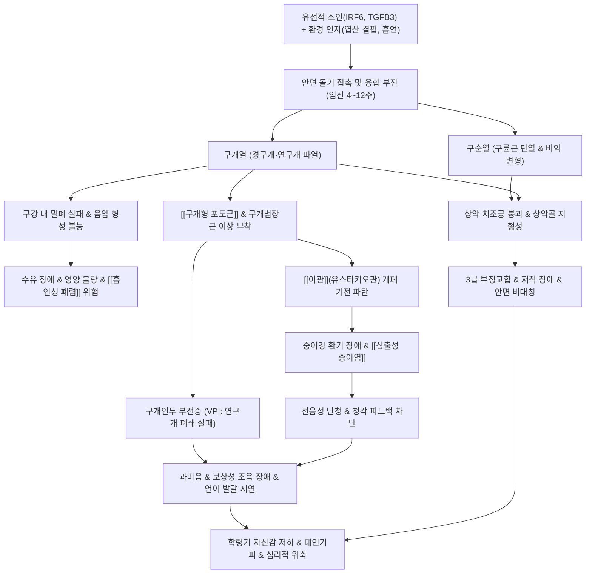

# 🩺 [[구순열과 구개 파열]] (Cleft Lip and Cleft Palate / 脣裂과 腭裂, Q35-Q37)

> **핵심 3줄 요약 (Key Summary)**:
> - 📍 **병소 부위 & 해부·병태생리**: 태아 발생기 안면 돌기 융합 부전으로 발생하며, 임신 4~7주 [[내측비돌기]](Medial nasal process)와 [[상악돌기]](Maxillary prominence)의 융합 실패로 [[구순열]](Cleft lip)이 발생하고, 임신 7~12주 양측 외측[[구개돌기]](Palatine shelves)의 수평화 및 정중선 융합 실패로 [[구개열]](Cleft palate)이 유발된다. [[구륜근]](Orbicularis oris) 단열, 비익 연골 편평화, [[구개형 포도근]](Levator veli palatini) 주행 이상 및 [[이관]](Eustachian tube) 기능 부전이 핵심 해부 병리이다.
> - 🚩 **전형적 임상 양상 & 3대 징후**: 출생 직후 상순 및 구개 결손 시진, 음압 형성 불능으로 인한 신생아 수유 장애 및 사레, 구개형 포도근 기능 저하로 인한 만성 [[삼출성 중이염]](Otitis media with effusion), 언어 발달기 [[구개인두 부전증]](Velopharyngeal Insufficiency, VPI)에 따른 심한 과비성 조음 장애(Hypernasality) 및 상악골 저형성에 따른 3급 [[부정교합]].
> - 🛠️ **핵심 감별 검사 & 한·양방 다각적 치료 전략**: 산전 정밀 초음파 및 출생 직후 손가락 촉진(점막하 구개열 감별). 생후 3개월 "10의 법칙(Rule of 10s: 체중 10 lbs, Hb 10 g/dL, 10주령, WBC 10,000 이하)" 하 [[구순성형술]](Millard 회전진전법), 생후 9~18개월 [[구개성형술]](Furlow/두판 피판법 및 환기관 삽입), 만 8~10세 이차 [[치조골 이식술]](ABG). 한의학적으로 선천결손, [[태중부족]](胎中不足), [[비신양허]](脾腎兩虛)로 변증하여 수술 전후 성장 및 영양 보강([[보중익기탕]], [[삼령백출산]]), 수술 후 흉터 구축 방지 및 연부조직 순환 개선([[자운고]], [[인중]], [[지창]], [[협차]] 자침 및 [[안면 추나]]).
> - <font color="#fa7e7e">⚠️ **응급 의뢰 레드플래그**: ① 신생아 수유 중 반복적 청색증 및 질식·[[흡인성 폐렴]] 징후 ② [[피에르 로뱅 시퀀스]] 등 소하악증 동반 환아의 설하수로 인한 급성 상기도 폐쇄 ③ 고열을 동반한 급성 중이염 및 유돌염 의심 증상 ④ 수술 부위 급성 열개 및 활동성 출혈.</font>

---

## 📌 목차
1. [질환 개요 & 해부학적 병태생리](#1-질환-개요--해부학적-병태생리)
2. [병태생리 메커니즘 & 생체역학적 악순환 네트워크](#2-병태생리-메커니즘--생체역학적-악순환-네트워크)
3. [임상 증상 & 이학적 검사(Physical Exam) 알고리즘](#3-임상-증상--이학적-검사physical-exam-알고리즘)
4. [감별 진단 매트릭스 (Differential Diagnosis)](#4-감별-진단-매트릭스-differential-diagnosis)
5. [한의 통합 치료 프로토콜 (침·약침·추나·한약)](#5-한의-통합-치료-프로토콜-침약침추나한약)
6. [양방 치료 & 병용·의뢰 기준 (Conventional Treatment & Referral)](#6-양방-치료--병용의뢰-기준-conventional-treatment--referral)
7. [재활 운동 & 생활습관 티칭 가이드](#7-재활-운동--생활습관-티칭-가이드)
8. [💡 사용자 진료실 핵심 필기 & 임상 노하우 (Melt-In 잔여 심화 집약)](#8--사용자-진료실-핵심-필기--임상-노하우-melt-in-잔여-심화-집약)
9. [출처 및 학술 참고 문헌 (References)](#9-출처-및-학술-참고-문헌-references)

---

## 1. 질환 개요 & 해부학적 병태생리

* **질환 정의 및 발생학적 분류**:
  * **정의**: [[구순열]](Cleft lip)과 [[구개열]](Cleft palate)은 안면부 및 구강 조직의 선천성 파열 질환으로, 태아기 안면 형성 과정에서 돌기(Prominences) 간의 융합 실패로 인해 발생한다. 단독 구순열(CL), 단독 구개열(CP), 또는 두 병변이 병발하는 구순구개열(CLP)로 나타나며, 두경부 영역에서 가장 흔한 선천성 기형이다.
  * **발생학적 기전 및 분기점**:
    1. **일차 구개(Primary Palate) 결손 (임신 4~7주)**:
       * 제1인두궁(First pharyngeal arch)에서 유래한 5개의 안면 돌기인 전두비돌기(Frontonasal prominence), 한 쌍의 [[상악돌기]](Maxillary prominence), 한 쌍의 하악돌기(Mandibular prominence)가 형성된다.
       * 전두비돌기 하단에서 비소와(Nasal pit)를 경계로 [[내측비돌기]](Medial nasal prominence)와 [[외측비돌기]](Lateral nasal prominence)가 발달한다.
       * **임신 6~7주경**, 내측비돌기와 상악돌기가 간엽조직(Mesenchyme)의 침투와 함께 정중선에서 정상적으로 융합해야 비순(상순 중앙의 인중 부위), 비소주(Columella), 전상악골(Premaxilla), 4개의 절치를 포함하는 일차 구개가 완성된다.
       * 이 융합 과정이 실패하면 **구순열(Cleft lip)** 및 치조열(Alveolar cleft)이 발생한다.
    2. **이차 구개(Secondary Palate) 결손 (임신 7~12주)**:
       * 이차 구개는 경구개의 대부분과 [[연구개]](Soft palate), [[구개수]](Uvula)를 구성한다.
       * 상악돌기 내측에서 자라난 두 개의 외측[[구개돌기]](Palatine shelves)는 초기에는 혀의 양측에 수직 방향으로 위치한다.
       * **임신 7~8주경**, 태아 하악골이 전하방으로 성장하면서 혀가 구강저로 하강하고, 수직이던 구개돌기가 혀 위로 급격히 수평 회전(Elevation/Horizontalization)하여 정중선에서 접촉한다.
       * **임신 8~12주경**, 양측 구개돌기가 전방에서 후방으로 지퍼가 닫히듯 상호 융합하고, 상방에서는 비중격(Nasal septum)과 하방 융합한다.
       * 이 수평화, 접촉, 상피간엽이행(EMT), 또는 정중선 융합 과정이 차단되면 **구개열(Cleft palate)**이 발생한다.
  * **임상적 형태 분류**:
    1. **구순열 분류**:
       * 불완전 구순열(Incomplete cleft lip): 파열이 입술 홍순 경계에서 시작하여 콧구멍 바닥(Nasal sill)까지 도달하지 않고 피부 띠(Simonart band)가 남아 있는 상태.
       * 완전 구순열(Complete cleft lip): 상순 전층 및 비강저까지 완전히 분리되어 비공이 외측으로 개방된 상태.
       * 편측성(Unilateral, 좌측 60%, 우측 30%) vs 양측성(Bilateral, 10%). 양측 완전 구순열 시 전상악골(Premaxilla)이 전상방으로 심하게 돌출된다.
    2. **구개열 분류**:
       * 점막하 구개열(Submucous cleft palate, SMCP): 구강 점막은 겉보기에 온전해 보이나, 하부 구개골 후연 결손(Bony notch)과 연구개 근육 결손(Zona pellucida) 및 이분 구개수(Bifid uvula)의 **3대 징후(Calnan's triad)**를 보이는 잠재성 기형.
       * 경구개 및 연구개 완전 파열 vs 연구개 단독 파열.
    3. **증후군성 vs 비증후군성 분류**:
       * 비증후군성(Nonsyndromic, 70%): 단독 안면 기형으로 다인자 유전 및 환경 요인의 복합 작용.
       * 증후군성(Syndromic, 30%): 전신 다발 기형의 일환으로 나타남. [[피에르 로뱅 시퀀스]](Pierre Robin sequence), [[22q11.2 결손 증후군]](디조지/반코카디오안면 증후군), [[스틱클러 증후군]](Stickler syndrome), [[반안면 왜소증]](Hemifacial microsomia) 등 400여 종 이상의 유전 질환과 연관.

* **역학적 특성**:
  * **인종별 발생 빈도**: 아시아인에서 가장 호발하여 신생아 약 **1/500 ~ 1/700** 빈도를 보이며, 백인(1/1,000), 아프리카계 흑인(1/2,000 ~ 1/2,500) 순이다.
  * **성별 분포**: 구순구개열(CLP) 및 단독 구순열(CL)은 남아에서 2:1 비율로 호발하는 반면, 단독 구개열(CP)은 여아에서 더 흔하게 발생한다(여아에서 구개돌기의 수평 거상 시점이 1주일가량 늦어 최기형성 유해 환경 노출 위험이 더 큼).

* **관련 해부학적 구조물**:
  * **안면 표정근 및 구강 근육군**:
    * **[[구륜근]](Orbicularis oris muscle)**: 정상 구순에서는 상순을 가로지르는 연속적인 괄약근 슬링(Sphincteric sling)을 형성하여 입술 오므리기, 빨기, 발음을 수행한다. 구순열 환아에서는 이 연속성이 단열되어 근섬유가 파열면을 따라 비정상적으로 주행하며, 외측 연은 비익 기저부(Alar base)에, 내측 연은 비중격 기저부(Columella base)에 비정상 정착하여 코와 입술의 비대칭 구축을 유발한다.
    * **[[구개형 포도근]](Levator veli palatini muscle)**: 연구개 부피의 40%를 차지하는 주 거상근으로, 정상적으로 두개저의 측두골 추체부에서 기시하여 연하 및 발성 시 연구개를 후상방으로 당겨 비인강 후벽과 접촉(구개인두 폐쇄)시킨다. 구개열 환아에서는 정중선에서 반대편 근육과 만나지 못하고, 경구개 후연의 구개골 수평판(Palatine bone horizontal plate)에 비정상 정착(Lierle-Coolidge 건막 부착)하여 연구개 거상이 불가능해진다.
    * **[[구개범장근]](Tensor veli palatini muscle)**: 접형골 익상돌기 주와에서 기시하여 익돌구(Pterygoid hamulus)를 도르래 삼아 주행하는 근육으로, 연하 시 [[이관]](Eustachian tube)의 외측 연골벽을 당겨 개구시킨다. 구개열 시 부착 이상으로 이관 개폐 기능이 상실된다.
    * **구개인두근(Palatopharyngeus)** 및 **구개설근(Palatoglossus)**: 인두 괄약 작용 및 혀의 후방 거상에 관여하며 주행 왜곡이 동반된다.
  * **골격 및 연골 지지 구조**:
    * **비익 연골(Alar cartilage / Greater alar cartilage)**: 구순열 측 외측각(Lateral crus)이 편평화되고 아래로 처지며 비공이 납작해진다. 비중격 연골은 건측으로 편위된다.
    * **[[상악골]](Maxilla) 및 치조궁(Alveolar arch)**: 치조열이 동반된 경우 상악 치조골이 분절되어 내측 및 외측 상악골 세그먼트가 분리되며, 치아 결손(특히 상악 측절치 결손 또는 과잉치) 및 맹출 이상이 발생한다.

---

## 2. 병태생리 메커니즘 & 생체역학적 악순환 네트워크

```
[태아 발생기 안면 돌기 융합 실패 (임신 4~12주)]
  │ (내측비돌기-상악돌기 / 외측구개돌기 융합 장애)
  ├────────────────────────────────────────────────────────┐
  ▼                                                        ▼
[구순 파열 & 구륜근 단열]                                [구개 파열 & 구강-비강 개방]
  │                                                        │
  ├─ 비익 연골 편평화 및 비공 비대칭                       ├─ 음압(Intraoral Negative Pressure) 형성 불능
  ├─ 외측 비익 기저부 견인 및 비순 변형                    │   └─ 영아 흡철 장애 → 수유 곤란, 사레, 영양 결핍
  └─ 안면 표정근 불균형 발달                               │
                                                           ├─ 음식물 및 수유액 비강 역류
                                                           │   └─ 비강 점막 만성 자극, 흡인성 폐렴 위험
                                                           │
                                                           ├─ [구개형 포도근 주행 이상 & 부착 부전]
                                                           │   ├─ 이관(Eustachian Tube) 능동적 개폐 불능
                                                           │   │   └─ 중이강 환기 부전 & 음압 지속
                                                           │   │       └─ [만성 삼출성 중이염 (OME)]
                                                           │   │           └─ 전음성 난청 및 언어 청취 장애
                                                           │   │
                                                           │   └─ 구개인두 폐쇄 부전 (VPI)
                                                           │       ├─ 비강 누출(Nasal emission)
                                                           │       ├─ 과비성 발음(Hypernasality)
                                                           │       └─ 보상성 조음 장애(성문 파열음)
                                                           ▼
[성장기 악순환: 상악골 발육 저하(3급 부정교합) + 언어·청력 결손 + 심리·사회적 위축]
```



### 1) 분자·세포 수준 기전
* **상피간엽이행(Epithelial-Mesenchymal Transition, EMT) 장애**: 구개돌기가 정중선에서 접촉한 후 접촉면의 내측 연 상피(Medial Edge Epithelium, MEE)가 세포 사멸(Apoptosis)을 겪거나 간엽세포로 전환되어야 골성 및 근육성 결합이 완성된다. *TGF-β3*, *MSX1*, *IRF6*, *TBX22*, *FGFR1/2*, *WNT* 신호전달 경로의 돌연변이 또는 신호 차단은 MEE 제거 실패를 초래하여 융합을 영구적으로 방해한다.
* **신경능선세포(Cranial Neural Crest Cells, CNCC) 이동 결함**: 안면 골격과 결합조직을 형성하는 두부 신경능선세포의 증식 및 이동 저하는 안면 돌기의 크기 부족을 유발하여 돌기 간 물리적 접촉 자체가 불가능해진다.

### 2) 장기·계통 수준 결과 및 3대 기능 장애
* **영아 수유 부전 (Feeding Dysfunction)**:
  * 정상 신생아는 유두를 구개와 혀 사이에 압착하고 연구개와 후설부로 구강 후방을 밀폐한 뒤, 하악을 하강시켜 구강 내 강력한 음압(-100 ~ -200 mmHg)을 생성하여 모유를 흡철(Sucking)한다.
  * 구개열 환아는 구강과 비강이 개방되어 밀폐 챔버를 형성하지 못하므로 음압 생성이 원천적으로 불가능하다. 잇몸과 혀로 젖꼭지를 쥐어짜는(Squeezing) 압력만으로 수유하므로 1회 수유에 과도한 에너지(1시간 이상)를 소모하여 탈진, 체중 미달, 영양실조, 탈수가 발생한다.
  * 수유 시 액체가 비강으로 분출되고 인두 반사가 억제되어 기관 내 흡인(Aspiration) 및 폐렴의 위험에 항시 노출된다.
* **이관 기능 부전 및 만성 삼출성 중이염 (Eustachian Tube Dysfunction & OME)**:
  * 비인강과 중이강을 연결하는 이관은 평상시 닫혀 있다가 하품이나 연하 시 [[구개범장근]]과 [[구개형 포도근]]의 협응 수축으로 외측 연골벽이 외측으로 당겨지면서 순간적으로 열려 중이강을 환기하고 분비물을 배출한다.
  * 구개열 환아는 이 근육들의 주행 방향 왜곡 및 경구개 후연 비정상 부착으로 인해 능동적 개방 기전이 완전히 소실된다.
  * 이로 인해 중이강 내 공기가 흡수되어 만성 음압이 형성되고, 혈관 투과성이 증가하여 무균성 장액/점액성 삼출액이 고막 뒤에 고이는 **삼출성 중이염(OME)이 환아의 90% 이상에서 필연적으로 발생**한다. 방치 시 전음성 난청 및 고막 유착, 진주종으로 진행한다.
* **구개인두 부전증(VPI) 및 조음 장애 (Speech Pathology)**:
  * 파열음(/p/, /t/, /k/), 마찰음(/s/, /sh/), 파찰음(/ch/) 등 고압 자음 발성 시 정상적으로 연구개가 후상방으로 거상되어 인두 후벽(Passavant 융기)과 완전 밀착함으로써 비강으로의 공기 유출을 차단해야 한다.
  * 구개열 수술 후에도 연구개의 길이가 짧거나 운동성이 저하된 경우 구개인두 부전증(Velopharyngeal Insufficiency, VPI)이 남아 공기가 코로 새어 나가는 과비음(Hypernasality)과 비강 누출(Nasal emission)이 발생한다.
  * 아동은 구강 내 압력을 만들지 못하므로 성대를 강하게 부딪치는 성문 파열음(Glottal stop)이나 후두개/인두 벽을 이용하는 보상성 조음(Compensatory articulation)을 습관화하여 발음 명료도가 현저히 떨어진다.

---

## 3. 임상 증상 & 이학적 검사(Physical Exam) 알고리즘

### 1) 시기별 주소증 및 핵심 증상
* **신생아기 (생후 0~3개월)**:
  * 외모상 상순 파열, 비익의 외측 하방 전위, 콧구멍의 수평 비대칭(구순열).
  * 젖을 물지 못하고 헛빨질을 반복함, 수유 도중 코로 우유가 뿜어져 나옴, 켁켁거림, 사레 들림, 다량의 공기 연하로 인한 심한 복부 팽만과 영아 산통.
* **영아기 (생후 3~12개월)**:
  * 잦은 발열 및 귓물, 보챔, 소리에 반응이 둔함(만성 삼출성 중이염에 의한 난청).
  * 숟가락 이유식 시 비강 역류 발생.
* **유아기 및 언어 발달기 (만 1~4세)**:
  * "엄마", "아빠" 등 첫 단어 발성 시 심한 코맹맹이 소리(과비성 공명).
  * 발음할 때 콧구멍이 벌렁거리거나 콧김이 새어 나오는 현상.
  * 타인이 환아의 말을 거의 알아듣지 못함(조음 명료도 50% 미만).
* **학령기 및 청소년기 (만 6~18세)**:
  * 상악골 열성장으로 인한 주걱턱 양상(반대교합), 치아 배열의 심한 불규칙, 왜소치, 치조열 부위 영구치 결손.
  * 외모 콤플렉스, 말하기 기피, 학교생활 부적응, 우울감.

### 2) 객관적 소견 & 이학적 검사법
* **구강 촉진 검사 (Intraoral Digital Palpation)**:
  * 겉보기에 구순이나 구개가 정상으로 보여도, 모든 신생아 검진 시 **소독된 새끼손가락을 구강 내로 넣어 경구개 정중선 후방을 끝까지 쓸어내려야 한다**.
  * 점막하 구개열(Submucous cleft) 환아의 경우 손가락 끝에서 경구개 후연의 뼈 결손(V-shaped bony notch)이 만져진다. 구개수를 비추어 보아 두 갈래로 갈라진 이분 구개수(Bifid uvula)가 있는지 확인한다.
* **이경 및 고막 검사 (Otoscopy & Tympanometry)**:
  * 양측 고막의 함몰, 단구 돌기 돌출, 호박색 또는 탁한 삼출액 저류, 공기-액체 음영(Air-fluid level) 관찰.
  * 고실계측법(Tympanometry) 상 중이강 음압 또는 삼출액 저류를 시사하는 **Type B (Flat curve)** 또는 Type C 곡선 확인.
* **비강 내시경(Nasopharyngoscopy) 및 비음도 측정(Nasonometry)**:
  * 연성 비강 내시경을 비강으로 삽입하여 환아가 발성할 때 연구개와 인두 측벽/후벽이 접촉하는 폐쇄 패턴(관상형, 원형, 시상형)과 폐쇄 간극(Gap)의 크기를 직접 관찰.
  * 음성 비음도 분석기로 비성도(Nasalance score)를 정량 측정하여 정상 범위(보통 15~20% 이하)를 초과하는지 평가.

### 3) 중증도 분류 (Veau Classification)
* **Veau I형**: 연구개(Soft palate)에 국한된 파열.
* **Veau II형**: 경구개 및 연구개에 걸친 파열 (절치공 전방은 침범하지 않음).
* **Veau III형**: 편측성 완전 구순구개열 (입술, 치조골, 경구개, 연구개 전층 파열).
* **Veau IV형**: 양측성 완전 구순구개열 (전상악골의 고립 돌출 동반).

---

## 4. 감별 진단 매트릭스 (Differential Diagnosis)

| 감별 질환 | 호발 연령 및 유전 양상 | 핵심 임상 특징 | 감별 포인트 (진단 검사 및 소견) | 응급도 및 치료 방향 |
| :--- | :--- | :--- | :--- | :--- |
| **[[구순열과 구개 파열]]** (본 질환, 비증후군성) | 출생 즉시 확인, 다인자 유전 | 상순 및 구개 파열, 정상 하악 크기, 전신 기형 없음 | 염색체 정상, 심장 초음파 정상, 안면 외 타 장기 이상 없음 | 계획적 다학제 수술 로드맵 진행 |
| **[[피에르 로뱅 시퀀스]]** (Pierre Robin sequence) | 출생 즉시, 산발성 또는 타 증후군 동반 | **소하악증(Micrognathia) + 설하수(Glossoptosis) + U자형 구개열** | 하악 저형성으로 혀가 뒤로 밀려 **치명적 상기도 폐쇄** 유발 | **<font color="#fa7e7e">초응급</font>**: 복위(Prone) 유지, 비인두 기도관, 하악신장술 |
| **[[22q11.2 결손 증후군]]** (디조지 / VCFS) | 신생아~유아기, 상염색체 우성 (22q11.2 미세결손) | 점막하 구개열/VPI, 원추동맥 심장기형(TOF), 면역결핍, 저칼슘혈증 | FISH / 마이크로어레이 검사(22q11.2 결손), 흉선 결손, 부갑상선 저하 | **고위험**: 심장 수술 우선, 수혈 전 방사선 조사 혈액 사용 |
| **[[스틱클러 증후군]]** (Stickler syndrome) | 영아~소아기, *COL2A1* 등 콜라겐 유전자 변이 | 구개열/피에르 로뱅 + **고도 근시, 망막 박리, 척추골단골이형성증** | 안과 정밀 검진(초자체 변성, 격자변성), 관절 과가동성 및 조기 관절염 | 조기 안과적 망막 박리 예방 레이저 광응고술 |
| **[[반안면 왜소증]]** (Hemifacial microsomia) | 출생 즉시, 제1·2인두궁 발달 부전 | 일측성 하악골 왜소, 소이증(Microtia), 이개전 외이도 폐쇄, 거구증 | 안면 CT상 일측성 하악지 및 측두하악관절 결손, 경추 기형 | 이비인후과 청력 재활 및 다단계 안면골 신장술 |
| **선천성 매독 안면 기형** (Congenital Syphilis) | 영아기 이후 발현, 수직 감염 | 안장코(Saddle nose), 허친슨 치아, 간질성 각막염 | 혈청 VDRL / FTA-ABS 양성, 구순 파열 없음 | 페니실린 정맥 항생제 치료 |

---

## 5. 한의 통합 치료 프로토콜 (침·약침·추나·한약)

### 1) 한의학적 변증 체계
* **태중부족(胎中不足) 및 선천결손(先天缺損)**: 임신 중 모체의 영양 불량, 기혈 허약, 외감열병, 놀람(경공) 등으로 인해 태아의 기형이 발생한 상태로, 신정(腎精)이 충실하지 못해 골격과 입술이 합쳐지지 못함. 안색 창백, 왜소, 기력 저하.
* **비위허약(脾胃虛弱) 및 수유곤란(授乳困難)**: 음압 형성 불능으로 수유량이 부족하여 후천지본(後天之本)인 비위가 손상됨. 만성 소화불량, 복부 팽만, 묽은 변, 체중 증가 지연.
* **비신양허(脾腎兩虛)**: 선천적 신정 부족과 후천적 비위 허약이 겹쳐 발육이 극도로 지연되고 천문 폐쇄가 늦으며 치아 맹출이 지연됨.
* **담습울체(痰濕鬱滯) 및 간담습열(肝膽濕熱)**: 이관 개폐 부전으로 중이강에 삼출액이 고여 빠져나가지 못하는 병태(만성 삼출성 중이염). 이롱(耳聾), 이창(耳脹), 비색(鼻塞).
* **기혈어체(氣血瘀滯) 및 반흔구축(瘢痕拘攣)**: 구순성형술 및 구개성형술 후 국소 경락의 기혈 순환이 단절되어 흉터가 붉고 단단하게 뭉치며 안면 표정근이 당기는 상태.

### 2) 침구 치료 프로토콜
* **수술 후 안면 반흔 연화 및 안면근 밸런스 회복**:
  * **주요 혈자리**: [[인중]](GV26), [[지창]](ST4), [[협차]](ST6), [[영향]](LI20), [[거료]](ST3), [[승장]](CV24).
  * **자침 기법**: 소아 환아이므로 0.16×15mm 일회용 초미세 호침을 사용하며, 유침하지 않고 자극 후 바로 발침하는 속자속발(速刺速拔) 단자술(소아침 요법) 또는 무통 피내침, 압봉(자석침)을 반흔 주변 비수술 피부 경계에 부착한다. 협차와 지창 사이 구륜근과 협근 부착 부위를 부드럽게 사자하여 근긴장을 완화한다.
* **이관 기능 활성화 및 중이강 림프 순환 촉진 (삼출성 중이염 관리)**:
  * **주요 혈자리**: [[예풍]](TE17), [[이문]](TE21), [[청궁]](SI19), [[청회]](GB2), [[풍지]](GB20), [[합곡]](LI4).
  * **자침 기법**: 예풍혈을 향해 하악각 후방에서 전내측으로 5~10mm 천자하여 이관 주변 측두골 혈관벽 순환을 촉진하고 유돌부 림프 정체를 해소한다.
* **소화기 흡수 기능 강화 및 성장 촉진**:
  * **주요 혈자리**: [[족삼리]](ST36), [[삼음교]](SP6), [[중완]](CV12), [[비수]](BL20), [[신수]](BL23).

### 3) 약침 치료 (수술 후 아동기 적용)
* **자하거약침(Hominis Placenta)**: 인체 유래 성장인자 및 펩타이드가 풍부하여 수술 후 섬유화된 반흔 조직을 연화시키고 결손된 연부조직의 재생을 돕는다. 인중선 양측 비익 기저부와 협차 부위에 포인트당 0.05cc씩 피하 미세 분주.
* **황련해독탕약침**: 만성 삼출성 중이염이 급성 화농성 중이염으로 이행되려 하거나 이관 주변 발열·발적 시 예풍혈 주위에 0.1cc 주입하여 국소 염증을 신속히 완화.

### 4) 한약 치료 (단계별 처방)
* **수술 전 체력 증강 및 수유 장애 극복기 (생후 0~3개월)**:
  * **처방**: [[보중익기탕]](補中益氣湯) 또는 [[삼령백출산]](蔘苓白朮散) 가감.
  * **목표**: 10의 법칙(Rule of 10s: 체중 4.5kg 이상)을 달성하기 위한 소화 흡수율 극대화 및 면역력 강화.
  * **구성**: 황기 4g, 인삼(또는 백출) 3g, 당귀 2g, 진피 2g, 승마 1g, 시호 1g, 감초 1g, 맥아 2g, 신곡 2g (영아 체중에 맞추어 탕전 농축액을 수유 시 스포이트로 1~2cc씩 소량 분할 투여).
* **수술 직후 어혈 제거 및 상처 치유기 (수술 후 1~4주)**:
  * **처방**: [[당귀수산]](當歸鬚散) 합 [[생간건비탕]] 가감.
  * **목표**: 미세혈관 신생 촉진, 국소 부종 흡수, 반흔 조직의 비대성 흉터 형성 억제.
  * **외용제**: [[자운고]](紫雲膏)를 봉합사 발사 후부터 1일 3~4회 수술 반흔부에 도포하여 가피 형성 억제 및 보습 유지.
* **만성 삼출성 중이염 동반기**:
  * **처방**: [[형개연교탕]](荊芥連翹湯) 또는 [[보미음]](保味飮) 가미.
  * **구성**: 시호, 황금, 형개, 연교, 백지, 창이자, 길경을 배합하여 이관 점막의 부종을 제거하고 비강 배농을 촉진.
* **성장기 치조골 이식 전후 및 골 형성 촉진기 (만 8~10세)**:
  * **처방**: [[육미지황탕]](六味地黃湯) 가미 (골쇄보 6g, 속단 6g, 녹용 2g 배합).
  * **목표**: 장골릉 골 이식편의 생착률 증대 및 상악골 결손부 골화 가속.

### 5) 안면 추나 및 구강 언어재활 수기 요법
* **구륜근 및 협근 스트레칭(Oral-Facial Myofunctional Chuna)**:
  * 술자의 검지에 멸균 골무를 끼고 환아의 구강 내로 진입하여 상순 안쪽을 받치고, 엄지는 외측 피부 반흔 부위를 잡아 안쪽에서 바깥쪽으로 부드럽게 C자형 롤링 마사지를 시행한다(1회 3분, 1일 2회). 이는 수술 후 구축된 구륜근 슬링의 신전성을 회복시킨다.
* **이관 펌핑 수기법**:
  * 예풍혈에서 흉쇄유돌근 전연을 따라 쇄골 상와까지 림프 배액 방향으로 부드럽게 쓰다듬는 경찰법을 적용하여 이관 주위 정맥혈과 림프 정체를 배출한다.
* **연하 및 혀 거상 훈련(Myofunctional Therapy)**:
  * 설첨을 상악 절치 후방 절치유두(Incisive papilla)에 대고 입천장을 누르는 연습을 유도하여 구개거상근의 고유수용성 감각을 자극한다.

---

## 6. 양방 치료 & 병용·의뢰 기준 (Conventional Treatment & Referral)

### 1) 다학제 구순구개열 수술 로드맵 (Cleft Care Timeline)
구순구개열의 치료는 단순 성형수술이 아니며, 출생부터 성인기까지 이어지는 종합 다학제 진료(Multidisciplinary Team Approach)이다.

```
[출생 직후 ~ 3개월] 
  └─ 비치조 성형술 (Nasoalveolar Molding, NAM): 테이핑과 구강 내 장치로 치조골 간격 축소 및 코 연골 교정

[생후 3 ~ 6개월] 
  └─ 구순성형술 (Cheiloplasty): Millard 회전진전법 또는 Fisher 해부학적 하위단위법 (10의 법칙 충족 시)

[생후 9 ~ 18개월] 
  └─ 구개성형술 (Palatoplasty): Furlow 이중 대향 Z-성형술 또는 두판 피판법 + [환기관 삽입술 (Myringotomy & Tube)]

[만 4 ~ 6세] 
  └─ 구개인두 부전증 (VPI) 수술: 인두 피판술(Pharyngeal flap) 또는 괄약근 인두성형술 (필요 시)

[만 8 ~ 10세] 
  └─ 이차 치조골 이식술 (Alveolar Bone Graft, ABG): 견치 맹출 전 자가 장골 해면골 이식

[만 11 ~ 14세] 
  └─ 전악 치과 교정 치료: 치열궁 확장 및 영구치 배열 교정

[만 16 ~ 18세 (성장 완료 후)] 
  └─ 악교정 수술 (Orthognathic surgery, Le Fort I) 및 최종 구순 비변형 이차 코성형술 (Rhinoplasty)
```

* **수술 기법 상세**:
  * **구순성형술(Cheiloplasty) - Millard 회전진전법(Rotation-Advancement technique)**:
    * 내측 편위된 인중부를 아래로 회전 절개(Rotation flap)하여 정상 인중 기저부를 내리고, 부족한 외측 입술 조직을 진전 피판(Advancement flap)으로 채워 넣는다. 단열된 [[구륜근]]을 전층 박리하여 정중선에서 해부학적으로 단단히 재문합한다.
  * **구개성형술(Palatoplasty) - Furlow 이중 대향 Z-성형술(Furlow Double-opposing Z-plasty)**:
    * 구강 점막과 비강 점막에서 서로 반대 방향의 Z-피판을 도안하여 거상한다. 경구개 후연에 비정상 종지해 있던 [[구개형 포도근]]을 골막에서 완전히 박리하여 횡방향으로 재배치하고 상호 봉합함으로써, 연구개의 길이를 후방으로 1~1.5cm 연장하고 정상적인 거상근 슬링을 재건한다.
  * **이차 치조골 이식술(Secondary ABG)**:
    * 상악 치조열 결손부에 자가 골(주로 장골릉 해면골)을 이식하여 상악 치열궁의 연속성을 확보하고, 영구 견치(Canine)가 건강한 골 조직을 뚫고 정상 맹출할 수 있는 골 지지대를 제공한다.

### 2) 약물 요법 및 한양방 병용 판단
* **수술기 약물 치료**:
  * 수술 중 및 직후: 예방적 1세대 세팔로스포린(Cefazolin) 정맥 투여.
  * 진통 관리: 마약성 진통제(Fentanyl) 사용을 최소화하고, 아세트아미노펜(Acetaminophen 15 mg/kg) 및 이부프로펜(Ibuprofen 10 mg/kg) 정맥/경구 병용.
  * 만성 중이염 감염 악화 시: 아목시실린-클라불라네이트(Amoxicillin-Clavulanate 90 mg/kg/day 고용량 요법).
* **한양방 병용 가이드라인**:
  * **수술 전 1주일**: 출혈 경향을 증가시킬 수 있는 항응고/혈전용해 작용 한약재([[당귀]], [[천궁]], [[도인]], [[홍화]] 고용량)는 투약을 중단한다.
  * **수술 후 급성기 (1~2주)**: 항생제 복용 기간에는 위장관 부담을 줄이기 위해 한약은 식후 1시간 간격을 두고 [[보중익기탕]] 연조엑스제나 증류 한약을 투여한다.
  * **수술 후 2주 이후 (만성 재활기)**: 양방 언어치료, 치과 교정 치료와 한의 안면 추나, 반흔 자운고 요법, 보익제 병용 시 시너지 효과를 내며 상호 금기증이 없다.

### 3) 전문과 다학제 의뢰 기준 (Referral Criteria)
* **소아성형외과 의뢰**: 출생 즉시(생후 1~2주 내) 비치조 성형술(NAM) 및 수술 로드맵 수립을 위해 구순구개열 전문 센터 즉각 의뢰.
* **이비인후과 의뢰**: 생후 3개월 이내 청력 뇌간반응검사(BERA) 시행 및 구개성형술 시 환기관 삽입술 동시 진행을 위한 의뢰.
* **소아청소년과 / 임상유전학 클리닉 의뢰**: 심장 잡음 청진, 소하악증, 이개 기형, 다지증 등 동반 기형 관찰 시 신드롬 감별을 위한 염색체 마이크로어레이(CMA) 검사 의뢰.
* **언어재활과 의뢰**: 생후 12개월경부터 언어 발달 스크리닝 및 조음 평가 의뢰.

---

## 7. 재활 운동 & 생활습관 티칭 가이드

### 1) 수유 장애 극복 특수 젖병 수유 티칭
* **특수 수유 기구 선택**:
  * **하버만 젖병(SpecialNeeds Feeder / Haberman Feeder)**: 젖꼭지와 젖병 사이에 일방향 밸브(One-way valve)가 있어 아기가 음압을 걸지 못해도 젖꼭지 안에 우유가 항상 차 있다. 아기가 잇몸으로 젖꼭지를 누르기만 해도 우유가 나오며, 보호자가 젖꼭지 슬릿의 방향을 돌려 유출 속도를 3단계로 조절할 수 있다.
  * **피죤 구순구개열 전용 젖병**: 젖꼭지 상단은 단단하여 비강으로 들어가는 것을 막아주고 하단은 부드러워 혀 운동만으로 수유가 가능하며, 젖병 몸체를 손으로 살짝 짜주어(Squeeze) 수유를 보조한다.
* **수유 자세 (Upright Feeding)**:
  * 아기를 눕히지 말고 **최소 45도에서 60도 이상 바로 세운 자세(Upright position)**로 안고 수유한다. 이는 중력에 의해 우유가 비강이나 이관으로 역류하는 것을 방지하고 기도로 흡인되는 사고를 예방한다.
* **공기 배출 루틴**:
  * 구개열 환아는 수유 중 다량의 공기를 삼킨다. 한 번에 다 먹이려 하지 말고 **15~30cc 수유할 때마다 젖병을 빼고 아기를 세워 등을 두드려 트림을 유도**해야 한다.

### 2) 수술 후 상처 관리 및 비익 지지법
* **팔꿈치 억제대(No-No arm splint) 착용**:
  * 구순성형술 후 최소 2~3주간 아기가 손으로 수술 부위를 비비거나 긁지 못하도록 양팔에 관절 억제대를 반드시 착용시킨다(혈액순환을 위해 2~4시간마다 한쪽씩 풀어 마사지 후 재착용).
* **비공 레테이너(Nostril Retainer) 착용**:
  * 구순성형술 시 교정된 외측 비익 연골은 수술 후 다시 편평하게 주저앉으려는 탄성 복원력이 있다. 의료용 실리콘 비공 유지기를 최소 6개월 이상 하루 24시간 착용하여 콧구멍의 대칭적 원형을 유지해야 한다.
* **흉터 마사지 및 자운고 요법**:
  * 봉합사를 제거하고 3일 후부터(상처가 완전히 아문 후) 실리콘 겔 시트 부착 또는 [[자운고]]를 바른 상태에서 엄지와 검지로 인중 부위를 단단하게 잡고 원을 그리듯 문지르는 마사지를 6개월간 지속한다(비후성 반흔 예방).

### 3) 가정 내 언어 및 구강 근육 발달 놀이
* **연구개 폐쇄력 강화 놀이**:
  * 만 2~3세 이후 빨대 불기, 비눗방울 불기, 촛불 끄기, 호루라기 불기, 탁구공 입으로 굴리기 등 **구강 내 양압을 형성하여 연구개를 후상방으로 강하게 거상시키는 호흡 놀이**를 매일 10분씩 놀이 형태로 시행한다.
* **비음 탈피 거울 훈련**:
  * 코 아래에 작은 거울을 대고 파열음(/바/, /다/, /가/)을 발음하게 하여 거울에 김이 서리지 않는지(비강 누출이 없는지) 시각적 피드백을 주며 연습한다.

---

## 8. 💡 사용자 진료실 핵심 필기 & 임상 노하우 (Melt-In 잔여 심화 집약)

> [!IMPORTANT]
> **🛡️ 원문 융합(Melt-In) 및 진료실 임상 고유 노하우**:
> - 구순구개열 환아 치료의 본질은 **"시간과의 싸움이자 가족 전체의 심리적 마라톤"**이다.
> - 한의 1차 진료실에서는 수술 전 영양 부전과 수술 후 반흔 구축, 만성 중이염이라는 3대 틈새 영역을 집중적으로 방어해야 한다.

* **실전 문진 및 진료실 관찰 핵심 팁**:
  1. **부모의 죄책감 해소가 첫 번째 치료다**:
     * 구순열 환아를 안고 내원한 어머니의 90% 이상은 "임신 중 내가 감기약을 먹어서, 스트레스를 받아서 아이가 이렇게 태어났다"는 극심한 죄책감과 산후우울증에 시달린다.
     * 🗣️ **진료실 상담 멘트**: *"어머님, 구순구개열은 어머님이 무엇을 잘못해서 생긴 것이 절대 아닙니다. 사람의 얼굴이 만들어질 때 세포 수억 개가 정교하게 이동하는 과정에서 우연히 발생한 아주 작은 틈일 뿐입니다. 요즘은 대한민국 의술이 세계 최고 수준이어서 시기별로 차근차근 수술받고 저희와 체력을 관리하면, 성인이 되었을 때 흉터도 거의 보이지 않고 발음도 완벽하게 회복할 수 있습니다. 어머니가 힘을 내셔야 아이가 건강하게 자랍니다."*
  2. **말귀를 못 알아듣는 아이는 뇌 검사가 아니라 '귀'를 먼저 보라**:
     * 구개열 아동이 만 2~3세가 되어 "말이 늦고 산만하다"며 내원하는 경우, 언어 발달 지연이나 자폐 스펙트럼을 의심하기 전에 이경으로 고막을 먼저 확인해야 한다.
     * 거의 예외 없이 양측 고막에 삼출액이 가득 찬 만성 삼출성 중이염 상태이다. 물속에서 소리를 듣는 것과 같은 상태이므로 아이가 소리를 모호하게 듣고 발음도 뭉개지는 것이다. 즉각 이비인후과 환기관 삽입술을 연계하고, 한의학적으로 형개연교탕과 예풍혈 자극을 병행하면 청력 회복과 함께 언어가 폭발적으로 발달한다.

* **수술 반흔 관리의 '골든타임' 노하우**:
  * 성형외과 구순 수술 후 생후 3개월에서 6개월 사이는 콜라겐 섬유가 과증식하여 흉터가 가장 붉고 튀어나오며 단단해지는 **'피크 구축기'**이다.
  * 이때 부모들은 수술이 잘못된 줄 알고 당황한다. 이 시기에 환부를 방치하면 흉터가 영구적으로 굳어진다.
  * 이때 진료실에서 생리식염수 냉습포 후 순수 [[자하거약침]]을 흉터 바로 옆 정상 피부 경계부에 0.02cc씩 극미량 분주하고, 외용으로 백지, 자초, 당귀로 조제된 [[자운고]]를 듬뿍 바른 후 림프 롤링 마사지를 지도하면 흉터 조직이 놀라울 정도로 부드러워지며 입술선이 자연스럽게 자리 잡는다.

---

## 9. 출처 및 학술 참고 문헌 (References)

1. **대한성형외과학회**. (2020). *성형외과학 제4판*. 군자출판사. 구순열 및 구개열 단원 (pp. 845-892).

2. **Dobhada S, Rajpurohit L, Lunawat P**. (2026). Quality and Content of Information on YouTube About Cleft Lip and Cleft Palate: A Systematic Review and Meta-Analysis. *J Maxillofac Oral Surg*. 25(5):1507-1517. [PMID: 42824558](https://pubmed.ncbi.nlm.nih.gov/42824558/)
   - **[연구 요약]**: 유튜브 내 구순열 및 구개열 환자 교육 영상 콘텐츠의 질적 수준을 체계적으로 메타분석한 최신 연구. 온라인상에서 보호자들에게 전달되는 비의학적 오정보의 위험성을 지적하고, 의료진에 의한 정확한 다학제 수술 타임라인 및 수유 관리 가이드라인 전달의 임상적 중요성을 입증함.

3. **Mehta V, Bhadania M, Singh A, Galletti C, Mathur A**. (2026). Role of Artificial Intelligence in Cleft Lip and/or Cleft Palate in Diagnosis and Detection-An Umbrella Review. *Clin Exp Dent Res*. 12(3):e70386. [PMID: 42251739](https://pubmed.ncbi.nlm.nih.gov/42251739/)
   - **[연구 요약]**: 구순열 및 구개열의 조기 진단 및 산전 감지, 안면 대칭성 평가에서 인공지능(AI)과 딥러닝 알고리즘의 임상적 효용성을 집대성한 엄브렐러 리뷰. 초음파 영상 기반의 산전 정밀 감지율을 획기적으로 향상시키고 수술 전 안면 성장 예측에 기여함을 규명함.

4. **대한소아청소년과학회**. (2021). *소아청소년과학 제12판*. 학지사메디컬. 선천 기형 및 두경부 질환 단원.


---

## 관련 노트

- [[구순열]]
- [[구개열]]
- [[피에르 로뱅 시퀀스]]
- [[22q11.2 결손 증후군]]
- [[스틱클러 증후군]]
- [[반안면 왜소증]]
- [[삼출성 중이염]]
- [[구개인두 부전증]]
- [[구륜근]]
- [[구개형 포도근]]
- [[구개범장근]]
- [[상악골]]
- [[내측비돌기]]
- [[이관]]
- [[구순성형술]]
- [[구개성형술]]
- [[치조골 이식술]]
- [[밀라드 회전진전법]]
- [[퍼로우 Z성형술]]
- [[보중익기탕]]
- [[삼령백출산]]
- [[육미지황탕]]
- [[당귀수산]]
- [[형개연교탕]]
- [[자하거약침]]
- [[황련해독탕약침]]
- [[자운고]]
- [[인중]]
- [[지창]]
- [[협차]]
- [[예풍]]
- [[족삼리]]
- [[안면 추나]]
- [[부정교합]]
- [[흡인성 폐렴]]
