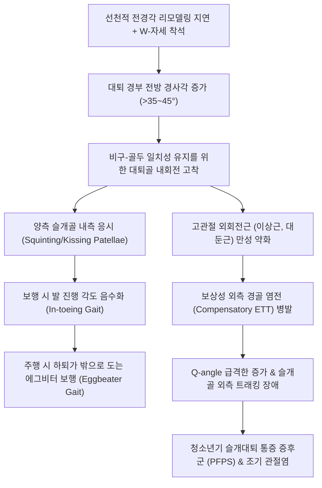

# 🩺 [[대퇴 염전]] (Femoral Anteversion / 大腿捻轉, Q65.8 / M21.8)

> **핵심 3줄 요약 (Key Summary)**:
> - 📍 병소 부위 & 해부·병태생리: 넙다리뼈([[대퇴골]]) 근위부의 해부학적 변형으로, 대퇴 경부 축(Femoral neck axis)과 대퇴 원위부 관절과 축(Transcondylar axis) 사이의 전방 비틀림 각도(대퇴 전경각, Anteversion angle)가 정상 범위를 초과하여 과도하게 증가한 상태이다. 출생 시 정상 30°~40°의 전경각은 성장과 함께 성인 정상치(10°~15°)로 감소해야 하나, 자궁 내 압박, 불량한 착석 습관([[W-자세]]) 및 유전적 요인으로 인해 리모델링이 지연되면서 발생한다. 만 3~8세 소아 [[안짱걸음]](In-toeing gait)의 가장 흔한 원인 질환이다.
> - 🚩 전형적 임상 양상 & 3대 징후: 보행 시 양측 무릎뼈가 안쪽을 마주보며 걷는 '키스하는 슬개골(Kissing patella / Squinting patellae)', 달릴 때 하퇴와 발이 바깥쪽으로 크게 휘돌려지는 '에그비터 보행(Eggbeater gait / Windmill running)', 바닥에 앉을 때 무릎을 모으고 다리를 W자 모양으로 벌려 앉는 'W-자세 착석([[W-자세]], W-sitting)'. 고관절 신전 상태에서 내회전 가동역이 70°~80° 이상으로 비정상적으로 증가하는 반면 외회전은 20° 미만으로 현저히 제한된다.
> - 🛠️ 핵심 감별 검사 & 한·양방 다각적 치료 전략: 복와위 고관절 내·외회전 각도 측정, 크레이그 검사([[크레이그 검사]], Craig's test / Trochanteric Prominence Angle Test, TPAT), 전경각 CT 스캔. 만 8~10세까지 80% 이상 자연 리모델링(Spontaneous remodeling)되므로 적극적 관찰과 자세 교정(W-자세 금지, 양반다리 권장)이 1차 원칙이며, 과거의 회전 토크 보조기나 특수화는 의학적 무효성이 입증되어 권장되지 않는다. 만 8~10세 이후 전경각 50° 이상의 심한 기형 및 기능 장애 시 대퇴 전자간 회전절골술을 고려한다. 한의학에서는 간신부족(肝腎不足), 근골위약(筋骨痿弱), 비위허손(脾胃虛損)으로 변증하여 골반-고관절 추나(이상근·장요근·대퇴근막장근 이완 및 외회전근 강화 가동술), [[육미지황탕가미]], [[독활기생탕]], [[보중익기탕]], [[환도]], [[양릉천]], [[현종]], [[신수]], [[족삼리]] 침구 치료를 시행한다.
> - <font color="#fa7e7e">⚠️ 응급 의뢰 레드플래그 & 악화 요인: 편측성 대퇴 회전 변형, 파행(Limping) 및 고관절·서혜부 통증, 하지 단축(Galeazzi sign 양성), [[발달성 고관절 이형성증]](DDH), [[대퇴골두 무혈성 괴사]](LCPD), [[대퇴골두 골단 분리증]](SCFE) 동반 의심 소견 시 즉각적인 방사선 촬영 및 소아정형외과 상급병원 의뢰.</font>

---

## 📌 목차
1. [질환 개요 & 해부학적 병태생리](#1-질환-개요--해부학적-병태생리)
2. [병태생리 메커니즘 & 생체역학적 악순환 네트워크](#2-병태생리-메커니즘--생체역학적-악순환-네트워크)
3. [임상 증상 & 이학적 검사(Physical Exam) 알고리즘](#3-임상-증상--이학적-검사physical-exam-알고리즘)
4. [감별 진단 매트릭스 (Differential Diagnosis)](#4-감별-진단-매트릭스-differential-diagnosis)
5. [한의 통합 치료 프로토콜 (침·약침·추나·한약)](#5-한의-통합-치료-프로토콜-침약침추나한약)
6. [양방 치료 & 병용·의뢰 기준 (Conventional Treatment & Referral)](#6-양방-치료--병용의뢰-기준-conventional-treatment--referral)
7. [재활 운동 & 생활습관 티칭 가이드](#7-재활-운동--생활습관-티칭-가이드)
8. [💡 사용자 진료실 핵심 필기 & 임상 노하우 (Melt-In 잔여 심화 집약)](#8--사용자-진료실-핵심-필기--임상-노하우-melt-in-잔여-심화-집약)
9. [출처 및 학술 참고 문헌 (References)](#9-출처-및-학술-참고-문헌-references)

---

## 1. 질환 개요 & 해부학적 병태생리

### 1) 질환의 정의 및 대퇴 염전각의 개념
[[대퇴 염전]](Femoral Torsion) 또는 과도한 [[대퇴 전경]](Excessive Femoral Anteversion)은 [[대퇴골]](Femur)의 장축을 기준으로 근위부의 **대퇴 경부-골두 축(Femoral neck axis)**과 원위부의 **대퇴 과간 관절면 횡축(Transcondylar axis)** 사이에 형성되는 회전 비틀림 각도(대퇴 염전각, Femoral Torsion Angle)가 전방으로 과도하게 편위된 상태를 의미한다.

대퇴 경부 축이 원위 과간 횡축에 비해 앞쪽(전방)으로 기울어져 있는 것을 **전경(Anteversion)**이라 하고, 뒤쪽(후방)으로 기울어져 있는 것을 **후경(Retroversion)**이라 부른다.

* **발생학적 변화 및 연령별 표준 전경각**:
  * **태아기 (재태 7~8주)**: 하지가 내측으로 회전하면서 대퇴골두가 비구에 안착됨.
  * **출생 시 (신생아)**: 평균 **30° ~ 40°** (고도의 생리적 전경 상태로 출생).
  * **만 1~2세 (보행 시작)**: 평균 **30° ~ 35°**.
  * **만 5~6세**: 평균 **20° ~ 25°**.
  * **만 8~10세**: 평균 **15° ~ 20°** (급격한 자연 리모델링 완료기).
  * **골 성숙기 (청소년 및 성인)**: 평균 **10° ~ 15°** (남성 약 12°, 여성 약 15°).

과도한 대퇴 전경은 이 정상적인 자발적 탈염전(Derotation) 리모델링 과정이 지연되거나 정체되어, 만 3세 이후에도 35° 이상의 높은 전경각이 지속되는 상태를 말하며, 소아기 안짱걸음의 가장 대표적인 원인이다.

### 2) 역학적 특성
* **호발 연령**: 만 3세에서 8세 사이의 유치원 및 학령기 초기에 가장 뚜렷하게 관찰된다. (만 1~3세의 안짱걸음이 주로 [[경골 염전]]에 기인하는 것과 구별됨).
* **성별 분포**: 여아에서 남아보다 약 2배 호발하며(여아:남아 = 2:1), 가족성 경향(유전적 인대 이완증, Familial ligamentous laxity)이 흔히 동반된다.
* **병변의 양측성**: 대부분 양측성이며, 편측성으로 발생한 경우 다른 선천성/신경근육계 기형을 반드시 감별해야 한다.

### 3) 관련 해부학적 구조물
* **골격 및 관절 복합체**:
  * [[대퇴골]](Femur): 대퇴 골두(Head), 경부(Neck), 대전자(Greater trochanter), 소전자(Lesser trochanter), 골간부(Shaft), 내외측과(Condyles).
  * [[비구]](Acetabulum): 골반 비구의 전경각(Acetabular anteversion, 정상 15°~20°)과 대퇴 전경각의 합을 복합 전경각(Combined anteversion)이라 하며, 고관절의 전방 안정성을 결정함.
  * [[고관절]](Hip joint): 구와관절(Ball-and-socket joint)로서 전경각이 클수록 고관절 굴곡위에서 골두가 비구 전방으로 노출됨.
  * [[슬개대퇴 관절]](Patellofemoral joint): 대퇴골의 내회전 정렬로 인해 슬개골이 내측을 향하게 됨.
* **근육 및 연부조직 복합체**:
  * 내회전 토크 근육군 (단축/과긴장): [[대퇴근막장근]](Tensor fasciae latae, TFL), [[소둔근]](Gluteus minimus) 전방 섬유, [[중둔근]](Gluteus medius) 전방 섬유, [[장요근]](Iliopsoas), [[치골근]](Pectineus).
  * 외회전 토크 근육군 (신장/약화): [[이상근]](Piriformis), [[상쌍자근]](Gemellus superior), [[하쌍자근]](Gemellus inferior), [[내폐쇄근]](Obturator internus), [[외폐쇄근]](Obturator externus), [[대퇴방형근]](Quadratus femoris), [[대둔근]](Gluteus maximus).
  * 관절낭 및 인대: 고관절 전방 관절낭과 [[장골대퇴인대]](Iliofemoral ligament, Y-ligament)의 과도한 이완증.
* **신경 및 혈관망**:
  * [[대퇴신경]](Femoral nerve) 및 대퇴동맥: 대퇴 삼각(Femoral triangle)을 통과하며 고관절 전방을 주행.
  * [[좌골신경]](Sciatic nerve): 이상근 하공을 지나 대퇴 후면으로 주행하며 외회전근군의 긴장에 영향을 받음.
  * [[폐쇄신경]](Obturator nerve): 내전근군을 지배.

---

## 2. 병태생리 메커니즘 & 생체역학적 악순환 네트워크

### 1) 해부학적 및 생체역학적 발생 기전
대퇴 전경각이 증가하면(예: 45°), 대퇴 골두는 비구(Acetabulum)의 전방 관절순(Anterior labrum) 바깥으로 비정상적으로 노출된다. 이때 신체는 **대퇴 골두를 비구 관절와 내에 가장 깊고 안정적으로 수용(Joint congruency 획득)**하기 위해 고관절을 무의식적으로 **내회전(Internal rotation)**시키는 보상 동작을 취하게 된다.

이로 인해 대퇴골 전체와 슬개골이 안쪽으로 돌아가게 되며, 보행 시 발끝이 안쪽으로 모이는 [[안짱걸음]](In-toeing)이 유발된다.

```
[ 과도한 대퇴 전경 (Femoral Anteversion > 40°) ]
                       │
                       ▼
    [ 대퇴 골두의 비구 전방 노출 & 불안정성 ]
                       │
                       ▼
 [ 관절 일치성(Congruency) 획득을 위한 대퇴골 내회전 보상 ]
                       │
          ┌────────────┴────────────┐
          ▼                         ▼
 [ 슬개골 내측 응시 ]      [ 고관절 내회전근 단축 ]
 (Kissing Patella)         (외회전근 신장 및 약화)
          │                         │
          └────────────┬────────────┘
                       ▼
          [ W-자세 착석의 편안함 획득 ]
          (W-sitting: 비틀림 악순환 고착)
                       │
          ┌────────────┴────────────┐
          ▼                         ▼
   [ 안짱걸음 & 에그비터 보행 ] [ 보상성 외측 경골 염전 유발 ]
   (잦은 넘어짐 & 피로)         (Miserable Malalignment)
                       │                         │
                       └────────────┬────────────┘
                                    ▼
                     [ Q-angle 증가 & 슬개골 아탈구 ]
                     [ 청소년기 슬개대퇴 통증 증후군 ]
```



### 2) 악순환의 핵심: W-자세 착석 (W-Sitting)의 역학
대퇴 전경이 있는 아동은 해부학적으로 고관절 내회전이 매우 자유롭고 외회전이 제한되어 있다. 따라서 바닥에 앉을 때 양반다리([[가부좌]])를 하면 고관절 외회전 제한으로 인해 고관절 전방과 무릎에 심한 불편감을 느낀다.

반면, 무릎을 꿇고 엉덩이를 바닥에 댄 채 양 발을 바깥으로 벌리는 **W-자세 착석([[W-자세]], W-sitting)**을 취하면 고관절이 80~90도 내회전되면서 골두가 비구에 완벽히 밀착되어 가장 넓은 기저면(Base of support)을 형성하므로 아동은 극도의 안정감과 편안함을 느낀다.

그러나 W-자세로 앉아 체중이 대퇴골에 실리면, 대퇴골 장축에 **지속적인 내회전성 비틀림 토크(Rotational torque)**가 가해져 대퇴 전경각의 자연적인 퇴행 리모델링(Derotation)이 완전히 차단되고 변형이 더욱 심화되는 치명적인 악순환이 발생한다.

### 3) 생체역학적 연쇄 반응과 Miserable Malalignment
대퇴골이 안쪽으로 돌아가면 보행 시 발끝이 심하게 안쪽을 향하게 되므로, 신체는 발끝을 전방 11자로 맞추기 위해 무릎 아래의 정강이뼈를 바깥으로 비트는 **보상성 외측 경골 염전(Compensatory External Tibial Torsion)**을 2차적으로 발달시킨다.
* **비참한 정렬 불량 증후군 (Miserable Malalignment Syndrome)**:
  * 대퇴골: 과도한 내회전 (대퇴 전경)
  * 슬개골: 내측 응시 (Squinting patella)
  * 경골: 과도한 외회전 (외측 경골 염전)
  * 발: 거골하관절 과회내 (보상성 평발화)
* 이 경우 **Q-각(Q-angle)이 20도 이상으로 극단적으로 증가**하여, 보행 및 달리기 시 대퇴사두근이 수축할 때마다 슬개골을 바깥쪽으로 강하게 잡아당기는 '활시위 효과(Bowstring effect)'가 발생한다. 이는 청소년기 및 성인기 [[슬개대퇴 통증 증후군]](PFPS), 재발성 슬개골 아탈구, 슬개골 연골연화증의 결정적 원인이 된다.

---

## 3. 임상 증상 & 이학적 검사(Physical Exam) 알고리즘

### 1) 임상 증상 및 3대 특징적 징후
1. **키스하는 슬개골 (Kissing Patella / Squinting Patellae)**:
   * 환아가 정면을 보고 서 있거나 걸어올 때, 양측 슬개골이 정면을 보지 않고 서로 마주보듯 안쪽을 향하고 있다.
   * 이는 병소 부위가 고관절/대퇴골에 있음을 시각적으로 증명하는 핵심 지표이다.
2. **에그비터 보행 (Eggbeater Gait / Windmill Running)**:
   * 환아가 빠르게 걷거나 달릴 때, 대퇴골이 안쪽으로 고정되어 있어 무릎 아래 하퇴와 발이 바깥쪽으로 원을 그리며 휘돌려지는(Circumduction) 특징적인 달리기 형태를 보인다. 흡사 거품기(Eggbeater)가 돌아가는 모양과 같아 명명되었다.
3. **W-자세 선호 및 양반다리 거부**:
   * 바닥 생활 시 거의 100% W자세로만 앉으며, 어른들이 양반다리를 시키면 "다리가 아프다", "불편하다"며 1분을 버티지 못하고 다시 W자세로 돌아간다.
4. **보행 중 잦은 넘어짐과 피로**:
   * 유각기(Swing phase)에 발끝이 반대측 다리에 걸려 넘어지며, 고관절 외회전근의 만성 신장으로 인해 조금만 걸어도 엉덩이와 허벅지 외측의 피로감을 호소한다.

### 2) 필수 이학적 검사법 (Physical Examination)

```
[ 대퇴 염전 진찰 알고리즘 ]
                   │
                   ▼
     1단계: 보행 관찰 (Gait Analysis)
     - 발 진행 각도 (FPA) 음수 확인
     - 양측 슬개골 내측 응시 (Kissing patella) 확인
                   │
                   ▼
     2단계: 앙와위 (Supine) 정렬 평가
     - 슬개골을 정면으로 정렬했을 때 발의 회전 상태 확인
                   │
                   ▼
     3단계: 복와위 (Prone) 고관절 회전각 측정 (핵심)
     - 고관절 내회전각 (IR) 측정: > 70°~80° 시 강력 의심
     - 고관절 외회전각 (ER) 측정: < 20° 시 확진적
                   │
                   ▼
     4단계: 크레이그 검사 (Craig's Test / TPAT)
     - 대전자 최대 돌출 시 하퇴 수직 각도 측정 (전경각 추정)
                   │
                   ▼
     5단계: 경골 염전 및 족부 기형 동반 여부 확인
     - 복와위 TFA 측정 (Miserable malalignment 감별)
```

#### ① 복와위 고관절 회전각 측정 (Hip Internal / External Rotation) — ★ 핵심
* **검사 방법**:
  * 환아를 진찰대 위에 편안하게 엎드리게(Prone) 한다.
  * 골반이 진찰대에서 들리지 않도록 수평을 유지한 상태에서, 무릎을 90도 굴곡시킨다.
  * 하퇴부를 바깥쪽으로 벌려 **고관절 내회전(Internal Rotation, IR)** 각도를 측정하고, 하퇴부를 안쪽으로 모아 **고관절 외회전(External Rotation, ER)** 각도를 측정한다.
* **판독 기준**:
  * **정상 아동**: 내회전 40°~50°, 외회전 40°~50° (합계 약 90°~100° 내외로 대칭적).
  * **과도한 대퇴 전경**:
    * **고관절 내회전: 70° ~ 90° (현저한 증가)** (경증: 70~80°, 중등도: 80~85°, 중증: > 85°).
    * **고관절 외회전: 0° ~ 20° (현저한 감소)** (심한 경우 0~10° 미만으로 외회전이 거의 되지 않음).
    * 통상 내회전 각도가 외회전 각도보다 **30도 이상 큰 비대칭**을 보인다.

#### ② 크레이그 검사 ([[크레이그 검사]], Craig's Test / Trochanteric Prominence Angle Test, TPAT)
* **검사 목적**: 방사선 노출 없이 진료실에서 환아 대퇴골의 실제 해부학적 전경각(Anteversion angle)을 임상적으로 정량 추정하는 골드 스탠다드 검사법.
* **검사 방법**:
  1. 환아를 복와위로 눕히고 검사측 무릎을 90도 굴곡시킨다.
  2. 검사자는 한 손으로 대퇴골 대전자(Greater trochanter)의 외측 가장 돌출된 부위를 촉진한다.
  3. 다른 한 손으로 발목을 잡고 고관절을 천천히 수동적으로 내회전 및 외회전시킨다.
  4. 대전자가 검사자의 손가락 아래에서 **가장 외측으로 뚜렷하게 돌출되어 평평해지는 순간(Greatest lateral prominence)** 회전을 멈춘다. (이 순간 대퇴 경부 축이 진찰대 바닥면과 완벽히 평행을 이룸).
  5. 이때 지면(수직 기준선)과 하퇴부(경골 장축)가 이루는 각도를 각도기(Goniometer)로 측정한다.
* **판독**:
  * 측정된 각도가 환아의 **대퇴 전경각**을 직접 반영한다.
  * 정상 성인: 10° ~ 15°.
  * 비정상적 대퇴 전경: **> 30° ~ 40° 이상**.

---

## 4. 감별 진단 매트릭스 (Differential Diagnosis)

| 감별 질환 | 호발 연령 | 병변 분절 | 슬개골 주시 방향 | 고관절 회전각 (IR / ER) | 크레이그 검사 | 허벅지-발 각도 (TFA) |
| :--- | :--- | :--- | :--- | :--- | :--- | :--- |
| **[[대퇴 염전]] (과도한 전경)** (본 질환) | 3~8세 | 대퇴골 근위부 | **내측 주시 (Kissing)** | **IR > 70°~80° / ER < 20°** | **양성 (> 30°~40°)** | 정상 (+10°~+15°) |
| **[[경골 염전]] (내측)** | 1~3세 | 하퇴부 경골 | **정면 주시** | 정상 대칭 (IR 45° / ER 45°) | 정상 (10°~15°) | **음수 (< 0°, -10°~-30°)** |
| **[[중족골 내전]]** | 0~1세 | 족부 전족부 | **정면 주시** | 정상 대칭 | 정상 | 정상 |
| **[[발달성 고관절 이형성증]] (DDH)** | 신생아~보행기 | 고관절 비구/대퇴두 | 비대칭적 편위 | **고관절 외전 제한 (< 60°)**, Allis/Galeazzi 양성 | 평가 부정확 (탈구) | 정상 |
| **[[대퇴골두 무혈성 괴사]] (LCPD)** | 4~8세 (남아 호발) | 대퇴 골두 골단 | 통증성 회피 | **고관절 외전 및 내회전의 심한 제한과 통증** | 롤링 검사 시 통증 | 방사선상 골두 압박 괴사 |
| **[[대퇴골두 골단 분리증]] (SCFE)** | 10~14세 (비만 청소년) | 대퇴 근위 성장판 | **외측 주시 (외회전)** | **고관절 내회전 완전 소실, 굴곡 시 강제 외회전** | 음성 (후경 패턴) | 고관절 방사선상 골단 전위 |

---

## 5. 한의 통합 치료 프로토콜 (침·약침·추나·한약)

### 1) 한의학적 병인병기 및 변증 체계
한의학에서 소아 대퇴의 회전성 부정렬과 안짱걸음은 **간신부족(肝腎不足)**, **비위허손(脾胃虛損)**, **근골위약(筋骨痿弱)**의 병전으로 파악한다.

* **간신부족(肝腎不足)**:
  * 간은 근(筋)을 주관하고 신은 골(骨)을 주관한다(『소문·위론』: 肝主身之筋膜, 腎主身之骨髓).
  * 선천적 태기(胎氣) 부족으로 신정이 부족하면 대퇴골 경부의 정상적 골 흡수와 리모델링이 지연되고, 간혈이 근막을 자양하지 못하면 둔부의 심부 회전근육들이 비대칭적으로 구축되어 뼈를 바른 위치로 회전시키지 못한다.
* **비위허손(脾胃虛損) 및 기육무력(肌肉無力)**:
  * 비는 사지와 기육을 주관한다(脾主四肢肌肉).
  * 후천적인 소화기 허약으로 기혈 생성이 부족하면 대퇴사두근과 중둔근, 대둔근 등 하지 지지 근육의 장력이 떨어져 바른 직립 정렬을 유지하지 못하고 관절이 내회전 방향으로 무너져 내린다.
* **경락 경근 울체(經筋鬱滯)**:
  * 족소양담경(足少陽膽經) 및 족태양방광경(足太陽膀胱經) 경근의 긴장과 순환 저체로 둔부 심부의 이상근, 상하쌍자근, 내외폐쇄근이 굳어지고, 족양명위경(足陽明胃經) 전방 근막이 단축되어 고관절 내회전이 고착화됨.

### 2) 소아 골반-고관절 추나 치료 (Chuna Manipulation)
소아의 고관절 관절낭과 연골은 매우 부드럽고 가소성(Plasticity)이 높으므로, 성인과 같은 고속저진폭(HVLA) 교정은 엄격히 금기하며, **근막 이완(Myofascial Release)과 수동적 관절 가동술(Mobilization)**을 적용한다.

```
[ 소아 대퇴 염전 추나 치료 3단계 프로토콜 ]
1단계: 전방 고관절 굴곡근 & 내회전근 근막 이완 (JS 기법)
   - 장요근, 대퇴근막장근(TFL), 대퇴직근의 과긴장 해소
2단계: 둔부 심부 외회전근 촉진 및 관절낭 가동술
   - 이상근, 중둔근 후방 섬유 이완 및 고관절 후방 관절낭 가동
3단계: 고관절 수동적 외회전 유도 신장 기법 (Passive External Derotation)
   - 앙와위/복와위에서 대퇴골 장축 외회전 방향 저항 장벽 신장
```

* **고관절 내회전근 근막 이완술 (MFR)**:
  * 환아를 앙와위로 눕히고 고관절을 가볍게 신전시킨 상태에서 술자의 수근부로 대퇴 외측의 대퇴근막장근(TFL)과 장경인대 기시부를 부드럽게 압박 유선하여 긴장을 해소한다 (3~5분).
* **고관절 수동적 외회전 가동술 (External Derotation Mobilization)**:
  * 환아를 복와위로 눕히고 슬관절을 90도 굴곡시킨다.
  * 술자의 한 손은 환아의 천골과 골반을 단단히 고정하여 골반이 들리지 않도록 지지한다.
  * 다른 한 손으로 환아의 발목 부위를 잡고 하퇴부를 천천히 몸 안쪽(고관절 외회전 방향)으로 유도한다.
  * 외회전 저항 장벽(End-feel)을 느끼는 지점에서 멈추고, 부드럽게 10~15초간 유지하는 지속 신장(Sustained stretch)을 5~10회 반복한다. 절대 반동을 주거나 통증을 유발하는 과도한 힘을 가하지 않는다.
* **장요근 및 골반 전방경사 교정**:
  * 토마스 검사 자세를 응용하여 대퇴골을 후하방으로 부드럽게 신전시켜 장요근 단축을 해소하고 골반의 전방경사를 완화한다.

### 3) 침구 치료 (Acupuncture)
소아 환아의 심리적 안정을 위해 **0.16mm 극세침을 이용한 속자속발(速刺速拔)** 또는 **무통 레이저 침**, **소아 스티커 피내침**을 활용한다.

* **주요 경혈 및 취혈 근거**:
  * [[환도]](GB30): 족소양담경과 족태양방광경의 교회혈로 고관절 질환의 최고 요혈. 좌골신경과 이상근 부착부에 위치하여 둔부 심부 외회전근의 신경근 조절력을 회복시킴.
  * [[거료]](GB29): 대전자와 상전장골극 중간에 위치하여 중둔근과 대퇴근막장근의 긴장을 조절.
  * [[양릉천]](GB34): 팔회혈 중 근회(筋會)로 하지 전체 근막 긴장 완화.
  * [[현종]](GB39, 절골): 팔회혈 중 수회(髓會)로 골 형성 촉진.
  * [[신수]](BL23) & [[비수]](BL20): 선천 지본과 후천 지본을 동시에 보강하여 골 발육 유도.
  * [[족삼리]](ST36): 대퇴사두근 활성화 및 전신 기육 강화.
  * [[질변]](BL54): 둔부 외회전근 긴장 해소 및 혈류 개선.
* **시술 방법**:
  * 3~6세 유아: 환도, 양릉천, 족삼리 혈위에 무통 레이저 침(각 30초~1분) 조사 또는 마이크로 피내침 부착.
  * 7세 이상 아동: 0.16mm 침으로 환도, 거료 5~10mm 직자 후 가벼운 염전 제삽 후 즉시 발침.

### 4) 한약 치료 (Herbal Medicine)
대퇴골 근위부의 골 리모델링 속도를 높이고, 건인대의 신축성과 근력을 강화하기 위한 한약을 처방한다.

* **간신부족·골연화형 (골 리모델링 정체 및 전신 성장 지연)**:
  * 처방: **[[육미지황탕가미]](六味地黃湯加味)**.
  * 구성: [[숙지황]](6g), [[산약]](4g), [[산수유]](4g), [[복령]](3g), [[택사]](3g), [[목단피]](3g), [[녹용]](2g), [[구판]](4g), [[두충]](4g), [[우슬]](3g).
  * 약리 기전: 숙지황·녹용·구판의 교질(Collagen) 및 칼슘 대사 촉진 성분이 대퇴 골두 및 경부 성장판의 조골세포 분화를 유도하며, 두충과 우슬의 이리도이드 배당체가 관절 인대 지지력을 향상시킴.
* **비위기허·근맥이완형 (보행 피로, 전신 유연성 과다, 마른 체형)**:
  * 처방: **[[보중익기탕]](補中益氣湯)** 합 **[[독활기생탕]](獨活寄生湯)** 가감.
  * 구성: [[황기]](6g), [[인삼]](3g), [[백출]](4g), [[당귀]](4g), [[진피]](3g), [[승마]](2g), [[시호]](2g), [[독활]](3g), [[상기생]](4g), [[속단]](4g), [[감초]](2g).
  * 약리 기전: 비위 흡수 기능을 개선하여 근육 단백질 합성을 촉진하고 둔부 외회전근의 장력을 회복시켜 보행 지구력을 강화함.

---

## 6. 양방 치료 & 병용·의뢰 기준 (Conventional Treatment & Referral)

### 1) 보존적 치료의 현대적 평가 (보조기 요법의 무효성)
과거 대퇴 전경 교정을 위해 널리 사용되었던 기계적 장치들:
* **트위스터 케이블 (Twister cables)**: 골반 벨트에서 신발까지 연결된 탄성 스프링 케이블로 다리를 강제로 외회전시키는 장치.
* **야간 부목 (Wheaton brace)**, 회전 밴드, 특수 교정화.

> ⚠️ **소아정형외과학회의 과학적 검증 결론**:
> 다수의 장기 추적 연구(Fabry et al., Staheli et al.)에 의해 **외부에서 가하는 회전 보조기나 신발은 대퇴골 근위부 뼈 자체의 전경각을 교정하지 못한다**는 사실이 명백히 입증되었다.
> 보조기를 착용하면 신발과 발목, 무릎 관절에만 회전력이 걸려 오히려 **무릎 인대 이완, 슬개골 외반 변형, 족부 외번 변형** 등 심각한 2차 합병증을 유발한다. 따라서 미국정형외과학회(AAOS) 및 대한소아정형외과학회는 대퇴 염전에 대한 일상적 보조기 처방을 강력히 반대한다.

### 2) 자연 경과 및 관찰 원칙 (Watchful Waiting)
* 대퇴 전경은 **자연 치유 경향(Natural resolution)**이 매우 강한 생리적 상태이다.
* 3~4세에 가장 심하게 관찰되더라도, 보행과 달리기를 통해 대퇴골에 정상적인 생체역학적 부하가 가해지면 **만 8~10세까지 약 80~90%의 환아에서 15~20도 수준으로 자연 교정**된다.
* 따라서 가장 안전하고 과학적인 양방 1차 치료는 '자연 경과 관찰(Observation)'과 '생활습관 교정'이다.

### 3) 수술적 치료 적응증 (Surgical Indication)
수술은 전체 환자의 1% 미만에서만 신중하게 결정된다.

* **수술 고려 기준**:
  1. 환아의 연령이 **최소 만 8~10세 이상**일 것 (이후에는 자발적 골 리모델링을 기대하기 어려움).
  2. CT 또는 MRI상 대퇴 전경각이 **50° 이상**으로 심각할 것.
  3. 고관절 외회전 각도가 **10° 미만**으로 심각하게 제한될 것.
  4. 기능적 장애: 심한 보행 장애, 잦은 낙상, 조기 슬관절 통증 및 미용적 고통이 현저할 것.
* **표준 수술 기법**:
  * **대퇴골 전자간 또는 전자하 회전절골술 (Intertrochanteric or Subtrochanteric Rotational Osteotomy)**:
    * 대퇴골 근위부(전자간 또는 전자하부)를 횡절골한 후, 원위부를 필요한 각도만큼 외회전(External derotation)시켜 정상 전경각(15도 내외)을 맞춘 뒤 금속판(Blade plate 또는 Locking compression plate)이나 골수강내 금속정(Intramedullary nail)으로 견고하게 고정함.
    * 최근 장기 추적 연구(Papadimitriou et al., 2026)에 따르면 단독 전자간 회전절골술을 시행받은 환자들을 17년간 추적 관찰한 결과, 통증 감소 및 관절 기능, 방사선학적 정렬에서 우수하고 안정적인 장기 임상 결과를 보임.
    * 수술 중 정확한 교정각 측정을 위해 스마트폰 기반 각도 측정 도구를 활용하는 등 정밀 술기가 발전하고 있음(Chenault et al., 2026).

### 4) 한양방 병용 판단 & 전문과 의뢰 기준
* **병용 시너지**: 양방 정형외과의 추적 관찰 기간 동안, 한의원의 비침습적 근막 이완, 고관절 스트레칭, 추나 교정, 한약 치료를 결합하면 아동의 관절 유연성과 근력을 극대화하여 뼈의 자연 탈염전을 촉진하는 훌륭한 협진 모델이 된다.
* **🚨 즉각적인 정형외과 상급병원 의뢰 레드플래그**:
  1. **편측성 대퇴 내회전**: 한쪽 다리만 비정상적으로 돌아가는 경우 ([[발달성 고관절 이형성증]], 편측 뇌성마비 배제).
  2. **서혜부/고관절/무릎 통증 및 파행(Limping)**: 단순 대퇴 염전은 통증을 유발하지 않는다. 통증이 있다면 [[LCPD]](대퇴골두 무혈성 괴사), 일과성 고관절 활액막염, 화농성 관절염 감별 필수.
  3. **비만 청소년의 급격한 내회전 제한 및 외회전 강제 편위**: 대퇴골두가 성장판에서 미끄러지는 응급 질환인 [[대퇴골두 골단 분리증]](SCFE) 의심 시 즉시 비체중부하 상태로 정형외과 응급 의뢰.

---

## 7. 재활 운동 & 생활습관 티칭 가이드

### 1) 착석 자세의 절대적 수정 (Ergonomics)
대퇴 전경 교정의 90%는 일상생활 자세에서 결정된다.

```
[ 자세 티칭 수칙 ]
⛔ 절대 금기: W-자세 착석 (W-Sitting)
   - 엉덩이가 바닥에 닿고 종아리가 바깥으로 빠지는 자세는 대퇴 전경을 지속 악화시킴.
   - 부모, 유치원 교사의 협조를 구해 아이가 W자세를 취할 때마다 잔소리가 아닌 
     자연스러운 신호로 자세를 바꾸도록 지도.

✅ 적극 권장: 책상다리 / 양반다리 (Tailor Sitting / Cross-legged Sitting)
   - 고관절을 외전 및 외회전시키는 자세로 대퇴골에 외회전 스트레스를 부여함.
   - 벽에 등을 기대고 발바닥을 서로 맞붙이는 나비 자세(Butterfly stretch) 권장.

✅ 대안 자세: 의자 생활화 (Desk & Chair)
   - 바닥 좌식 생활을 전면 중단하고 식탁 의자, 공부방 책걸상 생활로 전환.
```

### 2) 고관절 심부 외회전근 강화 운동
* **클램셸 운동 (Clamshell Exercise)**:
  * 옆으로 누워 무릎을 90도 구부리고 양 뒤꿈치를 붙인 상태에서, 위쪽 무릎을 조개껍질 열듯이 천천히 들어올림.
  * 중둔근 후방 섬유와 심부 외회전근(이상근 등)을 선택적으로 강화 (1회 15회, 양측 3세트).
* **외회전 밴드 보행 (Monster Walk)**:
  * 무릎 위 또는 발목에 탄력 밴드를 걸고 양 발을 어깨너비로 벌려 약간 외회전시킨 상태에서 게걸음(Side walking) 또는 전방 보행 훈련.

### 3) 단축된 고관절 굴곡근 및 내회전근 스트레칭
* **장요근 런지 스트레칭**:
  * 한쪽 다리를 앞으로 내밀고 반대쪽 고관절을 신전시키며 골반을 앞으로 밀어 장요근과 고관절 전방 관절낭을 신장.

---

## 8. 💡 사용자 진료실 핵심 필기 & 임상 노하우 (Melt-In 잔여 심화 집약)

### 1) 진료실 실전 감별 & 부모 상담 노하우 (Consultation Script)
* **내원 시 부모의 심리 상태**:
  * 부모는 대개 아이가 유치원에서 친구들과 달릴 때 뒤뚱거리거나(에그비터 보행), 툭하면 넘어지는 모습을 보고 극도의 자책감과 공포를 안고 내원한다.
* **진료실 상담 핵심 멘트**:
  > *"어머님, 아이가 달릴 때 다리를 밖으로 휘젓고 걷는 것은 뼈가 부러지거나 마비가 온 것이 아닙니다. 대퇴골이라는 허벅지 뼈의 위쪽 머리가 아직 아기 때의 유연한 각도를 유지하고 있어서 생기는 정상적인 발달 과정의 지연입니다.*
  > *이 뼈는 억지로 쇠틀을 채운다고 돌아가지 않습니다. 오히려 무릎만 망가집니다. 가장 중요한 것은 바닥에서 'W자 모양'으로 앉는 습관을 당장 멈추게 하는 것입니다.*
  > *바닥 대신 의자에 앉히고, 양반다리를 놀이처럼 시켜주시면, 만 8~10세가 되면서 허벅지 뼈가 스스로 제자리를 찾아갑니다. 저희가 굳어있는 허벅지 앞쪽 근육을 풀고 엉덩이 근육을 튼튼하게 만들어 아이가 넘어지지 않고 힘차게 뛰도록 돕겠습니다."*

### 2) 진료실 원포인트 손맛 팁: 고관절 외회전 유도 시 주의점
* **골반 고정(Pelvic Stabilization)이 없으면 100% 헛손질이다**:
  * 복와위에서 고관절 외회전 스트레칭을 할 때, 반대쪽 골반(ASIS/PSIS)이 진찰대에서 들썩거리면 대퇴골이 회전되는 것이 아니라 골반 전체가 회전되는 보상 작용이 일어난다.
  * 반드시 술자의 체중을 실은 한 손으로 환아의 천골과 반대측 장골익을 진찰대에 완벽히 밀착 고정시킨 후 하퇴를 조작해야 한다.
* **통증 역치를 넘지 않는 '놀이형 신장'**:
  * 소아는 통증을 느끼는 순간 즉각적으로 전신 근육을 경직시킨다. 긴장된 상태에서는 어떤 수기도 효과가 없다.
  * 아이에게 "무릎으로 시계 바늘 놀이하자"면서 부드러운 호흡 유도와 함께 저항 장벽에서 10초간 머무는 정적 스트레칭을 적용한다.

### 3) 크레이그 검사 시의 팁
* 비만한 아동의 경우 대전자(Greater trochanter) 촉진이 어려울 수 있다.
* 이때는 고관절을 외전/내전시키지 말고 정확한 시상면에서 무릎을 굴곡시킨 뒤, 발목을 좌우로 크게 흔들면서(Wiper motion) 대퇴 외측에서 가장 튀어나오는 뼈의 정점을 손바닥 전체로 넓게 감싸 쥐어 찾아낸다.

---

## 9. 출처 및 학술 참고 문헌 (References)

Chenault PK et al. (2026). Intraoperative Correction of Femoral Anteversion Using a Native Smartphone Measurement Tool. *Cureus*. 18(8):e114550. [PMID: 42733941](https://pubmed.ncbi.nlm.nih.gov/42733941/)

Papadimitriou I et al. (2026). Long-term Clinical Outcomes after Isolated Intertrochanteric Rotational Osteotomy for Pathological Femoral Torsion: A 17-year Follow-up Study. *Z Orthop Unfall*. ():. [PMID: 42463077](https://pubmed.ncbi.nlm.nih.gov/42463077/)

Staheli LT et al. (1985). Lower-extremity rotational problems in children. Normal values to guide management. *J Bone Joint Surg Am*. 67(1):39-47. (PMID 미확인)

Fabry G et al. (1973). Torsion of the femur. A follow-up study in normal and abnormal children. *J Bone Joint Surg Am*. 55(8):1726-1738. (PMID 미확인)

대한정형외과학회. (2020). *정형외과학 제8판*. 최신의학사. 제2권 소아정형외과 편: 소아 대퇴 염전 및 회전 변형.
