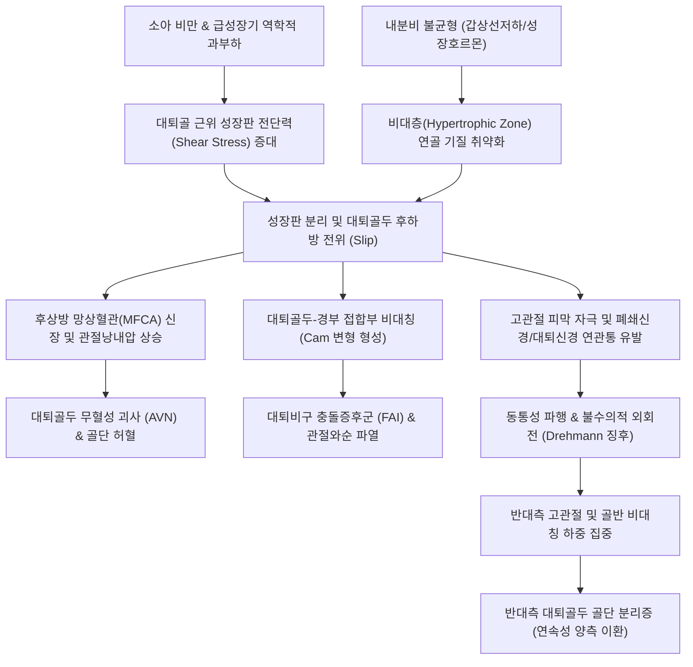

# 🩺 [[대퇴골두 골단 분리증]] (Slipped Capital Femoral Epiphysis, SCFE / 股骨頭骨骺滑脫, M93.0)

> **핵심 3줄 요약 (Key Summary)**:
> - 📍 병소 부위 & 해부·병태생리: 성장기 청소년 [[대퇴골]] 근위부의 [[성장판]](Physis 비대층)에서 생체역학적 전단력이 연골 결합력을 초과하여, [[대퇴골두]]가 골간단(Metaphysis)에 대해 상대적으로 후하방(Posterior-inferior)으로 전위(Slip)되는 대표적 소아청소년 고관절 질환.
> - 🚩 전형적 임상 양상 & 3대 징후: 비만 청소년의 원인 모를 파행(Limp), 고관절 굴곡 시 불수의적으로 외회전되는 [[Drehmann 징후]](Drehmann sign) 양성, 그리고 **[[폐쇄신경]] 연관통에 의한 단독 슬관절/대퇴 원위부 통증(Knee pain trap)**.
> - 🛠️ 핵심 감별 검사 & 한·양방 다각적 치료 전략: 골반 단순 X-ray(AP 및 Frog-leg lateral) 상 [[Klein 선]](Klein's line / Trethowan 징후) 단절 확인. 즉시 비체중부하(Non-weight bearing) 및 응급 단일 캐뉼라 나사 고정술([[In situ screw fixation]]) 의뢰. 수술 후 골유합기 및 재활 단계에서 [[활혈거어탕]], [[오적산]], [[보양환오탕]], 관절 가동 [[추나요법]], [[약침]] 치료로 [[무혈성 괴사]](AVN) 및 관절 구축 예방.
> - <font color="#fa7e7e">⚠️ 응급 의뢰 레드플래그 & 악화 요인: 체중 부하가 전혀 불가능한 불안정형 SCFE(Loder Unstable)는 대퇴골두 혈류 차단 및 급성 무혈성 괴사(20~50%) 위험이 있는 소아정형외과 응급 질환임. 진료실 내 강제 도수 정복이나 과도한 내회전 조작은 절대 금기!</font>

---

## 📌 목차
1. [질환 개요 & 해부학적 병태생리](#1-질환-개요--해부학적-병태생리)
2. [병태생리 메커니즘 & 생체역학적 악순환 네트워크](#2-병태생리-메커니즘--생체역학적-악순환-네트워크)
3. [임상 증상 & 이학적 검사(Physical Exam) 알고리즘](#3-임상-증상--이학적-검사physical-exam-알고리즘)
4. [감별 진단 매트릭스 (Differential Diagnosis)](#4-감별-진단-매트릭스-differential-diagnosis)
5. [한의 통합 치료 프로토콜 (침·약침·추나·한약)](#5-한의-통합-치료-프로토콜-침약침추나한약)
6. [양방 치료 & 병용·의뢰 기준 (Conventional Treatment & Referral)](#6-양방-치료--병용의뢰-기준-conventional-treatment--referral)
7. [재활 운동 & 생활습관 티칭 가이드](#7-재활-운동--생활습관-티칭-가이드)
8. [💡 사용자 진료실 핵심 필기 & 임상 노하우 (Melt-In 잔여 심화 집약)](#8--사용자-진료실-핵심-필기--임상-노하우-melt-in-잔여-심화-집약)
9. [출처 및 학술 참고 문헌 (References)](#9-출처-및-학술-참고-문헌-references)

---

## 1. 질환 개요 & 해부학적 병태생리

### 1) 질환 정의 및 역학적 특성
* **정의**: [[대퇴골두 골단 분리증]](Slipped Capital Femoral Epiphysis, 이하 SCFE)은 골 성숙이 완료되지 않은 청소년기에 [[대퇴골]] 근위부의 [[성장판]](Physis)을 통해 [[대퇴골두]](Femoral head)가 골간단(Femoral neck/metaphysis)으로부터 미끄러져 전위되는 질환이다. 엄밀히 말하면 대퇴골두는 [[비구]](Acetabulum) 내에 정상 위치를 유지하려는 경향이 있고, 체중 부하에 의해 대퇴 경부 및 골간단이 전상방(Anterosuperior) 및 외회전 방향으로 이동하므로 대퇴골두는 상대적으로 **후하방(Posteroinferior)**으로 전위된 형상을 취하게 된다.
* **호발 연령 및 성별**:
  * 남아: 만 12~15세 (평균 13.5세)
  * 여아: 만 10~13세 (평균 12.0세)
  * 남녀 성비는 대략 1.5:1 ~ 2:1로 남아에서 호발하며, 최근 소아 청소년 비만율 증가와 더불어 여아의 발병 빈도도 상승하고 있다.
* **양측성 침범(Bilateral involvement)**:
  * 초진 시 양측성이 확인되는 경우는 20~40%에 달하며, 일측성으로 발병한 환자의 50~60%가 향후 12~18개월 이내에 반대측 고관절에도 전위가 발생하는 연속성(Sequential) 양측 침범 패턴을 보인다.
* **주요 기저 위험 인자**:
  * **[[소아 비만]](Childhood Obesity)**: 환자의 60~80% 이상이 연령별 체질량지수(BMI) 95백분위수 이상에 해당한다. 과도한 체중은 수직 전단력(Shear stress)을 기하급수적으로 증가시킨다.
  * **급성장기(Pubertal Growth Spurt)**: 성장호르몬의 급증으로 연골 세포 증식은 활발하지만 세포외 기질의 석회화와 교원섬유 결합력이 미숙하여 전단 저항력이 가장 취약한 시기이다.
  * **내분비 질환(Endocrinopathy)**: [[갑상선기능저하증]](Hypothyroidism), [[성장호르몬]] 결핍 또는 성장호르몬 투여 치료, 범뇌하수체기능저하증, 부갑상선기능항진증, 신성 골이영양증(Renal osteodystrophy) 환자에서 골단판 기질 합성이 저하되어 비외상성 SCFE가 다발한다. 10세 미만 또는 16세 이상의 비전형적 연령대나 저체중 환자에서 발생한 경우 반드시 내분비 스크리닝이 요구된다.

### 2) 관련 해부학적 구조물
* **골격 및 관절 구조**:
  * **[[대퇴골두]] 및 근위 성장판**: 대퇴골 근위 골단판은 출생 시 수평에 가깝지만 사춘기 성장 스퍼트 동안 점차 경사(Oblique orientation)를 이루어 직립 시 체중에 의한 전단력 벡터가 증폭된다.
  * **골단판 조직학적 층 (Physeal Zonation)**:
    1. 예비층(Reserve/Resting zone)
    2. 증식층(Proliferative zone)
    3. **비대층(Hypertrophic zone - Columnar & Degenerative)**: 세포 부피가 커지고 세포외 기질(Type II collagen, Proteoglycan)이 얇아져 기계적 인장력 및 전단력에 가장 취약한 층이다. SCFE의 실제 분리선(Cleavage plane)은 바로 이 **비대층(Zone of hypertrophy)**을 관통한다.
    4. 임시 석회화층(Zone of provisional calcification)
* **신경 및 혈관 구조**:
  * **[[내측대퇴회선동맥]](Medial Femoral Circumflex Artery, MFCA)**: 대퇴골두의 주된 혈류를 공급하는 외측 골단동맥(Lateral epiphyseal arteries / Retinacular vessels)의 모혈관이다. 대퇴경부 후상방 관절낭 활액막 하부를 주행하므로, 골두가 후방으로 전위될 때 심하게 신장되거나 꼬이고, 관절 내 혈종이나 부종으로 관절낭내압이 상승하면 혈류가 차단되어 급성 [[대퇴골두 무혈성 괴사]](Avascular Necrosis, AVN)가 발생한다.
  * **[[폐쇄신경]](Obturator Nerve)**: 고관절 전내측 관절낭의 감각을 지배하는 신경 분지와 슬관절 전내측 감각을 지배하는 신경 분지가 L2-L4 척수 분절에서 공통 기원한다. 이로 인해 고관절 질환임에도 환아는 무릎 내측의 통증만 호소하는 투사통/연관통(Referred pain)이 빈발한다.
* **근육 및 근막 불균형**:
  * **단축/과긴장 근육군**: [[내폐쇄근]], [[이상근]], [[대퇴사두근]]의 대퇴직근, [[장요근]], [[내전근]]군.
  * **약화 및 억제 근육군**: [[중둔근]], [[소둔근]], [[대둔근]](고관절 외전 및 신전근 약화로 인한 [[트렌델렌버그 검사]] 양성).

---

## 2. 병태생리 메커니즘 & 생체역학적 악순환 네트워크

### 1) 해부학적 분리 및 전위 메커니즘
* 대퇴 경부와 골간단은 고관절 축을 따라 전상방(Anteriorsuperior)으로 이동하며 외회전(External rotation)된다.
* 반면, 대퇴골두는 비구에 단단히 안착된 상태로 후하방(Posteroinferior)으로 전위되며, 이로 인해 대퇴골 원위부 골격 전체는 상대적인 외회전 변형(Out-toeing) 상태에 고정된다.
* 비대층 연골 기질의 프로테오글리칸 농도 저하, 콜라겐 가교 결합 약화, 대퇴경부 전경각(Anteversion) 감소 혹은 후경각(Retroversion) 증가가 복합적으로 작용한다.

```
       [생체역학적 SCFE 전위 및 혈관 손상 모식도 (ASCII Art)]
       
       비구 (Acetabulum)
      /===================\
     |    대퇴골두 (Head)   |  <--- 비구 내에 잔류하며 후하방 전위
     |    (Epiphysis)     |
      \=======---=========/
             / : \              <--- 성장판 비대층(Physis Hypertrophic Zone) 전단 분리
            /  :  \
   외측망상혈관  :   \
  (MFCA branch)  :    \         <--- 후상방 망상혈관의 신장/압박/혈류 차단 위험 (AVN)
      [신장]     :     \
               / ===== \
              /  대퇴경부 \
             /  (Neck/    \     <--- 골간단은 전상방 및 외회전 방향으로 편위
            /  Metaphysis) \
```

### 2) 생체역학적 악순환 네트워크



---

## 3. 임상 증상 & 이학적 검사(Physical Exam) 알고리즘

### 1) 주소증 및 임상 분류
* **임상 양상 분류 (Loder Classification - 안정성 기준)**:
  * **안정형 (Stable SCFE)**:
    * 목발 사용 유무와 관계없이 **환아가 체중 부하(보행)가 가능한 상태** (90% 이상).
    * 골두의 혈류 공급이 대체로 보존되어 있어 무혈성 괴사(AVN) 발생률이 1~2% 미만으로 매우 낮다.
  * **불안정형 (Unstable SCFE)**:
    * 극심한 통증으로 인해 목발을 짚고도 **체중 부하가 전혀 불가능한 상태**.
    * 급성 골절에 준하는 상태로 골막 파열 및 외측 망상혈관의 급격한 견인/압박이 동반되어 무혈성 괴사 발생률이 **20~50%**에 육박하는 정형외과 응급 질환이다.
* **이환 기간에 따른 분류**:
  * **급성 (Acute)**: 증상 발생 후 3주 미만. 경미한 외상 후 갑작스러운 파행과 심한 통증.
  * **만성 (Chronic, ~85%)**: 3주 이상(수주~수개월) 지속되는 간헐적 둔통, 둔부 및 무릎 통증, 경미한 파행.
  * **급성 악화 만성 (Acute-on-chronic)**: 만성적인 둔통과 파행이 있던 환아에게 경미한 외상 후 갑작스럽게 극심한 통증과 전위 악화가 겹친 상태.
* **주요 호소 증상 및 "슬관절 함정(Knee Pain Trap)"**:
  * 서혜부, 둔부, 대퇴 전내측의 뻐근한 통증.
  * **무릎 통증 단독 호소 (Referred Knee Pain)**: 환아의 약 15~30%는 고관절 통증이 전혀 없이 오직 슬관절 통증만을 호소하여 내원한다. 이는 [[폐쇄신경]]의 관절지(Articular branch) 자극이 슬관절 지각신경으로 투사되기 때문이며, 이로 인해 단순 성장통이나 슬관절 염좌로 오진되어 방사선 촬영이 수개월 지연되는 치명적 실수가 자주 발생한다.
  * **파행 (Limp)**: 통증 회피를 위한 동통성 파행(Antalgic gait) 또는 외전근 약화로 인한 트렌델렌버그 보행.
  * 보행 시 이환측 발이 바깥쪽을 향하는 **외족지 보행(Out-toeing gait)**.

### 2) 필수 이학적 검사법 (Physical Examination)
* **[[Drehmann 징후]](Drehmann Sign - 필수 특이 검사)**:
  * 환자를 앙와위로 눕히고 검사자가 고관절을 수동적으로 90도 굴곡(Flexion)시킬 때, 정상적인 시상면 굴곡이 이루어지지 않고 **대퇴가 저절로 바깥쪽으로 벌어지며 외회전(External rotation & Abduction)되는 현상**.
  * 원인: 대퇴골두가 후하방에 위치하므로 대퇴 경부 골간단이 비구 전상연에 조기 충돌하는 것을 피하기 위한 생체역학적 필수 외회전 반응이다. SCFE 진단에 대단히 특이도가 높다.
* **고관절 운동 범위(ROM) 측정**:
  * **내회전(Internal Rotation)의 현저한 제한 및 통증 유발**: 고관절 90도 굴곡 상태 및 중립 신전 상태 모두에서 내회전이 0도 이하로 심하게 제한된다.
  * **외전(Abduction) 및 굴곡(Flexion)의 제한**.
  * 건측과 비교 시 수동적 외회전(External Rotation) 각도는 오히려 과도하게 증가함.
* **[[트렌델렌버그 검사]](Trendelenburg Test)**:
  * 이환측 하지로 외다리 서기를 시켰을 때 건측 골반이 아래로 처지는 현상 (외전근 기하학적 레버암 변화 및 중둔근 억제).
* **하지 길이 측정(Leg Length Discrepancy)**:
  * 골두의 상대적 근위부 이동(골간단의 상방 편위)으로 인해 1~2cm 내외의 외견상 하지 단축(Apparent shortening)이 관찰될 수 있다.

### 3) 영상의학적 진단 핵심 지표
* **골반 단순 방사선 검사 (AP view & Frog-leg lateral view)**:
  * **[[Klein 선]](Klein's Line) 및 Trethowan 징후**:
    * 골반 전후면(AP) X-ray에서 대퇴경부의 외측 피질골 경계를 따라 그은 접선.
    * 정상: Klein 선이 대퇴골두 골단의 외측부(1/6~1/5)를 관통해야 함.
    * **Trethowan 징후 양성 (SCFE)**: 대퇴골두가 후하방으로 전위되어 Klein 선이 골두를 전혀 지나지 않거나 건측에 비해 교차하는 골두의 두께가 현저히 감소함.
  * **수정 Klein 선 (Modified Klein Line)**:
    * 개구리 자세(Frog-leg lateral) 영상에서 Klein 선을 적용할 때 진단 민감도가 더욱 상승함.
  * **Steel의 골간단 창백 징후 (Blanch Sign of Steel)**:
    * AP 사진에서 후방으로 전위된 대퇴골두 음영이 대퇴경부 골간단 전방 피질골과 중첩되어 초승달 모양의 방사선 불투과성 음영(밀도 증가)이 관찰되는 현상.
  * **성장판 비후 및 불규칙성 (Physeal Widening & Irregularity)**:
    * 전위가 뚜렷하지 않은 조기(Pre-slip) 단계에서 성장판 간격이 넓어지고 경계가 불명확해지는 초기 징후.
  * **Southwick 전위각 (Southwick Slip Angle - 중증도 분류)**:
    * Frog-leg lateral 뷰에서 대퇴 골간 축과 골두 기저부 수직선 사이의 각도 차이(건측 대비):
      * 경도(Mild): < 30°
      * 중등도(Moderate): 30° ~ 50°
      * 중증(Severe): > 50°

---

## 4. 감별 진단 매트릭스 (Differential Diagnosis)

| 감별 질환 | 호발 연령 및 성별 | 주소증 및 통증 부위 | 전형적 이학적 소견 | 방사선 및 감별 핵심 포인트 |
| :--- | :--- | :--- | :--- | :--- |
| **[[대퇴골두 골단 분리증]] (SCFE)** | **만 10~15세 비만 청소년 (남아 우세)** | 서혜부 통증, **무릎 통증 단독 호소 빈발**, 만성/급성 파행 | **[[Drehmann 징후]] 양성**, **내회전 완전 소실**, 외회전 변형 고정 | **Klein 선 단절(Trethowan 양성)**, Southwick 각도 이상, Frog-leg 뷰 필수 |
| **[[레그 칼베 페르테스병]] (LCPD)** | **만 4~8세 소아 (남:여=4:1)** | 무통성 또는 경미한 파행, 서혜부 및 대퇴부 둔통 | 내회전 및 외전 제한, 트렌델렌버그 양성, 둔근 위축 | 대퇴골두 무혈성 괴사(골두 음영 증가, 압박, 분절화, 재골화 4단계) |
| **[[일과성 고관절 활액막염]] (Toxic Synovitis)** | **만 3~8세 유소아 (감기/상기도 감염 후)** | 급작스러운 고관절 통증 및 파행, 미열 가능 | 고관절 모든 방향의 경미한 ROM 제한 및 방어 | 방사선 정상, 초음파상 관절 삼출액 관찰, 1~2주 내 침상 안정 시 완전 자연 치유 |
| **[[소아 화농성 관절염]] (Septic Arthritis)** | **전 연령 (신생아 및 소아)** | 고열(>38.5℃), 극심한 통증으로 환지 완전 접촉 거부 | 고관절 굴곡·외전·외회전 위치로 고정, 미세 수동 운동에도 자지러짐 | 관절액 흡인 시 백혈구 >50,000/㎣, ESR/CRP 급상승, 응급 관절 절개 배농 적응증 |
| **[[골연골염]] / 대퇴신경통** | 청소년 운동선수 | 서혜부 국소 압통, 전력질주 시 통증 | 특정 근육 수축 시 유발통, 관절 수동 회전 제한 없음 | 골단판 정상, 건 부착부 견열 소견 또는 단순 연부조직 염좌 |
| **슬관절 내 질환 (원판형 연골판 등)** | 10대 전후 | 슬관절 부종, 관절선 압통, 잠김(Locking) | McMurray 검사 양성, 슬관절 국소 징후 | 슬관절 MRI 이상 소견, **고관절 이학적 검사 및 골반 X-ray 완전 정상** |

---

## 5. 한의 통합 치료 프로토콜 (침·약침·추나·한약)

> ⚠️ **진료실 안전 불변 원칙**: 급성 또는 불안정형 SCFE 의심 환아에게 **도수 정복(Manual reduction)이나 과도한 내회전 방향의 추나 수기는 절대 금기**이다. 무리한 도수 조작은 대퇴경부 후상방의 망상혈관을 완전히 파열시켜 대퇴골두 무혈성 괴사(AVN)를 유발한다. 한의 치료는 **양방 소아정형외과 수술([[In situ screw fixation]]) 전까지는 즉각적 체중 부하 금지 및 응급 전원**을 최우선으로 하며, 골유합 및 체중 부하 허용 판정 이후의 **수술 후 재활, 파행 교정, 잔여 통증 완화, 관절 가동성 회복, 건측 예방 관리**에 집중 적용한다.

### 1) 한의학적 변증 체계
* **기혈어체(氣血瘀滯)형 (수술 직후 및 급성기)**:
  * 외상성 전위 및 수술 침습으로 인한 국소 울혈, 종창, 자통(刺痛), 야간통.
  * 치법: 활혈화어(活血化瘀), 소종지통(消腫止痛).
* **비신양허(脾腎陽虛) / 비신휴손(脾腎虧損)형 (소아 비만 및 내분비 취약)**:
  * 비허습담(脾虛濕痰)으로 인한 고도 소아 비만, 골기(骨氣)를 주관하는 신정(腎精) 부족으로 성장판 골질 취약, 만성 피로, 하지 무력.
  * 치법: 건비화습(健脾化濕), 보신장골(補腎壯骨).
* **간신부족(肝腎不足) / 근골위약(筋骨痿弱)형 (만성 회복기 및 재활기)**:
  * 장기간의 비체중부하 및 고정으로 인한 대퇴사두근 및 둔근 위축, 관절낭 구축, 보행 불능.
  * 치법: 보기양혈(補氣養血), 보간익신(補肝益腎), 강근골(强筋骨).

### 2) 한약 치료 (Herbal Medicine)
* **급성 수술 후기 (1~4주차: 활혈소종 및 혈행 개선)**:
  * **[[활혈거어탕]](活血祛瘀湯)** 또는 **[[당귀수산]](當歸鬚散)** 가미방: 수술 부위의 혈종 흡수를 촉진하고 후상방 외측 망상혈관의 미세 순환을 개선하여 허혈성 괴사 위험을 감소시킴.
  * **[[오적산]](五積散)**: 비만형 환아에서 한습(寒濕) 정체와 기혈 울체를 동시에 풀어주며 관절 강직을 완화.
* **아급성 골유합기 (5~12주차: 혈행 촉진 및 조골세포 활성화)**:
  * **[[보양환오탕]](補陽還五湯)**: 대량의 [[황기]](생용 30~40g)를 주약으로 하여 모세혈관 신생과 대퇴골두 기질 재생을 촉진하고 정맥 울혈을 개선.
  * 처방 구성 예: [[황기]] 30g, [[당귀]] 10g, [[천궁]] 8g, [[적작약]] 8g, [[도인]] 6g, [[홍화]] 6g, [[지룡]] 6g, [[골쇄보]] 12g, [[속단]] 12g.
* **만성 기능 회복 및 건측 예방기 (3개월 이후: 근골 강화 및 체중 조절)**:
  * **[[독활기생탕]](獨活寄生湯)**: 간신을 보하고 풍한습을 제거하여 위축된 고관절 주변 근육과 인대를 강화.
  * **[[보기생혈탕]](補氣生血湯)** 또는 **[[육미지황탕]](六味地黃湯)** 가미방 ([[녹용]], [[골쇄보]], [[우슬]], [[두충]] 배합): 반대측 성장판의 조기 미끄러짐을 예방하고 골밀도 증진.

### 3) 침구 및 전침 치료 (Acupuncture)
* **주요 혈위 선혈**:
  * 고관절 국소 순경 혈위: [[환도]](GB30), [[거료]](GB29), [[비관]](ST31), [[충문]](SP12).
  * 원위부 및 하지 정격 혈위: [[양릉천]](GB34, 근회), [[족삼리]](ST36), [[현종]](GB39, 수회), [[태충]](LR3), [[태계]](KI3).
  * 배수혈(근본 골대사 강화): [[신수]](BL23), [[비수]](BL20), [[대장수]](BL25).
* **전침(Electroacupuncture) 프로토콜**:
  * 타겟: [[환도]] - [[거료]] (중둔근 및 관절낭 부위), [[비관]] - [[양릉천]] (대퇴직근 및 외측광근).
  * 주파수: 2Hz 저주파 연속파(엔도르핀 분비 및 혈류량 증가 유도, 근위축 방지), 20분 유침.

### 4) 약침 치료 (Pharmacopuncture)
* **약침 제제 선택**:
  * 수술 후 초기 염증 및 어혈: **[[중성어혈약침]](中性瘀血藥針)**.
  * 회복기 연골·골조직 영양 공급 및 혈관신생: **[[자하거약침]](紫河車藥針)** 또는 **[[녹용약침]](鹿茸藥針)**.
* **시술 부위 및 깊이**:
  * [[환도]], [[거료]], 중둔근 건 부착부, 대퇴근막장근(TFL) 트리거포인트.
  * 주입량: 혈위당 0.2~0.5cc, 총 1.0~2.0cc를 30G 38~50mm 멸균 주사기를 사용하여 심부 근막층에 분할 주입.

### 5) 추나 치료 (Chuna Manipulation)
* **적용 시기**: 정형외과적 방사선 검사상 나사 고정이 안정적이고 골유합 진행이 확인된 후(통상 술 후 6~8주 이후 부분 체중 부하 단계).
* **기법**:
  * **고관절 장축 간접 신연 기법(Long-axis distraction)**: 환자를 앙와위로 눕히고 족관절 상부를 부드럽게 파지하여 호흡에 맞추어 체중을 이용한 가벼운 축성 견인(Gentle traction)을 적용, 비구-골두 간 관절압 감소.
  * **골반 및 요추 가동 추나**: 고관절 통증으로 인한 보상성 골반 전방경사 및 요추 과전만 교정을 위한 장골 후하방 변위 교정 수기.
  * **근막 이완 기법 (JS Musculoskeletal Decompression)**: 단축된 [[장요근]], [[대퇴근막장근]], 내전근군에 대한 등장성 수축-이완 기법(PIR) 및 허혈성 압박(Ischemic compression).

---

## 6. 양방 치료 & 병용·의뢰 기준 (Conventional Treatment & Referral)

### 1) 양방 치료의 표준 원칙
* **진단 즉시 절대적 비체중부하 (Non-Weight Bearing)**:
  * 진단 즉시 목발이나 휠체어를 적용하고 침상 안정을 유지시켜 추가적인 골단 전위를 물리적으로 차단한다.
* **수술적 치료 (Surgical Intervention)**:
  * **단일 유관 나사 고정술 ([[In situ screw fixation]])**:
    * **표준 치료(Gold Standard)**: 전위의 정도와 무관하게 안정형 SCFE의 제1선 치료.
    * 목적은 해부학적 정복이 아니라 **"현 상태에서의 추가 미끄러짐 방지 및 조기 성장판 유합 유도"**이다.
    * 나사 중심이 대퇴골두의 중앙 1/3(Center-center)에 위치해야 하며, 관절면 천공(Chondrolysis 유발 위험)을 방지하기 위해 관절하 연골하골 5mm 이내에 안전하게 위치시켜야 함.
  * **개방적 정복 및 절골술 (Dunn / Modified Dunn Procedure)**:
    * Southwick 각도 50도 이상의 중증 변형 환자에서 대퇴골두 혈류(MFCA)를 외과적으로 박리 보존하면서 전위된 골두를 해부학적으로 정복하는 술식.
    * 술자의 숙련도에 따라 무혈성 괴사(AVN) 발생률에 차이가 큼.
  * **예방적 반대측 고관절 고정술 (Prophylactic Pinning)**:
    * 10세 미만, 내분비 질환 동반 환아, 또는 추적 관찰 순응도가 떨어질 것으로 예상되는 고위험군에서 반대측 대퇴골두에 예방적 단일 나사 고정술을 시행함.

### 2) 수술 후 고정 실패 및 합병증 (Dietrich et al., 2026 기준)
* **나사 고정 실패 패턴(Failure Modes)**:
  * 나사 후퇴(Screw back-out) 또는 이완.
  * 성장판 미유합 상태에서의 지속적 전위(Progressive slip).
  * 관절강 내 나사 돌출(Articular penetration)로 인한 [[연골용해증]](Chondrolysis).
* **주요 중장기 합병증**:
  * **[[대퇴골두 무혈성 괴사]](AVN)**: 가장 치명적인 합병증. 불안정형 SCFE 환자에서 다발.
  * **[[대퇴비구 충돌증후군]](FAI, Cam-type)**: 후방 전위된 골두로 인해 대퇴경부 전상방에 융기가 형성되어 비구순을 지속적으로 마모시킴. 조기 퇴행성 골관절염으로 진행.

### 3) 한·양방 병용 판단 기준
* **병용 가능 (Synergistic)**:
  * 정형외과 수술 후 안정기: 한약([[보양환오탕]], [[독활기생탕]]), 침구, 약침을 병용하여 수술 부위 부종 감소 및 조기 보행 회복 촉진.
* **병용 주의 (Caution)**:
  * 수술 직후 항응고제나 진통소염제(NSAIDs) 복용 중인 경우, 고용량 활혈거어제 처방 시 출혈 경향 모니터링 필요.
* **절대 금기 (Contraindication)**:
  * **수술 전 진단 미확정 상태에서의 무리한 도수치료, 추나요법, 온열요법 지체**: 단순 염좌로 오인하여 골든타임을 놓치거나 골두 전위를 악화시키는 행위.

### 4) 응급 전원(Referral) 체크리스트
* 🚨 **소아정형외과 즉시 응급 의뢰 기준**:
  1. 10~15세 환아가 고관절 또는 무릎 통증으로 내원하여 **체중을 전혀 싣지 못하고 부축을 받아야만 하는 경우(불안정형 SCFE 의심)**.
  2. 단순 방사선 사진상 **Klein 선 단절(Trethowan 징후)** 또는 성장판 불규칙 소견이 관찰되는 경우.
  3. 하지 굴곡 시 뚜렷한 **Drehmann 징후**가 관찰되는 경우.
  4. 수술 후 추적 관찰 중 갑작스러운 통증 재발, 관절 운동 범위의 급격한 소실([[연골용해증]] 의심).

---

## 7. 재활 운동 & 생활습관 티칭 가이드

```
        [단계별 재활 로드맵 (Rehabilitation Progression)]
        
  1단계 (술 후 0~6주)       2단계 (술 후 6~12주)       3단계 (술 후 12주 이후)
 [비체중/부분체중 부하]    -->  [전체중 부하 허용]     -->  [고유수용감각 & 스포츠]
  - 목발 보행 (PWB)          - 능동적 관절 가동        - 중둔근 파워 강화
  - 둔근/대퇴 등척성          - 고정식 실내자전거       - 조깅 및 점프 훈련
  - 족관절 펌핑 운동          - 수중 보행 운동 (Hydro)  - FAI 충돌 회피 자세 지도
```

### 1) 시기별 재활 운동 프로토콜
* **1단계: 보호 및 등척성 운동기 (수술 후 0~6주)**:
  * 목발을 사용한 점접촉 보행(Toe-touch / Partial weight-bearing, 체중의 20~30% 이내).
  * 앙와위에서 대퇴사두근 대퇴 세팅(Quad sets) 및 둔근 등척성 수축 운동(Gluteal sets).
  * 족관절 펌핑 운동(Ankle pumps)을 통한 심부정맥 혈전 예방.
* **2단계: 관절 가동 및 부분 체중부하 운동기 (수술 후 6~12주)**:
  * 안장을 높게 조절한 **고정식 실내자전거 타기(Stationary Cycling)**: 저항 없이 고관절 굴곡-신전 가동성을 부드럽게 확보.
  * **수중 보행(Hydrotherapy)**: 부력을 이용하여 체중 부하 스트레스 없이 정상 보행 메커니즘 훈련.
  * 슬링이나 밴드를 이용한 통증 없는 범위 내의 고관절 외전 운동.
* **3단계: 근력 강화 및 기능적 회복기 (수술 후 12주 이후)**:
  * [[중둔근]] 강화: 측와위 하지 거상(Side-lying hip abduction), 클램쉘(Clamshell) 운동.
  * 체간 코어 안정화: 브릿지(Bridge) 운동, 버드독(Bird-dog) 운동.
  * 고유수용성 감각 훈련: 보수볼(BOSU) 및 밸런스 패드 한 발 서기.

### 2) 일상생활 및 자세 티칭
* **체중 감량 (Weight Control - 최우선 과제)**:
  * 비만 환아의 경우 체중 5~10% 감량만으로도 양측 고관절에 가해지는 수직 전단력을 획기적으로 경감시킬 수 있음을 보호자에게 교육. 영양 상담 및 식이 조절 지도 병행.
* **위험 자세 금지**:
  * 고관절의 극단적인 굴곡 및 내회전 자세(예: 쪼그려 앉기, 양반다리, W자세로 바닥에 앉기)는 잔여 Cam 변형 부위와 비구순의 충돌을 유발하므로 입식 생활(침대, 의자)로 전면 전환.
* **반대측 모니터링 교육**:
  * 수술 후 수개월~수년 내에 건측(반대쪽) 고관절 또는 무릎에 조금이라도 뻐근한 통증이나 절뚝거림이 나타나면 즉시 내원하여 X-ray를 촬영해야 함을 강조.

---

## 8. 💡 사용자 진료실 핵심 필기 & 임상 노하우 (Melt-In 잔여 심화 집약)

> 🛡️ **Melt-In 원칙 집약**: 비오 원장실의 실전 임상 관찰과 소아 정형외과적 감별 직관 팁을 요약 보존한다.

### 1) 진료실 실전 감별 직관: "Knee Pain Trap"을 피하는 문진 루틴
* **진료실 공식**: *"10대 뚱뚱한 남학생이 넘어진 적도 없는데 무릎 안쪽이 아프다며 절뚝거리며 들어오면, 무릎에 파스를 붙이지 말고 바지를 걷어 고관절을 꺾어보라."*
* **10초 간이 스크리닝 순서**:
  1. 환자를 침대에 바로 눕힌다.
  2. 양 무릎을 가슴 쪽으로 천천히 밀어올린다(고관절 90도 굴곡 유도).
  3. **한쪽 다리만 발끝이 바깥으로 홱 돌아가면서 벌어지는지(Drehmann Sign)를 확인**한다.
  4. 다리를 편 상태에서 발목을 잡고 양측 고관절을 안쪽으로 비틀어본다(내회전 검사). 아픈 쪽 다리가 중립(0도) 이상 안쪽으로 전혀 안 돌아가면 90% 이상 SCFE다.
  5. 즉시 휠체어에 태우고 절대 딛지 못하게 한 뒤, "골반 AP 및 Frog-leg lateral X-ray" 의뢰서를 작성하여 소아정형외과로 보낸다.

### 2) 방사선 판독 시 놓치기 쉬운 포인트
* 일반적인 골반 AP 뷰만 찍으면 초기 SCFE(Pre-slip 또는 경도 전위)는 정상처럼 보일 수 있다.
* 반드시 **개구리 자세(Frog-leg lateral view)**를 함께 처방해야 한다. 골두는 '후방'으로 미끄러지므로 측면 뷰에서 가장 먼저 slip이 드러난다.
* Klein 선을 그을 때 자를 대고 대퇴경부 외측 피질골의 연장선을 정확히 그어야 한다. 건측과 비교하여 골두 외측 여백이 2mm 이상 차이나면 즉시 의심한다.

### 3) 보호자 소통 및 티칭 스크립트
* *"어머님, 지금 아이가 무릎이 아프다고 하지만 실제 원인은 엉덩이 관절의 성장판이 체중을 못 이겨서 아이스크림 스쿱이 흘러내리듯 미끄러진 상태입니다."*
* *"이 성장판 뒤쪽으로는 엉덩이 뼈 머리로 피를 보내주는 아주 가느다란 혈관들이 지나갑니다. 지금 억지로 걷게 하거나 뼈를 맞춘다고 비틀면 혈관이 터져서 대퇴골두가 썩는 끔찍한 후유증(무혈성 괴사)이 생길 수 있습니다."*
* *"지금 당장 휠체어를 타고 정형외과로 가서 나사 하나로 살짝 고정해주는 간단한 수술을 받아야 다리를 절지 않고 안전하게 회복할 수 있습니다. 수술이 잘 끝나고 뼈가 굳으면 저희 한의원에서 근육 재활과 관절 회복 한약으로 완치까지 돕겠습니다."*

---

## 9. 출처 및 학술 참고 문헌 (References)

1. Dussa CU et al. (2026). Slipped capital femoral epiphysis: pathomechanism, clinical presentation, diagnosis, natural history and treatment. A review of the literature. *Orthopadie (Heidelb)*. 55(5):351-360. [PMID: 41951777](https://pubmed.ncbi.nlm.nih.gov/41951777/)
   - **[연구 요약]**: 청소년기 대퇴골두 골단 분리증의 최신 병태생전단 기전, 비만 및 내분비 위험 인자, 임상적 Drehmann 징후와 방사선학적 Klein 선 진단 민감도, 조기 단일 나사 고정술의 장기 자연 경과를 포괄적으로 분석한 종설 논문.

2. Dietrich G et al. (2026). Failure Modes of Screw Fixation in Slipped Capital Femoral Epiphysis: A Proposed Life-Cycle Classification. *J Pediatr Soc North Am*. 17():100454. [PMID: 42861013](https://pubmed.ncbi.nlm.nih.gov/42861013/)
   - **[연구 요약]**: SCFE에 대한 단일 캐뉼라 나사 고정술 후 발생하는 실패 양상(나사 이완, 지속 전위, 관절강 침범 및 연골용해증)을 수술 후 생애주기별로 체계화하여 장기 추적 관찰과 재활 기준을 제시한 다기관 임상 연구.

3. Loder RT, Skopelja EN. (2011). The epidemiology and demographics of slipped capital femoral epiphysis. *ISRN Orthop*. 2011:486512.
   - **[연구 요약]**: Loder의 안정성 분류(Stable vs Unstable)의 역학적 타당성과 불안정형 SCFE에서 발생하는 대퇴골두 무혈성 괴사율(AVN)의 임상적 중요성을 규명.

4. 대한정형외과학회. (2020). *정형외과학 (제8판)*. 최신의학사. 소아 고관절 질환 - 대퇴골두 골단 분리증.

5. 전국한의과대학 침구경혈학교실. (2020). *침구학 (하)*. 집문당. 하지비통 및 관절 질환 프로토콜.

---

## 관련 노트
- [[레그 칼베 페르트병]]
- [[대퇴골두 무혈성 괴사]]
- [[일과성 고관절 활액막염]]
- [[대퇴비구 충돌증후군]]
- [[고관절]]
- [[성장통]]
