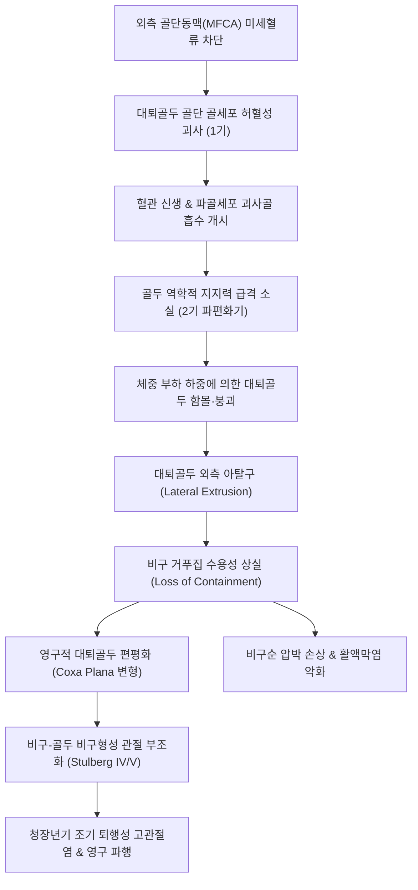

# 🩺 [[레그 칼베 페르테스병]] (Legg-Calvé-Perthes Disease, LCPD / 扁平髖, M91.1)

> **핵심 3줄 요약 (Key Summary)**:
> - 📍 병소 부위 & 해부·병태생리: 4~8세 소아의 급성장기에 원인 미상의 미세혈류 장애로 [[대퇴골두]] 골단에 특발성 무혈성 괴사([[대퇴골두 무혈성 괴사]])가 발생하여 골 흡수, 파편화, 재골화 및 재형성(Waldenström 4단계)을 거치는 자가한구성(Self-limiting) 골연골증.
> - 🚩 전형적 임상 양상 & 3대 징후: 활동 후 악화되는 무통성 또는 경미한 동통성 파행(Painless/Antalgic Limp), 고관절의 **내회전(Internal Rotation) 및 외전(Abduction)의 현저한 제한([[Roll test]] 양성)**, [[트렌델렌버그 검사]] 양성 및 대퇴사두근 위축.
> - 🛠️ 핵심 감별 검사 & 한·양방 다각적 치료 전략: 단순 골반 X-ray 상 Herring 분류(Lateral Pillar A/B/C) 및 Catterall 병기 평가. 대퇴골두의 비구 내 수용([[Containment]]) 유지가 치료의 절대 원칙(보조기·절골술). 한의 치료는 재골화기 및 기능 회복기에 [[독활기생탕]], [[보기생혈탕]], [[귀신환]], [[자하거약침]], [[온침]] 및 JS 관절 신연 기법을 적용하여 신생 혈관 형성 촉진과 골두 구형성(Sphericity) 보존.
> - <font color="#fa7e7e">⚠️ 응급 의뢰 레드플래그 & 악화 요인: 발병 연령이 8세 이상이거나 외측 기둥의 50% 이상이 붕괴된 Herring C군, 골두 외측 아탈구([[Gage 징후]] 등 Head-at-risk signs) 동반 시 비구 탈구 및 조기 평평관절(Coxa plana)로 영구 장애 위험 급증! 즉각적 소아정형외과 수용 수술(Containment surgery) 의뢰 필요.</font>

---

## 📌 목차
1. [질환 개요 & 해부학적 병태생리](#1-질환-개요--해부학적-병태생리)
2. [병태생리 메커니즘 & 생체역학적 악순환 네트워크](#2-병태생리-메커니즘--생체역학적-악순환-네트워크)
3. [임상 증상 & 이학적 검사(Physical Exam) 알고리즘](#3-임상-증상--이학적-검사physical-exam-알고리즘)
4. [감별 진단 매트릭스 (Differential Diagnosis)](#4-감별-진단-매트릭스-differential-diagnosis)
5. [한의 통합 치료 프로토콜 (침·약침·추나·한약)](#5-한의-통합-치료-프로토콜-침약침추나한약)
6. [양방 치료 & 병용·의뢰 기준 (Conventional Treatment & Referral)](#6-양방-치료--병용의뢰-기준-conventional-treatment--referral)
7. [재활 운동 & 생활습관 티칭 가이드](#7-재활-운동--생활습관-티칭-가이드)
8. [💡 사용자 진료실 핵심 필기 & 임상 노하우 (Melt-In 잔여 심화 집약)](#8--사용자-진료실-핵심-필기--임상-노하우-melt-in-잔여-심화-집약)
9. [출처 및 학술 참고 문헌 (References)](#9-출처-및-학술-참고-문헌-references)

---

## 1. 질환 개요 & 해부학적 병태생리

### 1) 질환 정의 및 역학적 특성
* **정의**: [[레그 칼베 페르테스병]](Legg-Calvé-Perthes Disease, 이하 LCPD)은 성장기 소아에서 명확한 선행 원인 없이 [[대퇴골두]] 골단으로 가는 혈류가 일시적으로 차단되어 골단 골조직의 허혈성 괴사가 발생하고, 이후 수년에 걸쳐 괴사골 흡수, 파편화, 신생골 재골화 및 리모델링이 순차적으로 일어나는 소아의 대표적인 특발성 [[대퇴골두 무혈성 괴사]](Idiopathic Avascular Necrosis of Femoral Head) 질환이다. 한의학에서는 골질이 부식되어 납작해진다 하여 [[골식]](骨蝕) 또는 [[편평고]](扁平髖)의 범주로 다룬다.
* **호발 연령 및 성별**:
  * 호발 연령: **만 4세 ~ 8세** (전체 환자의 약 80%가 이 연령대에 집중되며, 발생 가능 범위는 2~14세).
  * 성별: **남아에서 4~5배 호발** (남:여 비 = 약 4:1 ~ 5:1). 그러나 여아에서 발병할 경우 골 성숙이 남아보다 빠르기 때문에 골두의 리모델링 잔여 기간이 짧아 예후가 훨씬 불량한 경향을 보인다.
* **이환 양상**:
  * 대부분 일측성(Unilateral, 85~90%)으로 발생한다.
  * 양측성(Bilateral)은 10~15%에서 나타나나, 양측이 동시에 같은 병기로 시작하기보다는 시간차를 두고 비동기적(Asynchronous)으로 발생하는 경우가 많다. 만약 양측 고관절이 완전히 동일한 병기로 대칭적 침범을 보인다면 LCPD보다는 [[다발성 골단 이형성증]](Multiple Epiphyseal Dysplasia, MED)이나 [[갑상선기능저하증]], 크레틴병 등을 강력히 의심해야 한다.
* **환아의 신체적·체질적 특징**:
  * 환아들은 대개 또래에 비해 신장이 작고 골연령(Skeletal age)이 실제 연령보다 1~2년 정도 지연(Delayed bone age)되어 있으며, 매우 활동적이고 주의산만한(Hyperactive) 성향을 보이는 경우가 많다.
  * 최근 분자유전학적 연구(Hernández-Zamora et al., 2026)에 따르면 제2형 콜라겐 유전자([[COL2A1]]) 돌연변이, 응고인자 이상(Factor V Leiden, Protein C/S 결핍 등 저섬유소용해증), 혈관내피성장인자(VEGF) 발현 장애 등 유전적 소인과 반복적인 미세 외상이 복합 작용하는 다인자성 질환으로 규명되고 있다.

### 2) 관련 해부학적 구조물
* **골격 및 관절 구조**:
  * **[[대퇴골두]] 골단(Capital Femoral Epiphysis)**: 소아기 대퇴골두는 대부분 두꺼운 관절연골로 둘러싸여 있으며, 중심부에 이차 골화 중심(Ossification center)이 위치한다.
  * **[[비구]](Acetabulum)**: 유연한 섬유연골성 관절와순(Labrum)과 삼방연골(Triradiate cartilage)로 구성되어 있으며, 대퇴골두를 감싸는 천연 거푸집(Mold) 역할을 한다.
* **혈관 해부학적 취약성 (Patho-vascular anatomy)**:
  * 성인과 달리 만 4~8세 소아의 대퇴골두 혈류 공급은 매우 취약하다.
  * 영유아기(4세 미만)에는 원인대 동맥(Ligamentum teres artery)과 대퇴간부 골간단 혈관이 일부 기여하지만, **4~8세 시기에는 성장판이 발달하면서 골간단 혈관의 골두 유입이 차단**되고, 원인대 동맥의 혈류 기여도도 아직 미미하다.
  * 따라서 오직 **[[내측대퇴회선동맥]](MFCA)에서 분지하는 외측 골단동맥(Lateral epiphyseal vessels)**만이 대퇴골두 대부분의 혈류를 전담하게 된다. 이 외측 골단동맥이 관절낭 활액막 하부를 지나며 관절낭내압 상승이나 미세 외상, 혈전증에 의해 압박을 받으면 골두 전체의 허혈성 괴사가 유발된다.
* **신경 및 근육 지배**:
  * **신경**: [[폐쇄신경]](Obturator n.) 및 [[대퇴신경]](Femoral n.) 분지가 고관절 피막을 지배하여 서혜부뿐 아니라 대퇴 전면 및 무릎 부위로의 투사통을 형성.
  * **근육**: 고관절 외전근인 [[중둔근]](Gluteus medius)과 [[소둔근]], 신전근인 [[대둔근]], 굴곡근인 [[장요근]]의 불균형. 통증으로 인한 반사적 억제로 중둔근 위축 및 파행 발생.

---

## 2. 병태생리 메커니즘 & 생체역학적 악순환 네트워크

### 1) Waldenström의 병기 4단계 (Four Radiographic Phases)
* **1기: 초기 허혈/괴사기 (Initial / Avascular Phase, 수개월~1년)**:
  * 외측 골단 혈류 차단으로 골세포 및 골수 세포의 괴사 발생.
  * 연골세포는 활액(Synovial fluid)으로부터 직접 영양을 공급받으므로 관절 연골은 계속 성장하여 대퇴골두 관절 연골 공간이 오히려 비후됨(관절 연골 간격 증가).
  * 방사선 소견: 골두의 골화 중심 크기가 건측보다 작아 보이고, 골두의 전반적인 방사선 밀도(Density)가 증가(경화 소견)하며, 골두 전상방 연골하 피질골에 초승달 모양의 방사선 투과선인 **[[Caffey 징후]](Caffey's sign / Crescent sign)**가 관찰됨.
* **2기: 파편화/흡수기 (Fragmentation / Resorption Phase, 1~2년 - 가장 위험한 시기)**:
  * 주변 결합조직으로부터 혈관화된 육아조직이 괴사 부위로 침투하여 파골세포를 매개로 괴사골을 흡수(Creeping substitution).
  * 괴사된 골기질이 흡수되면서 대퇴골두의 기계적 강도가 극도로 취약해짐.
  * 체중 부하를 받으면 골두가 찌그러지고 갈라지며(Fragmentation), 비구 외측으로 삐져나오는 **외측 아탈구(Lateral extrusion)**가 발생.
  * 이 시기에 대퇴골두의 구형성(Sphericity)이 상실되어 납작해지는 **편평관절(Coxa plana)** 변형이 발생하므로 비구 내 수용([[Containment]]) 치료가 절대적으로 요구되는 골든타임이다.
* **3기: 재골화/재생기 (Reossification Phase, 1~3년)**:
  * 골단 주변부와 연골하 부위에서부터 신생 미숙 골주가 형성되며 골두의 골밀도가 서서히 회복되는 시기.
  * 파편화된 부위가 중심부로 향해 점진적으로 골화되며 대퇴골두의 강도가 다시 단단해짐.
* **4기: 잔유기/치유기 (Residual / Healed Phase, 골성숙기까지 지속)**:
  * 골 리모델링이 완료되고 최종적인 대퇴골두와 비구의 형태가 완성된 상태.
  * 대퇴골두의 구형도와 비구와의 관절 적합성(Congruency)에 따라 장기적인 퇴행성 관절염 발병률이 결정됨 ([[Stulberg 분류]]).

```
          [Waldenström 4단계 및 외측 아탈구 모식도 (ASCII Art)]
          
     1기: 초기 허혈기          2기: 파편화기 (붕괴 위험)      3기: 재골화기
      (Crescent sign)           (Fragmentation & Extrusion)    (Reossification)
         비구                      비구 (외측 아탈구)              비구
      /---------\               /---------\                 /---------\
     (  [경화골]  )             (  [파편화]  )===>> [탈출]   (  [신생골]  )
      \=========/               \===--====/                 \=========/
          ||                        ||                          ||
        대퇴경부                  대퇴경부 (광범위화)          대퇴경부 (단축)
```

### 2) 생체역학적 악순환 네트워크



---

## 3. 임상 증상 & 이학적 검사(Physical Exam) 알고리즘

### 1) 주소증 및 임상 발현 양상
* **파행 (Limp - 가장 흔한 주소증)**:
  * 초기에는 통증이 뚜렷하지 않으면서 아이가 뛰어놀고 난 오후나 저녁에 다리를 약간 절뚝거리는 **무통성 파행(Painless limp)**으로 시작한다.
  * 병기가 진행하여 관절낭 활액막염이 동반되면 점차 통증을 회피하려는 **동통성 파행(Antalgic gait)**으로 발전한다.
* **방사통 및 연관통 분포**:
  * 서혜부(Groin)의 둔통, 대퇴부 전내측 통증.
  * **슬관절 연관통(Referred knee pain)**: [[대퇴골두 골단 분리증]](SCFE)과 마찬가지로 [[폐쇄신경]] 감각 투사로 인해 무릎 통증만을 호소하여 소아과나 정형외과에서 무릎 질환으로 오진되는 사례가 적지 않다.
* **관절 운동 범위 제한 (ROM Limitation)**:
  * **내회전(Internal rotation) 및 외전(Abduction)의 현저한 제한**: 골두의 활액막 비후와 관절 삼출액, 대퇴골두의 외측 편위로 인해 발생하며, 특히 고관절을 굴곡시킨 상태에서의 내회전 제한이 가장 초기에 뚜렷하게 나타난다.
  * 굴곡 및 신전은 말기까지 비교적 보존된다.
* **근위축 및 하지 부동**:
  * 통증과 체중 부하 회피로 인해 이환측 [[대퇴사두근]](허벅지 둘레 1~2cm 감소) 및 [[대둔근]], [[중둔근]]의 위축이 동반된다.
  * 골두의 편평화 및 대퇴골 근위부 성장판 장애로 인해 1~2cm 미만의 하지 단축(Leg length discrepancy)이 관찰될 수 있다.

### 2) 필수 이학적 검사법 (Physical Examination)
* **[[Roll test]](고관절 회전 검사 - 조기 발견 핵심 검사)**:
  * 환아를 침대에 편안히 눕힌 상태에서 검사자가 환아의 양 대퇴부를 잡고 안팎으로 부드럽게 굴려본다(Log roll).
  * LCPD 초기 활액막염 시기부터 이환측 고관절의 수동적 **내회전 시 심한 저항감, 근육 방어(Muscle guarding), 통증**이 즉각 유발된다.
* **고관절 외전 가동역 측정**:
  * 양측 고관절을 굴곡 및 신전 상태에서 최대한 외전시켰을 때 건측(정상 45~50도)에 비해 이환측이 20~30도 이하로 뚜렷하게 벌어지지 않는다.
* **[[트렌델렌버그 검사]](Trendelenburg Test)**:
  * 환아를 이환측 외다리로 서게 했을 때 건측 골반이 아래로 떨어지는 양성 반응 (고관절 중심축 변화 및 중둔근 약화 반영).
* **[[패트릭 검사]](Patrick / FABER Test)**:
  * 이환측 고관절을 굴곡, 외전, 외회전하여 반대측 무릎 위에 올리고 무릎을 아래로 누를 때 서혜부 깊은 곳의 둔통 및 가동 제한 유발.

### 3) 영상의학적 분류 체계 (Classifications)
* **Herring의 외측 기둥 분류 (Lateral Pillar Classification - 가장 중요한 예후 판정 기준)**:
  * 파편화기(Fragmentation phase)의 골반 AP 방사선 사진에서 대퇴골두를 내측(15%), 중심(50%), 외측 기둥(Lateral pillar, 35%)의 3개 구역으로 분할하여, 체중 부하를 전담하는 **외측 기둥의 높이 유지율**을 평가:
    * **Group A**: 외측 기둥의 높이 감소가 전혀 없음(100% 보존). 예후 극히 양호.
    * **Group B**: 외측 기둥의 높이가 정상의 50% 이상 유지됨. 8세 미만 발병 시 양호, 8세 이상에서는 치료적 개입 필요.
    * **Group B/C Border**: 외측 기둥 높이가 정확히 50% 수준이며 매우 좁아짐.
    * **Group C**: 외측 기둥의 높이가 정상의 **50% 미만으로 심하게 압궤·파괴**됨. 연령과 무관하게 예후 불량(대부분 Coxa plana로 진행).
* **Catterall 병기 분류 (대퇴골두 침범 면적 기준)**:
  * I군: 대퇴골두 전방 25% 미만 침범.
  * II군: 대퇴골두 전방 50% 침범.
  * III군: 대퇴골두의 75% 침범 (후방 일부만 정상).
  * IV군: 대퇴골두 100% 전체 침범 (전 골두의 붕괴).
* **Gage의 위험 징후 ([[Gage 징후]] / Head-at-risk Signs - 불량 예후 지표)**:
  1. **Gage 징후 (Gage's sign)**: 대퇴골두 외측 골간단 부위에 V자형 방사선 투과상 관찰.
  2. **골두 외측 석회화 (Calcification lateral to epiphysis)**.
  3. **대퇴골두의 외측 아탈구 (Lateral subluxation / Extrusion)**: 대퇴골두가 비구 외측연 밖으로 밀려나감.
  4. **수평 골단판 (Horizontal physis)**.
  5. **골간단 반응 및 낭종 형성 (Metaphyseal cysts/reaction)**.
* **치유 후 Stulberg 분류 (최종 관절 적합성 및 40대 이후 관절염 예측)**:
  * Class I & II: 완전 구형 대퇴골두와 정상 비구 (완전 일치 관절, 관절염 발생 없음).
  * Class III: 타원형(Mushroom-shaped) 대퇴골두이나 비구와 적합함 (경도 관절염).
  * Class IV: 편평형(Flat) 대퇴골두와 편평 비구 (합치형 부적합, 중등도 관절염).
  * Class V: 편평 대퇴골두와 정상 비구 (완전 불합치형, 50세 이전 조기 중증 퇴행성 골관절염 100% 발생).

---

## 4. 감별 진단 매트릭스 (Differential Diagnosis)

| 감별 질환 | 호발 연령 및 성별 | 주소증 및 임상 특징 | 방사선 및 검사실 소견 | 감별 핵심 포인트 |
| :--- | :--- | :--- | :--- | :--- |
| **[[레그 칼베 페르테스병]] (LCPD)** | **만 4~8세 왜소한 남아 (남:여=4:1)** | 활동 후 무통성/동통성 파행, 서혜부 및 무릎 통증 | 대퇴골두 괴사·파편화·재골화의 **Waldenström 4단계 진행**, 비대칭 일측성 | **내회전·외전 현저 제한**, 연령별 병기 변화, 골두 외측 아탈구 관찰 |
| **[[일과성 고관절 활액막염]] (Toxic Synovitis)** | **만 3~8세 (감기/장염 앓은 후)** | 갑작스러운 파행과 고관절 통증, 안정 시 급속 호전 | 단순 X-ray 완전 정상, 초음파상 일시적 관절 삼출액 | **1~2주 안정 시 완전 소실**, 골두 괴사나 구조 변형 절대 없음 |
| **[[대퇴골두 골단 분리증]] (SCFE)** | **만 10~15세 비만 청소년** | 무릎/서혜부 통증, 고관절 굴곡 시 외회전 | Klein 선 단절(Trethowan 징후), 성장판 비대층 전단 분리 | **호발 연령 높음(사춘기)**, 비만 체형, [[Drehmann 징후]] 양성 |
| **[[다발성 골단 이형성증]] (MED)** | 만 3~10세 (남녀 동등, 상염색체 우성) | 전신 관절통, 왜소증, 동요 보행(Waddling gait) | **양측 고관절이 완전히 대칭적으로 골화 지연 및 편평화**, 수부/족부 골단 이상 | 가족력 동반, 양측성 대칭 침범, 척추 및 전신 골단판 이형성 |
| **[[소아 류마티스 관절염]] (JIA)** | 소아기 전 연령 (여아 우세) | 아침 강직(Morning stiffness), 다발성 관절 종창 | ESR/CRP 상승, 류마티스 인자(RF), 항CCP, 초음파상 만성 활액막 증식 | 6주 이상 지속되는 관절염, 다발 관절(무릎, 발목 등) 동반 |
| **[[소아 화농성 관절염]] (Septic Arthritis)** | 전 연령 (유소아) | 고열, 극심한 통증으로 환지 접촉 거부 | 관절액 백혈구 >50,000, CRP 급상승 | 응급 질환, 관절 파괴 방지를 위한 즉각적 관절 절개 배농 |

---

## 5. 한의 통합 치료 프로토콜 (침·약침·추나·한약)

> ⚠️ **한의 진료실 단계별 치료 원칙**:
> 1. **1~2기 (급성 허혈기 및 파편화기)**: 대퇴골두 연골하골이 스펀지처럼 연화되어 체중 부하 시 찌그러지는 시기이다. 이 시기에는 **과도한 관절 압박을 가하는 추나 수기나 무리한 보행을 엄격히 제한**하고, 관절낭 활액막염 소염, 미세순환 개선, 침상 안정 및 비구 내 수용([[Containment]]) 보조기 착용을 우선한다.
> 2. **3~4기 (재골화기 및 리모델링기)**: 신생골 형성이 시작되고 골두가 단단해지는 시기로, 이때 **한약([[독활기생탕]], [[보기생혈탕]], [[귀신환]]), [[온침]], [[약침]], 부드러운 JS 관절 가동 추나**를 집중 적용하여 신생 혈관 생성(Angiogenesis)을 촉진하고 조골세포 활성을 극대화하여 대퇴골두의 구형도(Sphericity)를 회복시킨다.

### 1) 한의학적 변증 체계
* **신허혈어(腎虛血瘀)형 (가장 핵심적인 LCPD 본태)**:
  * 선천적인 신정(腎精) 부족으로 주골(主骨) 기능이 저하되어 골단판 발육이 지연된 상태에서, 국소 기혈 순환 장애로 어혈이 형성되어 골단 괴사가 발생.
  * 증상: 왜소한 체구, 잦은 성장통, 야간에 심해지는 고관절 자통, 설암자(舌暗紫), 맥세삽(脈細澁).
  * 치법: 보신익정(補腎益精), 활혈화어(活血化瘀), 생골통락(生骨通絡).
* **비신양허(脾腎陽虛) / 기혈양허(氣血兩虛)형 (파편화기 및 만성 소모기)**:
  * 장기간의 통증과 활동 제한으로 소화 기능 저하, 전신 무력감, 안색 창백, 근위축.
  * 치법: 온보비신(溫補脾腎), 대보익기혈(大補益氣血).
* **습열침음(濕熱浸淫) / 기체혈어(氣滯血瘀)형 (초기 급성 활액막염기)**:
  * 고관절 관절낭의 삼출액 저류, 국소 열감, 심한 운동 제한 및 자통.
  * 치법: 청열이습(淸熱利濕), 활혈소종(活血消腫).

### 2) 한약 치료 (Herbal Medicine)
* **초기 허혈 및 활액막염기 (1기: 활혈소종 및 혈행 개선)**:
  * **[[당귀수산]](當歸鬚散)** 합 **[[오령산]](五苓散)** 가미방: 고관절 관절강 내 염증성 삼출액을 흡수하고 외측 골단동맥 주위의 미세 순환 정체를 개선.
  * 처방 구성: [[당귀]] 10g, [[적작약]] 8g, [[오약]] 6g, [[향부자]] 6g, [[소목]] 6g, [[홍화]] 4g, [[백출]] 10g, [[복령]] 10g, [[택사]] 8g, [[골쇄보]] 10g.
* **파편화기 및 재생 촉진기 (2~3기: 혈관신생 및 골기질 합성 촉진)**:
  * **[[보기생혈탕]](補氣生血湯)** 또는 **[[보양환오탕]](補陽還五湯)** 가감방: 대량의 [[황기]](생용 30~50g)를 활용하여 국소 조직의 VEGF 및 bFGF 발현을 촉진, 괴사골 부위로의 모세혈관 신생을 유도.
  * **[[귀신환]](歸腎丸)** 또는 **[[육미지황탕]](六味地黃湯)** 가미방: 신정을 보하여 조골세포의 알칼리성 포스파타제(ALP) 활성을 높이고 골기질 광물화를 촉진.
* **재골화 및 기능 회복기 (3~4기: 근골 강화 및 관절염 예방)**:
  * **[[독활기생탕]](獨活寄生湯)**: 간신을 보하고 풍한습을 몰아내어 관절 구축을 풀고 위축된 둔근과 대퇴근육을 강화.
  * **처방 가감 묘법**: 파골세포의 과도한 흡수를 억제하고 신생골 형성을 자극하는 대표적 지골(持骨) 본초인 **[[골쇄보]](骨碎補), [[속단]](續斷), [[두충]](杜仲), [[구척]](狗脊), [[녹용]](鹿茸)**을 반드시 고용량으로 배합한다.

### 3) 침구 및 온침 치료 (Acupuncture & Warm Needle)
* **혈위 선정**:
  * 국소 관절 혈위: [[환도]](GB30), [[거료]](GB29), [[비관]](ST31), [[충문]](SP12).
  * 원위 근골 혈위: [[양릉천]](GB34, 근회), [[현종]](GB39, 수회), [[태계]](KI3, 원혈), [[족삼리]](ST36).
  * 배수혈 및 원기 보강: [[신수]](BL23), [[비수]](BL20), [[대장수]](BL25), [[관원]](CV4), [[기해]](CV6).
* **온침(溫針) 및 뜸 치료**:
  * [[환도]], [[신수]], [[관원]]에 온침(쑥뜸 캡 적용)을 주 2~3회 시술하여 심부 관절낭의 한응(寒凝)을 온통(溫通)시키고 골반강 내 혈류량을 증폭시킴.
* **전침(Electroacupuncture)**:
  * 타겟: [[환도]] - [[거료]] (중둔근 심부), [[양릉천]] - [[비관]].
  * 주파수: 2Hz 저주파 연속파, 20분 자극 (근위축 방지 및 골형성 촉진 단백질 유도).

### 4) 약침 치료 (Pharmacopuncture)
* **제제 선택**:
  * 초기 어혈 및 염증 제어: **[[중성어혈약침]](中性瘀血藥針)**.
  * 골재생 및 혈관 신생, 성장 촉진: **[[자하거약침]](紫河車藥針)**(태반 추출물) 또는 **[[녹용약침]](鹿茸藥針)**.
* **주입 방법**:
  * [[환도]](GB30) 및 [[거료]](GB29) 심부 고관절 관절낭 외측부, 중둔근 부착부에 30G 38~50mm 멸균 침을 사용하여 각 부위당 0.3~0.5cc씩 주입(1회 총량 1.0~2.0cc).
  * 주 2회 치료로 연골하 미세순환을 보조하고 주변 근육 경결을 해소.

### 5) 추나 치료 (Chuna Manipulation - 시기별 맞춤 적용)
* **급성기 및 파편화기 (1~2기)**:
  * 관절에 수직 압박(Compression)을 주는 모든 수기 기법 절대 금기.
  * **앙와위 고관절 장축 간접 신연(Long-axis Gentle Distraction)**: 보조자의 지지 하에 족관절 상부를 가볍게 잡고 체중을 뒤로 실어 관절 간격을 미세하게 벌려주어 비구-골두 간 마찰 압력을 제거.
* **재골화 및 치유기 (3~4기)**:
  * **JS 관절 가동 기법 (Joint Mobilization)**:
    * 고관절의 제한된 내회전 및 외전을 회복시키기 위해 대퇴골두를 후하방으로 부드럽게 글라이딩(Gliding)시키는 관절 가동술.
  * **근막 이완 수기 (Myofascial Release)**:
    * 지속적인 단축으로 관절 가동을 저해하는 [[내전근]]군, [[장요근]], [[대퇴근막장근]]에 대한 능동적 이완 및 근막 스트레칭 적용.

---

## 6. 양방 치료 & 병용·의뢰 기준 (Conventional Treatment & Referral)

### 1) 양방 치료의 대원칙: 비구 내 수용 치료 ([[Containment]])
* **수용 치료(Containment)의 생체역학적 개념**:
  * 연화된 대퇴골두를 둥근 정상 비구(Acetabulum) 안으로 깊숙이 집어넣어, 비구가 천연 거푸집(Template/Mold) 역할을 함으로써 골두가 체중 부하를 받아도 찌그러지지 않고 둥근 구형(Spherical shape)을 유지하며 리모델링되도록 하는 원리이다.
* **비수술적 수용 요법 (Non-operative Management, Srivastava et al., 2026 기준)**:
  * **적응증**: 발병 연령 6세 미만, Herring A군 및 경도 B군, Catterall I/II군, Gage 위험 징후가 없는 경우.
  * **보조기 요법 (Bracing)**:
    * **애틀랜타 보조기(Atlanta brace / Scottish Rite brace)**: 양측 고관절을 약 40~45도 외전 및 경도 내회전 상태로 유지시켜 일상생활과 보행을 가능하게 하면서 수용성을 확보.
    * 보조기 착용 프로토콜의 표준화(Srivastava et al., 2026): 과거 23시간 연속 착용에서 최근에는 순응도를 고려한 파편화기 집중 착용(하루 12~16시간) 및 주기적 방사선 모니터링이 강조됨.
  * **석고 고정 (Petrie Cast)**:
    * 고관절을 외전 및 내회전 상태로 고정하는 석고 붕대를 수개월간 적용하여 급성기 통증 조절 및 관절 가동역 회복 도모.
* **수술적 수용 요법 (Surgical Containment)**:
  * **적응증**: 발병 연령 6~8세 이상, Herring B군 및 B/C border, Gage 위험 징후(외측 아탈구 등) 동반 환아.
  * **대퇴골 내반 절골술 (Femoral Varus Derotation Osteotomy, VDO)**:
    * 대퇴 전자간부에서 쐐기형 절골을 시행하여 대퇴골두를 안쪽으로 꺾어 비구 안 깊숙이 위치시키는 수식. (단점: 하지 단축 및 외전근 레버암 약화 가능성).
  * **골반 절골술 (Salter Innominate Osteotomy / Pemberton Osteotomy)**:
    * 무명골을 절골하여 비구 자체를 전외측으로 돌려줌으로써 외측으로 밀려난 대퇴골두를 덮어주는 술식.
  * **구제 절골술 (Salvage Osteotomy)**:
    * 이미 편평화(Coxa plana)가 진행되어 관절 일치성이 상실된 경우 비구 상연을 확장해주는 선반 절골술(Shelf acetabuloplasty)이나 Chiari 절골술 시행.

### 2) 한·양방 병용 판단 기준
* **병용 권장 (Active Combination)**:
  * 양방에서 보조기 치료 또는 절골술을 시행한 후 골유합 및 재골화기에 진입한 환아:
    * 한약([[독활기생탕]], [[보기생혈탕]]) 투여로 조골 활성을 유도하고 신생 혈관화를 촉진하여 치유 기간(평균 2~4년 소요)을 단축시키고 최종 골두 구형성을 개선.
    * 침구 및 약침으로 고정으로 인한 중둔근 및 대퇴사두근 위축을 방지.
* **병용 주의 및 금기 (Caution & Contraindication)**:
  * 수술 직후 또는 파편화기 절골 부위 불유합 상태에서의 강한 외력 수기 요법은 절대 금기.

### 3) 소아정형외과 전원(Referral) 체크리스트
* 🚨 **즉시 상급병원 전원이 필요한 경우**:
  1. 골반 X-ray 상 대퇴골두 외측 기둥이 붕괴되기 시작하는 경우 (**Herring B/C border 또는 C군**).
  2. 대퇴골두가 비구 밖으로 밀려나는 **외측 아탈구(Lateral Subluxation)**가 관찰되는 경우.
  3. **발병 연령이 만 8세 이상**인 고연령 환아에서 파행이 지속되는 경우 (자연 리모델링 잔여 기간 부족으로 조기 수술 필요).
  4. 단순 활액막염으로 치료 중 3주 이상 파행이 지속되고 고관절 내회전 제한이 악화되는 경우.

---

## 7. 재활 운동 & 생활습관 티칭 가이드

```
        [LCPD 단계별 재활 운동 가이드 (Rehabilitation Roadmap)]
        
  1단계: 활액막염 진정기       2단계: 수용성 유지기        3단계: 재골화 & 리모델링기
   (급성 허혈 & 1기)           (2기 파편화기)              (3~4기 치유기)
  - 침상 안정 & 절대 하중 금지 - 보조기 착용 하 가동       - 능동적 중둔근 강화
  - 수동적 외전·내회전 ROM    - 수영 & 무하중 자전거      - 밸런스 및 고유수용감각
  - 온열 찜질 & 통증 완화      - 둔근 등척성 수축          - 충격 회피 스포츠 복귀
```

### 1) 시기별 맞춤 재활 운동
* **1단계: 관절낭 안정 및 가동역 확보 (급성기/1기)**:
  * 관절낭 내압을 낮추기 위해 통증이 심한 기간 동안 침상 안정을 취함.
  * 앙와위에서 부모가 환아의 무릎을 굽힌 상태에서 고관절을 안쪽과 바깥쪽으로 부드럽게 흔들어주는 수동 관절 가동(Passive ROM).
* **2단계: 비체중부하 관절 운동 (2기 파편화기)**:
  * **수영 및 수중 보행 (Hydrotherapy - 가장 이상적인 운동)**:
    * 물의 부력으로 인해 고관절에 가해지는 체중 부하 압력이 90% 이상 제거된 상태에서, 고관절 외전과 회전 운동을 자연스럽게 수행하여 비구 내 골두 수용성을 최상으로 유지함.
  * **안장 높은 실내 고정식 자전거**:
    * 페달을 밟을 때 고관절이 90도 이상 과도하게 굴곡되지 않도록 안장을 높게 세팅하고 저항 없이 부드럽게 회전 운동.
* **3단계: 근력 회복 및 보행 훈련 (3~4기 재골화기)**:
  * **[[중둔근]] 강화 운동**:
    * 측와위 하지 거상(Side-lying leg raise) 및 탄력 밴드를 무릎에 걸고 옆으로 걷기(Monster walk).
    * 트렌델렌버그 보행 패턴을 교정하기 위한 한 발 균형 잡기 훈련.
  * **대퇴사두근 강화**:
    * 무릎 밑에 수건을 말아 넣고 무릎 뒤로 수건을 누르는 대퇴 세팅(Short-arc quad) 운동.

### 2) 일상생활 관리 및 생활습관 지도
* **충격 유발 활동 엄격 제한**:
  * 파편화기(1~2년) 동안 트램펄린(방방이), 달리기, 높은 곳에서 뛰어내리기, 축구, 농구 등 수직 충격이 반복되는 운동은 골두 붕괴를 초래하므로 절대 금지.
* **좌식 생활 지양 및 의자 생활화**:
  * 바닥에 쪼그려 앉거나 양반다리를 하는 것은 대퇴골두 외측에 비구 전외측연의 강한 전단 응력을 집중시키므로 책상과 의자, 침대 생활로 환경 전환.
* **성장 및 영양 관리**:
  * 비타민 D, 칼슘, 단백질이 풍부한 식단을 섭취하도록 지도하며, 비만이 동반될 경우 대퇴골두로 가해지는 단위면적당 압력이 증가하므로 엄격한 체중 관리 지도.

---

## 8. 💡 사용자 진료실 핵심 필기 & 임상 노하우 (Melt-In 잔여 심화 집약)

> 🛡️ **Melt-In 원칙 집약**: 비오 원장실의 실전 진료 관찰과 소아 LCPD 장기 추적 노하우를 집약한다.

### 1) 진료실 실전 문진: 5세 아이의 "저녁 파행"을 놓치지 말라
* **전형적 환자 내원 시나리오**:
  * *"원장님, 우리 5살짜리 남자아이가 낮에 유치원에서 뛰어놀 때는 멀쩡한데, 저녁만 되면 한쪽 다리를 뚝뚝 절어요. 어디 아프냐고 물어보면 안 아프다고 하거나 무릎을 가리키는데 어쩌죠?"*
* **실전 검진 3단계 팁**:
  1. **바지 걷고 대퇴 둘레 줄자로 재기**: 아프다는 쪽 허벅지가 건측에 비해 1cm 이상 가늘어져 있다면(사두근 위축), 최소 수주~수개월 전부터 체중 부하를 피해온 만성 병변(LCPD)이다.
  2. **앙와위 내회전 롤 테스트([[Roll test]])**: 무릎을 펴고 양쪽 복사뼈를 안쪽으로 모아보았을 때, 정상측은 40도 이상 돌아가는데 병변측은 10~15도에서 딱 걸리며 저항이 느껴지면 100% 고관절 질환이다.
  3. **골반 X-ray 확인**: AP 뷰에서 양측 대퇴골두 골화 중심 크기를 대조한다. 병변측 골두가 건측보다 작고 하얗게 굳어있다면(경화) 이미 Waldenström 1기가 진행 중인 것이다.

### 2) LCPD 예후 판단의 "나이의 법칙" (Age is King)
* **만 6세 미만 발병**: 대퇴골두 리모델링 기간이 6~8년 이상 충분히 남아있으므로, 보조기 착용과 한의 재생 한약([[보기생혈탕]], [[독활기생탕]]), 수영 요법만으로도 대부분 Stulberg I, II형(구형성 완전 보존)으로 완치된다. 수술을 서두르지 않는다.
* **만 8세 이상 발병**: 남은 성장 기간이 짧아 자연 치유에 의존하면 십중팔구 편평관절(Coxa plana)로 진행하여 30~40대에 인공관절 수술을 받게 된다. 즉시 소아정형외과로 의뢰하여 적극적인 대퇴 절골술 또는 골반 절골술을 받도록 설득해야 한다.

### 3) 보호자 상담 스크립트
* *"어머님, 페르테스병은 뼈에 세균이 들어가거나 뼈가 영원히 죽는 병이 아니라, 대퇴골두로 가는 핏줄이 일시적으로 막혔다가 스스로 뚫리면서 새로운 뼈가 자라나는 '자가 치유 질환'입니다."*
* *"하지만 새 뼈가 돋아나는 1~2년 동안 뼈가 마치 젖은 찰흙처럼 물렁물렁해집니다. 이때 뛰거나 방방이를 타서 찰흙이 찌그러지면 평생 다리를 절게 됩니다."*
* *"비구라는 둥근 밥그릇 안에 뼈가 예쁘게 갇혀있도록 무리한 운동을 피하고 수영을 시켜주셔야 합니다. 저희 한의원에서는 뼈로 가는 혈류를 뚫어주고 새 뼈가 단단하게 차오르도록 돕는 한약과 침 치료로 아이가 후유증 없이 완치될 수 있도록 끝까지 함께 관리하겠습니다."*

---

## 9. 출처 및 학술 참고 문헌 (References)

1. Srivastava S et al. (2026). Variability in Bracing Design and Bracing Protocols for the Non-Operative Management of Legg-Calvé-Perthes Disease: A Scoping Systematic Review. *Cureus*. 18(9):e115826. [PMID: 42836207](https://pubmed.ncbi.nlm.nih.gov/42836207/)
   - **[연구 요약]**: 레그 칼베 페르테스병(LCPD)의 비수술적 보조기(Brace) 치료 디자인 및 착용 프로토콜의 전 세계적 변이와 임상적 유효성을 분석하고, 비구 내 수용성([[Containment]]) 유지 및 파편화기 집중 관리 가이드라인을 제시한 체계적 문헌고찰.

2. Hernández-Zamora E et al. (2026). A Proposed Convergent Genetic and Molecular Framework for Legg-Calvé-Perthes Disease: A Scoping Review. *Int J Mol Sci*. 27(19):. [PMID: 42884134](https://pubmed.ncbi.nlm.nih.gov/42884134/)
   - **[연구 요약]**: LCPD의 발병 기전에서 COL2A1 유전자 변이, 혈관내피성장인자(VEGF) 조절 이상, 저섬유소용해증 및 미세혈전증 등 분자생물학적 통합 모델을 구축하여 골괴사 및 재골화 조절 타깃을 밝힌 분자역학 종설.

3. Herring JA et al. (2004). Legg-Calvé-Perthes disease. Part II: Prospective multicenter study of the effect of treatment on outcome. *J Bone Joint Surg Am*. 86(10):2121-2134.
   - **[연구 요약]**: 대규모 전향적 다기관 연구를 통해 외측 기둥 분류(Lateral Pillar Group A/B/C)와 발병 연령(6세/8세 기준)에 따른 예후 및 수술적/비수술적 수용 치료의 유효성을 통계적으로 확립.

4. 대한소아정형외과학회. (2021). *소아청소년 정형외과학*. 최신의학사. 대퇴골두 무혈성 괴사 - 레그-칼베-페르테스병.

5. 전국한의과대학 본초학교실. (2020). *본초학*. 영림사. 활혈거어약 및 보익약의 골대사 작용.

---

## 관련 노트
- [[대퇴골두 골단 분리증 scfe]]
- [[대퇴골두 무혈성 괴사]]
- [[일과성 고관절 활액막염]]
- [[고관절]]
- [[독활기생탕]]
- [[보기생혈탕]]
