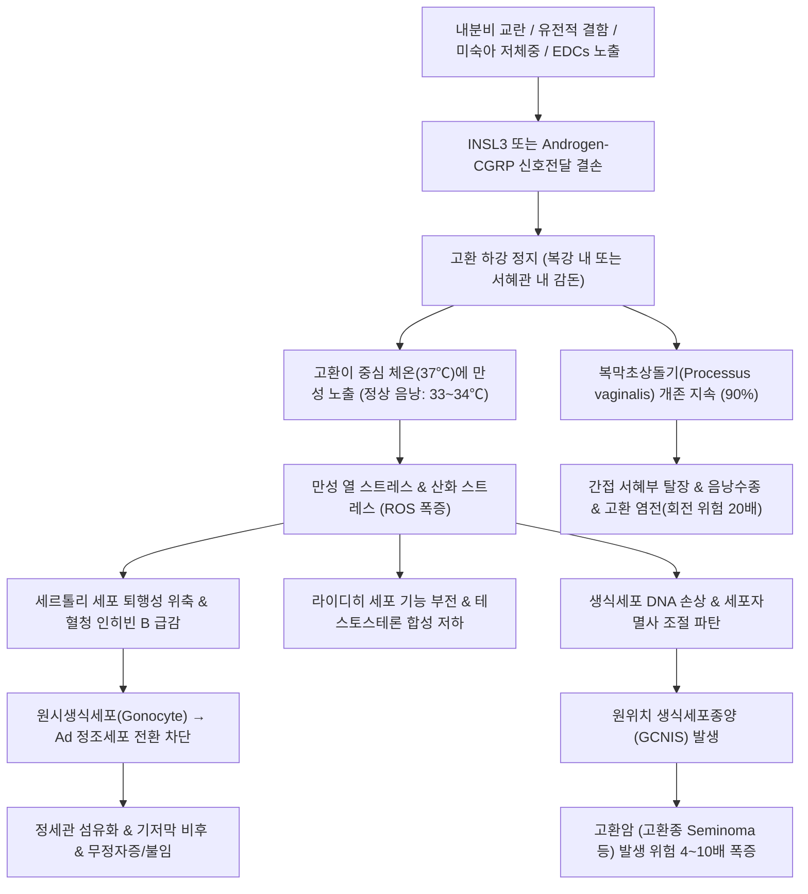

# 🩺 [[미하강 고환과 퇴축 고환]] (Cryptorchidism & Retractile Testis / 潛伏睾丸·退縮睾丸, ICD-10: Q53 / KCD: Q53)

> **핵심 3줄 요약 (Key Summary)**:
> - 📍 **병소 부위 & 해부·병태생리**: 태생기 복강에서 음낭으로의 [[고환하강]](Testicular descent) 장애로 인해 [[고환]](Testis)이 복강 내, [[서혜관]](Inguinal canal), 또는 서혜부 외륜에 정체된 [[잠복고환]](Cryptorchidism)과, 과도한 [[고환올림근 반사]](Cremasteric reflex)로 일시 견인되는 [[퇴축 고환]](Retractile testis)의 감별이 핵심임. 체온보다 높은 체내 환경 노출 시 [[세르톨리 세포]](Sertoli cell) 손상 및 [[정자형성]](Spermatogenesis) 장애, [[불임]]과 [[고환암]](고환종) 발생률이 급증함.
> - 🚩 **전형적 임상 양상 & 3대 징후**: 환측 [[음낭]] 내 고환 촉지 불능 또는 왜소한 음낭 발육, 온난 환경 및 무긴장 견인 시 음낭 기저부 안착 여부의 차이, [[복막초상돌기]](Processus vaginalis) 미폐쇄에 따른 [[간접 서혜부 탈장]] 또는 [[음낭수종]] 동반.
> - 🛠️ **핵심 감별 검사 & 한·양방 다각적 치료 전략**: 온수욕/이완 상태 양손 착지 촉진법, 1세 이전(생후 6~12개월, 최대 18개월 이전) 외과적 [[고환고정술]](Orchiopexy) 시행, 한의학적 [[산증]](疝症)·[[고축]](睾縮)·[[신양허]](腎陽虛)·[[기체어혈]](氣滯血瘀) 변증에 따른 [[당귀사역탕]], [[귤핵환]], [[귀신환]] 및 [[관원]], [[기해]], [[신수]], [[삼음교]] 침구 치법 병행.
> - <font color="#fa7e7e">⚠️ **응급 의뢰 레드플래그 & 악화 요인**: 서혜부 결절의 급성 동통·종창·발적(정체 고환의 [[고환 염전]] 또는 감돈 탈장 의심 시 6시간 골든타임 즉각 응급 전원), 양측성 비촉지 고환에 동반된 저혈압·전해질 불균형([[선천부신과형성증]] 응급 감별).</font>

---

## 📌 목차
1. [질환 개요 & 병태생리 (Disease Overview)](#1-질환-개요--병태생리-disease-overview)
2. [병태생리 메커니즘 & 대사·장기부전 악순환 네트워크](#2-병태생리-메커니즘--대사장기부전-악순환-네트워크)
3. [임상 증상 & 환자 소견 (Clinical Presentation)](#3-임상-증상--환자-소견-clinical-presentation)
4. [감별 진단 매트릭스 (Differential Diagnosis)](#4-감별-진단-매트릭스-differential-diagnosis)
5. [한의 통합 치료 프로토콜 (침·약침·한약)](#5-한의-통합-치료-프로토콜-침약침한약)
6. [양방 치료 & 병용·의뢰 기준 (Conventional Treatment & Referral)](#6-양방-치료--병용의뢰-기준-conventional-treatment--referral)
7. [식이·생활습관 & 자가관리 티칭 가이드](#7-식이생활습관--자가관리-티칭-가이드)
8. [💡 진료실 핵심 필기 & 임상 노하우](#8--진료실-핵심-필기--임상-노하우)
9. [출처 및 학술 참고 문헌 (References)](#9-출처-및-학술-참고-문헌-references)

---

## 1. 질환 개요 & 병태생리 (Disease Overview)

* **질환 정의 및 기본 개념**:
  * **미하강 고환(Undescended Testis / Cryptorchidism, 잠복고환)**: 태생기 동안 복강 내에서 발생한 고환이 정상적인 하강 경로를 거쳐 음낭 내로 완전히 내려오지 못하고 복강 내, 서혜관 내부, 또는 서혜부 외륜 상부에 영구적으로 머물러 있는 선천성 기형. 이완 상태나 온난 환경에서도 음낭 바닥으로 통증 없이 무긴장(Tension-free) 견인이 불가능하며, 억지로 당겨도 손을 놓는 순간 즉시 본래의 비정상 위치로 되튀어 올라감.
  * **퇴축 고환(Retractile Testis)**: 고환 자체의 하강 경로는 정상적으로 완성되었으나, 고환을 둘러싼 [[고환올림근]](Cremaster muscle)의 반사적 수축이 지나치게 항진되어 고환이 일시적으로 서혜부 천층으로 끌려 올라간 생리적 상태. 따뜻한 물로 목욕하거나 안정된 상태에서 부드럽게 쓰다듬어 내리면 음낭 바닥까지 쉽게 내려오며, 손을 떼어도 즉시 수축하지 않고 일시적으로 음낭 내에 안착해 유지됨.
  * **기타 아형**:
    * **이소성 고환(Ectopic Testis)**: 고환이 서혜관 외륜을 통과한 후 정상 하강 경로를 벗어나 대퇴부 피하, 회음부(Perineum), 반대편 음낭, 또는 복벽 천층낭(Denis-Browne pouch)에 위치하는 경우.
    * **무고환증 및 고환 소실(Anorchia / Vanishing Testis)**: 태아 초기 발생은 정상이었으나 태생 중기 혈류 차단(자궁 내 고환 염전 또는 혈전)으로 인해 고환 조직이 무균성 괴사 및 흡수되어 흔적(Fibrous remnant)만 남은 상태.
    * **후천성 상승 고환(Ascending Testis)**: 유아기에는 음낭 내에 존재했으나, 정삭(Spermatic cord)의 탄력 부족 또는 복막초상돌기 섬유화 유착으로 성장기 신체 비율 변화에 따라 다시 서혜부로 끌려 올라간 상태.

* **역학 및 위험 인자**:
  * **발생 빈도**: 정상 만삭아의 경우 출생 시 약 1.0~3.4%에서 발견됨.
  * **미숙아 및 저체중아**: 조산아(임신 37주 미만)에서는 약 15~30%, 출생체중 2,500g 미만의 [[저체중출생아]]에서는 최대 30~40%에 달할 정도로 조산과 저체중이 가장 강력한 위험 인자임.
  * **자연 하강(Spontaneous Descent)**: 출생 후 모체 에스트로겐이 소실되고 영아기 초기 시상하부-뇌하수체-성선 축이 일시 활성화되는 '미니사춘기(Mini-puberty of infancy, 생후 1~3개월)' 동안 분비되는 [[테스토스테론]](Testosterone)과 [[황체형성호르몬]](LH)의 자극으로 인해 생후 3~6개월까지 약 70~75%가 자연 하강함. 그러나 생후 6개월 이후에는 자연 하강 가능성이 1% 미만으로 급감함.

* **관련 장기 및 해부 구조**:
  * **주요 장기**: [[고환]](정자 생성 및 남성호르몬 합성), [[부고환]](Epididymis), [[정관]](Vas deferens).
  * **주변 주행 구조물**: [[서혜관]](Inguinal canal, 내서혜륜에서 외서혜륜에 이르는 주행 경로), [[정삭]](Spermatic cord, 고환동정맥·정관동맥·림프관·신경총 포함), [[고환도대]](Gubernaculum testis, 고환 하단을 음낭 바닥으로 이끄는 간엽성 결합조직 끈), [[고환올림근]](Cremaster muscle, 내복사근에서 유래하여 정삭을 감싸는 근섬유).
  * **신경계**: [[생식대퇴신경]](Genitofemoral nerve, 음부가지가 고환올림근 운동 신경 및 고환올림근 반사의 원심로 담당), [[장골서혜신경]](Ilioinguinal nerve).

```
[남성 서혜부 및 고환 하강 해부 모식도]

          [ 복강 내부 (정상 발생 기원) ]
                     │
               (임신 8~15주: INSL3)
                     ▼
          ┌─────────────────────┐
          │     내서혜륜 (Deep)  │
          │         │           │
          │      [서혜관]        │ ◀── [잠복고환 정체 다발 부위]
          │         │           │     (서혜관 내: 약 60~70%)
          │     외서혜륜 (Super) │
          └─────────────────────┘
                     │
              (임신 25~35주: Androgen/CGRP)
                     ▼
               [치골 결합부 상부] ◀── [퇴축 고환 견인 위치]
                     │
           ══════════╪══════════ (음낭 경계)
                     ▼
          ┌─────────────────────┐
          │   [ 정상 음낭 기저부 ] │ ◀── 체온보다 2~4℃ 낮은 환경
          │     (33.0 ~ 34.0℃)  │     (정상 정자형성 필수 조건)
          └─────────────────────┘
```

---

## 2. 병태생리 메커니즘 & 대사·장기부전 악순환 네트워크

### 1) 고환 하강의 정상 2단계 생리 기전
* **제1단계: 복강 단계 (Transabdominal Phase, 임신 8~15주)**
  * 태아기 복강 후벽에서 발생한 고환이 내서혜륜 부근까지 이동하는 단계.
  * [[라이디히 세포]](Leydig cell)에서 분비되는 [[인슐린 유사 펩타이드 3]](Insulin-like peptide 3, INSL3) 호르몬이 수용체 RXFP2에 결합하여 고환 도대(Gubernaculum)의 근위부를 비후·팽대시킴으로써 고환을 하복부로 견인함.
* **제2단계: 서혜-음낭 단계 (Inguinoscrotal Phase, 임신 25~35주)**
  * 고환이 서혜관을 통과하여 음낭 바닥으로 안착하는 단계.
  * 라이디히 세포의 [[테스토스테론]] 및 [[디하이드로테스토스테론]](DHT)에 의존함. 안드로겐은 [[생식대퇴신경]](Genitofemoral nerve)을 자극하여 [[칼시토닌 유전자 관련 펩타이드]](CGRP) 분비를 촉진하고, CGRP는 고환 도대의 율동적 수축과 신장을 유도하여 음낭으로 이동시킴.
  * 동시에 복막초상돌기(Processus vaginalis)가 고환을 선도하며 서혜관을 개방하고, 하강 완료 후 초상돌기는 폐쇄되어야 함.



### 2) 분자·세포 수준 손상 및 온도 유발 생식세포 괴사
* **만성 고체온에 의한 열 손상(Thermal Stress)**:
  * 음낭의 정상 온도는 정맥총의 열교환 시스템(덩굴정맥얼기 Pampiniform plexus)과 얇은 피부를 통해 복강 중심 체온(37℃)보다 약 2~4℃ 낮은 33~34℃를 유지해야 함.
  * 잠복고환으로 인해 37℃의 체내 환경에 지속 노출되면, 단백질 폴딩 이상, 열충격단백질(HSP) 과발현 한계 초과, 미토콘드리아 호흡 사슬 파탄으로 활성산소종(ROS)이 대량 생성됨.
* **세르톨리 세포 및 라이디히 세포 변성**:
  * 생후 6개월 이후부터 [[세르톨리 세포]]의 공포화(Vacuolization)와 위축이 가시화됨.
  * 세르톨리 세포 기능 저하로 인해 정자형성 지표인 혈청 [[인히빈 B]](Inhibin B) 농도가 급감하고, 음성 피드백 상실로 혈청 [[난포자극호르몬]](FSH)이 보상적으로 상승함.
* **정자 형성(Spermatogenesis)의 비가역적 차단**:
  * 생후 3~6개월경 일어나는 원시생식세포(Gonocyte)에서 성체형 암흑 정조세포(Type A dark spermatogonia, $A_d$)로의 분화가 정지됨.
  * 1~2세 이후에는 정세관 내 생식세포 밀도가 정상아의 10~20% 이하로 급감하며, 간질 섬유화가 비가역적으로 진행되어 성인기 핍정자증(Oligospermia) 또는 무정자증(Azoospermia)에 따른 [[불임]](Infertility)을 초래함.

### 3) 악성 종양화(Malignancy) 및 기계적 합병증 네트워크
* **고환암(Testicular Cancer) 발생 위험**:
  * 잠복고환 환아는 정상 대조군에 비해 성인기 고환암 발생 위험이 **4~10배** 높음. 특히 복강 내 고환의 경우 서혜부 정체 고환보다 암 발생 위험이 현저히 높음.
  * 가장 흔한 조직학적 형태는 [[고환종]](Seminoma, 약 60%)이며, 비고환종성 생식세포종양(태생성암종, 기형종 등)도 발생함.
  * 고환 내에 원위치 생식세포종양(Germ Cell Neoplasia In Situ, GCNIS) 병변이 조기에 형성될 수 있음.
  * 조기 고환고정술은 암 발생 위험을 유의미하게 낮추며, 만 10~12세 이후 성인기 자가촉진을 통한 조기 발견을 가능하게 함.
* **고환 염전(Testicular Torsion) 및 서혜부 탈장 동반**:
  * 잠복고환의 약 90%에서 복막초상돌기가 개존되어 있어 [[간접 서혜부 탈장]](Indirect inguinal hernia)이 필연적으로 동반됨.
  * 고환이 음낭 바닥에 견고히 고정되지 않고 정삭의 주행이 비정상적으로 꼬이기 쉬워 고환 혈관이 꼬이는 [[고환 염전]] 발생 위험이 정상인에 비해 20배 이상 높으며, 서혜관 내에서 염전이 발생하면 조기 진단이 어려워 고환 괴사 위험이 치명적임.

```
[미하강 고환 조직 변성 및 불임·악성화 진행 축]

생후 0~3개월  ──▶  생후 6~12개월  ──▶  생후 1~2세  ──▶  사춘기 및 성인기
 (정상 외형)       (세르톨리 손상)       (정세관 섬유화)      (불임 및 고환암)
      │                   │                   │                   │
      ▼                   ▼                   ▼                   ▼
자연하강 기대     Ad 정조세포 분화정지    생식세포 소실        무정자증/불임
(약 75% 하강)    인히빈 B 분비 감소     [외과적 수술 골든타임]   고환종(Seminoma)
```

---

## 3. 임상 증상 & 환자 소견 (Clinical Presentation)

### 1) 주소증 및 핵심 신체 소견
* **환측 음낭의 비어 있음(Empty Scrotum)**: 부모가 목욕을 시키거나 기저귀를 갈 때 한쪽 또는 양쪽 음낭에 알맹이가 만져지지 않는다고 호소함 (일측성이 약 85~90%, 우측이 좌측보다 빈발).
* **음낭 저형성(Hypoplastic Scrotum)**: 고환이 음낭 내로 내려와 압력을 가하지 못했기 때문에 해당 측 음낭 피부가 주름(Rugae)이 없고 얇으며 편평하게 위축되어 있음.
* **서혜부 팽륜(Inguinal Bulge)**: 서혜관 내에 정체된 고환이 작은 콩알 또는 포도알 모양의 덩어리로 만져지거나, 동반된 복막초상돌기 개존으로 인해 울거나 힘을 줄 때 서혜부가 불룩 튀어나옴.

### 2) 이학적 검진(Physical Examination) 알고리즘
* **진찰 환경 및 환아 준비**:
  * 차가운 촉진 기구, 차가운 손, 긴장감은 강력한 고환올림근 반사를 유발하므로, 진료실을 24~26℃로 훈훈하게 유지해야 함.
  * 환아를 보호자의 무릎에 앉히거나 개구리 다리 자세(Frog-leg position)를 취하게 하여 서혜인대 긴장을 완화함.
* **양손 교대 착지 및 비누칠 촉진법(Soapy Palpation)**:
  * 손에 베이비오일이나 비눗물을 묻혀 윤활성을 극대화함.
  * 한 손의 검지와 중지를 전상장골극(ASIS) 부위 서혜관 시작점에 대고 내하방(음낭 방향)으로 부드럽게 쓸어내림(Milking manipulation).
  * 다른 손은 음낭 입구에서 대기하여 쓸려 내려오는 고환 결절을 포착함.
* **무긴장 견인 시험(Tension-Free Pull Test, 결정적 감별)**:
  * 고환이 만져지는 경우, 엄지와 검지로 고환을 부드럽게 잡아 음낭 기저부로 끌어당김.
  * **퇴축 고환**: 별다른 저항 없이 음낭 가장 아랫부분까지 자연스럽게 내려오며, 잡았던 손을 천천히 떼어도 최소 수 초 이상 음낭 바닥에 머무름.
  * **잠복 고환**: 음낭 입구까지만 내려오거나 아랫부분까지 당길 때 강한 팽팽함(Tension)이 느껴지며, 손을 놓는 즉시 용수철처럼 서혜부로 되튀어 올라감.

### 3) 영상 진단 및 내분비 평가 지침
* **초음파(Ultrasonography)의 임상적 한계와 비권장 원칙**:
  * 미국비뇨기과학회(AUA) 및 유럽비뇨기과학회(EAU) 가이드라인: **촉지되지 않는 고환에 대해 일상적인 복부·골반 초음파 검사를 권장하지 않음**.
  * 이유: 촉지 불능 고환에서 초음파의 민감도는 40~50% 수준에 불과하며, 초음파상 보이지 않는다고 해서 복강 내 고환이 없다고 단정할 수 없고, 결국 수술적 탐색이 필요하기 때문임. 초음파는 오진으로 인해 수술 시기를 지연시킬 위험이 있음.
* **복강경 검사(Diagnostic Laparoscopy, Gold Standard)**:
  * 서혜부에서 전혀 만져지지 않는 비촉지성 고환(Nonpalpable testis, 전체의 약 20%)의 확진 표준은 전신마취 하 진단적 복강경술임.
  * 복강경으로 내서혜륜 상방을 관찰하여 복강 내 고환 여부, 정관과 고환 혈관의 맹단(Blind-ending, 고환 소실 증후군 입증) 여부를 100% 확인함.
* **양측성 비촉지 고환의 내분비 응급 검사**:
  * 양측 고환이 모두 만져지지 않는 경우, 성분화이상(Disorders of Sex Development, DSD) 및 잠재적 생명 위협 질환인 [[선천부신과형성증]](CAH, 21-수산화효소 결핍에 따른 여아의 남성화)을 반드시 배제해야 함.
  * 염색체 핵형 분석(Karyotyping: 46,XY vs 46,XX), 혈청 17-OH 프로게스테론, 전해질($Na^+, K^+$) 측정.
  * 고환 조직 존재 여부 확인: 혈청 [[항뮐러관호르몬]](AMH), [[인히빈 B]](Inhibin B), 또는 [[hCG 자극 검사]](hCG stimulation test, 근육 주사 후 혈청 테스토스테론 상승 반응 확인).

---

## 4. 감별 진단 매트릭스 (Differential Diagnosis)

| 감별 질환 | 호발 연령 및 위치 | 촉진 및 임상 양상 | 무긴장 견인 시험 | 동반 합병증 및 핵심 감별점 |
| :--- | :--- | :--- | :--- | :--- |
| **[[미하강 고환]]**<br>(Cryptorchidism / UDT) | 신생아~영아<br>서혜관 내(60%), 외륜(25%), 복강 내(15%) | 음낭 비어 있음, 저형성 음낭, 주름 소실, 서혜부 결절 촉지 또는 미촉지 | **음낭 바닥 안착 불가**<br>(손을 놓으면 즉시 서혜부로 튕겨 올라감) | 90% 복막초상돌기 개존(탈장), 정자형성 부전, 고환암 위험 4~10배 |
| **[[퇴축 고환]]**<br>(Retractile Testis) | 2~7세 소아 호발<br>(고환올림근 반사 극대기) | 평소 서혜부로 끌려올라가 있으나, 온수욕 시 음낭 내로 자연 하강 | **음낭 바닥 안착 가능**<br>(견인 후 손을 떼도 음낭 내에 머무름) | 생리적 정상 변이, 단 20~30%에서 재상승 고환(Ascending testis)으로 이행 가능 |
| **[[이소성 고환]]**<br>(Ectopic Testis) | 신생아기부터 존재<br>대퇴부, 회음부, Denis-Browne 낭 | 고환이 정상 하강선 경로를 완전히 이탈한 피하 부위에서 만져짐 | **음낭 내 견인 절대 불가**<br>(방향 자체가 어긋나 있음) | 고환 도대(Gubernaculum)의 비정상적 주행 부착, 외과적 재배치 필수 |
| **고환 소실 증후군**<br>(Vanishing Testis) | 신생아~영아<br>서혜관 또는 복강 내 맹단 | 고환 전혀 촉지되지 않음, 편측성 왜소 음낭 | **촉지 불가** | 태생기 자궁 내 염전/혈전으로 고환 괴사 흡수, 복강경상 혈관 맹단 확인 |
| **[[고환 염전]]**<br>(Testicular Torsion) 🚨 | 신생아기 또는 사춘기<br>정체 고환 또는 음낭 내 | 급격한 서혜부/음낭 격통, 종창, 홍반, 오심·구토, 고환올림근 반사 소실 | **극심한 통증으로 진찰 불가** | 6시간 이내 즉시 수술적 감돈 해소 및 고정(골든타임 놓치면 고환 괴사 적출) |
| **감돈성 [[서혜부 탈장]]**<br>(Incarcerated Hernia) 🚨 | 영아기 호발<br>서혜부 및 음낭 상부 | 서혜부에 단단하고 정복되지 않는 압통성 종괴, 보챔, 담즙성 구토 | **정복 불가** | 장관 허혈 및 장 천공 위험, 즉각적인 응급 수술 적응증 |
| **[[선천부신과형성증]]**<br>(CAH, 21-OHD) 🚨 | 신생아기 (양측성)<br>양측 음낭 내 고환 부재 | 양측 미촉지, 음핵 비대(여아의 남성화 외성기), 피부 색소침착 | **양측 모두 없음** | 생후 1~2주경 저나트륨혈증, 고칼륨혈증, 저혈압성 쇼크(Salt-wasting crisis) |

---

## 5. 한의 통합 치료 프로토콜 (침·약침·한약)

* **한의학적 병태 인식 및 병기**:
  * 한의학에서 고환은 족궐음간경(足厥陰肝經)이 순환하여 낙(絡)하는 부위이며, 선천지본(先天之本)인 신(腎)의 정기(精氣)가 주관하는 곳으로 인식함.
  * 본 질환은 전통 의학의 **[[산증]](疝症)**(퇴산 㿗疝, 한산 寒疝), **[[고축]](睾縮)**(고환이 오그라들어 배 속으로 당겨 들어감), **낭축(囊縮)**, **음종(陰腫)**의 범주에 속함.
  * 선천적으로 신기(腎氣)와 양기(陽氣)가 부족하여 고환을 음낭으로 이끌어 내리는 기화(氣化) 작용이 무력하거나, 한습(寒濕)의 사기가 간경(肝經)에 응체되어 근육(고환올림근)이 경련 수축하고 경락이 막힌 것으로 변증함.

* **변증 분류 및 치법 체계**:
  * **1) 선천부족·신양허약(先天不足·腎陽虛弱)**:
    * **임상 양상**: 조산아, 저체중아, 체격이 왜소하고 안색이 창백함. 음낭이 얇고 발육이 미숙하며 손발이 차고 추위를 잘 탐. 소변이 맑고 길며 대변이 묽음. 설담태백(舌淡苔白), 맥침지세약(脈沈遲細弱).
    * **치법**: 보신온양(補腎溫陽), 익기생정(益氣生精).
    * **처방**: [[귀신환]](歸腎丸) 또는 [[보아진음전]](保兒眞陰煎) 가감.
      * 구성: [[숙지황]](10g), [[산약]](8g), [[산수유]](6g), [[구기자]](6g), [[토사자]](6g), [[두충]](6g), [[당귀]](6g), [[복령]](6g), [[녹용]](2g).
      * 약리: HPG 축 자극, 고환 미세혈류 촉진, Leydig/Sertoli 세포의 생식 기능 보존.
  * **2) 한응간맥·근맥련급(寒凝肝脈·筋脈攣急)** (퇴축 고환 다발형):
    * **임상 양상**: 찬바람이나 찬물에 노출되면 고환이 서혜부로 극심하게 당겨 올라감. 따뜻하게 해주면 고환이 내려오고 안정됨. 복통이나 서혜부 당김을 호소하기도 함. 설태백윤(舌苔白潤), 맥현지(脈弦遲).
    * **치법**: 온경산한(溫經散寒), 난간이근(暖肝弛筋).
    * **처방**: [[당귀사역탕]](當歸四逆湯) 합 [[귤핵환]](橘核丸) 가감.
      * 구성: [[당귀]](8g), [[계지]](6g), [[작약]](8g), [[세신]](2g), [[통초]](4g), [[오수유]](4g), [[귤핵]](8g), [[소회향]](6g), [[오약]](6g), [[감초]](4g).
      * 약리: 말초 혈관 확장, 고환올림근(Cremaster muscle)의 과도한 수축 경련 완화, 혈액 순환 개선.
  * **3) 기체혈어·맥락저체(氣滯血瘀·脈絡阻滯)** (수술 후 유착 방지 및 잔여 종창형):
    * **임상 양상**: 고환고정술 후 국소 서혜부의 결절성 경결, 미세 종창, 혈류 순환 불량. 설자반(舌紫斑), 맥삽(脈澁).
    * **치법**: 활혈화어(活血化瘀), 산결통락(散結通絡).
    * **처방**: [[활혈산어탕]](活血散瘀湯) 가감 ([[도인]], [[홍화]], [[단삼]], [[적작약]], [[우슬]]).

* **침구 및 경혈 자극 프로토콜**:
  * **주요 선혈**:
    * **임맥(任脈)**: [[관원]](CV4, 신기 원기 보강), [[기해]](CV6), [[곡골]](CV2, 생식기 국소 혈류 개선).
    * **방광경·신경**: [[신수]](BL23), [[차료]](BL32), [[태계]](KI3).
    * **간경·비경**: [[태충]](LR3, 평간식풍 및 근육 긴장 완화), [[삼음교]](SP6, 간비신 삼경 교회혈), [[음릉천]](SP9).
  * **소아 맞춤형 침술 테크닉**:
    * 영유아의 경우 유침(留針)을 시행하지 않고, 0.16×15mm 호침 또는 무통 춘추침(소아 찰침)으로 경혈 부위를 1~2초간 가볍게 점자(點刺) 후 즉시 발침(단자법, 速刺速拔).
    * 또는 통증이 전혀 없는 무통 레이저 침술(Laser Acupuncture)을 관원, 기해, 삼음교, 신수에 분절당 30~60초간 적용하여 부교감신경계를 활성화하고 국소 골반 혈류를 촉진함.
  * **간접 뜸(온구) 요법**:
    * 하복부 [[관원]], [[기해]] 및 배부 [[신수]]에 신기온통구(간접 온열 뜸)를 1회 10~15분간 시행하여 심부 온도를 온난하게 유지, 고환올림근의 긴장성 수축을 이완시킴.
  * **약침 치료(Pharmacopuncture)**:
    * 수술 후 생식 기능 보존 및 퇴축 경향의 만성 환아: [[자하거약침]](Placenta) 0.1~0.2cc를 [[신수]](BL23) 및 [[관원]](CV4)에 극미량 피내 주입하여 선천 신정을 보강함.

---

## 6. 양방 치료 & 병용·의뢰 기준 (Conventional Treatment & Referral)

### 1) 외과적 표준 수술: 고환고정술 (Orchiopexy)
* **수술의 절대적 표준 시기(Optimal Timing)**:
  * **만 6개월~12개월 사이(늦어도 만 18개월 이전 완료 권고)**.
  * 생후 6개월 이후부터 세르톨리 세포의 조직학적 퇴행과 정조세포 소실이 시작되므로, 자연 하강의 한계선인 생후 6개월이 경과하면 지체 없이 소아비뇨의학과 외과 수술을 계획해야 함.
* **촉지성 고환(Palpable Testis)의 서혜부 고환고정술**:
  * **단계 1**: 서혜부 피부 주름을 따라 약 2cm 절개 후 서혜관을 열고 고환과 정삭을 확인.
  * **단계 2**: 동반된 복막초상돌기를 정삭 혈관 및 정관으로부터 섬세하게 박리하여 내서혜륜 부위에서 완전 고위 결찰(High ligation, 서혜부 탈장 동반 교정).
  * **단계 3**: 정삭 주위의 섬유성 유착 밴드를 박리(Retroperitoneal mobilization)하여 고환 혈관의 무긴장 길이를 확보.
  * **단계 4**: 음낭 내에 피하 낭(Subdartos pouch)을 형성하고, 고환을 음낭 바닥으로 통증과 장력 없이 견인하여 고정.
* **비촉지성 고환(Nonpalpable Testis)의 복강경 수술**:
  * 진단적 복강경으로 복강 내 고환의 위치와 정삭 혈관의 길이를 평가.
  * 고환 혈관 길이가 충분한 경우: 복강경 1단계 고환고정술 시행.
  * 고환이 너무 높은 위치에 있어 혈관 길이가 부족한 경우: **Fowler-Stephens 고환고정술(2단계 수술)** 시행.
    * 1차: 정삭의 주 고환혈관을 복강경하 결찰하여 차단(정관동맥 및 고환 도대 측부 혈류망의 대상성 발달 유도).
    * 2차(6개월 후): 측부 혈관망을 보존하면서 고환을 음낭으로 하강 고정.

```
[촉지 여부에 따른 외과적 치료 경로]

                 [ 생후 6개월 미하강 고환 확인 ]
                                │
                 ┌──────────────┴──────────────┐
                 ▼                             ▼
         [ 촉지성 고환 (80%) ]         [ 비촉지성 고환 (20%) ]
                 │                             │
          (서혜관/외륜 위치)              (진단적 복강경술 시행)
                 │                             │
                 ▼                    ┌────────┴────────┐
        [ 서혜부 고환고정술 ]          ▼                 ▼
        - 정삭 박리 및 길이확보     [복강내 고환]     [고환소실증(Blind)]
        - 초상돌기 고위결찰           │                 │
        - 음낭 피하낭 고정      (1단계/2단계 F-S)    (수술 종료/추적)
                                      ▼
                             [ 음낭 내 안착 완료 ]
                                      │
                 ┌────────────────────┴────────────────────┐
                 ▼                                         ▼
         (내분비 지표 추적)                        (성인기 선별 감시)
      혈청 인히빈 B / FSH 모니터링                  고환암 자가검진 교육
```

### 2) 호르몬 요법(Hormonal Therapy)의 현주소와 제한성
* 과거 hCG(Human Chorionic Gonadotropin) 근육 주사 또는 GnRH(Gonadotropin-Releasing Hormone) 비강 분무제를 투여하여 테스토스테론 분비를 유도해 고환 하강을 시도하였음.
* **현행 가이드라인(AUA, EAU)의 권고**:
  * 호르몬 치료의 실제 하강 성공률은 10~20% 미만으로 극히 낮으며, 성공하더라도 치료 중단 후 다시 서혜부로 재상승하는 비율이 높음.
  * 고용량 hCG 투여 시 미성숙 고환 조직 내 생식세포의 세포자멸사(Apoptosis) 촉진, 조기 음모 발현 및 음경 비대 등 성조숙 유사 부작용 유발 위험이 보고됨.
  * **따라서 일차적 고환 하강 목적으로 호르몬 요법을 단독 사용하는 것은 권장되지 않음**.

### 3) 한·양방 병용 판단 및 진료 지침
* **잠복고환 확진 환아**:
  * **절대적 원칙**: 만 1세 전후의 외과적 수술 골든타임을 한약 치료만으로 미루어서는 안 됨. 수술 시기가 18개월을 넘어가면 세르톨리 세포의 영구적 사멸로 성인기 불임 위험이 급증하므로, 반드시 소아비뇨의학과 외과 수술을 최우선으로 연계함.
  * **병용 요법**: 고환고정술 수술 전후기 환아의 전신 마취 후 체력 회복, 수술 부위의 미세 혈종 및 섬유화 유착 방지, 장기적인 정자형성능 보존을 위해 한약([[귀신환]], [[당귀사역탕]])을 복용하는 것은 훌륭한 시너지 효과를 발휘함.
* **퇴축 고환 환아**:
  * 외과적 수술의 대상이 아니며, 한의 온경산한(溫經散寒) 치법([[당귀사역탕]])과 하복부 간접 온구 치료로 고환올림근의 과민도를 완화하며 성장을 지켜봄.
  * 단, 매년 1회씩 소아비뇨의학과에서 고환의 크기와 위치를 측정하여 후천성 재상승 고환(Ascending testis)으로 진행하지 않는지 감시해야 함.

### 4) 양방 및 전문과 응급 의뢰 기준 (Referral Criteria)
* 🚨 **즉각적 응급실 전원 (골든타임 6시간 이내)**:
  * 서혜부에 만져지던 덩어리가 갑자기 단단해지며 극심한 보챔, 발열, 오심, 구토를 동반하는 경우 ([[고환 염전]] 또는 감돈성 탈장 -> 6시간 경과 시 고환 괴사).
  * 음낭 피부가 암적색 또는 청자색으로 변색되는 급성 음낭증 소견.
* 🏥 **소아비뇨의학과 정규 의뢰**:
  * 생후 6개월 이후에도 음낭 내에 고환이 만져지지 않는 모든 영아.
  * 퇴축 고환으로 추적 관찰 중이던 아동에서 점차 고환이 음낭 바닥으로 내려오지 않고 서혜관에 고정되는 양상을 보일 때(재상승 고환).
  * 고환고정술 수술 후 6개월~1년 추적 검사상 고환의 크기가 반대측에 비해 50% 이상 위축될 때(고환 위축 부작용 의심).

---

## 7. 식이·생활습관 & 자가관리 티칭 가이드

* **가정 내 안락한 환경에서의 고환 확인법 (부모 교육)**:
  * 진료실에서는 낯선 환경과 긴장으로 고환이 쉽게 수축하므로, 가정에서 부모가 정기적으로 확인하도록 지도함.
  * **최적의 확인 시점**: 따뜻한 물로 통목욕을 할 때(온수욕 중에는 고환올림근이 자연 이완됨).
  * 아기를 욕조에 편안히 앉히고 다리를 벌리게 한 뒤, 따뜻한 손으로 음낭 양쪽을 부드럽게 감싸 쥐어 둥근 고환이 양쪽에 대칭적으로 만져지는지 확인.
* **한랭 노출 방지 및 보온 티칭**:
  * 퇴축 고환 아동은 차가운 바닥에 맨살로 앉거나, 찬바람이 부는 환경에 장시간 노출되는 것을 피해야 함.
  * 하복부와 서혜부, 발목 부위를 따뜻하게 유지하여 간경(肝經)의 한응(寒凝)을 방지.
* **내분비계 장애물질(EDCs) 및 환경호르몬 차단**:
  * 태아기 및 유아기 플라스틱 가소제인 프탈레이트(Phthalates), 비스페놀 A(BPA), 다이옥신 노출은 INSL3 및 테스토스테론 합성을 방해하는 주요 원인임.
  * 플라스틱 젖병이나 장난감의 열탕 소독 시 환경호르몬 용출 주의, 유기농 식단 권장.
* **소아 비만 예방**:
  * 소아기 비만은 치골 부위 지방 패드를 두껍게 만들어 고환을 피부 속으로 묻히게 하는 매몰 고환(Buried testis)을 유발하고, 아로마타제(Aromatase) 활성 증가로 에스트로겐 비율을 높여 고환 발달을 저해함.
* **진료실 부모 안심 및 소통 스크립트**:
  * *"어머님, 목욕할 때 고환이 잘 내려와 만져진다면 이는 수술이 필요한 잠복고환이 아니라 근육 반사가 활발한 '퇴축 고환'입니다. 아이가 놀라거나 추울 때 고환을 몸속으로 보호하려는 자연스러운 반응이니 안심하셔도 됩니다. 다만 아이가 키가 크면서 정삭이 따라가지 못해 고환이 다시 위로 올라붙는 경우가 있으니, 초등학교 들어갈 때까지 1년에 한 번씩은 꼭 진찰을 받으며 크기와 위치를 확인해 주시는 것이 안전합니다."*

---

## 8. 💡 진료실 핵심 필기 & 임상 노하우

### 1) 퇴축 고환 vs 잠복 고환 감별의 1초 비기: '반동 시험(Rebound Test)'
* 고환을 음낭 기저부로 끌어내렸을 때, 손가락 끝에 전해지는 저항감의 유무가 핵심임.
* 손을 떼었을 때 고환이 **'미끄러지듯 서서히 올라가는가(퇴축 고환)'** 아니면 **'고무줄이 튕기듯 탁 하고 서혜부로 되튀어 올라가는가(잠복 고환)'**를 관찰함.
* 음낭 피부를 검지와 중지로 살짝 집어 올려 고환이 안착할 공간(Pocket)을 만들어 준 상태에서 고환이 그 자리에 머무른다면 100% 퇴축 고환임.

### 2) 부모들이 가장 많이 묻는 FAQ 및 명쾌한 답변
* **Q1: "수술을 꼭 돌(만 1세) 전에 해야 하나요? 아기가 너무 어려서 전신마취가 겁납니다."**
  * **답변 노하우**: *"어머님의 걱정은 당연합니다. 하지만 우리 몸의 체온(37도)은 고환의 정자 세포에게는 '뜨거운 사우나'와 같습니다. 생후 6개월이 지나면 고환의 정자 공장 세포들이 열을 견디지 못하고 파괴되기 시작합니다. 만 1세 이전에 내려주어야 성인이 되었을 때 정상적인 아기를 가질 수 있는 가임력을 지킬 수 있습니다. 최근 소아 마취 기술은 매우 정교하게 발달하여 안전하니 소아 전문 마취의가 있는 비뇨의학과에서 시기를 놓치지 않는 것이 훨씬 중요합니다."*
* **Q2: "수술을 하고 나면 나중에 고환암 걱정은 완전히 안 해도 되나요?"**
  * **답변 노하우**: *"수술을 일찍 해줄수록 암 발생 위험은 크게 낮아집니다. 하지만 정상인에 비해서는 약간의 주의가 필요합니다. 더 중요한 것은, 고환이 배 속에 숨어 있으면 암이 생겨도 만질 수가 없어 늦게 발견되지만, 음낭으로 내려놓으면 사춘기 이후 청소년기에 목욕하면서 스스로 만져보아 이상을 조기에 쉽게 발견할 수 있다는 점입니다."*

### 3) 사춘기 이후 자가검진(TSE, Testicular Self-Examination) 교육법
* 고환고정술을 받은 환아는 사춘기(만 12~15세) 이후 매월 1회 정기적인 고환 자가검진을 시행하도록 티칭해야 함.
* 따뜻한 샤워 직후 음낭 피부가 완전히 이완되었을 때, 양손의 엄지와 검지·중지를 이용해 고환을 굴리듯 만져보며, 완두콩 크기의 단단한 결절이나 무통성 종대가 만져지는지 확인하도록 지도함.

---

## 9. 출처 및 학술 참고 문헌 (References)

1. **Li S et al.** (2026). Changes in Serum Inhibin B Following Orchiopexy for Cryptorchidism: A Systematic Review and Meta-Analysis of Endocrine Recovery. *J Vis Exp*. (233):. PMID: 42612060.
   - **[연구 요약]**: 잠복고환 환아에서 고환고정술 전후 혈청 인히빈 B 수치의 동적 변화를 체계적으로 고찰하고 메타분석하여, 생후 조기 수술이 세르톨리 세포의 내분비적 기능 회복과 향후 정자형성 잠재력 보존에 미치는 결정적 영향을 규명함.

2. **Zhang D et al.** (2026). Obesity and cryptorchidism across development: an integrated endocrine and metabolic life course framework. *Front Endocrinol (Lausanne)*. 17():1793566. PMID: 42490787.
   - **[연구 요약]**: 소아 발달 과정에서 비만, 내분비 교란물질, 지방 대사 이상과 잠복고환 발생 사이의 상호 연관성을 전주기적(Life course) 내분비 대사 프레임워크를 통해 종합 제시함.

3. **Kolon TF et al. / American Urological Association**. (2014). Evaluation and Treatment of Cryptorchidism: AUA Guideline. *J Urol*. 192(2):337-345.
   - **[가이드라인 요약]**: 미국비뇨기과학회(AUA)의 잠복고환 표준 진료지침. 생후 6개월 이후 비촉지 고환에 대한 일상적 초음파 비권장, 생후 6~18개월 이내 외과적 고환고정술 완료, 호르몬 단독 요법 비권장을 규정함.

4. **Radmayr C et al. / European Association of Urology**. (2022). EAU/ESPU Guidelines on Paediatric Urology: Cryptorchidism. *Eur Urol*. 69(3):472-482.
   - **[가이드라인 요약]**: 유럽비뇨기과학회 및 유럽소아비뇨기과학회 합동 가이드라인. 잠복고환의 조기 수술적 개입 원칙, 복강경 수술 술기 및 퇴축 고환의 장기 추적 모니터링 프로토콜 제시.

5. **MSD 매뉴얼 전문가용** — [미하강 고환 및 퇴축 고환 (Cryptorchidism and Retractile Testis)](https://www.msdmanuals.com/professional/pediatrics/congenital-anomalies-of-the-kidneys-and-urinary-tract/undescended-and-retractile-testes)
