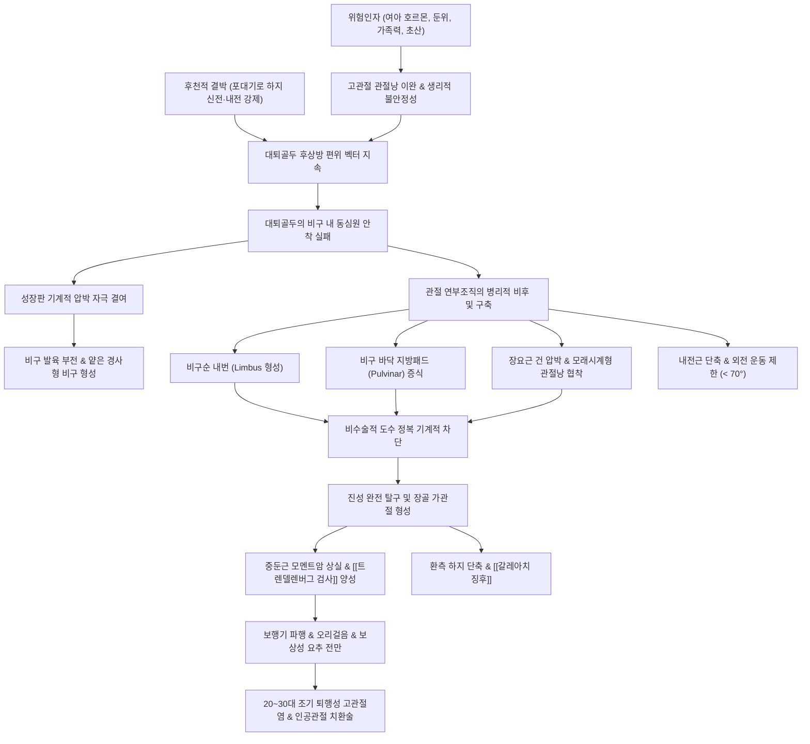

# 🩺 [[발달성 고관절 형성이상증]] (Developmental Dysplasia of the Hip, DDH / 發達性 股關節 形成異常症, Q65)

> **핵심 3줄 요약 (Key Summary)**:
> - 📍 **병소 부위 & 해부·병태생리**: 신생아 및 영아에서 미성숙한 [[비구]](Acetabulum)의 발육 부전 및 관절낭 이완으로 인해 [[대퇴골]]두(Femoral head)가 비구 내에 안정적으로 안착하지 못하고 아탈구(Subluxation) 또는 완전 탈구(Dislocation)되는 일련의 동적 스펙트럼 질환이다. 병리 진행 시 비구순 비후 및 내번(Inverted labrum/limbus), [[원형인대]](Ligamentum teres) 신장, [[장요근]](Iliopsoas) 건의 모래시계형 관절낭 협착, [[내전근]] 구축이 발생하여 도수 정복을 가로막는다.
> - 🚩 **전형적 임상 양상 & 3대 징후**: 보행 전 영아기에는 고관절 외전 제한(Abduction limitation < 70°), 대퇴부 및 둔부 피부 주름 비대칭, 무릎 높이 차이를 확인하는 [[갈레아치 징후]](Galeazzi sign), 탈구 유발 검사인 [[바로우 검사]](Barlow test), 정복 유발음('클렁크 Clunk')을 감지하는 [[오톨라니 검사]](Ortolani test) 양성이 핵심이다. 보행 개시 후에는 침범측 하지 단축, 지연 보행, [[트렌델렌버그 검사]](Trendelenburg test) 양성(트렌델렌버그 파행), 양측성 탈구 시 심한 요추 전만과 오리걸음(Waddling gait)이 특징적이다.
> - 🛠️ **핵심 감별 검사 & 한·양방 다각적 치료 전략**: 생후 6개월 이전에는 방사선 골화핵 미발달로 Graf 초음파 검사(알파각 > 60° 정상)가 표준이며, 6개월 이후에는 단순 방사선(AP Pelvis: 힐겐라이너선, 퍼킨스선, 셴톤선 파열, 비구각 증가)으로 확진한다. 생후 6개월 미만은 동적 외전 보조기인 [[파블릭 하네스]](Pavlik harness: 굴곡 100~110°, 외전 50~60°)를 24시간 적용하고, 6~18개월은 마취하 도수 정복 및 [[스파이카 석고붕대]](Hip spica cast), 18개월 이후는 관혈적 정복술 및 골반 절골술([[살터 절골술]], [[펨버턴 절골술]])을 시행한다. 한의학적으로 골탈(骨脫), 선천박약, [[간신부족]](肝腎不足)으로 변증하여 보익간신·강근골([[보중익기탕]], [[신기환]], [[독활기생탕]]), 보조기 및 깁스 해제 후 근위축 해소와 관절 안정화를 위한 [[소아 추나]] 및 경혈 지압([[환도]], [[질변]], [[족삼리]], [[양릉천]])을 병용한다.
> - <font color="#fa7e7e">⚠️ **응급 의뢰 레드플래그**: ① 과도한 도수 정복력이나 파블릭 하네스 과외전(> 70°)으로 인한 [[대퇴골두 무혈성 괴사]](Avascular Necrosis, AVN) 의심 소견 ② 하네스 과굴곡(> 120°)으로 인한 [[대퇴신경]] 마비(무릎 신전 불능 및 대퇴사두근 이완) ③ 18개월 이상 보행기 지연 발견 시 영구적 퇴행성 관절염 및 골반 변형 방지를 위한 즉각적인 소아정형외과 수술 의뢰.</font>

---

## 📌 목차
1. [질환 개요 & 해부학적 병태생리](#1-질환-개요--해부학적-병태생리)
2. [병태생리 메커니즘 & 생체역학적 악순환 네트워크](#2-병태생리-메커니즘--생체역학적-악순환-네트워크)
3. [임상 증상 & 이학적 검사(Physical Exam) 알고리즘](#3-임상-증상--이학적-검사physical-exam-알고리즘)
4. [감별 진단 매트릭스 (Differential Diagnosis)](#4-감별-진단-매트릭스-differential-diagnosis)
5. [한의 통합 치료 프로토콜 (침·약침·추나·한약)](#5-한의-통합-치료-프로토콜-침약침추나한약)
6. [양방 치료 & 병용·의뢰 기준 (Conventional Treatment & Referral)](#6-양방-치료--병용의뢰-기준-conventional-treatment--referral)
7. [재활 운동 & 생활습관 티칭 가이드](#7-재활-운동--생활습관-티칭-가이드)
8. [💡 사용자 진료실 핵심 필기 & 임상 노하우 (Melt-In 잔여 심화 집약)](#8--사용자-진료실-핵심-필기--임상-노하우-melt-in-잔여-심화-집약)
9. [출처 및 학술 참고 문헌 (References)](#9-출처-및-학술-참고-문헌-references)

---

## 1. 질환 개요 & 해부학적 병태생리

* **질환 정의 및 개념의 변천**:
  * 과거에는 출생 시 이미 고관절이 탈구되어 있는 선천적 결함으로 보아 **선천성 고관절 탈구(Congenital Dislocation of the Hip, CDH)**로 명명하였으나, 많은 환아에서 출생 당시에는 정상 접촉 상태이거나 경미한 불안정성만 보이다가 생후 수주 내지 수개월에 걸쳐 점진적으로 비구 발육 부전, 아탈구, 완전 탈구로 이행한다는 사실이 규명되었다.
  * 따라서 현재는 비구의 얕은 형성(Acetabular dysplasia), 대퇴골두의 불안정성(Subluxatable/Dislocatable hip), 불완전 탈구(Subluxation), 완전 탈구(Dislocation)를 모두 포괄하는 역동적 연속체 질환인 **[[발달성 고관절 형성이상증]](Developmental Dysplasia of the Hip, DDH)**으로 통칭한다.
  * **병태 단계별 분류**:
    1. **비구 이형성증(Acetabular Dysplasia)**: 대퇴골두는 비구 내에 위치하나, 비구의 골성 지붕이 얕고 경사도가 높아(비구각 증가) 골두를 충분히 덮지 못하는 상태.
    2. **아탈구(Subluxation)**: 대퇴골두가 비구 관절강 내에 남아 있으나 중심에서 벗어나 외상방으로 편위되어 관절 접촉 면적이 감소한 상태.
    3. **탈구(Dislocation)**: 대퇴골두가 비구 관절강에서 완전히 이탈하여 비구 외상방 장골 외익(Iliac wing)에 위치하는 상태 (도수 정복 가능형 vs 정복 불가능형).
    4. **기형성 탈구(Teratologic Dislocation)**: 관절구축증(Arthrogryposis), 척수수막류(Myelomeningocele) 등 신경근육계 유전 질환과 동반되어 태내 초기(임신 12~18주)에 발생하며, 출생 시 이미 심각한 연부조직 구축으로 도수 정복이 불가능한 특수 유형.

* **역학 및 6대 고위험 인자 (High-Risk Factors)**:
  * **발생 빈도**: 신생아 1,000명당 약 **1~5명**에서 진성 탈구가 발생하며, 경미한 관절 불안정증까지 포함하면 1,000명당 **10~20명**에 달한다.
  * **해부학적 편측성**: **좌측 고관절**이 약 **60%**, 우측이 20%, 양측성이 20%를 차지한다. 이는 태내에서 태아의 80% 이상이 좌후두전방위(LOA) 자세를 취하여 태아의 좌측 둔부가 산모의 딱딱한 천골(Sacrum) 돌출부에 직접 압박되어 고관절 내전 상태가 강요되기 때문이다.
  * **핵심 위험 인자**:
    1. **여아 (Female Sex)**: 남아 대비 **5~8배(약 80%가 여아)** 호발한다. 태반을 통과하는 모체 호르몬인 에스트로겐(Estrogen)과 릴랙신(Relaxin)에 대한 태아 골반 관절낭과 인대의 수용체 민감도가 여아에서 훨씬 높아 생리적 인대 이완증이 현저하게 나타나기 때문이다.
    2. **둔위 분만 (Breech Presentation)**: 단독 최대 위험 인자로, 둔위 출생 환아의 약 2~5%에서 DDH가 발생하며 전체 DDH의 약 20~25%가 둔위와 연관된다. 태아의 무릎이 신전된 채 고관절이 과굴곡된 둔위 자세는 슬괵근(Hamstrings)의 긴장도를 높여 대퇴골두를 비구 후방으로 밀어내는 탈구력을 형성한다.
    3. **가족력 (Family History)**: 1도 친족(부모 또는 형제자매)에 DDH 환자가 있는 경우 발병 위험도가 12배 증가하며, 부모 중 한 명이 환자이고 첫째 아이가 이환된 경우 다음 아이의 발병률은 36%까지 급증한다.
    4. **첫째 아이 (First-Born Child)**: 초산모의 단단하고 신장되지 않은 자궁벽과 복벽 근육이 태아에게 가하는 기계적 압박이 크기 때문이다(전체 환아의 약 60%가 초산).
    5. **양수과소증 (Oligohydramnios) 및 거대아**: 자궁 내 공간 협소로 인해 태아의 하지 운동이 제한되고 고관절이 지속적인 이상 압박을 받는다.
    6. **동반 선천성 기형**: 자궁 내 압박 증후군(Intrauterine packing disorder)의 일환으로 [[선천성 근성 사경]](Congenital Muscular Torticollis, 환아의 8~20%에서 DDH 동반), [[중족골 내전증]](Metatarsus adductus), 종골외반족이 흔히 병발한다.
    7. **후천적 환경 요인 (포대기 Swaddling)**: 아기의 양다리를 강제로 모아 곧게 펴서 싸매는 전통적 포대기 관습(북미 원주민, 중앙아시아, 전통 한국 관습)을 가진 사회에서는 발병률이 인구의 10% 이상으로 폭증하는 반면, 아기를 포대기에 업어 다리를 벌리게 하는 아프리카 사회에서는 발생률이 극히 낮다.

* **관련 해부학적 구조물**:
  * **골격 및 관절면**:
    * **[[비구]](Acetabulum)**: 장골(Ilium), 좌골(Ischium), 치골(Pubis)의 3개 골반골이 Y자 형태의 **삼방연골(Triradiate cartilage)**에서 융합되어 형성된다. 정상적인 비구는 대퇴골두를 180도 이상 깊게 감싸는 반구형 컵 구조를 갖추어야 한다.
    * **[[대퇴골]]두(Femoral Head)**: 출생 시에는 순수 초자연골(Hyaline cartilage) 덩어리이며, 생후 4~7개월경 중심부에 방사선상 보이는 이차 골화핵(Ossification center)이 출현한다.
  * **정적 안정성 구조물 및 관절내 병변**:
    * **비구순(Acetabular Labrum)**: 비구 테두리를 둘러싼 섬유연골성 링으로 관절와의 깊이를 더해준다. 대퇴골두가 장기간 외상방으로 탈구되면 비구순이 외측으로 밀려 비후되고, 결국 비구 관절강 안쪽으로 말려 들어가는 **내번(Inversion / Limbus)**이 발생하여 정복을 가로막는 가장 치명적인 해부학적 장벽이 된다.
    * **[[원형인대]](Ligamentum Teres / 대퇴골두인대)**: 비구와골(Acetabular fossa)에서 대퇴골두와(Fovea capitis)를 잇는 인대로, 탈구 시 대퇴골두와 함께 비구 밖으로 견인되어 극도로 비후되고 늘어나 관절강 내부를 가득 채운다.
    * **풀비나(Pulvinar)**: 비구 바닥에 존재하는 섬유지방조직으로, 골두가 빠져나간 빈 비구 내에서 반응성 증식을 일으켜 두꺼운 지방 패드를 형성함으로써 골두의 완전 안착을 방해한다.
    * **횡비구인대(Transverse Acetabular Ligament)**: 비구 절흔(Acetabular notch) 하부를 가로지르는 인대로, 만성 탈구 시 비후 및 수축되어 비구 입구를 좁힌다.
  * **동적 안정자 및 관절외 구축 근육**:
    * **[[장요근]](Iliopsoas Muscle)**: 요추와 장골와에서 기시하여 대퇴골 소전자(Lesser trochanter)에 정지하는 강력한 고관절 굴곡근이다. 대퇴골두가 상방 탈구되면 장요근 건이 전방 관절낭 위를 가로지르며 강하게 압박하여 관절낭 중앙부가 조여지는 **모래시계형 관절낭 변형(Hourglass constriction of the capsule)**을 유발한다.
    * **고관절 내전근군(Adductor Muscles)**: [[장내전근]](Adductor longus), [[단내전근]](Adductor brevis), [[대내전근]](Adductor magnus)이 지속적인 단축 구축을 일으켜 고관절의 외전을 심각하게 제한한다.
    * **둔근군**: [[중둔근]](Gluteus medius)과 [[소둔근]](Gluteus minimus)의 주행 방향이 대퇴골두 상방 편위로 인해 수평화되어 레버암(Moment arm)이 단축되고, 고관절 외전 토크를 상실하여 보행 시 트렌델렌버그 징후를 초래한다.

---

## 2. 병태생리 메커니즘 & 생체역학적 악순환 네트워크

```
[태내 위험인자 (여아 호르몬 감수성 + 둔위 분만 압박 + 양수과소증)]
  │
  ▼
[신생아 고관절 관절낭 이완 및 생리적 불안정성]
  │
  ├─ 후천적 악화 요인: 전통적 포대기(Swaddling - 하지 신전·내전 결박)
  │   └─ 슬괵근 긴장으로 대퇴골두 후상방 전위력 지속
  ▼
[대퇴골두와 비구의 동심원적 구심 접촉(Concentric contact) 소실]
  │
  ├─ 골화 유도 기계적 자극 결여 → [비구 지붕 발육 부전 (비구 이형성)]
  │   └─ 얕고 경사진 비구(비구각 증가) → 골두 지지력 영구 상실
  │
  ├─ 관절 연부조직의 비가역적 병리 변화 (정복의 해부학적 장애물 형성)
  │   ├─ [관절내]: 비구순 내번(Limbus) + 원형인대 비후 + 지방패드(Pulvinar) 증식
  │   └─ [관절외]: 장요근 건 압박(모래시계 관절낭) + 내전근 단축 구축
  ▼
[아탈구에서 완전 탈구로의 영구적 고착화]
  │
  ├─ 보행 개시 후 체중 부하 시작
  │   ├─ 가관절(Pseudoacetabulum) 형성 및 장골 외익 압박
  │   ├─ 중둔근 레버암 상실 → [트렌델렌버그 파행 & 하지 단축]
  │   └─ 골반 전방 경사 및 보상성 요추 과전만(Lordosis)
  ▼
[성인기 비가역적 조기 퇴행성 고관절염(OA), 만성 보행 장애, 척추 변형]
```



### 1) 세포·조직학적 및 생체역학적 기전
* **비구 발달의 기계생물학적 원리(Mechanobiology of Acetabular Development)**:
  * 비구는 독립적으로 형성되는 것이 아니라, 구형의 대퇴골두가 비구 중앙에 완벽하게 동심원적(Concentric)으로 안착하여 가하는 **간헐적 압박 응력(Intermittent compressive stress)에 반응하여 연골내 골화(Endochondral ossification)를 일으키며 깊어진다**.
  * 만약 출생 전후 관절낭 이완이나 부적절한 자세로 인해 대퇴골두가 비구 중심을 벗어나면, 비구 연골판에 가해지는 성장 자극이 소실되어 비구 지붕(Acetabular roof)의 골화가 정지하고 편평하게 굳어진다.
* **대퇴골 경사각 및 염전각의 2차성 변형**:
  * 골두가 탈구된 상태에서 대퇴골 근위부가 성장하면 대퇴골두-경부 각도가 비정상적으로 증가하는 **외반고(Coxa valga)**가 발생하고, 골두가 전방을 향해 과도하게 꼬이는 **과도한 전염각(Excessive femoral anteversion > 40~50°)**이 고착화되어 차후 정복을 더욱 어렵게 만든다.

### 2) 도수 정복을 가로막는 6대 해부학적 장애물 (Obstacles to Reduction)
환아가 성장할수록 단순 견인이나 보조기만으로 골두를 제자리에 넣을 수 없는 이유는 다음과 같은 구조적 장애물이 형성되기 때문이다:
1. **내번된 비구순(Inverted Acetabular Labrum / Limbus)**: 골두가 비구를 빠져나갈 때 비구순을 관절강 안으로 밀어 넣어, 골두가 되돌아가는 입구를 쐐기처럼 막아버린다.
2. **비후된 원형인대(Hypertrophic Ligamentum Teres)**: 늘어난 인대가 밧줄처럼 두꺼워져 비구 중심부를 물리적으로 차지한다.
3. **풀비나(Pulvinar)**: 비구와골의 지방 패드가 1cm 이상 두껍게 증식하여 골두의 심부 안착을 방해한다.
4. **횡비구인대(Transverse Acetabular Ligament)의 비후 및 수축**: 비구 하부 입구를 좁힌다.
5. **장요근 건(Iliopsoas Tendon)의 관절낭 압박**: 비구 전방을 누르며 관절낭을 조여 모래시계(Hourglass) 형태로 수축시킨다.
6. **고관절 내전근(Adductors)의 섬유성 단축**: 고관절을 외전시키지 못하게 결박한다.

---

## 3. 임상 증상 & 이학적 검사(Physical Exam) 알고리즘

### 1) 시기별 전형적 임상 증상
* **신생아 및 초기 영아기 (출생 ~ 생후 3개월)**:
  * **통증이 전혀 없다**: 신경 손상이나 염증이 없으므로 환아는 울거나 보채지 않는다.
  * 기저귀를 갈아줄 때 한쪽 다리가 반대쪽에 비해 잘 벌어지지 않는 느낌(외전 저항감).
  * 대퇴부 내측 및 서혜부 피부 주름의 비대칭(단, 정상아의 30%에서도 피부 비대칭이 있으므로 위양성에 주의).
* **후기 영아기 (생후 3 ~ 12개월)**:
  * **고관절 외전 제한(Limitation of Hip Abduction)**: 앙와위에서 고관절과 슬관절을 90도 굴곡시킨 후 부드럽게 양옆으로 벌렸을 때, 정상아는 바닥에서 80~90도까지 벌어지나 탈구측은 **70도 미만(심한 경우 45도 미만)**에서 딱딱하게 걸린다.
  * 탈구측 하지가 짧아 보이며, 무릎을 굽혀 세웠을 때 탈구측 무릎 높이가 현저히 낮아짐([[갈레아치 징후]]).
* **보행기 이후 (생후 12개월 이상)**:
  * 보행 개시가 정상아보다 늦어짐(생후 14~18개월경).
  * **일측성 탈구 시**: 절뚝거리는 파행(Limping gait). 환측 발로 체중을 지탱할 때 반대측 건전한 골반이 아래로 툭 떨어지는 **트렌델렌버그 파행(Trendelenburg lurch)**을 보이며, 상체를 환측으로 기우뚱하게 기울여 무게중심을 맞춘다.
  * **양측성 탈구 시**: 골반 양측이 모두 불안정하여 몸을 좌우로 심하게 흔들며 걷는 **오리걸음(Waddling gait)**을 보이며, 대퇴골두가 골반 후상방으로 전위되어 무게중심이 뒤로 쏠리므로 이를 보상하기 위해 배를 심하게 내밀고 허리가 과도하게 꺾이는 **심한 요추 전만증(Hyperlordosis)**이 동반된다.

### 2) 핵심 이학적 검사법 (Physical Examination)

```
[영아 고관절 선별 이학적 검사 흐름도]
  │
  ├─ [생후 0 ~ 3개월 신생아기]
  │   ├─ Barlow Test (탈구 유발 검사): 굴곡 90° + 경도 내전 상태에서 후방 압박
  │   │   └─ 골두가 비구 연골 턱을 타고 뒤로 "툭" 빠짐 (Dislocatable) → [양성]
  │   │
  │   └─ Ortolani Test (정복 유발 검사): 굴곡 90° + 부드러운 외전 + 대전자 전방 거상
  │       └─ 탈구된 골두가 비구 안으로 "클렁크(Clunk)" 들어가며 정복 → [양성: 확진]
  │
  └─ [생후 3개월 이후 ~ 보행기 영아]
      ├─ 고관절 외전 검사: 앙와위 90° 굴곡 외전 시 외전 각도 < 70° (비대칭적 제한)
      ├─ Galeazzi Sign: 무릎을 90° 굽혀 세웠을 때 탈구측 무릎 높이 하강 (하지 단축)
      ├─ Klisic Test: ASIS와 대전자를 잇는 가상선이 배꼽 아래를 향함
      └─ Trendelenburg Test (보행기): 한 발 서기 시 반대측 골반 하강
```

* **바로우 검사 (Barlow Test - 탈구 유발 검사 / Provocative Test)**:
  * **목적**: 현재 비구 내에 정복되어 있으나 불안정하여 외력에 의해 탈구될 수 있는 고관절(Dislocatable hip)을 찾아낸다.
  * **수기법**: 환아를 평평한 검사대에 반듯이 눕히고 기저귀를 벗긴다. 검사자는 한 손으로 환아의 골반을 단단히 고정하고, 다른 손의 엄지는 대퇴 내측(소전자 부위)에, 검지와 중지는 대전자(Greater trochanter) 외측에 얹는다. 고관절을 **90도 굴곡시키고 가볍게 내전(Adduction)시킨 상태에서, 대퇴골 장축을 따라 후방으로 지그시 압박**한다.
  * **양성 판정**: 대퇴골두가 비구의 섬유연골성 테두리를 타고 넘어가며 관절와 밖으로 "툭" 하고 미끄러져 빠져나가는 감각이 느껴지면 양성이다. 손을 놓으면 대부분 자연 정복된다. 생후 2~3개월이 지나면 관절낭이 팽팽해져 위음성이 나타난다.
* **오톨라니 검사 (Ortolani Test - 정복 유발 검사 / Reduction Test)**:
  * **목적**: 현재 이미 비구 밖으로 탈구되어 있는 대퇴골두를 비구 내로 다시 밀어 넣어 정복되는지 확인한다.
  * **수기법**: 바로우 검사 자세에서 시작하여, 환아의 고관절을 **90도 굴곡시킨 상태에서 서서히 외전(Abduction)시키면서 검지와 중지로 대전자를 전내측으로 들어 올려준다**.
  * **양성 판정**: 탈구되어 있던 대퇴골두가 비구 후연을 덜컥 넘어 비구 안으로 미끄러져 들어가면서 검사자의 손끝에 묵직하고 둔탁한 **'클렁크(Clunk)'** 감각이 전달된다.
  * ⚠️ **주의**: 힘줄이 뼈를 스치며 나는 단순 고주파 관절 마찰음(Click 또는 Snapping)은 정상적인 인대 소견이며, 진성 Ortolani 클렁크와 엄격히 구별해야 한다.
* **갈레아치 징후 (Galeazzi Sign / Allis Sign)**:
  * 환아를 침대에 눕히고 양측 고관절을 90도, 무릎을 90도 완전히 굴곡시켜 양 발바닥을 침대 면에 평평하게 붙이고 복사뼈를 나란히 모은다.
  * 양측 무릎의 높이를 수평선상에서 비교한다. 탈구된 쪽의 대퇴골두가 비구 후상방으로 편위되어 있으므로 **탈구측 무릎의 높이가 건측보다 현저하게 낮게 관찰**된다. (단, 양측성 탈구인 경우에는 양쪽 무릎 높이가 대칭적으로 낮아지므로 갈레아치 징후가 음성으로 나타날 수 있어 주의를 요한다).
* **트렌델렌버그 검사 (Trendelenburg Test - 보행기 환아)**:
  * 환아를 세운 뒤 한쪽 발을 들고 한 발로 서게 한다.
  * 정상적으로는 체중을 지지하는 쪽의 중둔근이 수축하여 반대측 골반을 위로 끌어올린다. 그러나 지지하는 쪽 고관절이 탈구되어 중둔근의 기시부와 정지부가 가까워져 근력이 약화된 경우, **반대쪽(공중에 뜬 쪽) 골반이 아래로 처지게 된다(양성 소견)**.

### 3) 영상 진단 알고리즘 (Imaging Protocol)

#### ① 생후 6개월 미만: 정밀 초음파 검사 (Graf Method)
생후 6개월 미만 영아의 대퇴골두는 방사선이 투과되는 연골 상태이므로 단순 X-선으로는 진단이 불가능하며, **관절 연골과 비구순을 실시간으로 직접 시각화할 수 있는 고해상도 초음파 검사가 표준(Gold Standard)**이다.

```
[Graf 초음파 관상 단면 기준선 및 각도 판독]
  │
  ├─ 기저선 (Baseline): 장골 외측 벽(Iliac wing)의 편평한 골성 윤곽선
  ├─ 골성 비구 지붕선 (Acetabular roof line): 삼방연골 하단에서 비구 골성 상연을 잇는 선
  └─ 연골성 비구 지붕선 (Cartilaginous roof line): 비구 골성 상연에서 비구순(Labrum) 중심을 잇는 선
  
  ▶ 알파각 (Alpha angle, α): 기저선과 골성 지붕선이 이루는 각도 (골성 비구의 깊이 반영)
      - α ≥ 60°: [정상 (Type I)] - 대퇴골두를 비구가 충분히 덮고 있음
      - α 50° ~ 59°: [생리적 미성숙 (Type IIa/IIb)] - 생후 3개월까지 추적 관찰 필요
      - α < 50°: [병적 이형성 및 아탈구 (Type IIc / Type III)] - 즉각 치료 개시
      - α < 43°: [완전 탈구 (Type IV)]
      
  ▶ 베타각 (Beta angle, β): 기저선과 연골성 지붕선이 이루는 각도 (비구순 전위 반영)
      - β < 55°: [정상]
      - β > 77°: [비구순의 외측 전위 및 탈구]
```

#### ② 생후 6개월 이후: 골반 전후면 방사선 사진 (AP Pelvis X-ray)
생후 4~7개월경 대퇴골두 골화핵이 출현하면 단순 방사선 사진이 일차 진단 도구가 된다.

```
                  │ (Perkins Line)
                  │
        Q1 (외상방)│ Q2 (내상방)
    ──────────────┼────────────── (Hilgenreiner Line)
        Q4 (외하방)│ Q3 (내하방: 정상 골두 위치)
                  │
                  │
    [셴톤선 Shenton's Line]: 대퇴골 경부 내측 하연 ──) 부드러운 호 (── 폐쇄공 상연
```

* **힐겐라이너선 (Hilgenreiner Line, H-line)**: 양측 골반의 삼방연골(Triradiate cartilage) 투명대를 수평으로 잇는 기준 기저선.
* **퍼킨스선 (Perkins Line, P-line)**: 비구의 골성 외측 상단 모서리(Bony acetabular margin)에서 힐겐라이너선에 수직으로 내린 선.
* **4분면 판독 원칙**:
  * H-선과 P-선이 교차하며 4개의 사분면을 형성한다.
  * **정상 대퇴골두 골화핵은 반드시 '내하방 사분면(Inferomedial quadrant)' 내에 위치**해야 한다.
  * 아탈구 시 '외하방 사분면'으로 편위되며, 완전 탈구 시 **'외상방 사분면(Superolateral quadrant)'**으로 완전히 이탈한다.
* **셴톤선 (Shenton Line)**: 대퇴골 경부 내측 하연의 곡선과 폐쇄공(Obturator foramen) 상연의 부드러운 호를 연결한 선이다. 정상에서는 연속적인 반원을 그리지만, 고관절이 상방으로 탈구되면 이 선이 층을 이루며 **파열(Disrupted)**된다.
* **비구각 (Acetabular Index, AI)**: 힐겐라이너선과 비구 지붕 경사면이 이루는 각도이다. 신생아기에는 약 **30도** 내외이며, 정상 발달 시 1세경 **20~25도 이하**, 2세경 **20도 이하**로 점차 평탄해져야 한다. AI가 **30도 이상으로 가파르게 유지**되면 비구 이형성증을 확진한다.

---

## 4. 감별 진단 매트릭스 (Differential Diagnosis)

| 감별 질환 | 호발 연령 및 원인 | 핵심 임상 소견 | 감별 포인트 (진단 검사 및 영상) | 응급도 및 치료 방향 |
| :--- | :--- | :--- | :--- | :--- |
| **[[발달성 고관절 형성이상증]]** (본 질환, DDH) | 신생아~보행기, 여아·둔위 호발, 다인자/기계적 | 외전 제한, 피부 주름 비대칭, Ortolani/Barlow 양성, 파행 | 초음파상 α각 < 60°, X-ray상 Shenton선 파열 및 골두 외상방 편위 | 조기 발견 시 Pavlik 하네스, 지연 시 Spica 깁스 및 수술 |
| **[[선천성 근성 사경]]** (Congenital Torticollis) | 신생아~영아기, 흉쇄유돌근(SCM) 섬유화 | 고개가 한쪽으로 기울고 반대로 회전, SCM 종괴 | DDH가 8~20% 동반되므로 **반드시 고관절 초음파 스크리닝 필수** | SCM 스트레칭 추나 및 물리치료 |
| **[[중족골 내전증]]** (Metatarsus Adductus) | 신생아기, 자궁 내 압박 증후군 | 전족부가 C자형으로 내측 내전, 외측 족연 볼록 | 고관절 자체의 탈구는 없으나 자궁 내 압박 병력 공유로 DDH 동반 흔함 | 도수 족부 스트레칭, 심한 경우 깁스 교정 |
| **마비성 고관절 탈구** (Paralytic Dislocation) | 영아기~소아기, 뇌성마비/척수수막류 | 하지 강직 또는 이완성 마비, 심한 내전근 연축 | 신경학적 반사 이상, 발달 지연 동반, 지연성 탈구 발생 | 내전근 절제술, 보톡스 주사, 휠체어 자세 교정 |
| **기형성 고관절 탈구** (Teratologic Dislocation) | 출생 즉시, 관절구축증 등 선천 증후군 | 출생 시 이미 완전 탈구, 관절이 돌처럼 굳어 움직이지 않음 | Ortolani 정복 전혀 불가, 전신 다발 관절 구축 동반 | **도수 정복 절대 불가**, 조기 관혈적 개방 정복술 |
| **신생아 [[화농성 관절염]]** (Septic Arthritis) | 신생아~영아기, 세균성 감염 (*S. aureus*) | **고열, 보챔, 기저귀 갈 때 비명, 가성 마비(움직이지 않음)** | **<font color="#fa7e7e">초응급</font>**: CRP/ESR 급상승, 초음파상 관절 삼출액, 관절 천자상 농양 | **응급 관절 절개 배농술(I&D) 및 정맥 항생제** (골두 괴사 방지) |
| **[[일과성 고관절 활액막염]]** (Transient Synovitis) | 만 3~8세 소아, 바이러스 감염 후 | **갑작스러운 파행, 고관절 통증, 미열 또는 무열** | 혈액검사 정상/경미, 초음파상 활액막염, 방사선상 골두 위치 정상 | 침상 안정, NSAIDs 복용, 한방 청열소종 (1~2주 내 완치) |

---

## 5. 한의 통합 치료 프로토콜 (침·약침·추나·한약)

### 1) 한의학적 변증 체계
* **골탈(骨脫) 및 선천박약(先天薄弱)**: 신(腎)은 골(骨)을 주관하고 수(髓)를 생성하는데, 부모의 정혈(精血) 부족이나 태중 조리 부실로 신기(腎氣)가 허약하여 태아의 고관절 비구와 골두가 단단하게 골화되지 못하고 연약하여 탈구된 병태. 대천문 폐쇄 지연, 하지 무력.
* **간신휴손(肝腎虧損) 및 근골위약(筋骨萎弱)**: 간(肝)은 근(筋)을 주관하고 인대를 관장하며, 신(腎)은 골을 주관한다. 간신이 모두 부족하여 고관절 관절낭과 인대가 과도하게 늘어지고(弛緩) 지지력을 잃어 관절이 빠지는 상태.
* **비위허약(脾胃虛弱) 및 기혈부족(氣血不足)**: 비위는 후천지본으로 사지 근육(肌肉)을 주관한다. 영양 섭취 불량으로 대퇴부 및 둔부 근육량이 빈약하여 고관절을 외측에서 단단히 잡아주지 못함.
* **기체혈어(氣滯血瘀) 및 경락비저(經絡痺阻)**: 파블릭 하네스나 스파이카 석고붕대를 수개월간 착용한 후 기혈 순환이 차단되어 고관절 주변 조직이 굳고 붓거나 근육이 위축된 상태.

### 2) 침구 치료 프로토콜 (소아 비침습 특화 자극)
* **둔부 고관절 안정화 및 중둔근 활성화**:
  * **주요 혈자리**: [[환도]](GB30), [[질변]](BL54), [[승부]](BL36), [[거료]](GB29), [[비관]](ST31).
  * **자침 기법**: 영유아 환아의 공포감과 통증을 방지하기 위해 일반 호침 유침을 피하고, 0.16×15mm 극미세 침으로 순간적으로 득기만 유도하고 빼는 **소아 점자술(단자술)**을 적용하거나, 무통 **자석침(피내침 / 압봉)**을 해당 혈자리에 부착하여 2~3일간 유지한다.
* **하지 근력 강화 및 골 성장 촉진**:
  * **주요 혈자리**: [[족삼리]](ST36), [[양릉천]](GB34 - 筋會), [[현종]](GB39 - 髓會), [[삼음교]](SP6).
  * **효능**: 양릉천과 현종은 근과 골수를 주관하는 팔회혈로, 고관절 인대의 결합력을 높이고 하지 골단의 연골내 골화를 촉진한다.
* **척추 정렬 및 신기 보강**:
  * **주요 혈자리**: [[신수]](BL23), [[대장수]](BL25), [[명문]](GV4).

### 3) 약침 치료 (보행기 이후 및 깁스 해제 아동)
* **자하거약침(Hominis Placenta)**: 간신을 보하고 정혈을 자양하는 대표 약침으로, 고관절낭의 섬유아세포 증식과 콜라겐 합성을 촉진하여 이완된 관절낭의 탄력성을 회복시킨다. 환도혈과 거료혈에 각각 0.05~0.1cc씩 피하 미세 주입.
* **녹용약침**: 신양(腎陽)을 북돋우고 강근골(强筋骨) 효능이 탁월하여, 비구의 골화가 지연된 비구 이형성증 환아의 골 형성 세포 활성화 및 조기 골화를 유도한다. 신수혈 및 양릉천혈에 0.05cc 분주.

### 4) 한약 치료 (단계별 맞춤 처방)
* **영아기 골화 촉진 및 신기 보강 (생후 3~12개월)**:
  * **처방**: [[육미지황탕]](六味地黃湯) 합 [[보중익기탕]](補中益氣湯) 가미.
  * **구성**: 숙지황 4g, 산약 4g, 산수유 3g, 백복령 3g, 택사 2g, 목단피 2g, 황기 4g, 백출 3g, 당귀 2g, 두충(염초) 3g, 골쇄보 3g, 속단 3g.
  * **약리 기전**: 두충과 속단은 골아세포(Osteoblast)의 알칼라인 포스파타제(ALP) 활성을 촉진하고, 숙지황과 산수유는 연골세포의 프로테오글리칸 합성을 증가시켜 얕은 비구 지붕의 조속한 연골내 골화를 강력히 유도한다.
* **보행기 파행 및 근골 무력기 (생후 12개월 이상)**:
  * **처방**: [[독활기생탕]](獨活寄生湯) 또는 [[신기환]](腎氣丸) 가감.
  * **구성**: 독활, 상기생, 두충, 우슬, 세신, 진범, 복령, 백작약, 당귀, 천궁, 숙지황, 인삼.
  * **목표**: 중둔근 및 둔부 외전근의 근력을 보강하여 트렌델렌버그 파행을 줄이고 정상 보행 패턴 조기 확립.
* **석고붕대(Spica cast) 해제 후 관절 강직 및 순환 장애기**:
  * **처방**: [[당귀수산]](當歸鬚散) 합 [[서근활락탕]] 가감.
  * **외용제**: [[자운고]](紫雲膏)를 관절 주변 피부에 도포하여 깁스로 인한 피부 찰과상과 건조증을 치료하고 미세 순환을 개선.

### 5) 소아 추나(Pediatric Chuna) 및 관절 안정화 수기 요법
* ⚠️ **절대 금기 수기**: **대퇴골을 신전(Extension)시키거나 내전(Adduction)시키는 강한 당김이나 견인 수기는 대퇴골두를 후방으로 탈구시키므로 절대 금기**이다.
* **개구리 다리 외전 유지 유법 (Frog-leg Abduction Massage)**:
  * 환아를 편안히 눕히고 양 무릎과 고관절을 90도 굴곡시킨 상태에서, 술자의 양손으로 대퇴 내측 내전근 부위를 안쪽에서 바깥쪽으로 부드럽게 쥐어짜듯 쓰다듬는 유법(揉法)을 3분간 시행하여 단축된 내전근을 이완시킨다.
  * 이후 양 무릎을 가볍게 바깥쪽으로 벌려 자연스러운 외전 각도를 유도한다(절대 억지로 바닥에 닿게 누르지 않는다).
* **날척법 (捏脊法 - 소아 척추 롤링 추나)**:
  * 환아를 엎드리게 한 후 미골 부위(장강혈)에서부터 대추혈까지 척추 양측 방광경 주행선을 따라 피부를 엄지와 검지로 집어 올리며 위로 밀고 올라가는 수기법(1회 5회 반복).
  * 독맥과 족태양방광경을 동시에 자극하여 전신 기혈 순환을 왕성하게 하고 자율신경과 성장판 발육을 촉진한다.

---

## 6. 양방 치료 & 병용·의뢰 기준 (Conventional Treatment & Referral)

### 1) 연령대별 표준 정형외과 치료 가이드라인 (POSNA / AAOS 지침)
DDH의 치료 목표는 대퇴골두를 비구 내에 안전하게 동심원적으로 정복(Concentric reduction)시키고 유지하여 비구의 정상적인 2차 발육을 유도하는 것이다. 치료 방법은 환아의 발견 연령에 따라 엄격히 구분된다.

```
[0 ~ 6개월 (신생아 및 초기 영아)]
  └─ [파블릭 하네스 (Pavlik Harness)] 역동적 보조기 24시간 착용 (6~12주)
      └─ 실패 시: 초음파 유도하 폐쇄 정복 또는 경성 보조기(Tubingen/Von Rosen)

[6 ~ 18개월 (후기 영아)]
  └─ 전신마취하 관절 조영술 (Arthrogram)
      ├─ 안정적 정복 가능 시: [도수 폐쇄 정복술 (Closed Reduction)] + [스파이카 석고붕대 (Spica Cast)] 3~4개월
      └─ 장요근/내전근 긴장 시: 경피적 내전근 건 절개술 (Adductor Tenotomy) 병행

[18개월 이상 ~ 보행기 아동]
  └─ [관혈적 개방 정복술 (Open Reduction)]: 비구내 장애물(비구순, 원형인대, Pulvinar) 수술적 제거
      ├─ 비구 이형성 지속 시: [골반 절골술] (살터 절골술 Salter / 펨버턴 절골술 Pemberton)
      └─ 대퇴골 과도 염전/외반 시: [대퇴골 단축 및 내반 회전 절골술 (VDRO)]
```

* **생후 0~6개월: 파블릭 하네스 (Pavlik Harness)**:
  * **원리**: 신생아의 자유로운 발차기 운동을 허용하면서도, 탈구를 유발하는 신전과 내전 동작만을 물리적으로 차단하고 **고관절 굴곡 100~110도, 외전 50~60도**의 **'안전 구역(Safe Zone)'** 내에 다리를 유지시키는 역동적 끈 보조기이다. 아기가 다리를 차는 과정에서 대퇴골두가 비구 중앙으로 저절로 미끄러져 들어간다.
  * **성공률**: 조기 적용 시 **85~95%**의 완치율을 보인다.
  * **합병증 방지 원칙**:
    * **과외전(Abduction > 70°) 금지**: 외전이 과도하면 대퇴골두를 영양하는 내측대퇴회선동맥(MFCA)이 치골 결절에 눌려 **[[대퇴골두 무혈성 괴사]](AVN)**가 발생한다.
    * **과굴곡(Flexion > 120°) 금지**: 굴곡이 과도하면 서혜인대 하방에서 **대퇴신경(Femoral nerve)**이 압박되어 일시적 신경 마비(무릎 신전 불능)가 발생한다.
* **생후 6~18개월: 폐쇄 정복술 및 스파이카 석고붕대 (Hip Spica Cast)**:
  * 하네스 치료에 실패했거나 진단이 늦어진 경우 적용한다. 전신마취 하에서 관절 조영술을 시행하여 연부조직 장애물 여부를 확인하고, 필요한 경우 내전근 건 절개술을 시행한 후 도수 정복한다.
  * 정복 상태를 유지하기 위해 가슴부터 발목까지 석고로 고정하는 **스파이카 붕대를 개구리 다리 자세(Human position: 굴곡 90~100°, 외전 45~50°)로 3~4개월간 착용**한다.
* **생후 18개월 이상: 관혈적 정복술 및 절골술 (Open Reduction & Osteotomy)**:
  * 해부학적 장애물로 인해 도수 정복이 불가능하므로 고관절을 절개하여 내번된 비구순을 제자리로 정돈하고 비후된 원형인대와 풀비나를 절제한 뒤 관절낭을 축소 봉합(Capsulorrhaphy)한다.
  * 비구각이 너무 가파른 경우 장골을 절골하여 비구 지붕을 전외측으로 회전시켜 덮어주는 **[[살터 절골술]](Salter innominate osteotomy)** 또는 **[[펨버턴 절골술]](Pemberton pericapsular osteotomy)**을 시행하며, 대퇴골의 과도한 압박을 줄이기 위해 **대퇴골 단축 및 내반 절골술(Femoral shortening varus derotation osteotomy)**을 병행한다.

### 2) 한양방 병용 판단 가이드라인
* **보조기 및 깁스 착용기 (0~6개월 하네스 / 6~18개월 스파이카)**:
  * 보조기 착용 중에는 정복의 기계적 유지가 최우선이므로 보호자가 보조기 끈을 임의로 풀거나 각도를 조절하지 않도록 엄격히 지도한다.
  * 한의 치료는 피부 짓무름 방지(자운고), 비위 소화기능 개선 한약 투여([[보중익기탕]]), 비침습 자석침 요법으로 제한하여 보조기의 치료 효과를 극대화한다.
* **깁스 해제 후 재활기 (Rehabilitation Phase)**:
  * 석고붕대 제거 직후에는 관절 강직과 근위축이 심하므로, 양방 물리치료와 한방 소아 추나, 근골 강화 한약([[독활기생탕]], [[육미지황탕]])을 적극 병용하여 보행 훈련 기간을 50% 이상 단축시킨다.

### 3) 소아정형외과 즉각 의뢰 기준 (Referral Criteria)
* 생후 영아 신체 검진 시 **Barlow 또는 Ortolani 검사 양성** 소견이 1회라도 촉지된 경우.
* 생후 3개월 이후 고관절 **외전 각도가 70도 미만으로 비대칭적 제한**을 보이는 경우.
* **둔위 분만으로 출생한 여아**이거나 **DDH 가족력**이 있는 고위험군 신생아 (신체 검진이 정상이더라도 생후 6주경 정형외과 선별 초음파 필수 의뢰).
* 보행기 아동에서 원인 불명의 **절뚝거림(파행), 오리걸음, 한쪽 하지 단축**이 관찰되는 경우.

---

## 7. 재활 운동 & 생활습관 티칭 가이드

### 1) 고관절 건강을 지키는 올바른 포대기법 (Hip-Healthy Swaddling)
전통적인 잘못된 포대기 싸기는 DDH의 발생 및 악화의 주원인이다.

```
[❌ 위험한 포대기 (Dangerous Swaddling)]
  - 아기의 양 무릎과 고관절을 곧게 펴서(신전) 양다리를 하나로 모아 꽁꽁 싸매는 방식.
  - 슬괵근 긴장으로 대퇴골두를 비구 밖으로 당겨 탈구를 직접 유발함.

[✅ 고관절 안심 포대기 (Hip-Healthy Swaddling - IHDI 권고)]
  - 상체는 모로 반사 방지를 위해 꼭 싸매더라도, [허리 아래 하체는 헐렁하게(Loose) 유지].
  - 아기의 다리가 개구리처럼 바깥으로 자유롭게 벌어지고(외전), 무릎을 가슴 쪽으로 구부릴 수 있는(굴곡)
    충분한 공간(M자 자세 / Frog-leg position)을 보장해야 함.
```

### 2) 아기띠(Baby Carrier) 및 카시트 선택 가이드
* **M자형 다리 지지(M-Position) 확인**:
  * 아기띠에 아기를 앉혔을 때 엉덩이부터 허벅지 전체가 넓게 받쳐져 무릎이 엉덩이 높이와 같거나 약간 더 높게 올라가는 **'M자형 자세(개구리 자세)'**가 유지되어야 한다.
  * 아기띠 바닥 폭이 너무 좁아 허벅지를 받쳐주지 못하고 다리가 아래로 축 늘어지는(I자형) 형태의 제품은 대퇴골두에 강한 외측 견인력을 가하므로 절대 사용해서는 안 된다. 국제고관절이형성증협회(IHDI) 공식 인증 마크를 확인한다.
* **카시트 및 유모차**:
  * 다리가 모이지 않고 자연스럽게 외전 상태를 유지할 수 있는 넓은 좌판 제품을 선택한다.

### 3) 파블릭 하네스 착용 중 가정 간호 수칙
* **피부 관리 및 목욕**:
  * 끈에 의한 마찰열 및 피부염을 예방하기 위해 하네스 안쪽에 얇고 솔기가 없는 순면 내의와 긴 양말을 반드시 입힌다.
  * 첫 6주간은 의사의 허락 없이 하네스를 완전히 벗겨 목욕시키는 것을 금하며, 스펀지에 따뜻한 물을 적셔 닦아주는 부분 목욕(Sponge bath)을 시행한다.
* **기저귀 교환 요령**:
  * 기저귀를 갈 때 아기의 발목을 잡고 다리를 공중으로 번쩍 들어 올리면 고관절이 신전되어 탈구 위험이 있다. 반드시 아기의 엉덩이 밑으로 손을 넣어 둔부를 살짝 들어 올리는 방식으로 기저귀를 교환해야 한다.

---

## 8. 💡 사용자 진료실 핵심 필기 & 임상 노하우 (Melt-In 잔여 심화 집약)

> [!IMPORTANT]
> **🛡️ 원문 융합(Melt-In) 및 진료실 실전 노하우**:
> - DDH는 "놓치면 영구 장애, 일찍 발견하면 100% 비수술 완치"되는 소아 정형외과 질환의 대표 주자이다.
> - 한의 1차 진료실에서는 영유아 예방접종이나 영유아 검진 차 내원했을 때 **'30초 루틴 스크리닝'**을 습관화해야 한다.

* **1차 진료실 '30초 고관절 스크리닝' 루틴**:
  1. 기저귀를 벗기고 아기를 편안히 눕힌다.
  2. 양 무릎을 굽혀 세워 무릎 높이를 본다 -> 높이가 다르면 **[[갈레아치 징후]] 양성**.
  3. 양 무릎을 가볍게 바깥으로 벌려본다 -> 한쪽이 70도 미만에서 덜컥 걸리면 **외전 제한 양성**.
  4. 서혜부와 허벅지 안쪽 주름을 본다 -> 주름의 개수와 깊이가 비대칭인지 확인.
  5. 2번이나 3번 중 하나라도 걸리면 지체 없이 소아 초음파 의뢰 소견서를 발부한다.

* **"다리 주름이 짝짝이예요" 보호자 상담 스크립트**:
  * 진료실에 "맘카페에서 허벅지 주름이 다르면 고관절 탈구라는데 우리 아이 다리 주름이 달라요"라며 사색이 되어 찾아오는 부모가 매우 많다.
  * 🗣️ **상담 멘트**: *"어머님, 너무 불안해하지 마세요. 아기들은 피하지방이 통통해서 건강하게 잘 자라는 정상 아기 10명 중 3~4명도 허벅지 살 접히는 주름이 짝짝이로 보입니다. 주름보다 훨씬 중요한 것은 '다리가 양옆으로 부드럽게 잘 벌어지는가'와 '무릎을 세웠을 때 높이가 같은가'입니다. 지금 진찰해 보니 양쪽 다리 모두 개구리처럼 85도 이상 시원하게 잘 벌어지고 무릎 높이도 똑같습니다. 탈구 가능성은 매우 낮으니 안심하시고, 혹시 둔위로 태어났거나 가족력이 있다면 확인 차원에서 생후 6주 초음파 검사만 한번 편안하게 받아보시면 됩니다."*

* **석고붕대(Spica Cast)를 풀고 온 아동의 재활 노하우**:
  * 3개월간 무거운 석고에 갇혀 있던 아이는 다리를 전혀 쓰지 못하고 피부는 하얗게 각질이 일어나며 심하게 굳어 있다. 부모는 아이가 영영 못 걷는 줄 알고 크게 걱정한다.
  * 이때 욕조에 미온수를 받아 아이를 담그고 따뜻한 수건으로 각질을 부드럽게 닦아낸 뒤, [[자운고]]를 둔부와 서혜부에 듬뿍 발라 장요근과 대퇴사두근을 가볍게 롤링 마사지한다.
  * 이후 아이를 엎드리게 하여 날척법(척추 롤링)을 시행하고, 욕조 안에서 물놀이를 유도하여 부력 상태에서 발차기를 시키면 통증 없이 2~3주 내에 스스로 일어서서 걷기 시작한다.

---

## 9. 출처 및 학술 참고 문헌 (References)

1. **대한정형외과학회**. (2020). *정형외과학 제8판*. 최신의학사. 소아 고관절 질환 및 발달성 고관절 형성이상증 단원 (pp. 1125-1158).

2. **Miller ND, Gibson M, Nair A, Liu J**. (2026). Preventing Missed Developmental Dysplasia of the Hip: Universal vs. Selective Ultrasound Screening. *JBJS Rev*. 14(8):. [PMID: 42658963](https://pubmed.ncbi.nlm.nih.gov/42658963/)
   - **[연구 요약]**: 발달성 고관절 형성이상증(DDH)의 진단 지연 및 치료 실패를 방지하기 위한 전수 초음파 선별검사(Universal screening)와 고위험군 선별검사(Selective screening)의 비용-효과성 및 위양성률을 비교 분석한 최신 체계적 문헌고찰. 둔위 출생 여아 및 가족력 환아에서 선택적 초음파의 필수성을 재확인하고 조기 발견의 임상적 가치를 규명함.

3. **Biz C, Cerchiaro M, Sbrissa I, Andreotti M, Maso G, Ruggieri P**. (2026). A historical journey through developmental dysplasia of the hip (DDH): from prehistoric evidence to the rise of modern diagnostic and therapeutic concepts. *Int Orthop*. 50(10):2743-2759. [PMID: 42631757](https://pubmed.ncbi.nlm.nih.gov/42631757/)
   - **[연구 요약]**: 고대 및 선사시대 고인류학적 유골 근거로부터 현대 정밀 진단(Graf 초음파)과 파블릭 하네스, 절골술로 이어지는 DDH 개념의 역사적 변천사를 종합 고찰한 논문. 기계적 결박 관습의 유해성과 조기 비수술적 동심원 정복의 중요성을 포괄적으로 정리함.

4. **대한소아청소년과학회**. (2021). *소아청소년과학 제12판*. 학지사메디컬. 신생아 신체 검진 및 근골격계 선천 기형 단원.

---

## 관련 노트

- [[비구]]
- [[대퇴골]]
- [[대퇴골두]]
- [[원형인대]]
- [[장요근]]
- [[내전근]]
- [[중둔근]]
- [[대퇴골두 무혈성 괴사]]
- [[바로우 검사]]
- [[오톨라니 검사]]
- [[갈레아치 징후]]
- [[트렌델렌버그 검사]]
- [[파블릭 하네스]]
- [[스파이카 석고붕대]]
- [[살터 절골술]]
- [[펨버턴 절골술]]
- [[초음파 검사]]
- [[골반 단순 방사선 사진]]
- [[선천성 근성 사경]]
- [[중족골 내전증]]
- [[화농성 관절염]]
- [[일과성 고관절 활액막염]]
- [[보중익기탕]]
- [[신기환]]
- [[육미지황탕]]
- [[독활기생탕]]
- [[당귀수산]]
- [[자하거약침]]
- [[녹용약침]]
- [[자운고]]
- [[환도]]
- [[질변]]
- [[족삼리]]
- [[양릉천]]
- [[소아 추나]]
- [[간신부족]]
