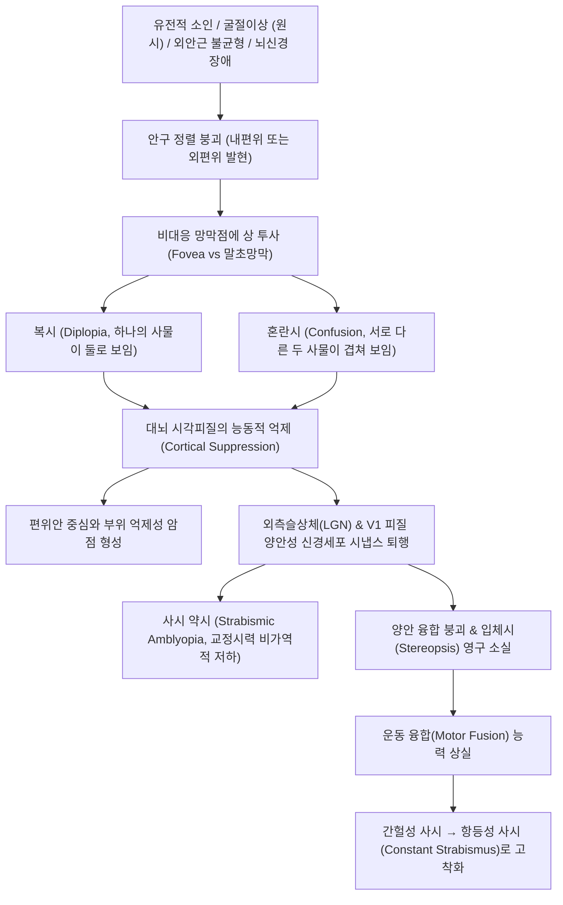

# 🩺 [[사시]] (Strabismus / 斜視, ICD-10: H49-H50 / KCD: H49-H50)

> **핵심 3줄 요약 (Key Summary)**:
> - 📍 **병소 부위 & 해부·병태생리**: 양안의 시선이 하나의 주시점을 동시에 향하지 못하는 안구 정렬 이상 질환으로, 6개의 [[외안근]](Extraocular muscles)과 3개 뇌신경([[눈돌림신경]] CN III, [[도르래신경]] CN IV, [[벌림신경]] CN VI), 대뇌 피질 융합 중추의 신경근 조절 불균형에 의해 발생함. 시각 발달의 결정적 시기(Critical period)에 시각 억제(Suppression)로 인한 [[사시 약시]](Strabismic amblyopia) 및 영구적 [[입체시]](Stereopsis) 상실을 초래함.
> - 🚩 **전형적 임상 양상 & 3대 징후**: 안구의 내편위([[내사시]]) 또는 외편위([[외사시]]), 피로나 졸릴 때 또는 야외 햇빛 노출 시 한쪽 눈을 찡그리는 현상([[간헐 외사시]]), 물체를 볼 때 고개를 돌리거나 기울이는 [[이상 두위]](Abnormal head posture).
> - 🛠️ **핵심 감별 검사 & 한·양방 다각적 치료 전략**: 히르쉬베르크 각막반사 검사, 가림 검사(Cover test), 프리즘 검사, 조절마비굴절검사 후 굴절 교정 안경 및 [[가림 치료]](Patching), [[외안근 후전술]]·절제술, 한의학적 [[목기]](目偏)·[[소아통정]](小兒通睛)·풍사침습·비신양허·간담습열 변증에 따른 [[보중익기탕]], [[정용탕]], [[명목지황환]] 및 안와 주위 침구([[찬죽]], [[사죽공]], [[승읍]], [[동자료]], [[합곡]], [[광명]]) 치법 병용.
> - <font color="#fa7e7e">⚠️ **응급 의뢰 레드플래그 & 악화 요인**: 동공 내 백색 반사([[백색동공]], Leukocoria) 발견 시 악성 종양인 [[망막모세포종]](Retinoblastoma) 의심 즉각 응급 전원, 급성 발병 마비성 사시에 동반된 극심한 두통·구토·안검하수([[뇌동맥류]], 뇌종양, 두개내압 상승 응급).</font>

---

## 📌 목차
1. [질환 개요 & 병태생리 (Disease Overview)](#1-질환-개요--병태생리-disease-overview)
2. [병태생리 메커니즘 & 대사·장기부전 악순환 네트워크](#2-병태생리-메커니즘--대사장기부전-악순환-네트워크)
3. [임상 증상 & 환자 소견 (Clinical Presentation)](#3-임상-증상--환자-소견-clinical-presentation)
4. [감별 진단 매트릭스 (Differential Diagnosis)](#4-감별-진단-매트릭스-differential-diagnosis)
5. [한의 통합 치료 프로토콜 (침·약침·한약)](#5-한의-통합-치료-프로토콜-침약침한약)
6. [양방 치료 & 병용·의뢰 기준 (Conventional Treatment & Referral)](#6-양방-치료--병용의뢰-기준-conventional-treatment--referral)
7. [식이·생활습관 & 자가관리 티칭 가이드](#7-식이생활습관--자가관리-티칭-가이드)
8. [💡 진료실 핵심 필기 & 임상 노하우](#8--진료실-핵심-필기--임상-노하우)
9. [출처 및 학술 참고 문헌 (References)](#9-출처-및-학술-참고-문헌-references)

---

## 1. 질환 개요 & 병태생리 (Disease Overview)

* **질환 정의 및 기본 개념**:
  * **사시(Strabismus, 사팔이 / 斜視)**: 어떤 물체를 주시할 때 한쪽 눈의 시선은 물체를 향하지만, 반대편 눈의 시선은 다른 방향(안쪽, 바깥쪽, 위, 아래, 또는 회선)을 향하는 안구 정렬 이상(Ocular misalignment) 상태.
  * **사시(Tropia, 현성 사시)**: 양안을 뜨고 있는 일상 상태에서 항상 또는 간헐적으로 안구 편위가 겉으로 드러나는 상태.
  * **사위(Phoria, 잠복 사시)**: 양안에 융합(Fusion) 자극이 주어질 때는 두 눈이 바르게 정렬되나, 한쪽 눈을 가려 융합을 차단했을 때만 편위가 발생하는 잠복 상태.

* **질환 분류 체계**:
  * **1) 편위 방향에 따른 분류**:
    * **[[내사시]](Esotropia, ET)**: 눈동자가 코 안쪽으로 몰리는 상태.
      * 영아 내사시(선천 내사시): 생후 6개월 이전에 발병하는 대각도 내사시.
      * 조절 내사시(Accommodative esotropia): 원시 굴절이상에 따른 과도한 눈모음으로 발생.
    * **[[외사시]](Exotropia, XT)**: 눈동자가 귀 바깥쪽으로 돌아가는 상태.
      * 간헐 외사시(Intermittent exotropia): 평소에는 정렬되어 있으나 피로, 졸림, 먼 곳 응시 시 외편위.
      * 항상 외사시(Constant exotropia): 주시 조건과 무관하게 항상 바깥으로 편위됨.
    * **수직 사시(Vertical Strabismus)**: 상사시(Hypertropia, 위로 편위), 하사시(Hypotropia, 아래로 편위).
    * **회선 사시(Torsional Strabismus)**: 외선회(Excyclotropia), 내선회(Incyclotropia).
  * **2) 운동 양상 및 신경학적 기전 분류**:
    * **공동성 사시(Comitant Strabismus)**: 안구를 어느 방향으로 움직이더라도 사시각(Strabismic angle)의 크기가 일정하게 유지됨. 소아기 특발성 사시의 대다수를 차지함.
    * **비공동성·마비성 사시(Incomitant / Paralytic Strabismus)**: 주시 방향에 따라 사시각의 크기가 달라지며, 특정 외안근 마비 또는 기계적 제한(안와 골절 등)에 기인함.

* **역학 및 인종적 특성**:
  * **전체 유병률**: 전 세계 소아 인구의 약 2~4%에서 발생함.
  * **한국 및 동아시아 소아의 역학적 특징**:
    * 서양 소아에서는 영아 내사시 및 조절 내사시의 비율이 높은 반면, **한국 소아에서는 [[간헐 외사시]]가 전체 소아 사시의 약 70~80%를 차지할 정도로 압도적으로 빈발함**.
    * 서구 통계와 다른 역학적 배경을 이해하고, 소아기 간헐 외사시의 조기 발견 및 양안시 융합 기능 보존이 국내 임상의 핵심 과제임.

* **관련 장기 및 해부 구조**:
  * **6개 외안근(Extraocular Muscles)**:
    * 수평근: [[내직근]](Medial rectus, 안구 모음 Adduction) / [[외직근]](Lateral rectus, 안구 벌림 Abduction).
    * 수직근: [[상직근]](Superior rectus, 올림·모음·내선회) / [[하직근]](Inferior rectus, 내림·모음·외선회).
    * 사근: [[상사근]](Superior oblique, 활차 통과, 내선회·내림) / [[하사근]](Inferior oblique, 외선회·올림).
  * **지배 뇌신경 3종**:
    * [[눈돌림신경]](Oculomotor nerve, CN III): 내직근, 상직근, 하직근, 하사근, 상안검거근, 동공수축근 지배.
    * [[도르래신경]](Trochlear nerve, CN IV): 상사근 지배.
    * [[벌림신경]](Abducens nerve, CN VI): 외직근 지배.
  * **중추 시각 경로**: 망막(중심와 Fovea) $\rightarrow$ 시신경 $\rightarrow$ 시교차 $\rightarrow$ 외측슬상체(LGN) $\rightarrow$ 일차 시각피질(V1, Striate cortex) 및 양안 융합 중추.

```
[외안근 신경 지배 및 안구 운동 방향 해부 모식도]

                     [상직근 SR (CN III)]       [하사근 IO (CN III)]
                                 \             /
                                  \           /
[외직근 LR (CN VI)] ◀──────────── [ 안 구 ] ────────────▶ [내직근 MR (CN III)]
 (바깥 벌림 Abduction)            /           \            (안쪽 모음 Adduction)
                                 /             \
                     [하직근 IR (CN III)]       [상사근 SO (CN IV)]
```

---

## 2. 병태생리 메커니즘 & 대사·장기부전 악순환 네트워크

### 1) 정상 양안 단일시(Binocular Single Vision) 형성 생리
* **대응점 망막 투사 및 대뇌 융합(Fusion)**:
  * 정상 안구 정렬 상태에서는 주시하는 물체의 상이 양안 망막의 중심와(Fovea centralis) 및 기하학적 대응 망막점(Corresponding retinal points)에 정확히 맺힘.
  * 대뇌 시각피질의 양안 반응 신경세포(Binocular neurons)가 두 눈에서 들어온 미세하게 서로 다른 시차(Retinal disparity) 정보를 하나로 결합하는 **감각 융합(Sensory fusion)**을 수행함.
  * 이 망막 시차 정보를 분석하여 입체적 깊이감을 인지하는 고차원 시각 기능인 **[[입체시]](Stereopsis)**가 완성됨.



### 2) 시각 억제(Suppression)와 사시 약시(Strabismic Amblyopia)의 악순환
* **복시와 혼란시의 회피 기전**:
  * 사시가 발생하면 주시 물체의 상이 한쪽 눈은 중심와에, 다른 쪽 눈은 주변부 망막에 맺히므로 사물이 둘로 겹쳐 보이는 [[복시]](Diplopia)가 발생하고, 양안 중심와에 서로 다른 물체의 상이 맺혀 두 상이 포개져 보이는 혼란시(Confusion)가 초래됨.
  * **소아 뇌의 가소성(Neuroplasticity)과 피질 억제**:
    * 성인에서 사시가 발생하면 억제 능력이 없어 극심한 복시를 호소하지만, 소아(특히 만 7~9세 이전의 시각 발달 결정적 시기)의 뇌는 복시의 고통을 피하기 위해 편위된 눈에서 전달되는 시각 신호를 대뇌 피질 수준에서 능동적으로 차단(Cortical suppression)함.
* **약시(Amblyopia)의 형성 기전**:
  * 편위된 눈의 시각 신호가 지속적으로 억제되면, 외측슬상체(LGN)의 해당 층판 세포가 위축되고, 일차 시각피질(V1) 내 안구우세원주(Ocular dominance columns)에서 편위안을 담당하는 영역이 정상 주시안 영역에 의해 잠식당함.
  * 결과적으로 안구 자체(각막, 수정체, 망막, 시신경)에는 기질적 병변이 전혀 없음에도 불구하고, 뇌의 시각 처리 회로가 발달하지 못해 안경으로 교정해도 정상 시력(0.8~1.0)에 도달하지 못하는 **[[사시 약시]](Strabismic amblyopia)**가 영구적으로 고착됨.

### 3) 조절-눈모음 연동(Accommodation-Convergence) 메커니즘
* **AC/A 비(Accommodative Convergence to Accommodation Ratio)**:
  * 물체를 가까이 볼 때 눈은 선명한 상을 위해 수정체를 두껍게 하는 **조절(Accommodation)**을 하고, 양안을 안쪽으로 모으는 **눈모음(Convergence)**과 동공이 작아지는 **축동(Miosis)**의 3대 근접 반사(Near reflex)를 가동함.
  * 조절 1디옵터(D)당 유발되는 눈모음의 양(프리즘 디옵터, $\Delta$)을 AC/A 비라고 함 (정상치: 약 $3\sim5\Delta/\text{D}$).
* **굴절 조절 내사시(Refractive Accommodative Esotropia)의 발병 기전**:
  * 유아기에 +2.00~+6.00 디옵터 수준의 중등도 이상 [[원시]](Hyperopia)가 존재하는 경우, 아동은 망막에 초점을 맞추기 위해 원거리와 근거리 모두에서 지속적이고 과도한 조절(Ciliary muscle 수축)을 행사함.
  * 이 과도한 조절 자극이 동안신경을 통해 내직근으로 전달되어 강력한 조절 눈모음(Convergence)을 촉발함.
  * 양안 융합 벌림(Divergence) 능력이 이 과도한 눈모음을 이겨내지 못할 때 안구가 안쪽으로 완전히 꺾이는 [[조절 내사시]]가 발생함.
  * 따라서 원시를 교정하는 볼록렌즈 안경을 씌워주면 조절 노력이 사라지면서 눈모음 과다가 즉시 소실되어 안구가 똑바로 정렬됨.

### 4) 간헐 외사시의 진행 및 융합 조절력 붕괴
* 평소에는 대뇌의 융합성 눈모음(Fusional convergence) 기능이 외직근의 긴장성 편위 성향을 억누르고 있어 정렬 상태를 유지함.
* 그러나 신체적 피로, 졸림, 질병, 멍때릴 때, 또는 원거리 주시 시 융합성 눈모음 제어력이 약화되면서 한쪽 눈이 바깥으로 돌아감.
* 특히 **야외 직사광선 노출 시 눈부심(Photophobia)**으로 인해 환측 눈을 찡긋 감는 현상이 특징적으로 나타남(단안 감음 현상은 복시를 피하려는 무의식적 방어 기전임).
* 시간이 지남에 따라 융합 제어 가능 시간이 점차 단축되고, 억제 암점이 깊어지면서 결국 항상 눈이 돌아가 있는 항상 외사시(Constant exotropia)로 악화됨.

```
[사시 병태생리 악순환 및 결정적 시기(Critical Period)]

출생 (생후 0~2개월)  ──▶  생후 6개월~2세  ──▶  만 3~6세  ──▶  만 7~9세 이후
 (생리적 불안정)         (조기 사시 발병)      (조절사시/간헐외사시)  (시냅스 가소성 종료)
       │                      │                   │                   │
       ▼                      ▼                   ▼                   ▼
자연 정렬 완성          대뇌 피질 억제       약시 발생 호발       비가역적 약시 고착
(양안시 회로 형성)     복시·혼란시 차단     [치료 골든타임]     (가림치료 반응 급감)
```

---

## 3. 임상 증상 & 환자 소견 (Clinical Presentation)

### 1) 주소증 및 임상 징후
* **외관상 시선 불일치**: 부모나 교사가 아이를 정면에서 바라보거나 사진을 찍었을 때 한쪽 눈동자가 다른 곳을 보고 있다고 인지함.
* **야외 눈부심 시 한쪽 눈 감기(Monocular Eye Closure)**: 특히 [[간헐 외사시]] 아동이 밝은 야외 햇빛 아래로 나갈 때 한쪽 눈을 질끈 감는 현상(부모가 안과를 찾는 가장 흔한 주소증 중 하나).
* **이상 두위(Abnormal Head Posture / Ocular Torticollis)**:
  * 사시 환아가 물체를 주시할 때 고개를 한쪽으로 돌리거나(Face turn), 턱을 들거나 내리거나(Chin up/down), 머리를 한쪽 어깨 쪽으로 기울임(Head tilt).
  * 목적: 사시각이 최소화되는 특정 안구 주시 방향을 찾아 양안 단일시(융합)를 유지하고 복시를 회복하려는 보상적 적응 현상임.
  * 상사근 마비([[도르래신경]] CN IV 마비) 환아는 건측 어깨 방향으로 고개를 기울여 복시를 제거함(Bielschowsky 머리기울임 시험 양성).
* **눈 피로 및 시각 증상**: 학령기 아동에서 독서 시 집중력 저하, 글자가 겹쳐 보임, 두통, 빈번한 눈 깜빡임, 눈 주위 압통.

### 2) 소아 안과 진찰 및 이학적 검사 알고리즘
* **1) 히르쉬베르크 각막반사 검사 (Hirschberg Test)**:
  * 펜라이트를 환아의 양안 정면 33cm 거리에서 비추고, 양쪽 각막 표면에 맺히는 빛 반사점(Light reflex)의 위치를 관찰함.
  * **정상**: 양안 각막의 동공 중앙 또는 약간 안쪽에 대칭적으로 반사점이 위치함.
  * **내사시**: 편위안의 각막반사가 동공 중심보다 **바깥쪽(귀 쪽)**에 위치.
  * **외사시**: 편위안의 각막반사가 동공 중심보다 **안쪽(코 쪽)**에 위치.
  * **사시각 추정 공식**: 동공 중심에서 1mm 편위당 약 **7~8도**, 즉 약 **$15\Delta$(프리즘 디옵터)**의 사시각을 의미함. (예: 동공 가장자리에 맺히면 약 $30\sim35\Delta$, 홍채 중간이면 약 $60\Delta$).
* **2) 가림 검사 (Cover Test / Single Cover Test, 현성 사시 검출)**:
  * 환아가 정면의 한 주시점을 보게 한 상태에서, 주시안(바른 눈)을 불투명 가림판으로 가림.
  * 반대편 눈(편위되었던 눈)이 주시를 위해 안쪽이나 바깥쪽으로 **다시 움직여 들어온다면 현성 사시(Tropia)**로 확진.
* **3) 가림-벗김 검사 (Cover-Uncover Test, 잠복 사위 검출)**:
  * 가렸던 눈을 벗길 때, 가려졌던 눈이 융합을 회복하기 위해 움직인다면 **잠복 사위(Phoria)**가 존재함을 의미.
* **4) 교대 가림 검사 (Alternate Cover Test, 최대 사시각 유출)**:
  * 양안을 번갈아가며 신속하게 가려(양안 융합을 완전히 파탄시킴), 숨어 있는 모든 사시각과 사위각의 합을 유출시킴.
* **5) 프리즘 가림 검사 (Prism Cover Test, 정량적 측정)**:
  * 교대 가림 검사를 시행하면서 편위안 앞에 프리즘을 대어 안구의 움직임이 완전히 사라질 때까지 프리즘 디옵터($\Delta$)를 올려 중화점을 측정.
  * **내사시**: Base-Out (기저부를 바깥쪽으로 배치).
  * **외사시**: Base-In (기저부를 안쪽으로 배치).
  * **상사시**: Base-Down (기저부를 아래쪽으로 배치).
* **6) 크림스키 검사 (Krimsky Test)**:
  * 협조가 불가능한 영유아에서 프리즘을 눈앞에 대어 각막반사가 동공 중앙으로 돌아올 때의 프리즘 값을 측정하는 방법.

### 3) 가성 내사시(Pseudostrabismus)와의 결정적 감별
* 동양인 영유아에서 콧대가 아직 낮고 양안 사이 미간이 넓으며, 안쪽 눈구석에 피부 주름인 [[덧눈꺼풀]](안쪽눈구석주름, Epicanthal fold)이 발달하여 안쪽 흰자위(공막)를 덮고 있는 경우가 매우 흔함.
* 외견상 눈동자가 안쪽으로 심하게 몰려 보여 부모들이 내사시로 오인하고 진료실을 찾음.
* **감별법**:
  * 히르쉬베르크 검사 시 양안 각막의 동공 중심에 펜라이트 빛 반사가 완벽히 대칭으로 맺힘.
  * 가림 검사 시 가림판을 대어도 안구의 재정렬 움직임이 전혀 관찰되지 않음.
  * 부모의 코앞에서 콧등 피부를 가볍게 손가락으로 집어 올려 덮여 있던 안쪽 흰자위를 노출시키면 두 눈이 완벽하게 똑바름을 즉시 시연 가능함.

---

## 4. 감별 진단 매트릭스 (Differential Diagnosis)

| 감별 질환 | 호발 연령 및 유형 | 사시각 및 임상 특징 | 가림/굴절 검사 소견 | 치료 방침 및 핵심 감별점 |
| :--- | :--- | :--- | :--- | :--- |
| **[[영아 내사시]]**<br>(Infantile Esotropia) | 생후 6개월 이전<br>(대다수 선천성) | 사시각이 매우 큼($>40\sim50\Delta$), 교차 주시(Cross-fixation), 하사근 기능항진 | 원시 경미(정상 범위), 조절 안경으로 교정 불가 | 만 2세 이전 조기 외안근 수술(양측 내직근 후전술) 시행 원칙 |
| **굴절 조절 내사시**<br>(Refractive Accommodative) | 만 2~3세 호발<br>(조절력 급증기) | 조절 시 사시 발현, 중등도 이상의 원시($+2.0\sim+6.0\text{D}$) 동반 | **조절마비굴절검사 후 완전 교정 안경 착용 시 사시각 $0\Delta$로 소실** | **안경 착용이 1차 완치적 치료**, 수술 금기(안경 벗기면 재발) |
| **부분 조절 내사시**<br>(Partially Accommodative) | 만 2~4세 | 원시 안경을 착용해도 사시각이 일부만 줄어들고 잔여 내사시 지속 | 안경 착용 후에도 상당한 각도의 내사시 잔존 | 굴절 이상은 안경으로 교정하고, 안경으로 해결 안 되는 잔여각은 수술 |
| **[[간헐 외사시]]**<br>(Intermittent Exotropia) | 만 3~5세 호발<br>(한국 소아 70~80%) | 피로·졸림 시 외편위, **야외 햇빛 아래서 한쪽 눈 찡그림**, 원거리 사시각 우세 | 가림 검사 시 외편위 후 융합 회복 지연, 억제 암점 발생 | 초기 관찰 및 융합 훈련, 조절력 상실 빈도 증가 시 외안근 수술 |
| **[[가성 내사시]]**<br>(Pseudostrabismus) | 신생아~영유아<br>(정상 변이) | 겉보기에 안쪽으로 몰려 보이나 실제 안축은 정상, 넓은 미간 및 덧눈꺼풀 | **각막반사 정상 대칭, 가림 검사상 움직임 전무** | 안심 티칭 및 성장 관찰 (콧대가 서면서 자연 소실) |
| **외안근 마비성 사시**<br>(CN III, IV, VI 마비) 🚨 | 전 연령<br>(소아: 외상, 뇌종양) | 비공동성 사시, 특정 방향 안구 운동 장애, **이상 두위(고개 기울임)**, 복시 | 주시 방향에 따라 사시각 급변, 단안 운동 제한 | 뇌 MRI 정밀 검사 필수 (두개내 종양, 뇌압 상승, 동맥류 감별) |
| **[[망막모세포종]]**<br>(Retinoblastoma) 🚨 | 영아~3세 미만<br>(안구 악성종양) | 망막 중심와 파괴로 인한 이차성 사시, **동공 내 백색 반사([[백색동공]])** | 안저 검사상 안구 내 악성 종괴 발견 | **생명 직결 초응급**, 즉시 3차 안과 전원 (항암·방사선·안구적출) |

---

## 5. 한의 통합 치료 프로토콜 (침·약침·한약)

* **한의학적 병태 인식 및 병기**:
  * 한의학에서 눈은 오장육부의 정기가 모이는 곳(五臟六腑之精氣 皆上注於目而爲之精)이며, 특히 간(肝)은 눈을 주관하고(肝開竅於目), 신(腎)은 동공(瞳子)과 정수를 관장하며, 비(脾)는 안검과 외안근의 기육(肌肉)을 주관함.
  * 사시는 고전문헌에서 **[[목기]](目偏)**, **[[소아통정]](小兒通睛)**, **투목(鬪目)**, **풍견편시(風牽偏視)**, **신주장반(神珠將反)**의 범주로 다루어짐.
  * 소아의 기혈과 장부가 미숙한 상태에서 선천적인 비신양허(脾腎陽虛)로 인해 안근(眼筋)을 지탱하는 힘이 무력해지거나, 풍사(風邪)와 풍담(風痰)이 안면의 경락에 침범하여 외안근의 기혈 순환이 차단되고 근맥이 편측으로 당겨지면서 발생함.

* **변증 분류 및 맞춤 한약 처방**:
  * **1) 비신양허·원기부족(脾腎陽虛·元氣不足)** (간헐 외사시 피로 악화형 최다):
    * **임상 양상**: 평소 체력이 약하고 밥을 잘 안 먹으며, 오후가 되거나 피곤할 때, 졸릴 때 눈동자가 바깥으로 풀림. 면색위황(面色萎黃), 식욕부진, 사지무력, 연변. 설담태백(舌淡苔白), 맥세약(脈細弱).
    * **치법**: 보중익기(補中益氣), 건비온신(健脾溫腎), 승양명목(升陽明目).
    * **처방**: [[보중익기탕]](補中益氣湯) 합 [[명목지황환]](明目地黃丸) 가감.
      * 구성: [[황기]](12g), [[인삼]](6g), [[백출]](8g), [[감초]](4g), [[당귀]](6g), [[진피]](4g), [[승마]](3g), [[시호]](3g), [[숙지황]](8g), [[구기자]](6g), [[산수유]](6g), [[밀몽화]](4g).
      * 약리: 중초의 기운을 끌어올려 외안근의 지구력과 신경근 접합부 전달 효율을 개선, 대뇌 융합 피로를 완화함.
  * **2) 풍담조락·경맥련급(風痰阻絡·經脈攣急)** (급성 발현 및 마비성 경향):
    * **임상 양상**: 감기 후 또는 바이러스 감염 후 갑자기 안구가 편위되거나 눈꺼풀 경련, 사물이 겹쳐 보임을 호소. 설태백니(舌苔白膩), 맥현제(脈弦滑).
    * **치법**: 거풍화담(祛風化痰), 서근통락(舒筋通絡).
    * **처방**: [[정용탕]](正容湯) 또는 [[견정산]](牽正散) 가감.
      * 구성: [[백부자]](4g), [[백강잠]](6g), [[전갈]](2g), [[천마]](6g), [[반하]](6g), [[진피]](4g), [[적작약]](6g), [[천궁]](4g), [[방풍]](4g).
      * 약리: 안면 신경 및 뇌신경 미세순환 개선, 국소 염증성 부종 흡수 및 근경련 완화.
  * **3) 간담습열·간화상염(肝膽濕熱·肝火上炎)**:
    * **임상 양상**: 눈의 충혈, 눈곱이 자주 끼고 야외 햇빛을 볼 때 극도로 눈부셔하며 번조, 야제(夜啼), 변비. 설홍태황(舌紅苔黃), 맥삭(脈數).
    * **치법**: 청열사화(淸熱瀉火), 청간명목(淸肝明目).
    * **처방**: [[용담사간탕]](龍膽瀉肝湯) 가감 ([[용담초]], [[황금]], [[치자]], [[결명자]], [[목적]], [[국화]]).

* **외안근 주변 안와 경혈 및 원위 배혈 프로토콜**:
  * **안구 주위 국소 혈위 (Local Ocular Points)**:
    * **방광경**: [[찬죽]](BL2, 안와상신경 절흔 부위, 전두동 및 안와 혈류 촉진), [[정명]](BL1, 안와 내측 인대 부근, 섬세한 표재 자침).
    * **삼초경·담경**: [[사죽공]](TE23, 눈썹 바깥쪽 함요처), [[동자료]](GB1, 외안각 외측 0.5촌), [[태양]](EX-HN5).
    * **위경**: [[승읍]](ST1, 안구 바로 밑 안와하연 부위), [[사백]](ST2).
  * **원위 원격 배혈 (Distal Systemic Points)**:
    * [[합곡]](LI4, '면구합곡수' - 두면부 질환의 총혈, 안와부 순환 촉진).
    * [[광명]](GB37, 담경의 낙혈이자 안과 질환의 최고 요혈).
    * [[태충]](LR3, 간경 원혈, 안구 긴장 완화), [[족삼리]](ST36, 기혈 보강).
  * **소아 맞춤형 침자 기법**:
    * 영유아는 유침(留針) 공포가 심하므로, 0.16×15mm 극세 호침으로 찬죽, 사죽공, 동자료, 승읍 혈위에 가볍게 1~2mm 점자 후 즉시 발침하는 속자속발(速刺速拔) 시행.
    * 비침습적 무통 레이저 침치료(Laser Acupuncture)를 안와 주위 혈위 및 합곡, 광명혈에 각 30초씩 적용하여 소아의 공포심 없이 외안근 고유수용감각(Proprioception)을 활성화.
  * **이개혈(Ear Acupoint) 압봉 치료**:
    * 이개 부위의 안(眼), 안1(眼1), 안2(眼2), 간(肝), 신(腎), 피질하(Subcortex) 혈위에 피내 자석봉 또는 왕불류행자 압봉을 부착하여 부모가 하루 3~4회 부드럽게 지압하도록 지도.

---

## 6. 양방 치료 & 병용·의뢰 기준 (Conventional Treatment & Referral)

### 1) 비수술적 보존 치료: 안경, 가림 치료, 프리즘
* **1) 굴절 교정 안경 (Refractive Correction)**:
  * **조절 내사시의 1차 표준 치료**: 조절마비굴절검사(Cycloplegic refraction: 1% 시클로펜톨레이트 또는 아트로핀 점안)를 통해 잠복된 원시 도수를 100% 찾아내어 **완전 교정 안경(Full hyperopic correction)**을 처방함.
  * 안경을 쓰는 것만으로 과도한 조절과 눈모음이 즉시 중단되어 사시가 완벽히 교정됨.
* **2) 가림 치료 (Patching Therapy, 약시 치료의 골든 스탠다드)**:
  * 사시로 인해 한쪽 눈에 약시가 동반된 경우, **시력이 좋은 눈(주시안)을 안대로 가려 약시안을 강제로 사용하게 함**.
  * **가림 시간**: 중등도 약시의 경우 하루 2시간 가림과 1시간의 근거리 시각 활동 병행, 중증 약시의 경우 하루 4~6시간 가림.
  * **연령별 한계**: 대뇌 피질 가소성이 살아 있는 만 7~9세 이전에 시행해야 효과가 탁월하며, 만 10세 이후에는 효과가 급감함.
* **3) 프리즘 안경 (Prism Correction)**:
  * 사시각이 작거나($<10\Delta$), 수술 전후 잔여 복시가 있는 경우, 또는 수술을 연기해야 하는 상황에서 프리즘으로 빛을 굴절시켜 양안 단일시를 보조함.

### 2) 외과적 수술: 외안근 수술 (Strabismus Surgery)
* **수술의 핵심 원리**:
  * 외안근의 부착부를 이동시키거나 길이를 조절하여 안구를 당기는 힘의 균형을 재조정함.
  * **외안근 후전술(Recession, 근육 약화 수술)**:
    * 근육 부착부를 공막의 원래 위치보다 뒤쪽으로 떼어내어 재봉합함으로써 근육의 장력을 약화시킴.
    * 적용: 내사시 환자의 [[내직근]] 후전술, 외사시 환자의 [[외직근]] 후전술.
  * **외안근 절제술(Resection, 근육 강화 수술)**:
    * 근육의 일정 길이(수 mm)를 잘라내고 남은 근육을 원래 부착부에 다시 봉합하여 근육을 팽팽하게 당겨줌.
    * 적용: 내사시 환자의 [[외직근]] 절제술, 외사시 환자의 [[내직근]] 절제술.
* **수술 적응증 및 시기 결정**:
  * **영아 내사시**: 양안시 기능(입체시)의 획득을 위해 **만 2세 이전(생후 12~24개월)**에 조기 수술을 시행하는 것이 세계적 표준.
  * **간헐 외사시**:
    * 깨어 있는 시간의 50% 이상 눈이 돌아가 있을 때.
    * 원거리뿐만 아니라 근거리에서도 융합 조절력을 상실할 때.
    * 사시각이 $20\sim25\Delta$ 이상으로 크고 점차 증가할 때.
    * 주술기 관리 표준 합의문(Chinese Association for Pediatric Ophthalmology 2025, PMID 40605302).
* **소아 근시 관리와의 최신 연계**:
  * 한국 소아 근시 관리 합의문 2025(Lee YH et al. 2026, PMID 41633654)에 따르면, 간헐 외사시 아동에서 조절력과 굴절 이상(근시 진행)의 상호작용을 면밀히 감시하며 저농도 아트로핀 및 특수 광학 렌즈의 복합 적용을 고려함.

```
[사시 임상 분류 및 양방·외과 치료 결정 경로]

                    [ 소아 사시 의심 환아 내원 ]
                                │
                    (조절마비굴절검사 시행)
                                │
        ┌───────────────────────┴───────────────────────┐
        ▼                                               ▼
  [ 내사시 계열 ]                                 [ 외사시 계열 ]
        │                                               │
  ┌─────┴────────────────┐                       ┌──────┴──────┐
  ▼                      ▼                       ▼             ▼
[영아내사시]        [조절내사시]            [간헐외사시]    [항상외사시]
(생후 6개월 전)     (중등도 이상 원시)      (한국 최다 빈도)  (융합 완전상실)
  │                      │                       │             │
  ▼                      ▼                       ▼             ▼
[조기 외안근 수술]   [완전교정 안경 착용]   [융합조절력 평가]  [외안근 수술]
(만 2세 이전 완료)   (안경으로 완전 소실)   (Newcastle 스코어) (후전술/절제술)
                         │                       │
                         ▼                       ▼
                   (잔여각 존재 시)         [50% 이상 발현 시]
                   부분조절 수술 연계        외안근 수술 시행
```

### 3) 한·양방 병용 판단 및 진료 지침
* **조절 내사시 환아**:
  * **절대적 원칙**: 안경 착용이 1순위 완치 요법이므로, 즉시 소아안과로 의뢰하여 조절마비굴절검사를 받게 해야 함. 안경 없이 한약이나 침구만으로 원시 조절을 대체할 수 없음.
* **간헐 외사시 환아**:
  * 초기 사시각이 크지 않고 깨어 있는 시간의 대부분 융합을 잘 유지하는 경증 단계에서는 한의 보중익기탕 처방과 침구 치료를 통해 대뇌 융합 피로를 줄이고 수술 시점을 최대한 늦추거나 보존적으로 관리할 수 있음.
  * 단, 융합 제어 능력이 깨지고 항상 외사시로 넘어가는 징후가 보이면 소아안과 수술을 적극 권고해야 함.
* **수술 후 재활 및 재발 방지**:
  * 외안근 수술 후에도 약 15~30%에서 과교정(외사시 수술 후 내사시 발생) 또는 저교정/재발이 나타날 수 있음.
  * 수술 후 시기능 재활기에 안와 혈류를 개선하고 시각 피로를 해소하는 한방 치료([[명목지황환]], 찬죽·동자료 침구)를 병행하면 융합 유지력 향상에 큰 시너지 효과를 냄.

### 4) 양방 및 전문과 응급 의뢰 기준 (Referral Criteria)
* 🚨 **즉각적인 3차 병원 응급실 전원 (초응급 레드플래그)**:
  * **백색동공(Leukocoria)**: 사진을 찍거나 불빛을 비추었을 때 동공 안쪽에서 하얀 불빛이 반사되는 경우([[망막모세포종]] 의심 -> 며칠 내 실명 및 전신 전이로 생명 위협).
  * 갑작스러운 마비성 사시 발병과 함께 극심한 두통, 분출성 구토, 안검하수, 동공 산대 동반(두개내압 상승, 뇌종양, 뇌동맥류 파열 의심).
* 🏥 **소아안과 전문의 정규 의뢰**:
  * 생후 6개월 이후에도 안구의 정렬이 맞지 않고 흔들리는 모든 영아.
  * 양안 교정시력 검사상 두 눈의 시력 차이가 2줄 이상 나는 경우(약시 확진 및 가림 치료 필요).
  * 안과 수술 후 안구 편위가 재발하거나 복시를 지속적으로 호소하는 경우.

---

## 7. 식이·생활습관 & 자가관리 티칭 가이드

* **20-20-20 시위생(Visual Hygiene) 규칙 준수**:
  * 근거리 디지털 화면(스마트폰, 태블릿, PC)은 과도한 조절과 눈모음을 유발하여 눈의 피로를 극대화함.
  * **수칙**: 20분간 근거리 작업을 했다면, 반드시 20초 동안, 20피트(약 6미터) 이상 떨어진 먼 곳을 바라보며 조절을 완전히 이완시킬 것.
* **매일 1~2시간 충분한 야외 활동(Outdoor Activity)**:
  * 자연광(햇빛) 노출은 망막의 [[도파민]](Dopamine) 분비를 촉진하여 안축장(Axial length)의 비정상적 신장을 억제하고 근시 진행을 늦춤.
  * 넓은 야외 공간에서 원거리 물체를 주시하는 것은 융합성 벌림 및 조절 이완 능력을 강화하여 사시 관리에 필수적임.
* **간헐 외사시 아동을 위한 가정 내 눈모음 훈련 (Convergence Exercises)**:
  * **연필 푸시업 운동 (Pencil Push-ups)**:
    * 연필 끝의 글자나 지우개를 눈높이에 두고 팔을 뻗어 정면에서 응시함.
    * 연필을 코끝 방향으로 천천히(초당 2~3cm) 다가오게 하면서 두 눈이 끝까지 연필을 모아보도록 유도.
    * 연필이 둘로 갈라져 보이기 직전의 지점에서 5초간 멈추고 주시한 뒤 원위치. 하루 10~15회 반복.
* **가림 치료(패칭) 순응도 향상을 위한 부모 티칭 노하우**:
  * 아이들은 좋은 눈을 가리면 세상이 흐리게 보이므로 패치를 뜯어내려 심하게 보챔.
  * 패치를 붙이는 시간 동안 아이가 좋아하는 애니메이션 시청, 레고 블록 맞추기, 색칠 공부 등 흥미진진한 근거리 시각 놀이를 제공하여 약시안을 집중적으로 사용하게 해야 함.
  * 칭찬 스티커 보상판을 만들어 매일 정해진 가림 시간(예: 2시간)을 완수한 경우 보상을 제공.
* **조절 내사시 환아의 안경 착용 원칙**:
  * *"아침에 눈을 뜨자마자 안경을 쓰고, 밤에 잠들기 직전에 벗어야 합니다. 안경을 벗는 순간 눈은 다시 안쪽으로 몰리고 뇌는 복시를 억제하여 시각 발달을 방해합니다."*

---

## 8. 💡 진료실 핵심 필기 & 임상 노하우

### 1) 가성 내사시 부모의 불안을 10초 만에 잠재우는 진료실 시연법
* 동양인 아기 부모의 80%는 가성 내사시로 병원을 찾음. 말로만 "정상입니다"라고 하면 부모는 믿지 못하고 병원을 전전함.
* **실전 시연 테크닉**:
  * 진료실 펜라이트로 아기의 코앞을 비추어 양쪽 동공 정중앙에 반짝이는 작은 흰 점(각막반사)을 부모에게 스마트폰 카메라로 직접 보게 함.
  * 그 다음, 한의사의 엄지와 검지로 아기의 미간 콧등 피부를 가볍게 1mm 살짝 집어 올려줌.
  * 숨겨져 있던 안쪽 흰자위가 드러나면서 두 눈이 완벽하게 똑바르게 정렬된 모습을 부모 눈으로 직접 확인시키는 순간 부모의 깊은 불안이 100% 해소됨.

### 2) 영유아 사시 진찰 시 시선 고정(Fixation) 유도 꿀팁
* 영유아는 펜라이트 불빛만으로는 3초 이상 시선을 고정하지 않음.
* 소리가 딸랑거리는 작은 방울 장난감, 또는 반짝이는 캐릭터 핑거라이트(Finger light)를 주시점으로 활용.
* 검사자가 손가락으로 장난감을 튕기며 소리를 낼 때 아기가 집중하는 찰나의 순간(1~2초)에 신속하게 가림판을 대고 떼는 기동성이 필수적임.

### 3) 수술 후 재발률 및 재수술 가능성에 대한 현실적 상담 가이드
* 부모들은 사시 수술을 "쌍꺼풀 수술처럼 한 번 째고 꿰매면 평생 끝나는 수술"로 오해함.
* **설명 스크립트**: *"어머님, 사시 수술은 눈동자 근육의 위치를 옮겨주는 훌륭한 수술이지만, 눈을 똑바로 유지하는 최종 조종실은 '뇌'에 있습니다. 아이가 자라면서 키가 크고 뇌가 발달함에 따라 안구의 위치가 다시 조금씩 바뀔 수 있어, 약 20% 전후에서는 2차 미세 조정 수술이나 안경 착용이 필요할 수 있습니다. 따라서 수술 후에도 정기적인 시기능 검진과 눈 피로를 덜어주는 한방 관리가 함께 가야 합니다."*

### 4) 간헐 외사시의 수술 타이밍 결정: Newcastle Control Score 활용
* 단순히 외편위 각도가 몇 도인가보다, **'아이가 하루 중 얼마나 자주 융합을 잃고 멍하게 눈이 돌아가 있는가'**가 수술 시기 결정의 핵심임.
* 가정에서 50% 이상의 시간 동안 눈이 돌아가 있고, 야외에서 단안 감음이 심해지며, 3차원 입체시 검사(Titmus fly test)에서 입체시 능력이 떨어지기 시작할 때가 바로 안과 수술을 적극적으로 연계해야 하는 최적의 골든타임임.

---

## 9. 출처 및 학술 참고 문헌 (References)

1. **Lee YH et al.** (2026). Myopia Management Consensus Statement in South Korean Children 2025 by the Korean Myopia Society for the Korean Association for Pediatric Ophthalmology and Strabismus. *Korean J Ophthalmol*. 40(2):185-205. PMID: 41633654.
   - **[연구 요약]**: 대한소아안과사시학회와 한국근시학회가 공동 제정한 2025 대한민국 소아 근시 관리 표준 합의문. 소아기 굴절 이상 교정, 조절 이상과 사시 발생의 상관성, 저농도 아트로핀 및 광학적 개입 프로토콜을 종합 규정함.

2. **Chinese Association for Pediatric Ophthalmology and Strabismus et al.** (2025). [Chinese expert consensus on the perioperative management of pediatric strabismus (2025)]. *Zhonghua Yan Ke Za Zhi*. 61(7):500-506. PMID: 40605302.
   - **[연구 요약]**: 소아 사시 환자의 수술 전 정밀 평가, 마취 및 수술 중 외안근 장력 조절, 수술 후 양안시 회복 및 합병증 예방을 위한 다학제적 주술기 관리 표준 임상 합의문.

3. **Wallace DK et al. / American Academy of Ophthalmology**. (2018). Pediatric Eye Evaluations Preferred Practice Pattern: Strabismus. *Ophthalmology*. 125(1):P41-P83.
   - **[가이드라인 요약]**: 미국안과학회(AAO)의 소아 안과 평가 및 사시 진료 지침. 히르쉬베르크 및 가림 검사의 표준 술기, 조절 내사시의 완전 원시 교정 원칙, 사시 약시의 가림 치료 시간 가이드라인 제시.

4. **Cotter SA et al. / Pediatric Eye Disease Investigator Group (PEDIG)**. (2014). Treatment of Intermittent Exotropia: A Randomized Clinical Trial of Patching vs Observation. *JAMA Ophthalmol*. 132(11):1328-1335.
   - **[연구 요약]**: 간헐 외사시 소아 환자에서 부분 시간 가림 치료(Part-time patching)가 외편위 조절력 향상 및 수술 지연에 미치는 치료적 유효성을 입증한 대규모 무작위 대조군 임상시험.

5. **MSD 매뉴얼 전문가용** — [사시 (Strabismus)](https://www.msdmanuals.com/professional/pediatrics/eye-disorders-in-children/strabismus)
