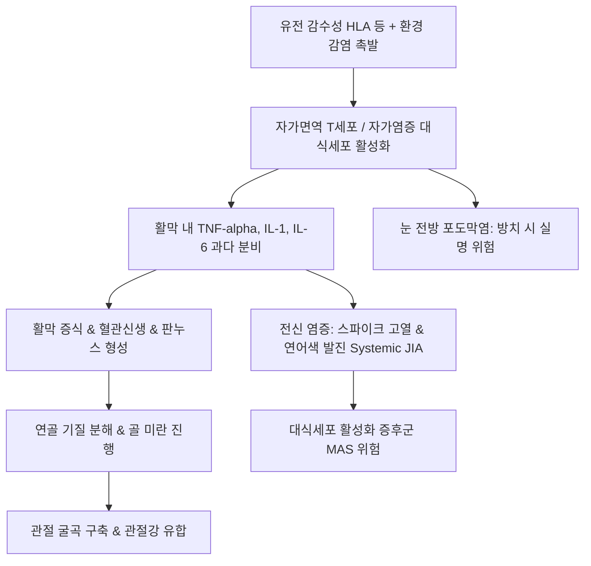

# 🩺 소아기 특발성 관절염 (Juvenile Idiopathic Arthritis, JIA / 小兒特發性關節炎)

> **핵심 3줄 요약 (Key Summary)**:
> - 📍 **정의 & 병태생리**: 만 16세 미만의 소아청소년에서 최소 1개 이상의 관절에 6주 이상 지속되는 원인 불명의 만성 활막염(Synovitis). 유전적 감수성과 환경적 촉발 인자가 결합하여 자가면역 및 자가염증 경로가 활성화되어 활막 증식, 연골 및 골 파괴, 성장 장애를 초래한다.
> - 🚩 **임상 양상**: 조조강직(아침에 관절이 뻣뻣하고 절뚝거림), 관절 종창 및 열감(발적은 드묾), 성장 지연, 전신형(Systemic JIA)의 경우 고열(Spiking fever) 및 연어색 반구진 발진(Salmon-pink rash), 무증상 전방 포도막염(Uveitis).
> - 🛠️ **치료 원칙**: 소아 류마티스 가이드라인에 따른 조기 적극적 치료(NSAIDs, 관절강 내 스테로이드 주사, 메토트렉세이트 MTX, 생물학적 제제 TNF/IL-1/IL-6 저해제), 정기적 안과 세극등 검사, 한의학적으로 풍한습비(風寒濕痺)·열비(熱痺)·간신휴손 변증에 따른 [[독활기생탕]], [[백호가계지탕]], [[육미지황탕]] 병용.
> - ⚠️ **응급 의뢰 레드플래그**: 전신형 JIA 환아에서 지속되는 고열, 범혈구 감소증, 간비종대, 혈청 페리틴(Ferritin) 폭증(수천~수만 ng/mL) 동반 시 치명적인 대식세포 활성화 증후군(Macrophage Activation Syndrome, MAS)으로 즉시 소아 중환자실 집중 치료 의뢰.

---

## 📌 목차
1. [질환 개요 & 해부학적 병태생리](#1-질환-개요--해부학적-병태생리)
2. [병태생리 메커니즘 & 7대 ILAR 분류 네트워크](#2-병태생리-메커니즘--7대-ilar-분류-네트워크)
3. [임상 증상 & 조조강직·포도막염 진단 알고리즘](#3-임상-증상--조조강직포도막염-진단-알고리즘)
4. [감별 진단 매트릭스 (Differential Diagnosis)](#4-감별-진단-매트릭스-differential-diagnosis)
5. [한의 통합 치료 프로토콜 (침·약침·한약)](#5-한의-통합-치료-프로토콜-침약침한약)
6. [양방 치료 & DMARDs·생물학적 제제 기준 (Conventional Treatment & Referral)](#6-양방-치료--dmards생물학적-제제-기준-conventional-treatment--referral)
7. [소아 성장 & 관절 구축 예방 재활 가이드](#7-소아-성장--관절-구축-예방-재활-가이드)
8. [💡 사용자 진료실 핵심 필기 & 임상 노하우 (Melt-In 잔여 심화 집약)](#8-💡-사용자-진료실-핵심-필기--임상-노하우-melt-in-잔여-심화-집약)
9. [출처 및 학술 참고 문헌 (References)](#9-출처-및-학술-참고-문헌-references)

---

## 1. 질환 개요 & 해부학적 병태생리

### 1) 질환 정의 및 임상적 중요성
- **소아기 특발성 관절염(JIA)**: 소아에서 가장 흔한 만성 류마티스 질환으로, 16세 이전에 발병하여 6주 이상 지속되는 관절염 중 감염증, 종양, 타 류마티스 질환이 배제된 질환군이다.
- 단순 관절통을 넘어 관절 파괴, 하지 부동(Leg length discrepancy), 턱관절 장애로 인한 왜소턱(Micrognathia), 실명 유발성 만성 포도막염을 야기한다.

### 2) 활막 미세구조와 성장판 해부학
- **활막 비후(Pannus 형성)**: 활막세포 증식과 T/B 림프구, 대식세포 침윤으로 두터운 판누스가 형성되어 연골과 골단을 침식한다.
- **성장판(Epiphyseal plate) 과성장 및 조기 유합**: 국소 만성 염증으로 혈류가 증가하여 초기에는 환측 사지가 과성장하다가, 염증이 장기화되면 성장판이 조기 유합되어 최종 신장 단축 및 사지 불균형을 초래한다.

---

## 2. 병태생리 메커니즘 & 7대 ILAR 분류 네트워크

### 1) 국제소아류마티스학회(ILAR) 7대 아형 분류
1. **전신형(Systemic JIA, 10~15%)**: IL-1, IL-6 주도 자가염증 질환. 매일 1~2회 39℃ 이상 스파이크 발열, 일과성 연어색 발진, 간비종대, 림프절염.
2. **소수관절형(Oligoarticular, 50%)**: 발병 6개월간 4개 이하 관절 침범(주로 무릎, 발목). 항핵항체(ANA) 양성 여아에서 무증상 만성 전방 포도막염 호발.
3. **다수관절형 RF 음성 (Polyarticular RF-, 20%)**: 5개 이상 관절 침범, 대칭성.
4. **다수관절형 RF 양성 (Polyarticular RF+, 5%)**: 성인 류마티스 관절염과 유사한 진행성 골 미란성 경과.
5. **건선성 관절염(Psoriatic JIA)**: 관절염 + 건선 또는 지염(Dactylitis, 소시지 손가락).
6. **골부착부염 관련 관절염(Enthesitis-related JIA)**: HLA-B27 양성 남아 호발, 아킬레스건 등 부착부염, 강직성 척추염 전조.
7. **미분류형(Undifferentiated)**: 2개 이상 기준 충족 또는 불일치.

### 2) JIA 병태생리 도식

---

## 3. 임상 증상 & 조조강직·포도막염 진단 알고리즘

### 1) 주요 임상 양상
- **보행 장애(Limping)**: 아침에 일어났을 때 절뚝거리며 걷다가 낮에 활동하면 호전되는 양상.
- **관절 종창**: 무릎, 발목 관절의 부종과 운동 범위 제한(성인과 달리 통증 호소가 적고 활동 거부로 나타남).
- **무증상 포도막염**: 소수관절형 ANA 양성 환아에서 통증이나 충혈 없이 진행하므로 조기 실명 방지를 위한 선제적 안과 스크리닝 필수.

### 2) 실험실 검사 SOP
- ESR, CRP 상승, 빈혈, 혈소판 증가증.
- ANA(포도막염 위험 평가), RF, HLA-B27.
- **전신형 MAS 스크리닝**: 혈청 페리틴, 피브리노겐 저하, D-dimer, 중성지방 상승.

---

## 4. 감별 진단 매트릭스 (Differential Diagnosis)

| 감별 질환 | 호발 특징 및 검사 소견 | 감별 포인트 |
| :--- | :--- | :--- |
| **일과성 고관절 활액막염** | 3~8세, 바이러스 상기도염 후 발생 | 1~2주 내 완전 자연 치유, 6주 지속 안 됨 |
| **화농성 관절염(Septic arthritis)** | 단일 관절의 극심한 발적·열감·고열 | 관절액 흡인 시 농성, 백혈구 > 5만/uL |
| **소아 백혈병(ALL)** | 야간 뼈 통증(관절 외 골간통), 빈혈, 자반 | 말초혈액도말, 골수 생검 |
| **성장통 (Growing pain)** | 밤에 양측 정강이 통증, 아침에 완전 정상 | 이학적 소견 정상, 관절 종창 및 조조강직 없음 |

---

## 5. 한의 통합 치료 프로토콜 (침·약침·한약)

### 1) 변증별 한약 처방 프로토콜
- **열비(熱痺) / 온독치성(溫毒熾盛) — 전신형 급성기**:
  - 주증: 고열, 피부 발진, 관절 작열감 및 부종, 번갈, 설홍태황, 맥활삭.
  - 대표 처방: [[백호가계지탕]], [[청온패독음]], 사묘용담탕 가감(석고, 지모, 계지, 금은화, 연교).
  - 치법: 청열해독(淸熱解毒), 통락지통(通絡止痛).
- **풍한습비(風寒濕痺) / 한습조체(寒濕阻滯) — 만성 관절염기**:
  - 주증: 조조강직, 한냉 시 관절통 악화, 무릎·발목 종창, 설담태백니, 맥현완.
  - 대표 처방: [[독활기생탕]], [[오적산]], 삼비탕(三痺湯) 가감(독활, 방풍, 진교, 상기생, 두충).
  - 치법: 거풍산한(祛風散寒), 제습통락(除濕通絡).
- **간신부족(肝腎不足) / 기혈양허(氣血兩虛) — 아급성·회복기**:
  - 주증: 관절 변형, 근위축, 성장 장애, 만성 피로, 안색 위황, 설담소태, 맥세.
  - 대표 처방: [[육미지황탕]], [[소건중탕]], [[귀신환]] 가감(숙지황, 녹각교, 백작약, 구기자).
  - 치법: 보익간신(補益肝腎), 건골생혈(健骨生血).

### 2) 침구 치료 프로토콜
- **주요 혈위**: [[독비]](ST35), [[내슬안]](EX-LE4), [[양릉천]](GB34), [[현종]](GB39), [[곡지]](LI11), [[족삼리]](ST36).
- **소아 무통 침치료**: 통증 공포를 줄이기 위해 소아용 피내침(스티커 침) 및 레이저 침치료 적용으로 관절 주변 경근 긴장 완화.

---

## 6. 양방 치료 & DMARDs·생물학적 제제 기준 (Conventional Treatment & Referral)

### 1) 단계별 약물 요법
- **1단계**: NSAIDs (나프록센, 멜록시캄) — 관절염 통증 완화.
- **국소 치료**: 관절강 내 트리암시놀론 헥사세토나이드(TA) 주사 (소수관절형 1차 치료).
- **2단계 (합성 DMARDs)**: 메토트렉세이트(MTX 10~15 mg/m² 주 1회 피하 또는 경구).
- **3단계 (생물학적 제제)**:
  - 관절형: TNF 저해제(에타너셉트, 아달리무맙).
  - 전신형: IL-1 길항제(아나킨라), IL-6 저해제(토실리주맙).

### 2) 안과 선별 진찰 기준
- 소수관절형 ANA 양성 환아는 **3개월마다 세극등(Slit lamp) 검사** 필수.

---

## 7. 소아 성장 & 관절 구축 예방 재활 가이드

### 1) 능동적 관절 가동 운동
- 관절 굴곡 구축(Flexion contracture)을 막기 위해 통증이 없는 범위에서 매일 수영, 자전거 타기 등 비체중부하 운동 권장.

### 2) 야간 부목(Splint) 적용
- 손목 및 슬관절 부목으로 수면 중 관절 기형 진행 방지.

---

## 8. 💡 사용자 진료실 핵심 필기 & 임상 노하우 (Melt-In 잔여 심화 집약)

### 1) 소아 관절염의 진단적 함정: 통증 침묵
- 성인은 관절염이 생기면 극심한 통증을 호소하지만, 소아는 통증을 명확히 표현하지 않고 "아침에 걷기 싫어한다", "안아달라고만 조른다", "절뚝거리며 걷는다(조조강직 파행)"는 행동 변화로 나타난다.
- 따라서 진료실에서 관절을 만졌을 때 붓거나 관절 가동 범위가 줄어들어 있다면 통증 호소가 적더라도 JIA를 강력히 의심해야 한다.

### 2) 전신형 JIA와 MAS 합병증의 조기 경보
- 전신형 JIA에서 스파이크 발열이 지속되다가 갑자기 발열 패턴이 지속열로 바뀌고, 간비종대와 함께 혈소판이 급감하고 혈청 페리틴이 수천 이상 폭증하면 이는 치명적인 대식세포 활성화 증후군(MAS)의 신호이다.
- 이때는 한의 진료실에서 지체하지 않고 즉시 3차 상급병원 소아 류마티스내과로 응급 전원해야 한다.

---

## 9. 출처 및 학술 참고 문헌 (References)

Bond. (2026). Investigating the Impact of Juvenile Idiopathic Arthritis on Health, Costs, and Quality of Life in Australia: The IMPACT Study. *J Pediatr*. PMID: 42476297.

Barbaric. (2026). An LLM-based decision aid for collaborative decision-making in juvenile idiopathic arthritis: A multimethod evaluation. *PLOS Digit Health*. PMID: 42911979.

Rawlinson-Smith. (2026). The long-term impact of juvenile idiopathic arthritis into adulthood: a systematic review. *Rheumatology (Oxford)*. PMID: 42886523.
